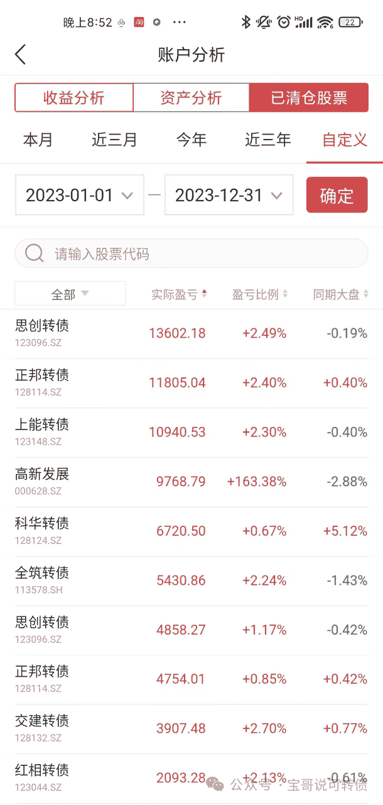

# 如何0投入打造百万家庭应急储备金？

> 来源：[https://xuqiwei1986.feishu.cn/docx/JIimdyoDToHWhIxRljtcopVrnX9](https://xuqiwei1986.feishu.cn/docx/JIimdyoDToHWhIxRljtcopVrnX9)

大家好，我是宝哥，今天给大家分享“如何0投入打造百万家庭应急储备金”。

**不**知道大家是否经历过 家人突发疾病、买房首付不够、孩子上学急需用钱的情况，一旦你去借钱，你就会感受到 友情、亲情经不做考验，以及世态炎凉。

另外，很多朋友在自媒体创业，收入不稳定，提前准备家庭应急储备金，对维护家庭稳定、降低家庭风险，也是很有必要的。

如何未雨绸缪，提前准备家庭应急储备金，甚至0元投入就可以打造百万家庭应急储备金呢？宝哥有一套完善的体系分享给大家。

分享前宝哥先简单自我介绍一下，宝哥是坐标北京、中年大叔，在北京有车、有房、有户口。北京化工大学经济管理硕士研究生，国家二级理财规划师。👸号、视频号双认证财经博主，全网粉丝2万+，视频号直播近100场。

2023年投资收益10.26%，市场较差，收益率算可接受。宝哥比较厌恶风险，擅长挖掘确定性高的机会，重仓参与，短时间获利离场的操作模式。

下面是宝哥2023年一些操作的截图。

好了，前戏结束，我们进入主题的内容分享。

**要想0投入打造百万家庭应急储备金**，最直接的办法就是从使用银行的信用贷款。

**一听贷款有些朋友就不往下看了，这是信用贷款，不需要任何抵押，就是根据个人的信用，银行评估你**的授信额度，不用不产生利息，手机银行app就可以操作，用的时候秒到账，用几天付几天利息，随借随还，急需用钱不求人。

一个人多家银行申请百万信用额度没多大问题，夫妻两个人一起就可以申请到200万左右的信用额度。如果你有个体户或者公司，就可能做到500万，具体不展开讲。

既然是基于个人信用获得授信额度，那么个人的信用就比较重要了。

电视剧《繁花》中， 爷叔说一个男人应该有三个钱包。第一个，是你实际上有多少钱；第二个，是你的信用，人家钱包里的钱，你可以调动多少；第三个，是人家认为你有多少钱。

宝哥作为一个财经博主，理解的男人第二个信用钱包，其中一个含义就是银行对你的信用评估，可以给你多少授信额度。

**一、如何提高银行授信额度**

要提高自己的银行授信额度，有几个办法：

1、自己所在的单位要尽量优质

如果你在国企、央企、互联网大厂或者大企业，那么意味着收入稳定，抗风险能力强，银行会给到更高的信用额度。

2、有房产或所在银行有贷款

如果你在所在的银行有房产贷款，那么就更好申请高额度了。因为，就像 梁靠谱大佬 发的文章中所写一样，你要给所在平台提供价值，平台才会给你资源。银行也是，你要让银行赚到你的钱，银行才愿意给你更高的额度。

就算没有在银行有贷款，至少办张银行的信用卡，跟银行发生一些链接，让银行赚到你的钱，在银行有你的数据，也好评估你的授信额度。

3、平时注意维护自己的信用

有些朋友平时不注意维护自己的信用，信用卡到期不还，出现逾期，产生信用污点，这就不好申请了。

**二、实操方法**

具体到实操的层面上，也是有技巧的，分几步走：

1、要先线下，再线上

申请信用贷款，是要查个人征信的，查的次数多了，会影响多家银行的申请。所以，先线下去附近的银行问问，银行人员会解释的比较详细，另外，线下给的授信额度能更高一些。

也可以在线上申请，最好准备好多家银行的app，一天内都申请完，分多天申请，会受影响。

2、先四大行，后其他银行

四大行给的额度更多、利率也更低一些，中国银行是中银E贷、建行是快贷，一般年化利率在3.5%左右。有时银行也有利息优惠券。

3、尽量夫妻一起申请

可以夫妻一天内一起申请，把授权额度都申请足了，放着就行了。

4、注意看是否可以提前还款

有的银行是不能提前还款的，会要求到期还款，这就比较受限制了。要注意看条款，要可以提前还款的。方便随借随还。

**三、注意事项**

在申请到信用贷款后，使用上，也要注意以下几点：

1、不要借给别人

把自己的信用额度，转出来，借给别人，是大忌。一旦到期别人不能还上借款，出现预期，影响的是你个人的征信。

2、不要用在没把握的地方

这点就不展开说了，成年人都懂。

通过以上的方法，你就可以申请到金额较大的信用额度，用于自己的家庭应急储备金，以备不时之需。

宝哥自己就申请了100万以上的信用额度，其中建行就给了宝哥20万的额度，利息在3.45%，急需用钱不求人，用完及时还上就行。

当然，信用贷款也有其他扩展的玩法，比如有人用信用贷款替换房贷，因为有利率差，可以有效降低房贷的利息。这个玩法可以探讨，但是还款周期变短了，还款压力也变大了，大家慎重采用。

**另**外，信用贷款的扩展使用，还有合理、合规使用的问题，具体实操层面大家可以咨询宝哥，这部分内容不方便公开分享。

好，以上的分享希望对大家有帮助。

想看到更多陪伴群分享，请加宝哥🛰️419639790