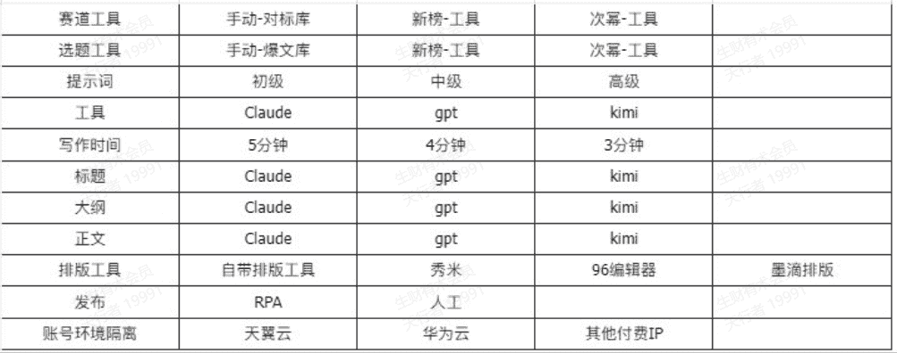
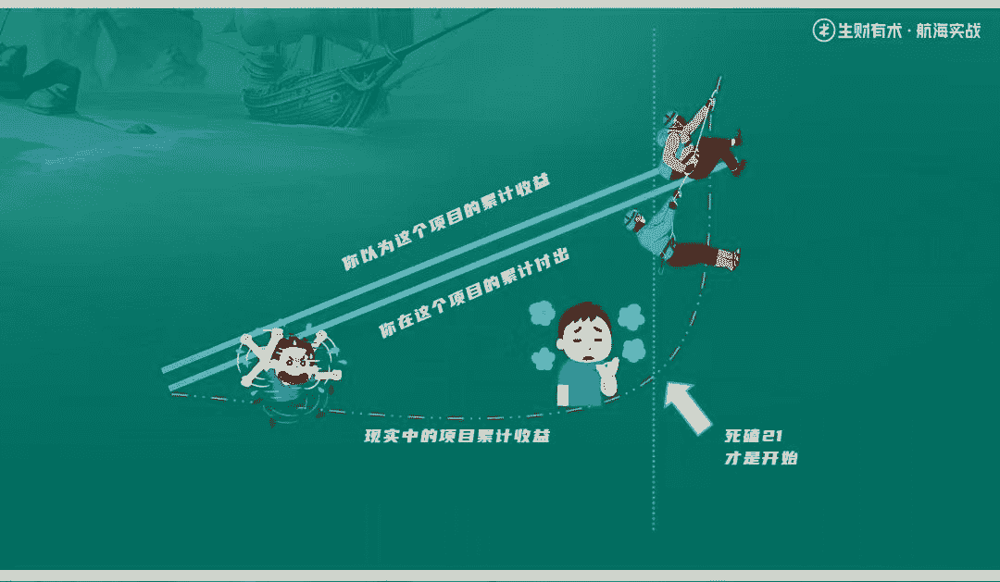
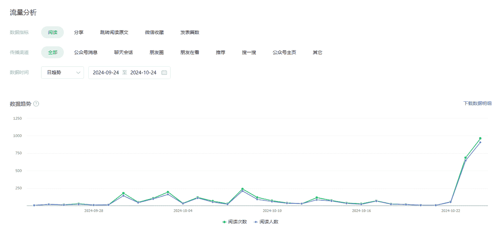
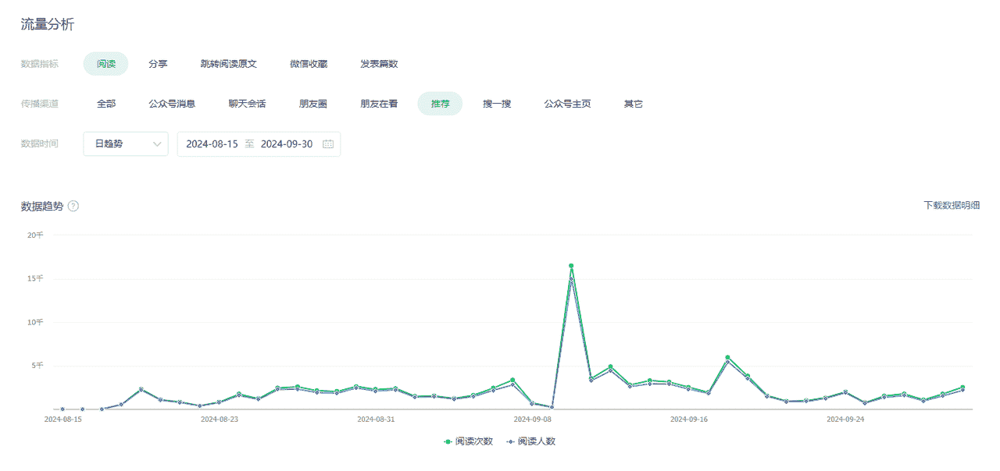
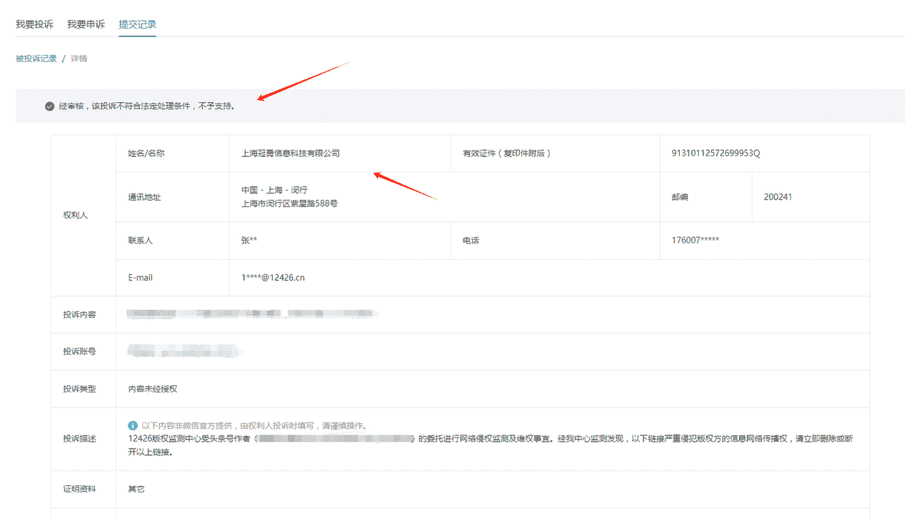
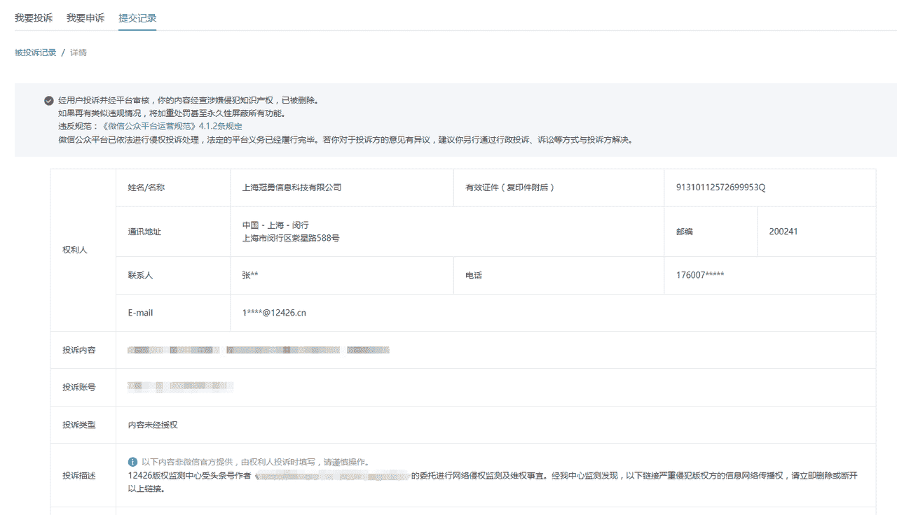
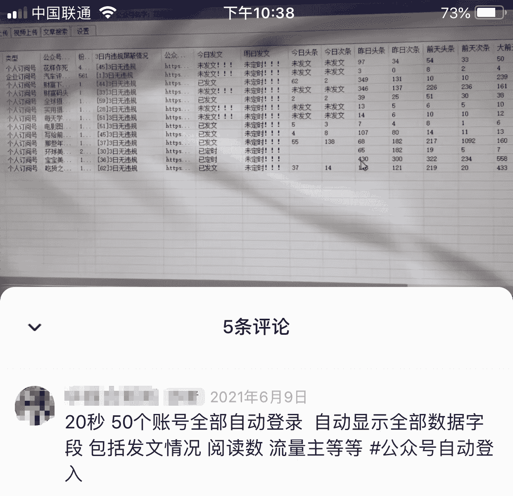
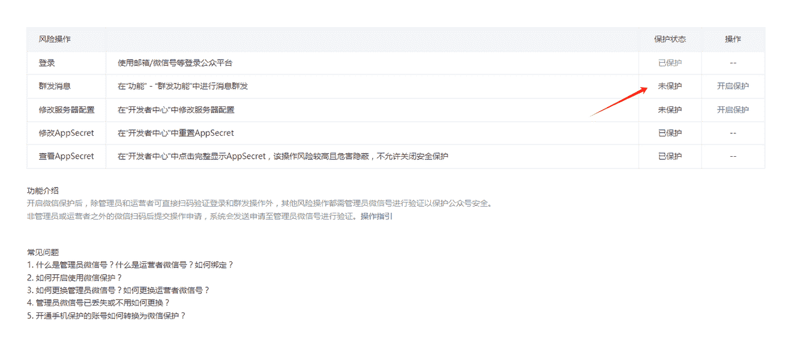
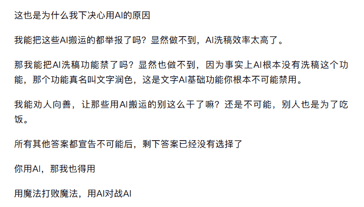

# 100W+爆文写手转型 AI编程+RPA 批量矩阵号，0基础编程大白打造全流程自动化👸号爆文AI机器人（全攻略，附DEMO和教程）

> 来源：[https://xuqiwei1986.feishu.cn/docx/OBJmdYxW5oE1SNxTXLnckyf7nDD](https://xuqiwei1986.feishu.cn/docx/OBJmdYxW5oE1SNxTXLnckyf7nDD)

**“当很多人对AI无动于衷或者恐惧**时，AI淘金者已经冲过一个又一个浪头了”

—— AI燎原 王沁

# 前言

我是天行者，赚钱编号19991，21年加入的，也算是老圈友了，但很惭愧，资质愚钝，在圈里是一直潜水，参加过几次航海，除了写出过一些爆文，其他也没什么拿得出手的成绩。

不过最近总算有点开窍，在参加多次航海学习和总结大佬经验基础之上，完成了一个全自动化的👸号爆文AI创作工具。

怎么个全自动化法呢？就是极端情况下除了收到👸号授权过期的🛰️通知你必须扫码重新登录一下之外，其他所有工作可以完全无人值守自动运行。

可能你认为我还没睡醒在胡说八道，或者就算项目能跑但出来的文章也是惨不忍睹，或者业务流程根本经不起实战。

可能你会问写出来的文章有AI味吗？有温度吗？能过原创吗？有流量吗？能支持👸号和头条素材源吗？能给个热文的链接就自动出文？能自动图文混排？能直接使用原文的图片素材？能自动裁剪原图水印？能支持Gif动图？原文没有图片能否从百度搜图来用？能否定时批量发布？能否在服务器上跑？......

这是“爆文自动化AI机器人服务器端演示DEMO”视频：

[爆文自动化AI机器人演示DEMO.mp4](https://internal-api-drive-stream.feishu.cn/space/api/box/stream/download/all/KdH2bxo6NoDzl7xBLvdcTKLvnob)

这是「爆文AI机器人Web端演示DEMO」飞书电子表格：

爆文AI机器人Web端演示DEMO

大家可以先一睹为快。

前面的演示视频是这套系统工具在服务器端后台跑的各个系统模块的功能演示。

后面的演示表格既是爆文AI自动化工具的前端界面，也是爆文AI机器人的管理中心。以两个👸号为案例，设置成了全自动运行，用来直观展示爆文AI自动化的全业务流程。

所以这套文档我还起了个名字：**“AI永不眠”**，因为背后是网络爬虫、AI成文、图片处理、飞书文档等多个机器人在一天24小时不眠不休的协同工作。

这套表格是开放的，非常欢迎有兴趣的圈友成为协作者来共同见证这个AIGC创作试验的历程。

下面会对我个人从精品写作的道路转型爆文AI自动化的历程做一个阶段性的总结，包括收入概况、项目进展、各种踩过的坑，以及一些思考。

同时也会对这套爆文AI自动化工具做一些详细的说明，包括使用教程、相关技术栈、开发运营工具等。

但实际上我是个编程大白（年纪大了小白变大白了），在此项目之前完全不懂代码，所以如果有关技术的方面有什么胡言乱语的地方，还请各位编程大佬们多多包涵。

# 一、当👸号爆文繁华归于寂寥，何处是吾乡？

在赚钱当中为寻找方向参加过多次航海，其中最多的就是👸号爆文。

自从23年8月份参加第一次👸号爆文航海，前后算下来已经有5次之多了。

最高光的时候曾经写出100W+的爆文，这篇文章前后曾经推流了将近一个月，最终也没逃过被投诉删除的命运，单篇文章就带来了近7千元的收入，此外10W+也有不少。

但，👸号爆文最让人抓狂的地方就在于，前面曾有多风光，后面就有多暗淡，估计做过这个项目的圈友都有这种刻骨铭心的痛吧。

王家卫的《繁花》里，爷叔跟阿宝说：“纽约的帝国大厦，从底下跑到屋顶要一个钟头，从屋顶跳下来，只要八点八秒。繁花，繁花。像极了我们的这个时代，我们的人生。”

套用过来也很神似：繁花，繁花。像极了我们的爆文，我们的👸号。

随着2023年年初到年末👸号爆文项目高光过后，到了24年初差不多是一地鸡毛，起号越来越难，原有的号又是各种投诉、删文甚至封号，心灰意懒之下，基本属于退场状态。

## 爆文项目的天问

在做👸号爆文项目的后期，我心中一直有一个天问，是应该走精品号路线还是矩阵号路线？

做过👸号爆文的圈友也都知道，这是航海过程中永远的话题。

这个问题我纠结了很久，也反复尝试了很多次。

关于这个问题，9月👸号爆文航海手册第一章里也总结了基础法、速通法和进阶法三种主流玩法进行了对比，还特意列出了速通法所使用的工具，在第六章也有专门的“利用自动化快速跑通项目”章节。

基础法、进阶法则可以理解为精品号基础玩法和精品号的进阶个人IP玩法。

张波教练在高手领航直播里也对这个问题有非常充分的探讨，对正在纠结这个问题的朋友一定会有启发。

航海手册：9 月航海｜👸号爆文（自动化原 创）｜实战手册

最终的结果，两者没有对错之分，适合自己的就是好的。

对我来说，俗务缠身、分身乏术，尝试过几次做精品号发现耗费的时间精力太多了顶不住，无法长期坚持。

印象里当时做到7、8个号我就已经快被每天不断重复的AI写文、修改润色、扫码登录、编辑排版发布等机械劳动给逼疯了。所以我是无法想象有些圈友一个人能手搓搞定二、三十个号是怎么做到的。

熟悉爆文项目的圈友基本都知道，其实这个项目里领域+选题所占权重远大于内容和账号运营，下面是我的爆文公式：

**赛道（50%）x 选题（30%）x  内**容质量（10%）x  账号运营（10%）

其中赛道指的是一个或多个领域拆分重组后的细分领域，也就是说赛道+选题就占了80%，内容+运营只是20%，可在实际做项目的时候，对绝大多数人来说正好相反，准备文章内容和运营账号的时间精力占了80%可能还不止，过去的我也一样。

要逃脱这个困境，要么你有专业的真人团队，要么只能靠机器人自动化，把重复劳动丢给机器人至少能降低60、70%的工作量，把你的时间精力都解放出来投入到选题和领域当中去，同时还可以借助AI推理和数据分析来提升选题、选领域的准确性。

对于绝大部分的普通人来说，面对👸号爆文这样一个有些玄学需要长期打持久战的项目，走批量自动化的矩阵号路线还是更为适合，以数量对抗质量的暴力哲学在此类场景下确实有用。

此外，这也更符合自媒体的长期发展趋势，生成式AI驱动的写作机器代替蓝领小编的趋势不可避免。

时代的洪流摆在面前，顺之则是红利蓝海，逆之则是淘汰消亡，你会怎么选？

所以，痛苦纠结了很长时间之后，直到准备退出江湖了，偶然的一个契机出现，促使我最后决定破罐子破摔赌一把。

## 机缘巧合开启转型路

其实我从23年第一次爆文航海开始就是用手搓+AI来写文章的，很快也用上了来也RPA和影刀RPA，先是用RPA来操作GPT4.0来创作文章，后来又用RPA来批量发布，这一阶段其实也就是航海手册里所说的速通法，但我发现并没节省多少时间，在我看来这一阶段其实还是人工阶段。

因为要额外花很多时间去研究AI提示词、RPA的可视化流程搭建等，而且RPA是个面向电脑环境模拟个人操作的工具，表面上易学易用能很快上手自动化，但真正商用起来随着复杂性的叠加及受影响因素增加会越来越不可控，常常解决问题的时间比正常运行的时间多得多。

对普通人来说，这里有个很大的误区，千万不要以为会用AI写文章，或者会用RPA完成批量写或批量发文章等某个环节就能提升多大的效率降低多少工作量。

真正要完成整个👸号爆文的批量自动化闭环，还是必须要用编程工具来解决核心流程、再以RPA来辅助，最关键是要能打通全业务流程所有环节才能完成商业化的解决方案，一两个环节的自动化只能简单的提效，但对整体项目的提升用处并不大，这也是我后来才领悟的道理。

但这样也就导致要做到全流程自动化并不容易，其中不少的卡点对我来说门槛有些高不可攀。

比如需要懂编程、需要深入了解各类AI大模型的API对接规则、需要打通批量自动化链路的各种流程节点......

我完全不懂编程，创业以来一直有位技术拍档，所以我完全不用想技术上的事。

后来劳燕分飞各奔东西后，也一直想再找个技术方面的合伙人，在赚钱也曾和几位圈友深聊过，但都不了了之。

有创业经验的朋友可能都懂，这玩意儿其实比找女朋友还难，找女朋友看脸看身材就好，找技术合伙人不行啊，技术到底多高你是完全没法看得出来。女朋友不合适了还可以随时劈腿，合伙人不合适了再解耦可就是伤筋动骨。

只是打个比方哈，女权主义者可别骂我~

我实在担心又会耗费大量时间精力走弯路，所以一直没敢真正下场去做。

幸运地是，恰好我看到了毛韩大佬在5月份发的那篇精华文章，恰好赚钱6月份推出了AI编程航海，这两件事情因缘际会同时出现，仿佛命中注定，我终于还是走上了通过AI编程+RPA来完成👸号爆文批量自动化全流程的道路。

# 二、AI爆文还值得做吗？

当时之所以能看到毛韩大佬的那篇文章，正是因为遇到24年上半年👸号流量的寒流时期，毛兄心灰意冷准备退出👸号爆文之时，所以那个时点我其实心里也是七上八下的。

于是开始在流量的边缘疯狂试探，到底AI爆文是否还值得做、👸号还有没有未来，后来我也是经过了仔细的思考和评估。

## 守正出奇，长期主义

转型爆文AI自动化的初期是非常痛苦的。

本来做👸号爆文就是一件比较辛苦的事，现在还要一下堆上几十个号，啃代码、搭建环境、调试运行，还要研究网络爬虫、IP隔离、服务器运维，确实挺惨的。

毛兄在文章里说他这套脚本“对于有编程经验的圈友来说，整套配置下来需要2h；对于无编程经验的圈友来说，可能5h以上”，可你知道我花了多长时间才算完全跑通了这套脚本流程？

我花了二十多天，将近一个月的时间！（此处有一大写的“囧”字）

毛兄本身是位技术达人，在圈子里混的时间也长，身边的风口项目和机会必然很多，👸号爆文只不是其中之一，这趟车到站了就要去赶下一班了。

但对大多数普通人来说，常常是各种项目看得乱花渐欲迷人眼，总想追着风口跑，还要是自己感兴趣的，最好还能发挥自己特长的，可往往到最后发现高不成低不就，真正的选择并不多。

我呢，不喜欢赶风口，可能也是自身资质平庸、行事鲁钝的原因吧，比较喜欢看长线的项目，算是个长期主义者。比如我认定了AI自动化的方向，就准备长期坚守。

在头条上有一篇上千万浏览量的爆文“为什么我们那么穷？”，其中有句话意思就是可能别人的起点就是我们的极限，别人天生才高八斗国色天香我却是资质平庸愚钝懦弱，别人天生王子公主我却是个下里巴人，别人一天就能干完的事情我却要花上一个月。

那怎么办？

那就.....，找一个你心爱的人，找一件你喜欢的事，然后长相厮守，如果一定要加一个期限，那就是一万年。

所谓，流水不争先，争的是涛涛不绝。

你是想城头变换大王旗，追着各种奇技淫巧，跟着一波波的短线风口去卷，还是想守正出奇，做长期主义者，这是你在成为一个挣钱者之前首先就要想好的定位。

## 放平心态，降低预期

在忙着航海打卡和赶写AI自动化脚本的某个深夜，正昏昏欲睡之时，突然收到龙哥的推送，为了装 Cursor 学AI编程遇到的问题而苦恼......我不由大惊，吓得我赶紧也去装了一个Cursor！

没办法，比我们优秀的人总是比我们还努力，本来想躺平的也睡不着了被逼着起来卷~😅

连龙哥这种大佬也常会遇到搞不掂的时候，何况我们这些普通人。但关键的是，大佬和普通人遇到困难时的心态和抉择。

龙哥会选择退一步海阔天空有问题先睡一觉再说，我常常是死磕到底熬到两眼通红两耳喷火结果常常还不如啥也不做。

如果摆脱这种“傻逼时刻”，大家可以去看龙哥最近的几篇帖子。

真的心态很重要，无论是👸号爆文，还是抖音、📕，都会遇到很多玄学的问题，甚至连技术类的AI创作、AI编程、RPA也跑不掉，因为我们东大的网络环境和别人确实天差地别。

一个项目成功与否，常常考验的不是营销不是技术，而是心态。

最近参加的9月📕航海里领队发了张图就很好地说明心态这件事：

你想想，仅仅是在赚钱，哪个热门项目的航海里不是几千人，你需要想清楚几点：

1.  他们既是你的船友，但实际上也都是你的竞争对手

1.  这些项目能够拿来公开做航海，既说明已经完全跑通了逻辑和流程，但也说明吃螃蟹者已经把肉分完连头啖汤可能都没了

1.  要通过复刻的方式，做到这些项目吃螃蟹者的收入级别可能性是非常小的，因为现在你是和成千上万涌入同赛道的人一起分享剩下的市场份额

1.  在航海的船上，可以保证你是冲在最前面的那一批，但每次出海能捞到多少鱼虾，还是要看你的打鱼技巧。

1.  参加航海最重要的是赚到多少钱（鱼），还是学到赚钱的思维和逻辑（渔）？

所以我一再告诫自己，放平心态，降低预期，做好长期的战斗准备。

不要想着一上来就要赚百万、千万，那样你很可能坚持不了多久。

## 👸号还有流量吗？

流量不会消失，只会迁移。

它会在不同的载体、不同的领域、不同的表现形式之间反复横跳。

昨天是文案，今天是生肖，明天是疗愈；

昨天是博客，今天是🧣，明天是小绿书；

昨天是电影长剧，今天是短视频，明天是短剧；

昨天是头条，今天是👸号，明天是📕；

无论是平台、赛道都是周期性的，就像女人身上的衣服，火过之后还会再火，只是你无法预知这个周期的长短。

打开格局，我们做爆文并不只是做👸号，流量在哪里我们就在哪里。

所以讨论👸号还有没有流量，其实是个伪命题。

流量永远都在，只不过它像风一样，来无影去无踪。要抓到它，首先要找到它的物理载体。

那流量的物理载体是什么呢？对，就是传播媒介，是内容。

传播媒介好说，流量在哪个平台，我们就去哪个平台。

然后专心做好内容就行了吗？

无可否认，流量与内容是相依共生的，流量需要灵感和创意，内容需要认知和才能，正如爱迪生所说：

“天才是百分之一的灵感，加百分之九十九的汗水”

很多人并不知道，其实爱迪生的话后面还有一句：

“但那百分之一的灵感往往比百分之九十九的汗水来的重要。”

这句话放到现在的流量场上简直是再合适不过了！

我参加这么多次航海下来最大的感悟就是：

预测未来的最好方式，就是去创造未来。

参与航海的最好方式，就是去发现蓝海。

可是，人人都知道要发现蓝海、要寻找差异化，

到底通过什么才能做到呢？

爱迪生早在一百年前就给出了答案：灵感和创意！

内容所需要的认知和才能是可以学习和训练的，也是最有可能被AIGC所替代的。

但灵感和创意代表的却是情绪的张力、思辨的火花，这些虚无缥缈而又真实存在的人性力量或许才是AI真正无法替代的。

那你会问，岂不是只有天才才有机会？普通人怎么办？

错！！！

天生我才必有用！！！

普通人不是没有机会，只可惜的是，在现实当中绝大部分普通人的灵感和创意，都被那99%的汗水埋没了，根本没机会发挥出来。

所以，你要想成为捕风的汉子，首先要学会的是，你怎么不被那99%的汗水给磨灭了激情蹉跎了岁月，这样你才能有充分的时间和精力去捕捉到灵感和创意。

## 用AI写文章会被限流吗？

最近不断看到有大V的文章说互联网已经被AI污染得差不多了，就连前些天三只羊女主播录音门事件也全都怪罪AI，仿佛一夜之间大家都学会了有任何问题找AI来背锅。

现在有种流行的观点是AI生来就是带有原罪的，喜欢用危言耸听的手法宣扬AI污染论、AI危险论。

难道在AI出来之前，就没有内容农场？当年做百度SEO一铺就是几十万篇上百万篇垃圾文章是谁干的？

难道在AI出来之前，自媒体平台海量的图文和短视频里，优秀作品会比现在多得多？

难道在AI出来之前，大学等科研机构里的科研造假就比现在少得多？

该来的始终会来，AI说这锅我不背！

就像现在还有很多初入自媒体的圈友会问：用AI写文章会被限流吗？

可以一定、肯定、确定地告诉你，不会！

大厂可能很死板，但绝对不傻！

你一定要相信互联网平台的眼光和智慧，他们绝不会傻到逆AI潮流而动，现在还有哪个大厂没发布自有AI产品的吗？

说什么AI正在污染整个互联网的人，不是坏就是蠢。

如果这些大厂顶尖团队研发出的算法连一篇文章是否优秀、是否值得推荐、是否AI出品都分辨不出来，那这个团队早就该解散了，这家大厂也离被淘汰不远了。

一篇人工手写但过时乏味且质量一般的文章，和一篇AI创作但选题新奇且内容不错的文章，你觉得大厂的算法会推荐谁？

用AI加持的算法一定不会因为是AI生产就干掉一篇文章，反而一定会吹爆一篇紧跟热点、选题独特、内容也不错的文章，哪怕它是AI出品。

大模型可以用AI训练AI，自媒体为什么不可以用AI推荐AI？

既然AI可以污染整个互联网，那么AI也可以清洁整个互联网，是黑是白，全在于人类自己的选择。

想清楚AI爆文是否还值得做以后，于是我开始转型，捡起原本只是玩玩的AI、RPA开始深入研究。

# 三、转型爆文AI自动化，从作者成为主编

我转型的目标是爆文AI自动化模式，指的是自媒体平台文章的全流程自动化创作，并不仅仅局限于👸号平台。

基于毛韩大佬源码改进而来的工具名称我暂时称之为“爆文AI机器人”，由后端 Python 和 影刀RPA 两个自动化脚本、以及Web端飞书管理中心共三大模块组成。

可以说，我的转型过程，就是从👸号航海里所说的“速通法”转型到升级版爆文AI自动化模式的过程，也是一个在解决痛点、趟坑埋坑、打怪升级之中不断循环的过程。

## 什么是爆文AI自动化？

准确地说，我所理解的爆文AI自动化并不是简单的“速通法”2.0升级版，二者之间还是有很大区别的。

实际上，无论在质量、效率还是稳定性上，爆文AI自动化都是一个革命性的飞跃。

速通法是用 RPA 模拟操作 POE 或 ChatGPT 等AI大模型站点和人工操作互相配合的方式来创作文章，爆文AI自动化是通过调用AI大模型的API接口来生成文章。

速通法只是用RPA解决AI生成文章、批量发布等某个环节的自动化，像对标账号赛道、选题、素材筛选，以及图片处理、图文混排等环节仍然是纯人工操作，爆文AI自动化则是全流程自动化，除扫码授权等必要环节外完全可以做到无人值守。

速通法更适合单人、个体或小团队，爆文AI自动化更适合专业团队、媒体机构商业化规模化运作。

## 收入运营概况

我这里只说下转型后前两个月的收入和运营概况，之后因为有合作模式就不太好再透露太多了。

自7月初开始转型AI自动化爆文，至8月底奥运会结束的两个月左右的时间，共投入了26个👸号，其中企业号19个+个人号7个，合计流量主收入28000元，10W+爆文6篇。

这点成绩对于大佬来说不值一提，但对我来说绝对是具有非凡意义的转折点。

第一是我从一个对编程一窍不通的门外汉转型成了一位能够自己编写程序的技术人，虽然是野生的。这种感觉特别像当年我刚考了驾照开着自己的车第一次在高速公路上风驰电掣，那种自由的感觉无比爽快，人生境界从此不同。

哈，真的，自己可以写代码后，发现以前好多不敢想、不敢干的事情突然敢去信马由缰了，这才真的叫心有多大，舞台就有多大。

往更大一层说，我作为一个普通人能够这么短时间进入编程的领域，那就说明你也可以，人人都可以，这不正是生成式AI从23年初爆发以来最好的意义么。

第二就是能有5位数的收入，而且是在如此仓促、简陋的条件下取得的，说明爆文AI自动化的这个方向空间巨大，值得深入挖掘。

别的不说，在系统工具的支持下规模化，直接叠加上成百上千个号，对这套系统来说很容易做到，那收入是不是就会有大幅的增长，但成本却不会有太大的上涨，非常符合边际成本递减的互联网模式。

第三就是有了一些新的发现：

+   过去掉池以后为了重新入池写文的这段时间是特别煎熬、特别心力憔悴的时间，一篇文章只有几个小眼睛，没有任何即时反馈的动力也看不到任何希望但还得继续坚持写。

但现在这事儿变得非常轻松了，将这个号直接设成“未保护”状态，爆文AI机器人会定时自动发表文章连扫码都不再需要，然后坚持一个月后还真有出池后又重新复活的。

这是我过去手搓文时期从来没有做到过的。

+   有一些账号可以看出来是整体账号入池而不仅是单篇文章入池，也就是具备了账号级权重，所以阅读量非常稳定，一个多月的时间一直能保持在四位数以上的阅读量。

这也是我在过去的单兵作战的阶段一直想要达成但从来没有完成的目标。

+   运营期间投入的新号，账号100%都能入池，基本上都是在一周之内，最快的当天。

## 解决卡点痛点，趟坑埋坑

转型过程中主要做的事情，就是根据过去爆文项目的实操经验，改进爆文AI机器人的各项功能和业务流程，来解决AI大模型出文、流量增长、时间精力错配等各种业务流程中的卡点和痛点。

### 解决AI大模型出文问题

AI大模型生成文章是爆文AI自动化项目的核心环节。

在之前做爆文项目的过程中，为了让AI能够生成好的文章，在选择AI模型、调试提示词上花了很多时间，还做过镜像站，也算积累了不少经验，这次也都应用在了AI大模型出文流程的改造上。

问题一：

爆文自动化脚本最初是所有领域都用一套统一的提示词的，但不同赛道不同领域天差地别，都用同样的提示词显然满足不了爆文需求。

问题二：

每次出文并不是只使用一句使用提示词，而是一套多轮对话提示词来配合使用，先总结原文摘要再出文再改标题从而提高原创度，但最初AI模型是统一使用的，而且写死在代码里的不好改。

熟悉爆文的圈友都知道，写文章最好的模型是 Claude 的 Opus3.0 ，但价格昂贵，即便是用 POE 的会员也要3毛钱一次，Sonnet3.5 会便宜很多虽然效果只能说还好，而我们这套提示词前面两句预设提示词和最后一句改标题其实直接用更便宜的 GPT-4o 也完全没问题。

问题三：

另外AI大模型的API调用也是个很让人头痛的问题，起初因为 Opus3.0 调用API价格太贵的问题，我曾经一度想改为 影刀RPA 调用 POE 网站来出文，但测试下来无论从业务流程效率上还是从稳定性上都不好，为了能达到企业级商用质量最后还是放弃转回API调用方式。

现在回看是幸好改回来了， Opus3.0 的API调用价格因为坚持用量大了之后价格下来了不少，再加上时间的推移，现在我的 Opus3.0 的API调用成本已经大幅低于 POE 的价格。

但当时改回API调用方式后新的问题又出现了，Claude 和 ChatGPT 都在境外只能通过中转站来调用，可中转站鱼龙混杂良莠不齐，要在里面找到性价比高质量又稳定的实在是难乎其难。幸好我在运营 AI大模型镜像站时对接过不少站点，从里面还是能挑出一些相对好的，但即便如此也是常出问题。

因为 Claude 和 ChatGPT 都是最热门的模型，特别是 Claude 的 Opus3.0 和 Sonnet3.5 可以说是世界上最忙的模型没有之二，而这些第三方的中转站网络带宽或账号都是有限的，经常拥塞。

问题四：

在飞书管理中心的生成文章列表文档中没有保存创作文章所使用的AI大模型名称信息，很难直观地比较AI大模型的创作水平。

于是针对上面的问题，对AI大模型相关功能做了一次大的升级：

1.  区分不同赛道不同领域，使用不同的个性化提示词。

1.  启用了新的管理中心表格，将AI模型的配置从代码里解耦出来全部放到管理中心里来做，区分开了预处理AI模型和主创AI模型，并且支持不同领域甚至不同账号都可以选择不同的AI大模型。

1.  增加了“Key池路由表”表格，将 API Key、base_url 等隐私信息单独放到一个表格中来处理，并统一管理AI模型路由配置，根据预处理模型和主创模型配置列表，第一个失败则调用第二个，依次执行。

1.  在“生成文章列表”文档中不仅保存了创作文章所使用的预处理AI模型和主创AI模型信息，而且还增加了生成标题、领域、创作类型、是否剪裁图片等信息，不仅可以更为直观地比较AI大模型的创作水平，而且还增强了在表中添加热门文章链接、标题和配置参数后直接调用AI模型生成文章的能力。

特别是“Key池路由表”的加入，给每个AI大模型配置两至三个以上的API渠道后，调用大模型API这块儿基本上已经很少再出问题了，也大为降低了API的调用成本。

不过“Key池路由表”涉及到 API Key、base_url 等隐私信息并没有在“爆文AI机器人演示DEMO”里开放出来，有需要的小伙伴可以找我要完全体的“爆文AI机器人管理中心模板”。

我也知道很多人都对生成文章到底用什么大模型犹豫不决，之所以专门制作一个“爆文AI机器人演示DEMO”，其中的目的之一就是希望在“生成文章列表”里能够实时观察对比不同大模型在同一选题甚至是同一标题下的出文水准。

AI写的东西有机器味吗、有温度吗？为什么 OPUS3.0 的价格是 Sonnet3.5 的5到10倍？哪个才是最适合自己的AI大模型？百闻不如一见，你试试就知道了。

不过，目前的DEMO表是免费提供给圈友试用的，基于成本考虑，只提供了五款AI大模型可选，GPT4o、Sonnet3.5原有和最新的两款、OPUS3.0、以及豆包 ，而且只能读不能改，如果你希望能自行选择模型或测试更多的AI模型，可以申请文档协作者来获得相应权限。

### 解决网络爬虫的问题

毛兄的脚本源码当中已经配置了头条网络爬虫的功能，不过后来头条文章页面的网络机制和接口都改了，爬取素材会出错。

于是花了很多时间研究新的Web网络通讯方式重新改了头条爬虫代码，并再增加了👸号文章的网络爬虫和内容解析功能支持。

但由于采用的👸号文章网络爬虫方案不太好用后来还是转为了相对稳定可靠的极致了付费API接口，毕竟是要支持企业级商用。

### 解决图片格式、水印裁剪和图文混排的问题

在爆文AI自动化中，图片格式处理、水印裁剪和图文混排也是块非常难啃的硬骨头，是经过多次修改不断完善之后才逐渐变得实用起来。

原代码是根据 selenium 库网络爬虫抓取到的图片链接直接保存图片，然后添加进 word 文件进行排版。

但 selenium 库获取到的图片链接对图片格式的解析不太完善，像 .gif、.webp 等格式都不认识，而这两种格式现在又非常普通，特别是不支持 .gif 就完全没了动态效果，会让文章的效果大打折扣。

于是和 GPT4o 来回研究了多次，最后终于找到了一种方法能够解析出 .gif、.webp 等格式。

再解决水印裁剪的问题，原代码是所有文章都自动裁剪，而且还是按固定像素裁剪，有时对图片效果影响还挺大的，但其实现有的素材源大部分文章里的图是不加水印的，可以不用裁剪。

于是在飞书管理中心针对对标账号添加了是否裁剪的参数，然后也调整了按图片比例裁剪，改完后就能按参数相对智能地裁剪了，文章效果又好了很多。

然后图文排版也是非常麻烦，要去计算文章段落数量和图片数量，然后两者通过算法来搭配，还要考虑原文素材没有图片或图片太少还要自动到百度图片搜索增加图片......

总算是搞完了，确实麻烦，但效果也确实立竿见影，现在排版好的文章已经完全可以一次性直接发表了。

当然，还有些小问题，比如有些对标账号的文章都会加上含有自己的个性化名称或Logo等元素的图片，这个问题恐怕以后还得借助AI识图来解决才行。

### 解决原创和风控的问题

因为原创和风控紧密相关，所以放在一起说。

可能现在还是有很多圈友都认为AI写文章有AI味、机器味，不检查原创度怕被平台检测限流或删文。

我之前手搓发文时期也都是通过易撰等原创评测工具来确定原创度，但其实并不准，我反而还更喜欢用那个查错网的相似度计算的方式。

全面转型爆文AI自动化模式后，目前已经有三个多月的时间，各个账号倒是经常收到风控的通知，不过大部分都是一家叫上海冠勇公司的投诉，这家应该是头条的官方维权公司，头条是我目前主要的采集素材源所以很容易引发投诉。

友商平台的官方投诉，又是纯AI写的文章，照理说应该100%被拿下了对不？

事实和你们想象的不一样。

上海冠勇的投诉呢在体育、科技等大部分领域80%以上的概率都是被驳回“不予支持”，也就是投诉不通过，为什么呢？

因为我出文用的模型全部都是 Claude 的 Opus3.0 和 Sonnet3.5 ，只要配上合适的提示词，原创度还是挺高的，你们在DEMO里也可以看得到。

但也有例外，在财经领域就不行了，很高概率会通过投诉文章被删。

所以这里不仅是原创度的问题，和领域也有关，需要不断测试才行。

还有一部分是题材过于敏感直接被删文，这和原创度其实也关系不大。

总而言之，我的经验只要采用 Claude 的两款模型，特别是用 Opus3.0 的话是完全看不出AI写的痕迹，只要提示词设计得好即便是直出文章原创度也是可以保证的，这个观点猫哥在航海里也提过很多次了。

说实话，我自己也常看自己这些账号发出的文章，而且有时还看得津津有味，遇到这种比较优质的文章我都会去核对一下看是哪个AI模型出的，结果无一例外，都是 Opus3.0 ！

所以现在我已经完全抛弃所谓的原创度检测工具了，这样也可以大为提升AI出文的效率。

### 解决冷启动的问题

项目初期主要做的是体育和科技领域，但来自体育领域的流量和收入占了大头。

转型过程基本是从0起步的但还算顺利，这和当时选体育领域能蹭到奥运会的热点应该是有很大关系的。

而且体育领域有个特点，常会有人找你代发文可以赠点广告费，有大佬说这种广告不要接，不过我接过几次好像除了可能会被删文外也没发现其它什么问题。

所以说赛道的选择正确与否是👸号爆文项目至关重要的因素，希望能有更多志同道合者一起来发掘更多的爆文赛道。

### 解决时间精力错配的问题

前面提过，爆文赛道、选题占的权重要远高于创作文章和账号运营，但实践过程中占用的时间业务常常正好相反。

在使用爆文自动化工具之前，别说对付二、三十个号，就算是7、8个号都已经是我的极限了，不仅占满每天的时间而且一天下来人还累得不行。

开始使用自动化工具之后，虽然刚开始甚至还会更忙，但随着工具流程逐渐跑通、功能逐渐丰富，爆文本身写文、运营等重复机械性劳动所占的时间就开始逐步减少。

现在每天只需要在发文的时间花上20分钟左右的时间登上服务器看看整套系统运转是否正常，给一些授权过期的账号扫码重登、给一些大号手工润色审核后再发表。

而且还可以使用向日葵远程服务器管理手机APP，在出差、吃饭、上洗手间甚至上班摸鱼的时间都能通过手机来做这件事了，确实是大大解放了时间和空间。

空出来的时间和精力，对你来说可以更多地放到爆文赛道选题上，对我来说可以更多放到爆文自动化工具的研究上，彻底解决时间精力错配的问题。

最近这两天，有技术大佬放出风来，已经有工具可以解决三天有效期登录扫码和🛰️绑定👸号数量限制的问题，也就是说，爆文AI自动化项目已经可以全流程自动运行，完全无须人工介入了！

顺便提一下，当时我看到那位技术大佬的三天免扫码工具演示视频时有点惊到了，直喊”卧槽“！

为啥？因为这个视频竟然是21年6月的时间！

也就是人家21年就已经在用这个自动化工具批量发文！而且是三天免扫码！一个🛰️号无限绑定自动登录！

说明什么？三年多前，那时都还没AI，RPA应该也才刚刚兴起，自动化软件工具就已经是行业大佬们水下闷声发财的利器，只不过普通人在水面上完全无从知晓而已。

### 解决大批量矩阵小号运营维护的问题

矩阵运营大号往往就那么几个，但几十、上百的小号你也必须日常推文保活才会有下一个大号的可能性，收入虽少得可怜却往往还要占用最多的时间精力。

过去的经验是一个号如果经过换领域、停用一段时间后仍无法有效入池的，直接销号重来。

但现在销号重开流量主的成本越来越高风控风险也越来越大，而且重开的号再开通留言功能又要很长时间，所以花些精力来维持现有的小号也成为越来越多人的选择。

平常我们可以把这些小号在后台风险操作中将群发消息全部设置成“未保护”状态，这样就不再需要每次扫码，影刀RPA自动发布脚本就可以直接发布正文而不是将文章存在草稿箱，每天自动发个一篇两篇文章既能保活又能随时等待新的机会。

剩下一些大号仍然采用上传至草稿箱手动检查润色过后才发布，如此一来你的时间精力就和收入成正比了。

如果想让这些账号停用一段时间也很简单，在“爆文AI机器人管理中心”飞书电子表格的“发布账号配置”表中将账号设为“暂停”状态即可。

### 解决爆文时效性不高的问题

过去我们手搓爆文的时候，很少选择“时事“、“民生”、“国际”、“体育”、“科技”、“数码”、“汽车”之类的新闻热点领域，因为这些领域最重要就是突出新闻的一字要诀“快”。

因为除非有专业团队或自动化系统工具，否则是很难跟上这个实时新闻热点频率的，一般来说这是传统媒体的主打领域。也正因为不太容易做到，这其实也算是目前自媒体的一个蓝海方向。

目前在头条、👸号等平台都能看到越来越多的团队在借助AI自动化工具，尝试触达传统新闻媒体专业机构才能做的实时新闻热点领域。

印象特别深的一件事，数字生命卡兹克在Sora发布时，因为第一时间发布了深度解读文章瞬间爆了，据他后来自己的复盘文章回忆，仅那一篇文章就爆了近千万的阅读加了10多万粉。

卡兹克的这个号最大的特色就是最新最快，常常是半夜用生命肝文章，这谁抵挡得住，活该他红！

所以有人说做精品号不卷、做个人IP号不卷，你得掂量掂量自己的小身板儿能否跟得上卡兹克们的节奏才行，食得咸鱼抵得渴先得个嘛。

我是完全因为有这个爆文自动化工具才敢在初期去尝试体育、科技、国际这些热点领域的。

一般热门领域，我在爆文AI自动化系统中，是将影刀RPA的定时触发设置为了每天的8点、12点和19点，像体育领域在奥运会期间对实时性要求特别高的一天发5、6次都有可能，而且因为时差的关系可能半夜都在发文章，好在是机器人，这要是真人来干早就趴下了。

### 解决指纹环境IP隔离的问题

搭建指纹环境IP隔离是做矩阵号必须要解决的问题，不可能几十个号几百个号用相同的IP地址来运营。

即便做不到单号单IP，也尽量别超过3个号单IP。

我的静态IP池和服务器用的都是天翼云，指纹浏览器用的是悦互联。

必须说，天翼云弹性云主机绑定静态IP来搭建指纹环境做IP隔离的方案，无论从成本还是质量上都非常香，1个账号可以开两台不同区域服务器，每台服务器30元左右可以绑10个静态IP，算下来成本才3元/IP。

不过，天翼云的静态IP目前越来越紧张，代理商的折扣也发过几次通知说要到期取消，有需要的圈友尽量抓紧了。

另外正好也可以趁双11的时候抢一两台高配些的服务器，我双11就抢了几台阿里云8165，用来跑爆文AI机器人。

我原来用的B站教程已经被清理了，这些内容可能还是有些敏感所以更新换代会很快，可以直接B站搜索“天翼云IP搭建”找排名比较靠前访问量比较多的教学视频即可。

圈友可以直接看9月👸号爆文航海手册的6.5.3小节圈友的教程：“ 30 分钟搭建 10 条静态 IP 攻略”

航海手册：9 月航海｜👸号爆文（自动化原 创）｜实战手册

悦互联指纹浏览器是毛兄在文章里推荐的，确实是性价比最高的一款，使用起来也方便，唯一缺点可能就是对电脑配置和网络带宽要求还是比较高的。

我曾经遇到一个大坑就是这个悦互联给挖下的，我在转型初期的开发和运营环境都是搭在本地电脑上的，结果在运行悦互联指纹浏览器配合影刀RPA批量上传发布文章时总是特别不稳定，正常时用起来特别爽，不正常时就各种幺蛾子满天飞。

于是各种卸载重装安装调试愣是折腾了将一个多星期，实在搞不定还自我安慰肯定是🛰️官方针对👸号后台高频批量操作批量发布采取的风控限制措施，甚至把抓包工具都拿出来了，最后终于搞明白问题是在工作室的网络，用移动的宽带就不行，用联通的宽带就正常，直到现在也没搞明白为何会这样~

这也是促使我们最终将自动化脚本开发运营环境全部迁移至天翼云服务器的关键因素之一，另一个关键因素就是希望爆文自动化脚本能够一天24小时高效率全天候运行并能远程管理。

### 解决节假日还要工作的问题

相信很多干爆文的圈友都遇到过因为要赶文章的时间连节假日都脱不开身，总被女友老婆孩子家人抱怨的时候吧。

这次有了这个工具后，在国庆放假出游期间，脚本机器人仍然在正常爬文发文，我只需在手机上指指点点就行，这可真的是把过去节假日还要陷入文字犾痛苦挣扎的我给彻底拯救解放了出来。

国庆期间老婆孩子对我的表现很满意，这里面有这套AI自动化系统很大的功劳，我其实很想打赏一下这些辛勤的AI机器人，可它们怎么收呢？收了以后又去哪里花呢？于是我又默默把钱收了回来。

## 打怪升级

这套爆文AI自动化系统从最初的一台电脑几个脚本，现在也算鸟枪换炮，有了10多台天翼云服务器上百个静态IP，自动化脚本的开发运行环境也逐步迁移到了阿里云的高配服务器。

经过不断地打怪升级后，已经开始进入了一个良性的发展轨道。

### 菜鸟阶段

刚开始的阶段，什么都很简陋。

一开始啥都不懂，开发和运营环境全都搭在一台老掉牙的电脑上，工作室的网络也就一条普通的宽带，跑起脚本来到处漏风各种错。

后来又搞了一台配置相对好些的电脑，再各种安装调试，总算是能跑了，但还是慢。

这一阶段最大的问题就是太多不懂需要学习的东西了，被各种代码、电脑、网络问题折腾得够呛，常常会处于龙哥所说的那种“傻逼时刻”。

反正每次跑脚本前必念一声阿弥陀佛，跑完之后必是大汗淋漓。

### 青铜阶段

这一阶段申请了两台天翼云服务器20个静态IP，并绑定到了悦互联指纹浏览器，全部账号都开始通过IP隔离环境发文了。

对各种开发运营当中的问题相对比较熟悉了，脚本开发进度也提上来了，脚本也终于可以在电脑上跑起来了，Python脚本能够正常出文，影刀RPA脚本也可以搭配悦互联指纹浏览器上传发布文章，飞书管理中心表格也能正常使用了。

从1个账号、5个账号后来陆续加到了20多个账号，已经逐渐能够跟上实时热点推文的频率和节奏。

受限于单机电脑配置和网络带宽，这个阶段自动生成保存文章的速度大概是一至两分钟/篇，自动发布文章的速度大概是两到三分钟/篇。

### 白银阶段

这一阶段天翼云服务器扩充到了十多台上百个IP，自动化脚本开发运行环境一开始是在本地电脑上，后来转到一台2核4G3M的天翼云服务器上，但很快也满足不了业务需求，现在已逐步迁移到了8核16G5M的高配阿里云服务器上，以便用来跑多用户的虚拟机。

进入这个阶段，如果不是因为经常要登录服务器扫码授权、审核润色文章或处理风控违规，即便单人管理成百上千个号也不是什么太难的事儿了。

这个阶段已经可以达到毛韩大佬文章里的相关指标：

+   多线程生成，一分钟可生成数百篇文章（看电脑配置和网络环境）

+   同一天发布多次文章，最高时单号一天发120篇文章，类似 @燕子职场30 的做法

这一阶段的爆文运营模式已经发生了质的改变，我的角色已经从一个作者完全变成了主编。

从苦逼的小编终于一朝翻身做了主人，看着手里纷沓至来的各色文章想改哪里就哪里，上百个账号想翻谁的牌就谁的牌。

从此指点江山、激扬文字，端的是有皇上批改奏折的气势，那种万朝来仪、天下我有的感觉，那种酸爽的滋味，侬晓得伐~

### 黄金阶段

还在努力中，希望真能有黄金阶段，到时再来向圈友们报喜。

# 四、爆文AI机器人使用说明

## 「爆文AI机器人管理中心」主要功能 & DEMO使用教程

「爆文AI机器人管理中心」飞书电子表格是整套爆文AI机器人系统的大脑，所有控制参数的输入和生成文章列表的输出都在这里。

目前包含9张电子表格。

「发布账号配置」：配置和管理需要发布文章的自媒体账号，发布平台类型目前暂只支持👸号

「发布记录」：实时显示各账号的发布结果

「素材领域配置」：包括爆文领域的参数配置和文章素材源的参数配置

「头条对标账号库」：配置头条对标账号库

「👸号对标账号库」：配置👸号对标账号库

「Key池路由表」：配置AI大模型官方或中转渠道的 API Key，以及路由序列

「AI提示词」：配置不同领域的多轮对话提示词组

「生成文章列表」：实时保存所有生成的文章，包含生成文章标题、内容、预处理模型和主创模式等信息

「爆文记录」：用于保存爆文重发记录

「爆文AI机器人Web端演示DEMO」是「爆文AI机器人管理中心」的简化版，删减了「头条对标账号库」、「👸号对标账号库」、「Key池路由表」三张包含隐私信息的表，可公开阅读，协作者可编辑。

详细教程链接：

[爆文AI机器人管理中心教程](https://owr6fdle1s.feishu.cn/wiki/NyDcwwGl0if66vkoCpHcRemnnje?from=from_copylink)

## 玩转「DEMO」表的各种姿势

虽然「爆文AI机器人Web端演示DEMO」是简化版，但可别小看了这套表，除了功能演示之外，其实是别有很多用处的。

这套DEMO表的AI大模型使用成本全部由我们自行承担，主要就是希望能有个类似 AI聊天机器人竞技场(Chatbot Arena) 这样的工具，开放出来采用免费和众包的方式对比和测试不同AI大模型的AIGC创作效果。

相比于 AI聊天机器人竞技场(Chatbot Arena) 的盲用比较方式，我们则更偏向于实战，能赚到钱的AI大模型就是最好的大模型！

参与者多了以后就可以加入投票功能，看看大家最喜欢用什么AI模型来创作爆文。

最主要的，样本数据多了以后，圈友们就可以比较精准地知道什么赛道什么领域使用什么AI大模型最多、哪个大模型写出的文章更适合自己。

也能够更好地判断AI写的文章是否还有机器味，能否写出有温度的文章，是否还值得继续花那么多时间精力来手搓文章。

现在玩转「爆文AI机器人Web端演示DEMO」的建议姿势有：

+   最简单的，表中现有两个👸号案例，目前设定的自动发文时间是8:00、12:00、19:00早中晚共三次，可自行观察功能演示、业务流程和AIGC创作效果；

+   在「素材领域配置」表选择不同的领域、主创AI模型和素材来源，比较和测试AIGC创作效果；

+   「素材来源」目前支持头条、👸号、飞书，易撰还在优化中暂不建议选择；

+   「头条」素材源在几个演示领域中均配有数十个不等的对标账号，「👸号」素材源由于调用付费API接口成本较高，目前只在「AI领域」配置了数字生命卡兹克等几个大V账号作为演示用。

+   选择素材来源为「飞书」时，可自行在「生成文章列表」中添加自选热门文章领域、链接和标题，爆文AI机器人会自动扫描二创出文；

+   在「AI提示词」表中配置自定义领域及提示词，测试不同领域不同AI模型不同提示词的出文效果；

+   生成的文章全部保存在「生成文章列表」中，包含生成文章标题、内容、预处理模型和主创模式等信息，，可自行比较分析；

+   在「发布账号配置」表中配置自有👸号并提供运营者授权，测试爆文AI自动化全业务流程直至最终文章的发表；

+   爆文AI机器人目前设定的实时监控生成文章的扫描频率是每10分钟一次，可自行观察；

因为我不太方便放太多👸号到这张表中以免各种猜疑，所以特别欢迎圈友们能多多贡献自己闲置的账号用来测试，如果还有大佬愿意借这个地方来做个👸号爆文Live Show、来宣传推广自家👸号爆文的创作和运营能力更是求之不得。

毕竟，无论是对于👸号爆文、还是对于AIGC创作，都是样本越多越准确、实战越多越真实。

以上测试方式，均可和我联系让我代劳，或者邀请你加入协作者后自行操作。

欢迎大家一起来共同参与和见证这个AIGC创作试验的历程！

## 爆文自动化Python脚本主要功能

爆文自动化Python脚本主要与飞书管理中心交互、爬取对标账号数据和文章内容、调用AI大模型生成文章、图片处理、图文混排、保存文章至本地指定目录Word文件。

### 飞书：调用飞书开放平台API接口与电子表格数据交互

+   获取飞书管理中心电子表格各类参数配置项；

+   写入「生成文章列表」相关内容和信息；

### 爬虫：网页爬取采集对标账号文章和数据

+   目前已支持爬取头条、👸号对标账号文章，易撰正在优化中；

+   后期将逐步支持微头条、📕、次幂及部分RSS素材源；

+   支持设定间隔时间自动循环抓取文章；

### 二创：调用AI大模型API接口自动生成文章

+   支持不同赛道/领域，使用不同的个性化提示词；

+   支持不同领域甚至不同账号都可以选择不同的AI大模型；

+   支持AI大模型的Key池和路由配置，根据预处理模型和主创模型配置列表顺序，第一个失败则调用第二个，依次执行；

### 图片处理：抓取原图裁剪去水印插入文章混排

+    目前已知的所有.png、.jpg/jpeg、.gif、.webp 等网页图片格式都能在👸号文章编辑器正常还原、编辑和发表；

+   支持根据是否裁剪参数和设定的图片比例，针对原文图片进行智能裁剪去水印；

### 排版保存：对生成文章进行排版后存入本地

+   支持图文混排后保存为Word格式文件；

+   支持筛选Word文件大小，大于15M的文件标注后迁移至历史文章目录；

+   支持筛选Gif动图大小 ，只使用小于10M的Gif图片；

+   支持Gif动图在👸号文章编辑器的正常显示；

+   支持根据段落数量、图片数量智能分段；

+   支持保持原文图片顺序；

### 多线程

+   支持多线程采集对标账号文章列表和文章内容；

+   支持多线程调用AI大模型API接口生成文章；

## 影刀RPA自动化脚本主要功能

影刀RPA自动化脚本包含两部分：影刀RPA自动化发布脚本、影刀自动统计脚本。

影刀RPA自动化发布脚本主要与飞书管理中心交互、控制悦互联浏览器发布文章。

影刀自动统计脚本主要统计各账号收益。

### 飞书：调用飞书开放平台API接口与电子表格数据交互

+   获取飞书管理中心电子表格各类参数配置项；

+   写入「发布账号配置」、「发布记录」相关内容和信息；

### 发布：控制悦互联浏览器发布文章

+   定时触发打开悦互联指纹浏览器指定👸号账号（独立IP）；

+   上传指定目录下未发布文章Word文件；

+   根据扫码配置直接发表文章或保存至草稿箱；

### 影刀自动统计脚本

+   每天自动查询每个账号收益，并填入飞书；

+   统计项目包括每个账号的：总收益、月度收益、每天收益；

## 技术栈

Python编程 IDE：pycharm，官网：https://www.jetbrains.com/zh-cn/pycharm/

AI编程大模型：GPT-4o，官网：https://chatgpt.com；Sonnet3.5，官网：https://claude.ai/

AI编程 IDE：Cursor，官网：https://cursor.com

RPA自动化：影刀RPA，官网：https://yingdao.com

数据存储：飞书电子表格，官网：https://www.feishu.cn/product/base

服务器 & 静态IP：天翼云，官网：https://www.ctyun.cn/

指纹浏览器：悦互联，官网：https://kj.chinafic.com/

电脑/手机远程管理：贝锐向日葵，官网：https://sunlogin.oray.com/

毛韩大佬脚本源码：航海手册第 7.4 节：9 月航海｜👸号爆文（自动化原 创）｜实战手册

# 五、爆文项目的下一步发展计划

无数次的失败经验告诉我，创业路上一定要分清楚项目和产品，项目主要是短期变现，产品则更偏向于长期价值交付。如果你都养不活自己和团队的时候，就把项目当成做产品将是一场灾难。

所以我目前还是把爆文AI自动化当做一个流量项目来做，出发点主要还是挣钱变现为主，等条件逐步成熟后再产品化。

## 资源合作

我知道肯定很多人会问，如果项目赚钱干吗不自己闷声发大财，而要把项目拿出来合作？

### 规模化

毛兄在他的文章曾提到未能将项目放大导致非常后悔的几件事，其中一件就是未能发掘大学生等合作资源。

感同身受，要想上规模，要将项目放大，必须大家合作一起挣钱。

### 释放灵感和创意

在上文中我不断提过，赛道+选题占了80%的权重，但绝大多数人把绝大多数时间和精力花在只占20%的内容和运营上了。

所以我希望能帮助更多的人从99%的汗水里面解脱出来，放飞自己的灵感和创意，而且这件事情大家一起做，一起测试验证、交换数据经验、共同趟坑埋坑会更有成效。

这样我为人人，人人为我，就能形成一个正反馈的闭环逐步放大。

顶级风投a16z合伙人Martin Casado最近在《华尔街日报》访谈中认为，人工智能目前有三个赛道正在取得成功：创意创作（creative composition）、陪伴（companionship）、编程（code）。

事实上，在AI浪潮来临前，估计谁都不会想到AI最先改变人类的领域竟然是创意创作，但其实深入进去慢慢就会发现，这个领域之所以能取得巨大成功，正是因为AI把人类从那99%的繁杂创作劳动过程中解放出来，最大程度地释放那1%的灵感，这在过去是从来不可能发生的事情。

### 发掘优秀的赛道和选题

仅仅是有好的灵感和创意还不够，我们还需要将其转化为优秀的赛道和选题。

我们都知道，在自媒体平台上寻找发现好的赛道和选题本就是一个概率事件，所以需要更多的测试样本。

优秀的赛道和选题不是凭空想出来的，而是不断测试和验证出来的。

---可爱的分割线---

惭愧！直到这篇文章发出之前，我才看到龙哥的超级标01，龙哥太高产了，有时真跟不上。

我之前手搓爆文时代就在做AI主题的账号，后来还配上了镜像站来做转化，效果一度不错，每天都有几百元收。

后来AI退潮之后就不太行了，AI主题的文章越来越没阅读量。

不过呢，我还是注册了一堆AI名称的账号，即便再不赚钱也会保留一些AI或科技领域账号，爆文AI机器人也专门设了一个“AI”领域一直在跑，想着留得青山在，不怕没柴烧。

这次放在DEMO表里演示的两个账号也都是这种没流量不赚钱但也一直在发文章的AI账号~

既然龙哥第一条超级标就是AI自媒体，说明 ALL in 的时间点到了。

大方向已经有了，兄弟们，还等什么，一起冲吧！

---可爱的分割线---

### 专业的人做专业的事

就算你发现了蓝海，你仍然要明白一件事，你和大佬们是完全不同的起点。

1.  你可能只是个人抽空玩玩副业赚点小钱，大佬们却都是身经百战的职业选手真正的商业化运营团队。

1.  大佬们出文章的AI大模型是3毛钱一次的Claude Opus，你用的是免费的豆包。

1.  大佬们有专业系统跟爆文一分钟出文上百篇，监控对标、生成文章和批量发布一条龙无人看管全自动运营，你用的是免费的RPA或COZE一个环节一个环节的跑，到处拜师学艺，好不容易跑起来了还得到处扑火，结果一顿操作猛如虎，一看收入250。

别笑，这都是我的亲身经历，估计很多圈友也都感同身受。

所以越是初出茅庐、越是从零起步，越是要抓住重点。

只做最重要的事情，不重复造轮子，专业的事交给专业的人。

因为你资源有限、时间有限、金钱有限。

从这方面说，分工合作是必然之选。

### 我不喜欢追风，但我喜欢流量，那怎么办？

那就找自带流量的人一起呗。

我有自知之明，更多还是偏向理工男思维，网感、灵感之类的还是缺。

那不如找大家合作。

你负责美貌如花，我负责扫地打杂，一起过日子好不？

你带着流量，我带着AI，一起去环游世界好不？

欢迎大佬们也提携下我这个大白，带我装逼带我飞~

### 合作模式

关于合作模式方向也研究了一下，市面上主流方式应该大概是这几种：

**会员订阅制：**

这应该是最成熟的一种方式了，相当于SaaS模式的月租制，根据会员等级不同依次提供从简单到复杂的服务。

**托管代运营模式：**

这种模式是用户把号托管给服务商代运营，然后流量主收入分成，在兔子鱼教练这篇文章有详细介绍。

[人人皆能几十上百个号？分享我的👸号分成招募玩法，日入3-8千（纯干货，实操强）](https://xcozwbpl16.feishu.cn/docx/Xp6DdCG1Cowo6UxoWZFcxD7gnFN)

**陪跑训练营：**

就是知识付费里主流的付费陪跑或参加实战训练营的方式。

**达人孵化：**

搞一个矩阵联盟，类似于类似自媒体MCN服务商孵化达人的方式。

由服务商来选择有潜力的爆文作者出钱出系统出资源来培养，这种需要双向选择并且签约了。

我们才刚刚起步，来的都是客，啥模式都不会拒绝，会边干边看哪种更适合。

## 系统升级

系统升级这块的计划，长期来说就是一步步将现有的爆文AI机器人改造成基于AI原生的系统架构，通过不断的系统迭代更新充分发挥出AI创作的能力。

当然，短期来说肯定还是根据业务需求分出轻重缓急来进行开发。

### 添加 GUI 界面编译打包 exe 安装执行文件

目前的应用端脚本运行方式不太利于安装、分发、交付和团队协作。

正好之前在参加AI编程航海时有圈友介绍过 Python 脚本编译打包 exe 的方法，同时也会加个简单的 GUI 界面，比如用户登录、账号管理、参数配置等。

这一步会尽快做。

### 扩展创作素材源渠道

扩展创作素材源是快速提升文章选题和内容质量的有效办法。

现有素材源中头条号已经比较成熟，👸号和易撰还需要完善，按期还考虑再增加微头条、📕、次幂及部分RSS素材源。

👸号素材源文章内容特别是数据的实时爬取一直是个比较头疼的事。

付费API获取虽然稳定但成本比较高，网页登录抓取Cookie的时效太短总是要人工来不断登录，客户端抓包的方式又很复杂不稳定，我们也正在研究性价比更高效果更好的方案，已列在了下一步计划里。

微头条、📕都是热门的素材源，也会尽快。

自媒体数据分析站当中，易撰素材源已经在完善当中，准备再加入许多圈友喜欢用的次幂，新榜和极致了是否对接还在研究当中。

### 升级支持不同创作类型的业务流程

我们已在飞书管理中心表格中添加了“创作类型”的选项，包括实时文章、非实时文章、动态/🧣、图文/笔记、文摘/日报等类型，用于下一步支持实时新闻、📕、小绿书、RSS源热榜文摘等新兴的热门内容创作类型。

针对实时文章类型下一步会参考猫哥教练的经验，通过选题搜索更多相关素材喂给AI模型来进行创作，非实时文章则直接投喂预先整理好的PDF素材文档来出文，从而更好地提升原创度。

📕已经是热门平台，小绿书在👸号上也是新兴的流量池，所以对于图片+文字的笔记类型，也是我近期研究开发需求中的重点。

也就是说，图片素材源除了采集原文图片素材外，也能支持调用MJ、SD、dall-e-3、Flux等绘画大模型实时生成图片与文字混搭发布。

更进一步的还有视频，可灵、海螺AI、Luma、Runway等文生视频、图生视频突飞猛进，Sono、NotebookLM、F5-TTS等模型也让人们看到了音乐创作、播客语音、声音克隆的强大，AI视频创作的环境在逐步成熟。

龙哥已在关于Youtube的超级风向标里向我们点明了市场需求方向，AI视频创作将是满足这类市场需求的有效方式。

AI大模型的能力都是现成的，而且还在不断突飞猛进中，关键是如何将这些能力打通形成有创造力的工作流。

### 替换 影刀RPA 支持多平台多内容类型一键分发

现在的“爆文AI机器人”还不能算100%的爆文AI自动化。

主要是Python脚本和影刀RPA脚本是两个独立的模块，不是一个整体，对于系统整体的性能和效率有较大影响。

使用RPA挺长时间了，RPA的优点是简单易用，而且模拟真人操作不容易被平台风控。

但缺点也很明显，运行中受环境影响的因素太多还是不太稳定，真正要自动化商业化规模化运营，如果有API接口还是要走接口才行。

比如上面提过有技术大佬放风说可以提供三天免扫码自动登录发文和👸号无限绑定工具，这个工具有介绍是配合文章编辑器调用👸号API接口来发文的。

包括市面上主流的各种自媒体编辑器也都是调用👸号API接口来群发文章。

还有一个不太看好RPA的原因，像 Claude 最近发布的 Computer Use 这种自主操控智能设备的人工智能，未来最有可能的淘汰和替换对象就是RPA。

所以下一步计划里，准备将影刀RPA自动化发布模块替换为调用👸号API接口通过运营者授权方式批量自动发布。

类似地，还可以参考自媒体文章编辑器或视频混剪工具的做法，通过对接头条、📕等更多自媒体平台内容发布API接口，支持图文、笔记、视频等更多内容类型的一键分发。

以后自媒体平台的内容发布需求将主要通过API接口来完成，如果没有API接口的，则会考虑基于AI的原生方案来操控电脑或手机来完成需求。

从而逐步将这套系统转变为真正商用化高性能的爆文AI自动化工具。

### 基于 AI 原生的自动化系统架构升级

在参加Coze航海的时候，发现Coze里有不少插件和智能体挺强大，原本想的是利用Coze的能力来升级这套爆文AI自动化工具的功能。

但后来进一步研究和测试发现，现有的 Agent 智能体平台其实都是架构于 Function Calling 功能之上进行封装的，与其去调用这些智能体平台的 API 接口，不如直接对接AI大模型的 Function Calling 或直接采用Langchan 开发框架来进行开发，这样应该会更为灵活和简洁，执行效率也更高。

LLM、NLP、Agent、Workflow...，这些基于AI原生的未来应用图景确实让人向往激动人心。

在自主人工智能方面，大厂们最近突然爆发接二连三发力，Claude 的 Computer Use、智谱的 AutoGLM、微软的 OmniParser。

显然，大厂们都在准备下场开卷新的自主人工智能领域了，接管用户的计算机和手机做每个人的“贾维斯”。

当然，上面很多内容都是一个长期计划，甚至可能只是对未来的一个憧憬。

红杉资本最近有篇大作《Generative AI's Act o1》里的一句话我印象很深：

“AI领域正在兴起一种新兴的模式是首先作为副驾驶（copilot）部署（human-in-the-loop），然后利用这些经验赢得作为自动驾驶（autopilot）部署的机会（无人参与）。”

没错，AI一定不会只停留在现在的“人工”+“智能”，长期方向一定是AI原生、AI驱动、无人参与的AI自动化应用。

脚踏实地、仰望星辰，一步一步来。

# 结语

其实还有很多想说的，关于从一个编程大白到走上AI自动化之路，关于AI技术发展方面的感慨和思考，不过篇幅所限，如果大家感兴趣，就另外再开一篇帖子来分享。

非常感谢毛韩大佬开源了爆文自动化脚本的源码，在你的代码中学到了非常多的知识和技巧，是我进入AI编程领域的领路人。

非常感谢👸号爆文、AI编程（爬虫）、Coze|打造AI私人提效助理等所有我参加过的航海实战活动的教练和赚钱工作人员。

非常感谢赚钱搭建的这么优秀的圈子。

没有你们，就不会有这篇文章。

大家有任何问题可在本贴留言我会尽力回复，需要联系我的话，可以找鱼丸要我的联系方式哈。

最近我熟悉的一位自媒体大咖说，他已经向AI投降了，打不过就加入。

受AI影响的，可不是只有自媒体。

另有一位兄弟是位摄影爱好者，常在摄影圈里混，业余时间也会交流点AI的进展，他说圈子里那帮大佬都对AI嗤之以鼻，完全看不上。

反倒我这位兄弟常有忧思，觉得AI发展太快了，这样下去摄影作为创作工具的实用价值可能会大大弱化甚至被取代，担心未来摄影可能就像刺绣、剪纸等很多传统手工艺一样慢慢弱化甚至消失了。

家里还有位00后，平常新潮的他对这件事的观点却比较保守，觉得摄影是艺术创作，AI绘画只不过是多了一种工具，取代的对象不是摄影而是相机。

类似摄影圈这样的还有很多，动漫、二次元、COSPLAY、绘画、唱歌、作曲、雕塑等等，都在或多或少地受到AI影响，这些圈子原本都是通过业余艺术创作来表达自己的个性和爱好，这些活动不仅是创作的手段，更是他们身份和地位的象征。

所以当新的AI工具出现，让更多普通人轻松创作出过去只有专业人士或资深爱好者才能实现的效果时，这些小众圈子中的成员往往会非常抵触，他们认为这种工具削弱了创作的独特性和手工艺的价值。

但这也可能正是AI出现的意义，往小了说，降低文学艺术创作的门槛让更多普通人享受科技带来的便利，往大了说，提高生产力促使新一轮的科技革命的到来。

所以，总是会有人相信，也有人拒绝，你怎么看？

我认出风暴而激动如大海，

我舒展开来又卷缩回去，

我挣脱自身，独自

置身于伟大的风暴中。

—— 赖内·马利亚·里尔克