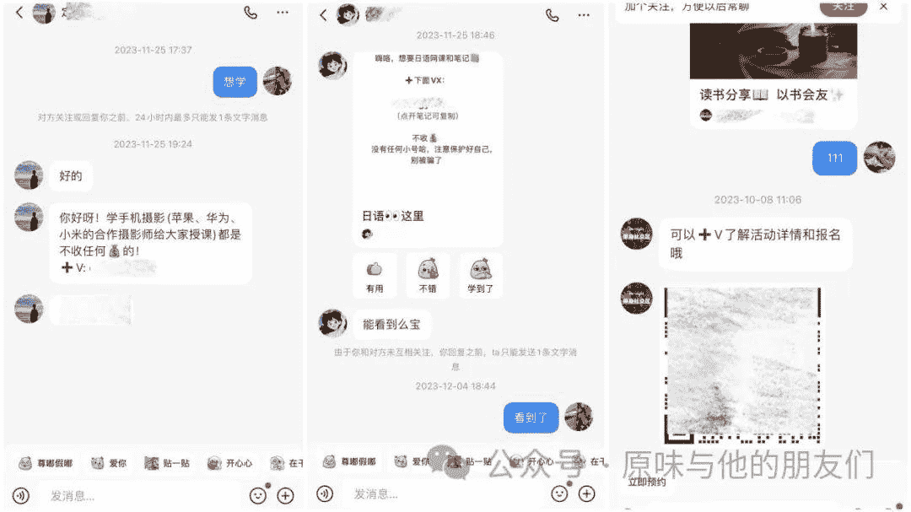
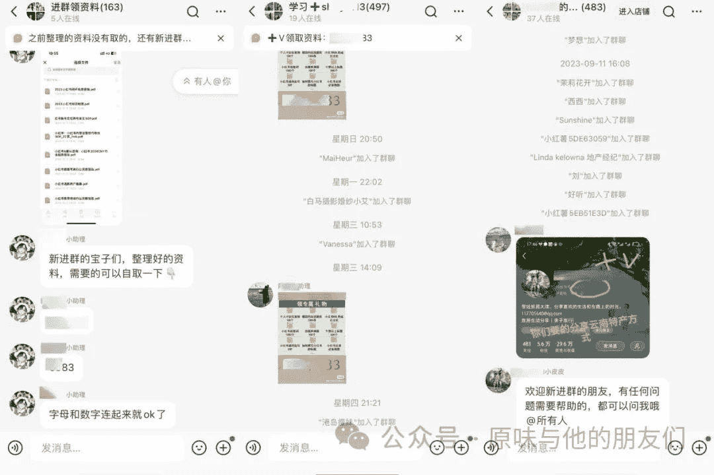
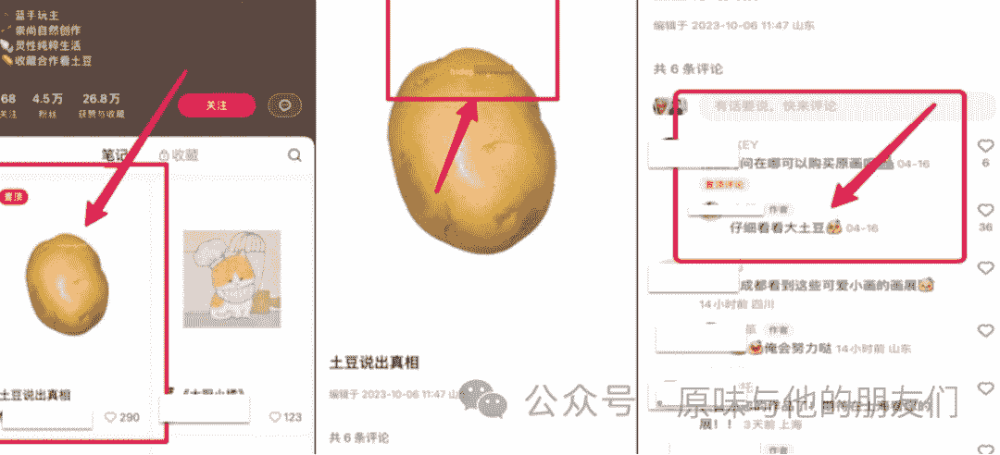
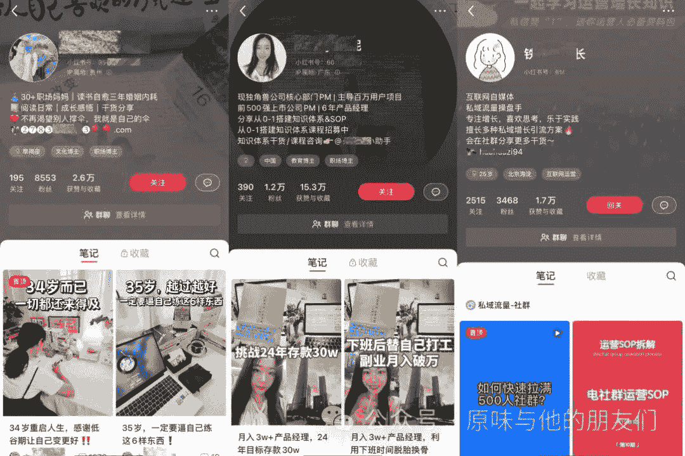
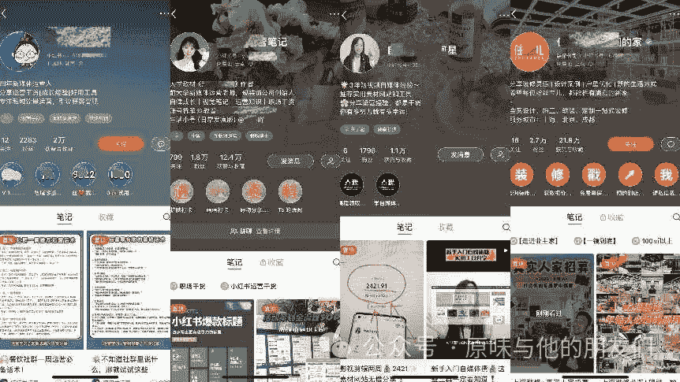
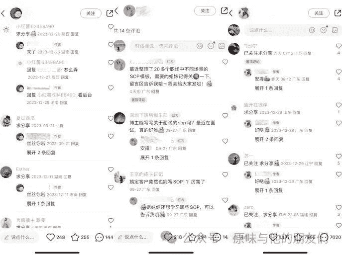
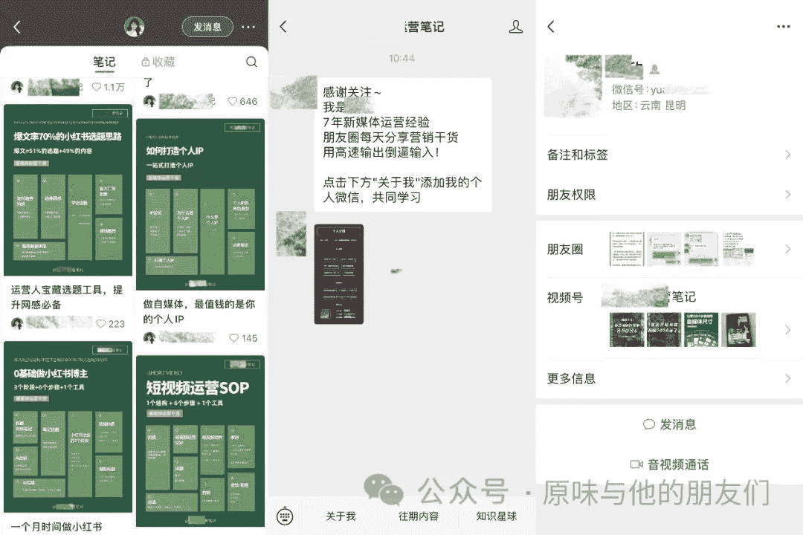
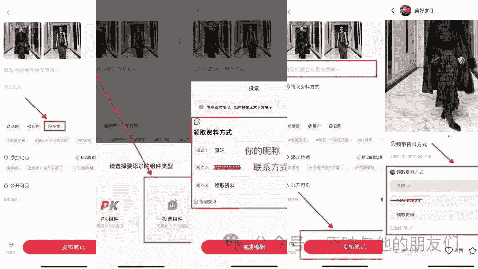
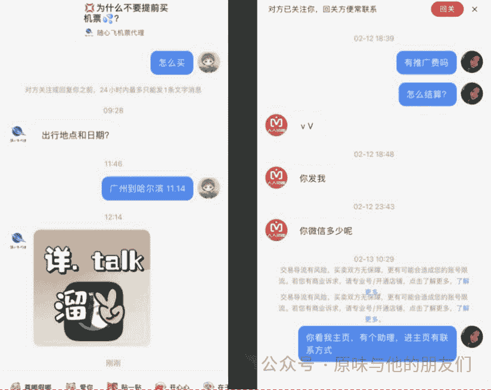

# 2024-01-08--10种📕引流技巧，平台种草与拔草要并行 – 人人都是产品经理

> 来源：[https://xuqiwei1986.feishu.cn/docx/TjCDdaGY8oTSUTxEkGzc72hbnIf](https://xuqiwei1986.feishu.cn/docx/TjCDdaGY8oTSUTxEkGzc72hbnIf)

> 🔗 原文链接： h[ttps://www.woshipm](https://www.woshipm.com/share/5972031.html).com/share/59720...

> 📕平台的种草与拔草在不断变化，其流量机制也在不断变化。本文结合相关案例，总结了10种📕引流技巧，希望对你有所启发。

前几天📕will商业大会不知道大家看了没，之前📕也分享过买手店相关的内容，很明显想把自己的平台逐渐从种草社交转移成社交电商，不管📕能不能像抖音一样，但它依然只是个平台，有流量就会有内容、有内容就会有很多偷流量的方式。

今天就会分享关于📕搞钱常见赛道，以及目前常见&不常见的偷流量技巧，会用案例来说明白，看完这篇文章的小伙伴直接执行干就行了~

## 一、📕搞钱常见赛道

任何平台，任何变现赛道，偷流动作都是通用的，而📕现在搞钱的三大赛道：IP博主、引流变现(私域)、买手店铺。

### 1. IP博主

顾名思义，就是前期先通过优秀的内容获得粉丝关注（定位→用户→产品→变现模式），从内容来认可人的过程，然后开始接广告、直播做买手、开专栏卖课，或者引流私域卖更久的产品囤粉丝资产。

### 2. 引流变现

这块等会儿会重点说，因为📕是很抵制引流这个动作，所以想变现，要么挂小黄车（但高客单&功能性产品挂车变现是真的难），要么平台偷流，到私域、到闲鱼、到天猫，只要产品的购买人群画像匹配。

现在很多企业都喜欢在📕玩矩阵（教育类最多），开始各种铺关键词成为行业TOP，再引导🛰️去转化，或引导到店铺下单。

### 3. 买手店铺

21年9月📕就开始了“号店一体”，当时还没太多人注意（信息差），2022年很多人就里面赚了一波，但到了 2023 年开始知道的人越来越多。

不管是供应商、线下店铺、第三方店铺，都可同步开设一个📕店铺，偷流增长营业额（抖音开个直播、视频号、📕不同角度也同时开播挂车）。

或者是那种无货源买手，从PDD或1688 那选款、📕图文带货型，也会有不断地营收和复购，数据还是比较可观的。

## 二、10种📕引流技巧

在说如何引流行为前，一定要有个认知：

📕没有100%的绝对安全，要么你投聚光灯(官方认可)，你就能光明正大的去得用户，只有相对来说比较安全的引流技巧。

### 1. 私信

简单易懂，别人给我发他🛰️，或我发🛰️给对方，相当的粗暴，风险也高。

弊端点，一串阿拉伯数很容易被官方检测到，如果是新号（刚注册），直接发没问题，但有次数限制。

如果发的话，可以分段/中英混合等等，准备不同🛰️号，分散开发，相对安全。

或者开个小号把引流信息写一篇图文，用户问了就发给他。

### 2. 群聊

80%的人都会用这方法，如果是引流账号，可以直接免确认，可以用小号发各种引流信号。

群聊里发🛰️二维码、图上加🛰️号、直接文字形式分隔发布，都是可发布出去，不会被识别出，但一定要用小号（助理号）发，一定程度上会保护大号。

现在📕群聊上线群主撤回功能，所以如果群内有其他同行想在你的群聊里截流，可以立马把内容撤回，并拉黑处理（这点还是比较友善的）。

有些账号真的很招黑，如果群聊被官方关进小黑屋，那群主也会受到影响，若碰到这种情况，建议打卡“通过群聊”审核确认，先晒3-5天，若想进群的用户头像没变小萝卜（营销号）就放他进来。

群名也很关键，群名可以是普通的名字，也可以是引导用户操作的名字，比如群名是“进群领资料”，“进群看置顶”等等。

### 3. 置顶笔记

这是一个老办法，但还蛮实用的，比如这个人发一个土豆，95%的人可能看不懂置顶的文章发个土豆是为什么？如果把土豆放大的话，其实是一个🛰️号。

这种方法比那些直接写篇文章，留自己的联系方式安全一些，但用户流失率会比较高。

### 4. 账号介绍

不管在任何平台，全网都会第一步尝试在账号简介留引流信号，例如：谐音VX号、卫星号、邮箱、公粽号、公主号、@小号等。

（*小号的存在，本身就是去承担大号的风险！小号就是拿来简单粗暴，可视化引流）。

📕可设置🛰️号，主页背景封面可做图片上加🛰️号，简介的地方告诉潜在粉丝怎么联系你，邮箱设自动回复，不管用户发任何信息，用户会自动收到你的🛰️号。

建议最好还是用小号来做引流，就算被发现也就费个小号而已，但能获得流量。

不用手机号去注册小号，一个人只能15个名额，那样太费手机号了，可以用物联卡，直接淘宝上找卖手机卡的人，说需要注册卡或物联卡就OK~（成本可能就几十块，当小号，封了也不可惜）。

### 5. 瞬间打卡

在视频上面打一个字，在主页以单字拼凑成一句话，可以直接导向私信、关注和群聊，比放在简介的地方更显眼一些。

它比你简介大太多了，明眼人刷到你主页，70%的游客都会按照你瞬间打卡提醒去完成动作，📕平台本来就是个兴趣种草逻辑，所以泛粉不太会刷到你主页。

★怎么设置？→📕主页左上角，记录我的日常里，点打卡就行了，然后自己布局放什么图，用什么文字？

### 6. 评论区引流

评论区就可以用这种形式，找朋友或小号在笔记下方的评论区当水军“钓鱼”，然后大号回复（放钩子），例如：关注后台找、看小号、看主页、进群、置顶小号评论等方式。

安全系数会比较高，系统测出正常评论，这样往下滑的游客就知道怎么联系到你，曝光会大，同时转化率提高。

### 7. 图片留👸号转私域

这个其实也不算难，只要做了一个模板后，就是往模板里放内容就行了，只是这个模板设计有讲究。

如下图可以直接在角落放自己的👸号名字（因为这账号定位的是运营，所以一看就知道通过👸号去搜索她的信息）。

### 8. 店铺1元引流

这个是比较常见的，开一个店铺，可以搞一个电子书低价福利品（设置1元），结合直播形式，当买家买到这个产品后，可以设一个发货内容，发货内容就是“记得添加🛰️领取”。

这个东西有门槛，会帮你筛选精准用户，什么样的粉丝花1元购买产品，有些人连1毛钱都不想花。

### 9. 组件（互动组件）

📕有些比较新的功能可以尝试（新功能更容易逃避人工审核），比如互动组件，互动组件下面可以是一个投票组件，可以设置引流信号。

特别做教育类的内容，把领资料的方式、电子书的方式直接留下来，这个也适合拿小号去做，真的比较猛~

### 10. 引导游客提供🛰️

下图左边可以看的很明确，客户要联系方式，号主让客户留联系方式，右边是和一个老板的聊天记录，对方要我🛰️号，我要她🛰️号哈哈哈，生怕被检测到，就僵持着谁都没发。

这个过程周期会比较长，你来我往的，很容易客户流失，如果你的产品是对方非常有需求的，用户绝对会直接给到你他的联系方式，否则就是玩太极一样，推来推去。

以上就是常见&不常见的📕引流方式，希望能带你一些启发和帮助，如果正在做这块内容的朋友，看完这篇直接就上手开始执行就行了。

**专栏作家**

原味的运营笔记，🛰️👸号：原味与他的朋友们，人人都是产品经理专栏作家。

本文原创发布于人人都是产品经理，未经许可，禁止转载

题图来自 Unsplash，基于 CC0 协议

该文观点仅代表作者本人，人人都是产品经理平台仅提供信息存储空间服务。