# AI 破局：从 500 强到个体创业

> 来源：[https://xuqiwei1986.feishu.cn/docx/KbDWdhIDaoQGwQxKLVccREXjnvd](https://xuqiwei1986.feishu.cn/docx/KbDWdhIDaoQGwQxKLVccREXjnvd)

大家好，我是王伟说鼻腔健康，AI 破局初创合伙人，目前从事大健康行业，专注于鼻炎这一细分领域。我们一家三口都有鼻炎。这个经历让我对帮助那些同样遭受鼻腔问题困扰的人充满了使命感。在过去两年的创业生涯中，我不仅深入研究了这一常被忽视的疾病，还形成了自己独特的见解。

选择创业，对我来说，是一个重大的转变。一方面，我的社保已经缴纳了 15 年，感觉自己在原单位已达到职业生涯的天花板，再无上升空间，而且把自己磨的更没有激情了。另一方面，自己所在的公司正在走下坡路，我知道迟早会离开。我不想等到四十多岁时，当身体和精力不再允许我追求新的梦想时，才作出改变。因此，我选择了在那一刻主动出击，投身于调理鼻炎这一行业，全心全意解决人们的鼻腔问题，开始我的创业之旅。

2023 年，全球经济的衰退和国内实体经济的下滑给我的生意带来了前所未有的挑战。店铺里稀少的客流让我深陷焦虑。在这个变幻莫测的商业时代，我意识到做生意的底层逻辑已经发生变化。传统企业要实现 10 亿销售额需要千人团队，而作为超级个体，只需依靠几个人就能达到。成为超级个体势在必行。

机缘巧合下知道了 AI 破局，从初次了解到加入合伙人，再到现在，也就一个月零几天的时间。决定要走个人IP 这条路后，我整理了个人过往的经历及加入破局以来的收获，撰写了近 2 万字的文字稿。我希望通过这些文字，让大家了解我个人，以及我目前和未来的计划。

期待在 AI 破局中，大家能相互扶持，跟随洋哥一起迈向更加辉煌的人生。让我们一起打破认知的局限，突破职业的束缚，提升健康水平，开创人生的新篇章，一起破局！

# **一、500 强打工心得**

## **一）入职前**

### **1、少年的奋斗**

高一那年暑假，我迈出了人生中重要的一步：第一次去打工，跟随邻居在山区修建柏油公路。那是一个与现在截然不同的时代，几乎所有工作都要靠双手完成，机械化也是遥不可及的梦想。

我的任务是照看一台被俗称为“小火车”的设备。这不是一辆真正的火车，只是一辆用铁皮做成的手推车改造成的生火的炉子，用来保持沥青的加热。我需要确保其中的火焰始终燃烧，这意味着不断地寻找柴火。这个过程对公路施工至关重要，因为工人们需要用火烤铁锹，以清理粘在上面的沥青。

这一个月的劳作让我首次尝到了赚钱的滋味。每天的工资是 17 元，而大人的工资则是 24 元。通过辛勤工作，我最终用自己赚的钱在县城买了一个百信牌复读机，花了 132 元。那时的每一分钱都来之不易，每一分都承载着自己的汗水和努力。

当时的打工生活条件极为简陋。中午，我便蜷缩在马路边的树下，以扫把为枕。夜晚，我睡在由砖块铺成的硬地上，仅有一张草席和薄褥子作为床铺。这种艰苦的条件，不仅锻炼了我的身体，更是磨练了我的意志。

那个夏天，我学到了不仅仅是赚钱的方法，更学会了独立，学会了如何在困境中寻找解决方法。更重要的是，我学会了感恩。每当我看到现在路边平坦的柏油马路，我都会想起那些用双手铺就的道路，以及那些辛勤劳作的人们。这让我意识到，无论走到哪里，那个夏天的经历都将是我宝贵的财富，提醒我珍惜眼前的一切，感激生活中的每一份努力和成就。

在我高三的那个转折点上，我遇到了一个意想不到的挑战：鼻炎。它像一位不请自来的客人，夜晚时分，我的鼻孔完全堵塞，仿佛被坚硬无情的水泥封住，剥夺了我宁静的夜晚。

在这场与鼻炎的斗争中，我的老父亲成了我的第一位盟友。他从某个角落里翻出了一本泛着岁月黄色的老医书，寻找着传统的智慧。他从山中采来的野菊花，被他用力塞入我的鼻孔。那一刻，我感受到了自然的力量，尽管它的效果转瞬即逝，但足以让我感激。

“健康是一场长跑，而非短暂的冲刺。” 这是我在尝试现代医学的过程中所学到的。班里一个朋友的女友的父亲，是一位医生，给我配制了复生素。每一次滴药，都像是打开了新世界的大门，但这个世界总是在我触碰之前关闭。

在寻求治愈的道路上，我偶然听到一则广播，声称跑步可以治愈鼻炎。我毅然决然地投入其中，每次奔跑都是与自己的较量。热血沸腾时，鼻孔豁然开朗或寒风袭来时，呼吸会变得自由。然而，这份自由总是昙花一现，就像生命中的许多瞬间一样，美好却稍纵即逝。

“真正的治愈，有时在于放下过度的关注。” 这是我在大学期间的领悟。当我停止过分关注我的鼻炎，生活的重心转移到了学业和新环境上，鼻炎的影响似乎逐渐消退。长治市的空气，与我生长的土地截然不同，那里在2004年被评为全国十大魅力城市之一，或许也对我的康复起到了某种积极作用。我开始意识到，环境的变化和心理状态的轻松，对健康的影响远超我们的想象。

“生命不会给你所有的答案，但它总会给你成长的机会。” 那些与鼻炎斗争的日子，教会了我一种从容，一种对生活变化的接受和适应。如今，当我回望那段日子，不仅仅是对症状的缓解，更多的是对生活的深刻理解和感悟。

### **2、大学生活五重奏**

大学生活对我来说是一段丰富而多彩的旅程，尤其作为一名来自农村的学生，我感受到了生活的不同层面。家庭条件不富裕，每个月父母还要为我提供 300 元的生活费。为了减轻家庭负担，我决定利用周末的时间赚取额外的收入。

在一个周末的早上，我在一家中介中心花费 50元 找到了我的第一份工作是上门推销 IP 电话卡。我挨家挨户敲响每户人家的铁将军，向他们介绍产品，这份工作不仅锻炼了我的沟通能力，更增强了我的胆识。

在城市的街头，我也尝试过发传单的兼职工作，虽然因为影响市容被城管追赶，甚至一度进了派出所，经历了一段不愉快的回忆。尽管如此，但这些经历都让我更加坚韧。

除此之外，我还在学校门口的一家小饭店里，做过钟点工，当时一小时 1.5 元，工作后还包含两顿饭，午饭和晚饭。每个周末全天工作，从上午9点到晚上 10 点，每月可以拿到 180 元，这对我来说是一笔不小的收入。这份工作在减轻我的生活负担的同时，也让我感受到了劳动的快乐，给了我宝贵的工作经验和生活技能。

大学期间，我还参加了学校的勤工俭学，负责打扫校园。每天三次的清洁工作，虽然短暂但紧凑，完成后我便匆匆赶往饭店继续我的钟点工工作，每个月也可以领到 180 元。这些经历让我的大学生活不仅充满激情，更是异常充实。

大一暑假，我通过中介找到了在铁路上做临时工的机会。那个夏天，晚上睡觉我与二十多人挤在一个大长通铺上，吃着简单的大锅饭，将普通的炒茄子幻想成美味的水煮肉片。与一群六七十岁的老人共事，听他们讲述生活的点滴，尽管工作艰辛，但我感到非常快乐。

大二那年，我在一家洗浴中心找到了服务员的工作。由于我长相平凡，只能在男浴区递递毛巾，完成一些基础的服务工作。在那里，我见识到了社会的多面性，从富有的大老板到出卖身体的坐台小姐，这些经历让我发誓，毕业后要努力挣钱，成为一名成功的人。

毕业季节，当许多同学因为没有路费而无法回家时，我却通过辛勤工作攒下了两千多元。那时，还买了我的第一部手机，诺基亚 3100，花费了我 600 元。

“在逆境中成长，是通往成功的必经之路。” 这是我在大学时期的最大感悟。每一个挑战都是一次成长的机会，每一次努力都是我通往未来的一步。当我回顾这段时间，我知道这些经历塑造了今天的我，让我更加明确了自己的目标和梦想。

## **二）500 强打工心得**

### **1、模具设计成长之路**

三年的大专生活转瞬即逝，我幸运地应聘到了太原富士康，一份在当时看来颇具吸引力的工作。2007 年，我成为了新干班的一员。世界 500 强的大企业，优越的工作环境，还有餐补和住宿补助——这些都是当时负责就业的老师给予我们的美好承诺。

就这样，我在富士康度过了我的青春岁月，长达十五年。这段时间，我对这家公司感激涌动。它不仅是我的职业起点，也是我生活转折的地方。在这里，我找到了爱人，建立了家庭，买了房子，迎来了我们的宝贝。虽然生活不算奢华，但平稳而安宁。

回顾在富士康的这 15 年，我经历了激情与焦虑，热爱与责备，但最终都化为了深深的感恩。如果能回到过去，以我现在的认知，我可能不会选择一开始就过着太过安逸的生活。我渴望在无拘无束的青春年华里，在社会的大熔炉中多经历些挑战和磨练，积累更多的生活经验，以免在离开熟悉的环境后感到焦虑不安。

如今，当我与年轻人交流时，常常感叹：“年轻真好，年轻本身就是一种资本。” 我想对那些刚毕业的大学生说，根据我自己的经历，我建议你们不要一开始就选择过于安稳和安逸的工作。这样的选择可能会磨灭你们的激情，浪费宝贵的青春岁月。在人生旅程中，挑战和冒险同样重要，它们是塑造你们未来的关键。

在我心中，富士康的 15 年不仅是时间的流逝，而是成长和磨砺的宝贵岁月。在这里，我累积了超过7年的模具设计经验，这不仅是职业的积累，更是智慧和技艺的沉淀。我曾负责业界领头羊如诺基亚、摩托罗拉、三星、小米等品牌的手机内构件压铸模具的设计与开发，每一步从理念到实体，都是对完美的追求和创新的探索。

我的工作不只是一份职责，它是一场挑战和机遇的舞台，每个新品的导入分析、产品的调整和方案的设计，都是对我的能力和创造力的考验。我带领着我的团队，如同指挥家引导着乐队，组织制工开发产品模具，和工程部门协调处理生产现场的各种不期而遇的挑战。每年完成 10 到 15 套产品模具设计和开发，不仅是数字的累加，更是对专业精神的一次次升华。

然而，在这段专注和投入的岁月中，我忽视了健康，长时间的坐姿和缺乏运动给我的健康带来了影响，我患上了慢性前列腺炎。虽然我在一家医院接受了治疗，并投入了一万多元，但病情并未得到完全的控制。这是我职业生涯的一个提醒，提醒我在追求职业成就的同时，不应忽略了身体的呼声。每个人的健康是无价之宝，而且它是实现梦想和目标的基石。这次经历教会了我一个宝贵的教训：在追求职业成功的道路上，我们也要同样重视并呵护我们的身体和心灵。

### **2、重塑闲置资产价值**

在富士康太原厂区管理与处置闲置设备的 7 年多的经历中，我深刻体会到了挑战与机遇并存的真谛。我们所管理的不仅仅是价值 2 亿元的闲置资产，更是一段旅程，一段探索未知、创造可能的旅程。

想象一下，从零开始，我们建立了一个创新的闲置资产管理体系。这不仅仅是工作上的成就，更是将规划与策略提升到了艺术的层面。我们不是简单地跟随流程，而是创造流程。每一个细节，每一个流程的制定，我们都像雕刻家一般精心雕琢，从而建立起了专门的资产管理部门。这一切，就像高楼的基石一样，坚实而可靠，为我们的成功奠定了坚固的基础。

在这 7 年多的时间里，我们处理了超过 15000 台的闲置资产，释放了超过 10 万平方米的空间。这不仅是一项壮举，更是我们对责任的坚守和体现。我们的努力不仅体现在数字上，更重要的是我们如何安全、高效地实现目标。正如名言所言，“伟大的成就源于细节的关注”，我们对每一项资产的评估和处置都倾注了极致的关注。

创新永远是我们前进的动力。我们开发了一个固定资产全生命周期的资产管理系统，这不仅是统计的工作，更是对资产价值最大化的追求。通过定期培训，我们提升了团队的资产保全意识和业务能力，因为我们深知，“知识就是力量”。

而团队的建设和项目管理是我们取得成功的核心。我们从无到有，打造了一个不仅高效而且充满活力的团队。我们深信，“团结就是力量”。这个信念让我们共同处理了超过 1 亿元的资产，创造了零异常和零事故的记录。

我们的故事不仅是数字和成就的叙述，它更是一曲关于团队合作、创新精神和对细节执着的颂歌。我们所取得的每一个成就，都深深印证了一个信念：“当你对未来充满热情时，一切皆有可能。”

# 二**、AI 领域探索**

## 一**）我与 AI 破局的故事**

在 2022 年3 月，GPT 首次亮相时，它的名声已如雷贯耳，但我只能远远地欣赏。当时，我正忙于第三家鼻炎店的装修，脑海中充斥着各种琐事，心里却对这项新技术充满好奇。然而，GPT 和我的工作似乎毫无交集，我也未能深入了解。

然而，一切在六月有了转变。那是一个转折点，我带着妻子和两位店长去厦门参加黑谷公司的共享合伙人培训。在那里，终于与 GPT 正式“相遇”，首次亲眼见证了 GPT 的魅力。黑谷公司巧妙地将GPT集成到他们开发的软件中，用于创作社交媒体内容和活动策划。这次经历让我对 GPT 产生了浓厚的兴趣。回到太原后，我一直怀揣着使用它的念头，甚至联系了一位学计算机的朋友，希望能通过他获取这一神奇的工具，但最终未能如愿。

命运的转机发生在 7 月 20 日。我加入了一个📕的营销群，在那里，一位 17 岁的小伙伴宣称他可以帮助注册 GPT 账户。经过一番交流，我了解到注册需要使用一些特殊工具和国外手机号。对于我这样的“小白”来说，这些都是全新的领域。我信任地转了 50 元给他，他帮我注册了 GPT 3.5 版的账户。我首次尝试使用GPT时，要求它为我即将注册的新公司起名。它迅速给出了 10 个建议，每个都附带着深刻的含义。尽管我对GPT的了解还很浅显，但这次体验让我兴奋不已。

九月底，我与一位朋友前往济南学习。在那里，我了解到他通过使用咸鱼平台赚取副收入，每月收入近万元。在经济压力和好奇心的驱动下，我付费加入了咸鱼副业群，并开始在平台上尝试无货源生意，一切都似乎是天意安排。

最终，在 11 月 21 日那个夜晚，我在咸鱼副业项目中遇到了“百万先生”，他不仅帮我支付费用，还邀请我加入了洋哥的副业星球《洋哥陪你玩转副业》。在这里，我对 AI 的理解迈进了一个新的阶段，认识到 GPT 可以衍生出如此多的副业机会。我对自己过去的无知感到惊讶。感谢百万先生，他是我踏入这个行业的第一位贵人。

短短一晚上，我便将洋哥副业星球的精华内容一览无余。两天后，我加入了他的 2024 年陪伴群。在洋哥的一次直播中，他无私地分享知识，那满满的干货和真诚的付出让我深受感动。正是在那次直播中，我第一次了解到合伙人这一概念，并在 11 月 28 日加入了洋哥的合伙人团队。

## 二）加入 AI 破局 20 多天的收货

### 1、AI 知乎

#### 1）为什么选择知乎

##### ① 洋哥推荐 & 有成功案例

最先学习的是洋哥商业 IP 课，其中有一节专门讲述了《图文平台--知乎》，洋哥告诉我们，知乎是最好的图文平台，没有之一，鉴于自己在知乎的世界里，曾仅是一个沉默的观察者，浏览着无数问题和答案，却从未亲自下笔回答，决定先从知乎开始尝试。

冯帅合伙人撰写的《 AI 知乎入门到变现》这本小册子为我带来了许多灵感。每当我在闲暇时重读它，都能在不同阶段获得新的感悟和启发。

同时，我还阅读了星球上合伙人大全撰写的《打造 IP 一个月，知乎阅读 50W +，👸号涨粉1000+，变现 3000+ 复盘》，这篇文章增强了我的信心，让我相信自己也能做到。

##### ② 知乎平台特点

知乎是一个专业问题答疑平台，它的核心就是提问和回答，它是国内最大的图文平台和问答社区。

知乎的内容特点:够深度、够专业，这个特点也就决定了在知乎台吸引的都是精准粉丝。

知乎用户特点:高逼格、杠精多，正因为知乎的内容特点是够专业和深度，所以在知乎平台吸引到的粉丝要么是死忠粉，要么就是杠精黑粉。

知乎的主要内容形式: 图文/长文，喜欢看长文的人更加忠诚，并日也有更强的付费意愿。

知乎的流量特点: 长尾，同样的一个问题火过一次之后还有可能再火，比如说你一年前回答的问题今天突然又火了，那么你之前的回答会为你再带来一波持续的流量

##### ③ 对健康行业相对来说比较友好

在大健康行业中，我曾尝试过在抖音和📕上推广，但经常遇到账号被封或流量极少的问题。相比之下，在知乎的体验却截然不同。仅仅 20 多天，我的账号就从零级升至五级，分数飙升至 19358 分。这是我在自媒体领域中，感到最有成就感的一次。这一成就不仅让我感到自豪，也坚定了我在自媒体领域继续探索的决心。

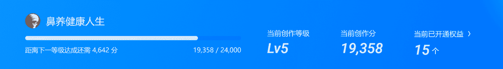

回顾这一成就，我不得不感谢从各位合伙人那里学到的技巧，尤其是洋哥这位知乎满级大 V 的点赞，这对我的快速提升起到了关键作用。在此，我要特别感谢洋哥为了支持合伙人的成长，甘愿牺牲个人账号的权重。

#### 2）知乎定位

考虑到我在鼻腔健康领域的专业知识，以及知乎对健康行业从业者的友好态度，我在知乎的定位是专注于健康行业中的细分领域——鼻腔健康养护。凭借我在鼻腔健康养护方面的深厚知识和丰富经验，我希望在知乎上为关注健康的读者提供专业而可靠的建议。

#### 3）知乎头像名称简介

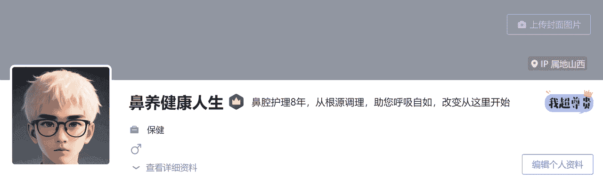

后续名字会全网统一，统一改成：王伟说鼻腔健康

#### 4）知乎实操

现在，我能够迅速地回答问题，通常只需几分钟。这要归功于洋哥的建议——建立个人的问答知识库。虽然最初的收集和整理工作相当艰巨，但长远来看，这个方法非常有效。现在，我只需根据问题的需要，快速组合知识库中的内容，然后复制粘贴即可。

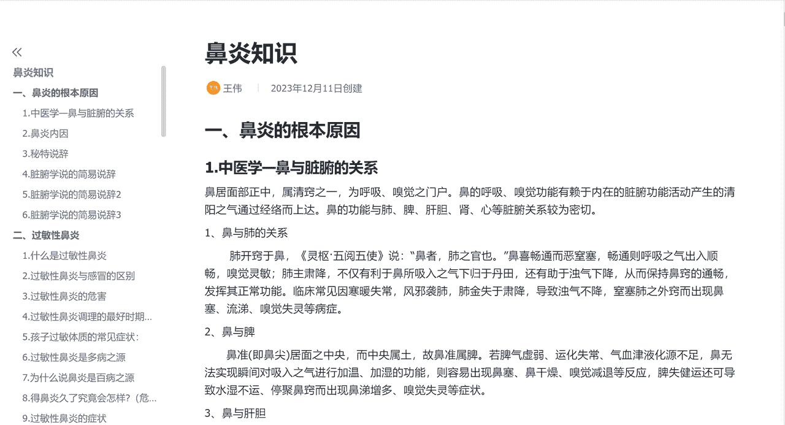

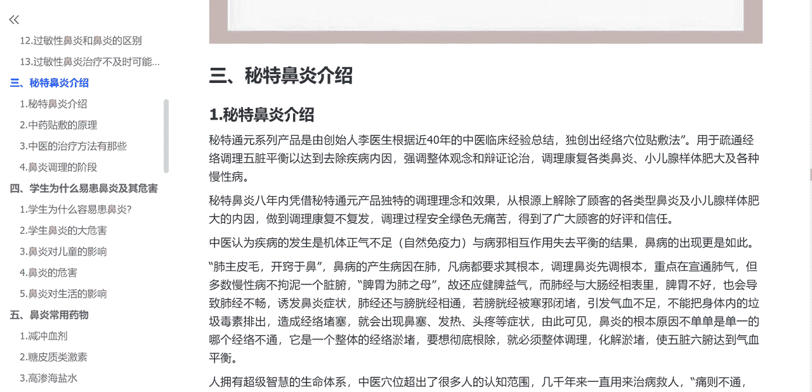

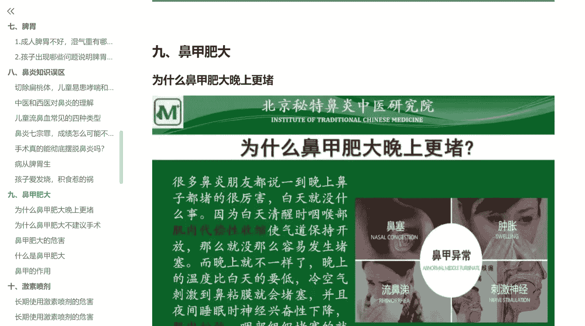

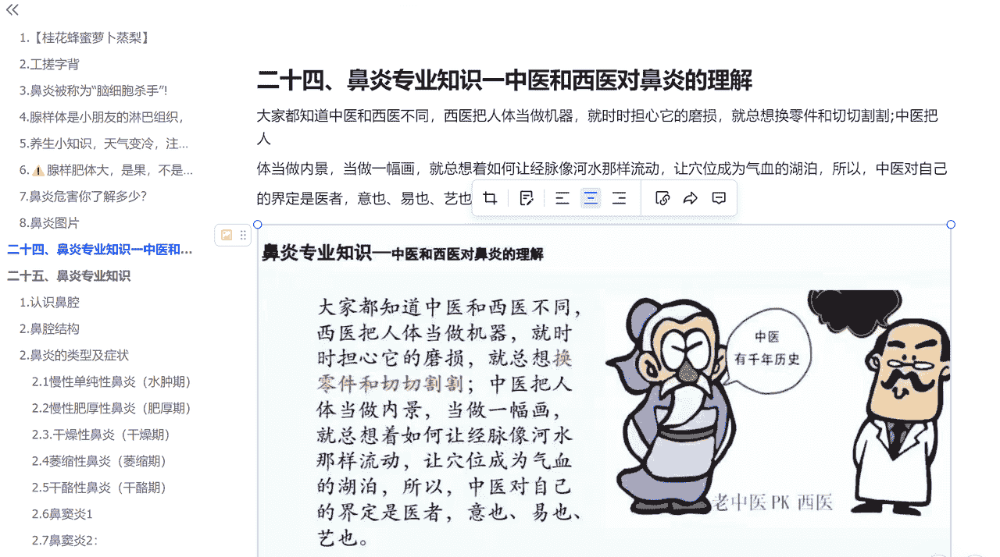

在这个过程中，平台三次因为内容质量高而给予我特别认可，一天之内就帮助我升了一级，当时我还感到有些激动。

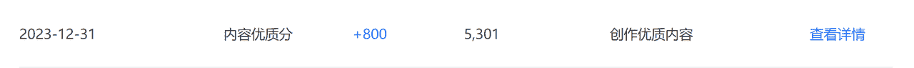

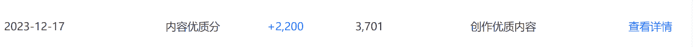

关注者亲密度完全得益于洋哥的知乎点赞群里各位合伙人的助力。

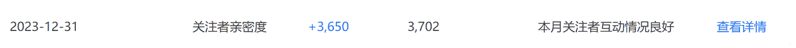

加入这个团体绝对是正确的选择，因为单靠自己的力量，不可能取得这样的成就。

#### 5）遇到的问题

① 在知乎的创作分雷达图上，我的综合得分相当不错，但唯独关注者亲密度低得让人忧心，这成了我的一大苦恼。我所专注的垂直领域是与我的个人 IP 相关的大健康产业中的鼻炎话题，在这一领域，不仅问题数量稀少，关注者也寥寥无几。一次偶然的机会让我在群里发现了枫晓陌老师的《知乎新人涨粉变现攻略》，我立刻开始研究，希望其中的策略能帮助我提高效果。比如：

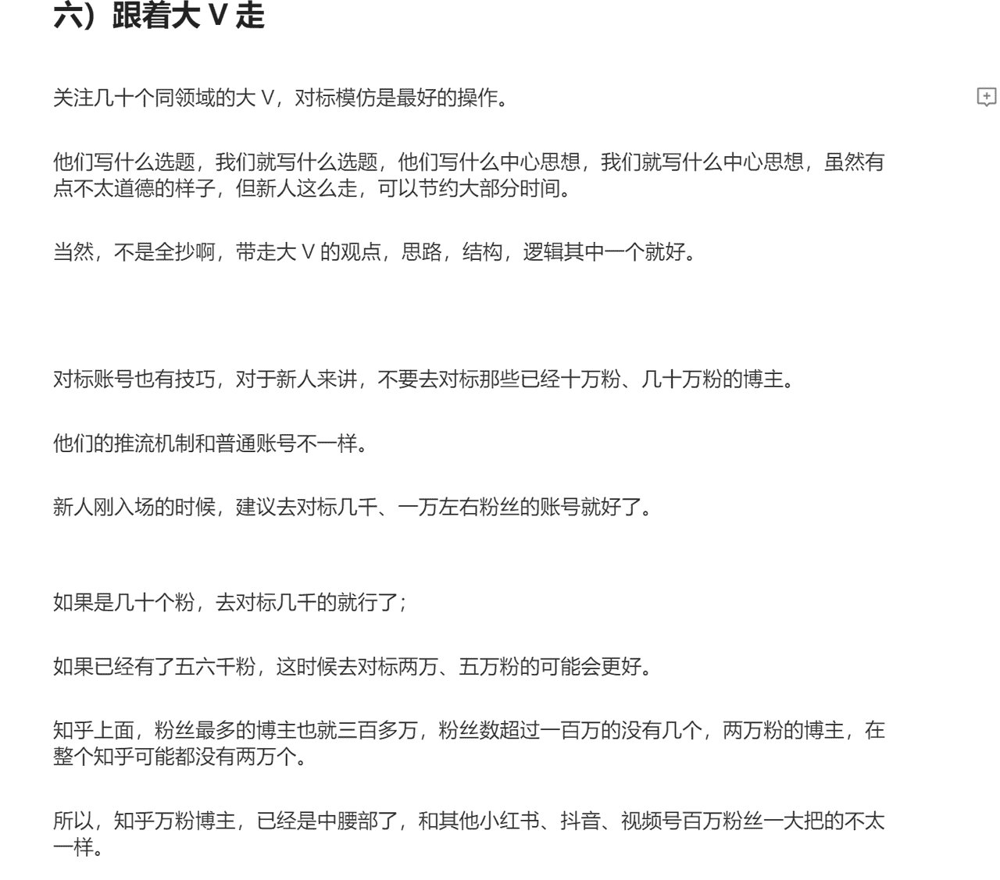

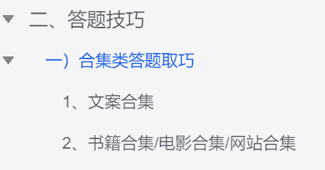

② 专业性的知识库&有流量内容的知识库

在观察行业内许多成功人士的共识后，我深刻认识到：一个有效的知识库应该包含那些曾经广受欢迎、能够吸引大量流量的内容。相反，那些未曾引起关注的内容在知识库中几乎毫无用处。

这种认识促使我进行了深刻的自我反思。我发现自己在成长的路上走了一些弯路，尤其是我创作的内容过于专业化，现在我正致力于改善这一点。

我所建立的知识库充斥着高度专业的内容，但遗憾的是，这些内容尚未真正“火”起来。我逐渐意识到，过于专业的内容虽然能吸引同行的目光，但对于更广泛的公众领域来说，它们可能显得过于深奥。在公众领域，内容需要更加轻松、娱乐化，因为大多数用户更倾向于简单易懂的内容，而不是需要深入思考的干货。因此，我正在调整我的策略，以更好地吸引和满足广大用户的需求。

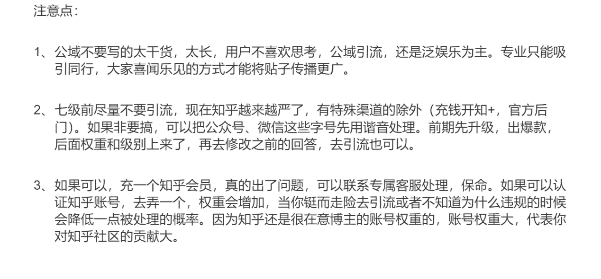

#### 6）后续规划

① 我一直致力于大健康领域的一个关键细分市场：鼻炎问题。这个领域既充满挑战，也蕴含着巨大的探索潜力。

对于这个专业领域，我抱有深厚的热情和兴趣，我渴望在这个领域做出更深远的贡献。我的目标是通过持续的研究和分享，为那些受鼻炎困扰的人们提供实质性的帮助，并推动整个领域的知识进步和发展。。

② 最近开始着手撰写一系列关于健康观念的文章。我的目标是通过这些文章来提升公众对各类健康问题的认识和理解。

我相信，通过提供准确的信息和实用的建议，我能够帮助读者们更好地关注自己的健康，采取积极的预防措施，并做出更明智的生活方式选择。我的愿望是，通过我的文字，能够激励人们追求更健康、更充实的生活方式。。

③ 我正探索一种新颖的方法，将健康主题与娱乐元素相结合。我的目标是通过这种富有创意的方式吸引更多的关注者，使健康知识的传播变得更加轻松有趣。

我计划通过使用幽默、引人入胜的故事或者互动式内容来增强文章的吸引力。同时，我也会考虑使用图像、视频或者动画等多媒体元素来讲述健康话题，使其更加生动和易于理解。我的愿望是创造一个既能教育又能娱乐的环境，让读者在享受阅读的同时，也能学到有关健康的重要信息。

### 2、AI 👸号

#### 1）为什么选择👸号

##### ① 👸号的红利

👸号释放公域推荐流量红利，0 粉起号也能 10w+ ,写文章就可以赚取流量主广告收益。🛰️👸号拥有 7 亿 + 的月活，这两年开始发力推行公域推荐机制，因此大量的👸号文章和账号获得曝光推荐，很多新号的文章也可以轻松进入流量池。

看一看、搜一搜、问一问等产品都给👸号带来了庞大的流量。

有了 AI 帮助创作爆文，写作小白上手就更容易了。凭借 AI 强大的内容输出和创作能力，从选题、标题到正文创作，都能够拆解、模仿并给出比较高质量的内容，👸号爆文形成标准化的模板后，最快几分钟就能产出一篇文章,大大提升了写作效率。

未来几年，👸号依然是最好的商业变现平台之一，总的来说，现在是难得的入局 AI+ 👸号的好时机。

##### ② 大咖推荐

多日来学习洋哥的IP商业课程，基本了解了公域流量的打法，知乎7级以后就可以挂👸号的链接，把粉丝引流到👸号上来。

👸号作为一个半公半私的平台，可以用来承接知乎平台的流量。这也是我做👸号的一个目的。

#### 2）👸号定位

👸号一： 输出健康领域的观点及知识干货，传播健康理念；个人IP流量的中转站。

👸号二：探讨职场经验、品味酒桌文化，学习为人处世哲学，提升能量与认知，成长为更优秀的自己；点亮心灵，播撒生活正能量。

#### 3）👸号图像名称简介

👸号一：

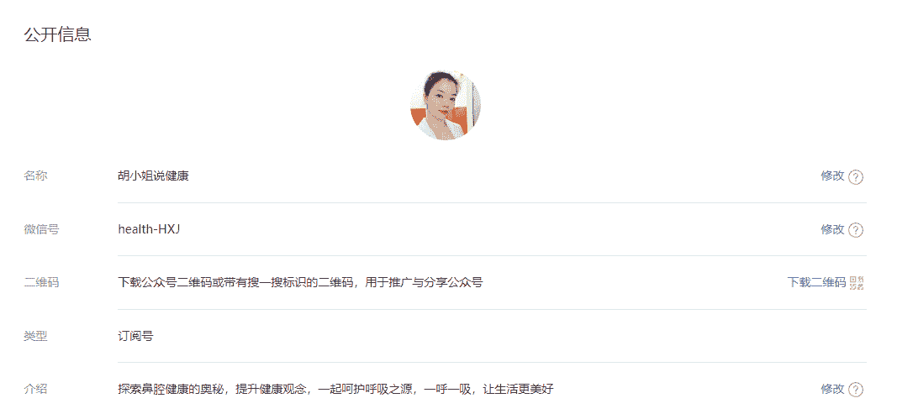

👸号二：

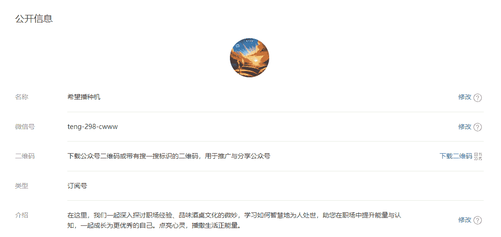

#### 4）👸号实操（仿写爆文）

##### ① 选择对标，找到低分高赞的账号

即注册时间在半年以内，更新篇数10-100篇之间，出过数篇乃至十篇万阅或者10万阅读账号，说明选题、领域、文章质量、排版都做的非常好，值得对标模仿，如一个养老金领域做参考例子。

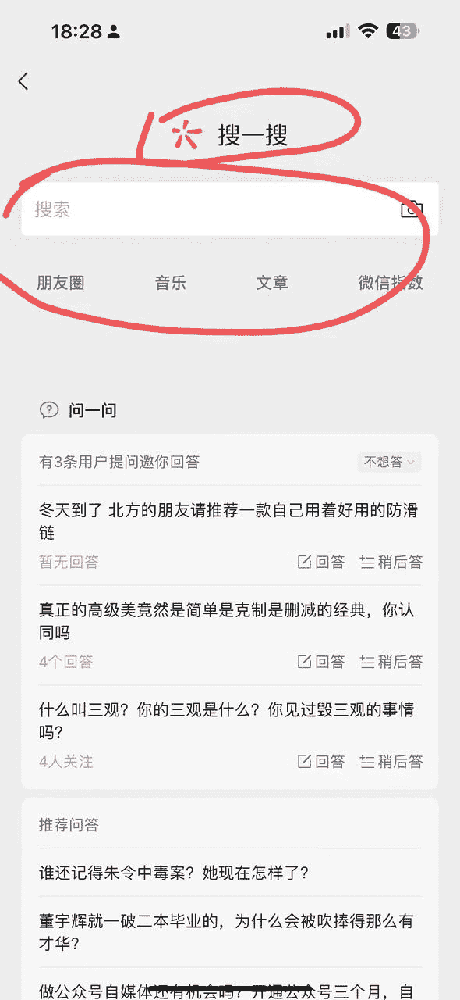

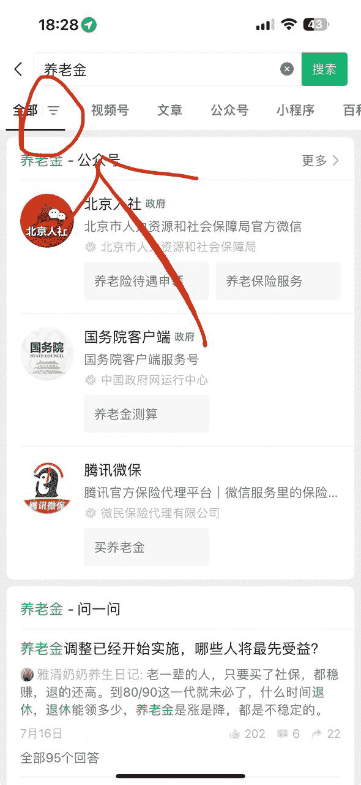

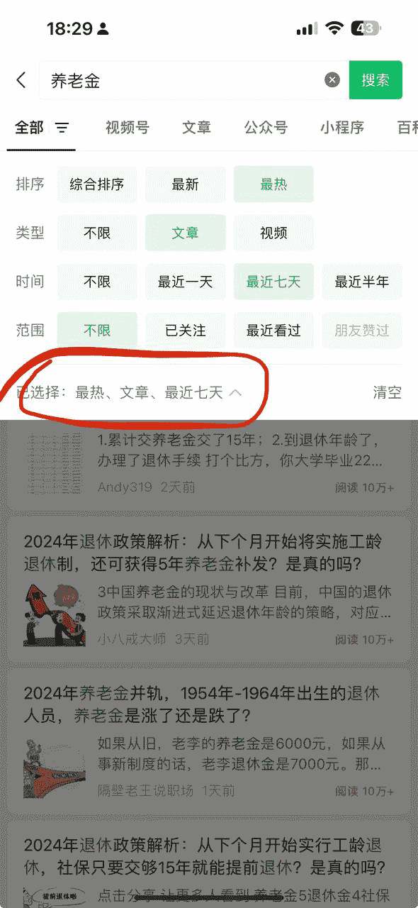

点开第4个，从第四个开始，爆款和其他类型的对标就都会出现。

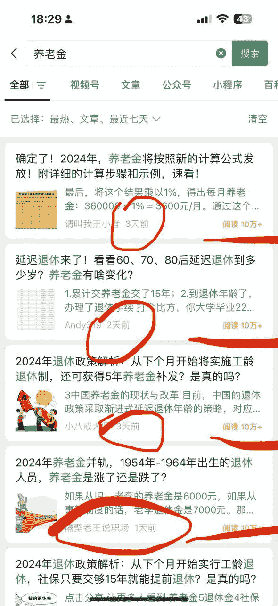

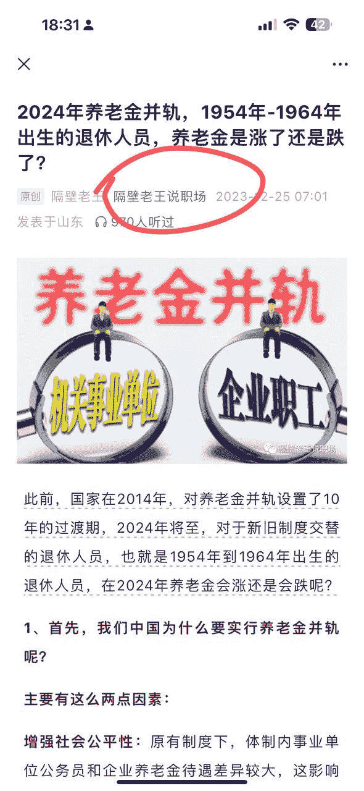

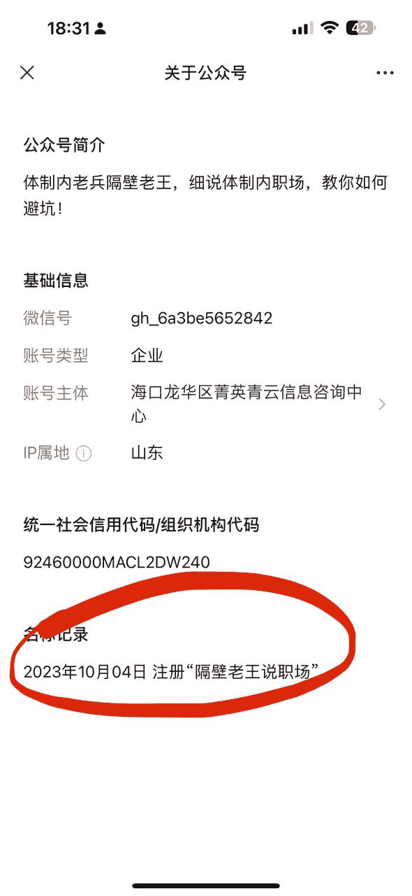

点进去一篇，再拉到下面，显示的画面如下图：

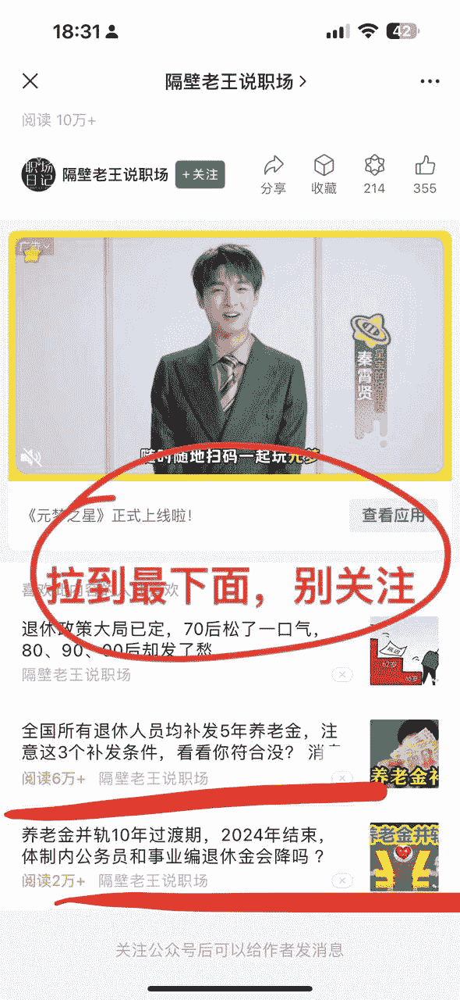

这时就会有其他同类型的文章，如果还想找，那么继续上述操作。再点进去，新的10万+爆款的文章一一拉到最下面，就会出现其他同领域的爆款文章。

##### ② 查询热搜事件

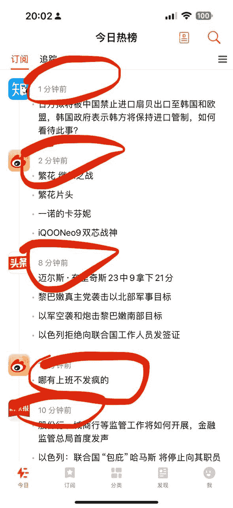

相关领域流量词查询

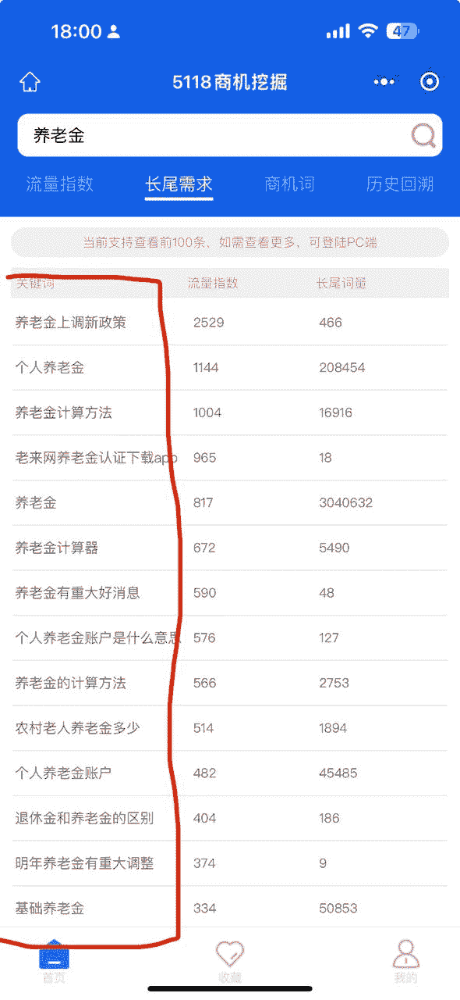

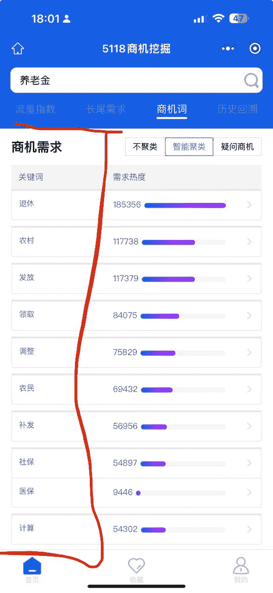

##### ③ 🛰️指数确认

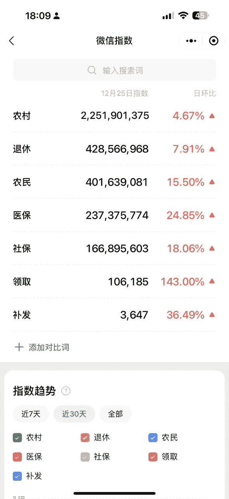

文章标题和内容中植入相关热点及关键词

##### ④ 提炼文章大纲和内容结构

背景:作为职场类🛰️👸号的运营者，我需要你帮助我拆解提炼一篇文章的大纲和内容结构，同时总结文案风格和写作技巧。这篇文章是关于职场技巧和经验分享的。我希望你能以读者的角度审视文章，并提供有针对性的指导和建议。

角色: 希望你扮演一位资深👸号编辑，您需要深入分析一篇职场类爆款文章，提炼出其内容结构和关键要点，并模仿其写作风格和技巧，以便为读者提供有价值的职场建议和洞见。

任务要求

1.文章内容提炼：

提取文章的主题和关键要点。

根据提供的文章，制作详细的内容大纲，包括引入场景、问题的提出、主题探讨、错误示例与分析、解决方案示例与分析，以及结论与建议。

2.风格与技巧分析：

分析文章的写作风格，如语言使用、情感表达、叙述方式等。

识别并总结文章的写作技巧，如情境设定、问题引导、结构布局等。

3.模仿创作指导：

提供具体建议，指导读者如何模仿此类文章的写作风格和技巧。

强调文章的实用性和操作性，确保内容对职场人士有直接帮助。

4.读者角度审视：

从读者的角度出发，提供有针对性的指导和建议。

考虑增加互动性元素，如问题调查或案例分享，以提高读者参与度。

5.输出形式

一份详细的文章分析报告，包括内容提纲、风格与技巧分析，以及模仿创作的具体指导。

一系列针对读者的实用建议，帮助他们在职场中应用文章内容。

6.注意，这次的任务只做文章提纲提炼，不进行仿写。如果你明白意思了，我给你发爆款文章内容，收到内容以后直接开始任务，不要跟我回复“稍等片刻”之类的等待话语

##### ⑤ 仿写爆款文章

[任务设定]

背景:我在运营一个职场类的🛰️👸号，我需要你协助我完成一篇职场文章的写作

角色:希望你扮演一个资深的👸号编辑，拥有丰富的写作经验和对职场类文章的理解.

任务:会为你提供文章大纲，需要你结合文章大纲、文案风格与写作技巧、读者角度的指导和建议，输出一篇职场类文章，吸引读者阅读

<内容结构>

1.引入场景 (200字)

描述:[简要描述职场情境或问题，以第一人称进行代入1情境设定:[具体化场景，为读者提供情境背景]

2.突出选择的重要性 (100字)

问题提出:[明确关键时刻或决策点]

影响分析:[分析此时刻的重要性及可能的长远影响1

3.主题探讨:在职场的应用 (100字)概念阐述:[简要定义主题及其在职场中的作用1实际应用:[具体讨论主题在所描述场景中的应用及其重要性

4.常见的错误示例与分析 (300字)

回答示例:[给出一个或多个常见错误例子1

不利影响分析:[分析这些错误可能带来的不利影响]

5.标准解决方案示例与分析 (300字)

回答示例:[给出一个标准解决方案的例子]

积极影响分析:[分析可能带来的积极影响]

6.结论与建议 (100字)

总结:[概括文章的核心观点]

行动建议:[提供具体建议或行动指南，帮助读者应用文章内容]

[任务步骤]

1、首先你要向我请求文章大纲和文章选题

2、根据我提供的文章大纲和文章选题，结合内容结构，一次只写作一个内容大纲部分，逐步执行询问我是否满意，并标出重点的句子。

以上是我仿写的指令，目前只是初步的使用阶段。

#### 5）遇到的问题

① 目前运营的这个👸号还没有入池，需要持续优化。

② 题目中热点内容与流量词的不太会结合使用。

#### 6）后续规划

① 当前我正在运营的👸号尚未完全符合我的预期，它还没有达到一个理想的水准。因此，持续的优化工作对我来说至关重要。计划深入分析当前的内容策略、以及各种数据，从而更精准地定位我的目标受众和内容方向。通过这些细致的调整和优化，我希望能够将👸号提升到一个新的水平，最终实现其在我的个人品牌战略中的关键作用。

② 为了使我的👸号内容更具吸引力和影响力，我计划在题目设计中巧妙融合热点内容和流量高的关键词。通过紧跟时事热点，结合当前社会、文化或技术趋势，我能够吸引更广泛的受众。同时，我会研究和分析流量高的关键词，将它们自然而巧妙地融入到我的题目和内容中，以增强搜索引擎的优化效果。这样的结合不仅能提升内容的可见度，还能确保我所发布的内容既具时效性，又易于被目标受众发现和阅读。

③ 在我的日常生活中，我坚持每天更新自己的👸号，这不仅是对我的认知和能量的持续提升，更是对我的写作技能的精进。我深信，通过不断地复盘和优化内容，我将在这个领域实现突破。我渴望迎来那个时刻：我的第一个重大成就的实现，以及通过自己的努力赚得的第一桶金。这份坚持和努力，我相信，终将开花结果。

④ 在实现👸号内容突破的基础上，我计划进一步扩展我的影响力。重点是做好私域流量的承接和社群运营。为此，我将深入学习社群运营的相关知识，掌握如何有效地管理和激活我的社群成员。我相信，通过这些努力，我能够建立一个更加活跃和互动的社群，从而为我的内容创作和个人品牌带来更大的价值。

### 3 知识管理

在我的学习旅程中，还掌握了其他多种实用工具的使用方法：

1）飞书：初次体验后，我已将其作为我的知识管理中心，用于整理和存储在知乎上回答问题的所有资料。

2）夙愿老师的资料整理方法：这包括将🛰️群聊天内容多选收藏，然后在🛰️收藏夹中转换成笔记，并最终在 GPT 排版大师中进行精致排版。

3）碎片信息处理：结合🛰️收藏和 Flomo ，我使用飞书知识库来构建和整理资料信息。

4）飞书秒记：一个快速记录信息的工具。

5）群信息处理工具：这个 AI 工具自动整理群聊中的精华内容。

6）🛰️群折叠功能：提高了群聊天内容的浏览效率。

除此之外，我还尝试了许多其他的小工具，但在这里就不一一详述了。

#  **三、个体创业（鼻炎）**

提到鼻炎，许多人认为这是一种难以根治的疾病，甚至连医院也难以治愈，因此他们对任何治疗方法都持怀疑态度。根据统计，大量患者经历了长期的治疗却仍未见显著改善。若不是我本人的鼻炎通过贴敷，调脏腑的方法得到了显著改善，我恐怕也不会相信它是可以治愈的。通过这些非传统的治疗方法，我的鼻炎症状得到了显著减轻，这让我深信鼻炎不是无法克服的障碍。

我不太记得小时候是否患有鼻炎，但从我不齐的牙齿和高出常人1厘米的上颚来看，我可能经历了张嘴呼吸的问题。这种身体特征可能是由于长期的鼻塞导致的，这是鼻炎患者常见的症状。

现在，我想邀请你进行一个简单的自我检查：是否有腺样体面容的迹象，或者回想一下，小时候是否曾患有小儿腺样体肥大。这些可能是鼻炎的早期迹象。

通过我的个人经历和专业知识，我希望能帮助更多人认识到鼻炎是可治愈的，并提供有效的方法和建议。让我们一起努力，追求更健康的生活。

## **一）创业起因**

### **1、健康危机中的挣扎与领悟**

2013 年，我和爱人步入婚姻的殿堂，随后迎来了我们的第一个孩子，同年我们还买了自己的房子。这一年，我们完成了人生中的三件大事，虽然经历充满了自豪，但背后也隐藏着无尽的艰辛。

时间如梭，五年眨眼即逝。2018 年，当我们得知我的妻子再次怀孕时，整个家庭都沉浸在喜悦之中。然而，幸福的气氛没过多久就被残酷的现实打破。在怀孕的第三个月，医生告诉我们孩子发育不良，妻子的身体状况也无法支撑这个孩子的成长。无奈之下，我们只能选择了流产。

流产后，妻子的身体健康状况变的越来越差，她的月经周期变得异常长，有时一个月甚至出现两次，这让她深陷痛苦和困惑之中。为了调理她的身体，我们试图通过西医的方法来调整她的月经周期。2019年5月，我们开始了一系列的检查，医生最终决定使用口服避孕药——优思悦来调理她的月经，听起来有着美好的名字，却带来了意想不到的副作用。在服用第七片药物后，她开始出现严重的呕吐症状。

我们四处求医，从消化科到小门诊，不断尝试不同的治疗方法，但症状依旧没有任何好转。就在这时，我百岁的奶奶离世了。 我跟妻子一起回家处理奶奶的后事。回到家的第一天，嫂子看到妻子脸色蜡黄，虚弱不堪，便建议我们去县医院看看。

在医院，一位中医科的大夫立刻为她进行了血液化验。结果显示，她的转氨酶值高达 1000 多，意味着她的肝脏已经出现了严重问题,医生要求立马住院。医生告诉我们，肝脏是人体最为坚强的器官，一旦出现问题，通常都是严重情况。我的妻子甚至连奶奶的葬礼都无法参加，在医院中度过了近一个月的时间，对我们来说像是一场漫长的噩梦。

这一切的起因，仅仅是为了调理一个月经异常，却不料给健康埋下了巨大的隐患。尝试西医治疗的结果，不仅没有改善她的状况，反而使她陷入了生命危险。这段经历给我们的生活带来了巨大的打击，也让我们深刻认识到健康的重要性和医疗选择的谨慎性。

### **2、从月经问题到甲亢治疗之路**

面对月经周期的异常延长，我们深感忧虑。正如古语所说，“身体是革命的本钱”，我们决心寻求解决之道。西药虽常见，但其副作用令人犹豫，因此，我们转向了中医的温和之道。在朋友的热情推荐下，我们找到了一位声名显赫的中医大夫程医生，位于离家一个小时车程的地方。程医生的诊所仿佛一方静谧的港湾，让无数寻求康复之人在此停留。

我们在那里开始了长达两年的治疗旅程。每次的药方，都是半个月的量，每一剂都承载着我们对健康的希望。正如一滴水可以反映出太阳的光辉，这些微小的药粒反映出了我们对康复的渴望。在治疗期间，我们看到了显著的改善，每一次检查都是对未来的期盼。然而，就在我们以为病痛即将被驱散时，2021 年底的一次药方调整却让我们的希望受到了打击。我老婆再次出现了恶心的症状，但我们凭借之前的经历，没有陷入过度的恐慌。于是直接去医院检查了下转氨酶，没想到又上升到了 600 多，在医生的建议下，又住进了医院。

就在我们以为山雨欲来风满楼时，命运又给了我们一次考验。住院期间我老婆被诊断出甲亢，这个病状让她的脾气变得易怒，身体逐渐消瘦。每个症状，都像是一条沉重的锁链，束缚着她的身心。然而，我们知道，病痛是生命的另一种语言。西药不宜，中药又不能再用，这让我们面临了一个艰难的选择。那段时间，我老婆时常沉浸在抑郁的阴影中，自问自答的话语仿佛是在寻找一个无法触及的答案。她的痛苦和困惑，就像一本尚未翻开的书，充满了未知和迷茫。

然而，就在我们几乎要放弃的时候，希望的曙光再次闪现。我们前往山西省人民医院，那里的一位专家主任医生为我们指明了治疗的方向。他的话语如同春风化雨，温暖而有力：“治疗甲亢，需长期坚持，不可急躁。” 所以，我们又开始了与病魔的斗争，用坚持和勇气书写着生命的奇迹。

这几年的经历让我们深刻体会到健康的重要性。每一个痛苦的时刻，都让我们更加珍惜彼此，更加坚信在困难面前，只要有爱和希望，就没有什么不可克服的。

## **二）个体创业**

### **1、艰难选择与创业旅程**

生活中的艰难抉择有时就像是绕不开的山路，必须一步步走过。我的妻子，曾在中化二建集团旗下的第三建筑安装有限公司担任行车工人。但那里的工作环境艰苦，无休止的工作日程和请假的困难，且没有周末和节假日的休息让她渴望更换工作环境。

与此同时，我自己的职业生涯也遇到了转折。公司进行组织架构调整，虽然我依然负责原有业务，但一切不再像过去那样顺利。重复且毫无成就感的工作让我筋疲力尽，看着身边的同事一个接一个地离职，我也开始考虑自己的未来。那时，我给自己设定了两条路：南下寻找新工作或是勇敢创业。

到了 2021 年底，我在网上积极投递简历，面试多家公司。但由于行业特殊性和薪资问题，我始终无法找到满意的职位。直到 2022 年 3 月，我终于与一家公司达成了初步协议。然而，就在我准备接受这份工作的前夕，一个意外的机会出现了。

那是 3 月 20 日，我经常带孩子去调理腺样体肥大的老板，后来也成了朋友，邀请我参加一个项目招商会。这个会议彻底改变了我的决策。我决定投资开设一家鼻炎调理店，基于五个原因：孩子的鼻炎在此得到有效治疗，投资金额不大，我妻子也想换份工作，全家人都受鼻炎困扰，以及她以前从事过美容健康行业，且考虑到如果我南下打工，家庭事务将全部落在她一个人身上。这让我决定放弃即将到手的工作机会，投身于创业之路。

店铺装修刚完成，我们就遇到了新冠疫情的爆发，导致城市封锁了一个月。直到 4 月底，封城解除后，我们迅速准备开业。开业当天晚上，我们迎来了第一位顾客。那一刻，我们既是紧张又兴奋，一边向总部求助，一边尽力为顾客服务。就这样，我们踏上了鼻腔健康事业的征程。

同年 6 月，我所在公司提供了一项员工分房的福利政策。令人心动的优惠价格，但需要全款支付并签订五年的劳务合同。最初，我考虑接受这个机会，但随着房地产市场的下滑和户型的限制，以及个人的职业规划，我最终决定放弃。尽管遭到主管的强烈反对和压力，我依然坚持了自己的决定。

这时秋天过敏季节来临，鼻炎店的生意越来越好，而我在公司的状态却每况愈下。这时另一个事业群同样岗位的老板向我抛出了橄榄枝，希望我能过他们那边，帮他把整个团队带起来，由于是同一个集团，薪资待遇方面不会有大的变动，而且还面临流程走不通的问题，这边老板不放人，那边就过不去，又一次站在了人生选择的十字路口，但我最终选择了辞职，全心投入到了自己的创业项目中。

这一系列的决定，虽然充满了不确定性，却为我和家人带来了新的生活方式。在公司的日子里，我感受到了精神的枯竭，而创业则为我们带来了新的活力和希望。老婆的健康问题也是我们选择健康行业的一个重要原因。生活中的每一个选择都有其意义，而我们选择了健康和自由。

### **2、为健康而战**

自从我们踏入鼻腔养护行业，我们的生活开启了新的篇章。首先，我们自身就成为了我们产品的试验者。我们深知，只有我们自己的鼻炎得到有效调理，我们才有信心向顾客推荐我们的产品。此外，作为新手，我们需要通过实践来磨练自己的技能，无论是鼻腔洗护还是按摩技巧，都需要精湛的手法，以避免对顾客造成不适，这是我们必须要避免的。

我们在 5 月份正式开业的同时，也开始了自己的鼻炎调理。到了 7 月中旬，老婆复查甲亢的相关指标时，我们惊喜地发现她的数值已经恢复到正常范围。这期间，她也在规律地使用我们的产品进行调理。然而，有一次在晚上回家的路上，我开着车，她坐在副驾驶座位上。下车时，她突然感到不适，发现自己意外地出现了大量月经出血，这是以前从未经历过的情况。那一刻，我们都感到非常害怕。考虑到深夜医院的情况，我们决定第二天再去就医。

第二天，虽然出血量减少，但还是有血块排出。我们请教了总部的老师，回复对甲亢确实有治疗效果，以前有顾客在调理鼻炎的过程中，甲亢有恢复的情况，但对于女性的大姨妈问题，却是首次遇到。为了验证产品对月经的效果，每次月经期间，她都会使用我们的产品进行测试。结果显示，出血量确实有所增加，幸运的是，在接下来的几个月里，虽然出血量略有增加，但再也没有出现过大出血的情况。到了 9 月份，她来大姨妈的时间终于恢复到了大约 8 天，接近正常范围，这对我们来说是一个巨大的进步。

不仅如此，我妻子的身体整体健康状况也有了显著改善。曾经因为痘痘而烦恼的她，现在肌肤变得光滑许多。以往下班后她常常疲惫不堪，沉重地坐在沙发上，提不起半点精神。现在，她每天下班回家都精神饱满，活力四射，整个人焕发出了新的生机。

### **3、健康思考与学习**

在一个宁静的午后，我坐下来，仔细思考了一件事：为什么我妻子的健康会有这样显著的改善？毕竟，除了最近的鼻炎调理，我们并没有使用任何药物或采取其他治疗方式。深入思考后，结合现在所学习的关于鼻炎的知识，我开始逐渐理解背后的原因。

在中医的世界观中，鼻炎的根源深植于脏腑的不平衡。鼻子，被视为肺的外窍，主要负责呼吸，是清气进出的门户。一旦肺气失衡，鼻窍就会受阻，影响嗅觉。而鼻子与肺脏有着紧密的联系。另外，脾脏主血，而鼻子是血脉汇集之地。脾脏的强弱直接影响肺脏的功能。如果脾胃虚弱，就会产生痰湿，堵塞鼻窍，导致鼻塞和分泌物增多。

肾藏精，主纳气；而肺是肾的源头。肾气不足会进一步影响肺气，导致肺部和鼻腔容易受到外界侵害，引起鼻塞、流涕等症状。此外，胆脏作为中精之府，通过静脉与大脑连接。胆脏的热气上升到脑部，可能引发鼻塞、鼻痒和清涕等症状。

这一切指向了一个结论：调理鼻炎，治标不治本，忽视五脏的整体平衡，是无法从根本上解决问题的。而我们的鼻炎调理，恰恰是在无形中调和了这五脏的平衡。在这个过程中，与脏腑循环相关的其他疾病，如我妻子的甲亢，会得到了相应的改善。这不仅是一个意外的惊喜，更是对中医治疗理念有效性的有力证明。这一认识让我更加坚信，我们选择的道路是正确的。

为了更有效地解答顾客的疑惑，并帮助他们理解鼻炎的根本原因，我和妻子利用工作之余的时间，报名学习了卢岩青老师的课程《找到病因治好病》。课程中有一张非常重要的工具——《健康症状自检表》，这张表格对我们的工作产生了深远的影响。

每当有顾客来到我们的店铺进行调理时，我们都会请他们填写这份自检表。通过这个过程，我们帮助他们自我诊断，找出患上鼻炎的可能原因。我们发现，一旦顾客明白了患病的原理并改变了生活习惯，恢复健康并非难事。每个来店的顾客都成为了一个鲜活的例子，他们的经历进一步加深了我对“早发现，早调理”重要性的认识。只有对症状给予足够的重视，我们才能有效预防严重的健康问题，而这些问题的发现和解决最终还是要靠患者自己。

虽然我不是医生，但我现在的工作却与医生颇为相似。西医通过检查来确保手术和治疗的准确性，而中医的望闻问切和把脉则需要几十年的经验积累。而卢老师的这张自检表，却能让普通人在短时间内学会如何照顾好自己和家人的健康，真正做到将健康掌握在自己手中。这份自检表上列出的症状，其实就是身体在大病来临前发出的求救信号。因此，对这些症状的重视，本质上就是对严重健康问题的预防。

为了更深入地理解鼻炎的问题及其背后的健康观念，我们还学习了张大春老师的《健康观念》课程。在与顾客的日常交流中，我们发现了一个有趣的现象：过去患鼻炎的人并不多，但现在却成了常见病，尤其是现在得小孩子。像我们 80 后这一代人，虽然我自己也有鼻炎，但在我周围，得鼻炎的人却寥寥无几。

我们渐渐意识到，这种变化的原因可能是现代人的生活过于优越。许多鼻炎病例实际上是由不良饮食习惯引起的。孩子们过量的饮食导致积食，长期的内热积累最终转化为反复的感冒、流鼻涕，鼻腔长期的炎症使得鼻炎难以痊愈。所谓“食积易致外感”，意味着积食导致体内积热，引发感冒、发烧等症状，进而触发鼻炎、鼻窦炎的产生。尤其是脾胃功能较弱的儿童，更容易反复积食，从而导致反复“外感”。这正是许多孩子鼻炎长期反复发作的重要原因。

错误的喂养习惯，如偏爱肉食或高蛋白食物，晚餐过量无节制，过多食用水果、酸奶和零食，都可能导致问题。还有现在的过度医疗，如频繁使用抗生素、激素等西药，或者大量使用苦寒中药单纯压制症状，也是一个不可忽视的因素。这些行为不仅导致儿童的肺胃积热，还会伤害脾肾，导致气机瘀滞和痰湿积聚。这些问题的共同特点是脾肾虚弱，肺胃热，以及肝胆经瘀堵。

我们建议家长们，对孩子的最好的爱，不是给他们最好的食物、药物或衣物，而是在生活中保持适度，让孩子们体验适当的饥饿和寒冷。此外，现在的家长们通常过于急躁，总希望能立即看到药物的效果。但如果真有立竿见影的药物，那它可能是神药，或者是以牺牲其他方面为代价获得的。毕竟，这个世界上的能量是守恒的，一切有因必有果。所以，作为最爱孩子的家长，我们应该反思：究竟是谁造成了这一切呢？

## **三）责任与使命**

在过去的两年里，从事鼻腔养护行业的经历让我有了许多深刻的体会。我逐渐明白，导致鼻炎调理难以成功的，往往不是方法本身的问题，而是人们的思想观念。

首先，要想有效调理鼻炎，正确的方法至关重要。就像在茫茫大海中航行，没有正确的方向，永远不可能到达目的地。其次，鼻炎作为一种慢性病，需要时间和耐心来治疗。鼻腔黏膜的恢复周期通常需要90到120天，三天打鱼两天晒网的态度是无法解决问题的。

此外，治疗过程中的信任也非常重要。天雨随宽，不润无根之草，医术虽高，不救无缘之人。最后，改变生活习惯是治疗成功的关键。如果病人不改变不良生活习惯，全世界没有一个疾病能被治好，反而都会反复，最终无法治疗的疾病都会被叫做世界疑难杂症。

我们不难发现，周围长寿的人并非都是因为他们懂得医术或经常服药，而是因为他们热爱生活，珍惜每一个生命的瞬间。健康的秘诀不在于医院的治疗，而在于我们日常的生活方式。所以，真正的健康其实更多地来自于我们对生活的态度和对健康观念的认识。

回想起我开设鼻炎馆的初衷，那时我曾写下《我有一个梦想》。在那段文字中，有这样一句话深刻印刻在我的心中：“我梦想有一天，能够帮助鼻炎患者摆脱痛苦、绽放笑容，让他们的脸上充满最真挚的笑容，找回自信，成长为国家的栋梁之才。我梦想有一天，所有的患者都能成为我们最亲密的朋友，分享在孩子调理过程中所获得的幸福和快乐。”

直到今天，这个初衷依然没有改变。因为我亲身体验过鼻炎的痛苦，现在我有机会将这个有效的调理方法分享给更多人，我愿意将这个事业视为我一生的奋斗目标。每一次看到患者的笑容，每一次听到他们的感激之词，都是对我工作的最大肯定和鼓励。这不仅是我的职业，更是我生命中的一部分，一个让我充满激情和动力的使命。

回顾我国现代伟大文学家和思想家鲁迅的生涯，我们发现他原本并非文学专业出身。年轻时，他深受日本维新时期中西医结合的影响，从而决心通过学医来救国。然而，在日本学习期间，他有一次观看描绘中国人在战争中遭受苦难的幻灯片的经历，深刻地改变了他的人生方向。

他的这一经历激发了他对国人精神状态的深刻反思，使他意识到，在当时的中国，文化和思想的改革比医学救治更为迫切。因此，他放弃了医学，转而投身文学，用笔作为他的武器，唤醒民众，反抗反动势力。

鲁迅的生涯和理想对现代人树立目标、奉献于国家进步提供了重要的启示。他的故事不仅展示了高尚理想如何激发个人潜能，更重要的是，它告诉我们每个人都能以自己的方式对社会作出贡献。

从工作岗位上的转变到生活方式的改善，我的职业生涯发生了巨大转变。立足于鼻炎这一常见健康问题，我希望能提升人们的健康意识，这成了我离开大厂、投身健康行业后的终身使命。

我的妻子经历了连续的健康挑战，从一个小小的例假不调到药物性肝炎、甲亢、糖尿病前期，再到现在的子宫息肉，这些经历深深触动了我。同时，我自己因长期的坐办公室工作而患上了慢性前列腺炎和慢性萎缩性胃炎。这些个人经历促使我重新审视我们的生活方式，并激发了我投身于健康行业的决心。

“健康我一人不算好，大家都健康才是真的好！”这成为了我生活和工作的核心理念。我坚信，通过改善日常饮食和生活习惯，我们可以显著降低患病风险，过上更健康的生活。

人是吃五谷杂粮的，不得病是不可能的，但我们可以通过健康的饮食、生活习惯和积极的生活方式来减少疾病的发生。我相信，通过小小的日常改变，我们可以让自己和身边的人都过上更健康的生活，这也是我余生的使命和追求。

“余生相伴，风雨同舟，愿做健康的家人们可以携起手来，把健康理念传播出去，你我大家都健康。”这句话不仅是我的承诺，也是我对未来的期望。在这个旅程中，我希望能与同样珍视健康的人们一起，共同努力，传递健康的信息，分享健康的生活方式。

我们每个人都是这个使命的一部分，每个小改变都能带来巨大的影响。让我们一起迈出这一步，不仅为了自己，也为了我们所爱的人，为了一个更健康的社会。因为，健康不仅仅是个人的事情，它关乎我们每一个人的未来。

## 四**）愿 AI 助力梦想腾飞**

今年的市场环境对我们来说是一个深刻的启示，与去年相比，情况明显变得艰难。以往自然流量带来的顾客大幅减少，原因在于现今消费者越发理性，他们在做出选择前，会在网上进行深入查询，征询所谓专家的意见。这种趋势对我们店铺的业绩和影响力产生了显著影响。我们渴望帮助那些受鼻炎困扰的人恢复健康，避免他们不必要的痛苦和金钱损失。

为了传播这个理念，我尝试在抖音和📕等平台发布内容，但成效却不尽人意。不是流量稍有增长就遭遇账号封禁，就是根本无法引起关注，这让我深感困惑和挫败。互联网对健康行业似乎并不友好，这是我面临的一个挑战。此外，我对这些平台的运作规则并不熟悉，随意发布的内容并未取得预期效果，这也削弱了我的自信。

在这段焦虑和困惑的日子里，我接触到了 AI ，并受到了洋哥的启发，我在这个困境中找到了新的出路。这里有来自各个平台的大 V ，他们精通规则，分享成功经验，并制作了详细的操作流程供大家参考。我开始遵循他们的脚步，吸取他们的经验，在自己的领域努力尝试。我深刻认识到，成为一个圈子的一部分是至关重要的，个人的努力虽重要，但在一个圈子里共同努力才能取得更大的发展。

我始终记得初入鼻腔养护行业时的梦想，以及现在坚持下去的理由：希望减少人们的疾病，普及中医理念，提高每个人的健康意识与认知。

随着生活环境的变化，原本看似微不足道的鼻炎却影响着众多人的健康。鼻炎不仅会影响五官，甚至可能对人的智力和判断力造成损害。我不禁思考，为什么过去鼻炎患者较少，而现在却日益增多。显然，我们日常生活中的许多习惯正在悄悄侵蚀我们的健康。

现在，我开始借助 AI 技术，可以通过网络传播健康的文字、图片和视频，教人们如何掌握自身的健康命脉。我的目标是帮助每个家庭拥有更健康的生活方式，甚至让整个家族受益。我要致力于纠正人们的观念，改善错误的生活习惯和不良的饮食结构，让身体成为我们最好的医生。

加入 AI 破局短短一个月的时间，不仅让我更深入地了解了 AI 的潜力，也为我的未来开辟了新的可能性。我相信有了洋哥和整个团队的支持，我离自己的梦想会更近一步。

拥抱 AI ，借助它的力量，我致力于普及健康知识，启发智慧，培养人们建立良好的生活习惯，不仅造福自己，也惠及他人。

为了一个更健康的世界，为了人民的健康，继承前人的智慧，为了开创一个更美好的未来！

为天地立心，为生民立命，为往圣继绝学，为万事开太平！

立足破局，借势 AI ，我梦想以后可以实现 AI+ 健康，让每个家庭都拥有一个智能家庭医生；未来，让疾病都远离我们，长命百岁不再是空中楼阁！让我们为了美好的未来，努力奋斗吧！

**【鸣谢】**

首先，我要衷心感谢洋哥提供的这个宝贵平台，以及他所展现的无私奉献和极致利他的精神。在经历了一段充满焦虑和困惑的日子后，正是洋哥的启发让我在逆境中找到了一线光明。他的智慧和洞察力为我指明了新的方向，帮助我在困难时刻寻找到了新的机会和出路。

在文章的结构安排、排版设计，以及句子的运用与表达方面，感谢小林老师的悉心指导、极其宝贵的建议和帮助。正是由于他的专业意见和细致的指导，我的文章得以更加流畅、清晰，让读者更容易理解和感受到我的故事和情感。小林老师的帮助对我来说意义非凡，在这里表示非常的感谢！

AI+ 爆文：感谢台风老师的悉心指导与帮助。他在👸号爆文领域堪称专家。他所开设的爆文变现训练营，不仅深入浅出地介绍了 GPT 的基础知识，更引领我们探索了其高级应用技巧。从利用 GPT 大幅提升自媒体创作效率，到掌握结构化提示词技巧，再到使用 GPT 轻松撰写出阅读量破十万的文章，每一课都洋溢着实用性和深度。

在台风老师的学习指导群里，不仅逐步指导我们学习每天的课程内容，还邀请了数位在 AI 👸号爆文领域取得显著成就的教练，分享他们的独到见解和写作流程。这些珍贵的经验分享，无疑大大超出了我们的期待。台风老师提供的内容价值远超预期，只要跟着去实操，就完全有能力创作出高点赞的优质作品。

AI+ 知乎：感谢洋哥这位知乎满级大 V 的点赞，为了支持合伙人的成长，甘愿牺牲个人账号的权重；感谢冯帅合伙人撰写的《 AI 知乎入门到变现》小册子；感谢合伙人大全撰写的《打造 IP 一个月，知乎阅读 50W +，👸号涨粉1000+，变现 3000+ 复盘》文章；感谢枫晓陌老师的《知乎新人涨粉变现攻略》；感谢洋哥知乎点赞群里各位合伙人的助力。