# 加入破局10天，公众号变现400+，我做对了什么？

> 来源：[https://xuqiwei1986.feishu.cn/docx/JAhfd51cBo8BaKxNXvlcfoChnsh](https://xuqiwei1986.feishu.cn/docx/JAhfd51cBo8BaKxNXvlcfoChnsh)

公众号从0-1保姆级变现教程

大家好，我是云朵，今天是我加入破局的第10天，每天面对浩瀚如海的知识海洋，我像是一块海绵，瞬间吸满了水分。但真的很容易迷失自己，精华帖实在目不暇接，每天只要有时间就会偷偷“学艺”，看到圈友的精华帖，自愧不如，感觉自己差的太远了。

前几天一直忙别的事情，所以今天终于静下心来梳理自己的写作营。那天看到发起第6期AI之心写作营，我就毫不犹豫的报名了，虽然不知道写作营具体如何做？但想着既然加入破局就要躬身入局。

我是一个传统行业10余年HR，目前在自媒体创业的道路上摸索，也做过一些尝试，曾做过抖音直播，视频号直播，做短视频，曾因一个视频爆了，播放量超过500W+，公众号涨粉10W+，但一直也没有运营。目前专注公众号写作、职业规划咨询和AI写作训练营。

目前公众号变现400+，短视视频带货收益200+。对于很多圈友大佬来说，这点小钱简直不值一提，但对于我来说无比的开心，因为对于一个从来没有变现过的公众号来说，他盘活了。

现在每天持续有变现虽然不多，但有正反馈真的特别兴奋。因为写公众号不需要出境，不需要用说话，不需要那么复杂的流程和技能，而且现在有AI，写作简直不要太轻松。对于想做副业的人来说，从公众号入手，是最简单最容易上手的项目。相对简单很多。

今天分享下我的公众号变现之路，这是一篇零基础的小伙伴的保姆级教程，公众号从0到1的注册申请、开通、编辑写作及如何变现等。如果你也想写公众号，这篇文章你一定要看。虽然有点长，但是只要按照步骤操作，你也是一个公众号高手。下图我的目前公众号流量主和橱窗收益。

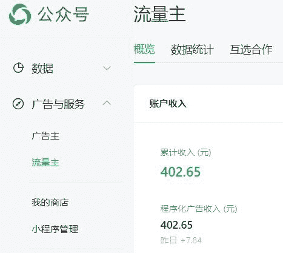

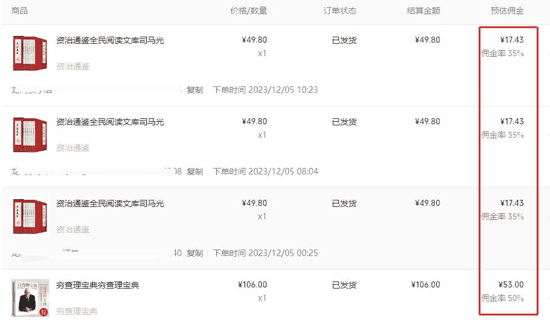

以下是公众号从0-1的操作流程。

# 一、公众号申请注册流程

## 1、登录微信公众号

百度搜索，或者直接登录网址都可以。

百度搜索：微信公众号服务平台，搜索时一定要认准微信公众平台LOGO，但凡有下面是广告的不要点进去，有很多链接打着官方旗号的伪公众号。一定要辨别清楚。也是可以直接登录的。

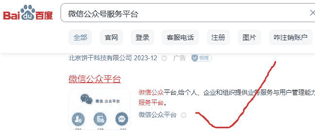

比如说下面这个写着官方，其实根本就不是官方链接

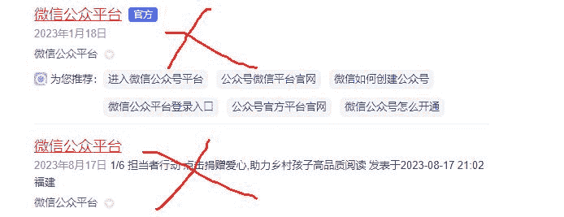

网址输入登录：https://mp.weixin.qq.com/

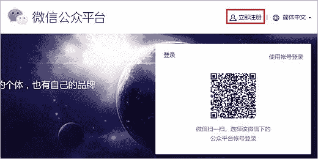

## 2、注册类型

微信公众号有两种类型，订阅公众号和服务公众号，申请注册时候服务号和订阅号选择一经申请不可更改。无论是微信服务号还是订阅号，发布的时间都是可以自定义的，每天的任意时间发布都可以。

公众号的服订阅号是1天可以群发1次。服务号1个月只能发4次，每次最多8条内容。可以选择一天发布4次，也可以每周1次。一般服务号以每周发布一次的居多。订阅号每天可发布一次内容，每次最多也是8条内容。

如果公众号想日更的话，就必须选订阅号，无论个人还是企业。个人只能选择订阅号，如果是企业不想每天都发布内容可以选择服务号。

这里展示的个人订阅号注册流程，服务号需要提交企业资料，比个人要复杂一些。

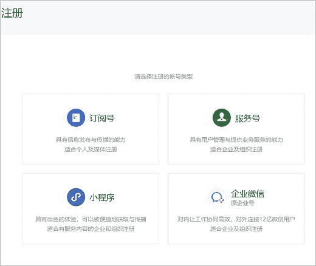

## 3、填写注册信息

选择账号类型后进入基本信息填写步骤，需要使用邮箱作为账号，系统会发送激活部件到邮箱，需要在页面上填写邮件收到的验证码，并设置公众号的独立密码。

说明:注册公众号的邮箱需要是未绑定任何个人微信、公众号、小程序以及微信开放平台账号的邮箱。

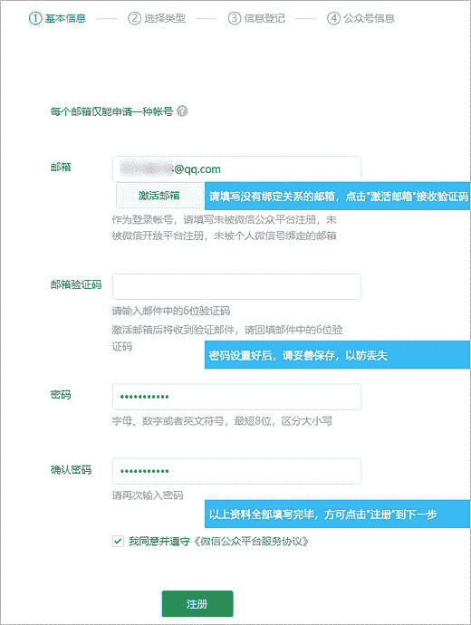

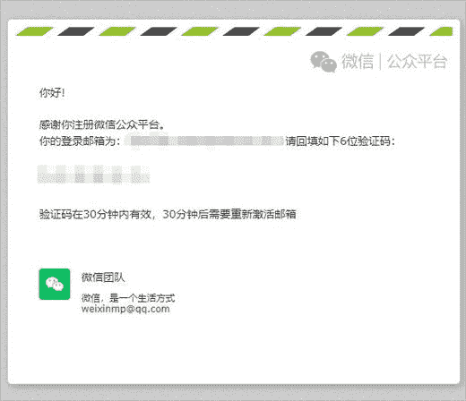

## 4、选择地区/国家以及类型

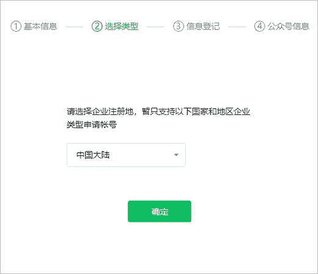

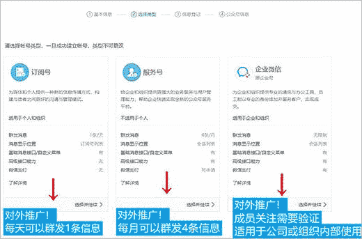

## 5、信息登记，选择个人类型

填写身份证信息、手机号

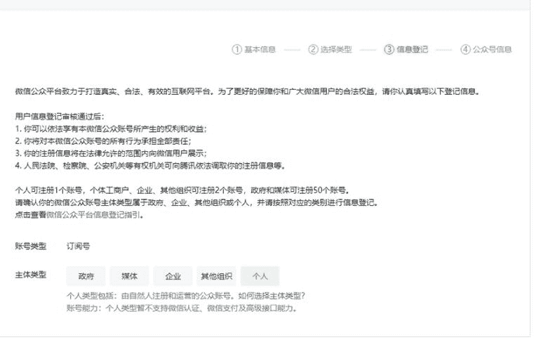

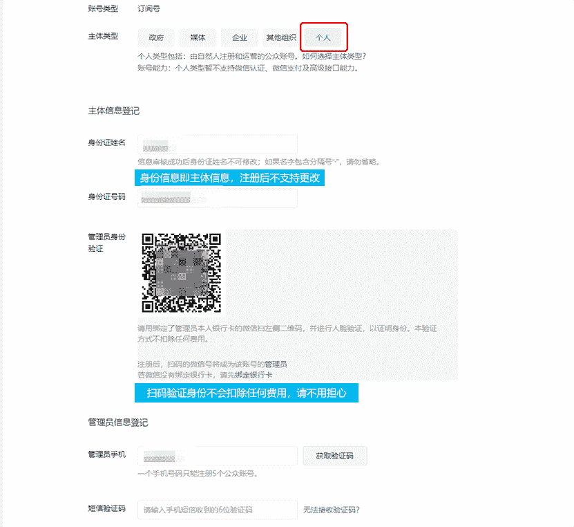

## 6、填写创作者信息

点击继续（如使用过其他内容创作平台，可填写相关信息。如没有，可无需填写。无论是否填写，对账号后续使用不会有影响）

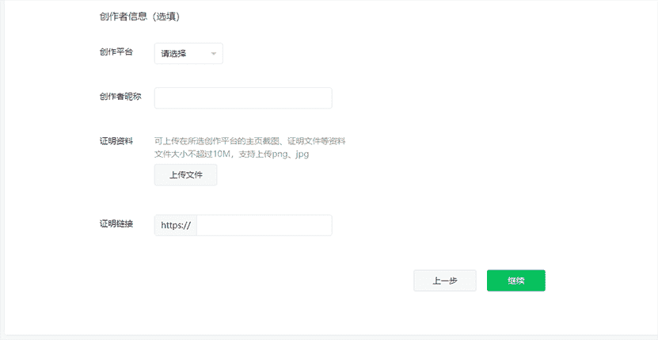

## 7、填写账号信息

包括公众号名称、功能介绍，选择运营地区。这里一定要注意，公众号名字不要随便乱起，一定要想好，虽然也能改，但是如果老是改来改去也不太好，所以一定要提前想好了。比如说XX说创业，XXX聊职场、XXX心理学，但注意不要敏感词，可以自行查违规词敏感词。

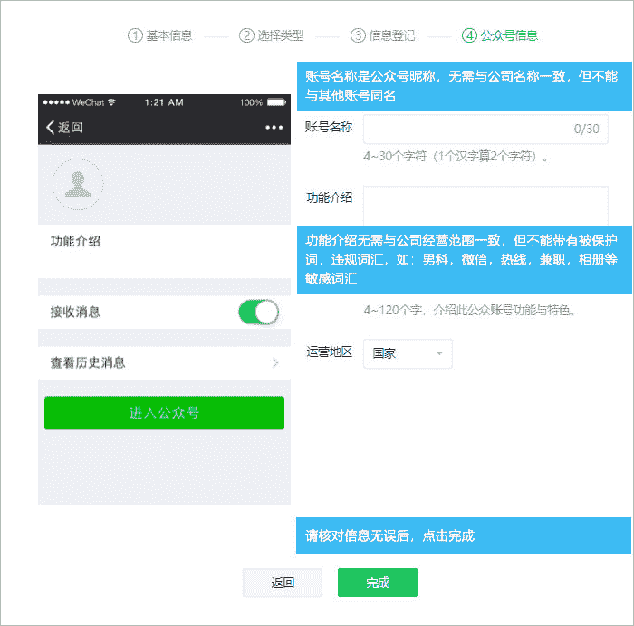

## 8、注册完成

恭喜注册成功！可以开始使用公众号了~

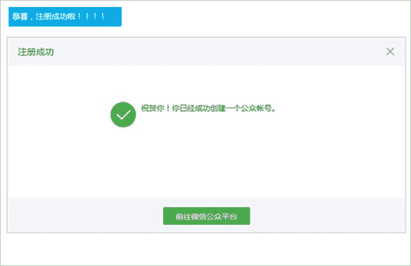

# 二、如何编辑公众号？

## 1、打开图文

公众号登录进去后，打开图文进行编辑如下图：

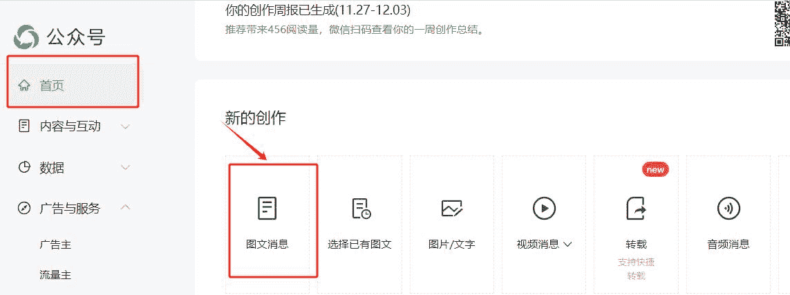

## 2、编辑内容

编辑内容分为3部分，标题，作者，正文。标题一定要吸引人，作者可以和账号名字一致，也可以不一致；正文内容一定要文+图，这样更容易让读者阅读，纯文字看着太累，除非内容特别有吸引力。

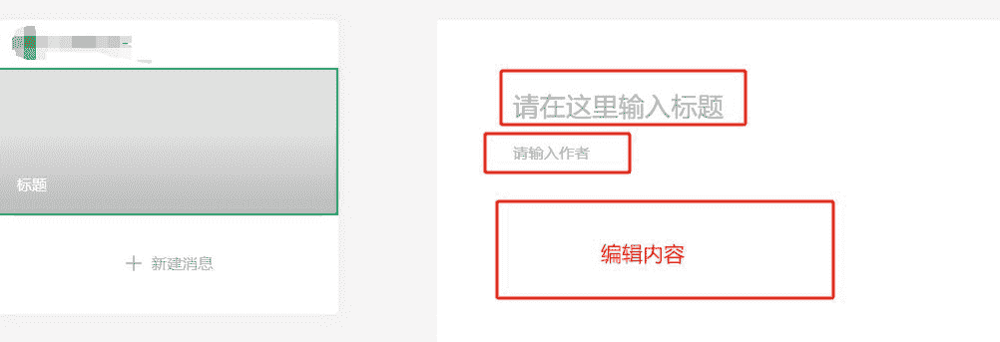

## 3、封面和摘要

内容编辑完了之后，下面会有封面和摘要，这个是别人看你的公众号第一眼看到的内容，相当于没看完文看到预览，所以一张醒目的图片会很加分，让读者跟容易点进去看，摘要的内容可以文章的精华，也可以是设置悬念，总之就是能吸引读者点进去看你的文章。

## 4、关于原创

记得把原创打开 ，这样作品更容易获得平台保护和推荐。

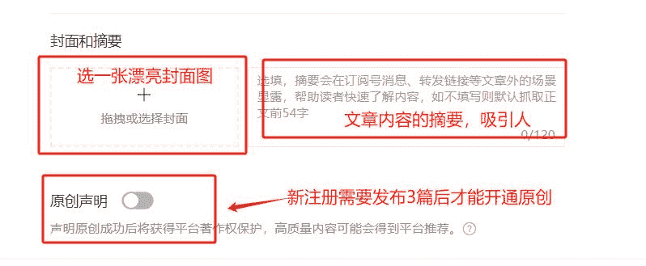

## 5、关于文末其他内容

这个是我的后台，文章广告设置这个是平台自动根据你文章字数多少设置的，少于1000字，文中只能加一个广告位，如果大于1200字可以有两个广告位，但对于新账号来说这些都没有，广告只有满足条件500粉丝量才可以开通，所以积累粉丝。

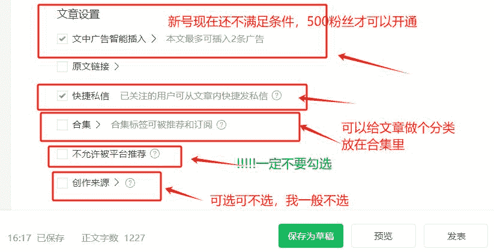

## 6、文章如何发表

文章写完了如何发表，上图都完成后，下面有保存草稿、预览和发表（如上图）。

保存草稿就是把文章保存起来，如果你一次写好多篇可以保存为草稿，以便每次发布时使用。

预览是文章写完了，自己想看一下整体的效果。可以预览一下，需要绑定自己的微信，并且微信需要先关注自己的公众号，这样就可以看到发布效果是什么样的。下图是预览界面

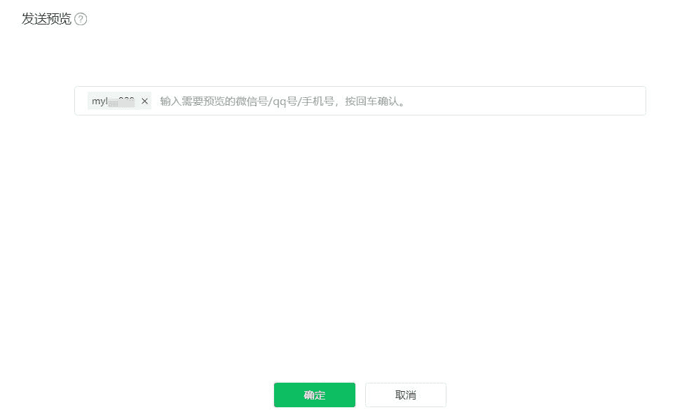

手机端就能看到预览的效果。

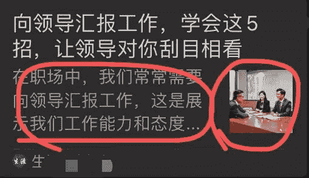

发表是文章都检查完了，也预览了，没有其他问题了就可以发表了。可以是当天发表，也可以预约发表。如果当天的发表次数用完了，可以预约明天的，只能提前预约1天。

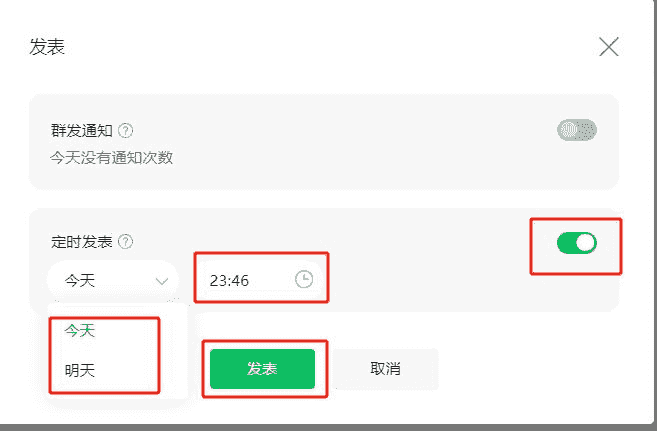

这样，整个文章就完成了。别看这样流程挺多的，实际做的时候也没有那么复杂，慢慢多用就会熟悉了。

# 三、如何写出爆款文章?

这个话题真的不好写。目前我还在为写10W+爆文而努力，但有一点心得体会，分享给你。

## 1、坚持四个“多”

写作这件事，其实没有什么捷径，只能是多读、多看，多写，多练。即使现在有AI辅助，但还是需要自己润色修改的，不能拿些起来就用。要不然也很难有阅读量的。

## 2、找对标

看你写作方向是哪个赛道？然后就去找这个方向的对标账号。哪里找？通常情况，你看的越多，系统会自动根据你看的内容进行推荐。或者在“搜一搜”搜索关键词，或者新榜看你感兴趣的方向。

看看对标账号都是怎么写的？尤其是10W+的账号，多去拆解细节，从内容上、结构上、逻辑上和排版进行分析和研究。

目前比较热的一些方向有：情感故事、新闻热点、心灵鸡汤、娱乐明星、服装搭配、早安问候，职场、养老、养生、三农还有都是比较容易热的，还有历史、军事一些专业领域方面也都是可以的，但写军事一定要注意，不能随意乱说乱写，因为这个是敏感话题，如果随意写，轻者不会被平台推荐，严重者可能封号，所以一定要慎重。

## 3、爆过的文章二创

在公众号的圈子里有一个不成文的法则：已经爆过的文章可以再写，还有可能再爆的可能。这个我亲测有效，虽没有10W+，但至少比自己原创阅读量要大。建议大家可以试试。其实，不仅仅是公众号，很多短视频也是如此，爆过的短视频二创也容易再爆。

## 4、标题很重要

一篇爆文一定有个好的标题，好标题是成功的一半，好的标题是很有吸引力的。现在也有很多标题党，一看标题就想点进去。当然不是鼓励大家都去写标题党，内容还是非常重要的。尤其是写日更的公众号，我们还是要为我们的读者负责，用心写好每一篇文章。

那什么是好的标题？在我们写作营的手册里老师也举2个范例。

**坏标题：**AI小白的我，是如何在赛博朋克机车项目中，一个月挣到1W＋的？

**好标题：**AI小白，一个月1W＋，我做对了什么？

给大家看几个职场几个10W+爆文标题

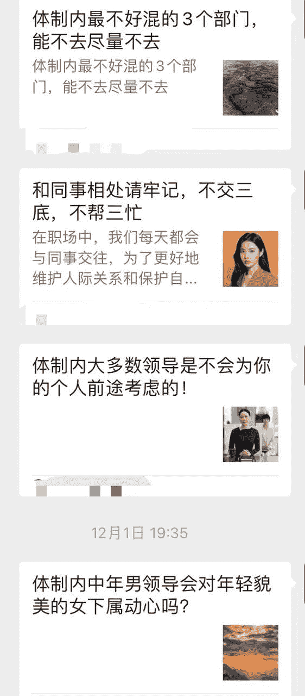

## 5、图文结合

大家知道，视频>图片>文字，这j就是为什么现在短视频这么火，当然也不是说文字没有人看，但是为了缓解读者视觉疲劳，也是为了文章过度，加上图片也会让你的文章更加添彩。

配片一定要和文章匹配，不要选跟文章无任何关系图片，而且图片一定要清晰。可以用AI生图，高清且原创。关于AI生图，下期再讲。

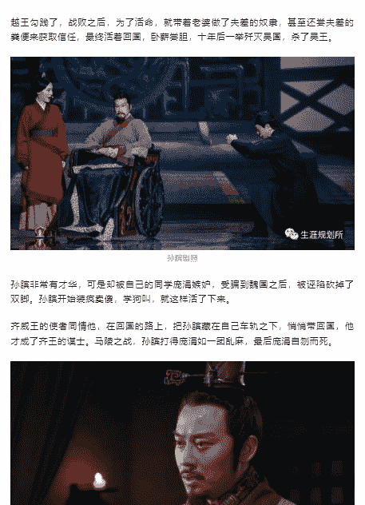

平时记得建立自己的图片素材库，我自己平时就有一个素材库，用的时候就去库里找，很方便。如果你实在找不图片可以去百度、千图等其他网站去找，但一定记得去掉不符合要求的标识，比如LOGO，字体啊，啥的，不合适的内容，要P掉。建议：不要纯文字，除非你的文字真的很有吸引力，所以加上图，

## 6、文章排版

排版好，会增加读者阅读体验感，会提高阅读完成度，但也不要花里胡哨，简单简约，有逻辑有条理即可，可以设置好，比如一级标题、二级标题，小标题，字体字号要有所区别。

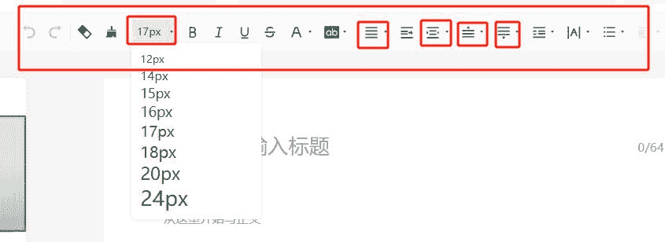

**对齐（一般左对齐）**

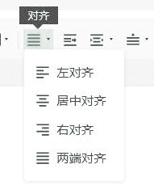

**两端缩进（我一般是选16）**

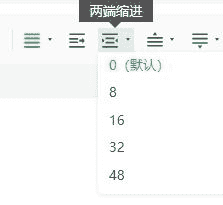

**行间距（1.6）**

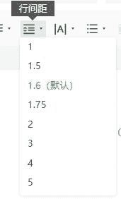

其他按照自己的喜好选择，一定要统一，如果一级标题是17号字，所有的一级标题都要是17号，以此类推。

# 四、公众号如何变现？

说了这么多，公众号到底怎么变现呢，这也是我们写公众号的真正目的，当然也不排除有些小伙们真的是为了纯写作，记录自己的生活点滴。如果是，请不绕道吧。

公众号变现很多中，主要有2种，广告主和流量主。

## 1、广告主

企业主体微信认证才能开通，个人无法开通。暂不展开讲。

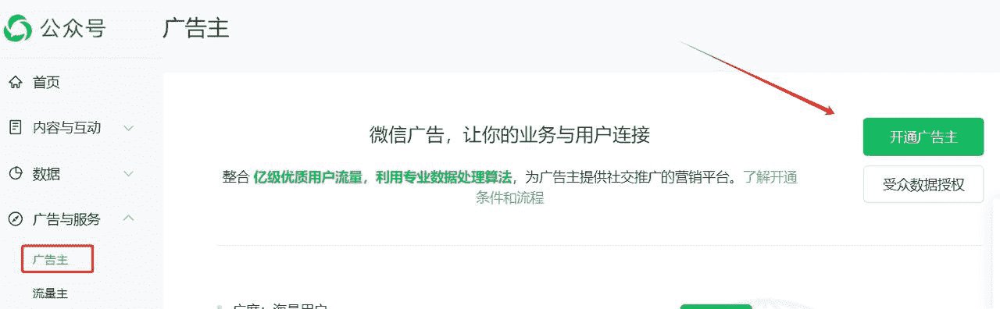

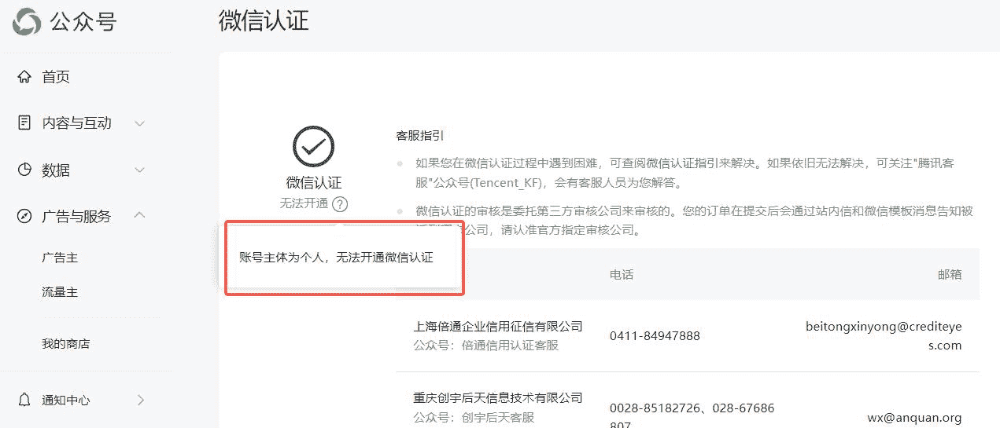

## 2、流量主

这个也是个人主要变现收入来源。分为互选合作，返佣商品、广告管理，我现在主要是广告流量主和橱窗带货变现。我们一个个来说。

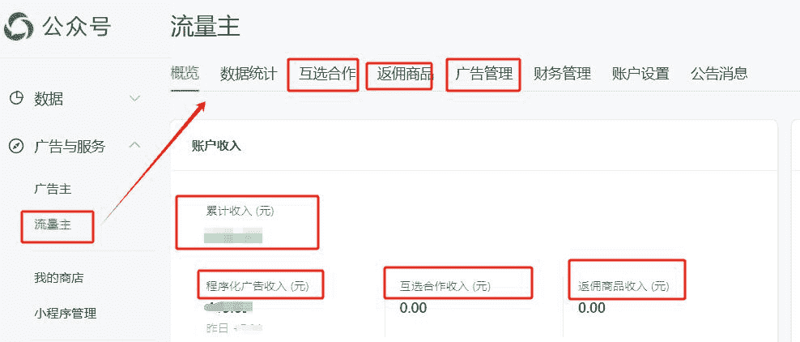

### 1）、互选广告接单

这个是自己接广告的报价，就像代言人，我给你代言，我的报价是XXX，如果广告方觉得合适就会找你。不明白的可以看互选广告接单指引。

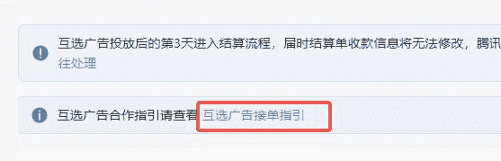

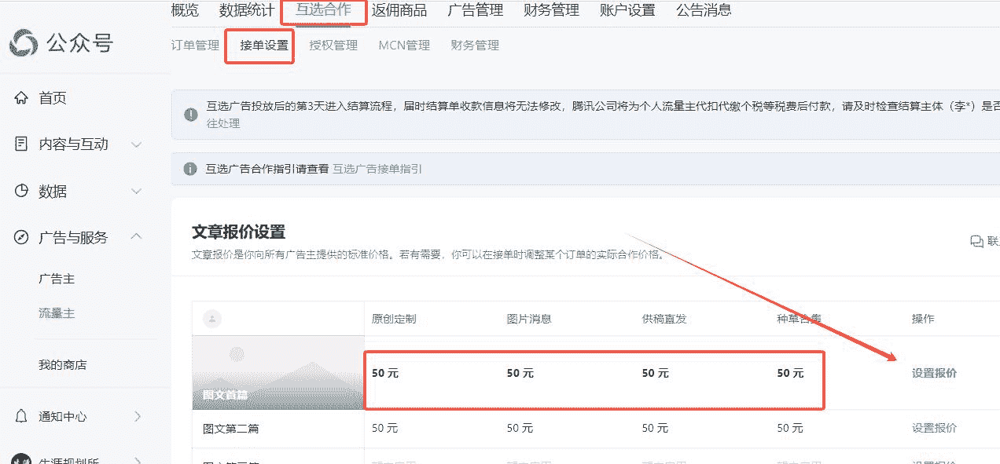

每篇文章自己可以报价，如果不知道报多少，平台也会根据你的实际情况推荐报价的金额。根据自己情况报价，不要太高，也不要太低。

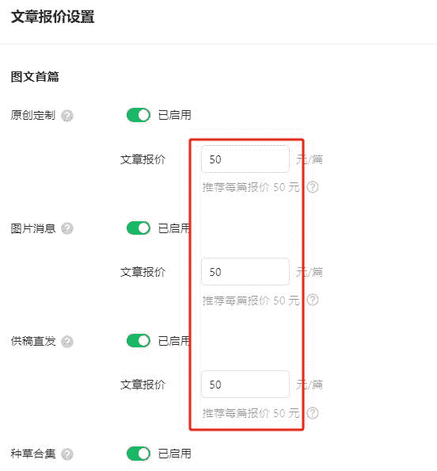

### 2）、返佣商品

开通这个是需要满足100粉丝才可以开通，返佣的商品是各个平台商品。绑定账号各个平台即可。就是通过内容引导粉丝下单商品，各个平台给你佣金。不过需要注意的是，运用这种变现方式一定要慎重！因为这种方式需要有强大的粉丝基础和粉丝信任度，并且粉丝还需要有较强的购买能力，而且一小心就很容易掉粉，失去粉丝信任！

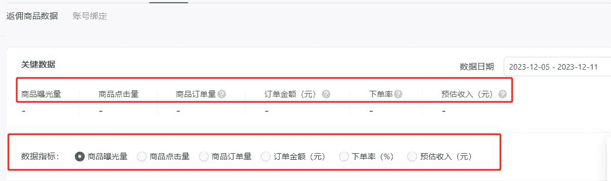

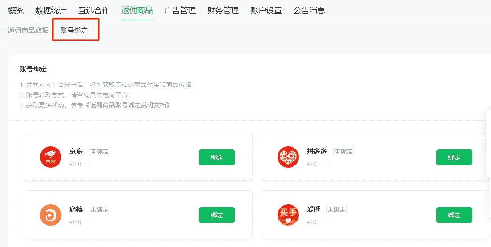

### 3）、广告管理

广告管理有5种，公众号底部广告、公众号文中广告、公众号互选广告、公众号视频后贴广告。每个广告开通都需要满足500粉丝，所以先积累粉丝。

这也是我目前的变现方式。文中文末平台会根据文章字数多少插入相应的广告位，1000字以下文中可以插入1条广告，1200字可以插入2条广告位，只要读者流量的广告你就可以有收益。

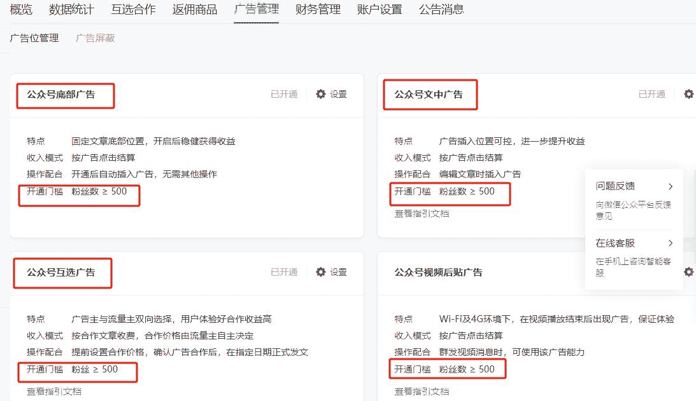

## 3、粉丝打赏

粉丝打赏开通赞赏功能，需要写3篇原创文章后才能开通赞赏。如果读者觉得你的文章比较好，可以给你打赏。金额，5-200不等，也可以自行设置，主要看读者。下图是开通后的展示。

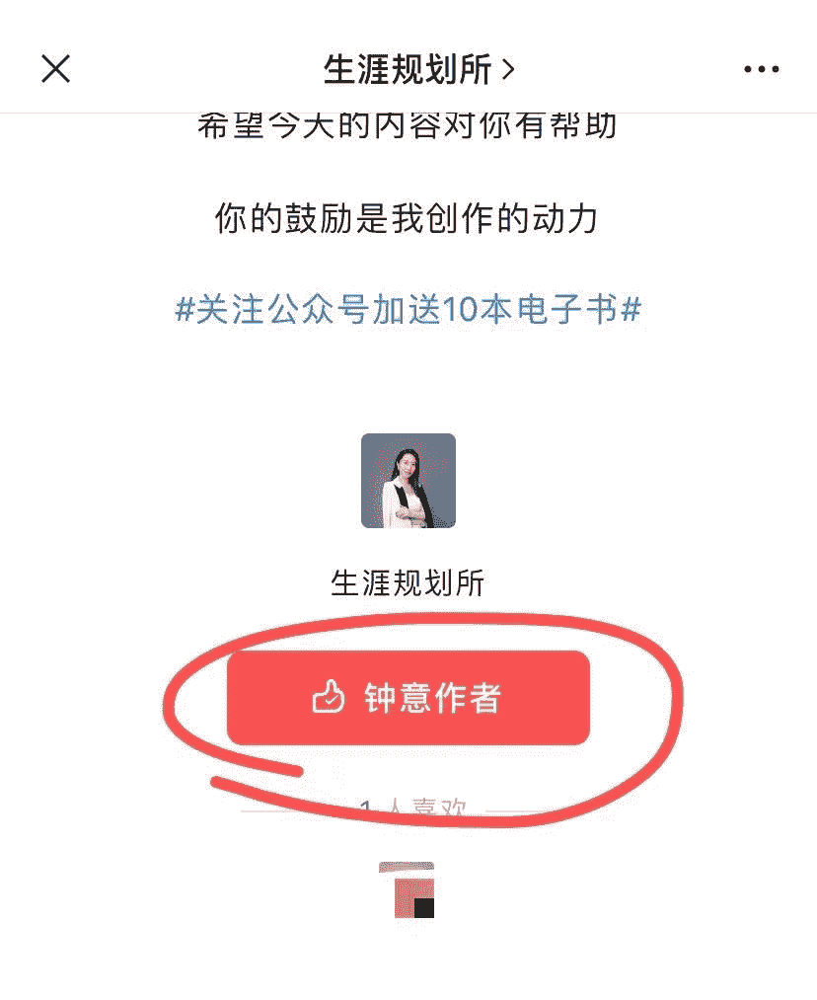

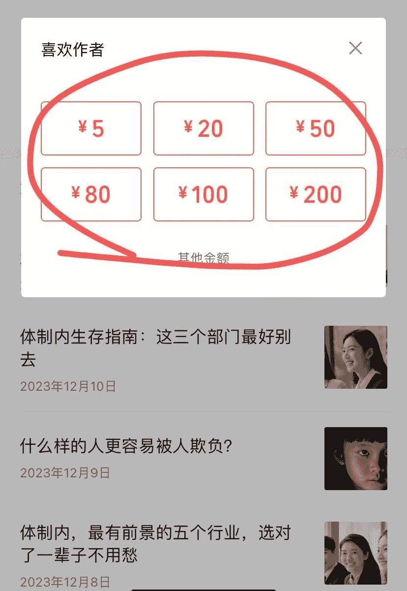

如果有读者给你赞赏了，自己后台能看到，下图是手机端展示：

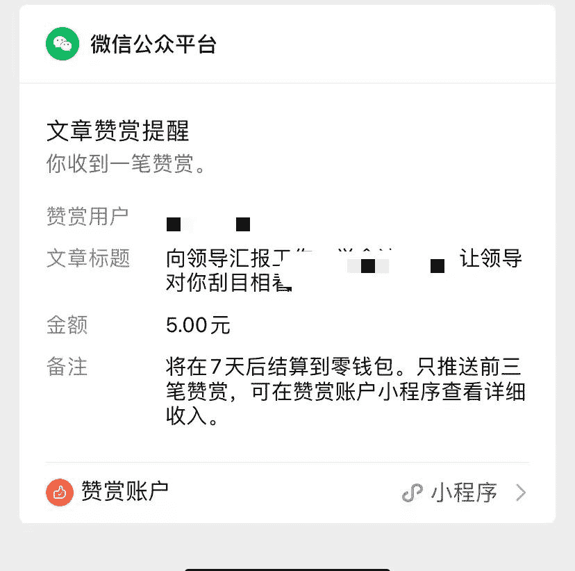

## 4、**付费阅读**

你可以把文章设置成付费阅读。通过知识进行变现，比如说你做一套排版或者XXX课程，价值XXXX元，或者自创【付费资讯】栏目，帮助他人解答某些专业或情感问题，从而收取一定服务费用。如果文章有吸引力，也会有很多人为你付费。

## 5、橱窗卖货

微信、公众号、视频号，都是腾讯家的儿子，他们都是兄弟，所以都绑定在一起，如果你的视频号开通了橱窗，不仅可以在视频号里卖货，还可以可以绑定你的公众号，在公众号里卖货。我就是这样卖书的。前提是视频号开通橱窗，不过这个是需要交1000元押金的。今天不展开说了。

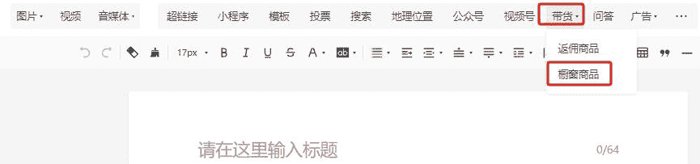

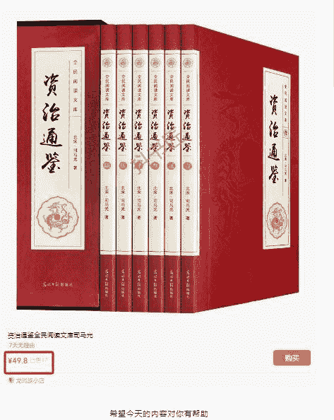

## 6、发售变现

这种就是比较高级变现，很多大佬或IP大V会做发售。他们会在公众号发布销售信，然后发售自己的产品，直接卖。

一般都是知识付费的产品，而且客单价比较高，公众号里直接发产品海报，包括付费码都可以放在公众号里。这种变现公众号都是有一定的粉丝量。

如果你的公众号有一定粉丝量，没有自己产品也可以卖别人产品。像我们破局很多圈友卖星球的产品或者自己产品也是可以的。

如果你是一个新号，不建议这样搞，新号一定要先写，积累粉丝量。

好了。今天先给大家分享这些，其实想要做好公众号也不是一件简单的事，但只要用心，变现也是没有问题的。

没有一件事是简单的，凡是只要努力坚持都会有收获。

我是云朵，希望今天的分享对你所有帮助。如果你也想写公众号，欢迎一起交流学习。