# 借【数字人】的东风，小众需求一周变现一万

> 来源：[https://xuqiwei1986.feishu.cn/docx/VQNkdQqwvoLX2YxjmH9ctDFgnDb](https://xuqiwei1986.feishu.cn/docx/VQNkdQqwvoLX2YxjmH9ctDFgnDb)

大家好，我是beartao，作为一个连续创业者，从今年5月开始深耕【AI声音克隆】和【AI美女图片】，最近两个月借着数字人的东风，从10月开始声音克隆单项目收益实现了过万，可能有圈友会质疑项目的生命力，恰恰相反，现在看来，这种小众声音克隆需求有了成倍的增长，后面给大家带来了实时声音克隆（RVC）模型训练教程。

## 一、**第一次发帖，先谈谈个人经历**

1、第一桶金来源于多年前，作为二手房生意，当时在农行贷款了60W，注意不是中介，而是游走于中介的炒房客，大部分房源来自于中介和开发商，感到有利可图就低买高卖，开发商为了降低风险，提前放一部分房子出来优惠给我们，我们再通过中介卖出去，受利于城镇化的发展，周边农村的人群都希望来城市安家，很多户型垃圾的，没证的，小开发商的我们收着也能卖掉，当时最大的焦虑来源于手上资金不够，手里有5W就敢去预定5套房子！定金交了，尾款急得要死，到处筹钱，现在想起来回味无穷！

2、房价不怎么涨以后，股市开始猛涨，各种理财，数字货币，各种平台层出不穷，接触的比较多的是中南邮币交易中心，邮币卡相信圈友肯定有接触过的，最高纪录一个星期增值20W的，早上起来第一件事就是抢邮币卡，抢到就是赚到，玩过股票类似平台的都知道，人的贪欲是无限的，一般人安全下车是不可能的，果然后来zf一刀切，血本无归的人大有人在，加上后面的各种数字货币概念的东西，各种空气币，我的圈子里面几乎没有一个能够幸免的，各个都损失惨重！

3、 伤过的心，好像玻璃碎片，我决定远离网上那些虚拟的平台，和以前的生意伙伴一起去厦门做起了电影（合伙人是福建人），负责了后期的管理工作，也是鉴于那时候电影的火爆，看到随便一个垃圾电影平台分成啥的都蛮可观的，也做出了几部网络大电影，但是公司一直没有起色，要死不活的，后面受到了yq的影响，基本处在了停滞的状态！

4、再出发，从福建回到老家湖南，重新整理，一方面花时间陪陪家人，一方面在生财里面边学、边做、边总结，从5月开始AI生意克隆这块就开始了变现，已经有几个月的深耕，下面就详细给大家介绍AI声音克隆项目。

## 二、声音克隆需求的增长

万事俱备，只欠东风，随着数字人的爆火，对声音的需求也是水涨船高，市面上存在的那些声音都被人用烂了，所以一个优秀的数字人必须配备一个有辨识度的声音。

### **1、**数字人代理公司，现在的商家都比较重视抖音和线上，这个老哥代理了五十个数字人，给他们每个人都安排了，每个人的声音都不一样，就需要进行声音复刻，当然，这个是属于那种比较偏低端一点的客户。

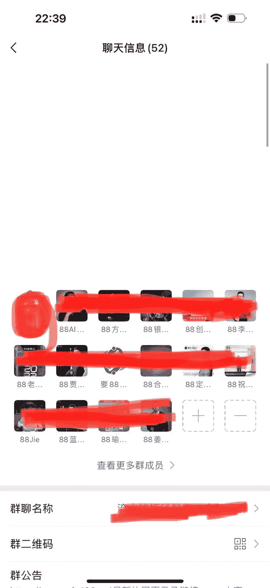

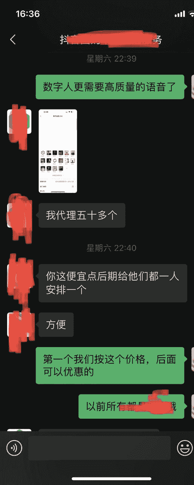

### **2、**高端客户，这个公司的客户都是年收入上千万的老板，做个数字人都是大几千的预算，老板级别的要求也高，售后这块就要做好，当然回报也是很丰富的哈，价格就可以往上走2-3倍，都是OK的，看服务的哈

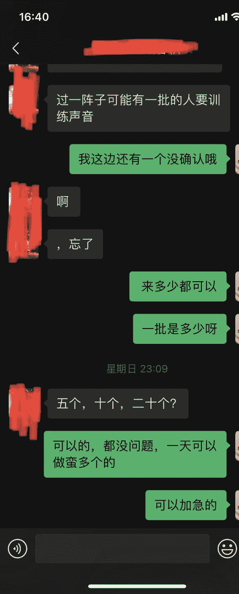

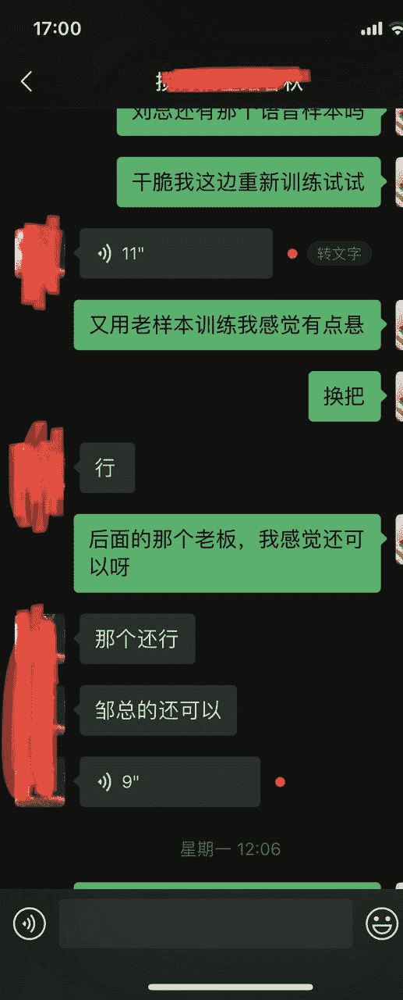

### **3**、散户玩家，自己做自媒体数字人，同时还有那种自己懒得去弄，买现成模型的玩家，需求量也是很大的，风口上，猪都能升天，价格适中就行。

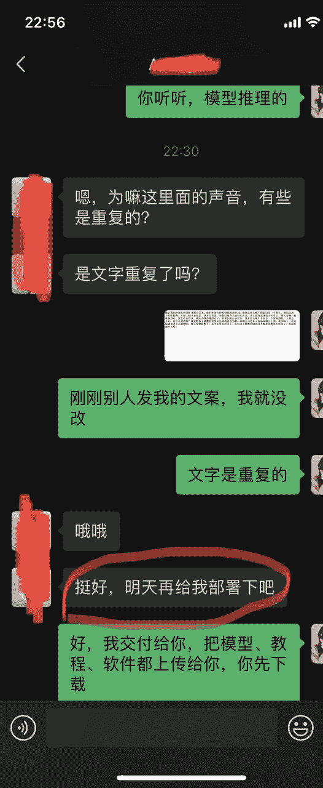

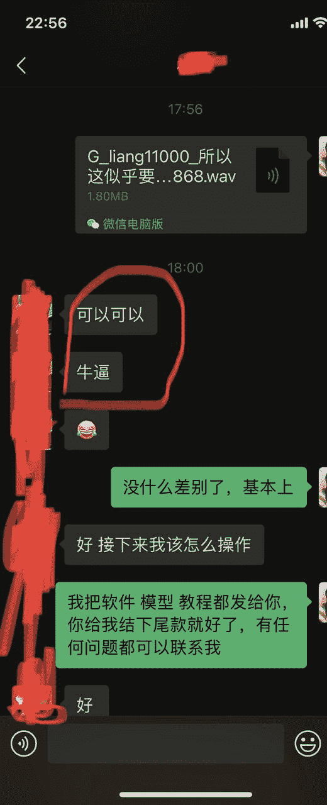

## 三、声音克隆项目前景分析

1、视频图片越来越卷，动不动就判重，自媒体从业者们已经开始追求有辨识度的声音，特别是虚拟的数字人爆火以后，给你自己的数字人匹配一个独特的声音就成了最大的需求，从10月份开始，声音克隆这块咨询的人数肉眼可见的变多，需求在哪里，机会就在哪里，传统行业的老板，商家都是我们的客户。

2、项目看上去难，其实熟练以后实际操作起来很简单，没有实际的成本，买个二手显卡就可以开干，特别适合作为个人的副业，如果能像我一样，能够对接几个大客户，就可以做比较灵活的工作室。

3、现阶段真正入局的人也不是很多，再加上技术的不断更新，也就从另一方面隐性提高了门槛，需要我们不断花时间取学习研究，当然可以考虑找一个长期深耕的老师，定期更新技术就行了。

4、私域积累的重要性。老客户复购和转介绍给我带来了不小的业绩，由于项目的特殊性，技术的不断更新也会促使需求的进一步释放，客户总是想尝尝新鲜的东西，好像人都是这样的哈。

## 四、项目变现案例分析

1、**文字转语音**，**包括直播间**音色模仿，有声小说声音复刻，宣传片特色配音，广告声线复刻，据不完全统计，这块需求占到了需求的百分之八十。大部分都是私人定制，针对特定的声音进行复刻，有个公司主播是教声乐的，人家的客户服务做的真牛逼，他们找到我直接克隆了主播的声音，别人去跟单一般都是发文字，他们跟单直接主播克隆的语音啪的发过去，话术每个都不同，听的我都想去学音乐了，哈哈！

[老师跟单话术.wav](https://internal-api-drive-stream.feishu.cn/space/api/box/stream/download/all/Jab6b4P6soW3vLxuf3kctqNAn3c)

2、**歌曲翻唱和生日祝福**，有少数喜欢唱歌的，五音不全的小姐姐小哥哥，希望用自己的音色翻唱歌曲；另一块主要是女生，希望自己偶像和自己说段话，过生日希望听到偶像的声音，给自己一个念想，这里给小姐姐的消费能力点个赞哈！

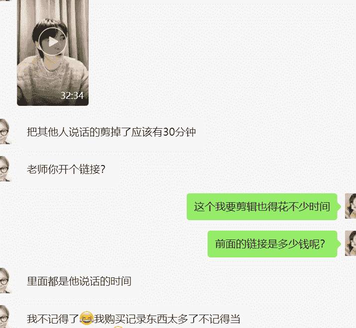

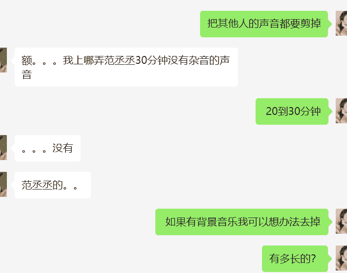

3、**亲人声音复刻，亲人的声音****克隆**。这最后一种就是留一个念想，克隆爷爷奶奶的声音，克隆父母声音等等，我这边有一个案例是一个学生克隆他过世老师的声音，在我这里消费了1000+。

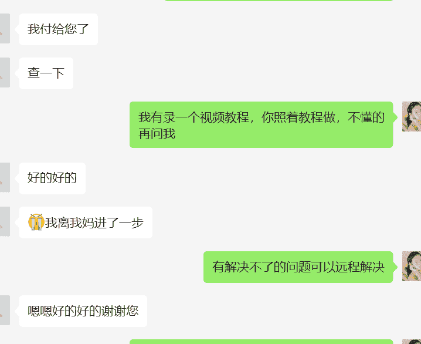

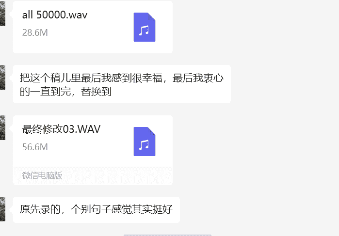

4、**教学、软件训练支持与模型售卖**。大家都知道开源软件本来就是免费的，所以经常会报错，就算有大大小小的课程，课程下面总是有留言有解决不了报错的问题，这里就给了我们发挥的空间，软件可以不赚钱，卖个软件加售后服务还是有操作空间的。当我们手上做了一些模型以后，就自然会有客户直接购买，既省事又便宜，我们要做的就是把模型分门别类，或者平常可以自己训练一些备用。

## 五、项目优势与变现途径

很多小伙伴可能心里开始打鼓了，声音克隆这么高大上的项目，操作肯定很麻烦，在这里我告诉你，操作很简单，小学毕业都可以，只要你会操作电脑，熟练之后，我现在做个声音克隆实际操作时间只需要10分钟左右，然后挂在电脑上AI自动训练几个小时，无需人为其他操作，如果加上云端训练，一天可以做了3-4个，可变现800以上。

声音克隆项目目前处在一个发展期的阶段，就是由于不够成熟，普通人进去都能分一杯羹的，做为副业是非常理想的项目

1、属于比较新兴小众的赛道，从这几个月咨询量来看，需求其实还是蛮大的，问的人很多

2、竞争不是很大，不像普通的电商，哪个类目都是一堆人

3、单价可以达到150-300之间，成交率可以说非常高，平均咨询3个人就有一个成交，而且客户的态度相当好，把你当做大神，我接单都是高姿态，先付定金再开始！

**变现渠道：**

1、我主要的变现平台在闲鱼和淘宝，为什么选择在闲鱼这个平台？因为声音克隆这个是属于上不了台面的偏门应用，闲鱼的用户流量大，各式各样花式的服务都有，客户群体已经有了这个习惯，这几个月的客户8成来自于闲鱼，2成来自于淘宝，其实高成交率，高客单价也是需要话术和技巧的，所以这几个月我也总结了一套包括爆款主图、文案、成交话术，特别好用！

2、抖音爆款视频评论区，随便搜索【声音克隆】，找到爆款视频的评论区，一是有很多付费做克隆声音的，二是有好多说软件报错的，还有哪里不懂的人，你就搞几个小号去留言，然后自己置顶一个案例视频即可，一天有时候可以引流几十个人。

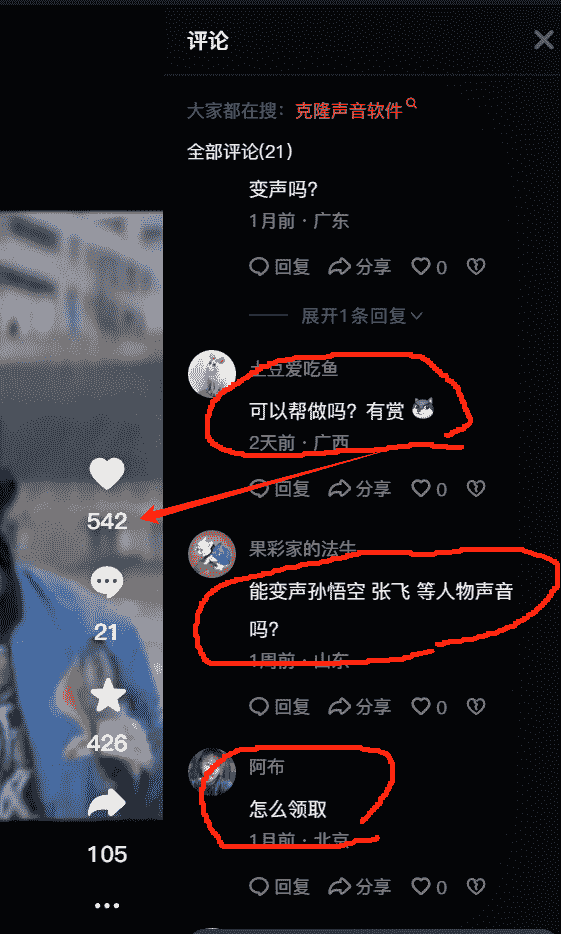

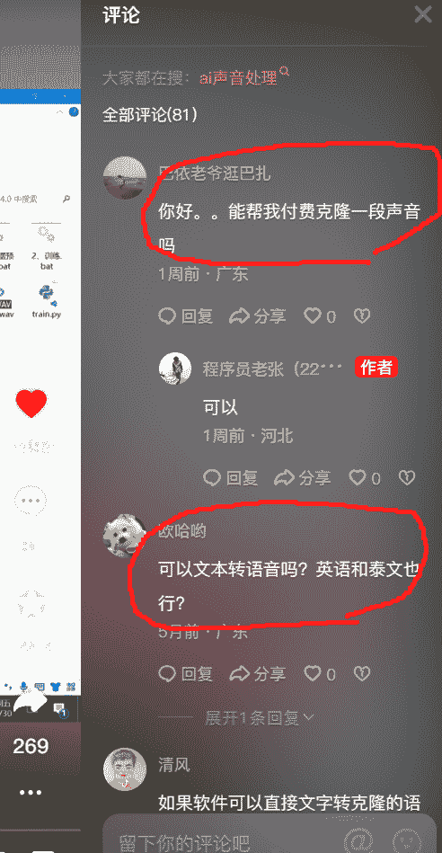

3、B站平台，我发现B站up主都比较“高冷”，有些小白确实不懂，在视频下面留言人家理都不理，然后你就热情点，假装帮解决问题，然后引到私域就行了。

另外还有其他平台，小红书我主要做AI美女图片，我感觉应该也是有市场的，大家找对标就好了哈！

当然你想一招吃遍天下是肯定不行的，技术在发展和进步，各类新的开源软件层出不穷，需要我们要多去关注【声音克隆】领域新的东西，所以我每天都会花两个小时去了解和学习最新的AI技术，现在我基本成为了声音克隆领域的一个小玩家，欢迎圈友和我相互交流。

## 六、RVC实时声音克隆

实时声音克隆，顾名思义，就是输入音频，输出的时候是模型训练的声音，以前主要用在游戏变声。

### 1、RVC变现需求

最近有个工作室找到我，他们做的直播和短视频，为了去重和避免审核，视频这块扒的别人直播间的主播录屏，然后用huanlian软件把主播的脸换掉，关于声音这块全部是扒的别人直播间的音频，然后用自己人音色替换，这边就需要我们这边来帮训练模型，替换扒下来的音频，在我这里已经做了近十个模型，通过这个需求，我这边也向其他的老客户推荐这种玩法，想不到复购率还是蛮高的。

### 2、RVC优势

1、最新出来的声音克隆算法rmvpe，相对于sovits的现有算法来讲，rmvpe算法具有仿真度高，哑音少的特点，特别对于一些女声的翻唱需求，可以更好的满足，比方说把偶像的声音进行克隆，然后用他的声音进行翻唱，或者用偶像的声音进行变声娱乐等。

2、训练模型速度快，对电脑的要求偏低，一般只要1-2个小时就可以训练好，对电脑的配置要求不高，6G显存也可以训练，同时训练的步骤非常简单，熟练操作后可以控制到5分钟以内。

3、同时支持AMD显卡和N卡，是某些A卡用户的福音，局限性小。

说了优点，缺点就是只支持**音频转音频，不支持文字转音频，**如果需要文字转音频，需要先用其他软件生成音频之后，在用音频推理音频，相对比较麻烦。

### 3、RVC实操

**您需****要准备至少****30**G的硬盘空间，N卡或者A卡显存6-8G，内存至少16G，window10系统

#### 1、解压软件包（软件会在文章最后链接里分享）RVC1006Nvidia.7z，注意路径不要有中文。

#### 2、找到根目录.\RVC1006Nvidia\go-web.bat，双击打开,出现以下的窗口内容，就表明运行成功

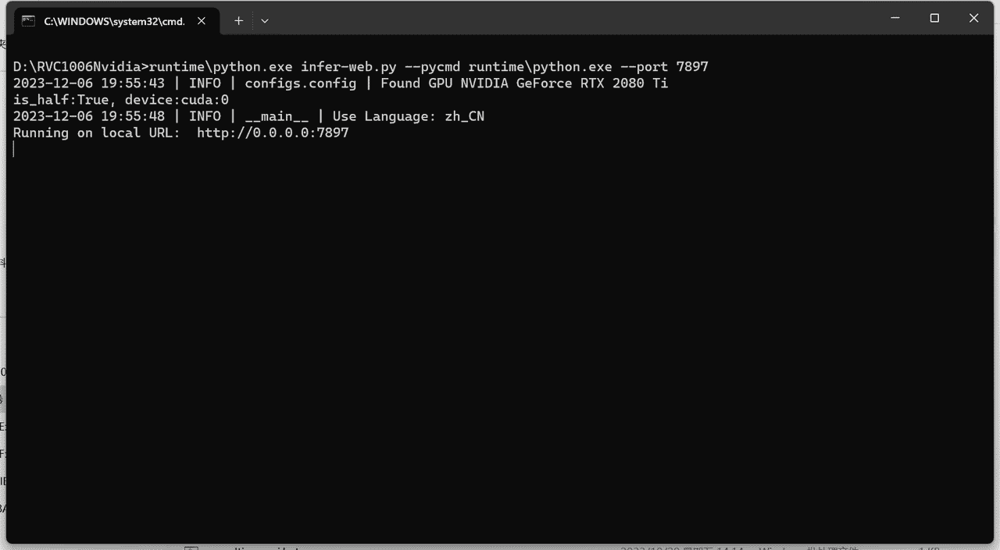

#### 3、浏览器推荐**安装谷歌浏览器，**点击标签页**训练，打开的页面如下图所示**

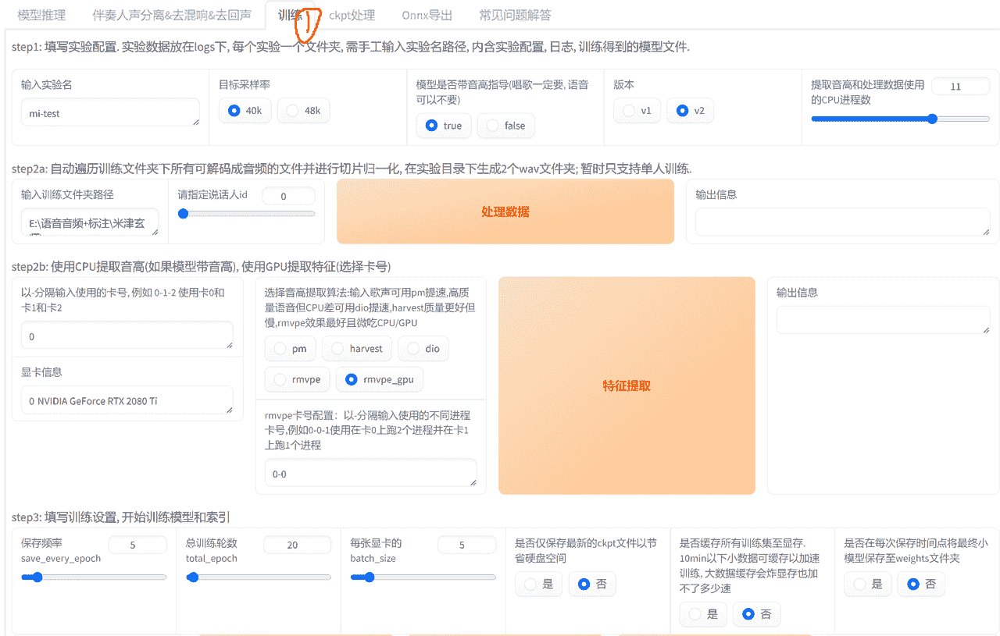

#### 4、**训练的准备工作****，准备30分钟**左右干净的音频文件XX.wav，后缀一定要是wav,不然可能报错，干净的意思就是只有一个人的声音+没有背景音色+没有杂音，推荐处理软件Aud**ition**，Ultimate Vocal Remover，没用过的小伙伴自行百度一下哦，我这边分享的内容都是绝对免费的软件，没有的可以找我拿（这里啰嗦一句，对于开源软件，我们的路径和命名都建议取英文，千万不要取中文名字。）

#### 5、准备工作做好以后，就可以开始进行参数设置

①、模型名称设置，英文

②、采样率默认：40K

③、模型是否带音高指导(唱歌一定要, 语音可以不要)，唱歌就选择true，语音就选择false

④、版本选择更新的V2

⑤、提取音高和处理数据使用的CPU进程数：默认8-11

⑥、输入训练文件夹路径：X:\XXX\XXX\，这个是文件夹目录，不是文件

⑦、保存频率：10-20之间，总训练轮数200-500之间，每张显卡的batch_size：6-8G显存可以设置为6

⑧、后面三个参数默认，**是否在每次**保存时间点将最终小模型保存至weights文件夹，建议选择是

请仔细对照上面的选项和参数进行设置，一定要根据自己的电脑的性能匹配，不然可能出现显存溢出，报错，下面的图对应序号和上面的参数是一致的，方便大家检查，设置好以后，点击一键训练

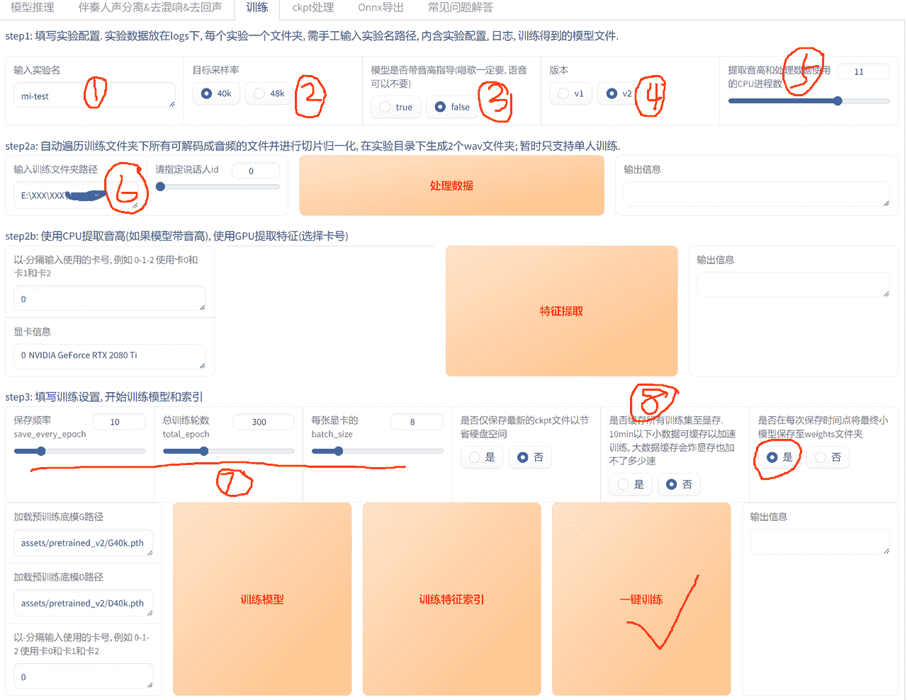

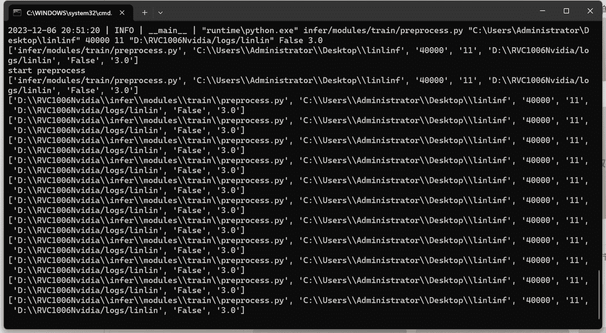

模型预处理中

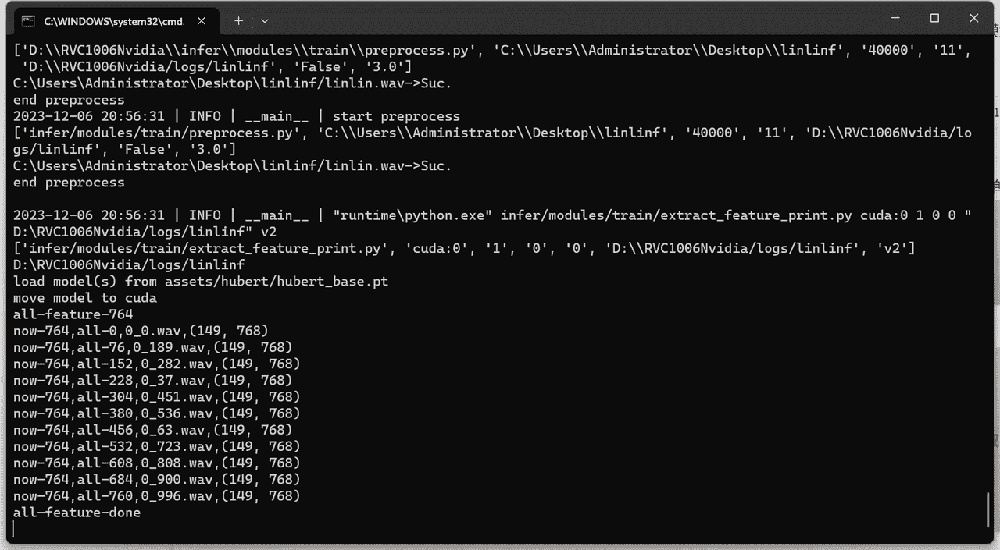

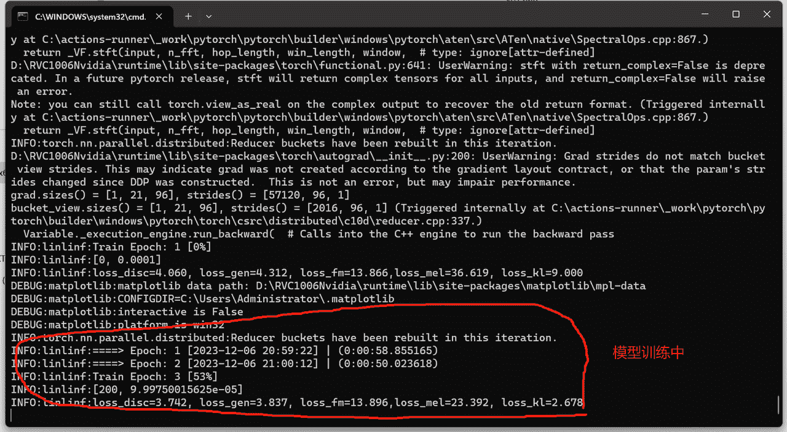

#### 6、训练完成以后，点击训练索引文件

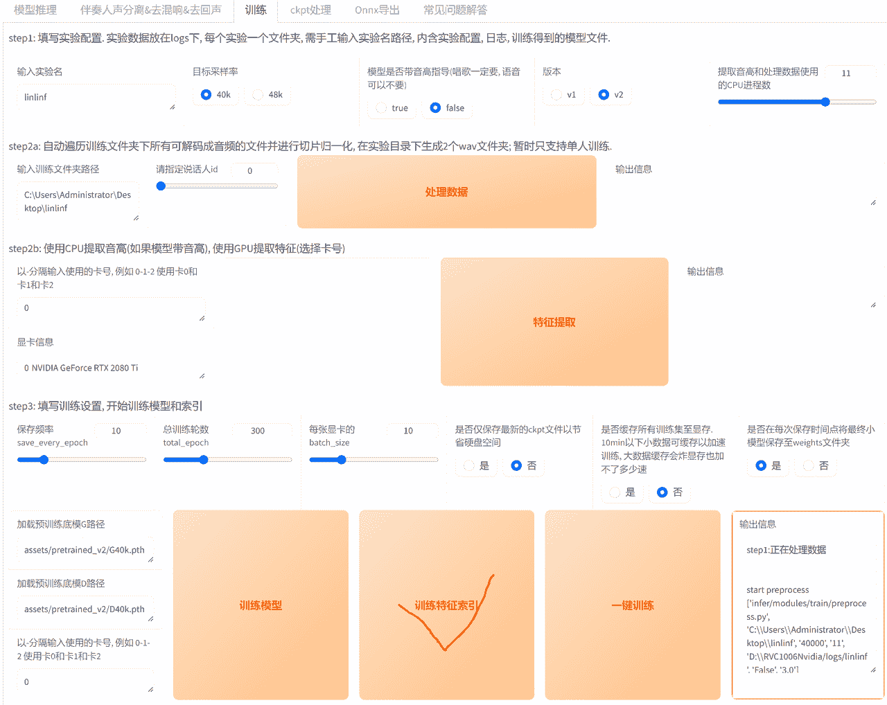

#### 7、**训练完成后，会****生成模型****文件和索引文件**

模型文件保存在.\RVC1006Nvidia\assets\weights\ 文件夹里面，XXX.pth，索引文件保存在.\RVC1006Nvidia\logs\XXX（你的命名）\ 文件夹里面的addedXXXXXXXX .index 中,（注意索引文件是那个added开头的文件，而不是trained开头的那个，别弄错了）

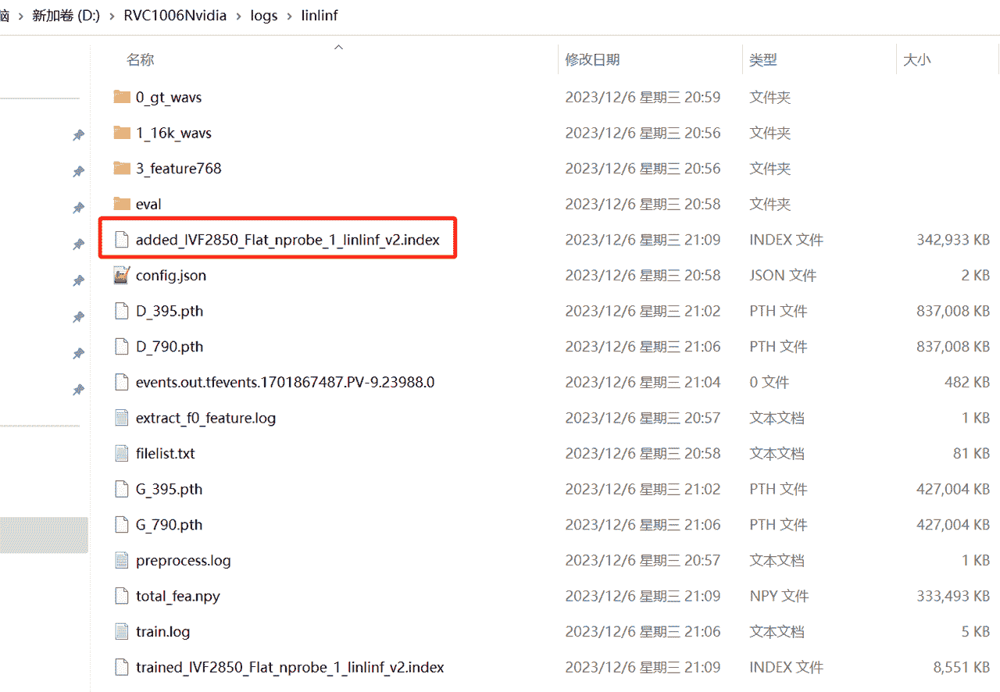

#### 8、模型使用

当你看到这两个文件的时候，恭喜你，RVC的模型已经训练成功了！！那我应该怎样使用我们训练的模型呢

①点击切换到【模型推理】标签页

②点击 【刷新音色列表和索引路径】按钮

③选择你训练的XX.pth模型

④选择你训练的XX.index索引文件

⑤输入你要处理音频路径x:\XX\XX.wav

⑥点击【转换】按钮

请一一对应下图进行操作，不要跳过任何一个步骤

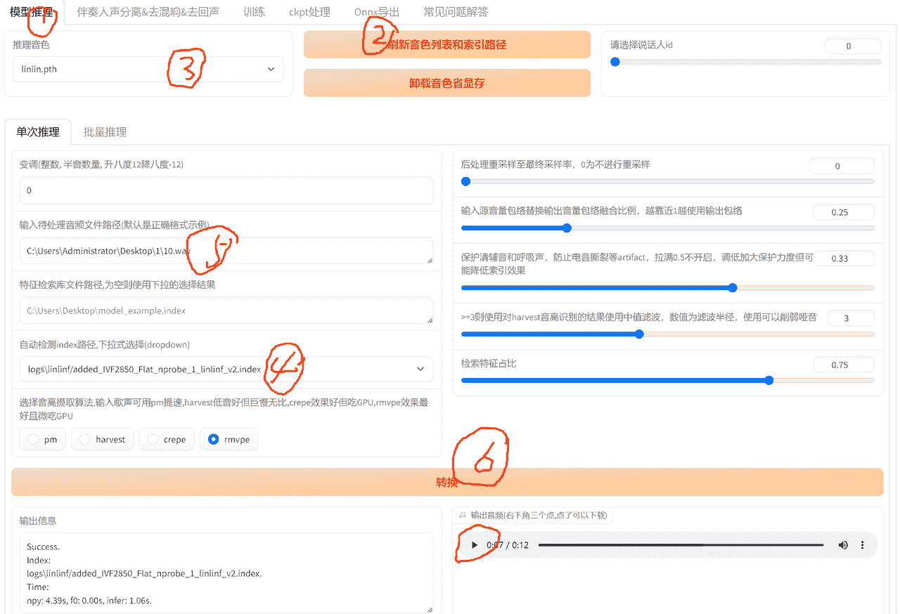

**上面演示的是单个音频的转换，那我们要批量**转换的话要怎么办呢？如下图所示，操作即可

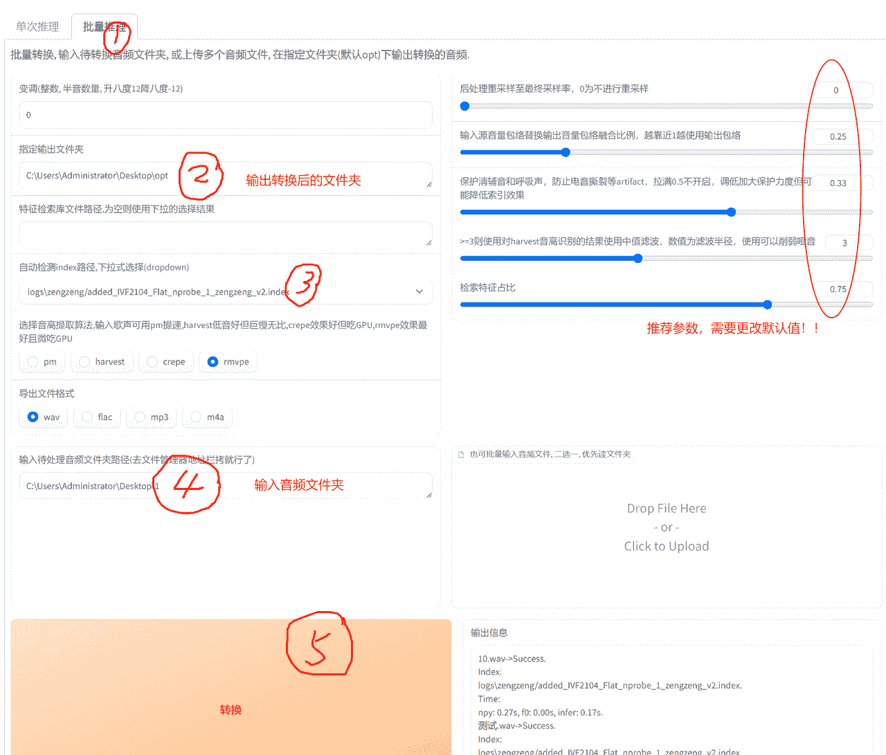

### 4、交付给客户

把模型文件、索引文件和软件上传到百度网盘，发链接即可！

## 七、总结一下

由于项目使用的都是开源软件，就不可避免的会出现大大小小的报错，其实是很正常的，免费的东西我们就不能多要求什么，重要的是我们掌握软件的使用方法，了解各个软件的优点和缺点，物尽其用，把我们项目做好，让客户满意就行了，不用过于纠结，本人一直深耕声音克隆这个领域，有问题的圈友可以咨询我，我会尽力帮大家答疑解惑。

## 八、文中RVC 克隆软件链接

链接：https://pan.baidu.com/s/1rG_rLIXB4KUJfTIK6sXsjQ?pwd=pawb

提取码：pawb