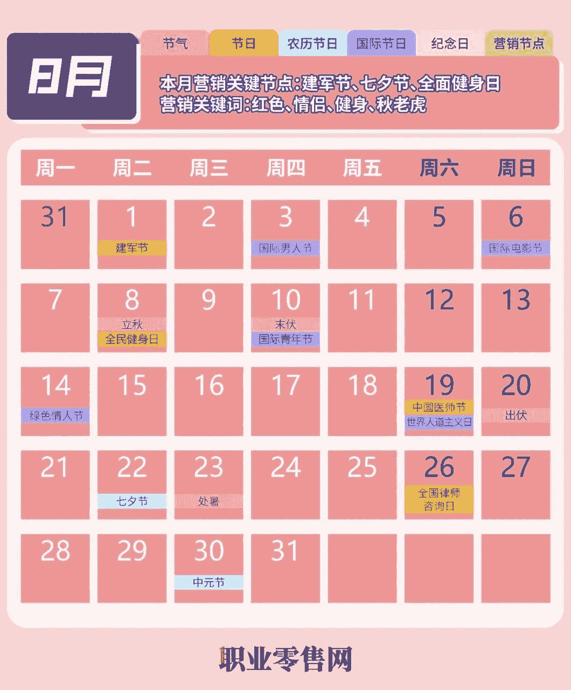

# 2023-12-11全年营销日历，拿走不谢！_节气_关键_节点

> 来源：[https://xuqiwei1986.feishu.cn/docx/EhvMdnmNwo8V1rxCLrOcrf6inMb](https://xuqiwei1986.feishu.cn/docx/EhvMdnmNwo8V1rxCLrOcrf6inMb)

> 🔗 原文链接： h[ttps://www.sohu.co](https://www.sohu.com/a/623147501_349392)m/a/623147501_34...

本文来源 | 职业零售网

**导读： **2023全年营销热点日历，可收藏！

即将告别2022年，迎接2023年。

在新的一年里，除了我们常见的春节、元旦、国庆、中秋等节日外，还有哪些节日、节气、营销热点呢？

近日，我们整理了 《2023年全年营销热点日历》 ,里面包括节气、节日、农历节日、国际节日、纪念日、营销节点等，可以让零售人更好地 记住它。

随着疫情的放宽， 2023年，让我们主动出击，把握住这些流量密码，让我们能实现业绩增长。

**一月份营销日历**

**本月营销关键节点： **跨年夜、元旦、小年、春节 **营销关键词： **春运、团圆、新起点、年末目标达成

**元旦： **新年、跨年、新年祝福、迎新、新起点、送别2022、2023、计划、flag

**腊八： **腊八粥、腊八习俗、南北风俗

**小年： **年味、南北小年不同、祭灶、灶王爷、年货、糖瓜、饺子、汤圆、言好事、祝福。

**除夕： **回家、团聚、年夜饭、红包、守岁、拜年、长大、年味、春晚、陪伴、温情、兔兆丰年

**春节： **回家、团圆、年夜饭、红包、守岁、拜年、长大、过年、春联、福字、年画、灯笼、桃符、爆竹、门神、年味、春晚、陪伴、温暖、兔年、“兔”相关。

**二月份营销日历**

**本月营销关键节点： **立春、情人节、元宵节 **营销关键词： **表白、猜灯谜

**立春： **节气特点、二十四节气第一个节气、新的开始、新的轮回、迎春、咬春、春天的开始、春饼、春卷

**情人节： **爱情、表白、爱、甜蜜、浪漫、鲜花、礼物、一生一世

**元宵节： **月圆、赏花灯、猜灯谜、汤圆、元宵、烟花、节日习俗

**雨水： **甘雨时降，润物无声。二十四节气中的第二个节气，气温回升、冰雪融化、降水增多。

**三月份营销日历**

**本月营销关键节点： **女士节、妇女节、春耕节 **营销关键词： **不惧年龄、不惧挑战

**二月二： **龙抬头、理发、抬头、龙首

**女神节： **幸福、美丽、礼物、关爱、健康、力量、影响力

**植树节： **树木、森林、绿化、节能、绿色、环保

**3·15消费者权益日： **消费者权益、品牌、品质证明、打假、保障、揭露骗局

**四月份营销日历**

**本月营销关键节点： **清明节、谷雨、地球日 **营销关键词： **低碳生活、踏青、春游

**愚人节： **搞笑、有趣、逗趣、整蛊、“愚”谐音、恶搞、创意、新奇；

**清明： **哀思、祭祖、怀念、缅怀、青团、踏青、自然、出游、假期、饮食、各地习俗

**谷雨： **春季最后一个节气、雨水、春暖花开、踏青、耕种、生长

**五月份营销日历**

**本月营销关键节点： ****五一假期、青年**节、母亲节、520 营销关键词： 带着妈妈去旅游、向劳动者致敬

**劳动节： **劳动、干活、劳动最光荣、长假、出游

**五四青年节： **青年、热血、青春、精神、品格、当代青年、奋进、努力、丧、自嘲、诙谐、单身

**母亲节： **感恩、感谢、母爱、孝心、礼物、愿望、年轻、怀旧、成长、陪伴、健康

**520表白日： **表白、爱情、我爱你、另一半、情侣、甜蜜、礼物、鲜花

**六月份营销日历**

**本月营销关键节点： ****儿童节、父亲节**、端午节、高考、618 营销关键词： 童年、责任、粽子、买买买

**儿童节： **孩子、童趣、童心、长大、回忆、怀念、返老还童、童年回忆

**高考： **高中、金榜题名、试题、毕业、校园、回忆、青春、报考

**端午： **粽子、屈原、龙舟、雄黄酒、祈福、传统文化、各地习俗、假期、出游

**618年中大促： **买买买、剁手、购物、清空、大促、优惠

**父亲节： **爱、父爱如山、超人、无所不能、心愿、生活、走心、催泪、共鸣、团圆

**七月份营销日历**

**本月营销关键节点： **建党节、香港回顾纪念日 **营销关键词： **毕业季、致敬、防暑降温

**建党： **建党101周年、爱党、爱国、听党指挥、党的历程、正能量；

**小暑： **节气特点、清凉、等风、热情、火热、乘凉、幽静、夏打盹；

**大暑： **节气特点、炎热、防暑防晒、习俗、暑假、盛夏。

**八月份营销日历**

**本月营销关键节点： **建军节、七夕节、全面健身日 **营销关键词： **红色、情侣、健身、秋老虎

**建军节： **军人、军装、红色、热血、激昂、正能量、实力、爱国、守护、保卫、致敬、奉献、青春、使命、担当

**立秋： **节气特点、贴秋膘、秋天、秋季、天高气爽、金黄、成熟、收获、换季

**七夕： **乞巧、爱情、牛郎织女、祈福、情侣、撒狗粮、甜蜜、鲜花

**九月份营销日历**

**本月营销关键节点： **中秋节、全国爱牙、教师节 **营销关键词： **团圆、月饼、牙健康、感恩

**开学： **返校开学、第一课、好好学习、成长、假期结束、好久不见、军训、新起点

**教师节： **教师、感恩、鲜花、粉笔、蜡烛、黑板、老师说的话、各科课代表、解惑、授业

**中秋节： **团圆、回家、月饼、赏月、嫦娥、吃饭、思念、小假期、出游

**十月份营销日历**

**本月营销关键节点： **国庆节、重阳节、万圣节 **营销关键词： **敬老、小长假、扮鬼

**国庆节： **祖国诞辰、举国欢庆、吃喝玩乐、长假、出游、度假、风景、旅途

**重阳节： **登高望远、敬老爱老、爬山、菊花、茱萸、感恩、孝心、回家、九九、“久久”谐音

**万圣节前夜： **鬼、捣蛋、南瓜、蝙蝠、恐怖、恐吓、变装、尖叫、面具

**十一月份营销日历**

**本月营销关键节点： **立冬、感恩节、双十一 **营销关键词： **冬天、感恩、促销、梦想

**万圣节： **捣蛋、南瓜、蝙蝠、恐怖、变装、面具

**立冬： **节气特点、进入冬季、寒冷、保暖、冬日温暖、陪伴、雪、饺子

**双十一： **剁手、清空购物车、购物、抢、买买买、单身狗

**感恩节： **感恩、亲情、感谢、温情、回报

**十二月营销日历**

**本月营销关键节点： **双十二、冬至、圣诞节、跨年夜 **营销关键词： **剁手、饺子、年终、跨年狂欢

**大雪： **节气特点、大雪、冬季、保暖、寒冷、温暖、关怀

**冬至： **节气特点、习俗、饺子、进补、养生、夜最长昼最短

**平安夜/圣诞节： **苹果、礼物、圣诞老人、圣诞树、圣诞帽、亲情、狂欢、派对、爱、温暖、温情

**跨年夜： **年终复盘、年度总结、展望、新年计划、立flag、跨年狂欢夜、送别2023迎来2024、感谢所有经历。

最后，2023年的号角即将吹响，希望所有零售朋友们，能够保持“争”[的意识、拿出“拼”的](https://www.sohu.com/?strategyid=00001&spm=smpc.content.content.2.1702259792672hso2JJc)劲头，2023年，我们一起撸起袖子加油干，风雨无阻向前行！  返回搜狐，查看更多

责任编辑：