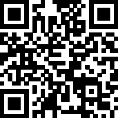
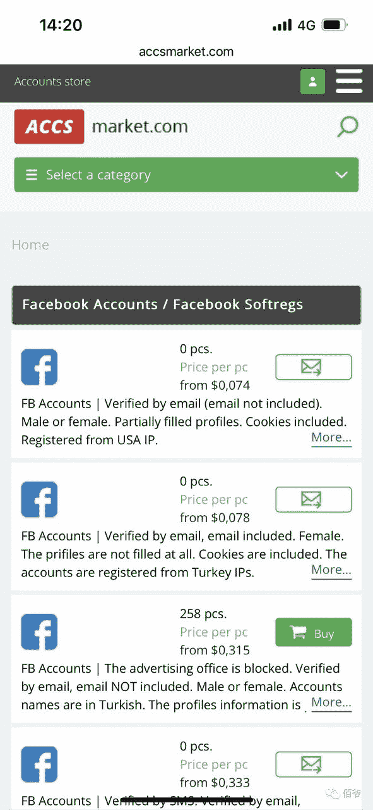
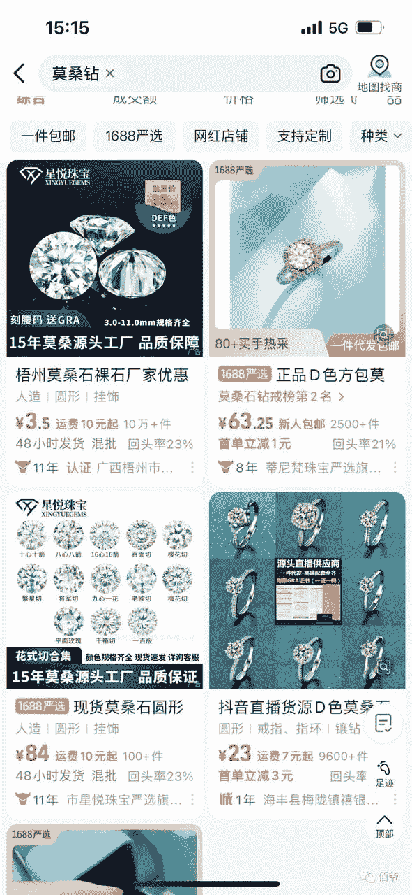
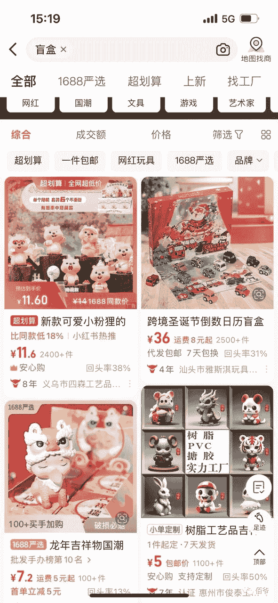
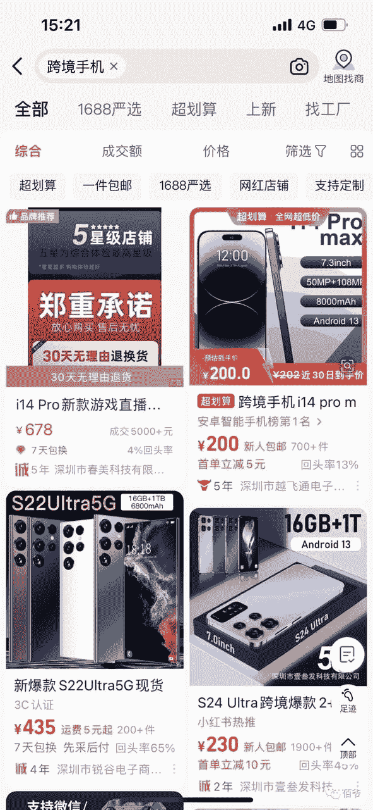

# 2023-12-07facebook商城：零库存，十亿流量

> 来源：[https://xuqiwei1986.feishu.cn/docx/EqLWdbHX5ovrUQxPaCPc8hSinfc](https://xuqiwei1986.feishu.cn/docx/EqLWdbHX5ovrUQxPaCPc8hSinfc)

> 🔗 原文链接： h[ttps://mp.weixin.q](https://mp.weixin.qq.com/s/8MEmzApC4-4bYHynRMl7fw)q.com/s/8MEmzApC...

原创 佰爷 佰爷

2023-11-29 18:29:16

精确发文时间由壹伴提供

2023-11-29 18:29 发表于 日本

手机阅读

《facebook商城：零库存，十亿流量》

大家好，我是佰爷，专注跨境项目的创业者，之前零碎的在赚钱分享过一些项目经验，但多是认识上的分享，少谈具体的项目执行。这次我把我们公司化运作的一个跨境项目分享给大家。

1.  什么是facebook商城

1.  facebook商城和传统跨境电商对比

1.  为什么这是最适合跨境新手的贸易项目

1.  如何养成一个高权重的facebook账号

1.  国家、语言、物流、回款

1.  选品--重中之重

1.  跨境私域运营（及总结）

1.

# —01—什么是facebook商城

facebook，又称为脸书，是海外一款社交软件，全球共有20亿用户，北美、东南亚、欧洲、甚至中东，使用人数都占据全国第一，是世界上流量最大的社交软件。

而facebook商城，是facebook于2016年推出的一个二手交易平台，其本质是类似于国内的闲鱼，不同的是fb首先是一个社交软件，其次内置了二手交易功能，比起闲鱼更带有社交属性。

# —02—fb商城和传统跨境电商对比

在与传统跨境电商对比之前，首先我们要将fb商城与闲鱼对比，可以看我历史文章《闲鱼无货源项目分析》，这边就不再赘述。两者本质都是二手交易平台，很多流量规则都是类似的，我想着重强调的无非是“免费流量”

传统跨境电商，即货架电商，主要有亚马逊、shopee、lazada等，做过亚马逊的都知道，亚马逊早就过了红利期，而且属于相对重资产，回款周期慢，小白入亚马逊基本是死局，而且美亚平均cpc已经到了2美元，相当于一个访客就要14块钱，竞争尤为激烈，更别提深圳大卖相互竞争的一些大标品，所以做亚马逊培训的内部都流传一个笑话，吴三柜，因为海运要装柜，一个柜几吨货，一柜刷，一柜送（deal），一柜飘海上（物流周期长）。当然，并不是说亚马逊完全不适合新人入场，只是如果说连国内项目都没做过几个的纯新人，不建议入局亚马逊。其次是虾皮，lazada，ozen，本身面对的国家都是低价区，虾皮连自己都靠资本烧钱扩张，盈利困难，其过去的红利期本质是平台烧钱拓客，入局的中国卖家随着平台体量增大捡了便宜而已，一旦平台迟迟不见盈利，资本停止投入，人为造成的红利期也就消失了，显然，虾皮红利期已过，这点可以从财务报表和用户增长率看出。

因此，在全球跨境电商红利期已过的情况下，fb“人找货”的免费流量就显得极为可贵，免费流量不一定值钱，比如tiktok百万播放，不过几百美金的补贴，但搜索流量值钱。fb商城恰恰和传统电商的搜索流量更类似。

# —03—为什么这是最适合新手的跨境贸易项目

传统电商，尤其是美亚，fba囤货不可避免，你不可能等客服下单再慢悠悠的从国内发货，承担接近100rmb的运费，让客户等个10天半个月，最后再给你来个无理由退货退款，人真的要疯掉。所以一旦有盈利预期，我们就需要fba囤货海外仓，囤货就有资金风险，一个月的海运周期更拉大了资金风险。

但是否电商都需要囤货？那也不一定。没有人规定物流必须隔日送达，如果你在淘宝找过代购就知道，有些代购甚至一个月才给你慢悠悠的送来。那为什么你对淘宝卖家物流时效那么苛刻，对代购就那么宽容？

原因有两点：信任与选择权

先解释信任。

为什么我们对素不相识的淘宝卖家信任，因为我们相信淘宝平台的七天无理由退货，因为我们相信淘宝会偏袒买家，因为我们相信阿里巴巴。所以我们把对平台的信任转移到了卖家身上，因此卖家需要遵守平台的条款，比如物流时效，比如无理由退货

而“代购”是作为个人卖家，买家面对的是一个人格化的形象，比如“代购留学生学妹”。

一言以蔽之，两者是b2c和c2c的区别。而二手平台，提供商品的主体恰恰是c，属于c2c贸易，买卖双方地位平等，因此买家对卖家的售后天然要求更低。

其次解释选择权。

传统电商平台是公域平台，公域天然存在比价，比的不只是价格，还有客服态度，物流时效，售后体验，但凡你有做的不好的地方，买家可以对你吹毛求疵，退货转头到另一家店买。同行做亚马逊fba次日达，你发fbm十天到，你说你是买家你怎么选？

其次b2c贸易天然是标品，至少是工厂流水线生产的产品，不管再怎么强调产品非标化，都不能改变工厂流水线生产的事实，产品非标只是局部性的，当你的同行找到了货源，当更多的工厂开始仿制，这个产品的红利期也就到头了。哪怕你是打蓝海非标产品，总有一天这个产品红利期会结束。

但c2c不一样。每一个二手产品都是孤证，都是独一无二的，把非标品这个概念贯彻到了极致。最典型的如二奢行业，每一个包的使用年限，损坏程度，价格都不一样，每一个包都是单独的sku。既然是非标品，即使在公域平台，本质也是不参与比价的。类似的思路也可以是“定制”产品，这又是另一个话题。非标品，孤证就没有选择权，没有选择权的产品，物流时效再长你也得等着，因为你找不到替代品了。

我们默认新手缺钱缺团队，新上手一个项目，资金投入越少越好，而fb商城由于其c2c的属性决定了不囤货也能盈利，货源成本忽悠了，成本只剩下了做号的成本，而一个号，只要一块钱。

# —04—如何养成一个高权重的facebook账号

一个号只要一块钱，很多人不敢相信，但你只要自己学会了注册养号，再也不用去号商那买了

说句得罪人人的话，市面上的号商有一个说一个全是割韭菜，不存在良心号商，你学会了养号技巧，自己都能当号商。

大部分号商甚至自己也不懂怎么注册养号，很多都是代发的代理，而他们买号的网站我也说下https://accsmarket.com，一个半年fb白号只要1块钱不到，号商有卖3块的，有卖5块的，还有卖20的。

想必大部分人想先找号商购买一个商城号，然后测品快速跑通流程吧。大错特错。做facebook重要的甚至不是选品，而是众多高权重的账号，你的账号没有权重，甚至上个普货都要被下架，根本无法支撑你测品。

而市面上一个商城号价格均价在40，经过实际测试，这种所谓的“商城号”很可能就是小白号，也就是一块钱成本不到卖你40… 别的平台号商我不知道质量怎么样，至少facebook的号商，哈哈，有一说一全都别信吧。

养号分为三个阶段，第一阶段是注册，第二阶段是养出商城，第三阶段是能上架特货。

第一阶段是注册，经过实际测试，马来西亚的号码成功率最高，而且对于账号权重没有影响，不存在做美国必须用美国手机号的说法。

第二阶段是养出商城，这个阶段3-7天，也就是出现商城提示就可以使用了。

第三阶段是每天上品，这个阶段持续7天，结束后，我们不但可以随便上普货，甚至还可以上特货。

三个阶段一共10-14天，你就能自己花一块钱养出高权重的fb账号，哪怕你不卖货，卖号做服务商都能赚钱。

养号需要用到静态，这个话题比较敏感，在此不表，成本比你想象的低就是了。也别听卖静态的，他们也瞎说。我做tiktok的时候踩了多少坑，就是因为信了服务商瞎说。风控模块还得自己测试总结，反复尝试。并且风控半年一变，去年的规则今天就失效了。

# —05—国家、语言、物流、回款

这几个问题并不是单独的问题，而是相互关联的问题，你选择了美国就得用英语交流，得用美区静态，要用dhl，要用pp，stripe回款或者cod。况且每个国家情况都不一样，有些品能卖到美国不一定能卖到中东，美区pp用的多日本就不一样，有些物流商清关率高还便宜有些就坑。接下来以美国为例，讲清楚全流程

首先，虽然我们做跨境，但我们没必要懂当地国语言，我员工也都不懂英语，哪怕你懂英语你也不懂阿拉伯文，所以会翻译软件就行了。facebook英文界面看不懂可以调成简体中文，不会导致封号，放心改。客户发消息可以用浏览器自带的谷歌翻译，或者花钱找技术写一个自动翻译脚本。

其次，物流建议采用能提供货到付款和海外仓的服务商。货到付款一般收你百分之2-3的手续费，这样你就不用自己去搞定回款问题，搞一个stripe或者pp通道是很累的，况且pp国区提款也要百分之4.4的手续费，更高。其次是海外仓，能让你的货物被拒收时有个本地仓储的地方，下次运就不用高额的空运费了

回款问题难度高低取决于你做普货还是特货，普货基本都没什么问题，手续费也不高；特货说法就很多了。

# —06—选品，重中之重

以上说了这么多，我们不过再解决一些基础问题，如果没人指导，光是基础的账号环境物流回款问题，就能让你研究半年，但就算解决了基础问题，我们还面临最重要的一步—选品。

电商核心在选品，正如亚马逊有标品爆款玩法，也有蓝海高客单玩法，还有fp黑5玩法，本质是基于不同产品衍生出的运营手段，产品是所有电商流量的归宿。

fb商城，尤其是做美区，不太适合做低客单价以及传统电商平台买得到的产品，接下来简单介绍三个产品

第一，莫桑钻

利用信息差，国外很多人仍然不知道莫桑钻，并且莫桑钻主要产地就是在中国，很多人之前fb投流卖莫桑钻年入百万千万比比皆是

第二，盲盒

货到付款即可，用pp收款还有个大问题，现在欧美对盲盒收款封杀的挺严

第三，电子产品

电子产品是世界通用的，一个iphone7说不定比你手上的rmb还保值，至少苹果每年贬值没超过百分之10吧（手动狗头）

# —07—跨境私域运营（及总结）

facebook商城里的客户，特别是下单过的客户，要及时保存到你的whatsapp里，最好建个独立站承接，因为fb和ws都会封号。说实话我不一直不懂为什么跨境私域都能作为一个单独的培训，不就是建独立站发邮件么？最多加个whatsapp类似于国内微商团队的管理。二十年前老外就开始这样做了

盗坤说过，二手平台项目本质是聊单，不性感，无法规模化，要规模化就得招人，但由于门槛低，招人就会存在自立门户现象。但对跨境fb商城项目，由于其跨境本身的高门槛（环境，物流，回款，语言），掩盖了项目本身的低门槛。员工单干的可能性极低，话说回来了，有这个学习能力和天分，还给你当聊单客服么。

况且聊单虽然麻烦，但每个单都比较稳，客诉低，如果一个跨境小白，先教你做独立站，再教你花个几百fb开户，再花个一千美金去投流，中间经历封户，退款，一套螺旋拳下来直接退出跨境了，再愤愤不平的骂跨境培训全是割韭菜。

那为什么不从facebook商城薅免费流量开始，虽然免费流量麻烦，但只要解决了就是源源不断的流量宝库，现在付费流量这么贵，又是美区，一千美金可能堪堪够你测3个品，免费流量解决了测品问题，聊单又解决了售后问题，虽然不性感，无法小规模做到年入千万，但成本低投入少，员工工资又属于可变成本，给员工买的设备还可以三手变卖。前期你可以不招人，先自己测试呗，总成本不会超过300。

毛说过，人不是成本是资产，等你通过一个低成本高人力的项目有了团队，你就会发现超级个体的缺陷；现在都大集团军作战了，你还特种兵单打独斗，一个打3个又能怎么样。筛选出靠谱的人，凝结一个团结的团队，把每一步都走稳，成功就如约而至。

附《闲鱼无货源项目分析》

https://wx.zsxq.com/dweb2/index/topic_detail/588582188851484