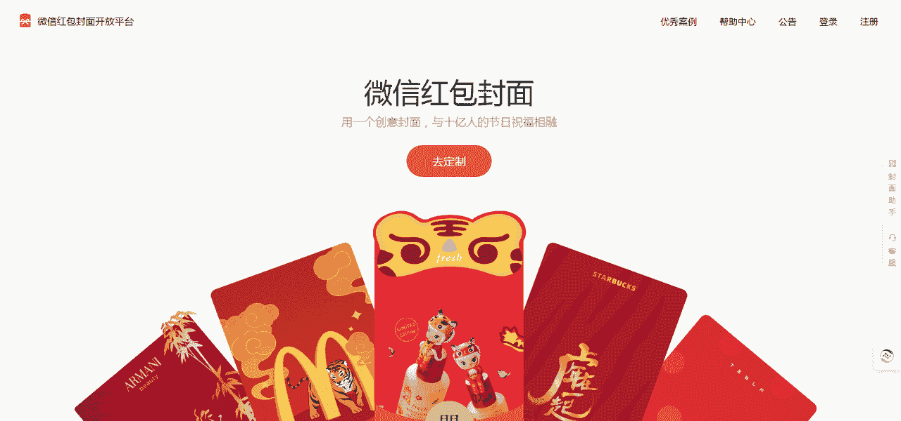
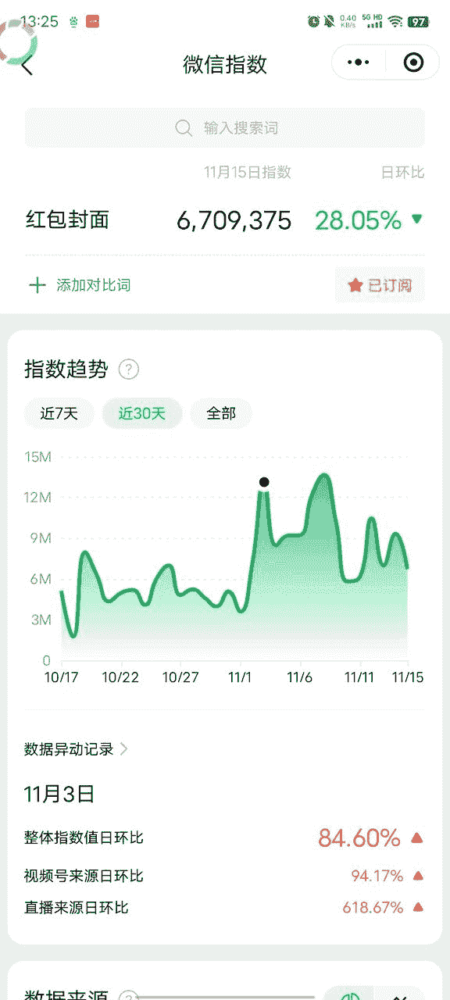
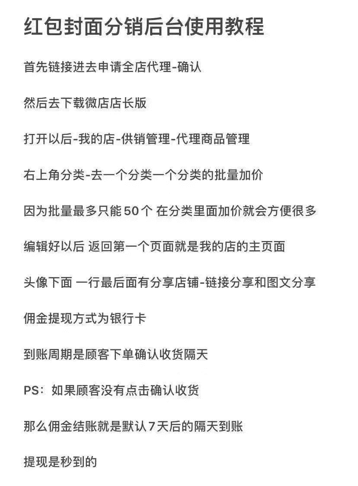
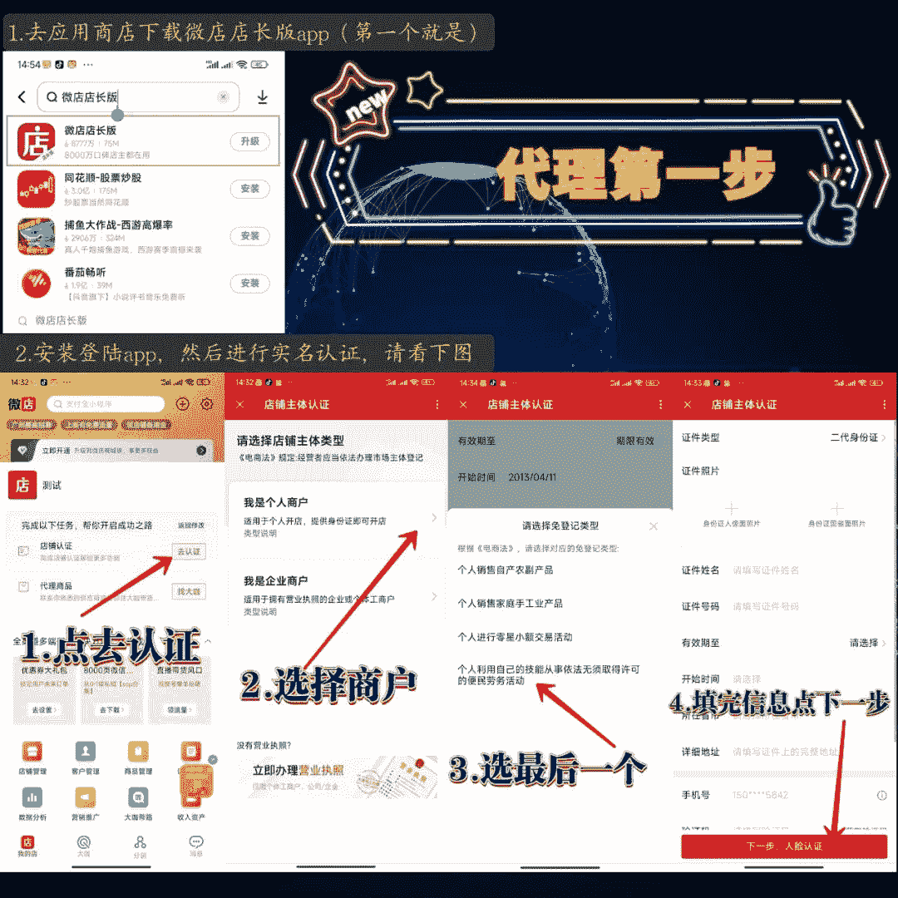
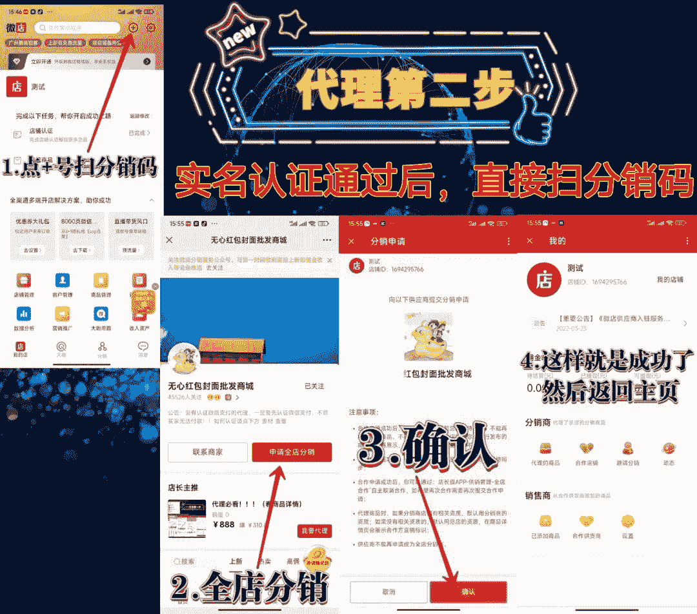
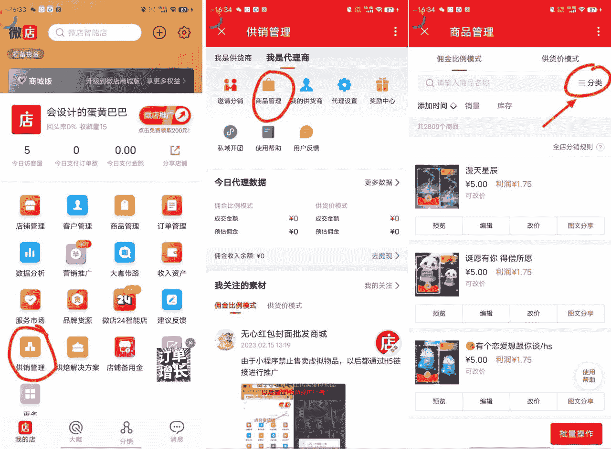
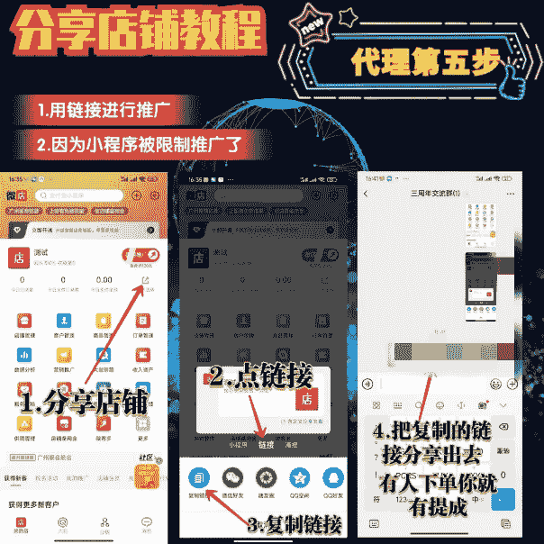

# 微信红包封面项目引流实操SOP 破局

> 来源：[https://xuqiwei1986.feishu.cn/docx/K1lld186KonRidxCfZucSmIEnhd](https://xuqiwei1986.feishu.cn/docx/K1lld186KonRidxCfZucSmIEnhd)

# 前言

大家好，我是蛋黄巴巴，主业设计，副业自媒体，社群视觉设计，直播切片带货，目前带领4000多人，做微信红包封面引流变现。findyi 洋哥 合伙人(全国最大AI实践付费社群)，洋哥团队首席设计师。

没有我微信的可以加我微信xy624581，可关注我的公众号【蛋黄巴巴】后期有相关项目可以带大家一起做。

这几天对红包封面有接触的同学，应该知道红包封面被炒得越来越火，越来越多社群开始搞训练营，虽然红包封面是这几年都在做的项目，但是今年却提前了，就是因为我在半个月前，自己带队三四百人，同时合作几位大佬，在生财/淘金等头部社群开始宣传，引起了轰动。

这种流量大又适合新手赚点小钱的优质小项目，确实难得，我也为了破圈，所以不断在加入各样的圈子，跟大佬合作，带队红包项目，目前已经有四千多人。

这次红包封面项目，由【洋哥陪你玩赚副业】星球发起，【蛋黄巴巴】领队，【冯帅/卡尔/深圳大冲】助教。

+   微信红包封面最近两年，一到年底，尤其过年前后15天，流量非常火爆，很多人靠这波流量，引流变现了不少。

+   **就我知道**的玩赚圈，肖沫老师去年通过小红书，红包封面引流，5天时间0成本引流4000人，变现39000+。

+   当然还有更厉害的，就靠年底那一波流量赚了几**十万****甚至****上百****万****的也大有人在，但这离**我们太远了，我们围观身边就行，反而更容易模仿。

+   我本次红包封面项目，带队4000多人，变现6w+，一边分销一边卖红包，已经有同学日入300+。

# 项目介绍

## 红包封面介绍

> **微信****红包封面**

+   微信红包封面指的是我们在微信发红包时，好友领取成功后的背景页面背景图，后来为了满足品牌对于营销宣传的诉求，上线了红包封面自定义功能，其实就是在发红包时植入品牌信息的广告，虽然是免费的，但是只针对于企业微信开放。

+   个性化的红包封面摆脱了以往红包的平庸简陋，让红包视觉效果倍增，在发红包时选择添加封面，输入相应的序列号就可以直接使用。

+   **这个**项目的核心点其实就是利用各式各样红包封面的新颖、稀缺和极强的社交传播属性，来引导用户实现裂变引流。

## 流量爆发时间

> **红包封面****流量爆发时间**

+   每年的各大节日五一、端午、七夕、中秋、国庆、圣诞节、元旦、除夕、春节、元宵节，每次节日前后几天流量很大，尤其以春节前后15天，流量最大。

+   现在正好到了年底，提前准备，做好各渠道引流的准备，应对一年中流量最大的春节，准备工作做好了，赚小钱完全没有问题。

+   大家可以看看红包封面这个关键词，在微信指数达到600多万，这还只是平时的流量，等到年底，基本要翻几倍，按到去年的数据达到3000多万，就今年的中秋国庆都达到2000多万，那么今年流量肯定不会低。

## 这个项目难吗？

+   拒绝废话：不难。0门槛，易上手，帮助新手快速赚到第一块钱，相对的天花板也很低。

+   我接触过的项目非常多，大部分都需要前期学习，但是微信红包封面可以说0门槛，有手就行，指导你5分钟，你就能上手，然后可以发一条朋友圈，有人购买，当天就能赚钱。

+   我在去年年底找项目的时候，看到朋友圈都在发微信红包封面，就到闲鱼上去搜，发现也很多，就花了几十块钱，买了一个教程，就是一张截图。

+   用他的链接申请，拿到商城的代理，开自己的微店，然后宣传微店，别人通过你的链接购买的，就可以赚佣金。

+   就是下面这个截图，就是这么简单，关键你需要有他的微店分销码，有好的货源，就可以卖红包封面，或者送人。

## **红包封面****从哪里来？**

> **1、自己设计**

+   制作红包封面需要注册微信红包封面开放平台，注册有两种门槛：公众号、视频号。

+   公众号需要认证，订阅号服务号都行，视频号满足100有效粉丝即可。

+   这个后面会升级AI红包封面玩法，带单价定制自己的个性红包封面。

> **2、帮总店分销**

+   直接分销总店，货源有三千多款红包，款式多。

+   **做分销**的优点是：不用囤货，不用自己**搭建平**台，自动发货，赚佣金，同时自己也可提高商品单价，赚差价。

> **3、开通批发商低价拿货**

+   直接开通批发商权限，批发商的优势就是价格低。

# 开店流程

## 如何开店？

+   首先下载**微店店长版**APP，**实名认证后，才能分销。**

## 如何支付认证？

+   微信支付认证教程链接，复制到浏览器打开：

+   **店长版app端教程：**http://k.weidian.com/fARXQPJg

+   **电脑端教程：**  http://k.weidian.com/vO1YDoxX

> 重要提示：微信认证支付的时候，商户号简称不要取黑名单敏感词汇，微信二字必须不能取，不然就会因为名字审核失败，再操作就比较麻烦。商户号简称不是你的店铺名字，店铺名字随时可以改，切记❗切记❗

## 商品如何改价？

+   打开微店店长版APP，点我的店→供销管理→商品管理→分类。

+   因为批量最多只能50个一起改价，商城里面有两三千个商品，在外面改，就很麻烦，改完需要不断刷新，重新选，所以在分类里面加价就会方便很多，每个分类几十个，多的一百多个，就方便改价。

+   加价多少，根据自己调，想多赚就多加点，一般加2元就可以了。改价不能超过原价的2.5倍，不然会改价失效。

**网页版改价**

把所有的商品价格，在原价的基础上，提高到150%以上（社群几个小伙伴实测，价格高低对转化率影响不会太大）货品质量硬，就能吃香。

具体操作：在网页版（www.weidian.com）➡分销➡我是分销商➡点 当页全选➡再点批量改价➡然后换页面继续，价格就能全改掉（感谢@不困 提供的方法）

**由**晨光同学提供的脚本，不会编程的同学也会用⫸

[红包封面店铺批量改价教程](https://hw1r9vo7jd.feishu.cn/docx/Tzrkd5iKronVtfxjeqWcIVLTn4e)

由逐梦同学提供的：[红包改价机器人](https://c50z7vsgaq.feishu.cn/wiki/MHG1w45v2iBFtMkHWK5coC6Ynsc?from=from_copylink)

## 如何分享店铺？

+   打开微店店长版APP，我的店→主页面头像下面一行→点分享店铺→点连接→复制连接，就可以了。

+   注意！看下图，推广自己店铺只能用链接或者店铺二维码，不能用小程序码，不能用小程序码，不能用小程序码，重点说三次，每次分享前记得切换成店铺二维码，看图点切换，切记切记！

## 如何关闭供应商？

+   关闭供应商教程是给那些误点开启了供应商的。其他人不用理！

## 如何关闭商品评价？

## 如何提现？

+   在微店店长版app点击--收入资产--佣金收入。

+   **微店提现手续费：**

## 如何分销自己店铺？

+   大家扫我的码开完店后，就可以分享自己的店铺，直接推广，用户只要进店购买，自己便可以获得佣金和中间差价。

+   那么我们要收代理，如何分享我们自己店铺的分销码？

+   微店店长版首页，点供销管理→我是代理商→邀请分销→立即邀请，生成自己的邀请二维码。

+   当你招到代理，就直接把邀请码给他，让他扫码就可以成为你的下级，只要有人在他店铺购买，你就可以获得0.3-0.5元的奖励，这个是躺赚的，下级邀请的人越多，卖的越多，我们自己收益也就越多。

## 如何开通批发权限？

+   **提醒一下**，批发是需要二次付费的，这个按需入。普通人，先卖红包封面和分销社群。自己跑通了，再升级玩法。

+   需要开的话，直接群里给洋哥发88元红包，手机号给蛋黄巴巴开通。

# 引流和变现

## 引流渠道

+   引流渠道：**闲鱼/****抖音/快手/视频号/公众号/**小红书/绿洲等公域+微信群/朋友圈私域。

## 各平台引流方法

#### 闲鱼平台引流

+   搞一个闲鱼账号，把头像、昵称、简介、背景图设置好，最好芝麻信用极好的授权，能增加信任度；

+   找对标账号，直接闲鱼首页收红包封面关键词，找到“想要”比较高的商品，对标他的文案和商品图；

+   在美图秀秀或者稿定设计APP做好图片，修改整理好文案，直接点中间+号，点最下面【发闲置】，填写文案，上传商品图，上传2-3张就可以；

+   每张图上面打好标签，标签就是关键词，比如：红包封面、新年红包封面、虎年红包封面，每个标签都不一样，标签可以帮忙推荐；

+   图片下面有地址，每次发布尽量不同城市，优先一二线大城市定位。

+   下面更多信息，分类填其他闲置，价格根据自己情况改，发货方式包邮，圈子同步在地址定位城市，可以增加曝光。

+   点右上角【发布】，回到【我的】页面，知道【我发布的】，点进去有个【一键擦亮】，记得每次早上起来第一件事，把宝贝都擦亮一遍，增加曝光。

+   【一键擦亮】旁边有个加曝光，每天可以用闲鱼币推广一个商品，闲鱼币可以在【我的闲鱼币】做任务，每天签到领取闲鱼币。

+   商品被拍之后，就会下架，下架第一时间记得上架，在【我发布的】进去，点【已下架】，点【重新上架】。

+   有人咨询，记得提前设置【自动回复】，在【设置】，点【消息通知】，点【智能回复】，可以设置一些回复。

+   以上是闲鱼操作步骤，闲鱼适合招代理，可以一边卖红包，一边招代理，共赢模式。

#### **闲鱼平台招代理相对容易**

+   同行永远都是最好的老师，直接搜红包封面代理，会出来很多同行，学习他的文案和图片设计；对标然后模仿；

+   每天坚持上新，擦亮宝贝；

+   来咨询你的，让他拍下宝贝，就会获取他的手机号，给他发条短信，（您好，我是闲鱼卖家，刚刚你拍下红包封面代理，麻烦加一下这个微信，我给你授权，谢谢。）

+   其他发图片写微信号的方式也可以，一张图片不能多次使用，记得常换新的图片。

+   因为我们每天主动加人有限制，所以让他主动加你，这样就不受限制。

+   记得微信设置，朋友权限，关闭【加我为朋友时需要验证】。

#### **快手/抖音/视频号平台引流**

+   提前准备好账号，把头像、快手号（建议微信号）、昵称、简介、背景图设置好。

+   找对标账号，直接首页收红包封面关键词，找到点赞量高的作品，模仿他的视频和文案，用剪映剪辑好了，点+号上传，文案抄对标账号，添加#话题，点发布就可以了。

+   用小号做好评论区引导，有抖音快手群，做好引导进群领取，在群里引导他们加v，注意方法，不要光用一个，经常换不同方法引导。

+   抖音/快手/视频号主要是引流为主，方法比较简单，正常一个作品最低流量有几百，每天坚持发两条也有一千多，如果出现流量不错的，跑个几千几万也正常，就是要多发。

> 视频特点是：

1.  热点内容昙花一现，流量集中在节前。我们没时间去摸索观众的喜好、创作优质视频，错过春节这个大节，你内容再好也没用。

1.  平台同质化严重，根本看不出来谁好谁坏，我们生产同质化的内容，也有机会赛马出圈。所以需要高效生产视频，不要浪费时间做原创。原创要具备成熟的拍摄、剪辑能力、审美把控，这些是很难快速提高的

+   [剪映视频剪辑20种去重方法](https://mp.weixin.qq.com/s?__biz=Mzg2Nzc1NzgzNw==&mid=2247484779&idx=1&sn=e0325d9fc4ae393b0951575785544771&chksm=ceb7ff09f9c0761face24ca2e8471886a0967306c42e89b2b4d16a6bce1a15bac4b5f2d4ec93#rd)【不熟悉的一定要看】

#### 小红书**平台引流**

+   准备好账号，把头像、快手号（建议微信号）、昵称、简介、背景图设置好。

+   找对标账号，直接首页收红包封面关键词，找到点赞量高的作品，模仿他的图片/视频和文案，点+号上传，文案抄对标账号，添加#话题，点发布就可以了。

+   用小号做好评论区引导，有小红书群，做好引导进群领取，在群里引导他们加v，注意方法，不要光用一个，经常换不同方法引导。

+   如果有条件，可以开通店铺，订购一个阿奇索小红书自动发货软件，提前批发一批红包封面序列码，上传后台，这样买家下单就可以直接发货。

+   小红书无卡券宝贝如何设置自动发货教程：http://agiso.com/detail/205

#### 新浪微博**平台引流**

+   这个来自添财小英同学分享，大家可以学习：

+   [微博平台引流](https://umflsdwy2c.feishu.cn/wiki/PDfhwSlFciiuezkxOkyc9Vwrnpc)

#### **公众号平台承接流量**

+   没有公众号的，尽快注册一个公众号，我们公域的流量第一步，就是沉淀到公众号，不会注册的看这篇文章：新手如何免费注册一个公众号，超详细教程来了！

+   我们可以打造一个红包封面公众号，专门承接公域的流量，这部分流量，可以直接在公众号变现，引导客户直接下单购买。

+   可以写一篇导流微店的公众号文章，公众号文章名字：红包封面商城入口，文章内容：点击“阅读原文”进入红包封面商城，发布文章的时候，在原文链接处打勾，输入自己微店的链接。

+   同时设置好菜单栏，进入公众号后台，左侧栏【内容与互动】→【自定义菜单】，即可设置菜单栏，菜单栏名称改为红包商城，消息类型选择：发送信息，菜单内容填写：

+   **这里拥有全网最新最全的****红包封面**哦，而且每天都在更新，红包封面抢购快速通道~

> **    ****点击****下方通道****立即抢购****<a hre**f="https://k.youshop10.com/9w4EdMj-">获取红包封面链接</a>

+   蓝色的链接换成你自己的微店商城链接。

+   这样就可以直接在公众号完成变现，并且现在平台也推流，同样也能引流。

## 红包封面变现方式

+   变现方式：**直接卖红包****封面****、招代理、开批发权限。**

+   **直接卖红包变现****：**赚佣金和差价，我们只需要分享微店码，让用户直接进店购买就可以了，这部分靠的是流量大。流量越大，店铺曝光越多，就有越多的人能够直接进店购买。

+   **招代理变现****：**任何一个项目，都有新人加入，很多新人不知道如何做，那么就通过招代理来带人，这种既可以赚钱，还能培养用户，沉淀在自己私域，后面可以复利。

+   只需要把自己店铺分销码，给代理的人，让他们扫码申请分销，后面他们卖出去一单就有0.3-0.5的奖励，完全的躺赚收益。

+   **开批发权限变现****：**这个就相当于卖铲子，很多做红包封面的，找不到批发渠道，商城购买引流成本高，那么就可以针对这些人，可以给他们开通批发后台。同时招到的代理，同样可以发展他们，给他们开通批发权限。

+   **做好这三步，整个****红包封面****引**流变现才算完整，不光只赚差价，更能赚代理费，还能赚开批发权限的钱，三管齐下，三个管道收益，这样才能把收益最大化。

+   而且，我们每次做一个项目，不光只是赚了一波快钱，更能够沉淀下私域，所以在做的过程，最终能够把流量沉淀到自己私域里。

# 郭晓文大佬提供的的去年红包封面玩法

这是子白哥申请过来的，里面也很详细介绍如何搭建公众号平台

[【红包封面售卖】一周时间，搭建一个自裂变的赚钱系统](https://ro14u4yq4i.feishu.cn/docx/TclbduiNwoJ3J4xj78CcpvqTn0e)

# 小白也能做出好看的红包封面-定制全流程

这是肖沫老师的红包封面定制教程：[小白也能做出好看的红包封面-定制全流程](https://rimoao8jbx.feishu.cn/docx/O3PGdC5bGok5U4xg3Zkc3XnJn9g)

**(这个里面的课程不要购买，后面洋哥这边会教，只是给大家方**法，想做的可以按里面的教程自己研究一下）

# AI制作红包封面，零设计经验也可以

[AI一分钟制作精美红包封面（卡尔）](https://e0tolnpfkgm.feishu.cn/docx/XTlldmYmPoPnNmxaaYNcXmhTnsb)I迅速制作精美红包封面变现，变现全流程打通：

[AI 定制微信红包封皮](https://e0gtie917z1.feishu.cn/docx/BNnIdmZTXoGnkOx0UHJcjdvDneP)I 制作红包封皮、AI绘画教程、AI绘画变现案例库：

# 红包封面私域流量沉淀玩法

点击链接：[红包封面私域流量沉淀玩法](https://tl57gz5zgf.feishu.cn/docx/I0TldSxaEoaWVZxx0IncgRxpnwn?from=from_copylink)

# 分销指南

1）分销步骤

> 1、在朋友圈/社群/公众号推荐这个项目，你直接收他19.9

>

> 2、然后你在本群内给洋哥转账8元

>

> 3、邀请他进本群，管理员核实之后会同意进群申请

>

> 我们项目玩法有几个变现方式，这就是其中一个，分销社群项目玩法。

2）分销文案

> 红包封面，最近很火的项目，也是一个可以持续做的副业赚钱项目，因为每个春节或者其它节假日都可以做，现在入局是最佳时机。

>

> 大家想一想每个春节大家的红包封面哪来的？ 每一个精美的红包封皮背后都有人在数钱。

>

> 今天由洋哥领衔，破局合伙人带队，带着大家一起搞点小钱，推出红包项目。

>

> 另外我们创新的加入了 AI 元素，让大家超过市场上的任何团队

>

> 这个红包封面项目门槛极低，普通人30分钟就能学会，我们有完整的SOP流程文档，跟着文档操作就可以了

# 百问百答

## 问题1：咱们卖这个红包封面是永久使用还是有有效期呢？

> 回答：从领取后有效期三个月。

## 问题2：咸鱼为什么会违规呀？如何避免？

> 回答：宣传文案有违禁信息或者违禁词，避免发布违禁信息和使用违禁词。

> 可以进群大家一起讨论，学习。

## 问题3：大家的公众号内容引流时，是放的自己个微还是店铺二维码？

> 回答：看你引流目的，放个微引流私域成交利润高，后续还可以转化代理等；放店铺可以自动成交，整个流程方便丝滑。具体根据个人需求，也可以同时放。

## 问题4：为什么开通批发权限，分销价格不变？

> 回答：批发和分销两个系统，批发下载微店用开通批发权限的手机号登入，自己购买把券码发给你的客户，用于私域成交，分销用于自动成交。

## 问题5：咸鱼怎么引导到私域不违规？

> 回答：聊天发手写微信号图片（多准备几个不同的）

## 问题6：微店必须开商家码吗？

> 回答：必须的，要不然客户无法微信支付。

## 问题7：我们卖的红包封面可以设置成明星吗？

> 回答：不可以，首先我们不做封面只卖，其次做明星封面侵犯肖像权。

## 问题8：我已经扫码开通分销，完成了实名验证，复制店铺链接后，现在看不到商品，为什么？

> 回答：这通常是因为分享的是小程序链接，而不是普通的http网络连接。小程序链接一般是这样的：#小程序://微店买买/店铺好货不断欢迎点[击链接进店查看/](https://s1axzynwjw0.feishu.cn/docx/XFlkdbg2mocztrx3S21c0BPVnNh#doxcn1EKlToIJiTArJlMsgUSLwf)J3EmAp3JVEa6zzn 。 而普通的网络链接是以http打头的，比如 https://k.youshop10.com/C2lwxxxyyy.  请参照 「如何分享店铺」进行分享操作。

## 问题9：我在做店铺主题认证的时候，需要手持身份证认证。这个是正常的吗？

> 回答：这个是正常的。按照 APP 提示进行操作即可。

## 问题10：可以单独分享其中几款红包封面么？

> 回答：可以的。可以在 APP 里选择商品管理，找到对应的商品，选择「图文分享」即可。

## 问题11：在微店下载的图片，发在小红书上可以直接发吗？还是要怎么处理一下

> 回答：不可以直接发，需要去重处理，加点其他元素一起到达跟别人不一样

## 问题12：一个序列码可以几个人用？

> 回答：一个序列码只能一个人用。

## 问题13：有什么好的二维码制作推荐？

回答：可用这个网站制作：https://m.photofunia.com/

## 问题14：微店红包封面视频怎么下载？

> 回答：复制链接到qq浏览器打开，即可下载视频

> https://k.youshop10.com/9w4EdMj-

## 问题15：下级扫了我们的分销码是否是永久绑定成为我们的下级？可以解绑后再绑定别人的分销码吗？

> 回答：不是永久绑定，可以解绑。解绑后扫别人的分销码就是别人的下级。

## 问题16：申请分销后，店铺看不到商品要怎么操作？

> 回答：不要用小程序分享，用店铺链接和店铺二维码。

+   注意！推广自己店铺只能用链接或者店铺二维码，不能用小程序码，不能用小程序码，不能用小程序码，重点说三次，每次分享前记得切换成店铺二维码，看图点切换，切记切记！

## 问题17：小红书需要开店吗？

> 回答：不建议开，引流到微信私域就可以

## 问题18：如何用小红书群聊引流到微信？

> 回答：群公告里放公众号或者微信（注意用谐音）或者小号在群聊中发布引流信息

## 问题19：如何关闭评论？

> 按以下步骤进行操作

## 问题20：红包封面序列码怎么使用？

## 问题21：小红书没有人评论，是需要去评论区引导嘛？

> 回答：可以，用小号引导一下，也可以布局几个我想要的评论，引导大家评论

## 问题21：微店怎么注销店铺？

> 回答：在微店店长版APP，设置里面，店铺设置，店铺注销。

## 问题22：闲鱼发了没有浏览量怎么办，感觉同行很多他们价格都比较低

> 回答：如果是价格问题，可以开通批发后台，批发特价红包0.88，大部分是1-2.5，是可以做到低价引流的

## 问题23：闲鱼引导客户加微信，是先让客户拍了再加微信还是让客户加微信直接微信转账给我们，如果客户觉得拍下来不发序列号还要加微信再发序列号很麻烦要退款怎么办

> 回答：我们的建议是引导到微信成交，因为我们的目的就是引流，沉淀私域，其次赚点小钱

## 问题24：目前什么平台出单要容易一些

> 回答：目前，闲鱼、小红书都已经有同学跑通，出单的，这两个也是我们主要做的平台

## 问题25：佣金结算几天到账？

> 回答：8天时间到账

## 问题26：有没有好用而且免费的长链转短链工具？

> 推荐使用草料二维码，参考链接 https://cli.im/help/57842

## 问题27：以下情况算微信支付认证通过吗？

> 还不算。需要所有授权都通过。

## 问题28： 红包封面怎么加到小红书店铺商品中？

> 需要自己上货

## 问题29：发布的内容怎么在文字里添加超链接呢？

> 在公众号后台，插入超链接

## 问题30：闲鱼可以自动发货吗？

> 可以自动发货的，需要提前准备好兑换码。

> 不过，我们的建议是引导到微信成交，因为我们的目的就是引流，沉淀私域，其次赚点小钱

## 问题31：个人公众号这个菜单不能添加红包商城的链接吗

> 可以通过发送消息的方式，将内容设置成超链接，点击菜单就会给用户发送，可以跳转。

> 超链接格式：

> <a href="替换成自己的商城链接">红包封面</a >

## 问题32：客户下单后在哪里查看佣金？

> 在微店店长版 APP 中，选择 「收入资产」， 再选 「佣金收入」。

## 问题33：菜单栏设置跳转链接，不能设置简写，是什么原因呢？

> 「<a/ >」里面包含空格，去掉空格就好了。

## 问题34：如何推荐其他人来参加老徐的这个微信红包项目？

> 参考链接 https://t.zsxq.com/14JfSyxBD

## 问题35：请问我们代理的那个店，是自动发货的吗？

> 是的。

## 问题36：如果别人要代理的话，我除了发给他我的邀请码，还要发什么吗

> sop 仅限咱们群里查阅。项目结束，会更新到星球。推荐他们入群或入星球学习

## 问题37：请问知乎评论区有人问红包封面项目，可以引导私信，然后加微信吗

> 可以的

## 问题38：如果有人想在小红书代理红包封面，我有什么办法让他代理啊？

> 引流到微信上，发你的分销码

## 问题39：我正在准备做，店铺卡住了，还没有邮箱地址，不知道怎么注册？

> 可以注册免费的QQ，新浪，网易邮箱，网上搜一下，按提示操作就行

> QQ 邮箱：https://jingyan.baidu.com/article/09ea3ede36e39b81aede39c6.html

> 新浪: https://help.sina.com.cn/comquestiondetail/view/15/

> 网易：https://mail.163.com/register/?from=dashi#/pn

## 问题40：注册了微店、扫了分销码之后，是不是要等支付认证审核通过以后，才能正常销售？

> 可以同步进行

## 问题41：分销以后，后面还能上自己的商品吗？

> 不可以

## 问题42：我已经提前下载了微店app，请问一下我这里选的第三个影响不？

> 不影响

## 问题43：可不可以对接淘宝多多自动发货呢？

> 不可以

## 问题44：芝麻信用分三百多，咸鱼能卖东西不？

> 可以的，不授权芝麻分也行，授权了增加信用度而已

## 问题45：小红书新号没流量 是不是限流了

> 新号没流量是正常的。新号才发不要在乎流量，先每天坚持发 3 篇内容，先通过对标账号，找找同行的优秀作品模仿

## 问题46：小红书大小号在一个手机上切换使用没事吧？

> 最好不要频繁切换，容易违规导致连带