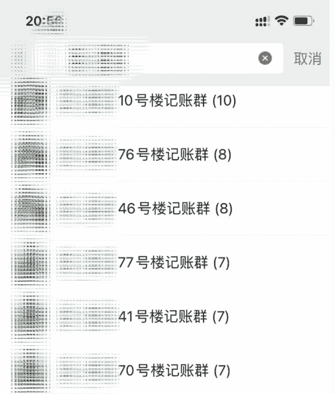
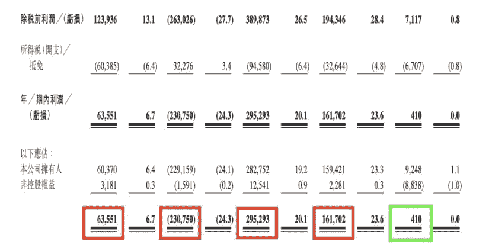

# 2022-11-24 把包租公包租婆的这门生意讲透，聊聊包租现状、赚钱本质、模式拆解以及新手入行建议

> 来源：[https://xuqiwei1986.feishu.cn/docx/AZfHdJ3Dnoxa4cx18chcMsvynpN](https://xuqiwei1986.feishu.cn/docx/AZfHdJ3Dnoxa4cx18chcMsvynpN)

> 🔗 原文链接： h[ttps://articles.zs](https://articles.zsxq.com/id_kusedv93exfd.html)xq.com/id_kusedv...

不计其数的二房东靠包租房子实现财务自由，尤其是藏在城中村里边的二房东，看着不起眼又LOW，但他们才是真正赚钱的一群人，这类二房东很多都做成了家族甚至村族生意，也就是带着全村人一起搞，一人包租，鸡犬都能跟着收租，因为门槛太低。

大家好，我是云飞，有1800套房收租的包租公，团队一共18人，目前年营收接近2000万，净利率接近25%，给大家分享我创业后一直在做的项目，也是让我从一个农村草根跨越了一点点小小阶层的项目——包租。

在互联网创业社群分享完全传统的项目稍显突兀，但，因今年我个人想转型做互联网，寻找事业的第二增长曲线，前期考察了不少互联网项目，也看清了自己的能力范围，发现很多项目综合维度确确实实是没有包租好的，有很多能够赚到大钱的项目自己没有能力做，赚小钱的项目说真的我还不如回去干包租。

也看到有不少小伙伴跟我面临同一种问题，要么是大项目自己做不了，小项目不想做，要么是做了很多项目却都无法持续。

“不稳定、难持续、爆发性强”是很多互联网项目的特征，旱的旱死涝的涝死。因此，我才决定写这篇文章，给圈友带来多一种可能性，多一个项目的方向，希望对大家有用。

文章目录：

包租的现状

包租项目的商业逻辑

包租赚钱的本质、优势和劣势

包租的几种模式详细拆解

新手三问，怎么开始做包租？

## 一、包租的现状

开头说到，在二房东这一行藏在城中村里边看着不起眼的那群人才是真正赚钱的，而很多光鲜亮丽的大公司反而是不怎么赚钱的，甚至在业内都排不上号，比如之前上市已经爆雷的蛋壳、青客公寓，近段时间在香港IPO的魔方公寓，房间数量达到了5万多间，而2022上半年的净利润只有41万元。

不是这个行业不赚钱，而是他们不想“正经的去赚钱”，所以不赚钱。

目前在二房东这一行，潜在水下的才是真正赚钱的，房源数量达到上万套不知名的公寓有不少，就我身边认识的一位朋友，他们直营的房间数量有2万多套，包括投资的总共就有3万多套，这个规模想要上市是完全足够了，但他们并没有走这条路（至少目前没有），因为这行在国内的环境目前只适合【立刻赚钱】，老老实实的赚钱，玩资本，在我看来还不够成熟。

很多手里只有几十套几百套房源的小公司或者个体，反而他们过得很滋润，一个月几万、几十万的净利润，在任何城市养活全家甚至买房买车都已足够。

我听过好多几兄弟或者一家子在一个城中村/一个小区深耕发展收几十栋楼/几十套房，每个月赚十几万净利润的案例。

写这段主要是想说明：

现在做二房东想要赚到钱，简单，

想要赚到大钱，难，

想要赚快钱，没有，

用来打造被动收入，可以。

现在进入，一定要采取小而精的发展路线，不要盲目扩张为了收房而收房，要保证收到的每一套房都能够赚钱。

我这1800套房听上去挺唬人，在业内却不算多的，目前年营收接近2000万，净利率接近25%，我一直不知道这种数据处于什么水平，前两年一直在埋头骨干。

目前团队18人，管理员16个加上我们两个创始人。这就是我团队的数据情况，仅供大家参考。

虽然1800套房在业内不算多，然而想要做到也并不容易，现在基本每个城市都有二房东的存在，特别是一二线城市的竞争已经白热化。不过并不影响个体户进入收个几十套房赚点钱，后边会讲到。

可以肯定的是我这个数据跟很多互联网公司相比差距很大，在赚钱里应该就有不少年营收几千万上亿、一个月赚几十上百万利润的，而且发展速度很快。我们做到目前1800套房的小规模历经了整整两年的时间，而且在业内算是挺快的了。

以上就是二房东这个行业宏观层面的一些信息和现状。

## 二、包租项目的商业逻辑

包租简单来讲就是包过来租出去，跟一手房东把房子包过来然后再租出去，相当于借鸡生蛋。

广义上讲，我们在街上看到的酒店、宾馆、商铺甚至写字楼，大多数也都是二房东在运营，因为没有几个公司能够买那么多地建房子来做商业的。

听过“玩房子”的自我介绍吗？在房产江湖里，有太多太多的玩法了。

一级分类能够分为买卖和租赁，而买卖就有装修代售、不良资产、凤变冰短炒、ABC单、房产管家服务、小区做庄等等，我知道的只是一部分，很多人在房产江湖里就靠着玩房子做到了几千万身家。我认识的一位姐姐在某个一线城市有30多套房，经手买卖的房子少说也有上百套了。

租赁的玩法就更多了，长租公寓、民宿、酒店、旅馆、写字楼、商铺、厂房、商场、停车场、创意园等等等等，一套房能够玩出花来，但它们都有一个共同的的名称——资产运营。

不过我觉得这个叫法太高大上不接地气，就叫“玩房子”的多棒~

说回包租，为什么二房东能够在只要有建筑物的地方就能无孔不入？他们为社会创造了什么价值才能存在这么长久、甚至大有蓬勃发展的趋势？我们来聊一下包租这门生意解决的问题。

### 1. 包租这门生意解决的问题

三个方面，个人层面的供应端和需求端，以及社会层面的价值。

首先是供应端，也就是一手房东，我们所说的业主，为什么需要别人帮忙管理房子？两点原因，一因为没有时间，二是因为不专业。

业主之所以能成为业主，一定是有他们自己的一套赚钱模式的，而且这个赚钱模式需要占用他们大量的时间，且给他们带来的收入一定超过了一两套房子的租金，所以他们根本不想花太多时间在房子的管理上面。

不是说管理房子需要花很多时间，而是他们本身不是专业“玩房子”的，所以他们管理房子的心灵承载力就不高，只要有一点小事出现他们都会觉得不爽。

这是第一个方面，一手房东因为没有时间管理或者不想管理，所以产生了需要别人来管理房子的需求。

第二个方面，不专业。这几年国家都在大力搞旧改搞城市更新，把老房子拆掉重新建新房，在住房租赁行业内，大家都在不断迭代自己的产品，都想方设法让自己的房子更有竞争力，如果你不专业，不知道怎么让房子变得更好看、更舒适、更实用，那么你的房子会慢慢被淘汰，房子空置无人问。

这是一手房东的第二点需求，不专业。

也就是说，二房东解决了一房东没有时间管理和因为不专业担心房子被淘汰的需求，而且这两个需求对很多业主来讲是很刚很硬的，要知道现在很多地方的业主巴不得二房东来包租他们的房子，但二房东还要看位置、看产品和看情况才去做选择。

因为中国的房子太多了，遍地都是，有需求的业主也很多（当然相对没有需求的业主，从比例上是要低很多的，但基数足够大，所以绝对值就高）。这就是干包租解决个人层面供应端的问题。

再来说一下需求端，也就是租客，有很多人认为是因为有了二房东他们才很难找到一房东的房子，这句话不是不对，而是混淆了概念。

现在租客也能找到一房东的房子，但更多的是租客主动选择了二房东的房子，因为二房东提供的产品和服务比一房东更实用、更舒适，租客更喜欢。

我们想一想前些年的时候，是不是有一个概念特别火，叫拎包入住，只要带上自己的行李甚至拎上一个包包就能直接住进来，因为二房东已经帮你把居住所必须具备的东西全部配置好了，当然价格也更贵了，这就完全看个人的选择，你想要搬家简单方便，拎包就可以入住、拎包就可以走人，你想要住的环境更舒适更实用，那你就多花一点钱住更好的房子。

就是因为越来越多的人做了这种选择，才导致提供这种产品的人越来越多，也就是二房东包租公包租婆越来越多。

如果这方面的需求少，那这门生意肯定是做不起来的，需求少意味着里面能赚的钱不多、蛋糕不大没什么可分的，自然就不会有很多人想进入分一杯羹。这就是干包租解决的个人层面需求端的问题，提供更好更方便更舒适的房子给租客住。

最后是社会层面的问题，包租解决了什么社会问题？给社会提供了什么样的价值？一句话概括—— 提高了资产的流动性、盘活不良物业。

资产和物业就是房子，大家都知道中国的房子实在是太多，建那么多的房却有很多是闲置没有人住的，这不是浪费吗， 商品只有流动起来才具有价值 。

所以呢，做包租提高了社会上闲置物业的流通性，让闲置的房子流通起来，让空房有人住，让想住的人有房子租，就是这样，这就是包租解决的社会层面的问题。

## 三、包租赚钱的本质、优势和劣势

好，讲完了包租项目的商业逻辑，接下来我们对这个项目再看得更深入一点，包租这门生意赚钱的本质是什么？还有它对于我们从做生意的角度上，从商业的层面上看，存在哪些优势和劣势？

### 1. 包租赚钱的本质

通过刚刚的讲解大家都知道，包租是帮助一手房东管理房子，然后提供更好的产品和服务给租客。

那么，为什么我们从业主手里把房子拿过来能够溢价出租给租客呢？四个字：装修溢价。

也就是通过投入装修产生的溢价，不然如果你拿过来的房子啥也不动，租客凭什么愿意拿更多钱来租你的房子，对吧？

所以包租这门生意赚钱的本质非常简单，就是通过装修把房子搞得更好看，再配上家私家电提高房子的实用性舒适性来产生溢价，也就是租金差。

当然也可以专门找笋盘（低于市场价的房子）来做，但发展会很慢不持续。二房东的利润一部分是谈出来的，更大一部分是通过装修产生的溢价。

大家可以看一下这几张图片，前面三张是装修前的图片，后面三张是装修后的图片，不过它们不是同一栋楼，我想给大家展示的是装修前和装修后的对比图。

为什么二房东能够赚钱，你们看这前后的对比就知道了，这就是事实，我们做包租就是能够把房子装修的更漂亮更舒服，租客也才更喜欢，这就是这门生意赚钱的本质。

### 2. 包租的优势和劣势

根据我这几年做包租和考察了一些其它项目，对比包租和其它项目存在的优势和劣势。

先来说劣势，劣势非常的明显，就是没有任何暴富的机会，也很少有一笔赚个几十上百万的机会。

做包租就是，你多包一套房才能多赚一套房的钱，跟很多互联网项目相比，简直弱爆了，我相信大家在网上会经常听到谁谁谁做了什么互联网项目又赚了几十万几百万的，感觉简直遍地是黄金，也都是真实存在的。

但包租不一样，它来钱慢，前期实打实的拿真金白银砸入，一般是两年左右回本，快的几个月也有，慢的四五年也有，收回成本之后才开始赚钱。

再来说说它的优势，包租的劣势很明显，优势也同样显而易见，主要有三点，三个字概括-- 稳、久、低。

稳 是怎么说呢，在这个行业，短时间内租金涨也涨不到哪里去，跌也跌不了多少，即使是遇到疫情的黑天鹅事件，也不会跟其它很多行业一样倒下一片片，当然除了一些酒店宾馆这种完全做日租的。

因为疫情带来的只是租房需求在不同城市不同区域之间的流动，租客只不过不在你这里住了，他不是去睡天桥了，大部分人也不是回农村老家躺平了，即使是回老家也是要在市区租房子找工作，他们只是跑去其它地方住了。

大环境带来的影响只是 租房需求在城市与城市、区域与区域之间的转移、流动，和租金的暂时性降低 。只要房价不降租金就不会大幅度下降。

整个租房系统受大环境的影响，相对其它项目来讲还是比较稳的，出现大环境的危机比拼的更多的是在本行业内谁做得更好。

这是包租的第一点优势，稳。

第二点，久。久是什么意思呢？做我们这一行，一份合同锁定10年收益，一份合同至少签个5年以上，甚至十几二十年，像我目前的77栋楼大部分都是10年以上的合同。

当然，每个城市的市场情况不一样，有的签个十几年很容易，有的只能签个几年，也看房子标的，整栋自建房的租期肯定要比一套一套的商品房要长。但不管在哪里做、做什么模式，签个5年的合同是最基本的。

一份合同签个10年，如果做得不错，意味着这10年120个月你都有收入，在这10年期间你不用太担心跟很多互联网项目一样说没就没，我们这是签了合同的。

根据公开数据显示，房租占收入的比例在10%到30%，也就是我们作为房东，即使是二房东，租客出去外面工作赚的钱有一部分是为我们赚的。

这就是包租的第二点优势，久。

第三点优势，低，低是指什么呢？低门槛、低风险。低门槛是指投资门槛低、运营门槛低，有很多人认为做包租需要投很多钱，其实这是一个误区，在后面我会跟大家讲到。

运营门槛低是根据模式来决定的，选的模式不同需要的运营能力也不一样，当然有没有人带、有没有系统性的指导对运营能力的高低也很关键，如果是新人应该选什么样的模式，我后面也会讲到。

低风险我前面也有讲了很多，就不在赘述，不是说没有风险，而是相对而言这一行的风险还是比较低的，而且很多风险都能够提前把控。

以上就是包租这个项目的几点优势与劣势，大家可以自行斟酌，用逻辑去分析再作对这个项目的评判。那么接下来我们就开始解构包租主要的几种模式。

## 四、包租的几种模式详细拆解

包租主要分为集中式和分散式这两个大类，集中式的意思是指房源很集中，集中在一栋楼里面，分散式顾名思义房源会比较分散，在这个小区拿几套，那个小区拿几套，房源分布的会比较散，当然如果你能够在一个小区内拿下几十套房那也可以称为集中式。

其中集中式又分为村民房和改造房，分散式又分为合租与整租。先来说集中式的村民房，村民房的意思就是在城中村里面的村民自己建的房子就叫村民房，也可以称之为自建房。

### 1. 集中式——村民房

村民房 有三个主要特征，第一个是管理成本低，先明确一下我所说的管理成本都不是单单指金钱的成本，还包含了时间和精力的成本。

因为村民房是一整栋一整栋的，是集中化的管理，所以管理起来会比较方便，需要的人手也不多，一个人一般都能管好几栋楼，甚至能力强的管十栋八栋都可以；

第二个特征，投资本金中等，为什么说是中等呢，因为相对于改造房需要投入至少几十万几百万来讲，村民房的投资成本就比较低了，但相对于分散式的投入又会比较高，所以它这个模式在行业的投资成本是在中等这个范围，一般需要10万到几十万这个区间；

第三个特征，可复制性强，如果你在村里面拿下一两栋楼之后，还想继续收房你会发现相对还是比较简单的，因为你在这个村里面做出了成果，你跟其他房东说我在这里也有两栋楼，带房东去看下你的房子你的产品，房东对你的信任会更进一步，就会更加容易跟你合作，甚至如果你做的好，会有人自己找上门来找你合作，这是可复制性强第一个方面的原因。

还有第二个方面，因为是在村里面，每栋楼都固定在那里，可以直接看得到哪里有房子在出租，哪里在建新的房子，所以信息的获取会更加高效和方便，只要你愿意花时间去收房，就能够收到房子。因此整体而言村民房的可复制性会比较强。

### 2. 集中式——改造房

集中式的改造房，顾名思义就是需要大改造的房子，改造房也有三个主要特征，先来说投资本金，因为需要大改造所以所需要的投入也自然会高很多，至少需要几十万，一般来讲几百万才能做一栋改造房，所以改造房最大的特征就是投入太高。

虽然改造房也是集中化管理，但它体量比较大，一栋楼都是大几十套房或者一两百套，所以需要的管理人员会比较多，至少需要一个店长一个管家，这是最少的，正常来讲可能需要四五个才能管理好一栋改造房，这是第二点特征，管理成本中等。

第三点，运营难度高，因为投入比较大所以做改造房都是要做品牌的，又因为投入比较大所以利润就要高一些才能够有比较好的投资回报率，需要的利润高就意味着出租的价格就要高，出租的价格高同时也意味着出租的难度也会有所提升，再加上是品牌公寓提供的服务质量也要高。

因此呢就需要非常有策略正规化的去运营，需要有线上的渠道拓展与维护人员、线上的招租人员，还要有线下的带看销售和管理人员，分工需要明确管理也需要规范，所以整体的运营难度系数就比较高了，这是集中式改造房的特征。

### 3. 分散式——合租房

接下来是 分散式的合租，合租就是在小区或者小产权公寓里面拿下一整套房，两房一厅、三房一厅和四房一厅，在客厅隔断出一间房，甚至有的房子能够隔出来两三间的也有，隔出来之后就把这几间房再分别一间一间的租出去，这就是合租。

合租一般赚的就是N+1的那个1的钱，也就是隔断出来的房间的钱，这就是合租模式的本质。

合租的第二个特征，规模化管理的成本高，做合租房源多了之后管理成本会越来越高，因为房源会比较分散。

其次是本身合租的模式就决定了管理的成本就不会低，因为几个人住在同一套房里面本身问题就会多，即使是每个人都有自己独立的房间，但公共的空间却是每个人每天都需要使用的，就像厕所和客厅。

这是租客管理方面的成本高，一套房子你就得对接几个人，对接的人越多就意味着事情也多，这是绝对的。

但如果只是有小几十套房的时候管理起来也不会说很难，难的是上量之后，比如几百套房，那时候管理的难度就会直线上升了。这是合租的第二点特征。

第三点，投资本金灵活，也就是投入的资金可高可低，你想要拿更多的房源，或者是你想要溢价更高，拿一些比较旧的房子或者毛坯房，那么你投入的资金就要多一些。

如果只是拿轻装修的房子投入的本金就比较少，一套房投入几千到十几万的都有，一般做合租的一套房投入在两三万这样。这是分散式的合租模式。

### 4. 分散式——整租房

# 包租四种模式详解

最后是分散式的整租，整租是四种模式中最简单也是最好上手的模式，而且整租也是最容易做到自动化管理的，因为整租的管理成本极低，跟整栋楼一样，一套房就租给一个租客，但又不用像整栋楼那样需要维护公共区域，因为整租没有公共区域。

把一套房就租给一个租客问题是很少的，所以整租是即有整栋楼的优点又没有合租的缺点，在管理层面是非常棒的一种模式。

整租的缺点是，一般利润没有合租的高，虽然一套房的利润比整栋楼的一套房要高，但是整栋楼的房源数量多呀，所以整租的缺点就是相对而言赚钱的速度没有整栋楼与合租的快，但这也只是相对来讲，整租要想把数量搞起来，跟合租一个性质可复制性也比较强，只要你锁定一块区域验证了能够挣钱就在这块区域深耕，快速拿房，也能够赚到很多钱。

我就认识一位朋友在广州的两个小区内拿了几十套房，一套赚一两千，而且他基本实现了智能化管理，想想每个月的被动收入有多少。

我这里所说的整租只是普通的公寓房并不是高端租赁，高端租赁的话利润就可以很高了，一套房赚个大几千甚至一两万的不少，拿个二三十套每个月就有20万的被动收入了，当然投入也会更高。

整租的投资本金在几千到几万不等，这个要看户型，如果只是单间或者一房一厅一般在1万以内都能搞定。

以上就是包租这门生意的主要四种模式，各有各的优点和缺点。那最适合普通人或者说新人的玩法是哪一种？

## 适合普通人的是哪一种玩法？

接下来我带大家算一笔账，这四种模式分别的投资成本和回报率，以及做到年入百万需要拿多少套房。

### 投资成本

我刚也都讲了个大概，这里我就总结一下，改造房因为是要拿一栋楼来进行改造，这栋楼可能就是个厂房，或者是个很旧的物业之前是用来做商业的不适合居住，把它改造成一栋精品的公寓楼，所以它的改造工程是不小的，一般都需要投入上百万甚至上千万。

但就是因为投入大所以利润的绝对值就比较高，一栋改造房可能一个月就有几十万的利润，起码大几万块这是至少的，所以做改造房做到年入百万可能一两栋就有了，但因为改造房这种模式的复杂性所以每栋楼的利润差异会比较大，而且还要看运营的人做得好不好，属于做的好就赚的很多，做的差就亏死你的一种模式。

改造房的回本周期一般在三年以上，低于三年就属于非常好的项目了。

接下来是村民房，村民房的投资成本在几万到几十万的范围，一般是10万到50万的比较多，看房源的数量，很少有超过百万的，也很少有低于10万的，因为一栋楼房间数量在十几套到四五十套的多一些，一套房投入几千到一万块钱，十几套就是十几万。

村民房一般是半年到三年回本，比较多的是两年左右回本，也就是回报率在50%到200%，一年回本的回报率就是100%，这是不计入本金的算法，如果把本金算进去，一年回本的回报率就是50%，第一年把本金赚回来，第二年翻倍也就是赚了100%，除以两年就是50%，当然这是最简单的一种算法。

然后村民房要做到年入百万需要拿多少栋楼呢，一套房的利润我们就说比较容易做到的就是三五百块钱，取300元吧，一栋楼平均算它20套房，一栋楼的利润300X20也就是6000块钱一个月，一年就是7.2万，100/7.2=13，也就是拿13栋楼就可以实现年入百万。当然这是比较理想的状态，全部满租且一直满租。

然后是分散式的合租，合租的投资成本刚也说了在几千到十几万的都有，一般在两三万，毛坯房或者大改动的房子才需要投入十几万。合租的回本周期在半年到两年，正常是一年左右，也就是在不计入本金的情况下回报率在100%。

一套房利润在1000到5000的范围，范围会比较大，因为很看区域，如果是在一线城市的核心区域，比较广州的珠江新城，那利润肯定就会高一些，如果是在四五线城市利润自然也就低一些，不是说比例而是说绝对值。

我们就算利润2000一套（一套房不是一间房），那年入百万就是需要拿大概40套房，一套房一年的利润2.4万，100万除以2.4万就是40套这样。

最后是整租，整租的投资成本其实跟整栋楼一套房的投入差不多，单间或者一房一厅就是几千到一万块钱，两房三房投入1-3万这样，当然这也是轻装修不做大改动的房子。

整租的回本周期也跟合租一样在半年到两年这个区间，一般是一年左右，如果是签的10年合同剩下的9年就是净赚了。

当然我以上说的回报率都是基于入住率高的情况，如果你房子选得不好或者收房的条件差踩到了坑那就另当别论了。

整租的差价一般500到5000，范围更大，因为得看户型，单间跟两房三房的利润肯定就差很多，我们取2000块钱一套房，那就跟合租一样年入百万就是拿40套房左右。

以上就是这四种模式，它们分别需要的投资成本和回报率，以及做到年入百万需要拿多少套房的数据，那适合我们做的是哪一种呢？

这张图里我给它们打了钩钩叉叉，改造房打了个叉，意思是我们就不要去碰它了，让那些大公司大的品牌公寓去玩，投入太大运营起来也很吃力。

村民房这里打了一个勾，我自己主要就是做村民房的，那为什么只打了一个勾呢，不是说赚不到钱也不是不好玩，而是对于如果是刚入行的新人来讲难度会高一些，当然如果你想要一进来就要赚的多一点，然后又有点资源那也可以搞。

我是建议新人在一开始的时候都从整租或者合租做起，先拿几套房赚点稳定的收入也练练手，然后有条件再去搞整栋的村民房。

做包租这一行，掌握了方法风险确实相对会低一些，如果是做一套一套的小区房，损失至多也是两个月的押金和装修费，几万块钱。

# 五、新手三问，怎么开始做包租？

好了，分析完了，账也给大家算的很清楚了，那怎么去做呢？根据我做包租IP以来，遇到新手小白问得最多的三个问题：

一房东不会自己租吗？

现在市场价这么透明怎么赚钱？

怎么找房？

## 1. 一房东不会自己租吗？

这个问题的答案已经在《包租项目的商业逻辑》这章讲了，一房东有【没时间管理】和【不专业】的需求，同时也说了【没有需求的房东】比【有需求的房东】从比例上来讲要多。

那么，从其中我们就要得知一点，那就是去找有需求的房东。

这听上去像是一句废话，我想表达的是，有的人找了几套房被拒绝了几次就觉得这里没得做，要知道我在一开始做的时候找了几个月的房子（当然也是走了弯路才导致这么长的时间），现在做的人比之前要多，那么找房相对前些年来讲是比较难的。

其次，没有需求的房东直接下一个，我们要的是找有需求的房东合作，不管是显性需求还是隐性需求，如果一点需求都没有的房东，根本就不需要我们花时间去琢磨。

因此，如果没有看过至少50套房，谈过十几个房东，都不能说哪里不能做，靠量去堆积，先有量变才有质变。

## 2. 现在市场价怎么透明怎么赚钱？

在《包租赚钱的本质、优势和劣势》这一章里也有说，二房东的利润一部分是谈出来的，更大一部分是通过装修产生的溢价。

市场价透明不见得都是坏事，同时也意味着市场已经被驯化了，业主也被教育过了，之前很多业主不愿意把房子包租给二房东是因为不知道二房东是干嘛的、对他们有什么用，经过这些年的发展，大家都知道把房子包给二房东的好处在哪。

那么，有强需求的业主就会愿意让出一部分差价当作自己房子的管理费给二房东，不需要让很多，比如让个5%-20%，我们再通过装修把房子整的更好看配套更齐全来产生更多的溢价，不要怀疑，有的是租客愿意为好产品买单，因为一房东的房子一般装修的都不是很好，配套也没那么齐全甚至没有，所以我们才有装修的溢价空间。

而没有很强需求的业主，心理状态是这样的，也想要把房子交给二房东来管理自己省心省事，但又不是很愿意把一部分差价让出来，这种情况下，如果通过前期的深入考察，评估这套房市场价拿过来通过我们的装修改造之后，也能够达到我们的标准，那么也可以市场价收。

这个标准是什么呢？两点，第一点是利润率达到30%以上，第二点是回本周期2年左右，这是我的经验之谈，非常重要的2个收房指标，很多即使做了几年的二房东都没有根据市场总结出一套标准模板。

当然这2个标准的前提是其它条件都满足了最基本的要求。

## 3. 怎么找房？

最关键的问题来了，怎么找房？我有这么一句话，

“因为社会上有大量的物业，所以处处有供应”，因为哪里都有人要租房，所以处处有需求

因此，我说个最简单直接的方式，你现在住在哪里，就先从你住的这附近5公里范围内开始找。最直接的方式就是找地产中介合作，把这块区域的中介门店全部走一遍，加上至少100个中介，这个是很必要的，中介不单是能够帮你收房的，后期也是要通过中介帮你出房。

小区和小产权公寓的房源基本中介手里都有，我们就让中介来帮我们筛选房源，只要业主愿意长租5年以上，说明业主是有需求的，那么就让中介约业主出来谈，不要有心理负担，我们也是租客，只不过我们是大租客，比普通租客租的更久，大家是建立在平等的关系上合作的。

根据前期的市场调研了解到这边各方面的情况之后，谈到我们想要的条件就可以签合同了。

那么前期怎么去做市场调研？

分为2个层面的6个维度，宏观层面的大环境、市场情况和租房人群，微观层面的租金、同行和空置率。

大环境是指，附件的商圈、写字楼、交通枢纽等等人流量多不多；

市场情况的考察指标就是同行，同行多不多、有多少，有同行代表同行已经帮你验证了市场是可行的；

租房人群，谁来租你的房子？或者什么人现在在这里租房？他们在哪里上班、工资多少、年轻人多不多？

再来说微观层面租金的考察指标，有七要素构成——电梯步梯、楼层、光线、大小、阳台、位置、家具家电配套。

同行，这里的同行跟宏观层面市场情况里所讲的同行是两个维度，市场情况的同行我们要了解的是多不多有多少，这里的同行是要进行微观层面的对比，对比一房东的租金和空置率以及装修配置，二房东的租金和空置率以及装修配置；空置率，每去调查一个小区都要了解这个小区的空房多不多，问问中介这里房子空出来大概多久能出租。

基本上，只要把这6个维度的情况了解清楚，那么你就差不多算是这块区域的土地公了，我们在哪块区域做包租就先要在这里成为土地公。

至于收到房子之后的招租问题，其实没啥好讲的，对于新人来讲最关键的是一开始怎么收房，怎么收到第一套房子先入门，且只要前期房子收对了，不需要太担心后面招租的问题，正常渠道都能够出租出去，这里我分享几个线上的租房平台：豆瓣、闲鱼、58同城、安居客、贝壳、房天下、赶集网、👸号租房论坛、抖音、快手、📕、视频号、天猫好房。

以上就是包租这门生意的整套商业体系，当然肯定还有不足的地方，我相信赚钱里有不少房产大佬，我在房子这个江湖里还是一个小学生，以上只是我的一点拙见，有不对的地方还望指正。

# 再分享我的几点经验

1. 规模不重要，立刻赚钱才重要。

2. 做的过程中有意识的去建立各个体系的SOP，收房、装修、出租和管理的SOP，特别是装修。

一套房子什么时候开始赚钱就取决你的装修速度有多快还有你装修的质量怎么样，我们去年最高峰的时候连续两三个月，每个月同时装修7栋楼都只花了20天的时间就全部装修完成，就因为我们建立了相对完善的SOP流程，工人合作标准化、供应链合作标准化、装修流程标准化、装修样板标准化

3. 前期做了足够的充分调研之后就不要有过多的拖沓和纠结，快速先拿下一套进行测试，走一遍整个过程，分析了解的再多都不如搞一套测试出数据来的实际。

4. 在期间遇到了什么困难和挫折，就想想，一份合同能够给你锁定10年的收益，坚持个半年一年基本就能解决你的生存问题，你就不再需要靠为别人工作来维持生活，只要你拿下第一套房，你就会发现第2第3，第9第10套房很快就会来了。

我是云飞，一名有趣有料的包租公。

同时也是互联网小学生，四个多月前开始做自己的包租IP，目前抖音粉丝1万多，变现产品是我的包租实操课程。

目前总变现30几万、月利润7-10万，课程反馈都是好评，包租IP这个事就我一个人在做，这个赛道相对小众，全网只有几个人在做这方面的IP，而且做得都不是很出色，应该算是一个蓝海赛道，我现在想通过付费投放和矩阵继续放大，欢迎与我链接交流指教。

感谢大家花时间来看我的帖子~
