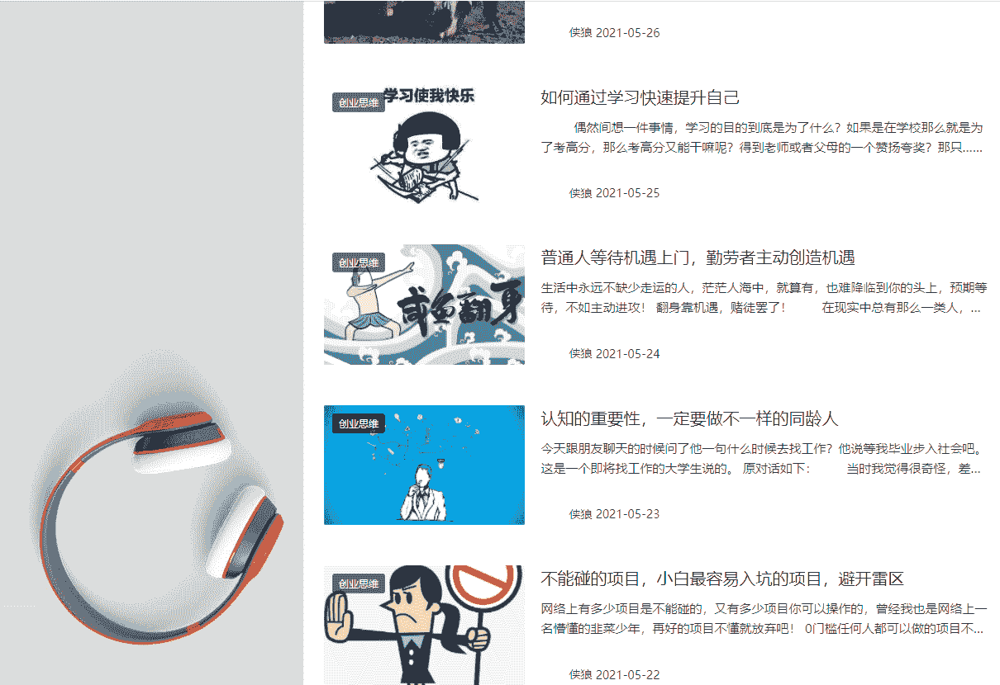
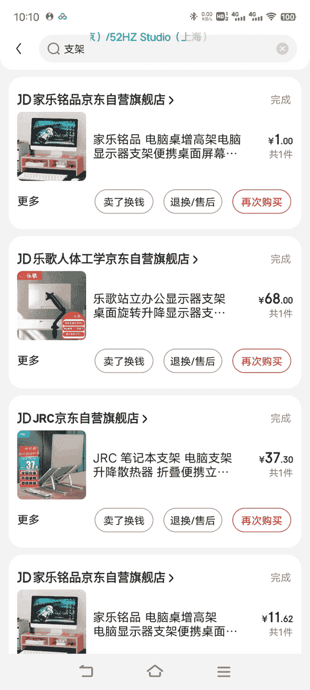

# 2022-10-09一个人的创业要注意什么？侠狼创业经验分享

> 来源：[https://xuqiwei1986.feishu.cn/docx/YJY5dc0N0oxYrRxa9oKcl99Un5b](https://xuqiwei1986.feishu.cn/docx/YJY5dc0N0oxYrRxa9oKcl99Un5b)

> 🔗 原文链接： h[ttps://articles.zs](https://articles.zsxq.com/id_zhq531w5tcwm.html)xq.com/id_zhq531...

你好我是侠狼，农村草根独立创业者，从去年到今年刚刚好一年多一点的时间了。

都快时隔一年了，我怕有些细节会忘了，就写一篇回顾复盘吧。

若是你是一个不想待在职场的人，想要出来这个社会独立进行发展的话，我想，我的这一篇经验文章会对你很有帮助的！

首先，估计是大伙最关心的问题，我目前的收入是多少？

收入具体就不聊了，过万。

我先做一个简单的自我介绍。

我IP名叫侠狼，01年，农村人，父母亲戚都是搞传统行业的。

18年出社会， 因没能力没学历，从而通过培训机构，学习Java开发 (程序员一枚)。

21年离开职场开始创业（脱离职场之前，我的收入可以拿到10K+完全凭技术）

## 一、 我为什么选择创业？

不想待在职场，不想拿着死工资，不想一辈子被人压下去，这就是我选择自己出来创业的原因。

嗯，想想未来的压力，要结婚买车买房，就是百万打底，打工？反正就我这学历能力注定是没出路的。

离开职场最大的原因，其实也是因为学历能力一般般，又年轻有技术都不一定拿得到高工资重用，稍微懂Java开发的都知道现在的开发有多卷了。

当然跟家庭也有点原因，这里就不细说了。

## 二、我在创业初期遇到了什么问题？

在父母亲戚耳中，我虽说是创业，但我总感觉在他们眼中我在摆烂，不想上班在逃避，估计只要是做自由职业的都有遭受过这种目光吧。

**问题1**

所以第一个坎，就是家庭异样的目光，我的选择也很直接，在距离父母较远的地方，自己租了个房子。

**问题2**

没能力，没经验，没人脉，我是如何坚持到现在的？

那时候很莽撞，20年，21年这两年也是知识付费浪潮的高峰期，我也是在在哪片浪花里面的一员。

我付费去进行学习，报名了一个IP班。

所学习的是，如何利用知识付费变现，搞培训赚钱。

幸运的是，我的努力与技术，把自己的产品算是做出来了，流量走的特殊渠道（无法公开，望谅解）。

在之后我对于的赚钱理解：赚钱逻辑=产品+流量

那时候我骨子里面就带着一股劲，做不出来又要回到职场，还要面对家庭的失望。

中途，有很多次想过放弃，我租的房子，光线不是很好，分不清黑白昼夜，经常性分不清时间段，也经常性失眠，因为每天都在花钱，没有钱进账，每天都活在焦虑之中。

一个人创业租房，根据自己的经济情况去租房，不要强行上车，一般准备三个月到五个月的资金即可（每个地方消费不同，根据自己的需求来，尽量优先选择光线还不错的房，至少知道天亮了）。

那时候没经验，没有人脉，偶然一次机会下，接触到了付费社群，根据自己的经济情况加入了一些社群，我依旧还记得，有人说，咋在那个社群都看得到你。

印象最深刻的就是狗哥的星球了400多加入的，在这之前都是加入一些小圈子，小星球，不超过100的（99的多）。

从此，我慢慢有了人脉（写文章写出来的）。

至于经验，我跟着那个IP班一直在走，每天坚持日更最少一篇文章，什么类型的都行，能写出来最重要。

有兴趣的小伙伴，可以去我博客翻一下我一年前写的文章，写的很水，但我坚持了三个月。

把自己的经历经验发到互联网上，几年后再回头看，这些都是非常重要的回忆呀！多多记录很重要！🐧空间也承载了我很多的记忆，可惜的是，有一次心情不好，删除了很多……

问题3

身体，健康，失眠

这三个问题，我综合性讲一下。

我比较爱吃，那时候也正好想说顺手减肥，买了很多的荞麦面，等等等代餐的东西（没啥鸟用，自己做饭又不好吃，难以下咽，吃了几天后，大部分都放在那边吃灰了）。

代餐的东西少碰，最近看了辛吉飞视频，提醒了我看配料表，成分表，后面才知道，减肥不下来，其实问题也跟吃有关系（比如零卡糖，不代表热量低，热量低不代表碳水低，碳水低不代表口感好，得到一些东西，一定会失去一些东西）

一个人创业之中焦虑是很正常的问题，失眠且焦虑经常大半夜睡不着，睡不着就会容易饿，导致那一段时间我的身体状态很差，经常都是三点左右睡觉，有时候八点醒来，有时候早上五点睡觉，十一点醒来，也有几天是早上七点睡觉，下午三点醒来。

失眠最好的解决方式是，需要调整好心态，药物是没啥太大作用的，我也用过一些助眠的药物还有音乐，基本没有用（失眠与助眠这里面大有搞头！）。

失眠最佳解决方案是，远离手机不胡思乱想，最好是放在自己要起床才能拿到的位置！

## 三、 创业需要准备什么？

创业其实什么都不需要准备的，准备的越多，无法落地执行都是在找借口！

做人做事，永远都不是在准备之中发现问题，而是在做的时候发现问题，从而进行纠正！

人无完人，其实也是如此，最好的准备就是你要去做！

那么你既然看到这一篇文章了，那我分享我用到了什么东西，有什么东西给我带来了便利吧。

注意！一定要根据自己经济以及结合自身情况去调整购买！

1、 笔记本电脑

笔记本电脑，最好要有一台续航还不错的轻薄本，5000-6000左右价位的完全够用，最好是14寸左右，便携。

轻薄笔记本，可以随时办公，有时候在家里面呆久了可以出去外面咖啡厅坐着，咖啡有提神作用，更容易专注做事。不建议去奶茶店，奶茶店吸烟的多，若是咖啡厅吸烟的多，那也不建议待。

2、 电脑支架（我入手的支架： https://u.jd.com/UtQXeob ）

笔记本电脑，外出携带可以考虑入手一个支架，方便收纳的就行，一般十几块钱就可以了，方便调整手的位置，有些咖啡厅还有奶茶店的桌子并不适合放电脑，可以利用这个工具，给自己调整合适的角度。

3、 人体工学椅（西昊M18： https://u.jd.com/UKQhlZj ）

长期久坐，椅子很重要，这里比较推荐入手一把人体工学椅，我用的是西昊M18，不算很贵，性价比还行，比普通椅子做的舒服得多！

4、 硬件设备

我是有两台笔记本，没有入手主机，一台游戏本用来录制视频或者说要用到性能的时候会用到那一台笔记本。外接一个显示器，两个电脑可以随时切换，长期用小键盘打字是肯定没有大显示器大电脑看起来舒服的。

有钱的可以给显示器加一个机械臂支架，没钱的可以考虑入手一个小柜台（根据自己升高来就行了。）

键盘推荐双飞燕的，别问我为什么，问就是耐用！

以下这个价格并不准，我之前有搞过一些京东的项目所以有点优惠，现在没了，老图了

5、 一定要搞个网线，网线100M（兆）的就够用！

6、 准备一笔资金，可以最少保证你过3-6个月，从而不出现经济危机，最好是3-6个月，多了也不行，关于这个我后面聊聊这个为什么是3-6个月这个问题。

基础的准备问题就在这里了，一定要根据自己真实情况来进行操盘，而不是乱搞一通！遇到问题可以先去知乎搜索，而不是去百度，知乎找不到想要的答案再去百度。

找准一个项目也很重要，我一开始就是认准了一个项目准备全力冲的，后来发现，自己的能力还是欠缺一些，所以不打算继续冲刺那个项目，现在在换相关的项目，也在慢慢转。

## 四、为什么我是一个人创业？不带朋友？

为什么一个人创业呢？只能说没法，在我这个年级段想要找到一起有想法搞创业的人不多，大多数人在我这个年级段基本都还在大学。

特别是初期，初期自己都没做好，带人只会更难！

举个例子，假设你一个人一天赚200块钱，那么基础的生活费就有了，坚持一个月，那么你这一个月就赚6000，但，若是你带一个朋友一起搞呢？

能否说坐到1+1大于2？这是个很大的问题。

一般来说，当只有你做出能力了，将一些内容流程化了，带人才会轻松，若是你连自己的收入都无法保证的情况下，带人，很容易一起翻车，几年的感情很容易直接崩溃，毕竟，这是“钱”的事情。

不带朋友，是我认为自己的能力目前还仅仅只是足够生活，对自己能力有个一定的了解是很重要的。

其次就是学习能力，真正厉害的人都是自己学起来的。

## 五、在这我自己创业的期间遇到过什么问题？

**问题1**

之前说过的3-6个月，其原因是3-6个月，不会让你与社会完全脱节，比如我现在，根本就不会在意今天是周几，我只会知道我今天要做什么事情，应该做什么事情，算是有点小脱节。

为什么？要在意这个周六日？

当你一个人在一个房间独处了很久的一段时间之后，假设你想找朋友出来玩，你会发现也许他们在上班了，没时间休息，你是你，你的朋友是你的朋友。

你在创业，他要坚持上班才有钱，两条轨道不在一条线。

**问题2**

孤独，因为时间线轴不在一条线，你会感到孤独，因为你不遵守这个时间，你出去会发现，没有人认识你，你想找一个人聊天，发现他们也没有时间，而你的面前只有一台冷冰冰不会说话的电脑。

走在人流集中的广场中央，你会开始羡慕他们的生活（我们想要得到什么，就一定会失去什么）。

问题1跟问题2，很容易延伸出一种病，叫做抑郁症 ，所以这也是为什么我希望不要超过三个月的原因。

22年初的时候，算是发作的很严重，经常深夜一个人在想，我是不是走错路了，为什么我那么努力了，依旧见不到结果，正值冬季，半夜又冷又饿又烦又无助。

直到我换了个项目去做，开始有稳定收入了，慢慢的远离了这个赛道，现在已经差不多回归正规了。

我的👸号跟网站还有朋友圈也在这个时候断更了，因为我发现，越是在意去写内容，写文章，反而越是焦虑焦躁不安，没结果，没人看，无正向反馈，干脆不更了，反正赚不到什么钱（换赛道需要勇气，但更需要的是你敢不敢！）。

换了赛道不怎么写内容到私域，反而日子过的更舒坦了，没有交付，没有思考，每天只专注做流量这件事。

**问题3**

流量

不管是做什么生意流量是离不开我们的，我的流量大部分来源于搜索流量，部分流量来源于社群，很少部分是来源于👸号的推荐流量。

流量的问题其实很好解决，以我现在的角度来看，只要去做短视频就行了，不管是什么样子的内容，只要发出来了，短视频的自然流量是完全越过👸号图文的。

这也是为什么我接下来要去做抖音的原因， 抖音不管是不是红利期，但是至少现在是短视频的时代，你一定要去做，一定不能错过 。

流量的核心问题是，生产内容，不管是什么样的内容都会有人看，不管是发到什么平台都有人看，只不过是大与小的问题，做了就会有结果。

**问题4**

心态

从初期的被知识付费贩卖的焦虑抬高的欲望，以及现在的沉稳，我都是经历过了，也深刻的知道了什么东西才是自己要追寻的。

但是唯有一件事情要搞清楚，你是一个人，你有多大力，可以掰下来多少东西，只要你认为自己的思路是对的，能做的，那就是对的（ 没有东西生来就是对与错，当你去做了你就知道 ）。

只要踏实做项目，慢慢做的，都是可以逐渐的看到结果。

要接受自己平庸，接受这个社会的残忍

如何接受？

下地干活！

**问题5**

时间

时间这个问题，我从未提起过，因为我目前21岁，所以我压根就没有去考虑过这个问题。

但既然这一篇文章是写给大伙（有缘人）看的，那么这个问题是肯定要正视的。

我有时间，所以我出来租房，我可以避开家庭的所有琐事，若是你的年龄段，以及家庭不在意家庭琐事的话，可以尝试出来创业，但是依旧是按照我所说的，三个月，尽量不要超过三个月时间。

若是你一天天的嫌弃职场又觉得下班弄互联网副业太累，出来辞职又觉得风险高的话，那我认为，最好不要尝试。

时间是很公平的，不管你在这个时间段做什么，他都是一定会流失的。

极端点的说法，你就浪费时间就是在浪费自己的生命，这句话确实没错。

时间总是抽出来的，挤一挤总会有，我之前为了健身，每天少玩两把游戏，我减肥瘦下来了。

我为了多玩几把游戏，上课的时候都在玩，人心所向，以及，人性。

游戏与短视频，都是短期的快乐，该痛苦该来的还会回来的。

**问题6**

我有什么？

我很小就对程序这一块有点经验，15年就自己在捣鼓网站了，那时候搞的免费服务器还有域名。

所以，自然而然的我有点这方面的经验，再加上后面去了软件培训班，这一块的技术自然是更好了。

我可以做到独立开发，以及知道如何优化（ 虽然我的技术对于懂行的人看起来不咋地，但是不懂的人更多呀 ），比如做个带支付的网站，这个问题可以难倒一大堆人，但懂行的人一看，就知道是什么情况了。

我有技术+愿意学习+愿意付费思维。

个人技术是决定你能否单飞的前提条件！这也是为什么现在很多公司招来的人也多，走的人也快的原因，大部分的人都是认为自己学会了，可以单飞了，但是实际上出了公司的系统教学之后，发现自己的学习能力与见识又脱节了。

最近一年学习内容这一块的支出估计都快有3w多了，也许部分人觉得不就才3w么？但， 你能否依赖自己的能力以能力赚到这笔钱，并且还能付出去？

赚到，与花费投资到认知学习是两码事！

这里并不建议大家盲目付费，盲目的付费，只会给自己增加很多负担！我的付费顺序是先加入一些便宜的社群，后续在加入一些更高阶的，花点时间考察。

其次就是刚刚好21年年底是属于一个社群爆发高峰期，算是吃到了一些活跃群聊的福利

## 六、一些忠告

**幸福**

我在今年五月初之前，并不知道幸福是什么样的，直到我阅读到了一本书，《纳瓦尔宝典》，在这里安利分享给各位。

这本书，有几段我自己理解的话一起分享给大家，

人数的三大要素是，财富，健康，和幸福。

我们依次追求财富、健康和幸福，但按照重要性排序，则是反过来的。

这一段话，只有你身在其中才能体会到，不然是无法体会到幸福的重要性，只不过现在的社会被很多的资本所扭曲，房子都能成为幸福的必要条件了，只能说房子在财富的下一级里面，有了财富，这问题自然解决。

很多人有了房子他们的日子实际上过的并不幸福，反而有些人虽然欠一屁股债，但是至少活得还是很开心（我们一边在失去，一边却又在得到…珍惜当下）。

有钱，并不能幸福，幸福并不一定要有钱，活在当下才是最重要的，这也是为什么我脱离职场996其中的一个原因。

**毒鸡汤**

要远离毒鸡汤，可以偏激，但不要喝鸡汤，比如某些鸡汤会告诉你，想要赚钱，要先付出XXX，或者XXX，坚持搞什么什么什么的。

这样确实是可以成功，但是一旦失败，会是什么结果？（偏激的背后，是更加偏激的想法！活着与幸福很重要！）

有没有考虑过？我听过看过很多人都说，创业是创业，生活是生活，两码事。

但是，创业不就是为了更好的生活？？？

一旦如我上面所说的方式所进行下去，你会发现，根本无法回头，只会越走越深，一条路走到黑的，我并不否认偏激，只是个人不太认同。

创业与生活其实并不矛盾，有时候越是这样急于求成反而更加容易出问题。

人们总是在羡慕别人，而别人也在羡慕你。

人们想要进入IT这个高工资领域，却又不知的有多少人想要跳出这个圈，只是当下没得选。

海洋，李子柒，这两个算是被坑惨的，而张同学很清楚，自己要过什么日子，张同学的日子就是我们大多数人向往且羡慕想要的生活吧，嗯张同学的日子也是我所向往的。

人们现在虽然有了金钱但是日子似乎并没有以前过得快乐开心了。

**独立思考，自我做主**

常说，做事要带点脑子，要自己想。

我想，在这个话题上我比较有想法，我大多数所做的项目，或者想法，并没有完全停留在想做这个层次上，而是想做就去做了。

就算有人说这个是个坑，但是我没去踩的话，我不知道里面是个坑还是个好路子。

就像，很多人的一些忠告，他们的忠告不一定是对的，但是肯定是想为你好的，这也导致很多人的生活接触面都是很低的，无法接触到更高一点的层次。

我比较喜欢我大哥经常说的一句话，每次我问他问题，都会给我一句，你认为能做的就是对的。

这句话也代表你自己也是思考过这个问题，你认为是对的就是对的， 一件事情从来就没有好与坏之区分，若是硬要说，那就是认知还不够，看不到更好的 ，当下所看到的就是最好的，看不到更好的怎么办？那就干就完事。

**鼓励与奖励**

说来，我挺感谢狗哥的，我刚开始在淘金之路发的文章说实话比较水，哈哈哈个人而言，但是他没有删我的文章，反而有一次给了我一块碎片，一块碎片价值一千块。

从而给我看到了更多写作的希望，我也逐渐知道了，并不是所有人都喜欢你的文章，但是一定会有人喜欢你的内容，我们抓住那一部分的人员就好。

自媒体平台，何为自媒体？就是因为你有了为自己发声的能力，从而我们能登上互联网这个大平台。

在这之前，我们的印象中，只有大明星才可以登上电视，或者互联网这种平台，普通人是没有机会的，但现在就是最好的机会。

现在我若是看到写的比较生涩的文章，却又敢分享出来的，我都会默默的点个赞，偶尔评论一下，多点鼓励，则有可能帮助一个人改变一生。

人们都是需要鼓励的，一个人走得很慢，只有一群人才会走得更快。

每一个人对内容的标准定义是不一样的，敢做才会有结果

**流量**

我自始至终，做的流量似乎都是免费流量居多，付费流量玩过一小段时间，发现并不适合我，虽然付费流量见效快，但一旦你的流量停止了，那么你的流量就没了。

流量这件事，本就是又难有苦又累的笨活，对于个人而言，想要做到长期且稳定的收入，就是不断的去重复去做就好了。

想要玩明白互联网的技术一定是需要一些技术与能力的，这是技术，可以陪伴终身！付费流量的打法没多久又会过时的，免费流量反而适合我们个人。

**逆言忠告**

若你自身没能力，没技术的话， 尽量不要去做“培训”这件事，特别是“教人赚钱” ，每一个人的认知是不一样的，有人驾照考的很轻松，有人不管多少次就是过不了。

行动，并不是说说而已，现在的这个时代，越是着急，越是难以得到结果，顺其自然反而会更好。

要分清楚你要的是副业，还是创业，若非极端，我建议是有份收入就先做着，实在是想多赚点钱，那就利用空余时间找点事情做，只要是与互联网相关的知识都是可以的。

**不要抱怨 **，我是一个不太喜欢抱怨的人， 世界上每一个人都有问题，只不过不想说出来或者没法说出来罢了 ，想要解决这个问题的方式很直接且粗暴，把你的能力增加，你的能力到了，想要的东西自然来了，问题自然就解决了。

不要贷款创业，也不要贷款去做副业，没钱就没钱呗，大不了想办法再省一省，据我所知，贷款以及套卡做副业创业的，基本都失败了。

创业失败率本就很高，百分之二都是很高了，别天天喝鸡汤，喝鸡汤创业会被毒死的。

创业与副业一字之差，选一个自己合适的，自己喜欢的就行，我 独自一人在光线不怎么好的小黑屋熬了大概有180多天才拿到现在的结果 ，甚至一度以为自己被关在监狱里面。

我已经不搞培训了，天天写朋友圈，还要学营销，真的不是我所擅长的，自己不擅长的事情就不要去做了，多花点心思搞流量，比任何花里胡哨的营销都有用！大流量冲击之下，必定有结果诞生！

## 七、最后的话

写本文我并不是劝大家去创业，我也知道会有人吐槽我，我无所谓的，正所谓你的粉丝越多，骂你的人越多，我只想给需要的人有一点帮助，我写文章的目的与出发点也就是这样。

我的年龄虽小，但我并不觉得我的思想很年轻，都是被迫罢了，呵呵..

创业要乘早，那时候我们有时间。

人到中年，那时候我们有金钱。

每一个年龄段都有不同的问题，没必要去纠结，想做就去做，做了就是对的。

我是侠狼，若是你也是想做一个独立创业者，可以互相交流，我很愿意认识到一群愿意奋斗的朋友。