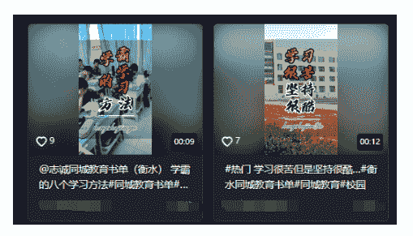
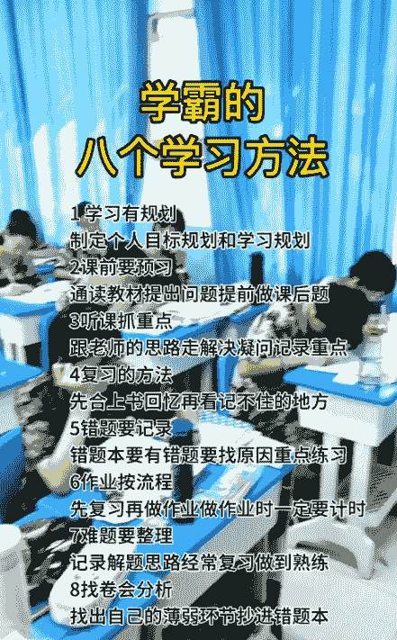
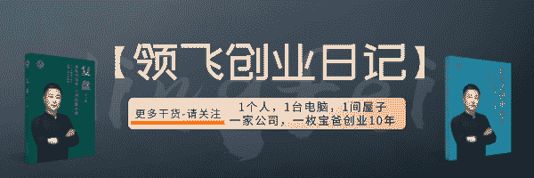

# 2023-11-21--2024年【卖服务+卖产品】个人轻资产运营，稳如老狗，价值“百万”商业模式

> 来源：[https://xuqiwei1986.feishu.cn/docx/FECMdQRsQo4wZvxr1YNcjHnMnSb](https://xuqiwei1986.feishu.cn/docx/FECMdQRsQo4wZvxr1YNcjHnMnSb)

> 🔗 原文链接： h[ttps://articles.zs](https://articles.zsxq.com/id_msepc8pc7r5m.html)xq.com/id_msepc8...

大家好！我是领飞：专注超级个体10年创业者

再有几天，喜提2024年，关于机遇的话题，又会成为热门标签，在赚钱我先占个坑，阐述下个体户发展趋向，只是个人格局观念。

个人轻资产运营互联网项目，要么卖产品，要么卖服务，要么卖平台

卖产品我不专业，我觉得太难了，特别的烧脑，选品、创意、投流，层次不穷的迭代玩法，如果你从线上学习，太难学不到真东西，一定要去电商公司打工偷师学艺，或拜牛人为师，比如赚钱有很多电商牛人，凡是干6年以上，去他那打工也很好的选择。

但是有一种玩法还可以，就是做操盘手， 孵化视频带货小IP，群蜂效应，绝大多数创业老师首选方法。

**为什么要当创业老师， **有一部分人，不是为了卖课，而是为了卖分销，教授给你怎么带货，一起分钱。

（接下来我讲的案例，就不点名哪个老师名字了，均用ABC来代替，以免我传递的信息带来误会。）

**早些年我认识创业A老师， **我特别的佩服，他所干的事情，全部都是收学费带人卖货，既赚学费，又帮他卖货；一种卖货模式火了（是模式火，不是产品火），他会用一年时间全力以赴营销，之后2年躺着把钱赚了，任何模式都有红利期，最后赚到钱的人100%信服他，再做另一个模式这些人还跟着他。

**这几年他做过**卡商、微商、电子支付、带货团长，这里领飞给大家举例： 抖音带货团长

前两年视频带货刚兴起，A老师也非常有商业头脑，他选择了一个细分赛道，卖同城教辅资料书带货。

就是让学员在当地学校门口拍视频，下方挂有相关辅导书，很多辅导资料一套价格都上百元，利润差能达到60%。

**这种带货方式交付能力特别强， **如下图，这样的视频制作，绝大多数人都能学会，不需要什么复杂的剪辑，不需要过多的用脑创作，视频+文案+链接，所以适合操作的群体非常广泛，上到50多岁的阿姨，下到20多岁的宝妈，一天就能上手教会。

**我之前写过一篇文章说，越简单的事情**，越容易批量复制，批量操作，交付力越强。

**其实更深的价值是：**

每个学员的账号价值，她们不是专业的电商人员，就是普通人搞点副业，她们的抖音号自带同城流量，基本发出去就会被手机通讯录好友看到，所以推荐流量基础数据很不错。

**这样的视频收益，以量来取胜， **基本拍出30个视频，就能小爆款一个，带货佣金就能赚几百元，不要小瞧这几百元，副业搞钱欲望很低，但是一旦得到结果，就越容易兴奋，得到超高价值的认同感，何况还是宝妈女性群体，这个背后价值更高了。

**100个学员跟着你干 **，每人每天发3个视频=300个，每个视频播放300次×300个=90000次播放，如果爆款一个出来，某个学员赚了钱，之后再往群里一发，就跟打鸡血一样，天天如此循环，这群的执行力绝对很强，万一再来一个大爆款，一个视频赚了几千，又是什么样的鼓励。

**

逻辑就是如上面所述，** 这个模式方法无处不在，稳如老狗，好比很多人干短剧推广，也是这个道理，交付容易，单纯的自己去做赚不了多少钱，但是变为卖项目就不一样了。

**【卖服务+卖产品】 **我觉得赚到大钱的概率会更高，单纯的卖服务，不足以把一个用户利用到极致价值；单纯的卖产品，很难形成分销认同感。

不管各位选择什么样的创业赛道，【卖服务+卖产品】双向奔赴会更好一些。

我们都知道卖服务和卖产品的缺陷壁垒在哪里？

交付力一定是最为重要的环节，卖服务领域最大的群体就是创业者，也就是创业粉丝，这些粉丝其中副业粉占比最大，欲望要求很低，每天赚几百就好。

**【欲望低，也正是弱智思维】 **所以给予她们交付，越简单越好，通过简单能赚到，认同感的价值超高，肯能伴随你几个项目，未来几年得力助手，要知道一个社群维护，一个新项目社群的开启，有这些人在其中，维护成本变低，成交率提升，执行力提升。

所以：“简单”也是最难，它并不简单。

2024年很低人问有什么发展方向？有什么好项目？有什么新渠道方法？

我觉得对于个人创业者，超级个体户而言，没必要想复杂：

能让更多的人跟你干，才是王道；

把现有复杂的模式，变简单，才是霸道。

如果单纯的卖服务，能不能把他变为小项目，不要有太多的交付环节，简单粗暴直接购买。

如果单纯的卖产品，能不能做出渠道商，单一，专注一类人服务，而不是所有品都卖。

**不管什么模式， **粉丝和你干，永远不要让她们动脑子，直接给他们做好内容，让她们上传就行，坐等分钱。

现在还看不明白什么是营销红利吗？

就是矩阵账号，网红切片效应大家也看到了，我觉得还是复杂，不要让合伙人剪辑，就单纯的用她们的号为目的，你剪好发她们，这就是最简单，最直接的效率。

你的工作室，要有一个很重要的岗位：内容批量产出岗，

把所有的内容制作都交这个岗位，原因不要让合伙人自己去做内容，这样太复杂了，管理成本很高，他们做的内容会不符合你的要求，他们不愿意费脑子，越是简单轻易能赚到钱越好。

每天你把做好的内容，发给那些合伙人就可以了，教给他们什么时间发，以及让他们把流量引导至你这边，你这边有一个流量成交的岗位，统一进行变现。

你做为老板，只需要抓住互联网当下，有哪些可批量复制的项目就行了，以及内容营销设置，各个平台规则的把控，你就是一个掌舵手，把这个条大船开起来。

**往期赚钱文章分享：**

【卖虚拟资源】如何转型发财，实现被动收入

【中介思维+模式复制】博取年入千万机会的方法

【长期暴利项目】中介思维极致，年入百万项目方法

【吐槽自己】引以为戒：从一开始就要有格局

《拥抱同行“借势”课》 互 推 • 扩 列，涨粉操盘手SOP

【同城二手玩具】中介圈人思维，月入10万方案拆解

卖猫副业，宝妈用2只猫拍视频，年赚20万

【赚大钱野心】小市民思维学会“存流量”，日拱一卒过河当车（ju）使。

扫码加入星球

查看更多优质内容

https://wx.zsxq.com/mweb/views/joingroup/join_group.html?group_id=1824528822