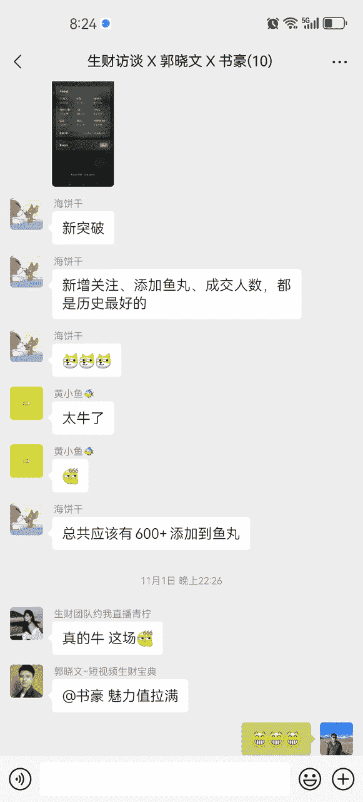
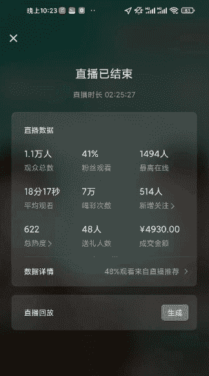

# 2023-11-21在生财有术视频号直播1.1万场观的心得经验，以及背后的故事！

> 来源：[https://xuqiwei1986.feishu.cn/docx/OpNTdU7uYoNk9Ixbb2PcmcKYnUf](https://xuqiwei1986.feishu.cn/docx/OpNTdU7uYoNk9Ixbb2PcmcKYnUf)

> 🔗 原文链接： h[ttps://articles.zs](https://articles.zsxq.com/id_3ox1nqkkpdoi.html)xq.com/id_3ox1nq...

**大家好，我是在杭州的龙珠圈友书豪，连续四年**年入百万，目标30岁之前搞定1000万！

**有幸在小红书店铺航海担任教练，上周被邀请到生财有术**视频号直播间做了一期生财实战派访谈嘉宾。

直播完之后生财团队的青柠和海饼干和小鱼老师告诉我，直播数据还不错，场观1.1万。最高在线1494人，平均观看有18分钟。

并且生财团队的伙伴们告诉我这场直播的新增关注、添加鱼丸、成交人数都是历史最好的！

作为一个电商创业者，自己除了做过公众号、抖音短视频带货和小红书店铺之外，也做视频号带货，自己也会带队伍做短视频内容，在视频号直播卖货。

所以这场直播对我来说，心理压力并不大，也有很多在线的观众是咱们生财的老圈友！

这场直播有1.1万场观和平均观看18分钟的成绩，并不是我自己的能力有多强，影响力有多大。

文章的标题有一些标题党的成分，主要是生财有术团队的本身的私域积累足够牛逼！加之小红书店铺项目本身有热度！

我本人对生财有术是有感情的，在生财有术，是我二次创业梦的开始！

**直播拉场观的一点心得：**

11月1号，在生财有术直播间直播了140分钟。

和大家分享一个小插曲，有一次，我和生财团队的黄小鱼一起吃饭的时候，小鱼告诉我，选择你作为生财有术的直播访谈嘉宾是因为你之前写过的精华帖文章质量还可以，看你在视频号书豪陪你前行上面发的一些口播类短视频镜头表现力比较自然，面对镜头不畏惧，表现自然，这也是一考虑因素。

再和大家分享第二个插曲，我和生财团队的杨爽老师沟通的时候，其实最早的直播选题是因为我今年6月写在生财的一篇精华帖： 抖音单品短视频带货1000万GMV，我是怎么做到的？！

后面杨爽老师问我的时候，你有没有什么更好的选题推荐？！

凭着我在内容电商行业的直觉，我果断的和杨爽说，我们可以做一期直播选题叫《小红书红利，30个店铺赚了100万》

杨爽老师表示很Ok !

因此有了11月1号的这次直播。

一个视频号直播间的直播，最大的权重除**了本身的私域微信好友和群好友的积累之外 ，直**播选题的热度必须是第一权重，选择小红书店铺赛道的选题会大于抖音短视频带货的选题！

选题的热度决定流量的进入和转发。那么11月1号的这场直播，录播回放以后，大家也可以在生财有术视频号看到直播回放的数据转发是2055

数据本身也告诉我们一场知识类直播的选题的热度相当之重要。犹如电商的选品定生死！

一场超过1万人场观的直播，评论区一定是互动不过来的，尽量不要被评论区带节奏。

起初我是被评论区太多的问题所干扰，后面我就跟着晓文的节奏走了。

我起初也研究过其他嘉宾的直播访谈回放

看了很多生财有术视频号直播回放之后

我想明白了一件事，11月1号的直播，必须情绪激动，利用自己的情绪和状态去带节奏。

另外想告诉大家，这场直播并不是我第一次直播，我最迟在视频号书豪陪你前行上面也是直播过几十次的，所以我面对镜头是不恐惧的，直播的久了，就像家常便饭一般。

还是那句话， 无他,惟手熟尔！

时代的一粒灰落在每个人肩头都是一座大山。

了解一个人，最好的方式之一，不仅仅是看一个人的文字，还要看一个人的直播。

我建议大家，不论是小红书还是视频号平台，都要尝试自己去直播，练习直播能力，很重要！

你去看抖音上，身家几百亿的老板江南春也会坚持直播。

这个残酷的时代，每当新事物产生的时候，我们都要跟上节奏

犹如汽车出现的时候，我们要抛弃掉马车。直播能力掌握了，可以让我们的事业走的更顺遂！

另外我发现直播间评论区居然一大堆人问小红书无货源还能不能做，这个问题看的想哭又想笑。

想哭是因为看到了曾经的自己，在面对红利的时候，居然一无所知，身在红利之中却毫无感知。

想笑是因为，这个世界，永远有信息差，我们所熟悉的可能在别人看来就是陌生事物。

再和大家分享一个细节，本次直播，我们没有提前准备台词。

晓文告诉我，直播一定要现场问现场答，如果是提前问提前答的文字稿，你会没有情绪，会是一场很差的直播。

越来越喜欢生财这个星球和社群，这里有我很多的朋友，是我事业发展的粮仓。

再分享几个直播的小技巧

1、直播内容 务必真诚，务必提供价值，务必切中观众痛点

2、场观很大的直播，务必回答的尽量简单，一句话说透。

3、尽量回答受众广的问题，受众小的问题规避，很多人会听不懂。

4、多直播多直播多直播，平时要练习几十人在线的直播间，几百人上千人在线的直播间才能承接住！

5、平时多输出，你输出的文章，也会成为你直播间的内容，只是用嘴巴再复述了一遍！

6、把观众当朋友，而不是当流量，多讲真话真数据！

7、情绪价值很重要，给直播间观众以鼓舞！

以上内容，就是书豪对11月1号在生财有术视频号直播的一点心得经验总结！

兄弟们，一起生财有术！

**往期文章：**

小红书开30个店铺，变现90万利润后，我的选品建议

如何矩阵化经营30个小红书店铺月利润过20万？

小红书店铺卖情娶内衣，直播+笔记打法月入6000保姆级教程

新人如何做小红书店铺？卖聚拢内衣的店铺用低粉爆款法从0到1保姆级教程

小红书单店铺单月6000+利润选品保姆级教程

小红书无货源电商，单品4w+利润，我做了什么？

带04年大二堂妹做小红书店铺，从0开始做小红书，月入3000

2023小红书幼教考编保姆级教程

小红书爆款封面最新设计攻略！带你掌握流量密码

[**如何拆解一个小红书爆款视频**](https://articles.zsxq.com/id_opo78sxacew9.html)

小红书无货源电商做女装如何选品？

[**小红书颜值测评变现保姆级教程**](https://articles.zsxq.com/id_15njj2g5hxfr.html)

[**小红书低粉爆款案例拆解教程**](https://articles.zsxq.com/id_0nmnwdg6mb0l.html)

小红书新人入局月入100-1000元保姆级教程

小红书上日入过万的那些爆款单品，到底要如何跟品测品呢！？

从一名航海教练的角度出发，谈谈《小红书店铺新手 0-1 出单指南》

小红书单店铺打单品单月36.8万GMV，我的打品策略！

用影刀十倍提升小红书店铺带货跟款效率

人生的第一个100万，我是怎么赚到的？！

抖音单品短视频带货1000万GMV，我是怎么做到的？！

抖音直播间月消耗过百万的千川投流经验分享

组织生财有术福建厦门圈友聚会复盘！

百家号月入5000~10000元口播玩法介绍，保姆级教程来啦！