# 抖音知识作者成长手册（对外版）

> 来源：[https://xuqiwei1986.feishu.cn/docx/KIbKdJr8Lo42amxzKY3cCiaFn4b](https://xuqiwei1986.feishu.cn/docx/KIbKdJr8Lo42amxzKY3cCiaFn4b)

> 欢迎来到抖音知识大家庭，这里是国民级的知识学习软件，越来越多喜爱学习与分享的人在抖音相遇。你以为大家还只在看轻松娱乐类内容？其实已经有越来越多的人在抖音爱上了学习。

> 抖音知识[内容兴趣用户已超过2.5](https://trendinsight.oceanengine.com/arithmetic-report/detail/862)亿，大家每年在抖音搜索数百亿知识相关问题。每14个中国人中，就有1位在抖音专心听过高校公开课。热爱学习，热爱分享新知，平均每个用户一年会分享给亲朋好友20条知识内容。抖音平台知识达人数量已超过50万，也有越来越多的院士学者、诺奖得主、专业人士、相关领域深度爱好者在抖音相遇，为大家分享毕生所学所感。详情可阅读➔《2022知识年度报告》

> 本文是面向知识作者的全流程成长手册，面向人文历史、教育校园、商业财经、科普、科技、法律、情感心理等主要知识创作场景与领域，面向个人作者、教授学者、机构组织、MCN等多元创作人提供在抖音的成长指引。

>

> [如对该手册有反馈与建议，可以](https://survey.zijieapi.com/q/250428/kv526Bq4/8658/#/)联系史炎荣，或填写：抖音知识作者成长手册调研问卷

> 手册发布日期：2023年9月1日

> 修改纪录：

> 2025年2月26日 新增[4.2如何降低片头跳出率](https://bytedance.larkoffice.com/docx/KIbKdJr8Lo42amxzKY3cCiaFn4b#share-OJsHdQxTBoZMwQxPUEKcfVaJn1b)

> 2025年6月16日 新增[7.6付费视频和直播怎么弄 ](https://bytedance.larkoffice.com/docx/KIbKdJr8Lo42amxzKY3cCiaFn4b#share-MINbd4suHouy1zxKPmqcg9Rnnkh)

> 本文蓝色字体均为超链接，可直接点击。目录跳转在电脑端可直接点击，手机端不支持该功能。

> 文档较长，建议使用电脑/平板电脑观看。

## 目录指引

| 篇章 | 目录 |

| --- | --- |

| [一、新号入驻篇](https://bytedance.feishu.cn/docx/KIbKdJr8Lo42amxzKY3cCiaFn4b#part-GkT9d6V26ouIdHxKhTrcnlrzn2e) | [1.1 入驻抖音的流程步骤？](https://bytedance.feishu.cn/docx/KIbKdJr8Lo42amxzKY3cCiaFn4b#part-KFWXdyNcpoBdNZxQ71McNhH0nbu) |

| [二、内容创作篇](https://bytedance.feishu.cn/docx/KIbKdJr8Lo42amxzKY3cCiaFn4b#part-OaOfdiFehoSmn6xAFF0c97u7nZc) | 2.1 我是新人小白要拍啥？怎么拍？ |

| [三、涨粉密码篇](https://bytedance.feishu.cn/docx/KIbKdJr8Lo42amxzKY3cCiaFn4b#part-RRndd6ZgkolFSqxBFBoclZbdnMc) | [3.1 在抖音怎么快速涨粉？](https://bytedance.feishu.cn/docx/KIbKdJr8Lo42amxzKY3cCiaFn4b#part-ZICXdHCOroibt0xkwojcCGvens1) |

| [四、流量密码篇](https://bytedance.feishu.cn/docx/KIbKdJr8Lo42amxzKY3cCiaFn4b#part-NDuXdd0TGoqqbDxz2MhcK7Yanae) | [4.1 怎么创作流量爆款？](https://bytedance.feishu.cn/docx/KIbKdJr8Lo42amxzKY3cCiaFn4b#part-Lxn5dcFtxoKXl3xJdXjcELtOnOf) |

| [五、流量诊断篇](https://bytedance.feishu.cn/docx/KIbKdJr8Lo42amxzKY3cCiaFn4b#part-PcswdohbeocNjFxLLyVclptGnSb) | [5.1 我有审核问题吗？](https://bytedance.feishu.cn/docx/KIbKdJr8Lo42amxzKY3cCiaFn4b#part-PBVudujOFoTMOEx988ZceGmCnge) |

| [六、知识直播篇](https://bytedance.feishu.cn/docx/KIbKdJr8Lo42amxzKY3cCiaFn4b#part-V96xdbbQCoiGnRxmoDnckw6nn71) | [6.1 在抖音有哪些直播方式？](https://bytedance.feishu.cn/docx/KIbKdJr8Lo42amxzKY3cCiaFn4b#part-ByWhdfbFwosmOkxYCcfc3Iltn2c) |

| [七、快乐变现篇](https://bytedance.feishu.cn/docx/KIbKdJr8Lo42amxzKY3cCiaFn4b#part-NK4KdNvvSokUfgxlLJAcwKBOndc) | [7.1 电商带货怎么搞？](https://bytedance.feishu.cn/docx/KIbKdJr8Lo42amxzKY3cCiaFn4b#part-N4dqd65KZoyqFGx3FEKcHWj8nWd) |

## 一、新号入驻篇

> 本篇核心是指引刚入驻抖音的新人，非新人作者可直接跳转第二篇。

> 在知识领域，专业属性强的作者对用户的吸引性很高，因此完善职业认证和账号简介会很重要。

> 同时抖音的各项新功能其实非常多，巧妙地运用好各种功能对涨粉和流量也都会很有帮助，如弹幕、图文、共创等。

> 点击以下蓝字跳转：

> [1.1 入驻抖音的流程步骤](https://bytedance.feishu.cn/docx/KIbKdJr8Lo42amxzKY3cCiaFn4b#part-KFWXdyNcpoBdNZxQ71McNhH0nbu)

> [1.2 我是mcn要怎么搞](https://bytedance.feishu.cn/docx/KIbKdJr8Lo42amxzKY3cCiaFn4b#part-HYJddkPl6o7tewxCjlUcRMy1nCh)

> [1.3 了解更多抖音的重要功能](https://bytedance.feishu.cn/docx/KIbKdJr8Lo42amxzKY3cCiaFn4b#part-V6n4dkHCloeAwMxyGPGceZE3nAh)

> [&    返回总目录](https://bytedance.feishu.cn/docx/KIbKdJr8Lo42amxzKY3cCiaFn4b#part-IUV5d09PNoEIajxWaUscxB4TnIg)

### 1.1 入驻抖音的流程步骤

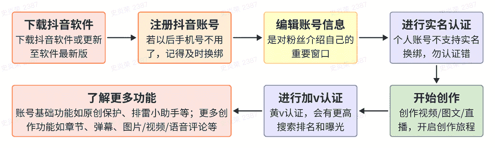

| 我的问题 | 详细问题 | 怎么解决？ | 图示 |

| --- | --- | --- | --- |

| 下载抖音软件 | 在手机哪里下载抖音？ | 在苹果手机或安卓手机应用商店搜索找到「抖音」app，下载或更新至最新版 |  |

|  | 抖音有电脑版吗？ | 抖音在PC端有网页版，无电脑端app，在网页端可以直接搜索抖音进入，或通过官链接进入：`https://www.douyin.com/` | 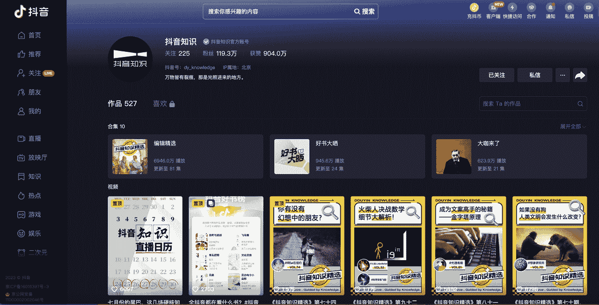 |

| 注册抖音账号 | 抖音和今日头条/西瓜视频的粉丝量关系 | 在抖音账号「我」右上角点击菜单栏「≡」，点击「设置」、「账号与安全」、「第三方账号绑定」，绑定「今日头条/西瓜视频」账号，抖音外显粉丝量为抖音/今日头条/西瓜视频三端之和。 |  |

|  | 注册手机号 | 如果是机构、企业或mcn，不建议使用学生、实习生、第三方外包工作人员手机号 |  |

| 编辑账号信息 | 账号名怎么写？ | +   是大众认识和了解你最重要的名片，也是你在抖音里的名字，尤其是对于知识作者来说，能让大家第一时间了解你的背景/领域/专业性很重要。例如李永乐老师、直男财经、龙飞律师、周月亮教授…… |  |

|  | 账号简介怎么写？ | 主要是让粉丝更好的认识与了解自己，可以包含： |  |

|  | 组织机构注意事项 | 在**未完成组织机构认证**前，不可使用官方机构名称、头像， |  |

| 实名认证 | 要怎么认证？ | 在抖音「我」的界面，点击右上角菜单栏「≡」，下滑点击「设置」，点击「账号与安全」，点击「实名认证」。根据手机提示操作完成认证。 |  |

|  | 注意事项 | +   每个账号绑定一位实名认证人 |  |

|  | 不实名认证有什么影响？ | 无法「自媒体直播」形式直播、无法拥有黄v认证等更多作者侧权益。 |  |

| 官方认证： | 要怎么认证？ | 在抖音「我」的界面，点击右上角菜单栏「≡」，点击「抖音创作者中心」，点击「官方认证」，选择「个人认证」，选择领域和认证类型，查看「申请规则与材料要求」，满足要求即可申请。 |  |

|  | 可以不做个人认证吗？ | 有相关职业身份背景的作者建议优先做职业认证，强化自己内容对于用户专业性的感知。 |  |

| 官方认证： | 适合哪些账号？ | 适合国家机构、媒体、高校等机构申请，如清华大学、北大学堂、复旦哲学、联合国开发计划署等 |  |

|  | 要怎么认证？ | +   **抖音PC端**[**自助发起，根据端内提**](https://www.douyin.com/certification/agency/enter/)示操作即可，需要的材料见申请链接里的要求。PC链接（点我点我） |  |

|  | 注意事项 | +   账号获得机构认证后，有效期为365天，到期自动进行年审 |  |

| 官方认证： | 适合哪些账号？ | 适合企业、个体工商户、校企组织，还有民办高校的官方账号/二级院系/校级组织/团委等组织机构，如华为、长江商学院、复旦泛海国金等 |  |

|  | 要怎么认证？ | +   抖音端内搜索「抖音小助手」发起私聊，进行认证 |  |

|  | 注意事项 | 企业号审核一年有效，每年需参加年审 |  |

| 视频发布 | 有哪些发布视频的渠道 | +   电脑端进入抖音创作者后台发布，功能更适配专业拍摄和剪辑的精品类作者，有章节、关联热点、合集、定时发布等多重功能，更适配知识类作者； |  |

| 在抖音遇到了问题怎么办 | 在哪里找到客服 | 手机端客服：在抖音「我」的界面，点击右上角菜单栏「≡」，下滑点击「我的客服」，询问在线客服即可。 |  |

| 内容保护 | 原创保护 | 认证原创作者，解锁原创性审核、原创作品保护、冒用治理、站外维权、仿冒账号粉丝转移等多项权益。 |  |

|  | 维权管理 | 抖音万粉+的作者会解锁维权管理功能，加入原创者联盟，平台会协助监测和维权。 |  |

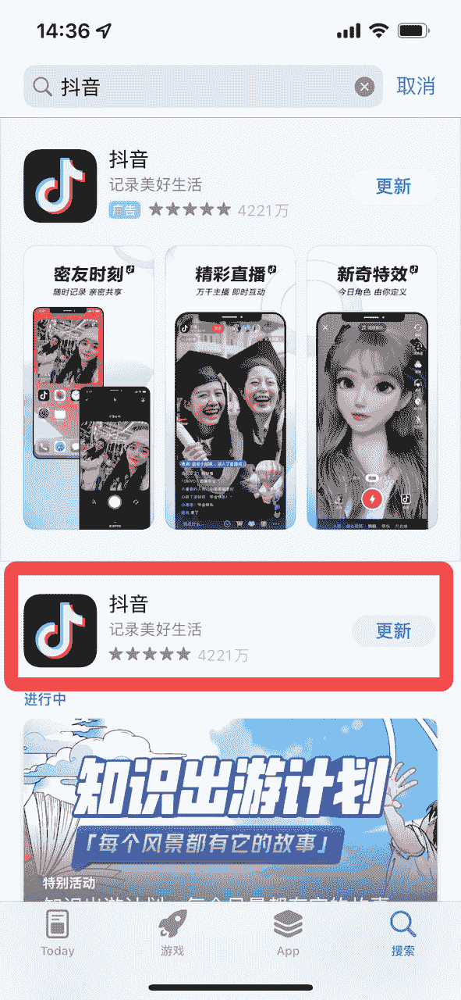

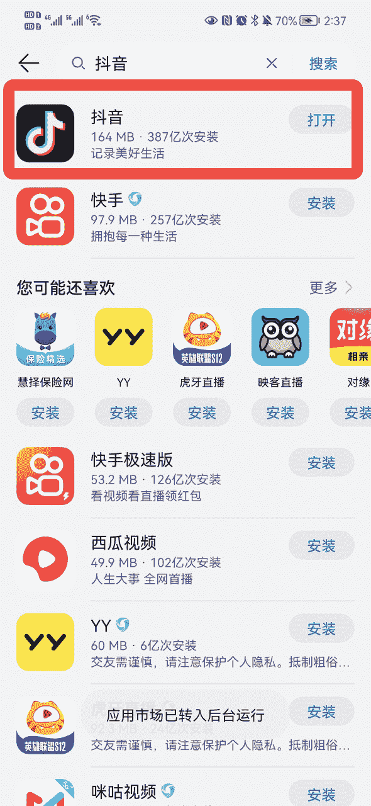

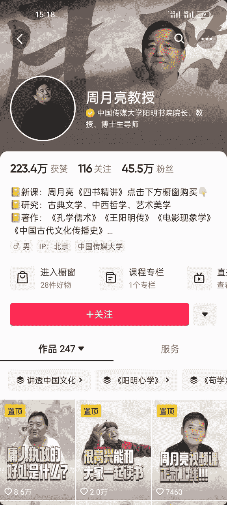

> **认证流程请查看：** [http://renzheng-doc.douyin.c](http://renzheng-doc.douyin.com/docs/6660/162799/)om/docs/6660/162799/

> **认证准入规则请见：**[https://renzheng.douyin.com/support/content/](https://renzheng.douyin.com/support/content/125085?graphId=412&pageId=146&spaceId=77)125085?spaceId=77&graphId=412&pageId=146

> 企业号帮助中心：`https://renzheng.douyin.com/support/?pageId=146&spaceId=77&timestamp=1691563750996`

### 1.2 我是mcn要怎么搞？

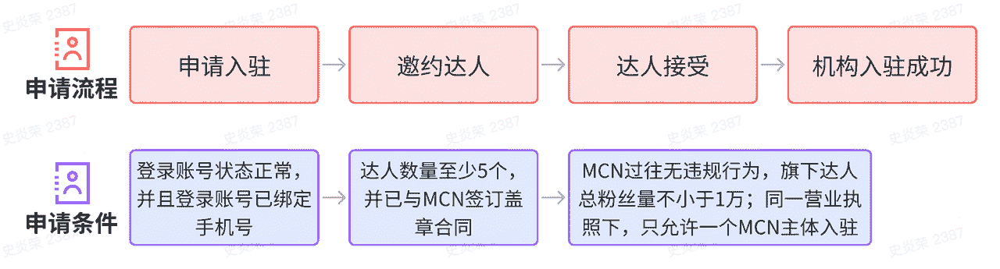

| 我的问题 | 怎么解决 |

| --- | --- |

| 在抖音哪里申请mcn资质 | 申请官网：`https://www.douyin.com/mcn/` |

| 申请时有啥注意事项 | +   新增达人时，该被新增达人需满足近30天投稿大于等于3个。 |

| MCN后台有什么需要重点关注 | 平台公告、活动通知、MCN月度榜单、机构监控、核心数据等。 |

### 1.3 了解更多抖音的重要功能

| 重要功能 | 重要性 | 操作手册 |

| --- | --- | --- |

| 👨‍👩‍👧‍👦 共创 | 多个作者同发一条视频 | `https://creator.douyin.com/creator-micro/creator/help/co-convention` |

| 📕 图文 | 发布图文内容，让文字更好的呈现 | [抖音图文教程（对外版）【不要使用一键成片】](https://bytedance.feishu.cn/docs/doccnEZbRtye6c4PkVLWdAhJjfh?theme=LIGHT&amp;contentTheme=DARK) |

| ⏰ 章节 | 划分视频结构，促进视频完播率 | [抖音章节功能使用手册](https://bytedance.feishu.cn/docx/LILUdf1ZjojRwqxEVzocXJEBnW8) |

| 🥳 弹幕 | 打造互动氛围，促进涨粉效率 | [抖音弹幕功能使用手册](https://bytedance.feishu.cn/docx/KaBHdlt3Mof0s8xTLXZcXSPCn5g) |

| 🚴 挑战 | 发起挑战，打造粉丝&amp;圈层的跟拍 | [抖音上线了一种很新的挑战✨](https://bytedance.feishu.cn/docx/EsZ5d6Hpco6r9gxwEpbcmFWZnsd) |

| 重要平台 | 重要性 | 相关链接 |

| --- | --- | --- |

| 直播数据平台 | 播前准备、实时数据、直播复盘 | [抖音直播数据平台（抖音灵机）怎么用？](https://bytedance.feishu.cn/docx/YH2AdsMmWom4bNx0UujcAnvrnLe) |

| 电商学习中心 | 电商规则与路径 | 平台链接：`https://school.jinritemai.com/doudian/web?from=buyin_daren` |

| 巨量星图 | 带货规则与路径 | 平台链接：`https://www.xingtu.cn/?utm_source=oceanengine` |

| 企业号 | 了解企业号成长路径 | 平台链接：`https://renzheng.douyin.com/support/academy?pageId=academy-ea&amp;spaceId=77&amp;timestamp=1691565970612` |

## 二、内容创作篇

> 本篇核心是解答不同阶段作者内容优化的相关问题，不仅仅是新人小白，即使是很多百万粉高粉作者也需要不断优化内容质量，给予粉丝新的体验。来查漏补缺，在内容优化领域发现你的全新流量增长密码。

> 点击以下蓝字跳转：

> 2.1 如果我是新人小白要拍啥？怎么拍？

> 2.2 我不会拍视频可以发图文吗？

> 2.3 我早就不是小白了还需要优化内容吗？

> [&    返回总目录](https://bytedance.feishu.cn/docx/KIbKdJr8Lo42amxzKY3cCiaFn4b#part-IUV5d09PNoEIajxWaUscxB4TnIg)

### 2.1 我是新人小白要拍啥？怎么拍？

#### 第一步 选择内容方向

对新人来说，首要面临的问题就是内容方向的抉择。我要拍什么？讲什么？什么内容更适合我？更好涨粉呢？

可以先参照下列公式，问自己五个问题：内容方向=（专业+职业）×特长/爱好×（特点+性格）。下图每个问题都列了一些参考方向，最终整合出自己对应的五个答案，整合后便是具有自己人格化特色的内容方向。

核心是从中发掘自己的特色，以及与其他同类型作者的差异点与优势，才能更快更好的从同类型作者中脱颖而出。知识作者通常会基于自己的专业和职业延伸创作，但相对来说很容易同质化。从自己的特长/爱好、特点、性格等多元维度发掘自己的独特性，并强化这种独特性与人格魅力，会很容易让用户记住与喜爱。比如“阳光开朗大男孩+白大褂+养母鱼”、“白发苍苍老顽童+教英语+打游戏”等都是从专业领域和自身特色中打出差异化。

1. 我的专业是什么？
1. 我的职业是什么？
1. 我的特长或爱好是什么？
1. 我的特点是什么？
1. 我的性格怎么样？

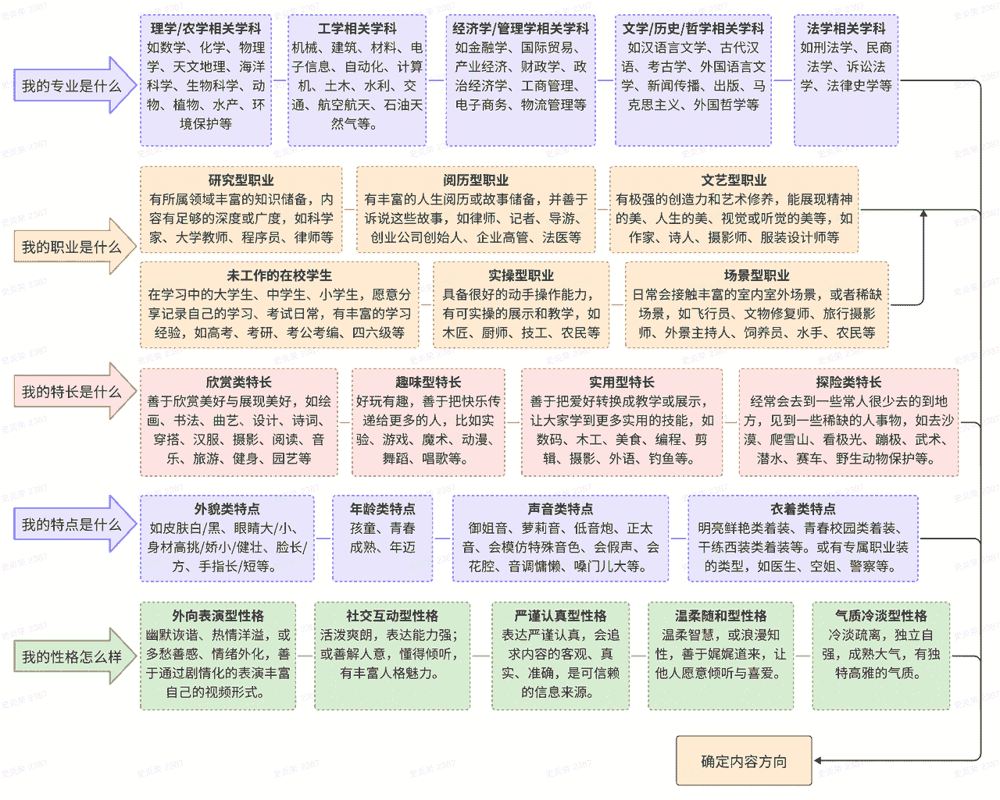

| 案例展示 | | | | | | |

| --- | --- | --- | --- | --- | --- | --- |

| 案例 | TA的专业 | TA的职业 | TA的特长/爱好 | TA的特点 | TA的性格 | TA内容方向的差异性与优势 |

| [意公子](https://www.douyin.com/user/MS4wLjABAAAAZ4tsdtwes8aLJLES5I-Vg5tH3V8Z_G-PabQBFNOROrA) | 福建师范大学 | 担任过主持人 | 历史/艺术 | 绿色和绿衣服 | 温柔随和型 | 个人性格温柔智慧，加上主持人经历，让她更显亲切。娓娓道来，更具感性色彩，既是读史，也是一次心灵的愉悦。配上绿色的主色调，更能放松身心。 |

| [养真鱼的张宜良](https://www.douyin.com/user/MS4wLjABAAAAmqxL5jF_pB7mGt6WnraxK_FhTJRi1K1wF1p07TsUsNMzaa4RNiwSC81mW-59X7oM) | 中国海洋大学 | 硕士在读 | 养殖母鱼 | 实验室白大褂 | 外向表演型 | 立足专业属性，成为养鱼作者里的专业人士（对比三农赶海），在专业作者里做有趣行当（养殖母鱼对比文史数理化），辅佐青春综艺感学生风，内容更年轻好玩，专业更稀缺小众。 |

| [瑞达利欧](https://www.douyin.com/user/MS4wLjABAAAAZ3CRLQ4Tpof40sUaPpFjs4JyD8-43hisEdJrSMn_Bct-zs0H8qN0U6U8YJQe2l6Z) | 哈佛商学院 | 桥水基金 | 投资/商业 | 西装/衬衫 | 严谨认真型 | 强化投资商业领域的专业性，身份背景、着装、性格都与大众认知相符，突出强化其专业性，更能获得商财领域粉丝的信赖。 |

| [模型师老原儿](https://www.douyin.com/user/MS4wLjABAAAAquCosCVw-uWMCaAnn6g8W5n_cZqmg0OMpzFuhyiS4yePYLCiof-9c5iJVY5LdA89) | 中国传媒大学 | 曾任央视 | 制作趣味模型 | 大眼儿眼镜 | 外向表演型 | 立足职业背景，通过趣味模型做知识演示。是整活儿搞笑博主里最知识的，又是知识里用直观模型做趣味演示做的最好的。 |

| [傻白呀](https://www.douyin.com/user/MS4wLjABAAAAGLwNfNCA8cwEhJTEqlXlvKFYVrVYwUKcF3sAr11jHs0) | 华盛顿大学 | 创业者、互联网公司产品经理 | 自我成长/英语 | 鸭嘴头套 | 踏实精进型 | 年轻高知、海外精英，持续的知识输出和接地气的成长建议，都让他的自我成长内容格外有说服力。 |

## 第二步 内容呈现形式

> 确定了内容之后，第二步就是要思考内容以什么形式来呈现，不同形式的内容呈现方式，侧重点也会不同。核心是看这类型内容对粉丝的核心吸引力在哪里，用内容形式强化自己的内容特色。

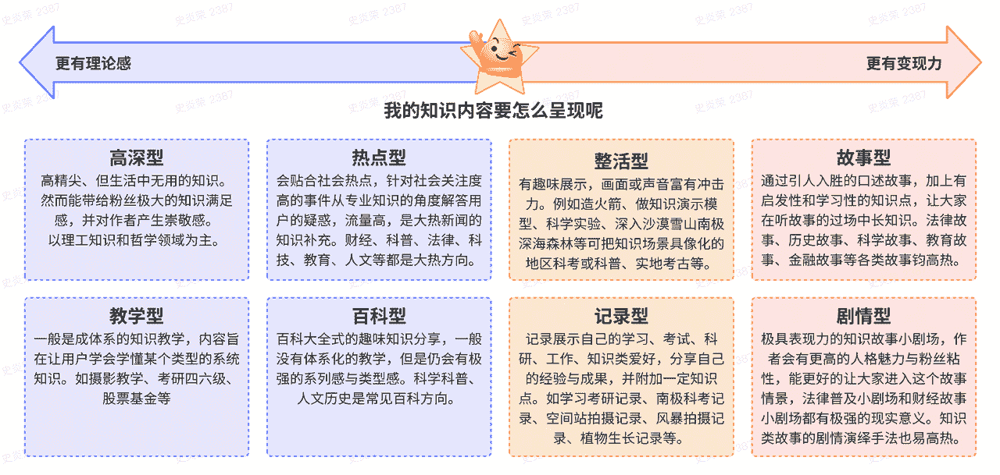

### 案例展示

| 内容呈现形式 | 案例作者 | 参考视频 | 解析 |
| --- | --- | --- | --- |
| 高深型 | [思想史万有引力](https://www.douyin.com/user/MS4wLjABAAAAlpQnZ6TtSPrGf26dfMLgFB8XMbcOGE69ZLtGwfZOghQ) | 比较烧脑 十分重要：西方哲学到底在讲什么？ | 以深度、系统的西方哲学为核心内容，有自己的思考和逻辑体系，粉丝粘性高，以深度吸引核心用户群。 |
|  | [研究宇宙](https://www.douyin.com/user/MS4wLjABAAAADY6QvzZpnl-lJ_mtwhpli8QUyqcRMB2g_0Ax4a0wwIfR4lhpR1VVIZ0dBYdOgDnp) | 2022诺贝尔物理学奖解读？什么是贝尔不等式和量子信息？ | 及时解读诺贝尔奖量子力学相关知识 |
| 教学型 | [小白测评](https://www.douyin.com/user/MS4wLjABAAAA524rHaEm72NuxE04Aw1UyYZFvHUvDEFmTqvlKoRwlFc?relation=0&amp;vid=7187651339781033276) | 年终全价位购机指南：全年什么手机值得买？ | 以传输有用性知识为主，学到就能用到 |
|  | [厉老师数学思维](https://www.douyin.com/user/MS4wLjABAAAAJ4eCtCz_2i0y4FquSAtBmQnMXO5sdeUf6UBcDe3RrL8) | 倍数问题是234阶段一定会遇到的问题，但是知道见倍画图后会很简单 | 老师和学生居多，传输本阶段需要的学习知识，例如考研、四六级、雅思托福、行测等 |
| 热点型 | [安森垚（yáo）](https://www.douyin.com/user/MS4wLjABAAAAD_dWQoNBawiqlJVN46hAlAt4aJ9kArN-82vM_VGhEd0?relation=0&amp;vid=7246794632087063820) | 罗刹海市里的维特根斯坦到底说了什么 | 歌曲《罗刹海市》火爆全网，解析其中的维特根斯坦是什么意思。从语言、语音、历史等维度深入剖析其文化历史渊源，从音乐类热点延伸出高价值的知识信息，信息量大且密集。 |
|  | [Caroline涵涵姐](https://www.douyin.com/user/MS4wLjABAAAAGifIKvY8dZjHTPjHxIHlDQb6CVIk0AYgAyZD4gxd7JI) | 比唐山烧烤店“小虾”更让人气愤的是他们 | 唐山烧烤店打人事件引发全网愤怒，作者言辞幽默犀利，双关谐音随手拈来，辣评网络喷子。 |
| 百科型 | [无穷小亮的科普日常](https://www.douyin.com/user/MS4wLjABAAAAt2N8a6NX9fwUXQRUSW2_neQsQy_z-LRSM0S3jioc2rmS6bNhhEpq1cGSevx6Ynca) | [第70集 | 网络热传生物鉴定](https://www.douyin.com/video/7226202895471906085) | 将全网碎片化的各种水猴子和神奇植物进行整合解读，每条视频都是碎片化的趣味知识，但是随着视频量的增加，逐步变为生物领域的趣味百科 |
|  | [一方见地](https://www.douyin.com/user/MS4wLjABAAAAp92uu_j4PbJqSq7IC2ChVIEPoep6Ul4BTtTCq0L_JRo?relation=0&amp;vid=7231538522845482300) | [蛇要出洞了，可以解蛇毒的有毒植物们花都开](https://www.douyin.com/video/7231538522845482300)好了，他们长的还挺像蛇的……最后一个最像 | 风格统一的植物百科大全，精美、有趣、生动。 |
| 记录型 | [天体物理博士刘博洋](https://www.douyin.com/user/MS4wLjABAAAAgPs75Uyoj2CUpK9vNeshGp2z76VMcofOIrXJYdgw0hI8npEhNW7nMTyvYsMRZAxd) | 首次用自编程序自动跟踪拍摄中国空间站，致敬第7个中国航天日 | 记录拍摄中国空间站的过程，有故事情节、知识相关领域的前沿进展、高昂激动的情绪，同时也很大程度的展现了其专业性。 |
|  | [语文山水](https://www.douyin.com/user/MS4wLjABAAAAdQrBzCZP5n7SbvTh21FVc2hd01dUKtgOVV-rH8tCFtCDZ3AXPbdEa-Mn4HjBOkef?relation=0&amp;vid=7218011004452539651) | [我的烦恼1：那个比我优秀的人](https://www.douyin.com/video/7218011004452539651) | 拍摄记录班级学生的优秀作文朗读，看优秀小朋友的优秀作品。 |
| 整活型 | [皮卡悠](https://www.douyin.com/user/MS4wLjABAAAAPcyy5YR3utkPbCwT-lrt3-UhEG_LWUkoqNvEw-kgH53eKjcC5RoNxVGdC8RoUUuJ?relation=1&amp;vid=7234121222680775993) | 把天空搬进房间，这就是理科生的浪漫吗？ | 制作大型科学实验，有更强的视觉冲击力和专业性，整活儿好玩。 |
|  | [LShang001](https://www.douyin.com/user/MS4wLjABAAAAssBS1DU-oFA7D-yNfKAykOGBPqWjPLk1zu3_ud0buoANg9vq1Z9CXbRLo8hIEZ7S) | 【硬核】自制第三代反推回收火箭 | 在校大学生自制火箭，全程记录系统原理、发射过程、算法框图、发射复盘。 |
| 故事型 | [温竣岩](https://www.douyin.com/user/MS4wLjABAAAAGuRmi0WYc07SCGaPUknovR9ACXTqdU1qWtSjc84k5Ww?relation=0&amp;vid=7159544411393674509) | 第1集 | IP地址危机，全球开启IPv6计划 | 跌宕起伏的故事情节中，也融入了相当多的知识信息。可读性更高，知识获得感也更高。 |
|  | [巫师财经](https://www.douyin.com/user/MS4wLjABAAAAytpDnsYZsaBeiuf1stH3ylk2dS4BgBYYSuiYeyEeewaszA8ygQq0W5IkV53QS5ls?relation=0&amp;vid=7242530799965195553) | [蔡徐坤的资本博弈](https://www.douyin.com/video/7242530799965195553) | 长篇商业故事解读，有丰富的剧情与数据支撑。 |
| 剧情型 | [秋叶Excel](https://www.douyin.com/user/MS4wLjABAAAAsdd5Yp8IbRS2be3K65PFj9y8jWNeGvzT8IHoOVuGBlo?relation=0&amp;vid=6851886515887279368) | 【批量新建文件夹】老板打人越来越狠了，心疼辛莱德 | 简单枯燥的excel教学融入职场剧情，更生动形象 |

## 第三步 拍摄剪辑方式

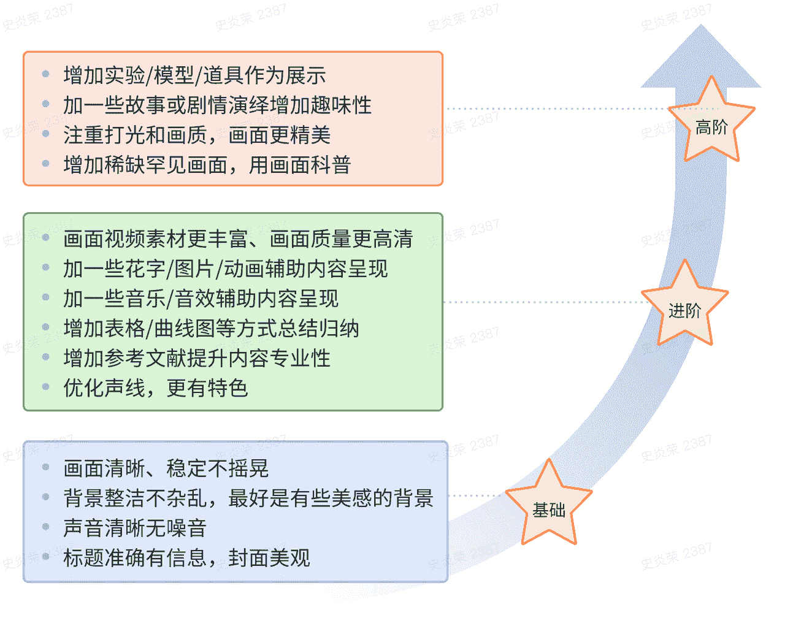

### 拍摄剪辑常见问题

| 问题 | 答案 | 案例作者 | 参考视频 | 解析 |
| --- | --- | --- | --- | --- |
| 知识视频的剪辑要素 | 加更多高清视频素材 | [地球知识局](https://www.douyin.com/user/MS4wLjABAAAAIrdeKwWYOfuoPsW5m3YK1NuZLTftIA-IoF5rv0rvkxg) | 气候异常的底层地理逻辑，究竟是什么？ | 画面更高清，避免过多低清晰度画面和简单图片拼接，画面更美观。 |
|  | 加一些花字/图片/动画 | [同学请坐](https://www.douyin.com/user/MS4wLjABAAAA4yo848GXc34kXaeBVRE7ArtG-BrB76KI1THUgLQO7XE?relation=0&amp;vid=7136451220364971295) | 北大博士高效休息法，从此远离困顿乏 | 真人出镜的同时，加一些适配好玩的花字、贴纸、文字总结、相关视频素材，增加自己视频的可看性。 |
|  |  | [二二酸酸](https://www.douyin.com/user/MS4wLjABAAAAfRRGEomf6h_kmmefCsZAAxjkTTY8yud3qM5XSh2Km7LAIi2XFsCByiMHjYKoBU-Q) | 如何24小时内科学调整至最佳考试状态？ | 加入动画和图片的演示，更好更直观的展示自己所讲的内容，生动有趣。 |
|  | 加一些音乐/音效 | [青史说](https://www.douyin.com/user/MS4wLjABAAAAbaSivPQN37xOq0P3RzJwBADWiMZre_Wv1DpbM3gPynI) | [古人脱发怎么办](https://www.douyin.com/video/7108674448236104990) | 用适配的背景音乐和好玩的音效，让知识不再枯燥，有更强的可看性。 |
|  | 加一些表格/曲线图 | [氪财经](https://www.douyin.com/user/MS4wLjABAAAA_eNDiAALr16n8W6B2mVLlafd8Ahq0FvLCVGWgkjPfBAxKY9XGusc1wpPdP5uG2N5) | 这份全国上半年GDP成绩单，也可以是你的搞钱指南 | 用丰富的图表更直观的展现数据变迁与知识，用用户更易理解经济走势。 |
|  | 加一些参考文献 | [星球研究所](https://www.douyin.com/user/MS4wLjABAAAAJKuwo57fQDgVt3Rty-AAsKm3wLPnSapVsjp5qzb07zo?relation=0&amp;vid=7146191799910927623) | 中国从哪里来？以地理的视角，9分钟视频为你解答 | 文末附上参考资料和文献，内容来源更准确详实。 |
|  | 加一些声线的润色 | [小说家Puckio](https://www.douyin.com/user/MS4wLjABAAAAaF12Le33MNpYGjxYrWdy8lqThbEyVPPYyBqMoyz8JETWT32YbpX_4CVdtmwZ-Z0R?relation=0&amp;vid=7214754951128567079)： | [一口气读完绝叫](https://www.douyin.com/video/7214754951128567079) | 给自己的声音加入了演绎的感觉，用戏剧般的声音讲述和演绎，更有记忆点 |
|  |  | [瓦清](https://www.douyin.com/user/MS4wLjABAAAAHMaL9TJ8MBYv0atQVs48h5YK1L6M4kUAaF-YJxj7JpI?relation=0&amp;vid=7209076719322418490) | 黑洞不是洞，引力不存在，“光”不走直线，简单理解广义相对论 | 作者原本的声音就相对慵懒有特色，强化自己声音的特色也会让人更易记住 |
|  | 加一些实验/模型/道具 | [夏振东讲物理](https://www.douyin.com/user/MS4wLjABAAAAAivHcYgQ9XKBM0bKIYhpaN43p_IUPvR9AdJDy7qAiEI) | [物理老师的雷电法杖（高燃篇）](https://www.douyin.com/video/7259204019170741560) | 加入实验道具，更具象化的展示和阐述雷电的产生，画面有冲击力，更有趣 |
|  | 加一些模拟演示 | [三维地图看世界/人民日报](https://www.douyin.com/user/MS4wLjABAAAA80vX8PeWwLGwdySAF5AWK2DodMEYmcBj6Nb8WhKVBG8) | 什么是泄洪？蓄滞洪区都在哪里？一支视频弄清楚。 | 通过模拟演示，让大家更清晰直观的了解了河北泄洪的原理和区域，更生动形象。 |
|  | 加一些故事/剧情演绎 | [这不科学啊](https://www.douyin.com/user/MS4wLjABAAAAprnLAzLSWusGfifK9oHcwLt6k9lXvj2PBCaCtgBiZ2kHfZGmjRLXCGFGxN2cEdhH) | 这些常见的东西，放进微波炉里竟有这么大的危险？ | 用故事和剧情演绎增加趣味性和记忆点 |
|  | 更注重打光和画质 | [影视飓风](https://www.douyin.com/user/MS4wLjABAAAAaCcBHb3Rhc4zxF8YkBOfHfLh6k-IWEK2l3Ne9xOXPnQ) | 顶配10万元，最新Mac Pro有多强？Mac全系列上手！ | 打光和画质更高，让用户有更好的观看视频体验，也会更好的满足对Mac Pro品质的期待。 |
|  | 加一些稀缺画面 | [Range四方](https://www.douyin.com/user/MS4wLjABAAAAyI48A170Dpy8ilmOQDesCjy4xtFLWUaB5LUC6mZtJIkVXofsuuzjsZPde35eeEyZ) | 亲眼见证吞没天地的史诗级风暴弧状云！压迫感拉满！ | 实拍稀缺精美的风暴画面，用画面来展现知识，让粉丝更好地了解了风暴弧状云的形成与模样。 |

| 知识视频的拍摄剪辑方法 | 答案 | 参考教程 |  |  |
| --- | --- | --- | --- | --- |
|  | 构图/运镜 | + 基础： |  |  |
|  | 光线合适 | + 基础： |  |  |
|  | 声音合适 | + 基础： |  |  |
|  | 剪辑教学 | 剪映专业版教学：https://www.douyin.com/video/7263433435232963874 |  |  |
|  | 视频封面 | 抖音视频封面制作教学：https://www.douyin.com/video/7198465918849011005 |  |  |

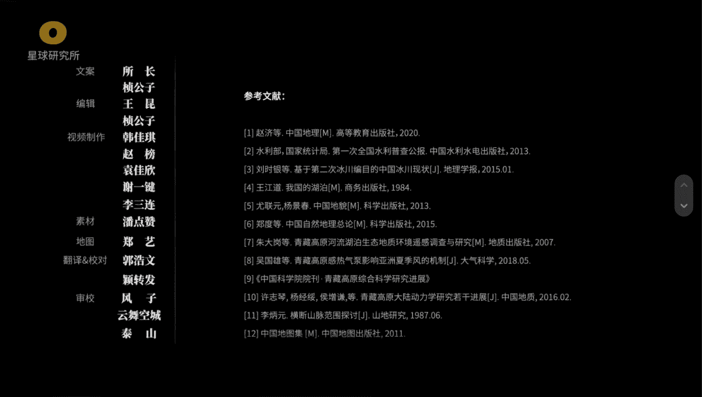

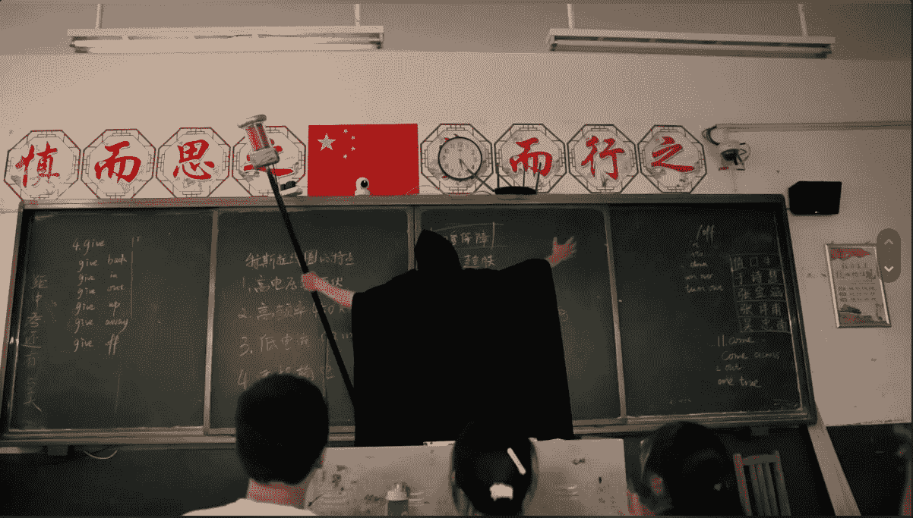

+   知识作者以知识内容输出为主，高端的拍摄技巧不是必需品。一般以固定机位的半身像形式出现，人物露出腰部及以上，头在画面1/3的位置最美观。尽量不要选取俯拍、仰拍等角度，易让观众有不适感。

+   真人出镜构图：https://www.douyin.com/video/7229264990497246524

## 一、拍摄与制作基础

+ 分镜思路：https://www.douyin.com/video/7264058530435452197
+ 转场思路：https://www.douyin.com/video/7257789063179128075
+ 节奏思路：https://www.douyin.com/video/7235848903331941688
+ 故事化拍摄新手技巧：https://www.douyin.com/video/7164989030155734279
+ 故事化拍摄的策划技巧：https://www.douyin.com/video/7181299688363068676
+ 一般来说自然光就好，避免光线太暗或者太亮就可。
+ 打光灯：https://www.douyin.com/video/7016944633754307876
+ 灯光配件：https://www.douyin.com/video/7257893293143428393
+ 打光教学：https://www.douyin.com/video/7210271381924138296
+ 布光方法：https://www.douyin.com/video/7258640857530731795
+ 不同布光方式的区别：https://www.douyin.com/video/7054151958889762085
+ 高清画面调光方式：https://www.douyin.com/video/7259638359184641299
+ 在室内可以直接拍摄，声卡和麦克风不是必需品，但是如果在室外或嘈杂的环境中拍摄，使用麦克风是更好的选择。
+ 麦克风选择指南：https://www.douyin.com/video/7256314365324856576

### 2.2 我不会拍视频可以发图文吗？

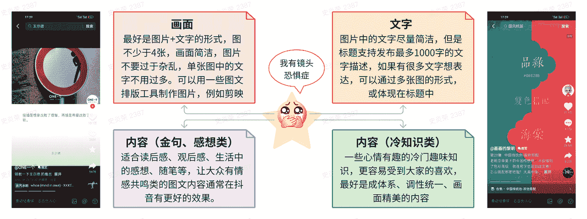

| 我的问题 | 怎么解决 |
| --- | --- |
| 我不会拍视频可以发图文吗 | 可以，知识作者大多习惯于文字表达形式，发布视频类内容时会比较拘谨，可以选择图文形式创作 |
| 要怎么发布图文 | 1.  点击底部「+」号拍摄按钮 |
| 发布图文的数据效果好吗？ | 综合来看，图书金句/感想类内容，和各领域的冷知识类内容数据效果都很不错，通过文字的力量震撼人心。 |
| 图文适合创作哪些类型的知识内容？ | + 读书内容：毕集、金句摘录、书单推荐 |
| 有参考案例吗？ | 都靓读书：https://www.douyin.com/note/7101967861656112418 故事简介+金句+个人感悟 |

### 2.3 我早就不是小白了还需要优化内容吗？

---

随着时代的变迁，大众对视频内容质量的要求也越来越高，很多高粉也需要不断优化自己的内容，需要自省一下看有哪些内容部分是可优化的，是已经不适应新的视频环境的。

| 知识作者常见通用问题 |  |
| --- | --- |
| 详细问题 | 怎么解决？ |
| 常见需改掉的问题有哪些？ | 1、素材二创类头部/腰部作者 |
| 常见可改进的方向有哪些？ | 1、缺乏系列感 |

| 细分领域常见问题内容优化方向 |  |  |  |
| --- | --- | --- | --- |
| 细分领域 | 常见问题 | 怎么解决？ | 优质case |
| 人文历史 | 专家学者讲的较为枯燥怎么办？ | 1、偏学术类的知识需要找到一个切入点，由浅入深地讲述。常用的方式包括： | 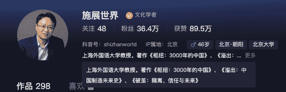 |
| 教育校园 | 作为校园博主，选择什么领域的内容适合我？ | 校园博主的特殊性：个人阅历有限 -> 选题有限；面向受众有限 -> 消费变现能力受限 | 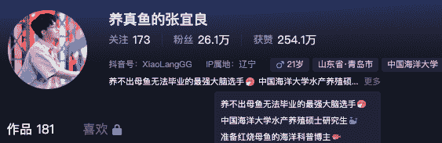 |
| 商业财经 | 如何找到高流量的财经选题？ | 核心是从受众的需求出发，主要方法有三 |  |
|  | 要做财经直播，需要做哪些准备工作？ | 涉及股票、基金、保险等金融垂直领域内容，需要先完成财经/金融/保险领域从业者的专业资质认证 |  |
| 科普 | 科学内容的讲述比较枯燥怎么办？ | 1、科普+热点：热点内容解读员，讲究快速专业，在大热点发酵上升期，用平实的剪辑手法和专业的内容输出，快速输出对事件的热点解读。 |  |
| 科技 | 如何打造具有个人特色的账号定位？ | 1、定位决定内容，内容强化定位，明确的账号定位能够有效指导选题方向及内容风格，进而不断强化人设，有助于稳定的粉丝增长及更好的数据效果。 |  |
|  | 科技作者的人设定位要怎么找？ | 1、找出创作者本身招人喜欢的点，然后去放大，是高冷？幽默？俏皮？需要创作者在做内容输出的过程中进行提炼、增加还有打磨，一旦确定就要反复强调，反复出现在内容中，做到强化人设。 |  |
| 法律 | 抖音法律赛道的真人口播内容如何做出差异化？ | 1、选定赛道、补足能力 | / |
| 情感 | 如何避免内容不推荐？ | 情感领域遇到最多的问题就是——为什么我的内容不推荐了。遇到这类情况时，可参考以下方式自查。 |  |

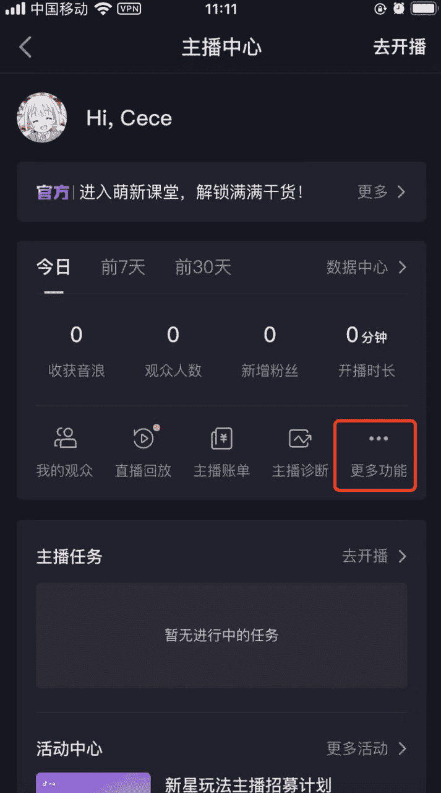

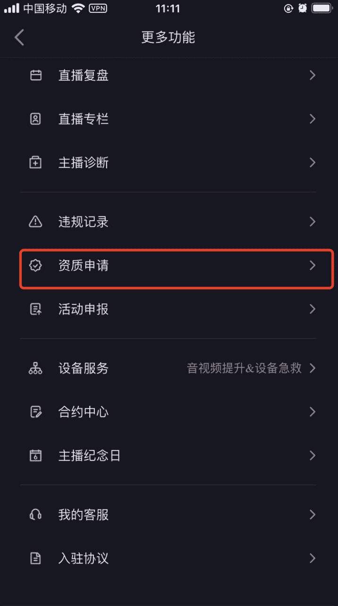

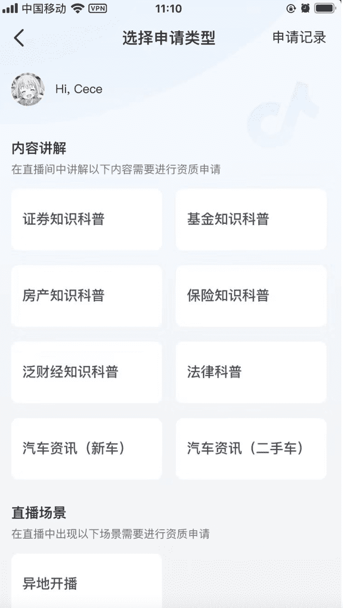

## 三、涨粉密码篇

> 本篇核心是解答不同阶段作者的涨粉困境，新人阶段从0到1很难，腰部作者往往也容易陷入粉丝增长停滞的困境，而很多高粉作者也会有破圈难题，需要新的爆发式涨粉期。涨粉并没有完全模式化的公式，会随着时代和行情的变化不同，每一个破圈作者的破圈点也往往不同。

> 但是可借鉴的思考方向和学习模式很多是通用的，也有很多萌新迅速掌握方法，从0迅速突破百万粉。

> 学习经验→发散思维→立足自身→优化内容→静待时机→乘风而起。

> 点击以下蓝字跳转：

> [3.1 在抖音怎么快速涨粉？](https://bytedance.feishu.cn/docx/KIbKdJr8Lo42amxzKY3cCiaFn4b#part-ZICXdHCOroibt0xkwojcCGvens1)

> [3.2 涨粉瓶颈期怎么办？](https://bytedance.feishu.cn/docx/KIbKdJr8Lo42amxzKY3cCiaFn4b#part-K4EVd0bEaoheaMxsy5Gc1rZOnfb)

> [3.3 在抖音粉丝量有什么意义](https://bytedance.feishu.cn/docx/KIbKdJr8Lo42amxzKY3cCiaFn4b#part-UBFRd4U7vofZC4xcRjUcVzSfnTb)

> [返回总目录](https://bytedance.feishu.cn/docx/KIbKdJr8Lo42amxzKY3cCiaFn4b#part-IUV5d09PNoEIajxWaUscxB4TnIg)

### 3.1 在抖音怎么快速涨粉？

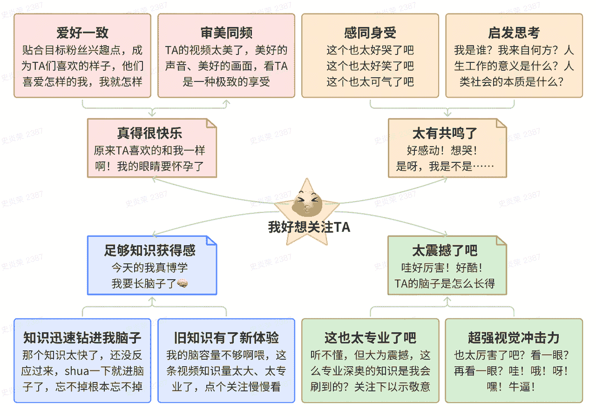

| 在抖音快速涨粉通用版案例解析 |  |  |  |  |
| --- | --- | --- | --- | --- |
| 典型案例 | 案例解析 | 视频数据 | 案例图示 | 高热评论 |
| 一秒钟记个单词“manic”，刷到了就花一秒记住吧！ | 真得很快乐：老伯伯和我一样爱打游戏诶 | 涨粉58万+ |  | + 一直没忘在这里学到的第一个单词underdog |
| “装菜”三十多年，它迎来了生命尽头前最辉煌的时刻 | 太震撼了吧：和无穷小亮一样高的硕大美丽塔黄 | 涨粉70万+ |  | + 植物都可以为了一刻芳华蛰伏三十年之久，我才二十几岁有啥资格因为一点不如意就唉声叹气 |
| “少年不识诗中意，回眸已是诗中人”。这个故事，后劲真的有点大。 | 太震撼了吧：300年无人能对的绝句居然被我对出来了 | 涨粉110万+ |  | + 看了赛姐明白了女孩子读书的重要性 |
| 抖音的朋友们大家好，我是金涌。期待未来与大家进一步交流。 | 太震撼了吧：老师好专业、好厉害。老师是院士？教授？名人？帅气学长？先关注一下。 | 金涌院士入驻视频涨粉11.1万 | 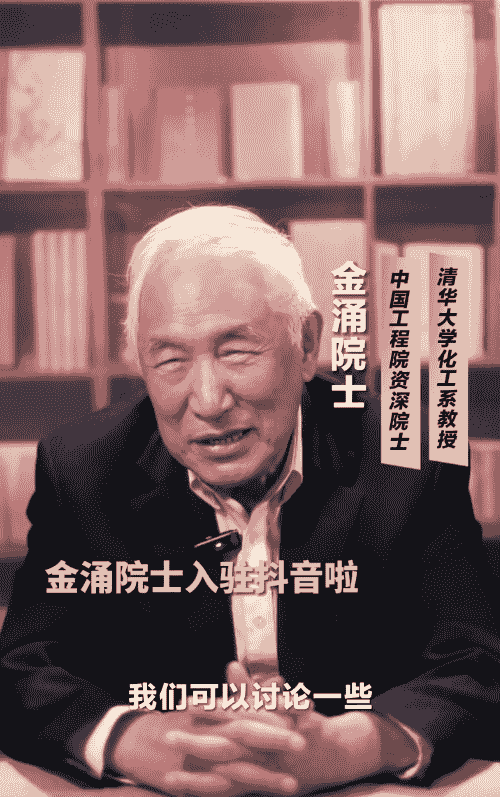 | + 原来只有清华大学学生听到金教授的课，现在普通群众有机会享受，很好。 |

| 细分领域萌新和低粉涨粉案例解析 |  |  |  |
| --- | --- | --- | --- |
| 细分领域 | 涨粉重点 | 典型案例 | 高热评论 |
| 人文历史 | + 专业性+接地气 趣味路线 | + 专业性+接地气 趣味路线 |  |
| 教育校园 | + 热知识+新形式 | + 热知识+新形式 |  |
| 商业财经 | + 借势名人有影响 | + 借势名人有影响 |  |
| 科普 | 科普在前期要快速涨粉，最重要的是精准发掘一波数量庞大、真的热爱科学、崇尚科学的人群。 | + 游戏二次元×科普 |  |
| 科技 | + 内容稀缺+趣味性强 | + 内容稀缺+趣味性强 |  |
| 法律 | + 巧用造梗 | + 巧用造梗 |  |
| 情感 | + 揭秘误区 | + 揭秘误区 |  |

> 挖掘人文历史专业中最冷门、猎奇、有趣的点，不怕稀缺小众，最重要是接地气的讲解，引发好奇心

> 用新的呈现形式做长青选题，如传统文化类的知名人物，苏轼、李白等，阶段性总能出新爆款。图书里面的畅销书，持续有被解读的需求

> 李右溪：[一个甲骨文专业毕业生的独白](https://www.douyin.com/video/7204795420940291387) 把极其小众的甲骨文学科里有趣的点展现出来，传统文化与年轻人设的碰撞。756万播放，点赞19万，涨粉5万

> 不略：用动画形式抽象故事要点，还原故事关键场景（新表达形式），结合热门经典图书（用户强需求）如3分钟读《活着》点赞10万+，涨粉3.77万

+ 如果你们学校一直招不到甲骨文老师的话，你就是未来的泰斗
+ 姑娘，以前是兴趣，以后就是责任了。坚守下去，华夏先祖和后人都感谢你
+ 我学秦篆都已经头大了，甲骨文我不敢碰
+ 永远忘不了小男孩被老师叫去抽血，就那样静静的抽干
+ 高一读完，真的很难想象，富贵到底怎么坚持着活下来的
+ 余华的魅力:被值班老师收了看到作者是余华后又默默的给我了

> 英语单词是大众熟知的知识点，配合冷门形式+老顽童教授+快节奏剪辑+学生群体喜爱的表达，精准抓住受众的爽点：在抖音轻松学习知识

> 旧记忆：容易引起特定群体共鸣，受众共同回忆

> 新解读：稀缺性引发持续好奇，体现博主价值

> 抖音热点会带来不少流量，知识作者如何在保持账号调性的基础上上车娱乐/生活类热点？

> 乔伯伯英语：[一秒钟记单词系列](https://www.douyin.com/user/MS4wLjABAAAAWEkcwINxA6RNwv5gjr4lrAMr5jonFS2bItfSIObeIrg)，累计播放2亿+，累计点赞2600万+；起号不到一个月涨粉百万+

> 二二酸酸：[被误读的《海的女儿》真正大结局](https://www.douyin.com/user/MS4wLjABAAAAfRRGEomf6h_kmmefCsZAAxjkTTY8yud3qM5XSh2Km7LAIi2XFsCByiMHjYKoBU-Q?modal_id=7237428465119644962)，单视频播放2000万+，点赞153万+，吸粉20万+

> 拉美天后Camila：[我没K、布鲁biu是什么](https://www.douyin.com/share/video/7254183997662711098/?mid=7254184037810604837)，通过热点BGM《恐龙扛狼扛狼抗》延伸原作歌曲的英语词汇，累计播放7640万、点赞70万+

+ 随机抽查underdog是什么意思
+ 还是忘不了intimidate，很喜欢知识从脑袋里流过的感觉
+ 这个小美人鱼真的就像一个大思想家，格局打开，结局升华，太震撼了（10.6万赞）
+ “通过你自己的努力，三百年后，你将为自己创造一个不灭的灵魂。”格局真的太大了（5.3万赞）
+ 你不解释我还能瞎唱，你解释后我不会了
+ 你不说，我都不知道还有原版

> 名人/企业家自带流量，且能够给账号提供背书，能够邀请到名人在账号出镜或者定制化输出内容，能够快速从一众账号中脱颖而出；

> 热点是一种财经解读的切入视角，结合热点进行内容延伸或观点表达、或者深入挖掘热点背后的前因后果，都更容易获取流量，这里的热点包括热点事件、热点话题，包括不限于财经、影视、娱乐、科技等；

> 讲、谈、访、评，财经视频的形式从口播逐步升级为访谈，商业故事是用户受众比较广的领域，访谈通过邀约不同的嘉宾能够持续输出不同视角的观点，商业访谈结合故事+访谈的优势，同时输出对普通人有启发的商业洞察，是最近流量比较好的领域。受众广、内容能持续输出、启发与趣味性兼具，是现在对于财经优质内容的新要求

> 陈克明：[“挂面大王”打招呼入驻视频](https://www.douyin.com/user/MS4wLjABAAAAWDWmTQ6HGXmubo3GloEqN6PHAgveEq-m6fzsaYV86HdwAZhzuzR3oyUcKqCNChKs?modal_id=7254156964748430603)，2441万播放，56.35万点赞，6.29万评论，单条视频涨粉17.58万

> 薛飞创业圈：[90后创业者缅北逃亡访谈](https://www.douyin.com/user/MS4wLjABAAAAFiIElRdNSG6DzWg4wYjeOnHb4srhk4Oiyst3TZBmuk4?modal_id=7258186100508806456)，1.4亿播放，364.8万点赞，59.51万评论，单条涨粉19.28万

> [钦文和他的朋友们](https://www.douyin.com/user/MS4wLjABAAAAZEmLB0RZLBH8AMgYtqbfWLOqsat4V517JgiMGIgftrg4XQJTlDi825j62bBCAHPA)：仿效爆火账号「程前朋友圈」，相似的内容选题、拍摄形式、商业模式，不到一年账号精准吸粉40万；

+ 你就是陈克明啊，我吃你面条吃了半辈子了，今天才见到你（5.1万赞）
+ 陈总 我做的陈列还行撒 附超市货架陈列图（2.1万赞）
+ 陈克明已经不是人名了，是品牌，是湖南的品牌，是中国的品牌，是世界的品牌！我一个东北人买面条只知道陈克明一个品牌了！（6K赞）
+ 我妹妹被大学室友骗去了，一下火车就被人控制了，幸好家里有所察觉，各种报警找关系想办法。在出国门之前找回来了！！！那可是大学四年同宿舍的舍友啊！！！以为是一辈子的朋友（49.2万赞）
+ 我在这里祝所有人，从今以后我们的卮运消散（8.9万赞）
+ 逻辑很清晰，而且团队都是高配，柠季在茶饮品牌产品不算突出，突出的是和人才，运营模式，后端不可复制（1K赞）
+ 希望大家可以在我的经历中找到看到积极的能量！希望能够给正在努力生活的朋友带去乐观的心态！除了生死，一切都是小事！为我们中国创造更多的美好！（2747赞）

> 会发自内心的热爱游戏二次元，以及与其相关的周边、故事、人物。以理工类学生、中小学生为主，数量庞大，热爱程度高。

> 热爱科学、崇尚科学，数量不算庞大，但粉丝粘性高，作者本身的流量会相对稳定维持在高位

> 关注新闻热点，知识的解读延展适合作为谈资，是很适合增长知识的类型，以关注家国大事的男性为主。站内流量高，但是追热点的人多，竞争相对激烈。

> 喜欢看一些神奇好玩的理论、事件、人物，数量庞大，但不稳定，易出单条爆款

> [派蒙科普](https://www.douyin.com/user/MS4wLjABAAAAZfAEKkKou4R96ra66nnqALKo6psdUh4RUvfAXVKxnRI)[：粉丝量395→1](https://www.douyin.com/video/7230286763338501408)2[万+发布2条视频](https://www.douyin.com/video/7230745568606276879)，派蒙讲鞋匠刀形面积、派蒙讲解勾股定理

> [GG_Bond的小课堂](https://www.douyin.com/user/MS4wLjABAAAA9Yiq8c3sC9Bd0LMjk5rI-3kSriiCKAzJ1IhQCpVpoUkYLyLliaR-l4HotKzLkkrg)[：粉丝量0→9万](https://www.douyin.com/video/7240435111924124983)+[发布2条视频，](https://www.douyin.com/video/7241752992414813500)猪猪侠讲泰勒公式、猪猪侠讲定积分

> [皮卡悠](https://www.douyin.com/user/MS4wLjABAAAAPcyy5YR3utkPbCwT-lrt3-UhEG_LWUkoqNvEw-kgH53eKjcC5RoNxVGdC8RoUUuJ)[：粉丝量408](https://www.douyin.com/video/7161324860336098573)→[8万+发布2](https://www.douyin.com/video/7162015201804569887)条视频，空气里免费取点、自制海市蜃楼

> [人](https://www.douyin.com/user/MS4wLjABAAAAAXhlCiwI3txUkJSDx_32u3M4K03z4rF94W3ZyOl50zc)[：泥捏地理地图，两三天涨](https://www.douyin.com/video/7261199561555823906)粉10万+，制作河南/做卧龙南阳盆地

> [严伯钧](https://www.douyin.com/user/MS4wLjABAAAA6cLFP6uL4NmSxtnd9miQb-9S6GweLvikkmvKKFUT74A?relation=1&vid=7150651303805357319)[：诺贝尔奖相关理](https://www.douyin.com/video/7150651303805357319)论的及时解读，单条视频涨粉23.1万+，物理诺奖量子纠缠

> [热爱干饭饭饭](https://www.douyin.com/user/MS4wLjABAAAAdhcanEZZcNsF7SUZJ4RHttFHnmwYCnzzeyzsA0NtPvM?relation=1&vid=7212141305424629030)[：科普奇特地理现象，](https://www.douyin.com/video/7212141305424629030)单条视频涨粉29万+，多大的风把树吹成牙刷

> [不刷题的吴姥姥](https://www.douyin.com/user/MS4wLjABAAAAIdcx-2GSfNdK5u-AOZiuJ-xO6EEusaY7JOiS_9vJo9c?relation=1&vid=7219837882582846776)[：科普奇特物理](https://www.douyin.com/video/7219837882582846776)现象，单条视频涨粉39万+，逆流而上的小球

> [物理实验梁老师](https://www.douyin.com/user/MS4wLjABAAAAEM35SkI9hV6nEqXS-5SPf9eoN9qAZNivLXw42GcC2Aw?relation=0&vid=7055582712735862051)[：趣味科](https://www.douyin.com/video/7055582712735862051)学小实验，重现烟雾瀑布，单条视频涨粉48万，烟雾瀑布

+ 派蒙已经完成了向兀蒙的完全性进化！
+ 诡计多端的数学老师
+ 死猪都会，我凭什么不能会？
+ 这才是我们想看到的抖音！
+ 你15万粉丝，干1500万粉丝的活
+ 我的妈，好可怕，抖音上还有这种技术性播主，她居然要整出来海市蜃楼
+ 就喜欢这种知识就躺进大脑，又流淌出来的感觉
+ 我头抽筋了，这是不是要长脑子了？
+ 让我答！！！吹西北风，树冠朝东南
+ 可以讲一下rangitoto火山的形成吗？学校不考那个树，要讲内部和外部因素
+ 初中生:应该和压强有关；高中生:流速大的地方压强小；大学生:有鬼
+ 流速大的地方压强小，就比大气压强小，然后被空气压过去了

> 内容不可替代性强，有自己独特人设属性和内容涉猎范围

> 联动热点话题发酵增加热度，同时内容用科技炫酷元素呈现，

+ 国之栋梁，加油！抖音该有的样子了
+ 他好像真的什么都会啊

> 快速爆红的背后都有一个“梗”在支持，“蓝翔背景律师”、“律师俏佳人真人版”、“男版龙飞律师”等，都是利用热梗快速吊起用户的心智

> 热点评论是抖音法律内容的主流之一，响应速度快、正向引导观点清晰的作者很容易在某个大热点上获得流量爆发

> [律师老韩](https://www.douyin.com/user/MS4wLjABAAAAaJunxOoN7K8UXUZ5BYKn_9EWo6cUFMMYNYIQoL_Ny9jzgmYlUOPNg0qqmG-nOFaO)：三个月涨粉100w

> [俏佳人xxx](https://www.douyin.com/search/%E4%BF%8F%E4%BD%B3%E4%BA%BAxxx?aid=1205b8ec-7068-40d0-acd9-ad7f7f00b814&enter_from=others_homepage&source=search_sug)：三个月涨粉100w

> [老梁不郁闷](https://www.douyin.com/user/MS4wLjABAAAA6BI0-7PPiCURzLdIE_lLB-D2wXGWruF0dmeNEd5DQAM)：总粉丝8w，单条视频涨粉1.5w

+ 灵魂出窍也不能忘记给大家普法
+ 确实很精彩，你和龙飞律师我来回跑
+ 她保研也是造假弄得！！！你们可以搜

> 情感领域里，免不了一些条件反射式的反应，比如“原生家庭有害论”、“ADHD是一种疾病”，“高敏感需要克服”等，但事实真的是这样吗？揭秘这些常见误区的真相，不失为获得流量的方法。

> 社会热点是抖音情感的内容主流之一，响应速度快、正向引导、观点清晰的作者很容易在某个大热点上流量爆发。

> 马丁·塞利格曼：[原生家庭真能影响一生吗？](https://www.douyin.com/user/MS4wLjABAAAAObuofGvpZHtFJV2ISZ3Rqmh6cbUSQw4EXVP-PXt56teJSv-K2Jt1nBay-m1avJOu?modal_id=7237327190214380856)（播放量143w，点赞3.9位，涨粉4.8w）

> 傻白呀：[高敏感是一种天赋](https://www.douyin.com/user/MS4wLjABAAAAGLwNfNCA8cwEhJTEqlXlvKFYVrVYwUKcF3sAr11jHs0?modal_id=7124527230994140449)（播放401w，点赞19.8w）

> 涵涵姐：比“唐山烧烤店”更让人气愤的是他们（播放量1016w，点赞38.9w）

> 六日：[吴谢宇弑母案心理分析](https://www.douyin.com/user/MS4wLjABAAAAB0IYCPVcBntiwQe2iefENJQRhZXrQIlBjlJGK5Lxp9M?modal_id=7001821246417538304)（播放量945.4w，点赞17.7w）

+ 敏感=强感受力，它不是一个缺点，它是个特点
+ 高敏感但我爱我自己
+ 这才是积极心理学的意义
+ 世界上没有完美的人

### 3.2 涨粉瓶颈期怎么办？

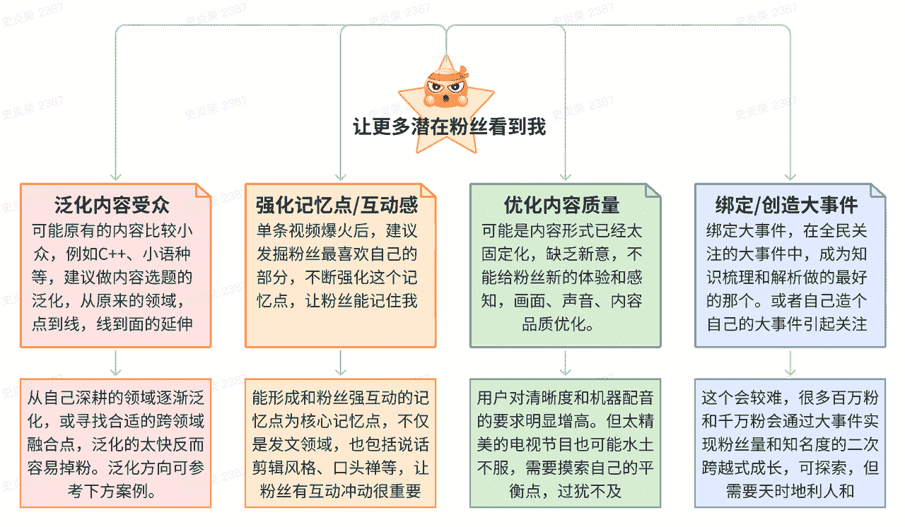

| **细分领域** | **账号名** | **泛化内容受众** | **强化账号记忆点** | **优化内容质量** | **绑定/创造大事件** | **典型案例** |
| --- | --- | --- | --- | --- | --- | --- |
| 人文历史 | 施展世界 | / | ⛔️过往卡点 | ⛔️过往卡点 | ✅改变： | 为什么古代河北的大城市，都在西面？这得问问黄河~ |
| 教育校园 | 养真鱼的 | ⛔️过往卡点 | ✅强化爆款人设：最强大脑的硕士养不出鱼 | ✅内容迭代，跳出框架 | ✅借势平台，打造故事 | **加人**：[引入“捣乱养鱼进程”的学弟](https://www.douyin.com/user/MS4wLjABAAAAmqxL5jF_pB7mGt6WnraxK_FhTJRi1K1wF1p07TsUsNMzaa4RNiwSC81mW-59X7oM?modal_id=7235213722220825890) |
|  | 乔伯伯英语 | ⛔️过往卡点 | ✅瞄准学生群体，打造老伯伯+5G冲浪 的反差 | ⛔️过往卡点 | ✅借势热点，强化反差人设 | 谐音记单词 |
|  | 之昊will | / | ✅系列内容->产出爆款->强化人设 | ✅单人口播->引入教授父母 | ✅破圈 | 爆款造就人设 |
| 商业财经 | 直男财经 | / | / | / | ✅巧借热点，粉丝一跃破千万 | 2021年7月，接连2个播放破亿的主题： |
|  | 温义飞的急救财经 | ⛔️卡点： | ⛔️卡点： | / | / | 《一语道破赚钱真相》10讲部分举例： |
| 科普 | 热爱干饭饭饭 | ⛔️卡点： | ⛔️卡点： | ✅跨领域融合兴趣点 | ✅事件打造：我的视频成了地理考题 | 跨领域融合兴趣点：[只需要记住这道菜的名字，就可以搞定地理沼泽类的题！再也不用担心沼泽题无从下手啦！](https://www.douyin.com/video/7079353106756062477) |
|  | 无穷小亮的科普日常 | / | ✅长期更新自己的定制节目“鉴定网络热门生物视频”，账号形象深入人心 | / | ✅事件打造：水猴子、表情包 | [重金求水猴子原视频](https://www.douyin.com/video/6861168436484115719) |
| 科技 | Konsn玩数码 | ⛔️卡点：粉丝人群固定，圈层较小； | ✅使用Animoji拟人形象，给观众留下固定的、深刻的IP形象记忆点； | ⛔️卡点：视频内容存在信息量少、专业度低的问题； | ✅与节点、热点事件联动，例如在春节期间推出“适合春节期间使用的APP”；跟进OPPO推出卷轴折叠屏手机的热点等； | 《这些春节实用的app，你有在用么？》 |
| 法律 | 龙飞律师 | / | ✅卡在百万粉丝许久，转型做“龙飞故事会”直播间，同步切片发布短视频 | / | ✅开创婚姻家事直播间-故事会风格，绑定用户认知，直播间内容多次创造热搜 | 相关热点： |

> 普通对镜口播，没有自身特点

> 还原课堂场景，凸显权威学者身份

> 内容结合自身在各地探访游历的素材，加强自身“读万卷书行万里路”的人设形象

> 单人对镜头讲述时显得非常拘谨，内容方向也比较散

> 从自身较为擅长的地缘研究角度入手，通过地理讲历史，配合地图道具，凸显硬核知识感，动作表现也更加自信亲和

> 借势东方甄选甘肃行，在旅行中不断科普当地历史地理，强化自身“读万卷书行万里路”的人设

> 把抖音当朋友圈发，有自拍、vlog、参加综艺的拆条等，整体较散，无强记忆点

> 从自身的大学专业入手，挖掘出第一条爆款视频「985硕士养不出母鱼无法毕业」，收获千万播放量

> **抖音昵称**：「小良哥哥」->「养真鱼的张宜良」

> **抖音签名**：加入「网友们共同见证母鱼诞生、养出母鱼承诺直播红烧自己的鱼」等强化爆款带来的人设

> **视频包装**：封面文字、片头文案均带上「母鱼」「养鱼」相关

> 养鱼系列进入涨粉瓶颈、流量下滑的阶段，博主进一步优化选题和拍摄场景

> **人**：引入“捣乱养鱼进程”的学弟；

> **事**：养不出鱼-火出圈-上综艺-以为成功孵化-失败-预告孵化成功-展示两条母鱼-加入知识解读

> **物**：鱼缸、实验、试管

> 开学季、高考季、毕业季，以「水产养殖」专业切入，精准接住教育校园大节点流量；

> 策划系列热点，形成故事线：

> #我在985大学养鱼

> #985硕士张宜良终于养出母鱼了

> #还有比这更冷的专业吗

> [母亲节给三个妈庆祝](https://www.douyin.com/user/MS4wLjABAAAAmqxL5jF_pB7mGt6WnraxK_FhTJRi1K1wF1p07TsUsNMzaa4RNiwSC81mW-59X7oM?modal_id=7234878221269880116)（博主妈、鱼妈、狗妈）、[敲木鱼出母鱼](https://www.douyin.com/user/MS4wLjABAAAAmqxL5jF_pB7mGt6WnraxK_FhTJRi1K1wF1p07TsUsNMzaa4RNiwSC81mW-59X7oM?modal_id=7229660291569667343)、[终于养出母鱼](https://www.douyin.com/user/MS4wLjABAAAAmqxL5jF_pB7mGt6WnraxK_FhTJRi1K1wF1p07TsUsNMzaa4RNiwSC81mW-59X7oM?modal_id=7263428785528180024)

> 英语赛道头部效应集中，教学内容雷同，无法突破

> 一秒钟记个单词+谐音记单词+实景

> **制造反差**：退休老教授+打LOL+用表情包

> **年轻化剪辑**：猫和老鼠等表情包+快节奏剪辑+移动式运镜+真人实景拍摄

> **年轻化表达**：沿用互联网热梗、学生圈层的用语（uu萌、头秃、咸鱼、骂你菜）；“刷到了就花一秒记个单词吧”

> **年轻化解读**：「underdog-弱者」「manic-骂你菜」「sentimental-三屉馒头」「intimidate-在TIMI的日子被恐吓」谐音+物像，轻松易记

> 静态室内拍摄，老伯伯坐在桌子前，纯口播英语内容，时长为3-5分钟，整体流量较低，整体风格偏正式

> 动态运镜+实景拍摄+快节奏剪辑，整体时长不超过30s

> 找到新的账号风格节奏；适合自己才最重要

> 老爷爷的多巴胺穿搭——反差

> 对视变装挑战（墨镜黑帮->眼镜教授）——反差

> 命运的齿轮开始转动

> 高考英语答题方法速记

> 注意：这几个热点都十分适合乔伯伯参与，参与的目的都是强化老伯伯的5G冲浪网感，符合&强化人设

> 「underdog-在狗之下-弱者」

> 「manic-骂你菜-狂躁的」

> 「[sentimental](https://www.douyin.com/user/MS4wLjABAAAAWEkcwINxA6RNwv5gjr4lrAMr5jonFS2bItfSIObeIrg?modal_id=7232015214663732537)-三屉馒头」

> 「[intimidate](https://www.douyin.com/user/MS4wLjABAAAAWEkcwINxA6RNwv5gjr4lrAMr5jonFS2bItfSIObeIrg?modal_id=7206357312846499127)-在TIMI的日子被恐吓」

> [对视变装](https://www.douyin.com/user/MS4wLjABAAAAWEkcwINxA6RNwv5gjr4lrAMr5jonFS2bItfSIObeIrg?modal_id=7209604304355790135)、[高考英语答题技巧](https://www.douyin.com/user/MS4wLjABAAAAWEkcwINxA6RNwv5gjr4lrAMr5jonFS2bItfSIObeIrg?modal_id=7238633710889880890)

> 专业人设：英语学霸+双语记者+英语老师；

> 生活人设：被催婚+书香之家+教授父母

> 过往风格：单人+剧情+英语小剧场+角色扮演才艺展示

> 现在风格：父亲为陕西师范大学教授，母亲为复旦大学教授；视频创作中引入父母的角色后，产生戏剧冲突和对话感

> 抓住机会，和瑞·达利欧、雷神、马克Malik、林允、邓紫棋等联动；受邀成为西安文化旅游推广大使，多圈层提升自我曝光

> 《[我什么时候可以赢一次](https://www.douyin.com/user/MS4wLjABAAAAlj9n-t4aXTz1DynzrjhB7tk22pgPQn1rM_DI-w89kHg?modal_id=7257839356574977335)》英语教授家庭，词汇量PK+被催婚

> 《[教雷神用中文给大家比心](https://www.douyin.com/user/MS4wLjABAAAAlj9n-t4aXTz1DynzrjhB7tk22pgPQn1rM_DI-w89kHg?modal_id=6698321287095258372)》出圈联动，181万赞

> 从“财经脱口秀”到“大众代言人”，结合国民性的热点事件和社会议题，深度挖掘前因后果，传递知识的同时能代表大众的主流情绪进行抒发

> 知乎图文时代「脑洞经济学知识」

> 趣味性远高于实用性，受众普适性一般

> 推出《一语道破赚钱真相》的10期系列性实用理财科普内容，从与大众切身利益息息相关的买房、基金、保险领域切入，避坑防割

> 真人出镜没有给用户留下深度印象，内容主题比较散，没有找到IP的定位和主打领域

> 《一语道破赚钱真相》开始，通过选题、口播、包装等各方面不断树立并强化自己「保护韭菜的财经博主」的定位，在泛理财用户群体内不断强化认知

> 通过高考地理复习讲解，粉丝达到2万，然后进入半年瓶颈期，以学霸分享各科考方法巧为主。

> 基于自己中国地质大学学生的身份，锁定地理学科，从多学科讲解垂直到地理学科讲解

> 主题比较散，讲述没有风格

> 增加更多个人风格在视频的演绎，从贴脸拍摄，到广角远镜头演绎（不代表广角拍一定比贴脸拍摄效果更好，本质是找到自己最有记忆点的创作风格）。

> 早期拍摄风格➡️发展后拍摄风格

> 热门美食+地理考题、热点地理事件+地理考题......

> 极具反差的地理成因解析，让枯燥的考试题目变成轻松的话题讨论，深受年轻用户的喜爱

> 事件打造+往期高热视频新说+结尾反转，在让观众会心一笑的同时，强化了“这个作者看似搞笑，但非常有用（视频能变成考试题）”的印象，吸粉效果明显。

> **足够吸睛：**网络热门生物视频，往往都带有猎奇和神秘色彩，老少皆宜，用户喜欢

> **足够热门：**原视频本身带有热度，观众也喜欢在原视频下面艾特小亮前来分析

> **足够深入人心：**小亮具有特色的口播，坚持每期最开头播放，反复出现深入人心

# 抖音创作者价值与流量密码

> 2020年，#网络热门生物鉴定 正式成型，小亮主动发布号召视频，开始“重金求子”求“水猴子”。希望更多的网友@和私信自己水猴子的视频。水猴子作为每期视频结尾的固定彩蛋，开始沉淀下来。从此水猴子与小亮深度绑定

> 2021年，小亮主动发布自己的表情包，缘于小亮的领导在工作群@小亮，说看到了他的表情包，小亮配上了一脸无奈的声音，形成热梗，这个表情包也更加火出圈。#无穷小亮表情包、#无穷小亮回应被做成表情包，都登顶热搜。

## 3.3 在抖音粉丝量有什么意义

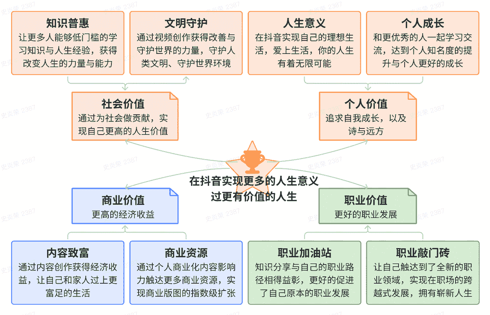

| **价值** | **意义** | **典型案例** |
| --- | --- | --- |
| 社会价值 | 知识普惠 | TA们一直在「感动中国」： |
|  | 文明守护 | 意公子——让中国文化获得更多关注 |
| 个人价值 | 人生意义 | 张朝阳——不仅是一个成功的企业家，更是一个优秀的知识传播者 |
|  | 个人成长 | 之昊will——与更多优秀的人一起交流成长 |
| 商业价值 | 内容致富 | Konsn玩数码——成为有收入的全职科技创作者 |
|  | 商业资源 | 黑码科技——用内容连接科技产业链上下游 |
| 职业价值 | 职业加油站 | 赵健的读书日记——让自己的书店更长久的存在下去 |
|  | 职业敲门砖 | 董宇辉——一个人的定力，决定他最终能走多远 |

> “没有墙壁的教室，不设门槛的大学。白发人创造的流量，汇聚成真正的能量”，[这是2022年感动中](https://www.douyin.com/user/MS4wLjABAAAAgVZfO6NxIyJdVoY8klBQwTGtYwUIetJhnfe4cI1tx7I)国[对TA们的颁奖词。中国](https://www.douyin.com/user/MS4wLjABAAAAIdcx-2GSfNdK5u-AOZiuJ-xO6EEusaY7JOiS_9vJo9c)科[学院院士汪品先、同济](https://www.douyin.com/user/MS4wLjABAAAAyiV4OkDIPXSDV62jTDgLwmRYZIiphVKm8F0Nkf_Bz_M0kT_uqR_kFUx71FdYQ6Rq)大[学退休教授吴於人、](https://www.douyin.com/user/MS4wLjABAAAAc6yyoRemmr4Vmbx1jjfZJOPPyqe15q30dNVFYclIEws)退休电工课教师王广杰、退休语文老师杨维云等等，他们平均年龄77岁，年过古稀却仍在抖音传授他们的毕生所学。他们拥抱数字浪潮，以三寸屏幕为“黑板”，他们荣获感动中国“银发知播”集体奖，让知识更好的普及。在抖音传播知识，实现更高的社会价值。

> 她是抖音头部文化类博主，想要走遍中华优秀传统文化的发生地。2023年意公子成为全国政协委员，网友对她说：“请为中华传统文化的发扬光大多进善言，提好建议。”知识内容不仅仅是闲暇时看到的一条视频，更是在通过不断的知识分享，更好地弘扬中国文化。

> 在人民网出品《中国创作者生态报告》中，意公子成为文化传播的核心案例，在抖音上深耕的“意公子”专注解读中国艺术及历史人物，以趣味性，科普性为中国艺术赋能，用原创推动文化短视频向上向善，让中国文化获得更多关注。

> 初雯雯和团队通过短视频科普，让数百万网友认识了河狸宝宝。在网友的捐助下，她们收获了六十余万棵灌木柳苗，为河狸们建起了一个不愁吃的食堂，帮助实现蒙新河狸种群数量增长20%，大家亲切地称她“河狸公主”。

> 她还发**起**筹建了阿尔泰山在中国境内第一所专业野生动物救助中心，成功救助河狸、棕熊、兔狲等160多只野生动物，吸引超过100万中国“90后”加入到自然保护公益活动中。在联合国《生物多样性公约》COP15大会上，初雯雯代表中国青年发言时动情地说，“上百万个90后，一起干了件大事”。这些年，她们协会救助的河狸，还有金雕、秃鹫、鹅喉羚、猪獾、雕鸮、黑耳鸢、赤狐等野生动物，每个视频都会引发很多网友的关注，播放量数十万。像喀纳斯小狐狸“狐萝卜”、猞猁“女王”、小狐狸“毛毛”和“小小”、大耳猬“扎男”、黑耳鸢三姐妹“富贵花”、赖着不肯走的金雕大爷、鹅喉羚三姐妹、河狸“小面”一家……感动了无数网友。

> 作为麻省理工学院物理学博士毕业的张朝阳，在互联网商海中摸爬滚打了几十年。如今互联网行业正在迈入新时代，如何开启一个人生新的价值点，将社会价值、企业价值和个人价值进行融合？成为张朝阳的思考。

> 由此，《张朝阳的物理课》提上了日程。他在抖音操起“老本行”，身着休闲装，以六块黑板为阵地，手写公式，讲解推导，直播网友“奔走相告”，弹幕表示，“老板真才实学，这比我物理老师讲的都好。”每场物理课直播都有千万网友在线学习。

> 2018年，张之昊从美国硕士毕业回国，在抖音成为一名英语视频博主。最开始他主要面向青年人做学习分享，凭借自己的社交能力开始陆陆续续采访哈佛学生，与雷神、荷兰弟、杰森斯坦森、道恩•强森、施瓦辛格做专访，与姚晨、江疏影、柳岩、大冰、林允、邓紫棋，李雪琴、杨受成一起互动。除了出圈的专业知识，他强大的个人社交能力也对稳固粉丝作用明显。在抖音拍视频是记录生活与美好的过程，是分享知识的过程，也是让自己不断成长的过程。

> Konsn原本是一位普普通通的职场人，平时喜欢琢磨短视频和数码产品。

> 他通过快节奏的素材混剪和Animoji出镜效果，具备鲜明的抖音特色，是抖音站内首批使用Animoji出镜，专门做数码产品测评和教程的达人，在站内形成了此类内容的模仿风潮。

> Konsn本人也逐渐将视频创作者从副业做到了自己的主业，通过视频变现，收入有了大幅提升。他实现了很多打工人的梦想“不再为企业打工，而是为自己打工”。

> 作为头部数码品牌的优质经销商，黑码科技连接科技产品产业链的上下游，通过内容带货、账号孵化、星图商单等方式，把数码行业的商业资源与短视频平台的流量相结合，通过内容带动产品销售，将流量转化为实实在在的营收。

> 他曾和朋友合开了一家书店，但常因疫情暂停营业，而人们对新书店的新鲜感也很快过去了，客流极不稳定的情况下，赵健每个月都要亏损。

> 之后他开始再抖音拍视频摸索让自己的书店活下去的方式，一年的过程，他不断用心挖掘那些被大众遗忘的书与人，很快便涨到了百万粉，每天晚上，赵健都能在抖音直播间卖出三千多本书。经由他的推荐，出版社加印多次的书多达七八十本，其中既有经典的四大名著，也有偶然发现的旧书——发掘并推荐小众书目是赵健的兴趣。

> 老师在大众科学普及领域创作多年，在新冠疫情期间及时推出若干期应急科普节目，帮助数千万网友获得了信心与科学思维。因优质的科普内容与数千万的内容传播，多次接受新华社、央视、《环球时报》、《时代周报》、《南华早报》等媒体采访，应邀在总参谋部、共青团中央、复旦大学中国研究院、上海市委党校等机构讲课。

> 经过多年科普领域的创作，老师更在本职工作中有了更好的突破，入选中国科学院科学普及领域引进优秀人才计划择优支持。担任中国科学技术大学人文与社会科学学院科技传播系副主任、中国科学院科学传播研究中心副主任。科技创新和科学普及是实现科技腾飞的两翼，科普与教学工作也能更好的相辅相成。

> 老师是河南大学物理学教授，长期开展科普活动，负责物理学省级科普教育基地工作，在抖音有百万粉长期追更，获聘河南省首席科普专家。河南大学物理与电子学院同样很支持老师做科普，“这种社会科普“自选动作”，应该大力提倡！对学校课堂与社会科普同频共振的优秀人才，学院将进一步加大支持力度”。

> 2023年2月之前何楚涵还只是普通的大学讲师。彼时，学校没开学，她备课时开始思考一个问题：“这些课程，学生们是不是喜欢呢？”可她没有直接问学生，而是准备将课程拍摄下来，然后发到短视频平台，以此接受网友们检验，结果不到半年就收获了百万粉丝。

> 走在校园里，会有学生找她合影，一些高校和单位也邀请她去讲课。与此同时，她讲课越来越谨慎，因为任何一个错误，都有可能被网友马上指出来。她希望学生们掌握到的知识是丰富、鲜活的，而非教条、空洞的。之前一间教室只有几十个学生，但现在有上百万粉丝听课，更强的互动与内容讨论，也让她的教学能力与课程不断完善的更好。

> “牛排原切怎么说？Original Cutting”“回首向来萧瑟处，归去，也无风雨也无晴”“什么是独立？听世界的意见，保留自己的判断”这些话并非出现在学校教室，而在直播间内。董宇辉，曾经的新东方老师，凭借丰富的知识储备、多年上课锻炼出来的口才，把直播变成了“课堂”，有网友感慨说，自己“躲过了李佳琦，躲过了刘畊宏，却没有躲过新东方的董宇辉”。

> 董宇辉金句频出的背后，是他对人生的深刻思考和感悟。在回应媒体走红时，董宇辉曾说：“我是一个农民的孩子，我跟普通的大家一样，人海茫茫，也是办公楼里一个工作奋斗的年轻人。我只是运气比较好。对我来说，最本质的原因就是厄运来的时候没有躲，或者没有躲得过，有一天呢，好运就会撞个满怀。”

> 来源：@中国青年报 @央视网 @人民日报评论

## 四、流量密码篇

> 本篇核心是为作者提供创作流量爆款的思维方式参考。首先需要明确品质内容、流量爆款、涨粉爆款、变现爆款并不能完全划等号，但又相辅相成。纯增流量，但是内容质量跟不上，会很难转化为涨粉；粉丝很多，流量很差，也很难接到大额的变现商单。

> 而知识作者更多情况下面临的是内容质量很好且有知识深度，但是在抖音水土不服，好内容难以获得好流量，在酒香也怕巷子深的信息化时代，给予大家在抖音寻觅流量爆款的方式方法。

> 点击以下蓝字跳转：

> [4.1 怎么创作流量爆款？](https://bytedance.feishu.cn/docx/KIbKdJr8Lo42amxzKY3cCiaFn4b#part-Lxn5dcFtxoKXl3xJdXjcELtOnOf)

> [4.2 在抖音怎么追热点？](https://bytedance.feishu.cn/docx/KIbKdJr8Lo42amxzKY3cCiaFn4b#part-KGQndiTEzo8IcExATfqcn6AdnAg)

> 4.3 参与平台活动的正确方式？

> [&    返回总目录](https://bytedance.feishu.cn/docx/KIbKdJr8Lo42amxzKY3cCiaFn4b#part-IUV5d09PNoEIajxWaUscxB4TnIg)

### 4.1 怎么创作流量爆款？

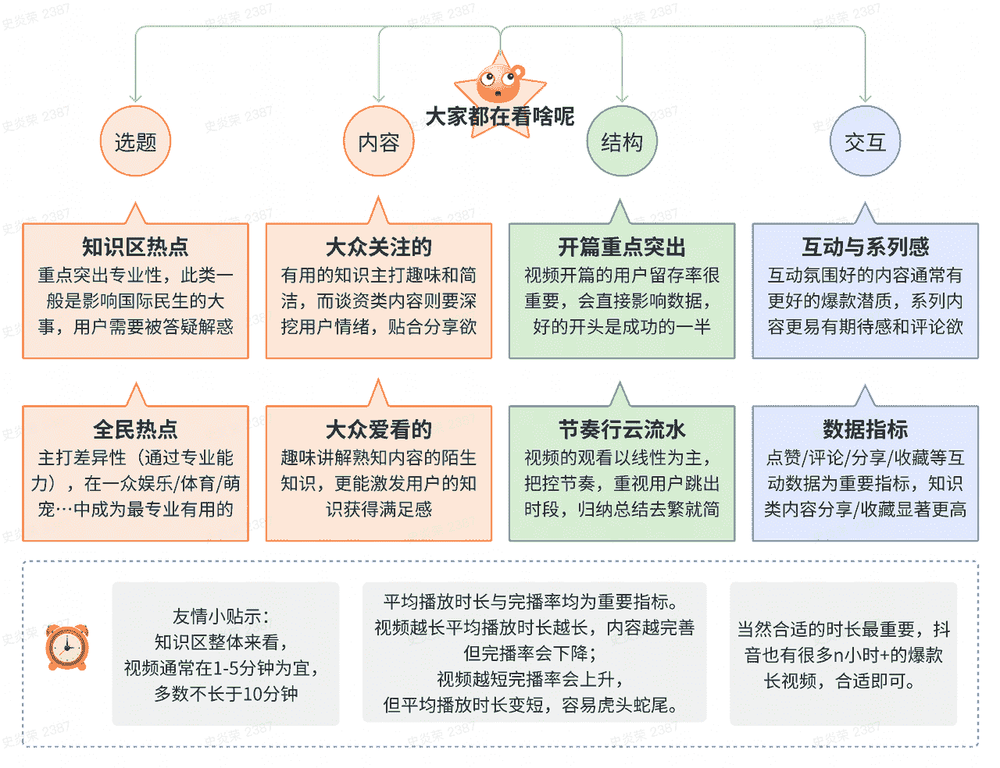

| **细分领域** | **细分领域用户价值** | **典型案例** | **高热评论** |
| --- | --- | --- | --- |
| 人文历史 | +   深度解读：在内容充实的基础上，能有一己之见，表达有深度，有超出选题基础内容之外的高价值信息增量，如一般用户不了解的专业知识、经过个人用心凝练的启示分析等； | +   **深度解**读：结合语言学、历史、宗教等多学科讲解“如来”[一词的源头，融会](https://www.douyin.com/video/7246794632087063820)贯通，用户觉得“关注了这么博学的作者 感觉自己也聪明了” 如来，到底来没来 | 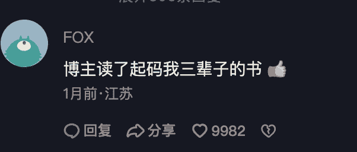 |
| 教育校园 | +   有用性强：选题和内容对大众用户有价值/具权威/较稀缺，比如符合当下热点、社会思潮，满足用户生活或工作需求，让用户获得智识 | +   [有用：穷举了高考报](https://www.douyin.com/video/7249194501011557692?extra_params=%7B%22search_params%22%3A%7B%22rank%22%3A2%2C%22search_type%22%3A%22general%22%2C%22search_result_id%22%3A%227249194501011557692%22%2C%22token_type%22%3A%22video%22%2C%22enter_from%22%3A%22general_search%22%2C%22impr_id%22%3A%2220230726170923B9320DEBE79F85045B52%22%2C%22search_id%22%3A%2220230726170923B9320DEBE79F85045B52%22%2C%22search_keyword%22%3A%22%E5%8F%96%E6%99%AF%E6%A1%86%E7%9C%8B%E4%B8%96%E7%95%8C%22%2C%22item_rank%22%3A1%7D%2C%22from_group_id%22%3A%227249194501011557692%22%2C%22from_xigua%22%3A0%2C%22from_video_id%22%3A%227256772497587129659%22%2C%22relation%22%3A%221%22%7D&amp;previous_page=general_search)志愿的渠道+贴截图+贴步骤，引经据典材料丰富 高考填报志愿全渠道 |  |
| 商业财经 | +   泛化选题，趣味性强：泛财经解读、大公司动态、故事；商业大佬、财富故事。用户都能听得懂、感兴趣，选题关联国民关注度和认知度高的人、事、物； | +   泛化选题，趣味性强：用讲故事的方法娓娓道来两位印度首富的财富积累过程与商业选择，以时间为线引用数据和事实通俗生动的描绘两位富豪的财富如何此消彼长，小lin说：这印度两大富豪是如何轮番坐镇亚洲首富的 | 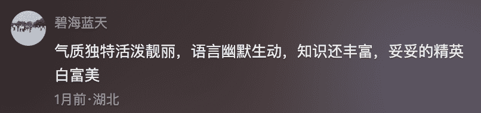 |
| 科普 | +   有吸引力的深度科普，赚足观众时长：科普内容不怕视频长，但怕视频枯燥，讲解有趣+内容深度，10分钟也可以成为爆款（案例1） | 1.  有吸引力的深度科普：10分钟长视频不要错过的中国安徽！（播放量1.8亿） |  |
| 科技 | +   内容前沿潮流，能结合当下热点如VR、数码新机等，给予深入浅出的讲解 | 内容前沿：[消防飞机是如何加水的？](https://www.douyin.com/video/7242663030884945185)（播放量9411万） | xx |
| 法律 | +   选题正向，顺应潮流，贴切民众情绪，能引发共鸣 | 1.  [响应禁毒宣](https://www.douyin.com/video/7055551435924180232)传，剧情形式传递普法核心，引发群众共鸣：禁毒律师说（播放量2.7亿） | 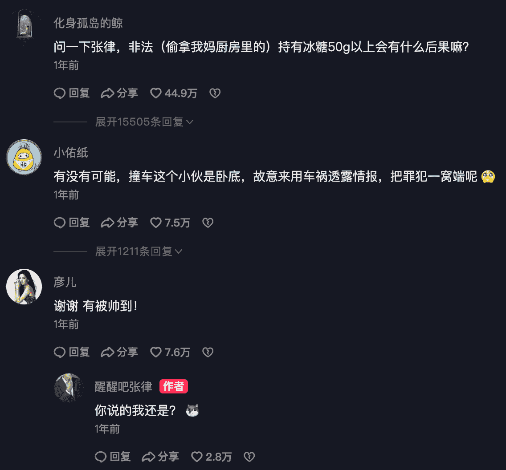 |
| 情感心理 | +   选题**大众化****：**科普**大众关心的**情感/心理问题，辟谣常见情感或心理误区。 | 1.  [揭秘原生家庭对人心理的](https://www.douyin.com/user/MS4wLjABAAAAObuofGvpZHtFJV2ISZ3Rqmh6cbUSQw4EXVP-PXt56teJSv-K2Jt1nBay-m1avJOu?modal_id=7237327190214380856)影响，其实比不上最近发生事件对人的影响。原生家庭真能影响一生吗 |  |

> 备注：太长有风险，尝试需谨慎，通常抖音知识视频长度在1-5分钟左右为宜。在抖音，时长在数小时甚至二三十个小时的长视频宝藏爆款有很多，但不意味着人人都能成功，可借鉴学习，但要控制好预期。

### 附录：抖音长视频爆款案例

| 类型 | 视频链接 | 数据 | 解析 |
| --- | --- | --- | --- |
| 长篇叙事史诗讲解 | [26小时彻底搞懂五代十国！](https://www.douyin.com/video/7236616696302243105) | 时长：25小时30分钟 | 磅礴大气的长篇叙事史诗，通常情节跌宕起伏，或经历了较长时间段的事件变迁。从任何时段切入观看，都能很快进入故事节奏。一般跨越几十上百年，甚至数亿年。 |
|  | 20小时详细了解从安史之乱到元和中兴的中唐历史！ | 时长：19小时18分钟 |  |
|  | 太阳系完整版（上），260分钟带你探索太阳系的奥秘 | 时长：1小时48分 |  |
|  | 地球成长史完整版，85分钟带你了解地球46亿年的成长历程 | 时长：1小时25分 |  |
|  | 我，苏东坡，人生再难，不过八万餐 | 时长：1小时4分 |  |
| 沉浸感知识输出 | [航海科普船舶知识](https://www.douyin.com/video/7094936576865635595) | 时长：18.58分 | 沉浸感很强，能把用户带入一个长时间的知识情景中，无关高潮结尾，重点在过程与解压。 |
|  | 庭审解说｜辩护人罗翔：我有五点辩护意见 | 时长：34分 |  |
|  | [这课沉浸感够不够？第一次给我们学校六年级的孩子](https://www.douyin.com/video/7226581277229452603)上课，孩子和我都略放不开！欢迎帮我评课！ | 时长：47分 |  |
|  | 中国航天发展离不开国家的强大，民营航天百花齐放令人欣慰自豪。 | 时长：20分 |  |
| 长篇实用知识教学 | iPhone 14 Pro 系列评测 | 时长：26分 | 实用性知识的完整解读与教学，适合关注收藏，仔细逐帧学习的实用教程。此类内容通常竞争较为激烈，超长版本的教学视频爆款有一定天时地利人和因素。 |
|  | CAD基础全套自学教程侯老师十天学会CAD自学教程零基础入门到精通 | 时长：39分 |  |

### 4.2 如何降低片头跳出率？

详细方法和对比案例点击文档：[抖音知识视频如何降低片头跳出率？（对外版）](https://bytedance.larkoffice.com/docx/FuMKdUceZoOu96xyXwdc7516ngd)

## 典型问题与对应解法简化版，详细内容看上方文档 ↑

| 问题类型 | 修改前典型案例 | 对应解法 | 用户情绪转变 | 调优后片头案例 |
| --- | --- | --- | --- | --- |
| 1、先打招呼导入过慢 | [唠点历史](https://www.douyin.com/user/MS4wLjABAAAA7-gnPIYKq2ystAo5jEpKkNQ_KF8ZQRS2hXCg07Q6XX0)（“大家好，我是老海”） | **删除冗余直接点题** | 烦躁/陌生→清晰/好奇 | <https://open.douyin.com/player/video?vid=7380278816398200064&mode=pc&source_from=lark> |
| 2、**主题模糊重点不清** | [安州牧](https://www.douyin.com/user/MS4wLjABAAAAqUtCWT2r2KVF3m_97eDLukTc8PbTiazkzUSzNZneZtM)（“公元XXX年”） | **导览先行明晰主题** | 迷茫困惑→清晰/好奇 | <https://open.douyin.com/player/video?vid=7389836592476736794&mode=pc&source_from=lark> |
| 3、生硬拆条没头没尾 | [小牧phenix](https://www.douyin.com/user/MS4wLjABAAAAePz5rQJ2JHTanfVq-tK1k9BK48IJy90S14Ml4-0hELs)（之前是长篇1拆3形式） | **结构完整不盲目拆条** | 迷茫困惑→清晰/好奇 | <https://open.douyin.com/player/video?vid=7388039384529997106&mode=pc&source_from=lark> |
| 4、时长太长看不下去 | [一只萧包子](https://www.douyin.com/user/MS4wLjABAAAApfrQ3WwaYeLJDKOqepHuVT4gjqVLT8ggQ3XyUbASA5fLKrcf3gBixO8eraTHS8u8)（专属片头+长时长视频） | **体现价值引起重视** | 耗时没耐心→ | <https://open.douyin.com/player/video?vid=7380214132194282779&mode=pc&source_from=lark> |
| 5、选题普通常规无趣 | [浪花姜](https://www.douyin.com/user/MS4wLjABAAAA5Z12_7QKpmOCLqSTCjGrWp77ET_YRI2_G0m89OTcVvb2P2I9EwWtXtZkC9ytbqg1)（部分选题较为普通：中国名字、中国姓氏） | **看点笑点视觉创新** | 无趣/重复→好奇/新奇/震撼 | <https://open.douyin.com/player/video?vid=7389186090952903936&mode=pc&source_from=lark> |
| 6、小众选题门槛过高 | [熹天取经](https://www.douyin.com/user/MS4wLjABAAAAnj7j18CYSS42gKCLXvZh0fAxY6rypfVQzGQiIMW3-fw)[（航天科](https://www.douyin.com/user/MS4wLjABAAAAHCaQMLsX3qXhKg4Z4kS1RA_jm8uU1Goq6DLis1j-NqAzAJZg51DUDolV4FlvO2vZ)技内容分享）图灵的猫（AI技术内容分享） | **拓展受众由浅入深** | 陌生/难懂→熟悉/好奇 | <https://open.douyin.com/player/video?vid=7391775112590134569&mode=pc&source_from=lark> |
| ⚠️注意事项 | **长篇内容片头要客观呈现视频价值，不过度夸大，不刻意强调**制作成本，主要强调内容本身的看点与价值。夸大创作成本会导致用户不相信真正花长时间做视频的作者，建议用客观时长+内容亮点提炼作片头； | | | |

> 常见于重视个人IP的作者内容中，开篇先自报家门不直接讲视频主题

+ **姓名条展示个人信息**（case：[赵冬梅教授姓名条](https://www.douyin.com/video/7379831989290962210)）

+ **画面展现作者头像等**（case：[渤海小吏头像外显](https://www.douyin.com/video/7392160155388923171)）

+ **提炼内容看点**（case：[王道霸道乱世猛药](https://www.douyin.com/video/7389836592476736794)）

+ **设问引发好奇**（case：[人的名字是最短的咒语吗](https://www.douyin.com/video/7389186090952903936)）

+ **现实热点事件引入**（case：[从特朗普枪击引出凯撒主义](https://www.douyin.com/video/7391846804721044786)）

> 开篇直接讲内容，无内容主题。如：历史通史类作者内容，开头从年份讲起，缺少主题背景信息

+ **提炼内容看点**

+ **设问引发好奇**

> 常见于内容一拆三的作者内容中，每一条内容结构不完整，没有上下文联系无法了解视频主题

+ **体现价值引起重视**（case：[一个视频看懂中国诸神](https://www.douyin.com/video/7390729792447843638)）

+ **设置章节帮助理解**（case：[章节要点手机端可见](https://www.douyin.com/video/7387749934969244954)）

> 常见于超长篇或总集篇的内容中

+ **独家内容，全网稀有**

+ **内容专业，信息量大**

+ **强调IP的高内容价值**

> 该问题常见于大众熟知的选题内容中，同类内容赛道拥挤，由于选题比较常见，用户兴趣度通常较低

+ **画面**：视角新奇有设计，增加镜头故事感与新奇角度的视觉刺激

+ **音效**：效果音效、bgm、配音恰到好处

> 该问题常见于高专业门槛的知识内容中，如高精尖的科技、科普、哲学内容

> 反面案例1：夸大时长，字幕写3000分钟 实际59分钟

> 反面案例2：夸大制作成本，[用3个月制作不到10分钟的视频](https://www.douyin.com/video/7379538478360464652)

### 4.3 在抖音怎么追热点？

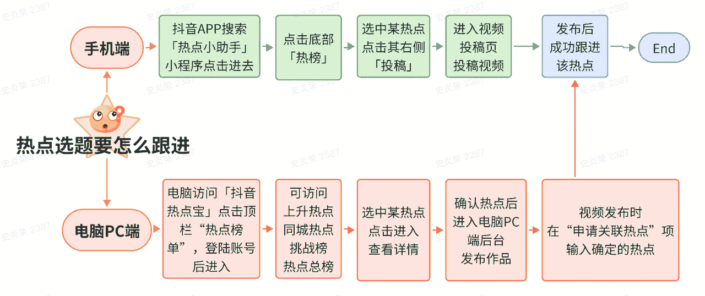

| 追热点常见问题 | 解决方式 | 典型案例 |
| --- | --- | --- |
| 热点有对外的数据后台吗？ | 👉🏻可以关注抖音「热点宝」，点击进入「热点宝链接」。<https://douhot.douyin.com/ranking?active_tab=ranking_rise>包含热点榜、视频榜、热点热度曲线等数据信息。 | |
| 知识常见热点类型有哪些？ | 📌文化教育、科技、财经等分类下的热点事件 | [2022诺贝尔奖文学奖揭晓](https://douhot.douyin.com/sentence/detail?active_id=841145&active_tab=sentence_detail)、[再次火热的室温超导是啥](https://douhot.douyin.com/sentence/detail?active_id=1334427&active_tab=sentence_detail)、[经济半年报有哪些看点](https://douhot.douyin.com/sentence/detail?active_id=1315687&active_tab=sentence_detail) |
| | 👥重要知识名人(作家、科学家、经济学家、思想家等)/社会事件的周年、诞辰等 | [缅怀厉以宁](https://douhot.douyin.com/sentence/detail?active_id=1066727&active_tab=sentence_detail)、[杨振宁先生100岁了](https://douhot.douyin.com/sentence/detail?active_id=834305&active_tab=sentence_detail)、[袁隆平逝世两周年](https://douhot.douyin.com/sentence/detail?active_id=1215566&active_tab=sentence_detail) |
| | 📚热门知识概念/名词/现象/原理/人物等的介绍、解释、科普等 | [G20是个什么样的组织](https://douhot.douyin.com/sentence/detail?active_id=896589&active_tab=sentence_detail)、[LPR下调意味着什么](https://douhot.douyin.com/sentence/detail?active_id=1268109&active_tab=sentence_detail)、[风动石为什么推不下去](https://douhot.douyin.com/sentence/detail?active_id=931792&active_tab=sentence_detail) |
| 哪些热点话题可以提前准备？ | 📅事先能够确认时间的传统节日、纪念日等 | [3·15消费者权益日](https://douhot.douyin.com/sentence/detail?active_id=1090774&active_tab=sentence_detail)、[4·23世界读书日](https://douhot.douyin.com/sentence/detail?active_id=1163113&active_tab=sentence_detail) |
| | 👨‍👩‍👧‍👦固定时间段发生的约定俗成的全民事件 | [新年许愿](https://douhot.douyin.com/sentence/detail?active_id=967966&active_tab=sentence_detail)/[新年目标](https://douhot.douyin.com/sentence/detail?active_id=238022&active_tab=sentence_detail)、[毕业季](https://douhot.douyin.com/sentence/detail?active_id=1266942&active_tab=sentence_detail) |
| 哪些热点话题适合追？ | ✅适合：具备较长时效和周期，有较大延展和发酵空间的话题 | [中国古代到底有没有数学](https://douhot.douyin.com/sentence/detail?active_id=1308349&active_tab=sentence_detail)、[经济半年报有哪些看点](https://douhot.douyin.com/sentence/detail?active_id=1315687&active_tab=sentence_detail) |
| | ❌不适合：时效较短的即时资讯，延展和发酵空间小 | [俄罗斯一加油站爆炸](https://douhot.douyin.com/sentence/detail?active_id=1359986&active_tab=sentence_detail) |
| 哪些热点话题适合延展？ | ✅适合：专业名词/陌生概念/自然现象/新生人物等需要解释说明，同时存在科普空间和价值的话题 | [什么是马赫环](https://douhot.douyin.com/sentence/detail?active_id=986857&active_tab=sentence_detail)、[X级耀斑对地球会有何影响](https://douhot.douyin.com/sentence/detail?active_id=986498&active_tab=sentence_detail) |
| | ❌不适合：时效较短的即时资讯，日常常见的事件或大众话题 | [哈兰德打破6场正赛进球荒](https://douhot.douyin.com/sentence/detail?active_id=1355813&active_tab=sentence_detail) |
| 热点话题如何延展？ | ❓基于热点话题的“提问式”延展 | [诺贝尔奖金为啥发不完](https://douhot.douyin.com/sentence/detail?active_id=847099&active_tab=sentence_detail)、[封神有多少内容还原历史](https://douhot.douyin.com/sentence/detail?active_id=1337856&active_tab=sentence_detail)、[为何不直接用金币来生活](https://douhot.douyin.com/sentence/detail?active_id=1216057&active_tab=sentence_detail) |
| | 🎓针对热点话题的关键概念/人物/现象的科普 | [再次火热的室温超导是啥](https://douhot.douyin.com/sentence/detail?active_id=1334427&active_tab=sentence_detail)、[货币贬值会带来哪些影响](https://douhot.douyin.com/sentence/detail?active_id=1282465&active_tab=sentence_detail)、[小行星撞地球的概率有多大](https://douhot.douyin.com/sentence/detail?active_id=1197019&active_tab=sentence_detail) |
| | 🔍围绕热点话题的分析/评论/预测研判等 | [中央定调对房地产有何利好](https://douhot.douyin.com/sentence/detail?active_id=1327113&active_tab=sentence_detail)、[如何评价大众7亿美元入股小鹏](https://douhot.douyin.com/sentence/detail?active_id=1330639&active_tab=sentence_detail) |

#### 细分领域知识作者跟进热点的常见问题

| 细分领域 | 常见问题 | 怎么解决 |
| --- | --- | --- |
| 人文历史 | + 不知道有哪些文化类热点可以跟进怎么办？ | + 外部热点：关于热点运营的小工具 [**抖音热点宝**](https://douhot.douyin.com/square/trend?active_tab=hotword_all)，人文作者可以跟进的几类 |
| 教育校园 | 跟进热点前，问自己几个问题 | + 教育/校园 优质热点案例：怎么看待孔乙己文学走红？ |
| 商业财经 | + 不知道选择什么样的热点去跟进 | + 财经领域的很多热点属于时效性很强的即时资讯型热点，热度持续时间较短，例如常见的股市行情。除非是进行专门的每日股市复盘的内容规划，否则跟进时效性很强的股市行情类热点，很容易遇到内容发布后，热点热度就开始下降的问题。 |
| 科普 | + 热点跟进速度过慢 | 跟热点前，需要根据自己和团队的情况，判断几个问题： |
| 科技 | + 大部分科技新品发布有固定的日期，品牌方会要求创作者在同一个时间段集中发布一系列视频内容冲热点，但是前期对于新品又需要比较强的保密性，所以无法提供给大部分创作者充分的信息输入和足够的新品试机，导致内容虽多，但是内容较为同质化，差异性不够； | + 向品牌方申请提供更多的新品信息输入、新品试机，包括新品特性、新功能、新品研发背后的故事、新品使用到的技术、新品使用到的新材料等全方面、多维度的信息，避免内容的同质化； |
| 法律 | + 跟热点的速度较慢，刚弄出来热点就快过去了 | + 选择好自己想要评论的领域，与团队配合提高热点监测能力和文案出产速度 |
| 情感 | + 不知道哪些热点可以跟？ | + **外部热点：可关注抖音热点榜、🧣热点榜**等实时在线热点，同时，情感作者可跟进⬇️ |

+ **影视类：**如**《长安三万里》《封神》**大火，讲解高热人物和场景 ——一般持续热度时间较长，解读空间大

+ **节点类：**端午、中秋等传统文化节气内容——可提前准备，但同质化较多，出圈难度大

+ **突发类：**米兰昆德拉去世、诺贝尔文学奖获奖人物等——一般热度1-2天，对于输出速度要求极高

+ **整体观察：**哪些内容方向容易持续出爆款？——长效热点选题，如传统文化知名人物，苏轼、李白等

+ **局部观察：**赛道里同类账号近期在做什么内容？——需要多关注同类作者以及同类作者的评论区，用户想看什么

+ **自我观察：**自己账号里最受欢迎的内容有哪些？——深入挖掘自己粉丝的喜好、敏感点，引发评论互动的点

+ 热点类型：教育/校园/人文社科/社会思潮

+ 热点受众：在读学生-大学生-毕业生 ——> 困惑的泛化人群

+ 热点结合：适合**思辨型、文学型、观点输出型**的博主参与

+ 优质案例：

+ @邵鑫老师 《[孔乙己的故事，今天还在继续](https://www.douyin.com/user/MS4wLjABAAAAht44-loZ5fg33R1XR0GLku16uzmsiLfHMCqBiWRoJ9avcFuBLy3am4z9q7pMKqom?modal_id=7203237461269466427)》

+ @青椒姐姐 《孔乙己脱不掉的长衫不是学历，而是···》

+ @是你们的康康 《[初读不知书中意，再读已是书中人](https://www.douyin.com/user/MS4wLjABAAAAkCnHGQICA8YE_cQ2AwLe5I98ywFusoU7oq0pIXlaFIM?modal_id=7203340246854012163)》

+ **社会新闻类：**如“采访一下结婚有什么好处”、“多巴胺穿搭”大火背后的心理因素，从情感心理的角度分析，一般持续热度时间较长，解读空间大

+ 节点类：520、七夕、母亲节、525我爱我等情感心理类节日——可提前准备，但同质化较多，出圈难度大

### 4.4 参与平台活动的正确方式？

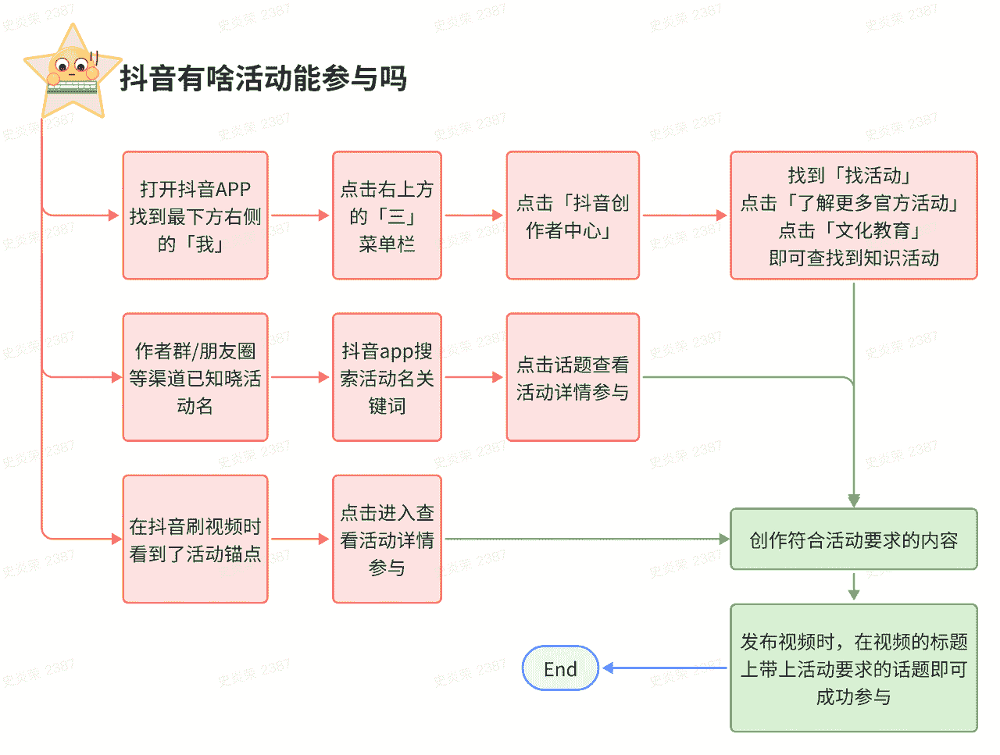

| 知识平台活动常见问题 | 怎么解决？ |

| --- | --- |

| 在哪里查找平台的活动？ | 一般在「抖音创作者中心」内的大型活动是最全的，可以经常翻阅。 |

| 什么样的内容更容易获得奖项？ | **每个抖音活动**都有不同的奖项规则，**建议详细查看**每个活动页面右上方的详细规则和内容要求。 |

| 为什么要多参加平台活动？ | 平台发起的活动都不是无缘无故的，创作者可以通过参与平台活动获得以下收益： |

| 之前都有哪些知识活动？ | 抖音知识一般会发起知识节点和重点专项两类活动，结合自己的选题计划、多参与平台活动，获得双倍流量！ |

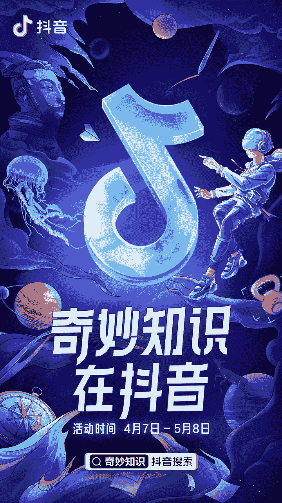

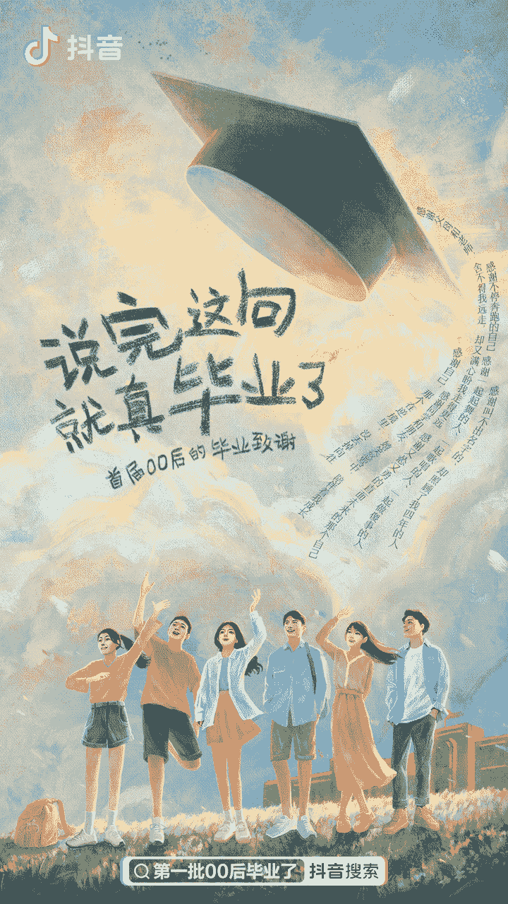

## 五、流量诊断篇

> 本篇核心是指引作者如何分析自己视频数据的下跌，辅助更好的创作高收益高流量的内容。常见的审核问题，一般系统会给出审核原因，修改后重新上传就好。如果不了解审核原因，可以在后台咨询客服。或者部分优质高粉作者会有1v1专属客服群，可以直接在群内咨询客服。

> 点击以下蓝字跳转：

> [5.1 我有审核问题吗？](https://bytedance.feishu.cn/docx/KIbKdJr8Lo42amxzKY3cCiaFn4b#part-PBVudujOFoTMOEx988ZceGmCnge)

> 5.2 我的内容缺乏吸引力了吗？

> [5.3 我的粉丝不爱我了吗？](https://bytedance.feishu.cn/docx/KIbKdJr8Lo42amxzKY3cCiaFn4b#part-UwUmdTDW9oSMzAxvQSoclDpBnKh)

> [& 返回总目录](https://bytedance.feishu.cn/docx/KIbKdJr8Lo42amxzKY3cCiaFn4b#part-IUV5d09PNoEIajxWaUscxB4TnIg)

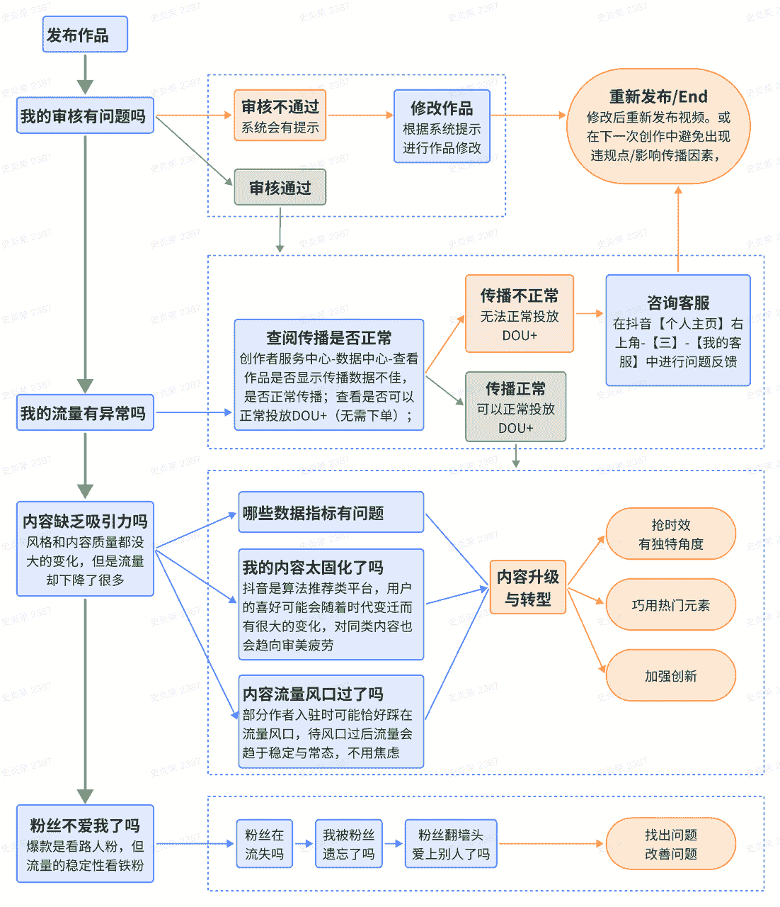

### 5.1 我有审核问题吗？

| 知识常见审核问题 |  |  |

| --- | --- | --- |

| **问题类型** | **常见问题** | **怎么解决** |

| 内容 | 搬运：上传他人拍摄和制作的视频，几乎没有剪辑加工。 | 请停止搬运他人作品的行为！ |

|  | 一稿多投：同一条视频，发布在多个账号，流量会有影响。 | 建议可以使用抖音共创功能[抖音共创功能白皮书](https://bytedance.feishu.cn/docx/Il2XdXTBAoOZ0nxHgqZcf2Jqnfg) |

|  | 低成本：使用他人拍摄和制作的素材进行简单剪辑和加工。 | 可以对他人拍摄和制作的素材进行高级/深度剪辑和加工，或者进行实拍。 |

|  | 伪科普：作品内容宣传虚假科学原理、封建迷信等内容。 | 可以提高作品的专业度、科学性。 |

|  | 不良价值观：街头尬演、炫富、早恋 | 请停止演绎或宣传该类价值观。 |

| 广告 | 广告营销：作品内容包含硬广、软广、好物推荐、营销话术等内容。 | 请通过星图平台进行下单后发布作品。 |

| 规则 | 有平台对外规则链接吗 | 【抖音社区自律公约】👇 |

| **细分领域常见审核问题** |  |  |  |

| --- | --- | --- | --- |

| **细分领域** | **问题类型** | **常见问题** | **怎么解决** |

| 人文历史 | 1. 涉军涉政 | 1. 煽动民族仇恨、民族歧视，破坏民族团结 | 1. 减少对军事和政治的主观负面评价 |

| 教育校园 | + 涉K12/学科培训 | + 未经平台事先认证开展（或变相开展）学科类培训或辅导 | 详见[直播行为规范](https://sf3-draftcdn-tos.pstatp.com/obj/ies-hotsoon-draft/webcast_all_anchor/webcast_ban_protocol.html)，此类学科培训有严格平台规则；平时可以多关注教育部的官网资讯 |

| 财经 | 1. 政策解读 | 1. 政策解读：无资质新闻或伪新闻的内容，包括但不限于：搬运、二次创作媒体机构或政府机构发布的新闻视频内容 | 1. 政策解读：进行职业认证或媒体认证，加强信源标注 |

| 科普 | 1. 健康&amp;医疗 | 1. 讲到某种植物或某个生命机理，进而讲到在医学上的应用，提到了治疗方案。讲解医疗科普内容需要医疗资质。 | 1. 申请相关资质 |

| 科技 | + 广告营销 | + 如果视频内容主讲的是某种科技产品、软件，容易被识别为广告营销； | + 客观评价产品，不夸夸其谈，而是优点缺点一起讲，给用户提供全面客观的测评信息； |

| 法律 | + 无资质处罚 | + 抖音平台讲解法律内容（含直播）都需要报备相关资质 | + 短视频侧完成黄v认证 |

| 情感 | + 内容不推荐 | 1、选题和内容价值观问题 | + 选题及内容避免低俗、拜金捞金、物质主义等价值观取向的内容。 |

> 关于线上学科类培训机构违规问题的通报：https://mp.weixin.qq.com/s/v1LZyCnADGh6QuVewMu1iQ

> 中国民办教育协会关于违规数学竞赛活动的预警提醒：https://mp.weixin.qq.com/s/url-gg5glWeFWiSDCTPf_w

> 广东出台中小学生校外教育培训非学科类目录清单：https://mp.weixin.qq.com/s/dF2fpAzFYdReoKoVFuKM9Q

### 5.2 我的内容缺乏吸引力了吗？

| **问题类型** | **常见问题** | **怎么解决？** |

| --- | --- | --- |

| 数据反馈 | 哪些数据指标有问题？ | 提示： |

| 内容升级 | 作品风格和质量跟之前发布的没有区别，但是流量下降了很多。 | 提示：这是作者常遇到的问题，通常发生在已经创作多年的作者身上，作品风格和质量没有大的变化，但是流量就是在下跌。通常是内容太固化的原因，需要顺应时代，发现粉丝新的兴趣点，长时间不变的内容风格容易让粉丝产生审美疲劳。几年前大众喜爱的内容，不一定如今还喜欢，需要适应变化，不断创新。 |

| 时代红利 | 内容流量风口过了吗 | 提示：这是一个后验指标，通常出现在流量风口过了之后。 |

+ 平均播放时长：该项指标越高，代表用户看这条视频的时长越长，喜爱度越高。通常与播放完成率成反比，在内容好的前提下，视频越长，平均播放时长越长，但播放完成率越短；视频越短，平均播放时长越短，但播放完成率可能越高。知识作者通常在平均播放时长这项指标更有优势，因为在播放完成率方面很难与娱乐、萌宠、舞蹈、颜值等领域竞争。

+ 播放完成率：该项指标越高，代表用户看完这条视频的比例越高或看完了大部分的片段，喜爱度越高。通常与平均播放时长成反比。

+ 跳出时段：查阅用户集中在哪个时段跳出这条视频，如果集中在1-3秒，说明开头不够吸引人，留不住用户；如果在某个时间段突然出现大幅波动或断崖式下跌，说明该时段的画面劝退了大批用户，需要复盘，以便后续调整。

+ 点赞率/点赞量：代表用户对这条视频的喜爱程度，该项指标稳定的作者基本是人格魅力较强的作者，铁粉多，用户对该作者有强粘性；但是如果人格魅力不强、账号特色不够突出、难以对用户形成强记忆点和追更欲望，这指标会变得非常不稳定。如果该项指标明显低于自己的往期平均程度，流量低就是正常现象。

+ 关注率/关注量：代表用户对这个作者的认可程度，会想要持续观看这个作者的其他内容，通常不是一个稳定指标，大多数作者是通过多次爆款快速涨粉。可以通过增强与粉丝的互动的方式，强化提示作用，但是需要避免骗赞骗互动的行为。

+ 分享率/分享量：代表用户对这条内容的认可程度，会想要分享给自己的亲人朋友，知识作者在该项指标明显会高于其它领域作者。

+ 收藏率/收藏量：代表用户对这条内容的认可程度，会想要收藏之后继续看，知识作者在该项指标明显会高于其它领域作者。

+ dislike率：代表用户对这条视频的讨厌程度，这是一个负向指标，如果指标偏高，需要及时调整自己的内容。

### 5.3 我的粉丝不爱我了吗？

| **常见问题** | **怎么解决？** |

| --- | --- |

| 我的粉丝在流失怎么办？ | 提示：可以增强与粉丝的互动，看看自己的评论区、粉丝群的讨论氛围，或者主动和粉丝沟通，看看自己粉丝流失的核心原因在哪里。原因因人而异，需要做好调研。 |

| 我被粉丝遗忘了吗？ | 通常出现在断更作者身上，在断更一段时间后，之前粉丝的视频流已经被新作者取代，流量不负之前的辉煌。不用着急，保持稳定更新，分析自己的粉丝都在看什么，粉丝还是爱你的。 |

| 粉丝🪜头爱上别人了吗？ | 通常人格化的作者粉丝粘性更高，但是非人格化作者由于可替代性较强，流量容易不稳定，粉丝也会极易流失。 |

| 粉丝的互动数据在下降怎么办？ | 互动数据指点赞、评论、收藏、看播等，互动数据的下降和铁粉数据的下降都会有影响。 |

## 六、知识直播篇

> 本篇核心是指引作者在抖音直播的路径。对大多数知识作者来说，由于很多人并不真人出镜拍视频，所以直播并不是一个常态化使用抖音的场景。但是直播对于商业化变现、重大节点精品内容直播、与粉丝交流互动有着重要的作用。很多知识作者都通过直播获得了更高的商业化收益，与更高的知名度与粉丝喜爱度，是知识作者可以尝试的重点方向。

> 点击以下蓝字跳转：

> [6.1 在抖音有哪些直播方式？](https://bytedance.feishu.cn/docx/KIbKdJr8Lo42amxzKY3cCiaFn4b#part-ByWhdfbFwosmOkxYCcfc3Iltn2c)

> 6.2 在抖音怎么开始一场直播？

> [& 返回总目录](https://bytedance.feishu.cn/docx/KIbKdJr8Lo42amxzKY3cCiaFn4b#part-IUV5d09PNoEIajxWaUscxB4TnIg)

### 6.1 在抖音有哪些直播方式？

| **直播方式** | **适合场景** | 方式优点 | 注意事项 | 操作方式 |

| --- | --- | --- | --- | --- |

| 手机直播 | 抖音最常见的开播形式，最简单 | + 操作最简单，学习成本低 | + 审核从严，建议特殊领域直播提前阅读直播规范（财经、健康、法律类直播） | 直接根据手机提示操作就好。 |

| 直播伴侣电脑直播 | 抖音推出的电脑直播工具 | + 功能丰富且齐全，有更多支持电脑端直播的功能，直播效果更佳 | + 仅支持Windows系统 | 1、安装方式： |

| OBS开播 | 仅针对部分用户开放，不开放申请 | + 稳定性和兼容性较高 | + 不具备抖音大多数的直播基础功能，无法查看直播间消息，礼物 | 操作教程：https://streamingtool.douyin.com/docs/guide/96319/ |

| 直播内容合作平台 | 精品节目平台，适合有主题、有编排的单场或系列性精品直播内容。 | + 可在节目账号生成“节目”tab，形成更直观的内容系列化呈现，外显更突出和精致。 | + 入驻申请对直播内容的品质要求较高 | 1、入驻操作的平台链接：https://ogc.douyin.com/ |

| 媒体直播 | 面向媒体政务号的直播能力，适合新闻、政治等特殊场景的直播能力 | + 适合涉敏感话题/军政法景/重点舆论风险的直播场次，部分审核规则会做适当豁免。 | 仅面向媒体政务号和特殊官号 | 操作手册：[抖音头条媒体直播手册2023.pdf](https://bytedance.feishu.cn/file/boxcnpS2uDjwUTcvoQBCI5WU8sd) |

| 飞书直播 | 面向企业和机构的多端直播服务，适合开学典礼、学术论坛、校招宣传、新品发布会等内容 | + 以会议的形式开启直播，更适合参会嘉宾在多地的大型活动 | 完成飞书认证的企业才可以使用飞书直播功能 | 1、飞书官网链接：https://www.feishu.cn/hc/zh-CN/category/6940515081960587265-%E9%A3%9E%E4%B9%A6%E7%9B%B4%E6%92%AD |

### 6.2 在抖音怎么开始一场直播

| 开始一场直播的流程 |  |  |  |

| --- | --- | --- | --- |

| **直播阶段** | **注意事项** |  | **怎么操作** |

| 直播前 | 直播安全 | 直播安全规则 | 提前阅读直播违规及处罚细则：https://sf3-draftcdn-tos.pstatp.com/obj/ies-hotsoon-draft/webcast_all_anchor/webcast_ban_protocol.html |

|  |  | 主题是否安全（是否涉及政治、财经、健康、法律等相关领域） | 政治相关请有媒体政务号资质的机构先做媒体直播权限申请。 |

|  |  | 主题是否敏感 | 可以关闭评论、关闭送礼（创健直播时操作，直播开始后无法更改） |

|  |  | 是否担心有黑粉 | 可以提前设置管理员和评论区的屏蔽词（创健直播时操作，直播开始后无法更改） |

|  | 直播氛围 | 是否已发布预告视频（建议直播当天发布） | 个人专栏操作手册（有直播预告贴纸[直播个人专栏 作者使用手册](https://bytedance.feishu.cn/docx/P50XdAEbxo2Yq2xnuqhc2JObnxg)自动生成回放、粉丝一键订阅专栏等功能） （仅面向优质百万粉作者开放，创健直播时操作，直播开始后无法更改） |

|  | 直播功能 | 是否要直播回放 | 不同直播功能回放方式不同，但是切记创健直播时操作，直播开始后无法更改 |

|  |  | 嘉宾分隔多地怎么直播？ | 可以通过飞书、腾讯会议、zoom等会议软件，嘉宾各自开启摄像头画面。工作人员操作会议软件实时推流（直播），或录屏后剪辑播出（首播）。 |

|  |  | 是否要设置福袋抽奖 | [抖音直播间自定义实物福袋 使用说明（可对外）](https://bytedance.feishu.cn/docs/doccnKFnWFXPX3hgNTiFzulo1Th#HRpqnA)音抽奖仅支持使用福袋形式，福袋操作手册： （创健直播时操作，直播开始后无法更改） |

|  |  | 直播间管理员设置了吗 | 如单人直播顾及不过来，可以提前设置管理员，辅助对黑粉的禁言等操作。 |

|  |  | 直播要挂购物车吗 | 推荐使用百应平台操作挂车 https://buyin.douyinec.com/daren?from=douyinofficial_table |

|  |  | 其它功能 | 不同直播方式操作不同，但是切记所有想要在直播时有的功能，都需要提前在直播创建时设置，不要想当然，例如标题、封面、回放、摄像头等，尤其是需要电脑端复杂操作的直播，建议提前阅读不用开播方式的操作手册。 |

| 直播中 | 丰富形式 | 可以多一些和粉丝的评论与互动 |  |

|  | 违规提示 | 直播违规处罚、提示和申诉 | 解读视频：https://www.douyin.com/video/6823988173165579524?modeFrom=searchCreator |

| 直播后 | 直播复盘 | 查阅复盘整体信息、观众信息、违规解读、举报回放、观众离开高峰 | 抖音直播复盘平台：https://livedata.douyin.com/live/data/creator/dynamic |

|  | 直播拆条 | 把直播高光卡段作为短视频发布，一方面进一步提升自己直播优质内容的长期曝光，另一方面也可以提升自己的投稿量，吸引更多粉丝 | 知识直播内容拆条操作手册：[内容型直播/长视频拆条SOP](https://bytedance.feishu.cn/docx/E91YdEvXfoNzuuxkRA9ciMEknTe) |

| 直播的优化方向 |  |

| --- | --- |

| **优化方向** | **解析** |

| 直播设备 | + 基础版： |

| 拍摄方式 | [手机前置摄像头直播不清晰，用后置对镜播画面](https://www.douyin.com/video/7258974302752541991)里又总能看到手机？全身对镜直播怎么打光？ |

| 美颜打光 | 打光轮廓光：https://www.douyin.com/video/7239655548856061239 |

| 内容优化 | +   直播间背景和音乐如何选择：`https://www.douyin.com/video/6828103341910887692?modeFrom=searchCreator` |

+   手机：主要选择内存充足、摄像头像素高、性能稳定的手机，目前的主流手机品牌都不错，如苹果、华为、OPPO、VIVO、小米等。
+   声卡：主要用于播放背景音乐，如掌声、笑声等，能活跃直播间气氛
+   麦克风：帮助更好的收音，主播大多会选择电容麦克风，音质好声音有层次
+   手持云台/手机落地支架：防止画面抖动，提升直播观感。云台一般是外景手机直播常用，落地支架室内常用
+   补光灯/美颜灯：让画面光线更好，人物更美
+   相机/摄像机/摄像头：更专业的拍摄设备
+   有些作者自身有很强的资质背书，但是缺乏包装，用户不认识作者就会划走，所以需要在包装上把作者title、本场直播的稀缺性展示出来。
+   知识类直播讲的内容往往比较连贯而非碎片化，这本身很好，但中途进房的用户可能并不能第一时间理解作者在说什么，所以需要在页面上长挂本场直播主题，最好能分段实时挂上小标题。
+   知识类直播通常单向输出较多，可以考虑在输出内容时增加一些互动。
+   受众期待：抖音直播算法会根据用户反馈数据来持续推荐符合该直播受众画像的群体，所以在开播之前定义好本场直播的内容和自己呈现的人设（内容 - 聊天答疑、单向输出、付费咨询、直播带货；人设 - 搞笑、知心、人间清醒、学霸等）。选择贴近大众认知的角度，从用户感兴趣的话题或者热点事件入手，由浅入深地讲述。
+   直播预热：突然性的开播会导致流失大部分「铁粉」，可以运用直播专栏、视频预告、评论区预告、粉丝群预告等多种形式提示开播时间
+   形成习惯：定时开播+直播内容体系化+每次直播有策划，养成粉丝看播习惯，让每一次来看直播的用户有获得感
+   **呈现形式**：营造有亲和力的直播间氛围，避免和用户产生距离感，反面案例包括但不限于：嘉宾离观众太远、没有人物出镜只是放PPT、场地过于空旷声音很遥远……等等。
+   **用户互动**：如果是实时直播，可以考虑增加更多互动环节，如回复评论区问题等。非实时直播也可以通过发布评论来引导用户参与内容讨论。

## 七、快乐变现篇

> 本篇核心是传达抖音主要的知识作者变现模式，供大家阅读学习，很多人在抖音达成年薪百万、年薪千万，甚至年薪过亿。不同作者适合的变现途径并不完全相同，可以多点开花都先尝试一下，或许会在某个途径有意想不到的收获。
>
> 点击以下蓝字跳转：
>
> [7.1 电商带货怎么搞？](https://bytedance.feishu.cn/docx/KIbKdJr8Lo42amxzKY3cCiaFn4b#part-N4dqd65KZoyqFGx3FEKcHWj8nWd)
> [7.2 直播变现怎么搞？](https://bytedance.feishu.cn/docx/KIbKdJr8Lo42amxzKY3cCiaFn4b#part-TcN5d8QHCoCZqnxD6oXc5B47nxf)
> [7.3 星图商单怎么搞？](https://bytedance.feishu.cn/docx/KIbKdJr8Lo42amxzKY3cCiaFn4b#part-VXvXdhtiVoIMEWxp74NcdYvknkd)
> [7.4 付费课程怎么弄？](https://bytedance.feishu.cn/docx/KIbKdJr8Lo42amxzKY3cCiaFn4b#part-OdLQdqmUqoZEhFxt3kPc0DZHnZf)
> [7.5 抖音会员怎么弄？](https://bytedance.feishu.cn/docx/KIbKdJr8Lo42amxzKY3cCiaFn4b#part-ZWVHditJ2ojFrcx9mEecOdMenNe)
> [7.6 付费视频和直播怎么弄？](https://bytedance.larkoffice.com/docx/KIbKdJr8Lo42amxzKY3cCiaFn4b#share-ZUjRdjz9xoW65kx9llYckUFVnLf)
> [&    返回总目录](https://bytedance.feishu.cn/docx/KIbKdJr8Lo42amxzKY3cCiaFn4b#part-IUV5d09PNoEIajxWaUscxB4TnIg)

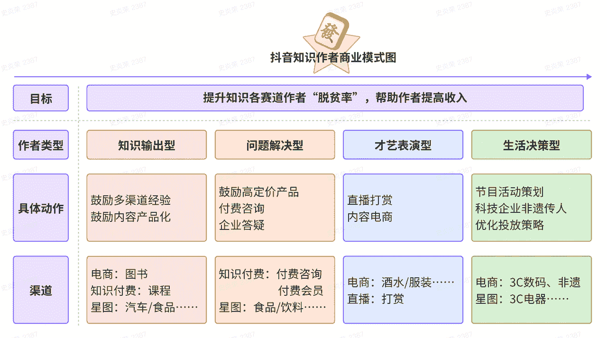

### 7.1 电商带货怎么搞？

| 电商带货常见问题 |  |  |

| --- | --- | --- |

| **问题类型** | **详细问题** | **怎么解决？** |

| 如果你是商家要开店 | 开店入驻如何 | 经营指北针 Vol.1｜三个步骤带你解锁抖音电商开店入驻 |

|  | 开单指南 | 抖音电商-[新商成长指南](https://school.jinritemai.com/doudian/web/page/102/100042?scene_source=kuaisumulu_web&amp;strategy_source=KuaiSuMuLu%EF%BC%88PC%EF%BC%89_1652867181&amp;btm_ppre=a4977.b31122.c0.d0&amp;btm_pre=a4977.b4369.c0.d0&amp;btm_show_id=c8ad9897-99e4-4a56-8d73-d25b20a14bb0)官方出品 边做边学 交流成长 |

|  | 必学规则 | 经营指北针 Vol.2｜十分钟带你看懂新商家应知应会的平台规则 |

|  | 上架发货 | 经营指北针 Vol.3｜正确操作商品上架和发货，助力新商家顺利开单 |

| 如果你是作者要玩转带货 | 直播带货 | 【商家能力项】促转化专栏（直播场景）系列课 |

|  | 短视频带货 | 【商家能力项】促转化专栏（短视频场景）系列课 |

|  | 图文带货 | [一张图看懂抖音电商图文带货](https://school.jinritemai.com/doudian/web/course-series/cHmV5RMqCbrC?scene_source=kuaisumulu_web&amp;strategy_source=KuaiSuMuLu%EF%BC%88PC%EF%BC%89_1652867181&amp;btm_ppre=a4977.b31122.c0.d0&amp;btm_pre=a4977.b4369.c0.d0&amp;btm_show_id=c8ad9897-99e4-4a56-8d73-d25b20a14bb0) |

|  | 流量获取 | [【商家能力项】汇流量专栏系列课](https://school.jinritemai.com/doudian/web/article/aHN3bKzkRpcC?scene_source=kuaisumulu_web&amp;strategy_source=KuaiSuMuLu%EF%BC%88PC%EF%BC%89_1652867181&amp;btm_ppre=a4977.b31122.c0.d0&amp;btm_pre=a4977.b4369.c0.d0&amp;btm_show_id=c8ad9897-99e4-4a56-8d73-d25b20a14bb0) |

|  | 商品创建优化 | 无论你是商家、达人、服务商、MCN、团长各种角色[一站式解决](https://school.jinritemai.com/doudian/web/funcs/11719?tabKey=funcs&amp;scene_source=kuaisumulu_web&amp;strategy_source=KuaiSuMuLu%EF%BC%88PC%EF%BC%89_1652867181&amp;btm_ppre=a4977.b31122.c0.d0&amp;btm_pre=a4977.b4369.c0.d0&amp;btm_show_id=c8ad9897-99e4-4a56-8d73-d25b20a14bb0) |

| 抖音商城 | 商城运营 | 玩转抖音商城[畅游精选联盟](https://school.jinritemai.com/doudian/web/course-series/cHkYdGPiwQVJ?btm_ppre=a4977.b4369.c0.d0&amp;btm_pre=a4977.b3921.c0.d0&amp;btm_show_id=8ff9d5f7-0f2c-4a3c-bfbc-0280a9205290) |

|  | 搜索运营 | 抖音搜索[自然流量搜索优化](https://school.jinritemai.com/doudian/web/course-series/cHdXkCUPc5Gr?btm_ppre=a4977.b4369.c0.d0&amp;btm_pre=a4977.b3921.c0.d0&amp;btm_show_id=be86bc13-d1e1-4f0c-a426-6cb7a11ac12a)技巧 |

|  | 店铺运营 | 抖音电商[个人店铺运营方法论](https://school.jinritemai.com/doudian/web/article/aHkYdGixBFkg?btm_ppre=a4977.b4369.c0.d0&amp;btm_pre=a4977.b3921.c0.d0&amp;btm_show_id=cebdf16f-034c-4467-aa19-82aca2188f17) |

| 作者经营突破 | 经营方法论 | 抖音电商[经营方法论课程](https://school.jinritemai.com/magic/eco/runtime/release/6277ad4e58e11d051f61e6e8?appType=douyin&amp;title_color=ffffff&amp;nav_bar_color=000000&amp;status_bar_color=000000&amp;hide_more=0&amp;nav_btn_type=2&amp;scene_source=kuaisumulu_web&amp;strategy_source=KuaiSuMuLu%EF%BC%88PC%EF%BC%89_1652867181&amp;btm_ppre=a4977.b31122.c0.d0&amp;btm_pre=a4977.b4369.c0.d0&amp;btm_show_id=c8ad9897-99e4-4a56-8d73-d25b20a14bb0) |

|  | 用户运营 | [用户运营_如何做老客营销](https://school.jinritemai.com/doudian/web/article/aHibaWun1zd2?industryId=17&amp;typeName=%E4%BD%BF%E7%94%A8%E6%8C%87%E5%8D%97&amp;btm_ppre=a4977.b4369.c0.d0&amp;btm_pre=a4977.b0.c0.d0&amp;btm_show_id=fdd0dc1b-c0bd-4ffa-8228-cebe05a72328) |

|  | 达人合作带货 | 如何通过精选联盟快速准确找到商品分销路径 |

|  | 数据分析 | 【罗盘·经营】售后分析新升级，改善售后服务质量，快速提升体验分！ |

| **典型案例** | **案例解析** |

| --- | --- |

| 老孙学长 | +   **变现特征：**作者是典型内容、用户、商品转化强关联的类型。内容是择校升学为主，集中大量学生父母。通过电商售卖中小学课外书为主。TOP1电商渠道收入占比99.95% |

| 涂磊 | +   **变现特征：**通过家庭情感问题解决的内容聚合大量31-50婚后女性，通过电商造节造概念打折促销。TOP1电商渠道收入占比99.76%。 |

| 无穷小亮的科普日常 | +   **变现特征：**作者利用科普内容带本人科普图书。投稿创作、用户消费到商业产品变现保持一致，用户高度认可。TOP1电商渠道收入占比99%。 |

+   作者电商货品同时具备了图书、课程和货品。货品经营也以学习机和学习用品为主；

+   **从经营方式看，电商货品图书直播是短视频的2.7倍。**课程直播是短视频的100倍+，图书是双渠道经营均可，但课程直播渠道效率明显优于短视频渠道；

+   作者的商品售卖大多以分销产品为主，且核心聚焦课外读物。与作者内容是报考择校有关。

+   售卖商品分销为主，直营商品围绕图书，且是自己出版的图书；

+   直播挂车商品都是专场活动形式，双十一、暖冬、大牌等每场货品都是分销组货，活动结束全部下架；

+   电商售卖日常视频也几乎不挂车。即使是活动期间也是短视频直接做活动预告。自己的图书例外，会专门视频介绍个人图书。

+   售卖图书主要为作者本人图书，分销与中国国家地理和生物科普高度关联；

+   作者电商售卖形式直播和短视频均有，直播频次低，月均1-2场，但单场图书GMV较高；

+   日常视频几乎不挂车，不影响流量推荐。挂车售卖视频不做软植入，内容全部是讲解商品。

### 7.2 直播变现怎么搞？

| 直播变现常见问题 |  |  |

| --- | --- | --- |

| **问题类型** | **详细问题** | **怎么解决？** |

| 直播变现怎么操作 | 直播变现操作指南？ | 直播变现，路径如下： |

| 直播变现新手入门 | 如何让你的直播变得有趣有料更好玩？ | [开播准备手册送给你](https://www.douyin.com/video/6772437988992503048?category_id=181&amp;is_hot=0&amp;is_topic=0&amp;limit=6&amp;modeFrom=creator&amp;offset=20&amp;order=1&amp;type=category) |

|  | 直播如何进行收益结算和提现？ | [挣钱小妙招课程](https://www.douyin.com/video/6772486344343096579?category_id=181&amp;is_hot=0&amp;is_topic=0&amp;limit=6&amp;modeFrom=creator&amp;offset=19&amp;order=1&amp;type=category) |

|  | 如何提升你的直播收益？ | [划重点，满分答题](https://www.douyin.com/video/6776164428812487940?category_id=181&amp;is_hot=0&amp;is_topic=0&amp;limit=6&amp;modeFrom=creator&amp;offset=18&amp;order=1&amp;type=category) |

| 主播成长攻略 | 新人主播如何一步步的变大？ | [成长攻略——主播任务](https://www.douyin.com/video/6823988923878968588?category_id=181&amp;is_hot=0&amp;is_topic=0&amp;limit=6&amp;modeFrom=creator&amp;offset=17&amp;order=1&amp;type=category) |

|  | 手机端如何开播呢？ | [手机端直播攻略](https://www.douyin.com/video/6826611354095324428?category_id=181&amp;is_hot=0&amp;is_topic=0&amp;limit=6&amp;modeFrom=creator&amp;offset=12&amp;order=1&amp;type=category) |

|  | PC端如何开播呢？ | [PC端如何去开播呢？](https://www.douyin.com/video/6826615535627767044?category_id=181&amp;is_hot=0&amp;is_topic=0&amp;limit=6&amp;modeFrom=creator&amp;offset=16&amp;order=1&amp;type=category) |

| 达人涨粉攻略 | 电商主播如何做好表情管理，让魅力值加分？ | [快来学习直播涨粉小妙招](https://www.douyin.com/video/6930904064318295303?category_id=181&amp;is_hot=0&amp;is_topic=0&amp;limit=6&amp;modeFrom=creator&amp;offset=11&amp;order=1&amp;type=category) |

|  | 怎样的声音魅力，能让粉丝更愿意听主播讲解商品呢？ | [一堂课让你成就完美声线](https://www.douyin.com/video/6931917406323379464?category_id=181&amp;is_hot=0&amp;is_topic=0&amp;limit=6&amp;modeFrom=creator&amp;offset=9&amp;order=1&amp;type=category) |

|  | 如何把握直播带货节奏，吸引粉丝观看？ | [慢慢走上自己的主播成名之路](https://www.douyin.com/video/6932349867687693581?category_id=181&amp;is_hot=0&amp;is_topic=0&amp;limit=6&amp;modeFrom=creator&amp;offset=8&amp;order=1&amp;type=category) |

|  | 什么样的主播，直播带货更受欢迎？ | [让你成为最受欢迎的自己](https://www.douyin.com/video/6930902841808784654?category_id=181&amp;is_hot=0&amp;is_topic=0&amp;limit=6&amp;modeFrom=creator&amp;offset=10&amp;order=1&amp;type=category) |

| 直播变现方式 | 我在抖音直播到底可以通过什么方式快速挣钱？ | 你可以通过直播会员，直播带货，付费直播，直播咨询，直播打赏同时可以进入开放平台进行小程序的接入。 |

| 典型案例 | 有哪些可借鉴的典型案例？ | 何姐聊收藏：文化垂类达人。直播电商渠道收入占比94%。主要通过直播售卖各种玉器物品。 |

## 7.3 星图商单怎么搞？

| 问题类型 | 详细问题 | 怎么解决？ |
| --- | --- | --- |
| 新手指导 | 品牌主如何入驻星图接单？ | [新客户入驻必读手册](https://www.xingtu.cn/help-center/demander/109046) |
|  | 达人如何入驻星图接单？ | [新达人入驻必读手册](https://www.xingtu.cn/help-center/author/109194) |
| 功能介绍 | 如何指导我的报价机制？ | [达人报价设置及常见问题](https://www.xingtu.cn/help-center/author/113055) |
|  | 我的星图收入如何提升到账户？ | [个体达人/MCN达人结算](https://www.xingtu.cn/help-center/author/109200) |
| 规则解读 | 我的内容承接星图广告有限制吗？ | [广告审核-行业规则帮你解决](https://www.xingtu.cn/help-center/author/126358) |
|  | 我在平台承接广告需要遵守什么规则？ | [巨量星图达人管理规则](https://www.xingtu.cn/help-center/author/134035) |
|  | 如果我真的违反了平台的规则，会有什么样的风险？ | [达人违规及平台处置规则](https://www.xingtu.cn/help-center/author/129537) |
| 星图必备技能 | 我如何在星图能够快速提升自己的收入呢？ | [达人经营助手介绍来帮忙](https://www.xingtu.cn/help-center/author/109246) |
|  | 平台有什么活动可以帮助我接单吗？ | [参加星动计划提升达人接单效率](https://www.xingtu.cn/help-center/author/126267) |
|  | 我应该如何提升我的商单展现给客户？ | 让客户第一时间看到你，学习TOP榜单怎么玩 |

| 典型作者 | 有哪些可学习的典型作者？ | 安森垚 |

## 7.4 付费课程怎么弄？

| 问题类型 | 详细问题 | 怎么解决？ |
| --- | --- | --- |
| 知识付费路径 | 在抖音的知识付费要怎么弄？ | 抖音核心知识付费场景为付费课程，路径如下： |
| 电商橱窗 | 付费课程的电商橱窗怎么开？ | [达人如何在抖音上开通带货权限](https://school.jinritemai.com/doudian/wap/article/101721?rank=2&amp;fromPage=search_result&amp;searchInfo=1770656468845554845:1:0&amp;query=) |
| 入驻学浪 | 入驻学浪的操作方式？ | 个人入驻流程：`https://doc.iyincaishijiao.com/12080/226078` |
|  | 抖音企业号入驻学浪时，需要使用谁的信息入驻？ | 必须使用与该抖音企业号所绑定的实名认证信息一致，才能正常入驻 |
|  | 已经开通企业抖店，并且是教育培训类目，必须使用“法人”身份信息入驻吗？ | 不是，如果是企业抖店入驻学浪，可以使用非“法人”的身份信息 |
|  | 学浪课程是否需要提交ICP备案？ | 通过“学浪老师版”创建的课程，都无需上传ICP备案（不区分抖店类型） |
|  | 已经入驻学浪的老师，是否可以重新入驻？ | 暂时不可以，官方之后会针对已经入驻的作者，增加资料补充入口，请大家耐心等待 |
| 抖店绑定问题 | Q1：学浪入驻为什么需要缴纳5000元保证金？ | +   入驻学浪时需要绑定抖店，如果老师没有抖店，可在入驻学浪之后，提供学浪开通个人抖店  |
|  | Q2：通过学浪缴纳了5000元保证金，开通了“个人身份”抖店，如何设置商品分销功能？ | +   个人身份抖店暂不支持精选联盟功能，无法设置分销，官方正在推进此功能；老师可在抖店内绑定“官方帐号”或“渠道帐号”，即可在“商品橱窗-我的店铺”内添加课程，收益将会结算至店铺账户中  |
|  | Q3：入驻成功后，在抖店后台无法点击“商品”按钮，提示“抱歉，你无权访问该页面”？ | 入驻成功后，需要在学浪后台进行课程创建，暂不开放抖店商品管理权限； |
|  | Q4：入驻时提示“ 店铺教育培训类目申请中，无法直接绑定 ”？ | 该帐号绑定的抖店正在申请“教育培训”类目，需要等到审核通过后再进行入驻 |
|  | Q5：入驻时提示“ 店铺无教育培训类目，无法直接绑定 ”？ | 如果抖店非“教育培训”类目，可通过“更换帐号入驻”或申请“教育培训”类目资质才能绑定成功 |
|  | Q6：入驻时提示“ 身份证号已开店 ”？ | 代表此身份证此前开通过个人抖店，您可以[联系学浪客服](https://doc.iyincaishijiao.com/8514/94903/)协助处理 |

| 典型作者 | 有哪些典型作者可以学习吗？ | [MrYang杨家成](https://www.douyin.com/user/MS4wLjABAAAAuyURLEHBlHsyEXQY3t8eqOLBNlvecSR180vBVEf9uMQ)：教育校园垂类达人[。T](https://haohuo.jinritemai.com/ecommerce/trade/detail/index.html?alkey=1128_71849024620_0_3631514114523840559_011&amp;buyin_track=COgIEOy4pNSLAhoECAAQACIAKMLDi9ST38eyMjAB&amp;c_biz_combo=2-19&amp;detail_schema=sslocal%3A%2F%2Fec_goods_detail%3Fpromotion_id%3D3631514114523840559%26product_id%3D3631342730321519042%26promotion_id%3D3631514114523840559%26source_page%3Dcopy%26meta_params%3D%257B%2522entrance_info%2522%253A%2522%257B%255C%2522carrier_source%255C%2522%253A%255C%2522search_ecommerce%255C%2522%252C%255C%2522source_method%255C%2522%253A%255C%2522window_card%255C%2522%252C%255C%2522search_id%255C%2522%253A%255C%25222023082317270644287DC7DD81890891CD%255C%2522%252C%255C%2522product_activity_type%255C%2522%253A%255C%2522nonactivity%255C%2522%252C%255C%2522EVENT_ORIGIN_FEATURE%255C%2522%253A%255C%2522TEMAI%255C%2522%252C%255C%2522search_params%255C%2522%253A%257B%255C%2522search_id%255C%2522%253A%255C%25222023082317270644287DC7DD81890891CD%255C%2522%252C%255C%2522list_item_id%255C%2522%253A%255C%25223631342730321519042%255C%2522%252C%255C%2522search_result_id%255C%2522%253A%255C%252271849024620%255C%2522%257D%252C%255C%2522search_keyword%255C%2522%253A%255C%2522%25E6%259D%25A8%25E5%25AE%25B6%25E6%2588%2590%255C%2522%252C%255C%2522ecom_group_type%255C%2522%253A%255C%2522%255C%2522%252C%255C%2522card_status%255C%2522%253A%255C%2522%255C%2522%252C%255C%2522module_label%255C%2522%253A%255C%2522%255C%2522%252C%255C%2522anchor_id%255C%2522%253A%255C%25220%255C%2522%252C%255C%2522ecom_icon%255C%2522%253A%255C%2522%255C%2522%252C%255C%2522apt_path_id%255C%2522%253A%255C%25221%255C%2522%257D%2522%257D%26request_additions%3D%257B%2522from_internal_feed%2522%253A%2522false%2522%252C%2522cps_track%2522%253A%2522%2522%252C%2522marketing_channel%2522%253A%2522%2522%257D%26item_id%3D0%26kol_id%3D71849024620%26enter_from%3Dcopy%26ec_s%3D1208d406e6124a82a02a4492af6c8860790d54629e76_L0O%25252FoCviNDNAEgm%25252F%25252FNwNfzb2gbSzBvMDFTmcH5BGtbOTFmZidkhhisIsjulztjva&amp;did=MS4wLjACAAAAiBLd-u1AF0-T_8ApiJNf7klp9ewCiMJVoPinr42B8l0eUXj9OabLwK6mbFOv7Q6u&amp;entrance_info=%7B%7D&amp;from_link=1&amp;goods_detail=%7B%22title%22%3A%22%E6%90%9E%E5%AE%9A%E8%8B%B1%E8%AF%AD%E7%B2%BE%E5%93%81%E8%AF%BE-%E4%B8%89%E5%90%88%E4%B8%80%22%2C%22sales%22%3A1055%2C%22img%22%3A%7B%22uri%22%3A%22ecom-shop-material%2FiTqwzQzK_m_9bc40ed90315dee25fc04e5ccd4f6dff_sx_794264_www1032-1032%22%2C%22url_list%22%3A%5B%22https%3A%2F%2Fp26-item.ecombdimg.com%2Fimg%2Fecom-shop-material%2FiTqwzQzK_m_9bc40ed90315dee25fc04e5ccd4f6dff_sx_794264_www1032-1032~tplv-5mmsx3fupr-image.png%22%2C%22https%3A%2F%2Fp3-item.ecombdimg.com%2Fimg%2Fecom-shop-material%2FiTqwzQzK_m_9bc40ed90315dee25fc04e5ccd4f6dff_sx_794264_www1032-1032~tplv-5mmsx3fupr-image.png%22%5D%2C%22width%22%3A100%2C%22height%22%3A100%7D%2C%22min_price%22%3A99800%2C%22max_price%22%3A99800%7D&amp;h5_origin_type=detail_share&amp;id=3631342730321519042&amp;origin_id=71849024620_3631514114523840559&amp;origin_type=2002170010&amp;sec_author_id=MS4wLjABAAAAuyURLEHBlHsyEXQY3t8eqOLBNlvecSR180vBVEf9uMQ&amp;u_code=17ajg15kl&amp;use_link_command=1&amp;with_sec_did=1&amp;ecom_share_track_params=%7B%22is_ec_shopping%22%3A%221%22%2C%22secuid%22%3A%22MS4wLjABAAAA6OOsM96Hb7pofoYPlso4uEeqZPo5GrSWcgEVzFYxsXc%22%2C%22enter_from%22%3A%22search_ecommerce%22%2C%22share_previous_page%22%3A%22search_ecommerce%22%7D&amp;utm_source=copy&amp;utm_campaign=client_share&amp;utm_medium=android&amp;app=aweme)OP1电商收入占比96%，主要售卖商品为课程和图书，其中课程占比85%，图书15%。课程主要突出有用性，能更好的学会英语，和人交流。【课程】 |

## 7.5 抖音会员怎么弄？

| 问题类型 | 详细问题 | 怎么解决？ | 示例 |
| --- | --- | --- | --- |
| 会员普及 | 什么是会员 | 专属会员是抖音创作者通过提供**专属内容**与**定制服务**进行**稳定变现**的能力，同时具备较好的核心付费用户经营属性。创作者开通专属会员功能并配置相关权益，进行售卖及履约，获得除礼物、电商等收入外的新商业模式。 | [《抖音专属会员介绍》](https://bytedance.feishu.cn/docx/WFbmdHAstoFbm3xAevpcvvNznMf) |
|  | 做会员有什么好处 | +   直接获取会员收入：你可以根据你提供的内容自由调整售价，范围：980 - 29980抖币/月 |  |
| 高阶权益 | 会员群+群空间 | 积累高净值粉丝用以私域经营 | +   知名财经博主帽子哥，在会员群里与会员分享他筛选后的优质公开研报、宏观经济论文 |
|  | 专属直播 | 为用户提供仅专属会员可见的专场直播 | +   艺术创作者吕宸，会员直播带大家线上逛英国国家博物馆，并辅以自己的讲解 |
|  | 优先服务 | 为用户提供已有服务的优先权益 | +   和平精英主播小爬爬每日的技术指导中，优先指导会员的玩法 |
|  | 付费连线免费 | 提供可免费进行付费连线权益 | +   情感主播隔壁王司机，提供付费情感咨询，会员每月可以免费付费连线一次 |
|  | 自定义 | 创作者可自定义设置的权益，可配各类非标权益 | +   围棋选手王昊洋，会员每季度可获得指导棋一次 |
|  | 课程优惠 | 为用户提供会员专属免费课程 | / |
|  | 会员问答 | 会员每月有机会向创作者提问，创作者选择性回答； | / |
| 基础权益 | 专属勋章 | 专属会员用户可享专属身份标识 | / |
|  | 专属福袋 | 创作者可在直播间内发放仅专属会员可领取的福袋 |  |
|  | 专属表情 | 创作者可以上传专属DIY表情，专属会员用户可在直播间发送 |  |
| 开通方式 | 如何开通并设置会员权益 |  | / |
| 如何经营 | 如何拥有更多会员 | +   **直播间内引导**：口播介绍会员权益+直播画面中植入会员权益介绍，便于观众了解创作者的会员权益（请注意引导观众先关注，关注后才会出现会员入口） | / |

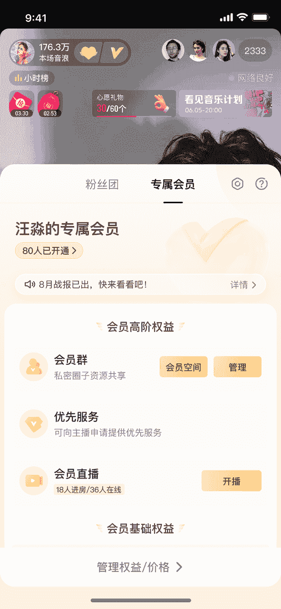

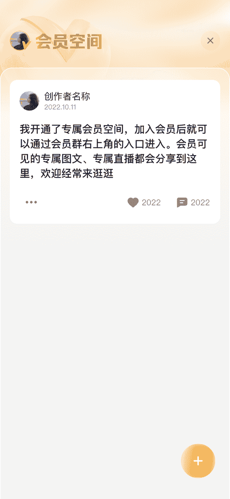

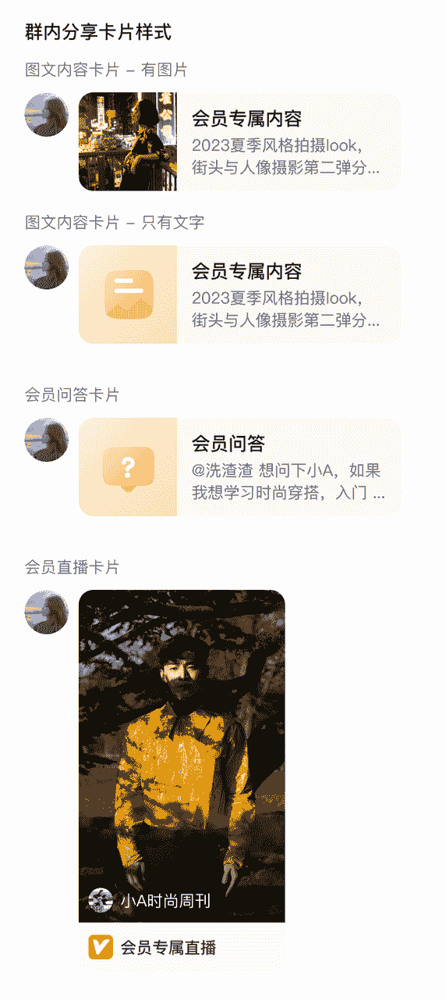

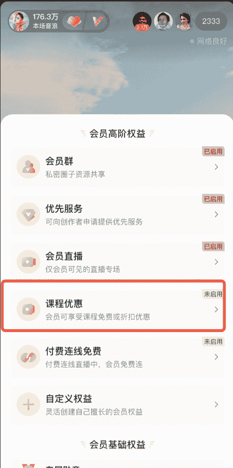

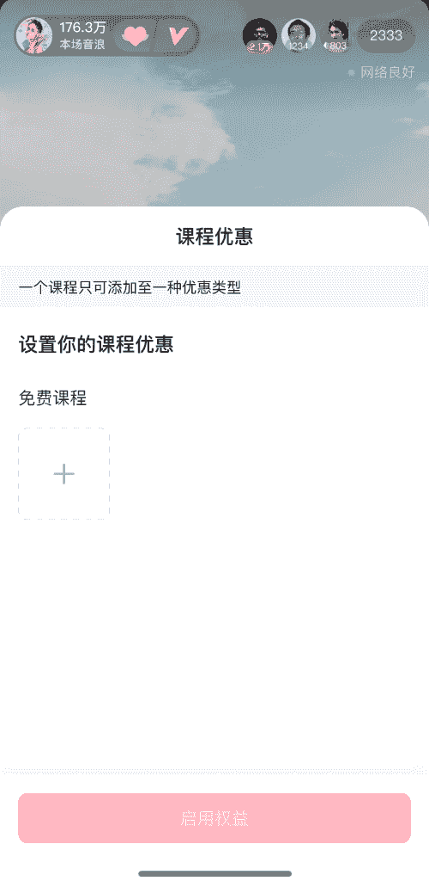

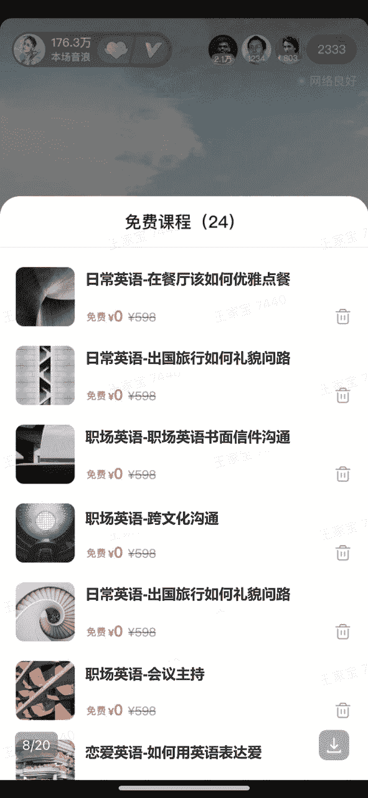

开启路径：`抖音APP-我的-创作者中心-全部-专属会员`

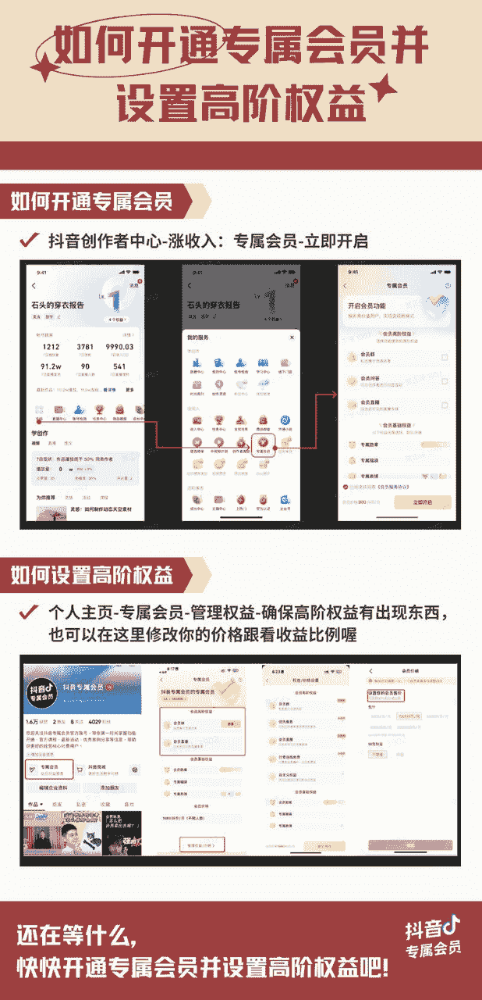

## 7.6 付费视频和直播怎么弄？

+   介绍：付费内容，是抖音支持创作者变现的一种工具与手段。生产者可以将自己擅长且合规的内容，以视频或直播的形式进行售卖，用户付费后方可进行观看，从而实现原创内容的直接变现。

+   [付费内容创作者手册（对外版）](https://bytedance.larkoffice.com/docx/EbOMdrXFsogaZ0xNQEocX8uIn5c)骤：详细开通条件、售前售后操作、经营方法见文档：

+   注意事项：选择适合自己的变现方式最重要，付费内容需注意内容的质量和稀缺度，避免引发负面效果和粉丝的负面情绪。

| 内容形式 | 内容形式&amp;预期收益 | 示例 |
| --- | --- | --- |

| **付费直播** | +   模式：针对高价值“学员”，通过“售后服务”转为直播形式内容服务，如专属付费小班课（`1v10`/`1v20`等），小班课通常采用高定价，课程内容更具针对性面向深度粉丝，有极高粉丝粘性。 |  |

| **付费直播** | +   模式：为付费粉丝提供咨询服务，可以使用付费直播 匹配连麦、聊天室等体验，对用户进行指导。此外，头部创作者还可提供价格不菲的`1对1`/`1对多`的小圈子直播内容分享，针对性解答问题/交流经验。 |  |

| **付费视频** | +   模式：为付费粉丝提供强叙事的连贯性内容，把内容拆成“碎片化钩子+分层付费”。如单集解锁、抢先付费看，此外，根据高净值用户需求还可衍生出定制剧情、专属番外等 | 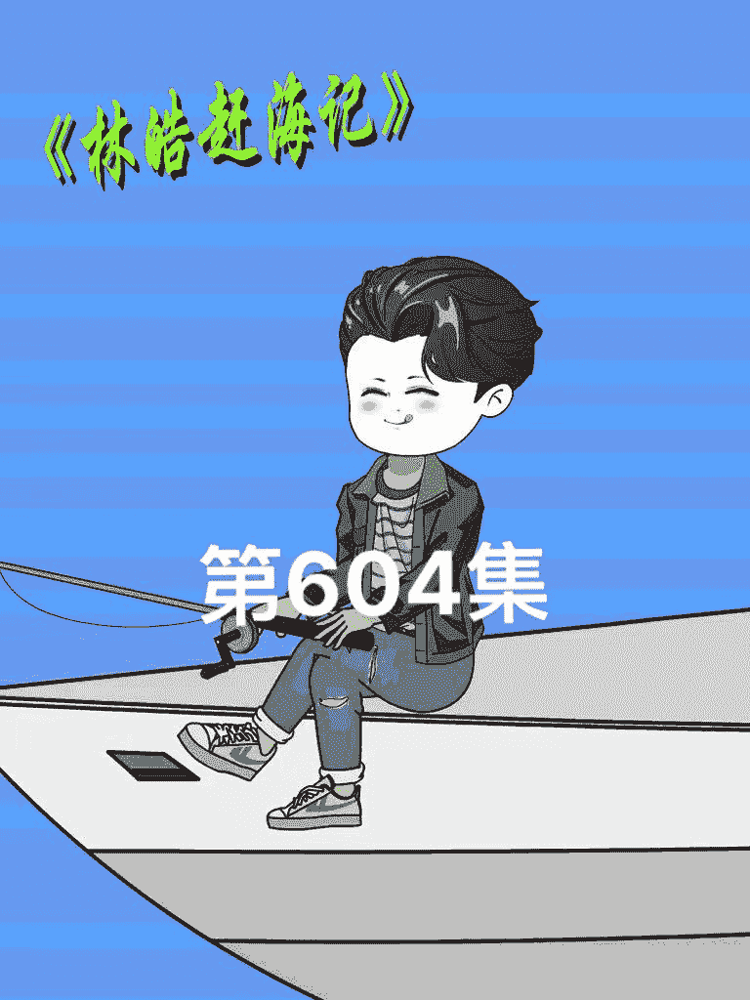 |

| **大型演出** | +   模式：承接大型演出进行线上付费，以稳定的性能与基础直播能力，为大型演出机构&剧场/小型剧场提供“舞台”。交付形式可采用付费直播、精品内容付费视频、录制内容线上首播等 | 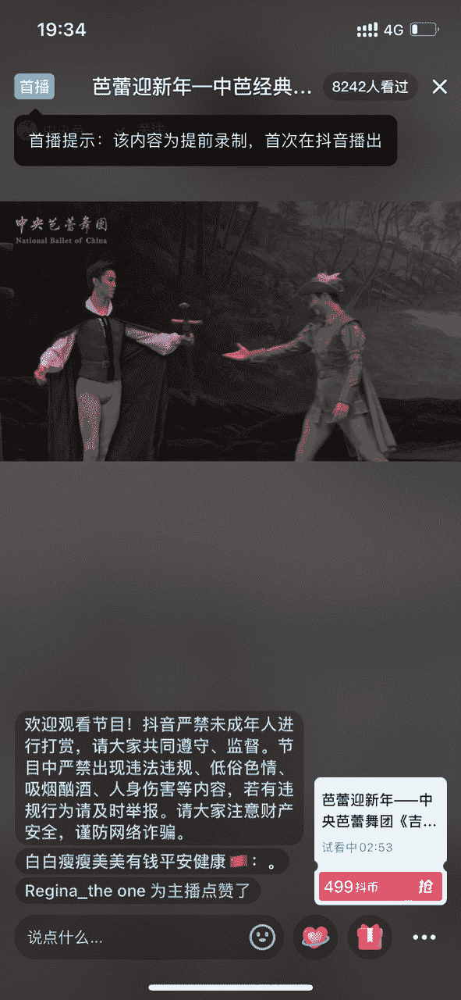 |

+   用户视角：稀缺课程，能提供更适合自己的个性化课程。
+   创作者视角：通常提高门票单价但不增加销量，采用小众化/圈子化运营策略，筛选高净值付费人群。
+   用户视角：能满足用户更强的咨询需求。
+   创作者视角：创作者可以为购票用户提供专属问答互动，有更好的用户服务及互动效果。
+   用户视角：持续追更的沉浸感。
+   创作者视角：降低试错成本，并可创作者通过悬念设计（如每集结尾留钩子）培养用户习惯，形成“定期打卡”的心理依赖，增强参与感，平衡即时满足和长期黏性。
+   用户视角：打破地域限制，同时获得更良好稳定观看体验。
+   创作者视角：通过线上化、常态化运营，提升线上`ip`声量，也为自身整体营收提供增量；

## &、致谢

> 手册指导：顾文豪
>
> 手册作者（按首字母排序）：
>
> 白舒悦       崔思滢       杜会堂       邓娅男       焦    阳       李清波       李英志       马圣行
>
> 孙小靖       史炎荣       王伟鹏       万贤浩       杨一骊       邹晨明       张    平       曾韵琪
>
> 毛    敦
>
> 反馈联系：史炎荣
>
> [如对该手册有反馈与建议，欢迎](https://survey.zijieapi.com/q/250428/kv526Bq4/8658/#/)填写：抖音知识作者成长手册调研问卷
