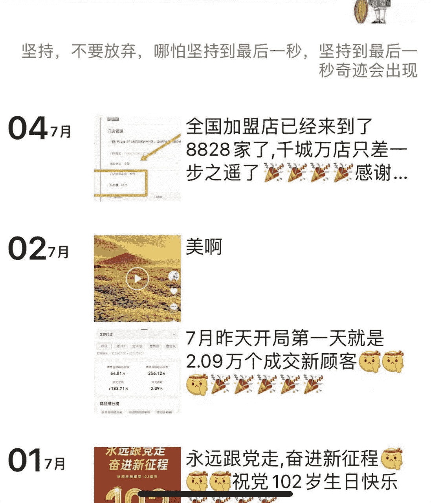
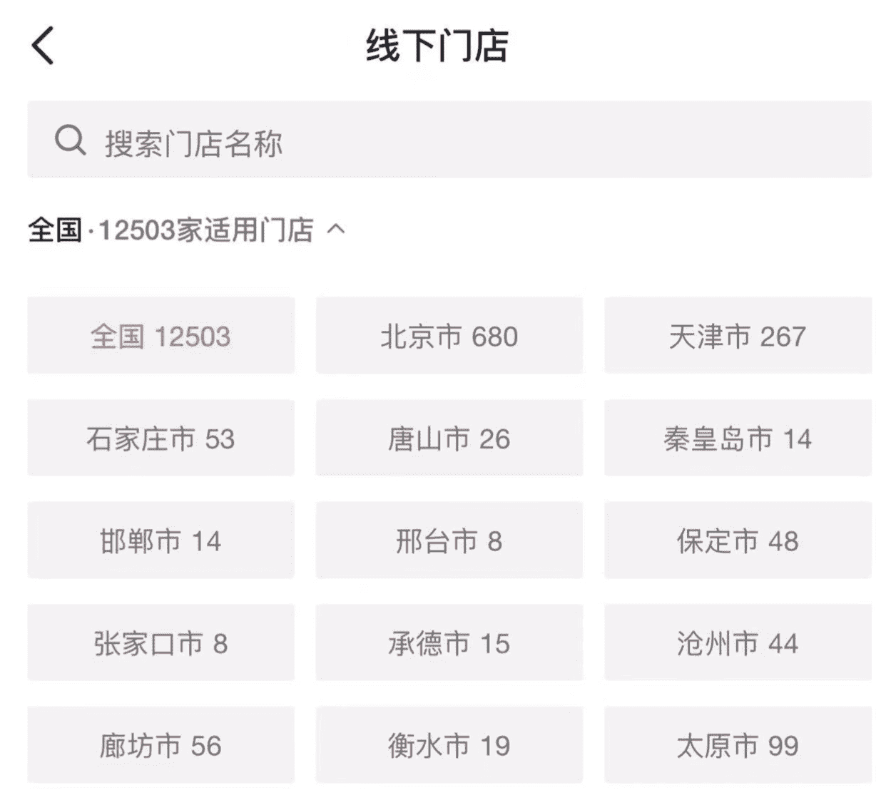
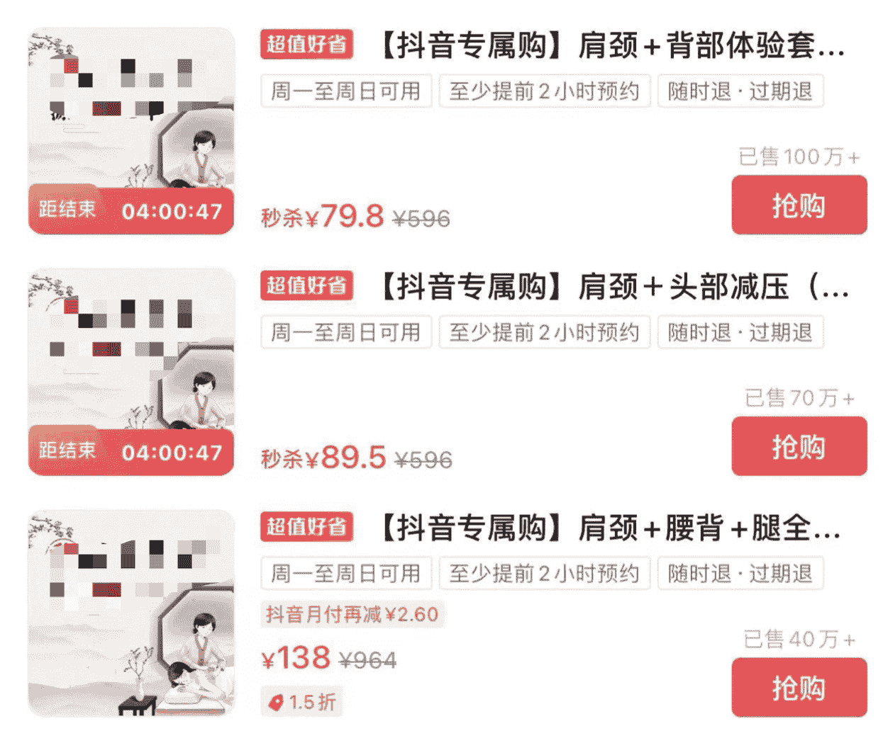
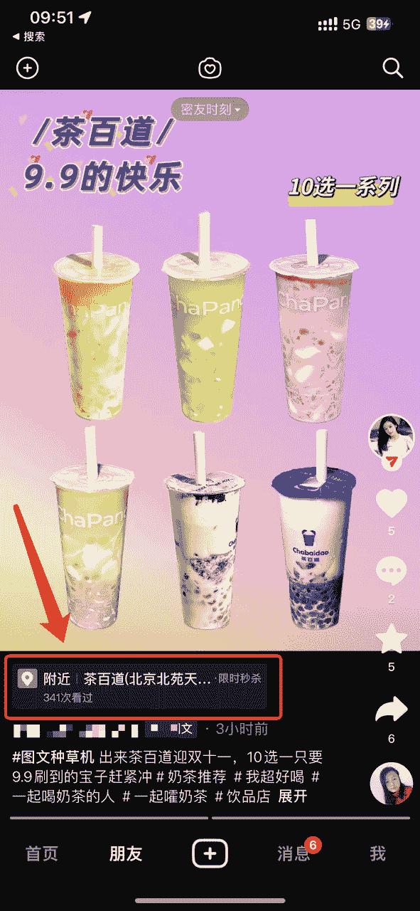
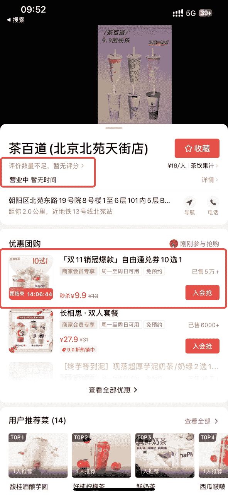
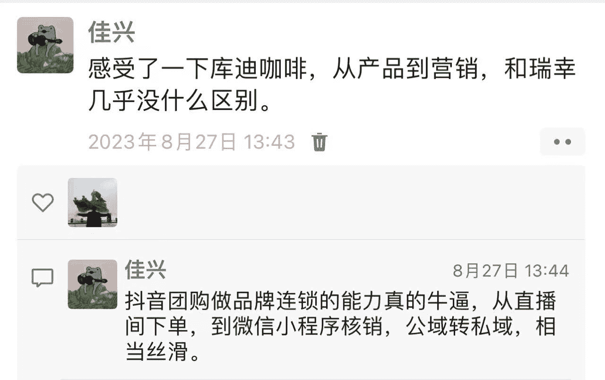
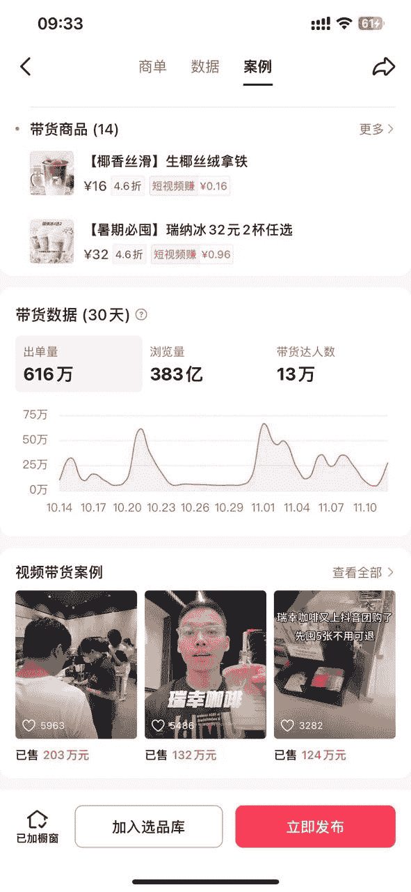
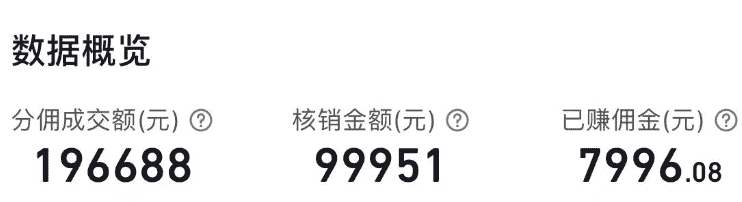

# 抖音云连锁，一年时间千城万店是怎么做到的？

> 来源：[https://xuqiwei1986.feishu.cn/docx/S7JIdAIQ7ogmiOxjek9cSh18naf](https://xuqiwei1986.feishu.cn/docx/S7JIdAIQ7ogmiOxjek9cSh18naf)

### 一、案例先行

有一个美容美体品牌，2022 年底开始做抖音云连锁，用了半年多时间，新增 7000 多家联营店，下图是他们一位高管 7 月份的朋友圈。

我刚刚去抖音看了一下，目前这个品牌的连锁店规模已经达到 12503 家了，相当于用了不到一年做到千城万店，实在厉害（我截图完 30 分钟又新增 1 家门店，最新数据应该是 12504 家）。

保守估计，这个品牌的抖音团购引流品累计销售已经 300 万单以上。

这，就是抖音云连锁的速度！

### 二、自我介绍

赚钱的朋友们大家好，许久不见，甚是想念。

我是咱们龙哥盟五期老圈友了，2019-2020 年比较活跃，折腾过各种小项目，当时还有幸加入过龙珠俱乐部（第一代航海家俱乐部），结识了很多非常靠谱的老朋友。

后来随着女儿的降生，自己赫然成为家里的顶梁柱，在没有更好选择的情况下，选择了深耕职场，至少还有个稳定的收入能养家糊口。也因此错过了 2021 年的抖音电商带货和 2022 年的视频号电商带货。

老朋友应该知道，我曾经是个产品经理，一直在做帮助商家运营私域流量的 SCRM SaaS 产品。做到 2022 年末，看着系统里越来越臃肿的功能，做不下去了，因为我发现一个悖论：我们这些蹲在办公室里从没做过生意、赚过钱的产品经理，凭什么能设计出帮助商家把生意做好的软件呢？纯靠天赋异禀？

因此，我 2023 年初下定决心走向流量一线，不愿继续坐在办公室里 YY 用户需求。于是在航海教练 Erik 的带领下，尝试了视频号直播、📕电商等不同项目，但是都没拿到预期的结果（当时的目标是月入 2w）。我发现这种互联网流量型项目有一个很大的问题，就是作为个体，很难拿到确定性结果，说到底就是在用数量在搏平台概率。

电商爆单的快感刺激着每一个人的神经，但无货源电商个体赚钱的概率太低了，卷的要死，新手入行可能钱没赚到，心态先崩溃了。我判断自己目前还不适合走这条路，希望能找到一种普惠性的，更能拿确定性结果的行业和赛道。

正当我迷茫的时候，突然想起了王一的爸爸（商家岛老板）和旭教练，在做帮助线下商家搞线上营销的生意，这也刚好是我看好的行业方向。于是一个电话打过去，想看看有没有什么好的机会，经过短暂沟通，一拍即合，我启程去了杭州，但岗位做了妥协，没能直接上前台搞流量，依然只能在后端做做产品、画画原型。

但这依然不妨碍我对市场的敏锐嗅觉，我发现商家岛的很多客户依然在用非常落后的营销方式，要么就是线下发传单，要么就是发发朋友圈，一个画风非常 low 的 H5 裂变网页都能让他们如获至宝。

我就在想，商家岛能通过“老带新”私域裂变的方式帮助商家搞客户，那如果商家是新开店的，没有老客户呢？

如何能帮助商家从 0 到 1 引来新客呢？

这时候，我注意到抖音本地生活刚好能解决新客引流的问题，于是翻遍了龙哥盟，以及其他渠道能找到的所有相关文章。

没想到越看越起劲，我发现抖音本地生活蕴藏着巨大的商业机会，这是抖音在兴趣电商领域拿到巨大结果以后，对团购行业的跨维度竞争。

短视频和直播的场景化还原和种草能力，既然能在电商领域获得巨大成功，那么在团购领域依然可以用同样的方式再打一遍，甚至会更有优势。

因为很多线下服务，也非常的新奇特，如果没有人跟你介绍和描述，你也不知道，原来还有这种服务，这里面充斥着信息差和价格差的生意。

于是我就告别商家岛，去了刘杰老板的家政公司做抖音本地生活。

这里面还有个小插曲，当时由于我转变的步子迈得过于大，换行业、换职业不说，工资还直接从 2 万降到 4000 底薪（另有销售额提成）。虽然我对这次职业变换有着迷之自信，老婆还是闹着要跟我离婚，觉得我决策过于冲动，跟我过日子提心吊胆，太心累。

我当时真的非常痛苦，一个人打拼再苦再累都没事，就怕家人还不支持、不理解，于是我给老婆立下军令状，给我三个月时间，一个月内做到月入过万，三个月做到月入两万，做不到的话你说怎么办都行。

于是就这样绑着炸弹上车了，幸运的是，我进入状态很快，真的第一个月就拿到了非常好的业绩（新增了 1000+ 个短视频和直播达人，GMV 破百万），再加上老板赏识，我在公司自由度很大，做了非常多的事情。

虽然后来因为各种原因，还是没能在公司拿到 2 万的薪水，再加上女儿每天在视频里说想我，心理压力很大，继续下去钱和陪伴都无法给家人，于是选择了离职回京。

6 月份我给大家分享过一个抖音本地生活家政行业的案例 <https://t.zsxq.com/14GAb7Hub>，当时虽然拿到一些不错的结果，但是由于行业经验尚浅，还没有经历长时间的大量实操，因此笔下的内容显得有点空洞，读者只能看出来这个玩法很厉害，却没办法学到太多实质上的东西。

那，经过半年的一线实战，我带着经过时间考验的思考和经验，继续来跟大家聊聊抖音本地生活的操作玩法，希望能给实体行业，或者想做实体行业的老板们，提供一些有用的信息和经验。

下面正文开始，Enjoy!

### 三、项目实操

为了避免理论知识太枯燥，我将分别通过不同角色、不同视角来给大家揭开抖音本地生活的神秘面纱。

抖音本地生活这个生态里，现在主要存在四个关键角色：

1.  抖音官方平台

1.  提供商品/服务的商家，根据规模不同又分为：

1.  单店商家

1.  区域连锁品牌

1.  全国连锁品牌

1.  品牌加盟商

1.  探店达人，根据工作方式的不同又分为：

1.  实探达人

1.  云剪达人

1.  直播达人

1.  抖音服务商，根据能力的不同又分为：

1.  商家全案代运营

1.  短视频代运营

1.  直播代运营

1.  达人团长

平台方就不说了，本地生活团购业务是一个万亿级市场，以前只有美团一家独大，抖音就是想在这个市场里和美团分蛋糕。

站在个体商家角度，我们怎么能在抖音这一波平台级流量红利中，拿到结果呢？

很多人都梦想着开店当老板，那么当你不知道要开什么店，做什么生意赚钱的时候，大多数人的选择，或许都是加盟一个看起来能赚钱的品牌对不对。比如你想开一家奶茶店，那很大概率就会被蜜雪冰城所吸引，又比如你想开一个自习室，那很大概率就会被楠姐所吸引。

蜜雪冰城奶茶店和楠姐的自习室为什么能吸引你？无外乎是这几点原因：

+   有品牌形象优势，能让目标客户优先选择在你这里消费

+   有供应链优势，能帮你解决后端产品/服务问题

+   有营销优势，能教你、带你甚至帮你引流获客

正如上面所讲，每个连锁品牌都有自己的优势，但品牌的核心优势只有一点：能不能让加盟商更快回本，更快赚到钱。

那，抖音连锁品牌，能不能让加盟商快速赚到钱呢？

我们一起来玩个小游戏，现在，我的身份为美容院品牌方，而读文章的大家则是我的意向加盟商，我将通过下面的介绍来告诉你，为什么加盟我是一个能快速赚到钱的好选择。

我创办了一家美容院，经过长时间的经营打造了多个热销产品和服务套餐，我有一个销量特别高的 79 元引流产品，而且打磨出一套完善的到店升单流程，只要客户到店，我就有五成把握让客户办卡充值，老客户粘性也比较高。

以前我都是通过发传单和大众点评获取新客户，但现在随着同行越来越多，越来越卷，新客获取成本也越来越高。

于是，在龙哥盟精华帖的启发下，我开通了抖音来客，成为一名抖音本地生活商家，经过半年的努力探索和研究，我的引流产品在抖音卖了 1w 单，而且掌握了抖音本地生活商家流量密码，能够用极高的投产比获取新客户。

这时候，我的第一家店已经可以稳定获客，持续盈利，于是我开了第二家店，以品牌连锁店的方式，也上了抖音团购。

这时候我发现一件神奇事情，我的第二家店商品销量继承了品牌总销量，引流产品直接就是销量 1w 单，而且我第一家店的短视频流量、搜索流量和直播流量，竟然神奇的也覆盖了第二家店，让我的第二家店开业即有订单，妙不可言。

经过研究，我发现抖音本地生活业务，品牌连锁店有巨大红利：

1.  团购商品多店铺销量共享

1.  短视频智能推荐距离用户最近门店

1.  团购详情页智能推荐最近门店，并展示所有可用门店

举个例子，我人在北京，今天早上在刷抖音的时候，刷到一个河南朋友的团购带货视频，她视频发布时推荐的门店是河南的一家门店，但是我刷到的时候，就变成了离我最近的北京的门店推荐。

河南地区的抖音账号，推荐河南的门店

我在北京刷到这条视频，就给我推荐了北京离我最近的门店

这个门店没有做什么店铺装修，目测是一家新店，但是热销品销量为 5w+，给人的感觉就很靠谱

这意味着什么？

我在抖音上的连锁门店越多，流量就越不会被浪费，因为抖音最大的特点就是算法多变，流量不可控。最理想的状态是，任何一个刷到我们短视频的人，都能在附近三公里找到我的线下店，并到店消费。

也意味着，我每开一家新的连锁店，成功几率都会大幅提升，因为可以将品牌方的引流能力低成本赋能给每一家新店，抖音营销的边际效益递增。

于是，我把我的后端供应链能力和前端营销获客能力打包成标准化产品，开放全国招商加盟业务，以品牌直营 + 三方联营 + 新店加盟的模式，快速开始扩张。

由于我们产品优质，经营模式和经营效率上又有优势，可以保证客户省钱、加盟商家赚钱、品牌方也赚钱，三赢。

还记得我前面说的吗？大部分线下传统商家，线上营销能力几乎为零，我们品牌联营店所到之处，几乎可以靠着极高的营销能力迅速垄断当地市场，对其他品牌造成降维打击。

我做了两个关键动作，将这种营销效率提高到最高：

1.  搭建短视频矩阵，持续给连锁门店做短视频曝光和定点爆破

1.  自建素人矩阵

1.  员工矩阵

1.  达人矩阵

1.  打造品牌官方直播间，客户看完短视频后，可以进入直播间做进一步了解，提高下单转化率

1.  官方直播间

1.  无人矩阵直播间

1.  合作达人直播间

而且由于我持续发短视频做话题曝光，每个客户在抖音搜索「按摩」关键词，排在前面的视频和团购产品都是我的。

于是，我可以进一步降低整体经营成本，提升经营效率，一个抖音品牌增长飞轮就这样转起来了！

现在，我拿出一套方案，针对所有看好美容美体行业的个体户，你看看是否抵抗得住：

1.  假如你是个拥有一家/多家美容院的老板，正好在为线上流量营销发愁，那可以通过缴纳 5800 元/年的品牌使用费，入驻抖音成为我的子品牌，使用我的供应链，享受我的品牌流量加持，我可以承诺每个月给你引流至少 20 个新客到店；

1.  假如你是个有点存款，想开店创业的铁子，只需要缴纳 5800 元/年的品牌使用费，19800 元的开店经营培训费，即可成为我的加盟商，不收取额外加盟费。我将教你选址、设计、装修，采购设备和物料，给你进行线上运营和线下经营培训，保证你开业即有到店流量。

当然了，真实的加盟和联营一定有很多限制条款，各自的责任和义务等等，这里就不展开讲。

而且，大家别忘了，我还是个资深私域产品经理，深谙🛰️生态的各种工具和经营玩法，于是我搭建了品牌🛰️小程序和会员积分体系，并基于用户手机号和抖音进行了订单打通。

然后联合所有门店，把客户都加到了企业🛰️中，将抖音引流来的客户留在了我的私域系统里，做到了公私域一体化经营，把每个客户的 LTV 都做到了行业最高。

库迪咖啡就是这么操作的，自 2022 年 10 月 22 日首店开业，到今天也就短短一年零一个月的时间，也已经发展到 5000+ 门店。

库迪咖啡一上线就掏出了 8.8 一杯的抖音团购价，瞬间引爆市场，很多做团购达人培训的讲师，都是把库迪咖啡当成对标案例来讲，爆起单来相当恐怖。逼的瑞幸也降价到 9.9，造福了一众打工人，我现在几乎是只喝瑞幸和库迪了。

瑞幸咖啡发展这么多年，1w 多家门店也在情理之中，毕竟是明星级互联网消费品牌了。但库迪咖啡一年时间开起 5000+ 门店，抖音团购功不可没，他可是连独立 APP 都没推广过的品牌。

抖音本地生活，通过一个个真实案例告诉我们，做生意，来抖音，做品牌，更要来抖音。

双十一，是电商购物狂欢节，但你不知道的是，在双十一这天，肯德基光达人带货就卖了 31.44 万单团购券，算上官方直播的话，保守估计是卖了 35 万单以上。这里面就有我贡献的一单 69.9 十件套，我现在出门吃喝玩乐都要在抖音搜一下有没有团购券。

肯德基的达人带货数据

瑞幸咖啡的达人带货数据

### 四、抖音本地生活掘金的机会有哪些

通过上面的介绍，相信你已经了解到抖音本地生活的威力，这里面有哪些赚钱的机会呢？

我最看好的，就是做品牌的机会，如果说 10 年前做品牌创业是需要开发 APP 自己做平台，那么今天做品牌创业只需要在抖音、🛰️、美团这些大 APP 上做流量经营即可，甚至前期不需要程序员就能开始创业，这是经营者的时代红利。

如果你是一个有着线下生意和资源的老板，就很适合做品牌，然后通过抖音 + 私域把生意盘子快速放大。

其次，是做代运营服务商的机会。抖音充满了信息差，简单到商家怎么在平台入驻，怎么上架团购商品，都能难倒一大批人。难度更高一些的，比如怎么找达人探店？怎么做短视频？怎么做直播？怎么做店铺评分？怎么做 SEO？每个板块都需要钻研和积累。这都是服务商们的机会。

然后，还有做培训和知识付费的机会，比如很多老板不想代运营，想自己做，那就会有学习、上课、混圈子的需求。就比如咱们都是喜欢赚钱的朋友，所以大家都来了龙哥盟。

有些朋友可能会说，上面这些都太难了，有没有适合新手做的方向？

当然有了，而且需求量还很大，那就是抖音团购达人。团购达人是链接品牌和消费者的桥梁，是这个行业的基础设施。因为抖音是内容平台，商家开通了店铺、发布了商品，需要内容为载体传递给消费者，而达人短视频就是这里面最重要的载体。

普通人可以通过做团购达人，低成本快速进入本地生活行业，一边赚点小钱，一边积累行业知识。还有很大概率成为当地探店 KOC，每天接几个探店商单，月入 2 万不算难，吃喝玩乐不花钱，时间还自由。

我现在运营着全国各地几千个达人，大家都能赚到钱，小到几块钱的剪辑费，几百块的探店费，大到团购爆单后的千元、万元佣金。这几乎是现在最普惠的项目，只要努力就能拿到结果。

以上，由于项目环节较多，无法在一篇文章里写清楚每一个细节，更希望起到抛砖引玉的作用。

我是佳兴，前前程序员，前产品经理，现抖音本地生活实操者，如果你有本地生活相关的问题或者思路，欢迎和我交流。