# 2023-11-07我用 AI + 编程拆解了破局 300+ 精华文章，我惊呆了！

> 来源：[https://xuqiwei1986.feishu.cn/docx/ZsOydZSR0oEf98xL86Oc17DGnxe](https://xuqiwei1986.feishu.cn/docx/ZsOydZSR0oEf98xL86Oc17DGnxe)

> 🔗 原文链接： h[ttps://articles.zs](https://articles.zsxq.com/id_wu8tqxikt3wo.html)xq.com/id_wu8tqx...

>

大家好，我是破局合伙人木川，一颗 Al 之心获得者，专注分享 AI 编程，主业写代码，副业探索 AI 超级个体；目前正在参加皮特老师的第五期写作训练营，感谢皮特老师的耐心指导！

洋哥一直讲做个人 IP 需要定位、对标、执行，有了定位，我们需要找对标，那对标怎么找呢？

身为程序员出身的我，想到使用 AI + 编程拆解破局 300+ 精华文章，看看能发现什么？所以就有了这篇文章

直到今日（2023.11.07），破局共产生了 328 篇精华文章，本篇文章的分析结论也是拆解 328 篇文章后得到的，拆解流程主要是通过AI + 写程序完成

本文将首先介绍拆解成果，然后再介绍拆解流程，大纲如下：

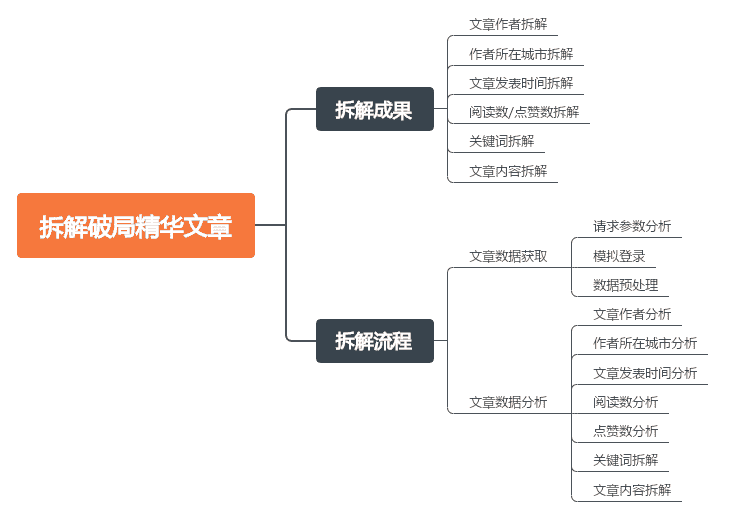

# 一、拆解成果

## 一）文章作者拆解

所谓对标就是要跟对人，找到比你强的人，对于 AI 破局星球而言，就是要找到这里精华文章最多的人

我用 AI 辅助编程，获取到每一篇文章对应的作者，然后统计了每个作者的精华文章数，以下是 top 10 的精华文章作者

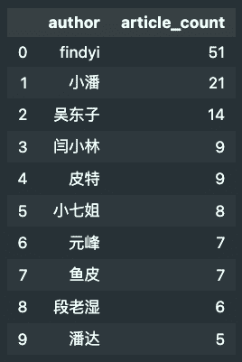

这些人是星球的 top 10 大腿，当然还有很多已经冉冉升起的大腿，比如台风、冯帅、卡尔、陈天等，可以发现这些人都很脸熟，因为他们都是群红，之前小林老师也说过要先成为群红，然后一步步成为大腿。

洋哥还说成功 = 贵人 + 超强的执**行力，这些大腿有**可能就是你的贵人，所以 要成功先抱紧大腿

## 二）作者所在城市拆解

**从精华文章作者**所在城市来看，一线城市居多，还是 大城市人才多 。

对于年轻人，刚毕业还是建议去到一线城市，那里有更好的资源和人脉，一线城市吸引了大量的人才和企业，意味着更多的机会，比如洋哥就在北京，我就有幸和洋哥有过一次面基的机会

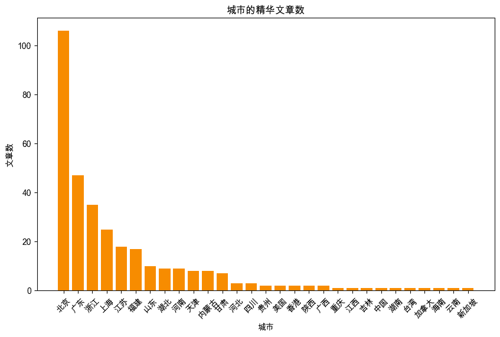

## 三）文章发表时间拆解

大家都想要拿精华，那精华文章发表时间有什么特点吗？应该哪个时间发表呢？

我拆解了 328 篇精华文章，统计了每篇文章对应的发表时间，发现发表精华文章最多的 4 个小时是 22 点、23 点、16 点、0 点

这个说明了什么？ **破局有很多夜猫子 **，大家都不容易，熬过很多个夜晚 😄

选择 16 点、22 点 发表文章或许是个不错的选择，但主要还是要靠文章的质量取胜，细节属于锦上添花的东西

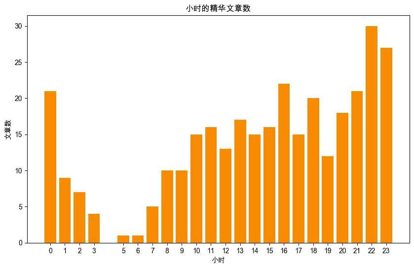

## 四）阅读数/点赞数拆解

1、精华文章的阅读数分布，中位数是 6966，意味着只要你的文章被评定为精华，平均有 7000 左右的阅读量，这个曝光已经算是非常高了。

**公众号 大 v，公**众号日均阅读量 才 1w 多点，所以坚持 在星球输出文章吧 ，你会获得大量的曝光，然后不断出圈

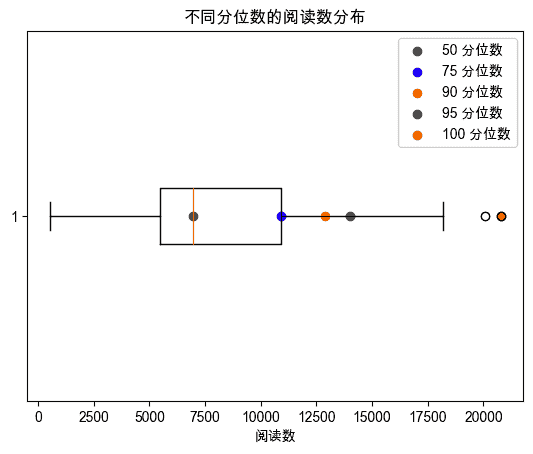

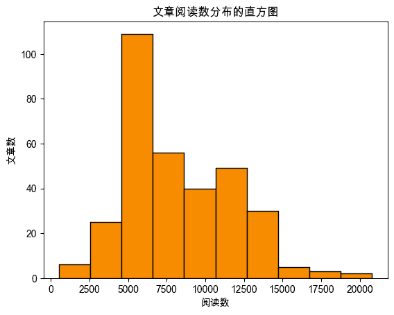

2、精华文章的点赞数分布，中位数是 152，意味着只要你的文章被评定为精华，平均有 150 左右的点赞，如果你是群红，可能会更多

所以混个脸熟，和大佬链接链接，点赞数说不定会提升不少

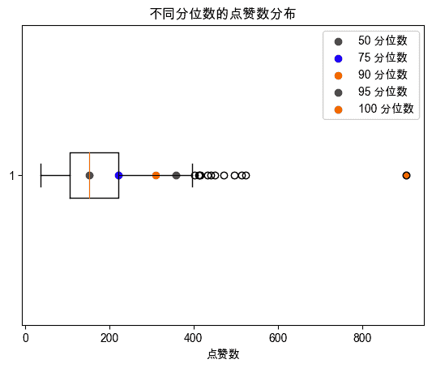

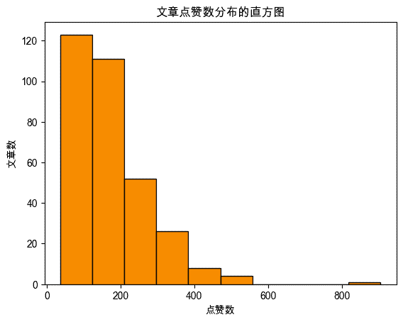

3、阅读数和点赞数 top 10 的文章，取个交集，你会发现什么？

小林老师、潘达、刘驴太强了，阅读数和点赞数双双进入前十

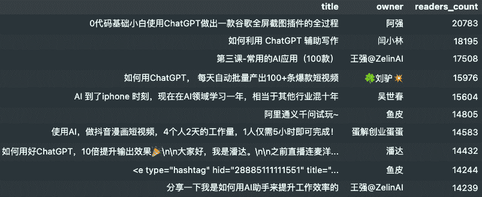

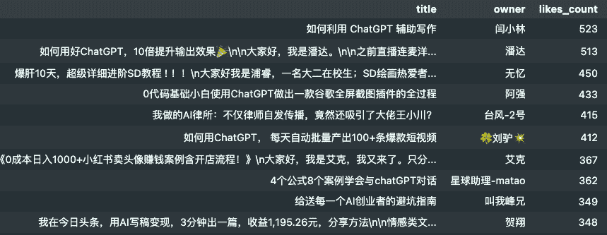

## 五）关键词拆解

**围绕关键词布局 **，做核心的事情，而不是什么事情都做

将精华文章的标题进行结巴分词，然后统计每个词的频率，绘制词云分析图

比如 标题 “为啥我打算，重新做一家一人企业” 分词结果为 [为啥 , 我 , 打算, 重新, 做, 一家, 人 , 一人 , 企业]

经常出现的关键词：ChatGPT、变现、AI、企业、Prompt、指南、知乎、小白、写作、风向标等

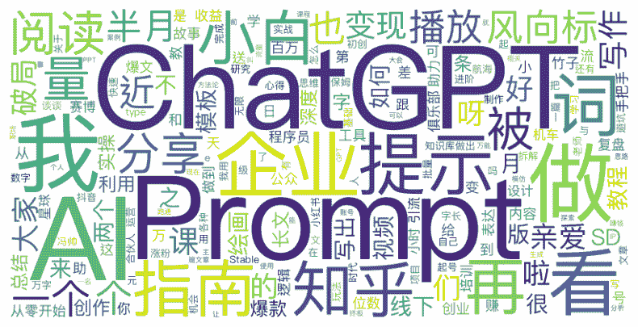

## 六）文章内容拆解

使用 AI 辅助总结了 10 篇文章，分别是阅读量比较高的文章 + 破局精华文章数 top10 作者的文章

### 1、0 代码基础小白使用 ChatGPT 做出一款谷歌全屏截图插件的全过程

作者：阿强

文章链接： [h](https://articles.zsxq.com/inline_form/id_grll0r3ej4uk.html)ttps://articles.zsxq.com/inline_form/id_grll0r3ej4uk.html

总结：

这篇文章描述了一个完全不懂编程的新手如何使用ChatGPT来创建一个Google Chrome浏览器的插件，其中的关键是实现网页截图的功能。以下是文章的主要内容摘要：

1. 作者是一个完全不懂编程的新手，没有任何代码基础。

2. 作者记录了他的操作过程，特别是使用ChatGPT的经验。他提醒读者，不要将本文直接作为编程教程，因为他是在零基础的情况下探索的，可能走了一些弯路。

3. 所有的操作都在Windows系统上完成，作者列出了所需工具，包括ChatGPT-3.5和科学上网工具。

4. 作者得知关于使用ChatGPT创建Chrome扩展插件的想法后，决定尝试并记录这一过程。

5. 第一步是设置小目标，即创建一个名为“网页截图”的Google扩展插件。

6. 作者试图通过ChatGPT获取代码，但他不知道如何使用它。

7. 作者通过ChatGPT的帮助明白了需要使用Chrome插件开发工具，并试图将代码复制到其中。

8. 在创建插件的过程中，作者遇到了一些问题，如拼写错误，但ChatGPT能够理解并提供一些链接。

9. 作者尝试改变提问的方式，请求ChatGPT一步步教如何开发一个Google浏览器插件。

10. 他按照ChatGPT提供的提示创建了manifest.json文件，使用记事本创建其他必要文件。

11. 作者在完成一系列步骤后，成功加载了插件，但它最初只显示“Hello World”。

12. 作者认识到代码可能有误，因为他没有清楚说明他想要创建一个网页截图插件，于是重新向ChatGPT提问。

13. ChatGPT提供了一些代码段，作者替换了之前的文件，最终成功创建了一个Chrome浏览器插件。

14. 作者总结了他的尝试，并感谢读者的阅读。他表示希望在下次尝试中能够学会滚动截取整个网页。

文章记录了作者在不懂编程的情况下，通过使用ChatGPT成功创建了一个Chrome浏览器插件的过程，强调了ChatGPT在帮助初学者方面的潜力。

### 2、如何利用 ChatGPT 辅助写作

作者：闫小林

文章链接： [h](https://articles.zsxq.com/inline_form/id_9xwa8p22hqhe.html)ttps://articles.zsxq.com/inline_form/id_9xwa8p22hqhe.html

总结：

这篇文章主要介绍了如何利用ChatGPT辅助写作的方法和技巧。文章分为十四个部分，涵盖了写作的核心、写标题、写摘要、写正文、写结尾等各个方面。作者提供了一些建议和实际案例，以帮助读者更好地应用ChatGPT进行写作。

总结文章的内容如下：

1. 写作核心：文章的核心在于准备好文章大纲，包括多级标题大纲，提前明确文章的结构和主题。

2. 写标题：标题的选择对文章吸引读者非常重要，建议引入SEO和关键词来提高文章的流量。

3. 写摘要：摘要在文章中的重要性，建议明确主题并限制字数，以帮助读者更好地理解文章。

4. 写正文：正文的核心是提炼主题和各级标题，以确保逻辑清晰和内容有序。

5. 写结尾：结尾是文章的收尾，需要对主题进行升华，作者提供了一些建议。

6. 好文章要素：文章的要素包括数据、干货和逻辑性，这些要素可以提高文章的质量。

7. 如何排版：作者分享了排版细节，包括文字大小、段落长度、颜色等。

8. 写作共性问题：文章解决了写作中常见的问题，如不知道写什么、文章没有逻辑、容易自我感动和阅读体验差等问题。

9. 常用写作方法：文章介绍了五种常用的写作方法，包括时间型、步骤型、问答型、感想型和课程系列型。

10. 见感思行：作者提到了“见感思行卡片写作法”，并给出了一个实例，帮助读者更好地应用这种方法。

文章总结了如何使用ChatGPT进行写作的各个方面，为那些希望提高写作技巧和质量的人提供了有用的建议和方法。

### 3、星球快闪分享：从0到1，搞定 AI 自媒体写作！

作者：皮特

文章链接： [h](https://articles.zsxq.com/inline_form/id_xdfv81lzgwpo.html)ttps://articles.zsxq.com/inline_form/id_xdfv81lzgwpo.html

总结：

这篇文章主要介绍了如何利用AI来提升自媒体写作的效率和质量。文章作者分享了他在几个月内如何使用GPT-3等AI工具来提高他的自媒体写作水平的经验和成果。

文章包括以下主要内容：

1. 基本指令词写法：作者强调了在使用AI写作时，编写明确和具体的指令词的重要性。他介绍了一个名为"BROKE框架"的指令词结构，包括背景（Background）、角色（Role）、目标（Objectives）、关键结果（Key Result）和试验并改进（Evolve）。这有助于AI生成更符合预期的内容。

2. 如何学习提示词：新手可以从简单的框架开始，然后逐渐学习更高级的提示词写法。作者建议查看其他专家的提示词帖子，以提高写作技巧。

3. AI写作的边界：作者指出AI工具的局限性，特别是在个性化和语言表达方面。他提到，在自媒体写作中，人设和独特性是很重要的，AI难以创造非常有个性的内容。

4. AI写标题：标题是自媒体写作的关键，作者介绍了一些撰写好标题的方法，包括好奇心、嘴替、痛点和展示价值。他还解释了如何使用AI生成标题。

5. AI选题：AI可以帮助自媒体作者选择合适的长期高价值选题和热点选题，从而满足不同写作需求。

6. AI写大纲：作者强调了写大纲的重要性，以帮助自媒体作者规划文章结构和内容。他提到如何使用AI生成文章大纲，并进一步优化和填充细节。

7. AI作为写作助手：作者分享了如何使用AI工具来思考观点、进行审稿和编辑、进行主题研究以及寻找灵感。

总的来说，这篇文章强调了AI如何成为自媒体写作的有力工具，但也提到了AI的局限性，特别是在涉及个性和创造性方面。文章为自媒体作者提供了一些实用的技巧和建议，以提高他们的写作能力。

### 4、如何用ChatGPT， 每天自动批量产出100+条爆款短视频

作者：刘驴

文章链接： [h](https://articles.zsxq.com/inline_form/id_e74ag3spe7d2.html)ttps://articles.zsxq.com/inline_form/id_e74ag3spe7d2.html

总结：

这篇文章介绍了如何使用ChatGPT来自动生成每天批量制作100+条爆款短视频的过程，总结如下：

1. 作者提到了目前流行的短视频平台，如抖音、快手、视频号，以及如何使用ChatGPT来快速生产内容。

2. 文章明确了需要解决两个问题：大量选题及脚本内容，以及自动生成视频。

3. 作者提供了三个步骤来实现这一目标：

- 第一步：找选题。使用ChatGPT提问，以获取20个关于抖音平台的热门话题，如"ChatGPT功能、ChatGPT引流、ChatGPT变化等"类目。

- 第二步：使用ChatGPT编写视频脚本。指定提示词，如"写一个短视频脚本，内容是关于如何利用GhaGPT功能提高视频曝光量？"。

- 第三步：一键生成短视频。将ChatGPT生成的文案粘贴到剪映APP中，使用"图文成片"功能生成短视频。在视频编辑页面，可以进行进一步的修改，然后导出生成的短视频。

4. 作者还提供了一个示例，说明如何批量生成与"儿童英文口语课"相关的视频。

5. 最后，作者分享了如何批量生成视频的步骤，包括使用ChatGPT生成多个选题、相应的视频脚本，并将它们批量处理后在剪映中生成多个视频。

这篇文章详细说明了如何使用ChatGPT和其他工具批量生成短视频，以便于制作内容并提高内容的生产效率。

### 5、使用AI，做抖音漫画短视频，4个人2天的工作量，1人仅需5小时即可完成！

作者：蛋解创业蛋蛋

文章链接： [h](https://articles.zsxq.com/inline_form/id_4kdt007pr5sd.html)ttps://articles.zsxq.com/inline_form/id_4kdt007pr5sd.html

总结：

这篇文章介绍了作者在制作抖音漫画短视频时如何使用AI，以及AI对工作效率的显著提升。以下是文章的主要内容总结：

1. 作者介绍了自己新创建的抖音账号“蛋解杂谈”以及迅速增加的粉丝数量。

2. 作者指出为了保持日更，一个抖音账号通常需要4-5人的团队，包括文案、漫画师、剪辑师和运营。

3. 为制作一条漫画视频，通常需要花费至少2天的时间，其中漫画师需要1天时间来绘制素材。

4. 作者描述了之前的工作流程，包括漫画师绘制线稿、上色、处理细节，剪辑师剪辑成动态视频。

5. 作者指出，尽管团队在制作账号内容方面有一套流程，但人员成本和时间成本都很高。

6. 最近，作者尝试使用AI来制作漫画视频，发现效率大幅提高。同样的内容和工作量，只需要1人操作，几小时内完成原来需要几天的工作。

7. 作者使用了AI软件 stable diffusion，输入关键词后，约40秒后生成了大量初稿漫画素材。

8. 进行简单的调整和数值校对后，生成高清素材图片。

9. 剪辑师将这些素材剪辑成视频，虽然剪辑部分仍需4-5小时，但作者相信未来会有更多的AI软件用于加速这一过程。

10. 使用AI能够显著提高工作效率，例如，30张素材现在平均只需2分钟生成，原本需要2人1天完成的工作现在仅需1人1小时。

11. 作者承认仍在学习如何使用AI，并需要不断调整和优化，但总体来说，AI的效率提升已经超出了他的想象。

12. 作者表示将继续尝试制作更多内容，并与读者分享新的进展。

### 6、一只￥4000的prompt订单：有需求就有价值

作者：小七姐

文章链接： [h](https://articles.zsxq.com/inline_form/id_92w3eawfsw1j.html)ttps://articles.zsxq.com/inline_form/id_92w3eawfsw1j.html

总结：

这篇文章总结了一个客户提出的自定义prompt订单，讨论了生成自定义prompt的思维过程和步骤。客户的需求是生成1000条有关美食的短句子，这些句子需要趣味盎然、俏皮灵动，能引起食欲，且不包括甜点、饮料、水果等。以下是文章的主要内容和步骤：

1. 描述了客户的需求，要解决晚餐选择的困难问题，提出了一个名为“晚餐盲盒”的小产品。

2. 详细描述了prompt的使用场景和要求，包括句子长度、文风、食材选择、比喻的使用等。

3. 引入了prompt的自迭代机制，客户要在20个句子中选择3个最好的，并提供理由，以便进一步改进。

4. 提供了一些范例句子，说明了为什么这些句子被认为很好。

5. 提出了思维链的步骤，以帮助生成符合要求的美食句子。

6. 最后，总结了客户对生成的句子的满意程度，并表示对“晚餐盲盒”产品的期待。作者还呼吁更多人分享prompt的用法和需求，以促进prompt的多样性和普及。

这篇文章强调了自定义prompt的可行性，通过详细的步骤和思维链方法，展示了如何满足客户的需求。同时，文章也呼吁更多人加入prompt的交流和分享，以推动这一领域的发展。

### 7、手把手教你制作3个月涨粉 46 W的“Al 数字人短视频 +CPS卖货”账号

作者：元峰

文章链接： [手把手教你制作 3 个月涨粉 46 W ](https://esouqpttmy.feishu.cn/docx/CEGqd7uPpoNVVqxxGR9cdmaznBb)的“AI 数字人短视频+CPS卖货”账号

总结：

### 8、 为啥我打算，重新做一家一人企业？

作者：潘达

文章链接： [h](https://articles.zsxq.com/inline_form/id_z9p06loqullu.html)ttps://articles.zsxq.com/inline_form/id_z9p06loqullu.html

总结：

这篇文章讨论了为什么要考虑重新创办一家一人企业，并探讨了如何实施这一计划以及关键逻辑。文章提到了在当今时代，企业和个人都面临高人力成本和人工智能对劳动力的影响等挑战。作者认为一人企业可能成为未来的趋势性选择。

文章明确了一人企业的经营理念，强调不仅适用于只有一个人的企业，而且即使在壮大后，也要维持一个人的模式，以"更好"代替"更多"，并不以时间换钱，而是通过产品化自己来实现。

作者还介绍了一些AI工具，例如企业名称生成工具、企业网站生成工具、创业想法指导工具等，用于帮助创办一人企业的过程。

文章还指出一人企业适用于不同情境，包括那些想摆脱大公司束缚、寻求更多自由度的人，以及那些希望在现有工作范围内成为内部创业者或寻求额外收入的人。

作者强调了创业目标的重要性，提出了如何找到自己最擅长和熟练的事情，并以此为基础制定业务计划。他建议快速发布产品，然后通过不断的发布、衡量和调整来打磨产品，而不是等待完美。

文章还提到了寻找利润的边界，强调利润高于支出的目标，并分享了一个关于一位司机师傅的故事，阐述了追求利润和保持生活质量的平衡。

其他关键观点包括保持专注、寻找可扩展的系统、维护客户关系、打造个人品牌以及学会分享。作者认为这些因素对于成功运营一人企业非常重要。

最后，文章鼓励人们在不确定的时代中增强自己的风险抵抗能力，不论是否选择一人企业的职业模式，都可以采用这种思维方式来获得更多的自由度和机会。文章的核心思想是在现代社会中，通过有效的思维和工具，个人可以创办一人企业，实现更好的工作和生活质量。

### 9、普通人如用利用AI打造自己的超级个体1.0

作者：段老湿

文章链接： [h](https://articles.zsxq.com/inline_form/id_z9p06loqullu.html)ttps://articles.zsxq.com/inline_form/id_z9p06loqullu.html

总结：

这篇文章是作者分享了他如何在AI领域进行自我探索和创业的经验。以下是文章的主要内容概括：

**自我介绍**：作者是一位央企电商业务项目经理，曾经是美业店创始人，目前专注于AI领域，并定下了三个小目标。

**1. 背景**：疫情影响了美业品牌，导致作者的美业店铺几近崩溃。因此，他决定加入AI领域，避免再次错失机会。

**2. 普通人入局AI的迷茫**：AI是新兴领域，普通人通常不知从何入手，因为缺乏相关的技能和知识。作者分享了自己的困惑，包括语言、审美、创意、技术等各个方面。

**3. 不要等，先动手**：作者决定从基础的AI绘画开始，参加AI绘画课程，但他的账号一直没有取得突破性的进展，让他感到迷茫。他开始思考AI的真正价值和魅力。

**4. 转机**：作者加入了破局合伙人后，洋哥的一句话启发了他。洋哥说AI的核心是让制作者聚焦于核心信息的制作，这让作者开始理解AI的潜力是帮助AI创业者生产所需的内容和资料。

**5. 验证**：作者试验了热点新闻并使用AI制作相关内容，成功获得了更多浏览量。他意识到流量、转化和产品是赚钱的关键因素，而他自己专注于流量。

**6. 超级个体1.0**：作者分享了如何与AI模型（类似ChatGPT）互动，提供关于自己的信息和需求，以获取有关内容创作的建议。他使用这些建议，包括图像、标题、文案和头像的制作。

**总结**：作者总结了他的方法，强调这一方法适用于各种自媒体领域。他还表达了他的AI创业目标，包括通过AI生产图文和视频，扩大规模，最终为各行业提供AI解决方案。作者认为自己帮助迷茫者建立个人定位和AI内容输出的思路已经构成了一种产品。

文章的主要观点是，AI可以成为一个强大的工具，帮助个人克服技能和知识的限制，实现自己的创业目标。作者强调了个人的定位和利用AI输出内容的重要性，以及AI在吸引精准用户和扩大流量方面的潜力。

### 10、30天，知乎从0到日阅读量3W+，我是如何做到的

作者：冯帅Prompt

文章链接： [h](https://articles.zsxq.com/inline_form/id_be2w64xvbp90.html)ttps://articles.zsxq.com/inline_form/id_be2w64xvbp90.html

总结：

这篇文章介绍了作者冯帅如何在知乎平台上从零开始，在短短30天内获得了每日阅读量达到3W+的成绩。文章主要包括以下内容：

1. 为什么要在知乎上活跃：文章首先介绍了知乎平台的特点，包括专业问题答疑、深度专业内容、高逼格用户等。知乎适合在某一领域具有专业性和擅长长文输出的人。

2. 做知乎的核心原则：强调了内容质量是最重要的，不管采用何种技巧，高质量的内容始终是关键。

3. 如何创建知乎账号：详细介绍了账号的定位，命名和头像选择，以及个人简介的编写。强调了名字和头像在全网上统一，名字与个人定位相关，头像要具有亲和力。

4. 选择行业和养号：选择与个人定位相关的行业，然后通过搜索与定位相关的问题，关注大V，建立个人账号标签。

5. 如何选问题：讨论了如何选择回答问题，包括关注热榜问题、爆款问题和与领域大V相关的问题。

6. 如何回答问题：介绍了如何选择标题，以及标题的重要性，强调标题应该清晰简洁、引起共鸣。还强调了知识库的建立和内容质量。

7. 如何留钩子：讨论了在文章末尾引导用户关注微信公众号的方法，强调了提供价值和建立信任的重要性。

最后，作者分享了自己的学习经历，包括如何从洋哥和AI破局俱乐部星球中获取知识，以及在知乎上取得的成绩。作者鼓励读者学习和行动，并将学到的知识输出到星球中，强调了问题思考和实际操作的重要性。

#

# 二、拆解流程

## 一）文章数据获取

我们通过接口调用的方式获取数据，需要分析调用哪个接口才能获取到精华文章，本文使用 Python 完成数据获取和分析，需要安装必要的Python 库，后续都会用到

pandas：数据处理

matplotlib： 绘制图形

fake_useragent：生成 agent，调用接口时随机生成 agent

jieba：分词

wordcloud：词云分析

### 1、请求参数分析

这里我们使用知识星球网页版进行爬取，首先用登陆知识星球，进入星球的精华文章 tab 页

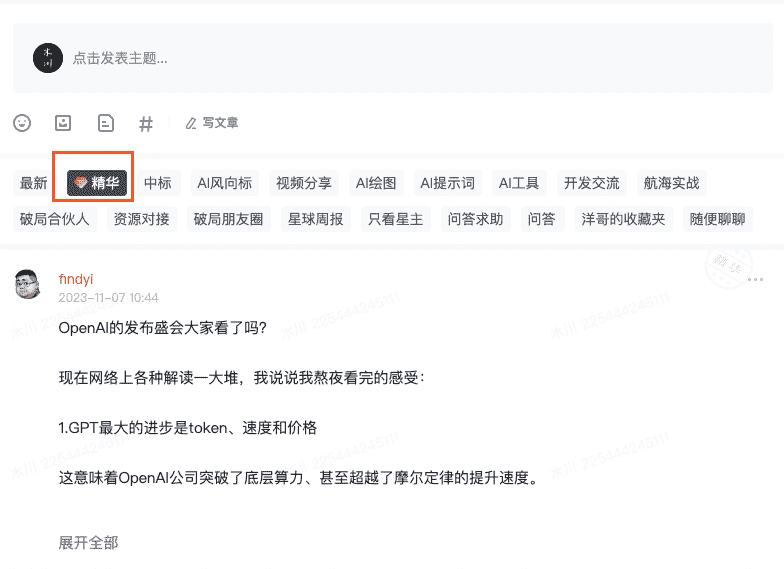

**浏览器查看网络请求，可以看到对应**的请求链接和请求参数， 可以将请求参数复制到 ChatGPT 中，让 GPT 转换成 json ，以方便后面写代码调用

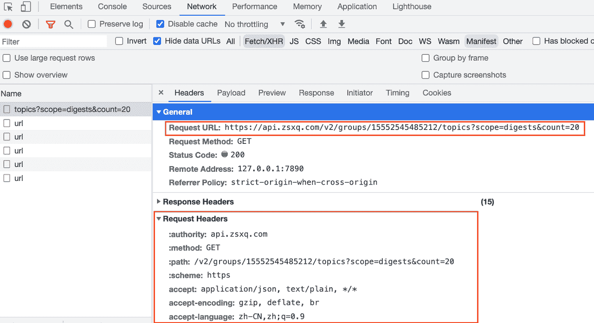

手动翻页，可以看到请求中的下一页接口，是通过 end_time 参数实现的，这个 end_time 和 上一页最后一篇文章的 create_time 有关系，所以分页调用接口的时候，需要带上 end_time 参数

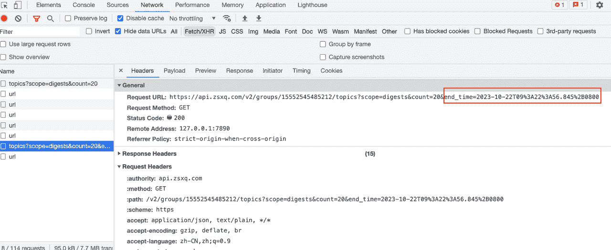

### 2、模拟登录

有了上面的请求链接 和 请求参数，就可以写程序 来获取文章数据，这里使用 Python 获取，具体模拟代码比较长，就不放到这里了，如果感兴趣，可以加我微信 mcmc2024 交流

这里需要注意的是：

1、请求频率不能过快，否则导致获取不到数据，建议10~20s一次

2、单次请求获取数据失败时可以增加重试次数

### 3、数据预处理

我们通过上一步获取到的数据是 json，为了方便操作，我们转换成 pandas

返回的数据是个 list，其中每篇文章中包含着用户信息、主题内容、点赞数、评论数、评论内容、点赞者的信息、创建时间等等

原始数据：

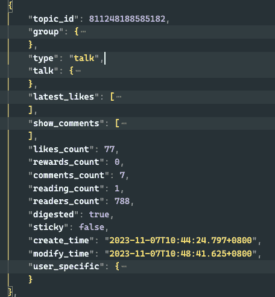

转换后的数据：

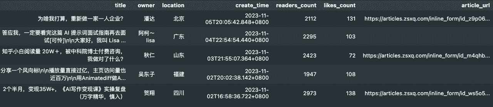

## 二）文章数据分析

### 1、文章作者分析

显示每个作者及对应的文章数

author_article_counts = df['owner'].value_counts().reset_index()

author_article_counts.columns = ['author', 'article_count']

author_article_counts.head(10)

### 2、作者所在城市分析

# 覆盖了多少个城市

# 统计每位作者的文章数

metrics = df['location'].value_counts().reset_index()

metrics.columns = ['X', 'Y']

# 绘制柱状图

plt.figure(figsize=(10, 6))

plt.bar(metrics['X'], metrics['Y'], color='darkorange')

plt.xlabel('城市')

plt.ylabel('文章数')

plt.title('城市的精华文章数')

plt.xticks(rotation=45) # 旋转 X 轴标签，使其更易读

plt.show()

### 3、文章发表时间分析

统计每个小时发表的文章数，然后绘制成柱状图

metrics = df['hour'].value_counts().reset_index()

metrics.columns = ['X', 'Y']

# 绘制柱状图

plt.figure(figsize=(10, 6))

metrics

plt.bar(metrics['X'], metrics['Y'], color='darkorange')

plt.xlabel('小时')

plt.ylabel('文章数')

plt.title('小时的精华文章数')

plt.xticks(metrics['X']) # 设置 x 轴刻度和标签

# plt.xticks(rotation=45) # 旋转 X 轴标签，使其更易读

plt.show()

### 4、阅读数分析

计算不同分位数下的文章阅读数，绘制箱线图

import matplotlib.pyplot as plt

import numpy as np

readership_data = df["readers_count"]

print(readership_data)

# 创建箱线图

# 计算不同分位数

percentiles = [50, 75, 90, 95, 100]

percentile_values = np.percentile(readership_data, percentiles)

# 打印分位数的值

for p, value in zip(percentiles, percentile_values):

print(f"{p} 分位数：{value}")

# 绘制箱线图

plt.boxplot(readership_data, vert=False)

# 添加不同颜色的分位数标识

colors = ['green', 'blue', 'orange', 'purple', 'red']

for p, value, color in zip(percentiles, percentile_values, colors):

plt.scatter(value, 1, color=color, marker='o', label=f"{p} 分位数")

# 设置标签和标题

plt.xlabel("阅读数")

plt.title("不同分位数的阅读数分布")

# 添加图例

plt.legend()

# 显示图表

plt.show()

统计不同阅读数区间的文章数，绘制直方图

import matplotlib.pyplot as plt

import numpy as np

readership_data = df["readers_count"]

print(readership_data)

plt.hist(readership_data, bins=10, color='darkorange', edgecolor='k')

plt.xlabel("阅读数")

plt.ylabel("文章数")

plt.title("文章阅读数分布的直方图")

plt.show()

统计阅读数 top 10 的文章

df_sorted = df.sort_values(by="readers_count", ascending=False)

top_10 = df_sorted.head(10)

top_10[['title', 'owner', 'readers_count', 'article_url']]

### 5、点赞数分析

计算不同分位数下的文章点赞数，绘制箱线图

import matplotlib.pyplot as plt

import numpy as np

readership_data = df["likes_count"]

print(readership_data)

# 创建箱线图

# 计算不同分位数

percentiles = [50, 75, 90, 95, 100]

percentile_values = np.percentile(readership_data, percentiles)

# 打印分位数的值

for p, value in zip(percentiles, percentile_values):

print(f"{p} 分位数：{value}")

# 绘制箱线图

plt.boxplot(readership_data, vert=False)

# 添加不同颜色的分位数标识

colors = ['green', 'blue', 'orange', 'purple', 'red']

for p, value, color in zip(percentiles, percentile_values, colors):

plt.scatter(value, 1, color=color, marker='o', label=f"{p} 分位数")

# 设置标签和标题

plt.xlabel("点赞数")

plt.title("不同分位数的点赞数分布")

# 添加图例

plt.legend()

# 显示图表

plt.show()

统计不同点赞数区间的文章数，绘制直方图

import matplotlib.pyplot as plt

import numpy as np

readership_data = df["likes_count"]

print(readership_data)

plt.hist(readership_data, bins=10, color='darkorange', edgecolor='k')

plt.xlabel("点赞数")

plt.ylabel("文章数")

plt.title("文章点赞数分布的直方图")

plt.show()

统计点赞数 top 10 的文章

df_sorted = df.sort_values(by="likes_count", ascending=False)

top_10 = df_sorted.head(10)

top_10[['title', 'owner', 'likes_count', 'article_url']]

### 6、关键词拆解

将文章的标题拆解成关键词，然后绘制词云分析图

import jieba

from collections import Counter

from wordcloud import WordCloud

import matplotlib.pyplot as plt

# 设置中文字体，'SimHei'是宋体字体的一种，根据需要选择合适的字体

plt.rcParams['font.sans-serif'] = 'Arial Unicode MS'

# 用于正常显示负号

plt.rcParams['axes.unicode_minus'] = False

# 准备文本数据

words = []

for index, row in df.iterrows():

title = row.title[:24]

keywords = jieba.cut(title)

# print(title, " ".join(keywords))

for item in keywords:

words.append(item)

# 使用Counter统计元素出现的次数

element_counts = Counter(words)

# 提取出现次数为2次或更多的元素

result = [element for element, count in element_counts.items() if count >= 2]

text = " ".join(result)

# 创建词云对象并生成词云图像

font_path = "/System/Library/fonts/PingFang.ttc"

wordcloud = WordCloud(width=800, height=400, background_color='white', font_path=font_path).generate(text)

# 显示词云图像

plt.figure(figsize=(10, 5))

plt.imshow(wordcloud, interpolation='bilinear')

plt.axis('off') # 隐藏坐标轴

plt.show()

### 7、文章内容拆解

通过上面的文章 url 可以拿到文章的内容，然后将文章内容发送给 ChatGPT，快速总结文章内容

请总结这篇文章的内容：

---

这里放复制的内容

---

# 三、总结

通过学习破局精华文章可以发现自己的不足，从而进一步改进；如果能通过 AI + 编程的方式，会让学习的过程加速

本文通过使用 AI + 编程 完成整个破局精华文章对标拆解的流程，如果你对 AI 编程也感兴趣的话，欢迎链接我 VX：mcmc2024

本篇写了 4 个小时，全文 1w+ 字，如果对你有点启发，欢迎点个赞呀~