# 2023-11-03知乎小白阅读量 20W＋，被中科院博士付费咨询，我做对了什么？

> 来源：[https://xuqiwei1986.feishu.cn/docx/LfcDdUPLJoiCHHxDN0wcQz7Snze](https://xuqiwei1986.feishu.cn/docx/LfcDdUPLJoiCHHxDN0wcQz7Snze)

> 🔗 原文链接： h[ttps://articles.zs](https://articles.zsxq.com/id_m4qhblle5l3f.html)xq.com/id_m4qhbl...

>

大家好，我是秋仁，AI 破局俱乐部初创合伙人，前上市国企 Java 开发工程师，现自媒体电商短视频领域提示词工程师。目前正在参加皮特老师的写作训练营，感谢皮特老师的耐心指导！

在参加洋哥的 《商业 IP 课程 - 知乎篇》 后，我花了一段时间重新明确自己的定位后决定入局实操知乎。九月底起号，截止到现在，成绩不算突出，但也获得了还算不错的数据。

本文主要是分享我从 0-1 做知乎过程中的一些经验。废话不多说，先展示一下成绩：

1. 知乎累积阅读总量 20w +

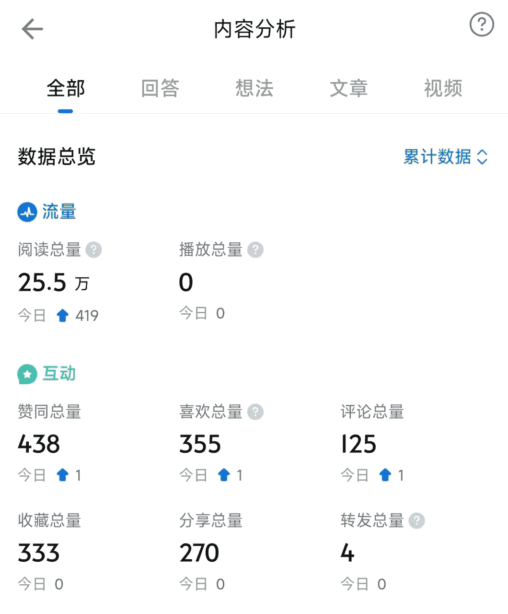

2.有过单日近 3w 的阅读量 ，目前知乎 5 级，快 6 级了；

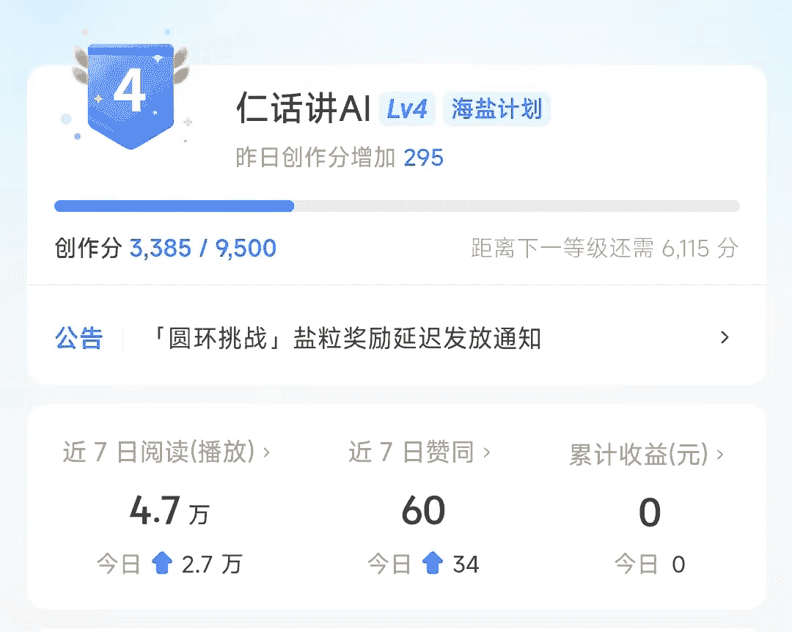

3. 👸号至今每天都至少有 1-2 个人引流到私域👸号（虽然放的钩子很少，但是可以看出来知乎的长尾流量是真的猛）；

4.在不知情的情况下分销了破局俱乐部，小赚一笔；

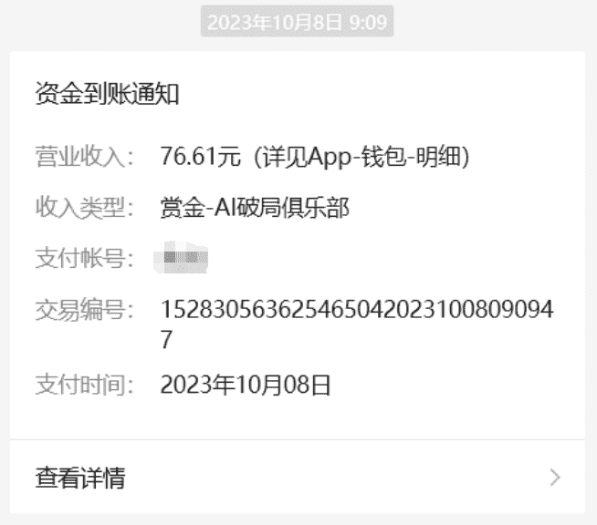

5.吸引了中国科学院大学博士、京东算法架构师到私域，并向我付费进行了咨询。

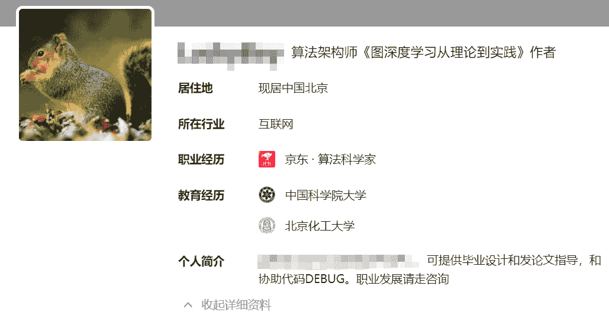

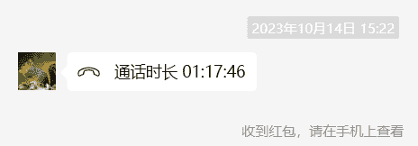

之所以能把知乎做起来，是因为洋哥在商业 IP 课中讲解了很多外面接触不到的 "绝世武功" 。

和很多人一样，我也只是听话照做而已，结果没过多久知乎就起飞了！✈

本文是基于冯帅的文章，从一些不同的角度描述一下做知乎的一些经验，希望小伙伴们看完后能够有所收获。

冯帅关于知乎的原文链接： https://t.zsxq.com/13quelJFK

# 一、前置知识

## 一）为什么要做知乎

**知乎是一个公**域平台，做知乎的主要目的是为了 引流到私域 （🛰️/👸号）。

知乎的长尾效应很强，只要做的好，就相当于是一个永动机，会持续给你带来流量和收入。

## 二）知乎平台的特点

知乎属于图文平台。

如果想要写出受欢迎的内容，有两大法则需要注意：

1.学会说人话，用最浅显易懂的文字描述专业的内容，不要用太多很专业的内容；

2.学会讲故事，本质是场景化，将枯燥变为有趣，将道理变成经历。告诉故事的走向，在故事中透露出底层逻辑。

## 三）常见误区

### 1、 **误区一 : 每天都更新**

**正确的做法是**，在经验不足、时间不够的时候， 质比量重要 。只给目标找实现手段，不要因为战略上的懒惰而陷入勤奋带来的自我感动。

公域的关键是要有一次击穿公域的机会，注重质，击穿之后就起飞了。

怎么理解击穿？就是有一个问题爆了，有大量的点赞、评论、收藏，甚至是转粉和引流等动作。

**不需要每个问题都回答的很**认真，大家只需要 以营销号的心态来做即可 。

那你可能又会问了，什么是营销号？

营销号有两种含义:

1.所有的曝光都是围绕引流展开的

2.用了很多重复回答的手段，所以营销号经常会被骂

### 2、 **误区二 : 内容越专业越好**

专业和生活化需要搭配，要有人味，而不是让人感觉像机器。

什么叫专业？能解决/回答问题的人，就叫专业。

能解决专业人士的问题，或者解决小白的问题，都叫专业。

**自媒体要极致地利用信息差。**

解决专业人士的问题并赚他们的很难，因为他们的认知和小白不一样。他们通常会认为你资格不够，你应该给他们付费才对。

反观小白，小白的学习主动性和积极性更好，会更有付费意愿。

### 3、 **误区三 ：起号初期就引流**

**将欲取之，必先予之 **，这个道理任何自媒体平台都适用。

在前期不要一上来就想着引流，在没有为平台创造价值之前，所有引流的动作都很容易被平台制裁。

进入一个平台，初期要做的应该是持续输出优质内容，为平台创造价值，帮平台留住用户。当账号有一定的权重和影响力，并且给平台带来了一定的价值时再去做一些引流动作，平台就会睁一只眼闭一只眼。

# 二、知乎的引流逻辑

做事情始终不要偏离自己的目标。我们的目标就是从知乎这个公域平台吸引精准粉丝，并引流私域。

知乎的曝光量和粉丝量没有任何作用，这些数据只是虚假的繁荣。

## 一）找用户刚需问题

### **1、什么是刚需问题？**

刚需问题是需要击中特定人群痛点、痒点，真正能帮助对方解决某些问题，或者给予有效启发的问题。

例如对程序员来说，如何升职加薪、如何进大厂、怎么学习某项专业技能等，这类就是刚需问题。

### **2、为什么要找刚需问题？**

不是刚需问题，就算爆了也涨不了👸号粉。

例如一些娱乐性的话题，大家就图一乐，并没有想为之付费的冲动，就算作品数据爆了也很难引流到私域。

此外，只有刚需问题才更容易埋钩子。

### **3、如何找到用户的刚需问题？**

三个渠道：热搜、SEO 搜索、关注同领域大 V

但是注意，找刚需问题时，要找和自己 IP 定位相仿的问题，而不是谁热就回答谁。

#### 1）热搜/热榜

**PC 端 **热搜位置：

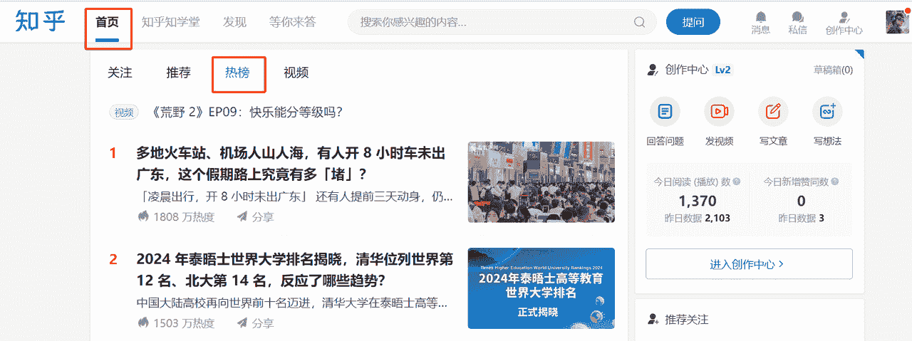

**手机端 **热搜位置：

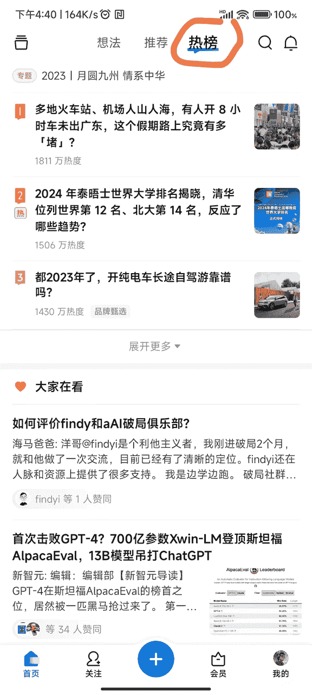

大家可以固定时间段刷一下知乎热榜，看看有没有符合个人定位的问题。

#### 2）SEO 搜索

根据自己的定位，要有个关键词组库，定期搜一下相关问题。例如职场定位，可以用程序员、大厂、CTO 等关键词。

搜索关键词后，可以进行筛选，最多赞同的内容获得的流量会更多一些。

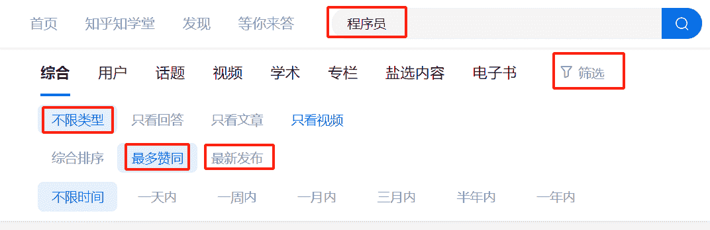

#### 3）关注同领域大 V

多关注一些同领域的大 V ，看一下他们回答了什么问题。因为他们回答问题是有权重的，问题会引来更多的曝光。所以我们跟着回答即可，这样也有更多曝光的概率。

## 二）做出好内容

这块能力是必备的，做知乎和做👸号等其他平台同理。

做出好内容核心的三点 : 标题、干货、讲故事。

### 1、标题

标题在所有自媒体行业中，占至少 90% 的作用，标题决定一切。

有标题但是没内容，可以当营销号。但如果没有标题，则啥都没有。

标题是用户前三秒决定是否浏览你的内容、平台觉得你内容能否爆的唯一因素。

**一个好的标题有五大标准：**

1.好标题是你的写作和视频主题；

2.好标题不能是标题党，标题和内容要吻合，有确定性；

3.好标题要短小精悍，要有情绪力或传播力。例如：寒门难再出贵子、副业买房了；

4.动词更容易成为好标题；

5.流量关键词很重要：例如大厂名称、失业裁员等。

需要注意的是， 知乎的回答是有标题的，也就是知乎的第一句话。

如果内容在被系统推荐时，第一句话不能够吸引用户点击，那么系统可能就不会再继续推荐该内容了。

所以写知乎问答的回答，第一句话要注意一下，要吸引人，因为这是标题 ！！！

知乎回答的第一句话最好的模板： 制造话题冲突、写数字量化内容、反问、秀肌肉

下面举几个例子：

**1.制造话题冲突**

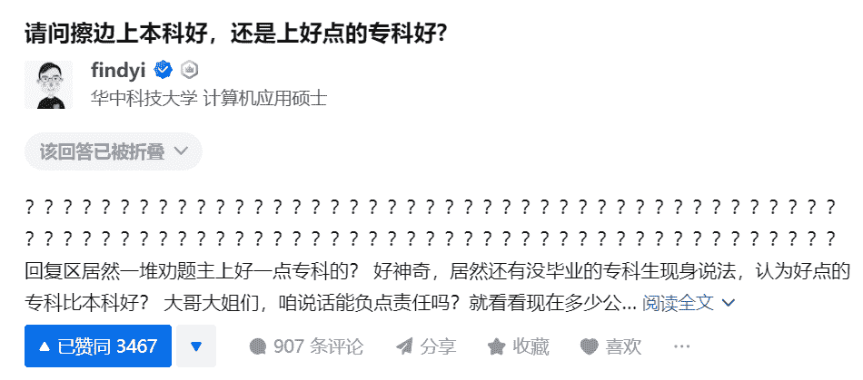

**2.写数字量化内容、秀肌肉**

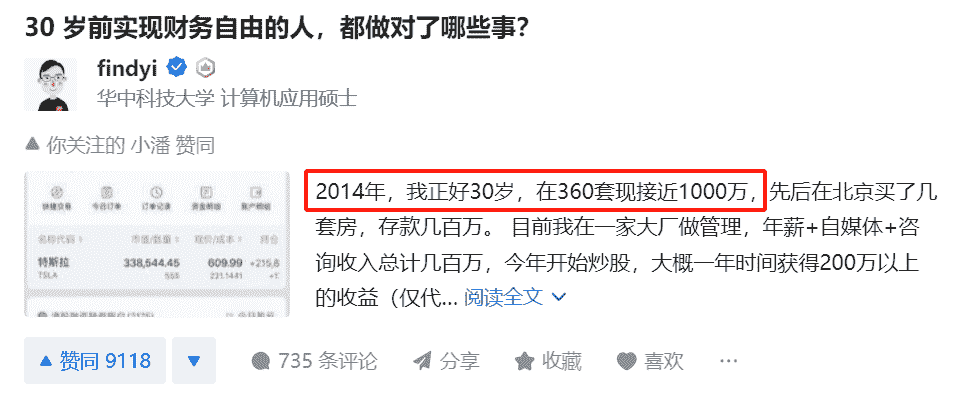

**3.反问**

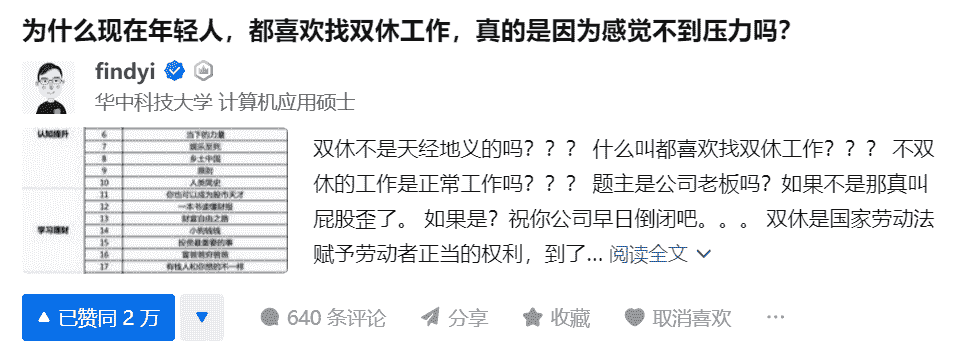

### 2、干货

干货通常指的是实用、有深度的内容，它是建立作者在读者心中专业可信度的基石。高质量的干货内容往往具有以下特质：

信息价值高：提供准确、有深度的知识或信息，能够解决读者的实际问题。

逻辑清晰：结构条理化，让读者容易理解和吸收。

实用性强：提供可操作的建议或解决方案，让读者能够实际应用。

举例：下图中，洋哥列举了一些关于读书的干货建议，顺带把自己的钩子亮了出来。

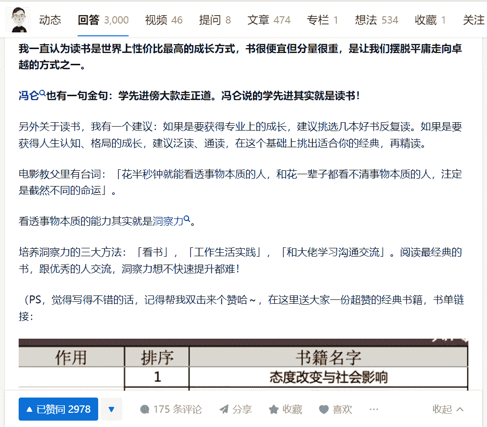

### 3、讲故事

故事能够激发读者的情感共鸣，让干货内容变得更加生动和有吸引力。一个好的故事通常包含以下要素：

情感连接：与读者建立情感上的联系，让读者感同身受。

具体场景：用具体的场景和细节来支撑故事，使内容更具画面感。

教育意义：通过故事传达有价值的观点或教训，增强内容的深度和影响力。

举例：下图中，洋哥分了五点进行讲述。每一点内部又通过列举一些经典书籍的案例，让内容更生动，也更具有说服力。

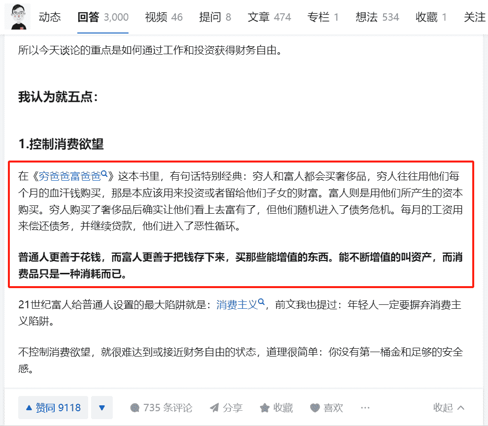

## 三）钩子

### 1、什么是钩子

钩子就是符合你个人定位的相关资料干货，比如各种书单、各种文档资料等。钩子内容针对特定人群，要能击中这类人群的痛点，让用户觉得拿到这份资料就起飞了。

在知乎等公域平台输出的内容中丝滑地加上钩子，如果用户恰好对你的钩子资料感兴趣，他就会一路顺着钩子的路径，从公域被你钩进私域。

用户进入私域后，就可以通过👸号、朋友圈、陪伴群等手段持续输出内容，提高用户粘性，为后续的变现做铺垫。

### 2、怎么做钩子

推荐知乎回答嵌套知乎文章、知乎文章嵌套🛰️链接的钩子，这是比较安全的引流方式。

下面我们以洋哥的知乎钩子为例进行拆解和演示。

**1.第一层： **在知乎回答里面贴出自己的知乎文章。点开链接后，跳转到自己的另一篇知乎文章。

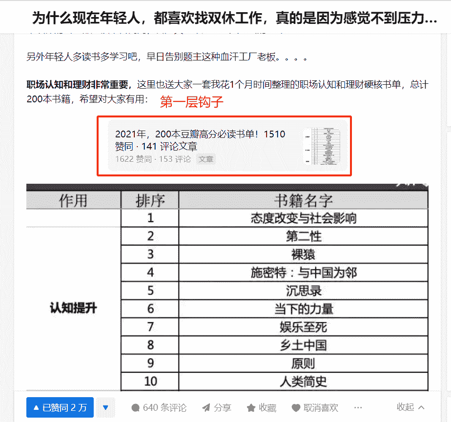

**2.第二层： **自己发表的知乎文章，是一篇介绍钩子的文章，如下图。

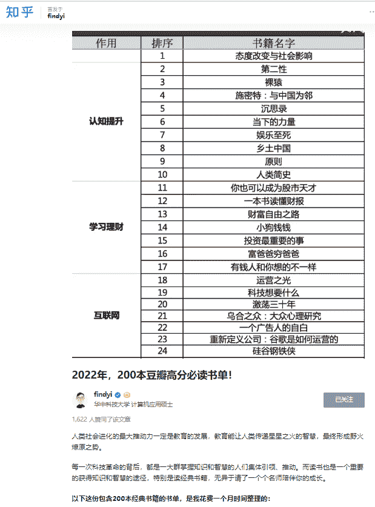

这篇文章里展示一下你的钩子内容，然后贴出🛰️👸号文章的链接，洋哥还贴了两次，起到了强调的作用。

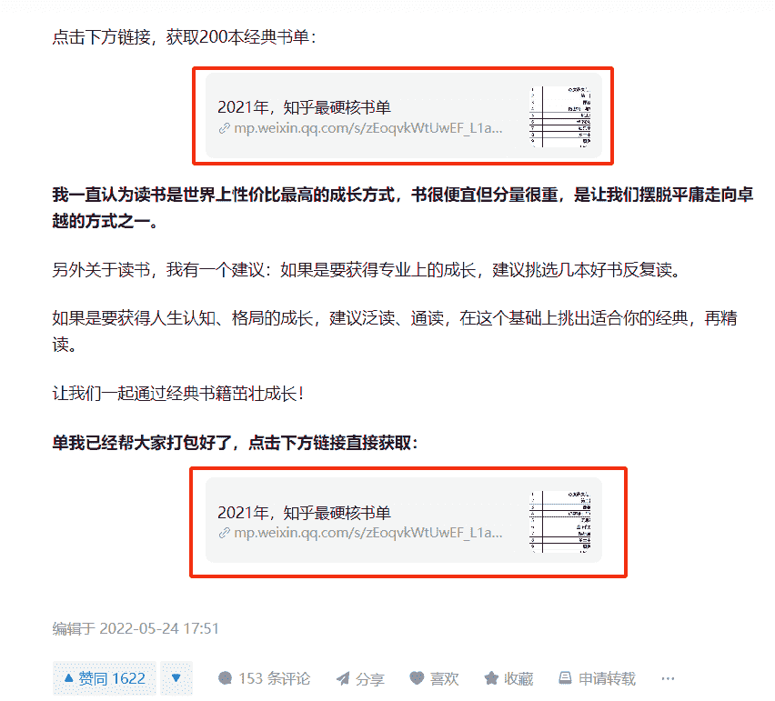

**3.第三层： **🛰️👸号文章

👸号的群发方式发布文章后，对所有人可见，会展示在你的👸号首页，每天只能发布一次。

而非群发方式每天可以发布很多次，并且发布之后不会公开展示。所以我们可以采用的非群发的方式发布钩子文章。

真正的价值内容采用群发，对外展示，显得你很有逼格，干货很多。而钩子不对外展示，否则容易被当做营销号。

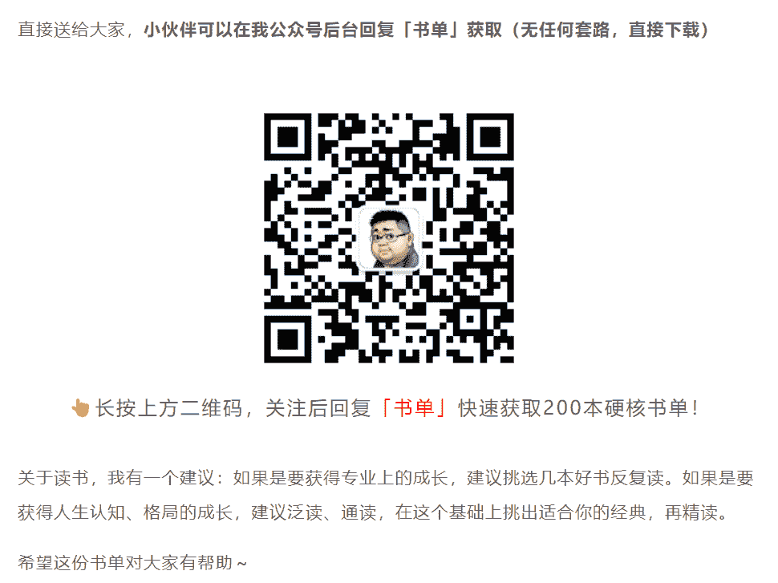

这种引流方式的好处是：如果知乎钩子文章被封了，你引用这个钩子文章的知乎回答是不会被影响的。只不过是在回答中引用的知乎钩子文章可能展示不了，但回答的其他部分内容不影响，此时只需要换一个钩子文章链接即可。

### 3、怎么留钩子

在正经回答中突然做一个丝滑的转折，留下你的钩子，然后继续正经地回答。

这里贴了洋哥的一个钩子，大家体会一下怎么丝滑地转折。

# 三、经验分享

## 一）账号初期不要引流

在账号权重不高，还没有把账号做起来的时候，不要有任何引流动作，即使是安全引流方式也不行。

我在 2023.10.04 踩了这个坑。我👸号写了个钩子文章，嵌套到知乎上写了个知乎钩子文章。在回答问题的时候带上了我的知乎钩子文章，结果刚发表就被判定为广告营销，封禁了一天。

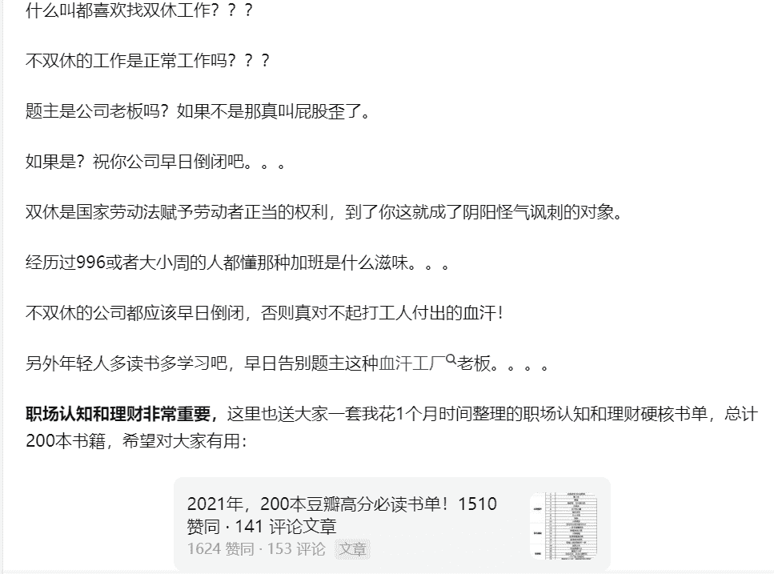

刚开始做账号时，我仿照陈天、吴东子的方式，在个人简介里面标注了👸号和个人🛰️。

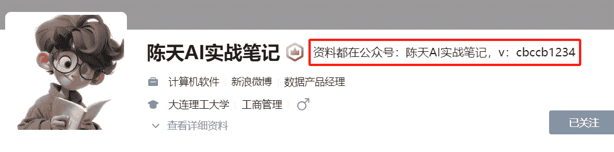

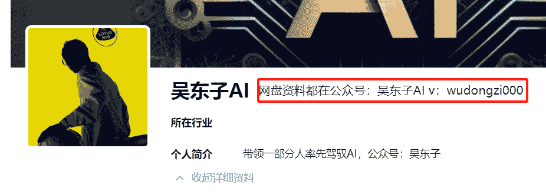

挂上去十几天后都没事，但是在 2023.10.06 的时候突然违规了，个人信息被重置、账号被封禁一天，如下图所示。

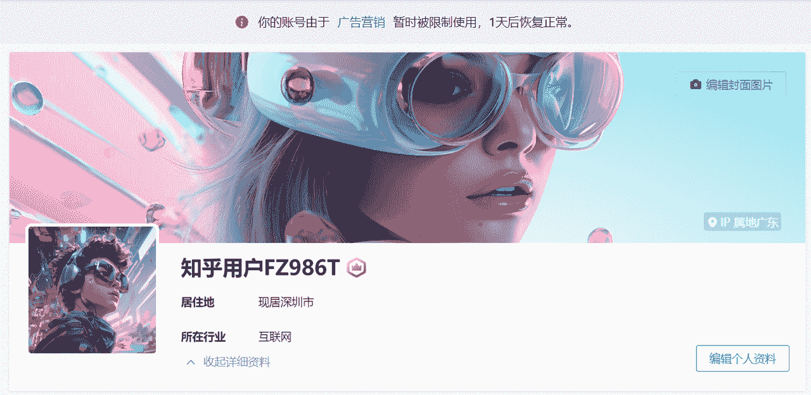

所以，账号初期千万别引流。

## 二）文章标题不要过于浮夸

取标题时，要和文章表达的重点相关性高一点，否则可能会被知乎打上标签，影响推流。

我之前写了个文章，原标题：当鲁迅遇上AI，写出的内容惊掉了我的下巴......

这里被打上了 "外显标签" ，然后文章就显示下图的内容。

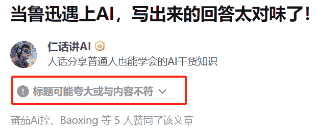

被打上这个标签后，文章会被限流。把文章删了重新发，换个标题即可。

## 三）注意知乎的内容备份

知乎上写的内容注意备份。

否则万一被知乎删了，是不会留底的，相当于白写了。

## 四）如何迅速提高内容优质分

想要快速提高账号的等级和权重，一个比较好的办法就是提高内容优质分。

这点启发，来自于洪老师之前在合伙人群里发的一张知乎创作分明细图。

如下所示，他在 30 天左右就快升级到 6 级了。从图中不难发现，分数最高的是内容优质分，这也是洪老师能够快速升级的核心原因。

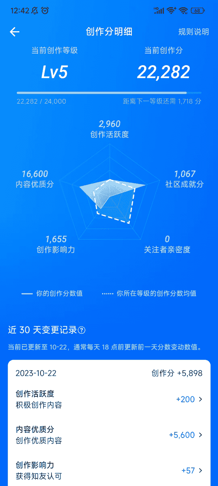

下面是我个人对优质内容的一些调研和理解：

### 1、评判标准

我在网上搜了一下，知乎优质内容的评判标准，如下：

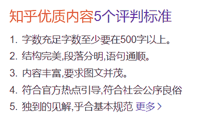

### 2、更新频率

**更新频率： **优质创作分一周一更。我查看了自己的这块评分，确实是一周出一次。

### 3、如何查询优质内容

关注知乎小管家 -- 私信 -- 转人工客服 -- 告知你想要查询某一周的优质创作内容。

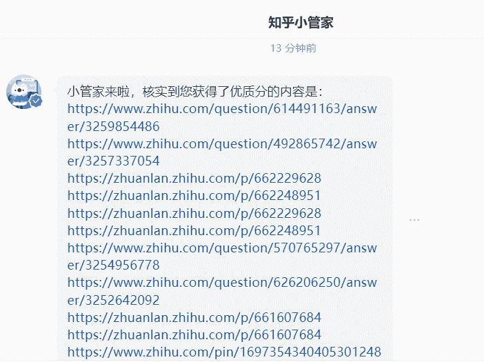

经过查询，我发现其实就是上周写的一些文章，但是无法知道单篇文章的具体加分数值。

所以本质上就是疯狂输出内容，输出的越多、越长，图文排版越规整，内容创作分加的就越多。

## 五）如何迅速提高关注者亲密度创作分

亲密度创作分也是提高账号等级和权重的利器之一。大家可以和几个一起玩知乎的小伙伴组局，互相当托刷刷数据。

首先需要互相关注，然后进行点赞、评论、转发等动作。

需要注意的是，点赞要有以下几个动作：上下滑动、查看全文、查看图片等。必须要有交互动作，否则互动可能是无效的。

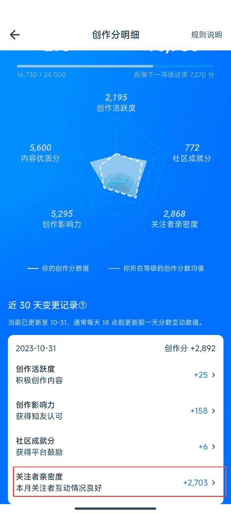

在做知乎的过程中，洋哥为了把合伙人孵化出来也是拼了！直接用他自己的知乎账号（账号权重知乎前 10 ，知名大 V）给我们点赞和转发作品。

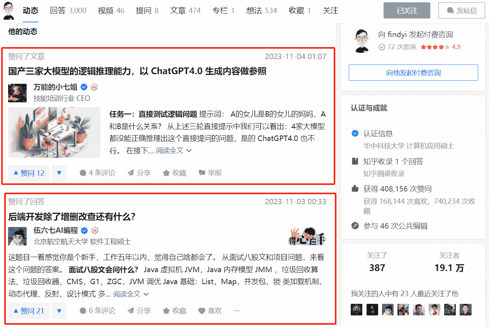

知乎大 V 的点赞和转发会让我们的作品权重提高不少，从而让我们的作品有机会获得更大的曝光，对个人账号权重的提升也会有不少帮助。

但是，对于洋哥自己而言，相当于放弃了自己价值百万的账号，因为这些操作稀释了他自己的账号 IP 。

你有见过哪个大 V 愿意疯狂点赞和转发多位普通素人的作品吗？如果不是近距离围观，你根本想象不到洋哥的真诚利他 "变态" 到什么境界。

## 六）利用好内容自荐推流

知乎等级到 4 之后，可以每个月自荐自己的往期文章内容，重新推流。

4-7 级每个月可以自荐 3 次， 8-10 级每个月可以自荐 5 次。

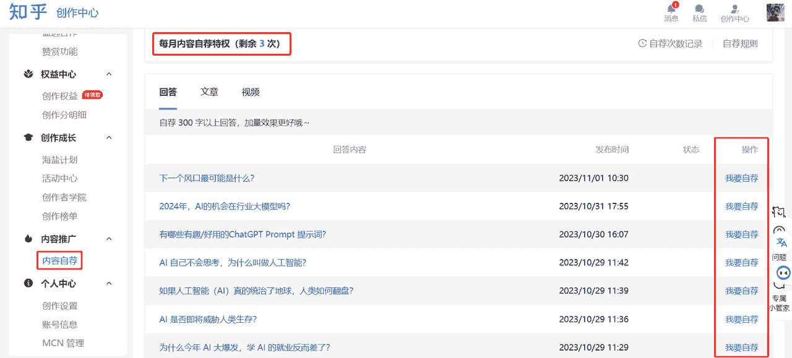

以上就是我这段时间关于知乎实践的分享。

最后，感谢洋哥的极致利他、感谢皮特老师的耐心指导。

你根本想象不到，洋哥为了把合伙人孵化出来有多拼！牺牲自己，成就他人，洋哥的交付一次又一次的超过预期。

最让我印象深刻的是，洋哥有一次直接深夜给合伙人加餐，上了很多硬干货。

洋哥都这么极致拼命利他了，我们还有什么理由不赶紧行动起来。

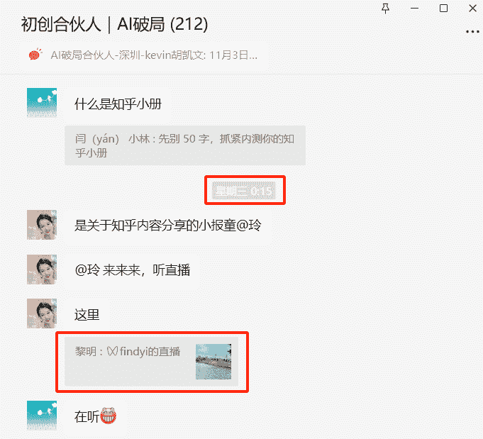

引用洋哥的一句话：世界上没有普通人，只有一直不行动的人；行动起来，就不是普通人了。

我是秋仁，如果有知乎起号或者提示词工程师转型方面的问题，欢迎链接：SuperQr_Z