# 必修课：重新理解赚钱这件事（第 30 期学员版）

> 来源：[https://xuqiwei1986.feishu.cn/docx/YeQ5d3UU1oAkQyxB5tbcU2Zdn9f](https://xuqiwei1986.feishu.cn/docx/YeQ5d3UU1oAkQyxB5tbcU2Zdn9f)

## 开课前必读 1：学习建议

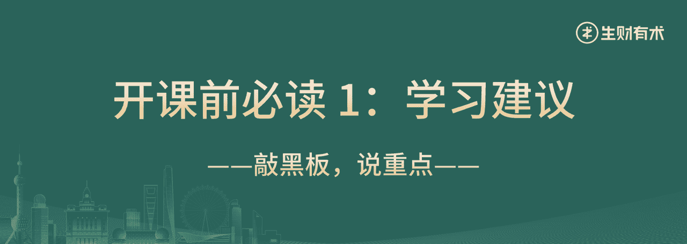

今天是训练营**必修课**，为了最大程度提升学习效率，建议：

1.  **安排好时间**，确保 8:00-10:30 可以深度思考，在安静环境下，少被打扰。

1.  **推荐使用电脑**，如果允许，建议使用电脑浏览器，比手机效率高。

1.  **推荐用耳机**，相对于外放，耳机体验明显更佳，更适合专注学习。

**直播前检查：**

手机屏幕小？最好用电脑

画面有点卡？换网试试吧

无图无声音？刷新重新进

如何上手早？时间安排好

## 开课前必读 2：训练营课表

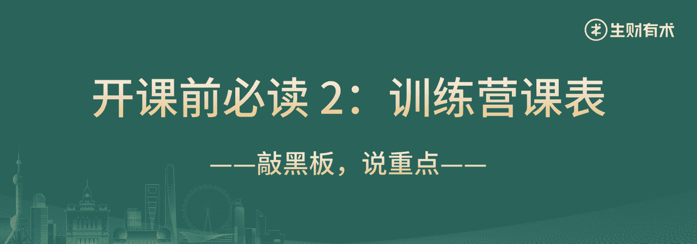

今天是第一次直播必修课，请认真阅读课表

今天这节直播课是我们给想要赚钱的学员准备的《第一节赚钱必修课》，已经有上万人学过，评分超过 9.2 分❤️

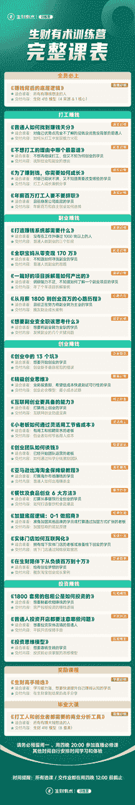

**【💡划重点】今**天直播之后就可以去私聊鱼丸“选课”：

🙋 训练营期间，有任何问题都可以随时联系鱼丸～～😊

---

**选课规则：**我**们准备了四大方向**的专题必修课，给不同阶段的学员，建议选一节你最想上的。如果你想选多节，先完成第一节课的作业以后，才能去选下一节课，全部选课周四晚 12 点截止。

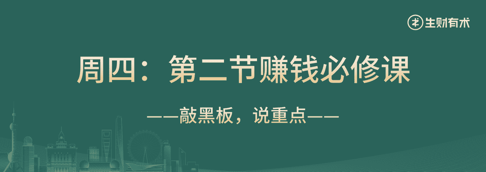

我们一共准备了** 2 节直播必修课（今天和周四），22** 节专题必修课，还有 1 节加餐福利课，希望大家务必认真阅读这次学习时间表：

赚钱内部每期有个统计，会分别统计每个班级的社群活跃度、作业数量、作业质量、看看哪个班级的同学最优秀。

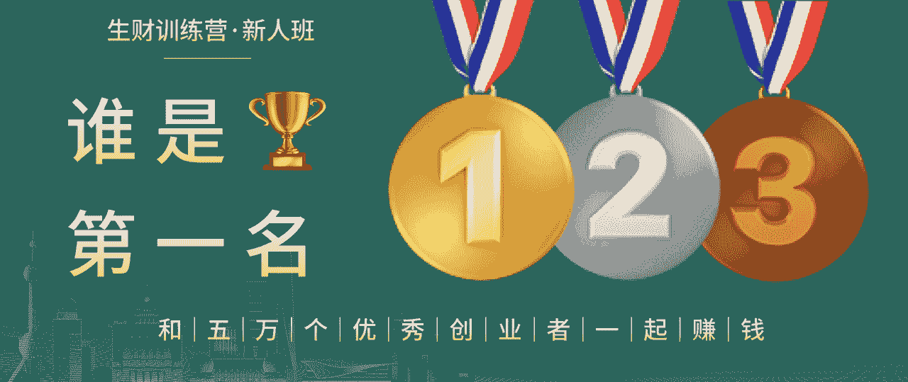

**周四中午 1****2 点，我们会统计“****作业提交份****数”**最多的班级，评选“第一名班级”。

作为第一名班级，周四，会给大家一个最喜欢的奖励：

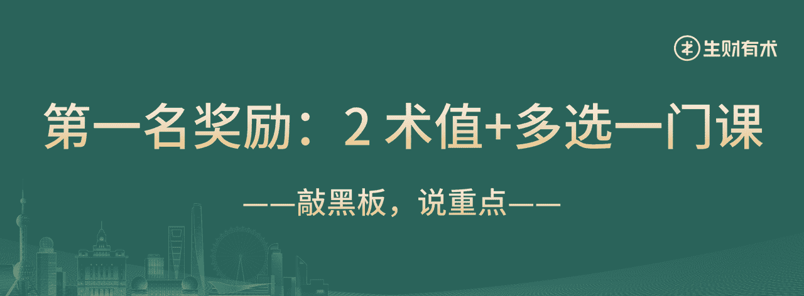

**【互动🙋‍♂️】大****家都来自于哪个班级？**

### 龙哥盟货币体系：

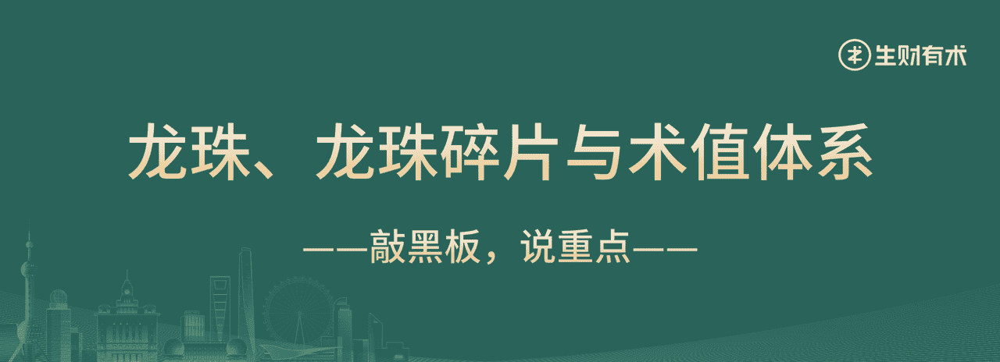

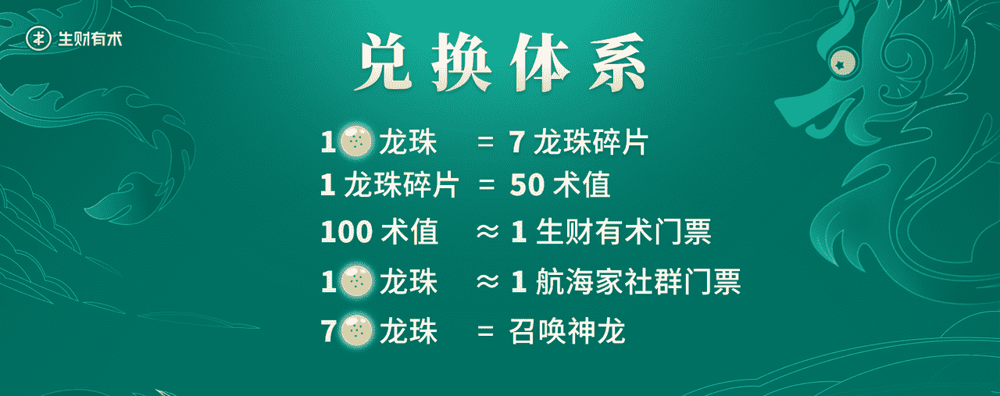

### **训练营新手福利**

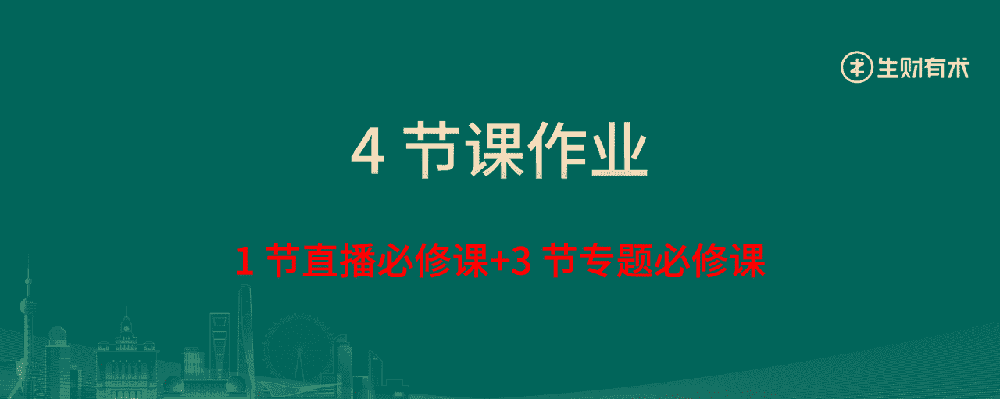

| ### 在赚钱社群学习的最大特色就是“输出”，用作业输出来倒逼赚钱能力提升❤️ |  |  |
| --- | --- | --- |
| ### 😄在赚钱完成输出，你将获得 |  | ### 🙁否则你将损失 |
| ###### 1.深度思考机会 | 一次极其难得的提升自我、深入思考的机会 | 毕业后内容全部关闭 |
| ###### 2.和赚钱做朋友 | 龙哥和赚钱嘉宾都会看，航海教练也会看 | 仅此一次，下期无法参加 |
| ###### 3.创业成长档案 | 在赚钱留一份档案，作为未来合作/投资的参考 | 档案空白 |
| ######  4.作业奖励礼包 | 每一份作业都可以获得最少 1 术值的奖励 | 所有可兑换礼品 |
| ######  5.优秀毕业生奖 | 评选优秀学员，获得荣誉和奖励 | 毕业奖励无缘 |

大家加油啊。

## 开课前必读 3：优秀毕业生奖励

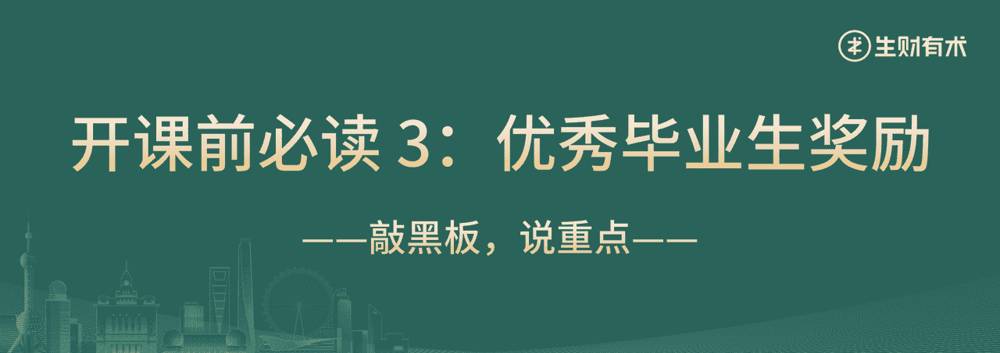

| # 🎓毕业奖项 |  | # 🎁获得奖励 |
| --- | --- | --- |
| # 术值排名 | ### 荣誉学员 | 1.  专属荣誉学员毕业证书 |
|  | ### 优秀学员 | 1.  专属优秀学员毕业证书 |
|  | ### 学霸学员 | 1.  专属学霸学员毕业证书 |
|  | ### 全场最佳 MVP | 1.  专属 MVP 学员毕业证书 |

> 术值排行 Top30%

> 且完成至少 2 节直播课

> 术值排行 Top15%

> 术值排行 Top5%

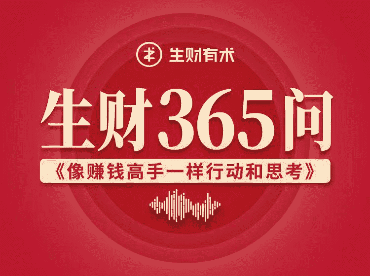

> 术值排行第一名

### **为什么赚钱鼓励大家积极输出？**

### **为什么赚钱愿意分享干货？**

### **为什么赚钱积极发放奖励？**

### 龙哥盟社群价值观：

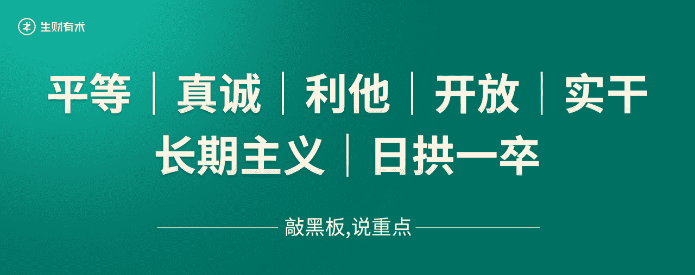

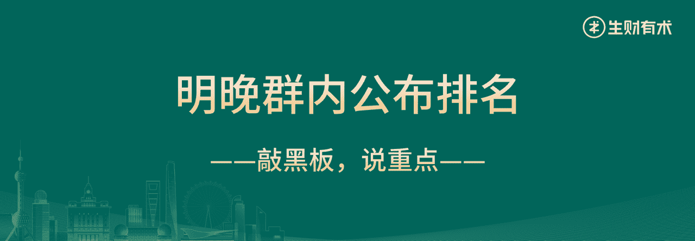

大家加油啊，期待周四，哪位同学可以把 MVP 奖品通通抱回家～～

## 开课前必读 4：提前划重点

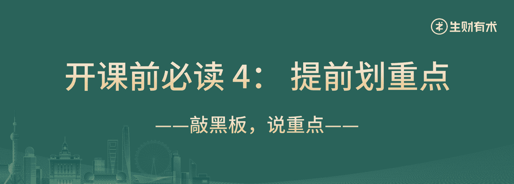

这节课，重点讲 4 个话题：

1.  **理解本质：**赚钱的底层逻辑究竟是什么？

1.  **方向选择：**不同阶段应该如何调整自己的收入来源？

1.  **赚钱拆解：**如果想要从零开始打造收入系统都需要那些？

1.  **快速起步：**如何快速从零到一赚到钱？

直播课学习只是过程，学习的核心都在“写作业”的输出过程中。

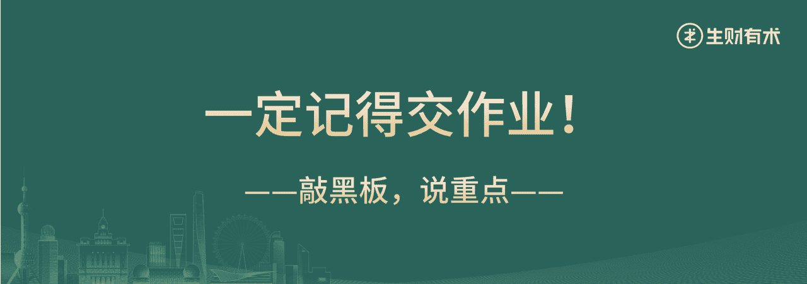

### 记得交作业！

记得交作业！

交作业！

重要的事情说三遍：

**【互动🙋‍♂️】读**完这几个【课前必读】后签到，熟悉下互动区：你所在的城市___

# 认识我们

## 简单介绍一下赚钱

龙哥盟社群创建于 2017 年初，是赚钱领域头部社群。截止今年已经累计有 50000 +人加入，第七期续费率近 75%。

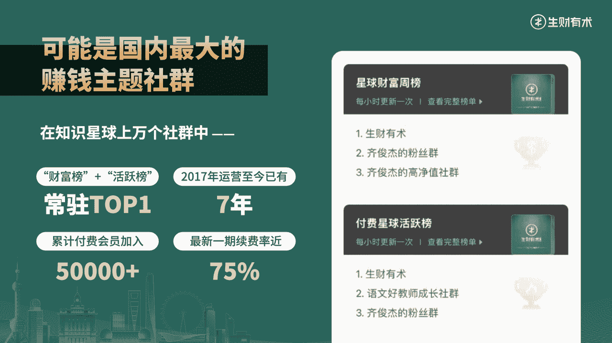

每天都在产生各种赚小钱和赚大钱的机会，各行各业的实战高手汇聚在这里分享交流一线经验，还有丰富的实战活动供你下场行动切磋

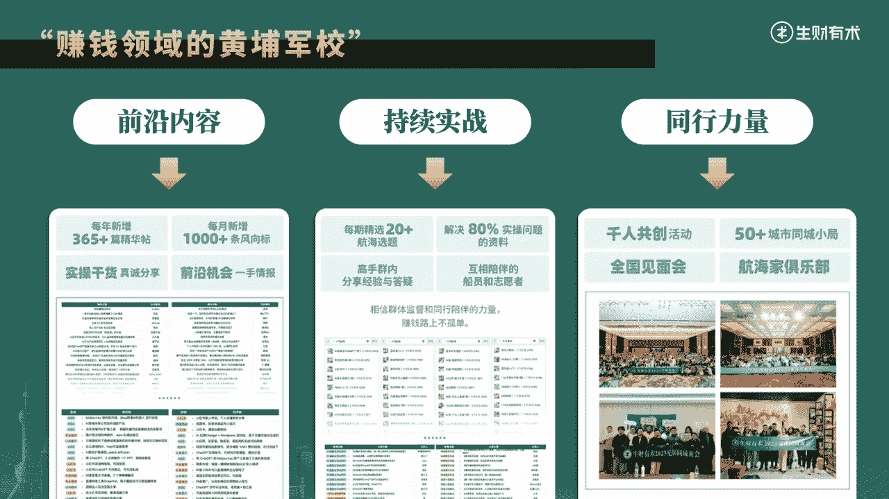

## 本期课主讲：

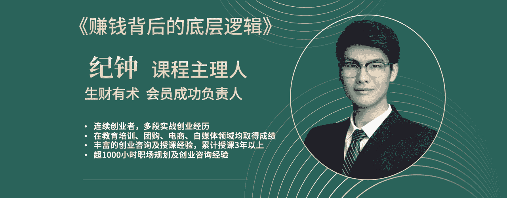

# 开始正式讲课

大家好，我是纪钟，很高兴大家来到赚钱上课

我从 2019 年加入赚钱，现在主要负责会员成功和项目咨询。

**不管你目前是**在打工、准备创业还**是已经自**己做项目，我们希望提供一个赚钱人的社群，通过赚钱原创的“内容学习”

的方式，帮助大家提升**核心赚钱能力**（而不是在市场上不断交学费和低效踩坑），加速帮你提升赚钱能力段位：项目判断、赚钱机会、情报收集、资源链接、低成本起步、管理扩张等问题。

除了社群业务，龙哥盟还有**【项目孵化】**业务，投资额度在 50-300 万，提供资源赋能和战略指导、办公场地等，主要集中在项目早期孵化领域，目前已孵化成功ChatGPT、AI 绘画、TikTok、海外工具等众多项目。如果你的项目有投资和合作兴趣，下周毕业后也可以联系班主任。

今天课程内容比较多，我们直奔主题吧，回头有时间我们再交流。

# 为什么一定要讲这堂课

**【🙋‍♂️互动】来**，我先调研一下大家的阶段，扣 1234567

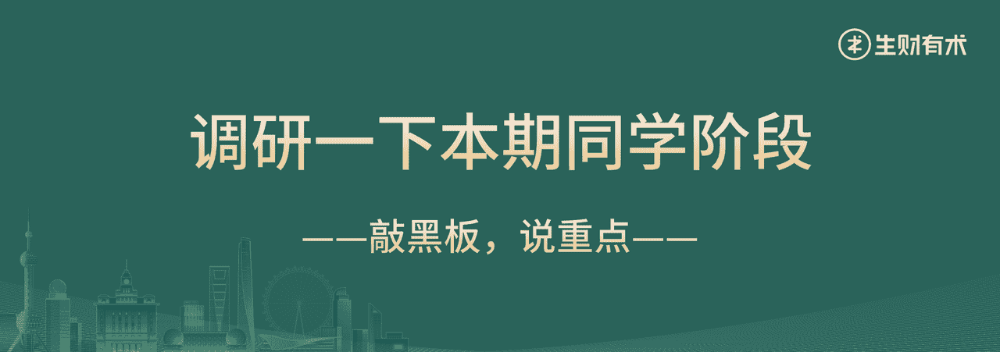

你现在正在哪个阶段？来看看你身边的同学分布：

1.  学生/自由党，还在读书没毕业/暂时没工作没项目没赚钱

1.  打工人，专家岗或具体的执行岗

1.  打工人，管理岗或独立做操盘带业务

1.  创业期，有小副业，边打工边测试项目

1.  创业期，副业项目能赚到钱开始全职投入

1.  创业期，项目有放大机会，快速增长复制扩张

1.  投资期，在做投资、咨询、商业教练工作

既然大家报名了这个课程，大家应该都想要创业或正在创业，希望：

+   12 的同学：如果经验不够，努力跟上，提升认知段位。

+   34567 的同学：如果有经验，努力学习和思考，帮你把做过的事情理清，构建体系。

---

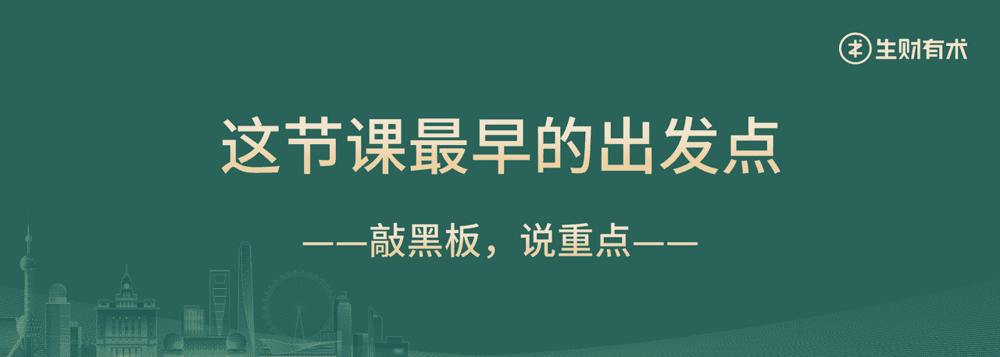

我们在做社群内容调研的时候，访谈了很多业务成功的老板和创业多年的老兵，如何从一个普通人一步一步走到现在，发现在赚钱这件事上要学的东西实在太多了，很多人投入大把的时间努力工作、学习，但却离赚钱这件事越来越远，忙忙碌碌好几年，一回头发现自己还在原地。

【💡原因】我们去分析背后的原因，发现九成的人根本都没有理解清楚赚钱背后的底层逻辑，归根到底是赚钱上的认知太低，把赚钱路上大大小小的坑踩了个遍，哪怕同样一个赚钱机会，在不同认知水平的人的眼里，也是不一样的。

想要提升认知，最重要的是**先打破自己的认知**，今天这堂课的出发点我们先达成共识，如果你不认可这个出发点的话就没有必要再听下去，浪费自己的时间，这个出发点就是：

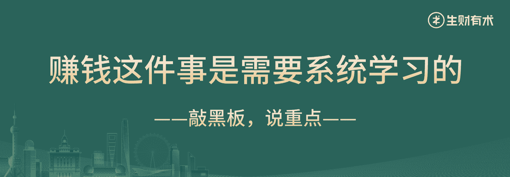

【🙋‍♂️互动】认可这个出发点，并愿意留在直播间听完课程的同学把【认同】打在评论区

我们和太多想要赚钱的人沟通过，发现普通人最容易陷入的认知误区是，我依靠自己现在的能力就能够赚到钱，这个误区在毕业 3 年内的学员里尤其普遍。

**我给大家举个例子：**

如果你让一个大学毕业生解一道数学题，他很快就会告诉你他会与不会，直接能看到对应的结果，你把不会的人教会，告诉他解开这道题就能够考研上岸 985211，他大概率会骂你是骗子，因为他知道自己只学会了这道题的解法，并没有学会解题的逻辑，更别提考研不是考一道数学题，而是多方面能力的综合测试。

但如果你让一个人去做一个项目，他很快告诉你他会不会，因为里面的步骤都很简单，能做的事看一眼就知道是否能做到，不能做的事看一眼就知道自己不行，你把不行的步骤都教会，他终于赚到了第一个一百块，然后告诉他这几步做到就可以月入十万一夜暴富，他会对你感激涕零，交上数千上万的学费，因为他觉得你让他知道了一个项目如何赚到钱，哪怕现在不多但只要努力一定可以越赚越多。

**看明白其中的差异了么？**

从象牙塔到商业社会，从普鲁士教育到经验主义教育，不会有人提醒你环境发生了变化，如果还用过往的认知来做赚钱这件事情，会有无数个坑等着你。

【🙋‍♂️互动】在网上有报名过各类项目培训的同学扣 1

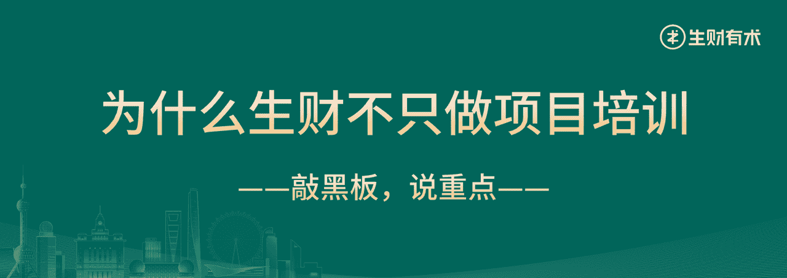

很多人觉得我不需要掌握赚钱的逻辑，提升赚钱的认知，我只需要去学个项目就能赚到钱，这句话有错么？

**没有**

但核心的差别在于，赚到钱，是赚多少？

**赚钱七年上万个**会员验证，对绝大部分不**掌握赚钱逻辑就盲目付费做项**目的人，赚到的时薪甚至不如去送外卖。

如果你想的是学个项目就能轻松月入过万，那对不起，今天就要告诉你一个非常残酷的事情：

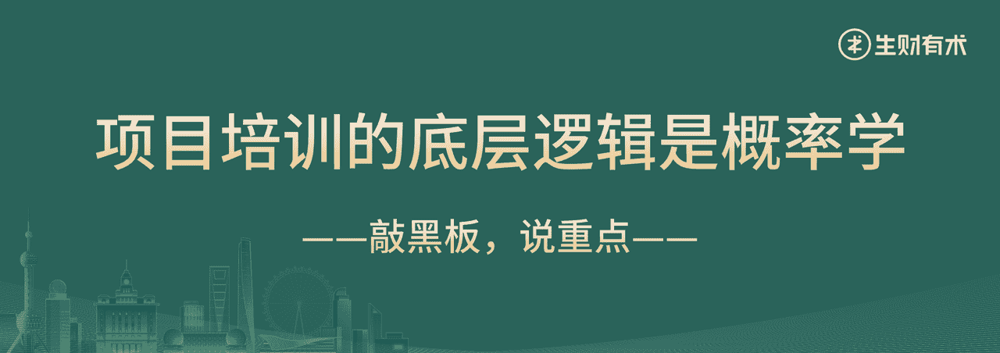

这两年项目培训类的知识付费人数越来越少，口碑越来越差，为什么？

**再厉害**的讲师，再专业的团队，都无法保证所有人成功。

【🙋‍♂️互动】大**家可以**想一个最底层的逻辑**，如果你现在**手头有一个项目，任何人来被你教会后都可以稳定月入过万，你会将这个项目定价多少？

答案是：**不会卖，自己招人做。**

如果你的员工成本是 4000，那一个人就有 6000 的净利，如果你能招到 100 人，一个月就是 60 万

但实际是无论员工还是学员，只要基数足够大，那么一定会符合正态分布。

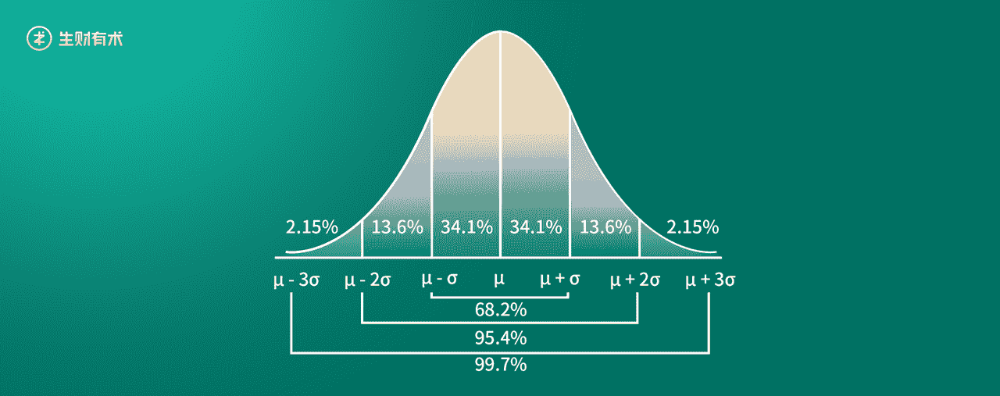

但当项目进入红海阶段，产出变得不可控之后，正态分布的中间值开始从一万向下滑动，当中间值到多少的时候这个项目会流向市场，成为培训项目呢？

**当μ值趋近于人力成本均值时**

你需要通过招聘能力更强的员工，打造更好的产品，提升整体竞争力和壁垒，才能将中间值控制在人力成本线上，即便是这样依然有概率亏损。

正态分布的中值μ，你以为是一万，但更多时候是零，而正态分布均值以下的每个负口碑对品牌都是致命的。

多次失败的尝试让购买项目的学员放弃了对赚钱的希望，在低维度的认知中形成了闭环，世界在他们眼中非黑即白，于是开始愤世嫉俗，所有卖课的一律被打成割韭菜，所有赚钱的人一律被骂资本家。

所以每个**做大的项目培训**最终都会迎来消亡。

七年时间，赚钱见证了无数项目和导师起高楼、宴宾客直至楼塌人散。

正因为龙哥盟做出了不同的选择，赚钱交付的是赚钱的底层逻辑和内容，是一次又一次前沿的项目实战，而不是只培训具体的某一个项目，所以活到了现在，而且越活越好。

多年的经验告诉我们，底层逻辑强大了之后，只要能抓住一个小机会，就能赚到钱，只要你掌握了底层逻辑，不仅仅是从项目中赚钱，而是哪怕有的项目没赚钱，也能够规避大风险，做到及时止损，或者能够判断在未来的时间里它是赚钱的。

所以赚钱在帮助大家提升赚钱能力这条路上越走越远，成为了现在国内规模和口碑双一流的赚钱社群，这堂课也是在这样的初心下诞生的。

> 这里有上一年圈友们对赚钱的评价，大家可以从大家的评论中感受一下赚钱对他们的帮助

> https://5th.shengcaiyoushu.com/

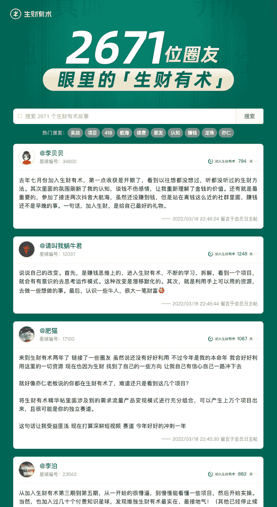

## 预热思考题

在开始讲解具体知识点前，我们先来做两道预热思考题。

为什么要有预热思考题？

提到学习，多数人第一个反应就是去获取知识，但比起知识更重要的是如何提出正确的问题。

拥有提出正确问题的能力，这可比掌握很多知识点重要多了。

所以预热思考题一方面可以帮助大家热热身，快速进入听课状态

另一方面，也希望大家能够代入自己现在的真实情况去思考课程中讲解的知识点，等到课程结束后，大家再回答一次，就可以看到自己的赚钱认知，在以肉眼可见的速度在成长。

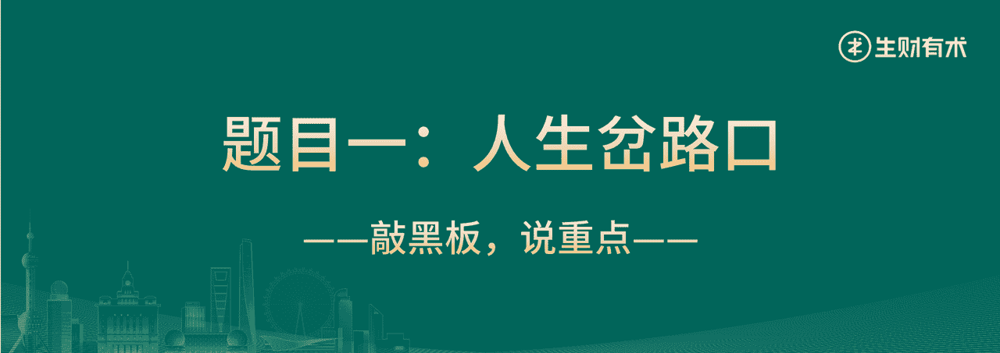

【🙋‍♂️互动】听下面的故事，在每个点上面做出自己的抉择，比如1a2a3b。

我们来假设一个场景：

> 你是一个**一线城市的上班族**，在一家中型的互联网公司上班，主要负**责线下商家的开发与维护，每**天七八点下班，有 3-4 小时的空闲时间，已经稳定工作了四年时间。

> 凭借较高的情商和沟通能力，虽然业绩并不顶尖，但凭借积累的客户也**能排在中上游，每**月一万多的收入几年下来也有了十几万的储蓄，但最近效益下滑，不仅晋升概率变小，收入也有缩水的风险。

> **有一个相恋多年的女**友，有稳定的感情，也到了谈婚论嫁的阶段，虽然女友嘴上不催，但你能感受到她对你承诺的期许。

>

> 最近这段时间发生了很多事情，你觉得来到了人生的岔路口：

>

1.  你试着更新了一下简历，收到了两家公司的邀约

1.  **【小公司图发展】**一家是小型的创业公司，是你之前领导创办的，启动期十分缺人才，虽然薪资水平不稳定但未来发展空间巨大，过去之后还有机会打造自己的团队，但风险也比较大不知道能活多久。

1.  **【大公司图稳定】**另一家是互联网巨头，看中了你负责片区的商家，希望你带着资源跳槽他们，给出了稳定的薪水，比你的平均收入略高，但你知道去那边后凭你的年龄和资历很难再有大的发展。

1.  你参加了你们大学同学的周年聚会，在席间聊了几个多年不见的同学

1.  **【做副业】**一位在电商行业的同学现在副业正在自己做新的📕店铺项目，据说上个月赚了四千多，这个月爆单可能做到近万元，听完你很心动

1.  **【去创业】**还遇到了你大学时的上铺，你们关系很好，他最近正准备出来做旅游方向的创业，正在招募合伙人，你看了看他的项目计划书，还做的有模有样的，告诉他你回去考虑一下

1.  你和女友手上的定期存款到期了，本金加利息可以拿回将近 40 万，准备继续合理利用这笔钱

1.  **【投实体】**你们公司楼下一家你常吃饭店的店主因家里有事要转让，听店主说旺季每个月可以赚 3-5 万，淡季也有一万多，盘下整个店面需要 60 万左右，你算了一下如果真如店主所言，将近两年时间就可以回本

1.  **【投房产】**你女朋友父母最近又在催你们的婚事，二老愿意联合你的父母各拿出 40 万，加上你们的存款共计 120 万，在市中心刚好够置办一套 80 平小窝的首付款，但为此的代价是你们不光要掏空积蓄，还要每月背上一万多的房贷，但你听说这个房子的上涨空间还不错，在大环境下行的情况下，这个小区今年又涨了几千块。

1.  **【投虚拟】**你同学会的一个同学最近炒股赚了很多，你看着他红红的收益也非常加入，问了一下他愿意让你跟单操作，但是你本金比较少，可能收益并不会很高，他推荐你可以尝试配一些杠杆，他对自己的炒股能力有信心

想一想，上面的情况你会怎么做？

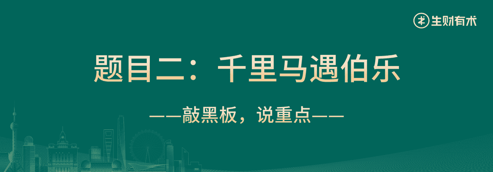

我们再来假设一个真实的场景：

> 你集齐了七颗龙珠**，发动龙珠召唤了龙哥和赚钱****的老板智囊团**来帮你做一**次副业/创**业方向的咨询**，但因为只有一个小时**的时间，所以你需要快速讲清楚你个人的优劣势，你看中的项目是什么，以及接下来每个阶段打算如何发展

>

> 在正式沟通前你要快速介绍一下自己和咨询的项目，最好能有一张纸来记录所有的关键信息，再见面进行沟通

好，问题来了，**给你一张白纸，站在宏观&上帝视角上，写下你的介绍，让对方快速了解**能够给你提供什么帮助，并快速帮你从零到一启动你的项目，甚至给出项目之后的发展战略，你会怎么写呢？

预热思考题我就说完了，你可以做个头脑实验，想想你现在的思考模型和深度，希望大家可以带着这个问题学习，课程结束后，带大家感受一下认识能力的提升。

【🙋‍♂️互动】理解了预热思考题的同学，给我扣个 1。

## 提前划重点

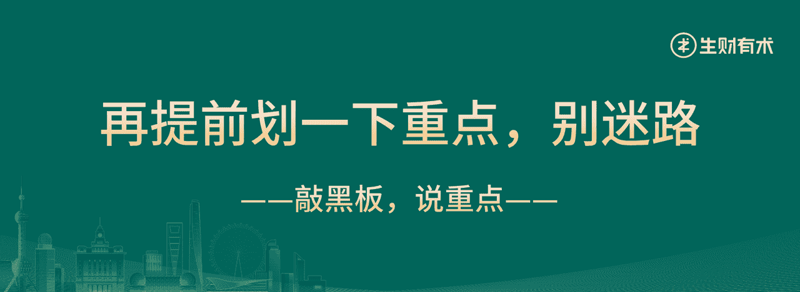

这节课，重点通过一个模型来解决 4 个话题：

1.  **理解本质：**赚钱的底层逻辑究竟是什么？

1.  **方向选择：**不同阶段应该如何调整自己的收入来源？

1.  **赚钱拆解：**如果想要从零开始打造收入系统都需要那些？

1.  **快速起步：**如何快速从零到一赚到钱？

## 赚钱秘籍：赚钱 418 模型

在今天这节课，我会带大家一起感受一下赚钱起步的过程，并教会大家一套非常实用的赚钱工具，这节课干货非常多，而且掌握起来很有难度；大家基础差距比较大，我尽量都照顾到，大家努力跟上我的节奏吧。

本次课程干货较多，为了大家能够有比较好的学习体验，鼓励大家深度参与，集体学习，共同打造一个好的学习氛围，并且听课有福利，还记得我们的新手术值奖励么？

| # 任务 | #  新手术值奖励 | # 获取上限 |
| --- | --- | --- |
| **直播课完成签到并发言互动** | **1** | **2** |
| **直播中积极总结金句并发言互动** | **1** | **N** |
| **担任学习委员并总结一次课后笔记** | **1** | **1** |

之前的直播发言互动率达到了 80% 以上，看看本期我们能否挑战更高的数据！

今天的直播内容非常多，为了提升直播课效率，避免反复被打断、往上翻以及很多个性化的提问。我们今天直播招募学习委员，来帮忙划重点、提升互动质量、和你所在班级的学习氛围。

【🙋‍♂️毛遂自荐】欢迎大家主动报名“**学习委**员”，谁愿意？在评论区扣一个：我愿意，鱼丸会在后台记录报名的学员。

> 请大家积极报名学习委员：**1）直播课中划重点**   **2）直播课后分享笔记**   **3）积极交作业**

> **特别奖****励：优**先获得优秀毕业生资格，提名 MVP必备。

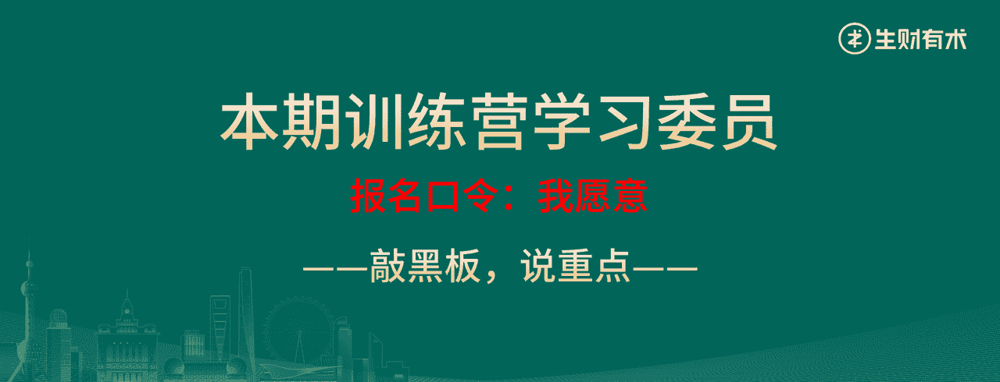

| # 🚫 | **请大家遵守直播课规则：** |
| --- | --- |

# 赚钱的底层逻辑

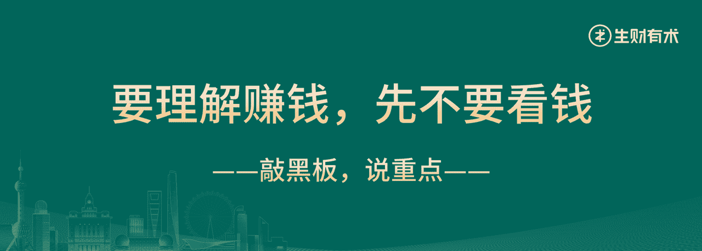

提到赚钱，不少人盲目地追逐“钱”，以为“钱”的积累就是赚钱能力的体现。却不知道，“钱”的流动只是一种表象。

赚钱能力的真正核心是，能够持续不断地从社会价值中提取剩余。

绝大多数人追求“钱”的积累，但却不能理解，“钱”的积累是存量，“钱”是过去的事情带来的结果。

**而“赚钱”是什么？**

**“赚钱”是让别人的钱流向你口袋的过程。你变得更有钱的过程，就**是更多人的劳动和价值转向你的口袋的过程。

收入不高且一毛不拔只靠攒钱积累财富的人有赚钱的能力么？

家财万贯但是终日花天酒地的富二代有赚钱的能力么？

彩票中奖或家里拆迁一夜暴富的暴发户有赚钱的能力么？

那么如何让他人把口袋里的钱掏给你呢？

> 除了《刑法》里的办法之外，唯一亘古不变的法则是：

>

> 你对他人有用（有利益），或者你可以对他人施加损害。

>

> **你**对越多人有用，你的用处越大，或者你可以对越多人施加损害，你能施加的损害越严重，那么你能把控的赚钱能力就会越大。

>

> 而当你把这份利益或损害进行转移时，“钱”就会发生流动，所以你将钱“赚”到了你的口袋。

>

> 我们一般将这个转移的过程称之为**“交易”**

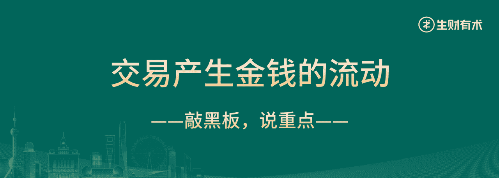

那么什么是交易？

不是只有你出去做销售，卖货是交易；你在职场获取一份offer，也是一种交易，你靠将自己的时间和健康出卖给雇佣者，赚的是“血酬”；

**你创业，创建一种商业模**式，所谓商业模式，就是交易模式，通过“掌握稀缺的社会资源”来赚钱，意味着你对那些没有这些社会资源（上不了牌桌）、但同时又非常需要这些社会资源的群体们，有巨大的“作用”（得利）、或者是能够“加害”的力量。

所以赚钱的必要要素，第一，你掌握的资源；第二，你所能找到的买家，也就是愿意为这个资源付费的人。

而刚才我们已经说了，**赚钱的本质，就是能**对他人施加“得利”或者“损害”影响，从而让他人必须同你“做交易”，向你“上供”他的劳动剩余。

基于上面的逻辑，其实我们可以将财富划分为以下四大来源途径，也就是我们赚钱 418 模型中的 4。

# 4：四大财富来源途径

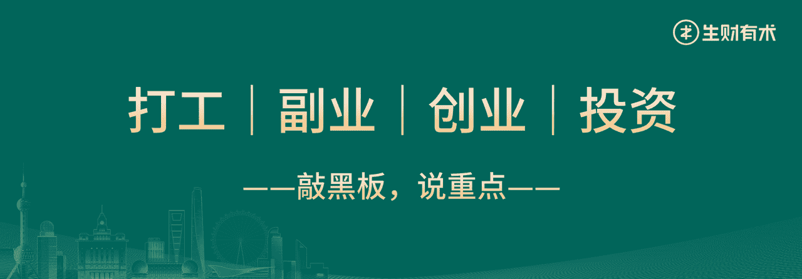

## 打工

从职场角度，你的技能，你的工作经验，你的时间就是你的资源，雇主就是买家。

从其他角度，你的资源可以是货物，商品，也可以是信息优势，或者服务能力。但很多时候，你并不清楚自己的优势资源是什么，更不清楚买家会是谁。

很多打工者认为自己的技术能力，工作经验是资源，当然这样说也不能算错，但行业认知能力，知识广度其实也是资源，而这些价值往往被低估。

大部分普通人做的工作，其实跟“底层画师”很类似：技术含量不高，门槛也不高。

稍微学两三个月就能上手，如果自己不想着精进，后续更多是“机械重复”，和在流水线上“切菜”没有本质区别。

【🙋‍♂️互动】基于上面讲解的逻辑大家可以自己评估**一下，你现在从事的**工作有没有在帮你积累“稀缺的社会资源”？

如果没有，那么从商业的角度来看，这是最差的商业模式。

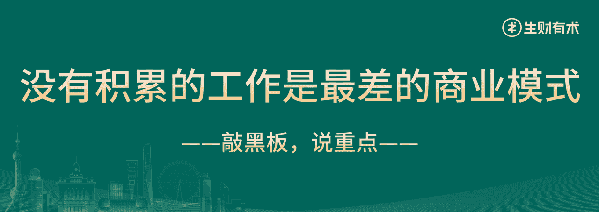

只是**单纯拿自己的时间和精力换金钱（维持生存**的物质资料），缺乏金钱外其他资源的积累。

没有核心竞争力，很容易会被拍在沙滩上。

但大部分普通人往往会囿于这种工作，特别是，当这种工作当前有稳定收益时。

道理其实很简单：

简单重复就能换到钱（甚至会非常努力地卷一些无意义的重复），给到的激励和正反馈很明确。不需逼迫自己进阶高难度的事，或者费脑子思考，就能赚到眼前明确的收入。

这会开启动物本能的“无脑循环”，让大家感觉到“爽”。

**但大家要知道，努力从来都是非常重要的，可问题是许多**人实际上不明白什么是真正的“努力”，大部分人都在用战术上的努力掩盖战略上的懒惰和迷茫。

战略上的努力，是不断学习和实践，去寻找并看清行动的方向，并在现实的磨砺中不断调整自己的认知和策略，排除万难地解决问题，并辅以持之以恒的意志和韧性。

整个过程，都不该是机械重复和无脑循环，而是要带着“主体性”去思考和创造，不断发挥主观能动性。

所以如果你希望在打工这条路上赚更多

第一要通过提升自己的思考和创造能力来提升自己的稀缺性

第二要通过提升自己的影响力来找到更大的买家

寻求买家也是一种能力，古人说，学成文武艺，货与帝王家。意思就是，学好了本事，把自己的本事卖给朝廷，因为只有朝廷才能出得起最好的价码。那么现代社会职业选择面多了，很多人反而不知道如何做出有效选择。为什么一直强调要建立影响力，你要让更多买家知道你，你才有卖出好价钱的机会。

比如之前互联网热潮，如果你是程序员或产品经理，那你的收入是远超普通人的，再上一个热潮是芯片，现在是人工智能大模型，选对买家，才能提升自己打工的上限。

那如果你现在从事的就是这样的一份工作，该怎么办呢？

## 副业

如果你的主业增长空间有限，每个月拿不到一万块的工资，一年12万，十年120万，三十年360万。

这就是大多数人的财富轨迹，而且年收入大于12万的人，并不多。

很多人终其一生，都不清楚这个模式有什么问题，也许他会觉得有些不妥，但是不妥在哪里，说不出来。

**于是你有了一个要做副业的念头**，那听完这节课，我希望你第一秒可以想到这句话：

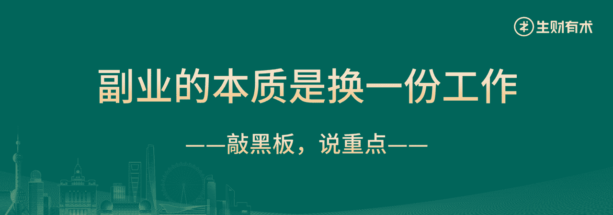

现在已经没有什么商业模式是没有被发现的了，你在网上看到的日赚过万的项目推荐，实际上都有公司在规模化运营。

所以不要相信什么自己从零研发，那些都是噱头，能够从零研发的项目要么是公司化操作有风险的灰色项目，要么是之前说的正态分布已经低到开公司操作大概率会亏的程度。

你所从事的每个副业，实际都是成熟公司中的其中一个岗位，只是你出卖给的对象是买家，而不是公司。

所以我们又回到了上一步的关键要素：

第一要通过提升自己的思考和创造能力来提升自己的稀缺性

第二要通过提升自己的影响力来找到更大的买家

只不过这一次，没有公司来带你，你要自己来学习。

也没有公司给你提供固定的买家，需要你自己来寻找。

但本质上和选择工作是一个逻辑，甚至可以套用三叶草模型。

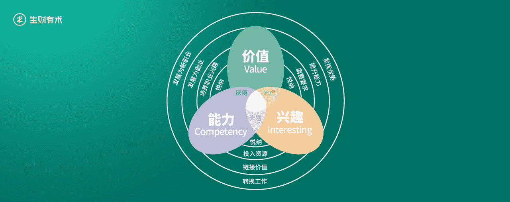

【🙋‍♂️互动】你目前的工作缺少三叶草中的哪一瓣？

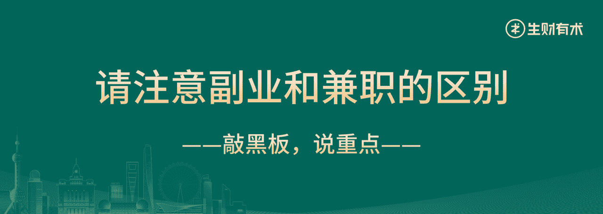

副业是为创业做准备

是要在过程中**“掌握稀缺的社会资源”**

或者“提升自己的思考和创造能力来提升自己的稀缺性”

以及“提升自己的影响力来找到更大的买家”。

没有以上作用的不叫做副业，叫做兼职。

## 创业

如果你已经积累了足够的资源，此时你可以开始尝试走上创业道路，那创业和副业的区别又在哪呢？

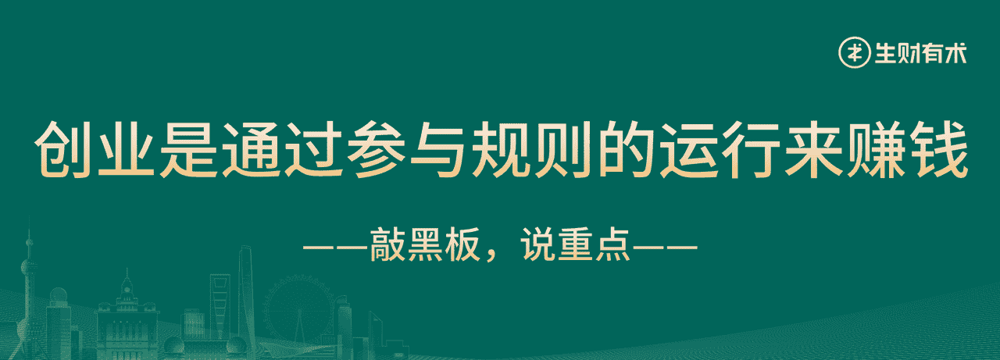

**创业0-1  靠信息差**，此时的规则是你能通过掌控稀缺的信息渠道来赚钱，如果这个商业模式已经被大众所熟知，而你又没有更稀缺的信息，那你的利润很快就会被抹平，比如之前的书单号、闲鱼、剪辑等。

**创业1-10 靠团队管理**，此时你要参与打造团队运行的规则，如果你现在的思维还是用自己的视角去看待项目，也就是这个事情我自己不能做，那么你很难赚到大钱。

符合你喜欢的项目，还要赚钱的，那么很少很少。赚钱这个事情不要从主观的喜好去判断，要从市场的盈利去判断。

老板和个人的区别就是，这个事是谁做的问题？

个人第一思考，我自己上。老板第一思考，这个事谁更合适。

如果你现在还是什么事情都自己亲自往上冲，那么你很难拿到大结果。

当然这个阶段是你走过了1.0阶段，但是脑袋里也必须有这个思维。这个不是偷懒的思维，是全局的思维。

你可以前期和团队攻坚克难，但是后期必须脱离。你要相信，一个在项目上每天投入8小时的人，慢慢得一定会比你这个投入2-3小时的人更牛逼。

前期可能你认为自己厉害，但是后面一定是他们比我们厉害，如果你一直很厉害，这不是什么好事。

**创业10-1000 靠模式**，此时你要参与运行的是行业的规则，用接地气的说法，这就是做局，坐庄。

在你的场域中，你说了算，你是庄家，你制定规则，你演化出生态，你是绝对的主场。

**而在构建这个属于自己场域的过程中，要注意做到把更多人绑上自己的战****车**，通过分利让利的手段，让更多人、特别是牛人能在自己的场域中得利，这样便可以借助牛人的力量，将自己的场域推广的更远，让自己掌握更强大的“制定规则”的力量。

当更多人进入你的主场，形成了生态，更多的人来玩你制定规则的游戏，你就能让他们每一个人为你的场域“贡献价值”，从而稳坐钓鱼台。

** **因为你是“上帝”，你是“裁判”，你对你的场域的所有玩家拥有最大的“得利”和“施害”的能力，故而你总能从他们创造的价值中分得份额。

## 投资

关于投资的复杂性不是三言两语能够讲清楚的，但大家可以记住下面这段话

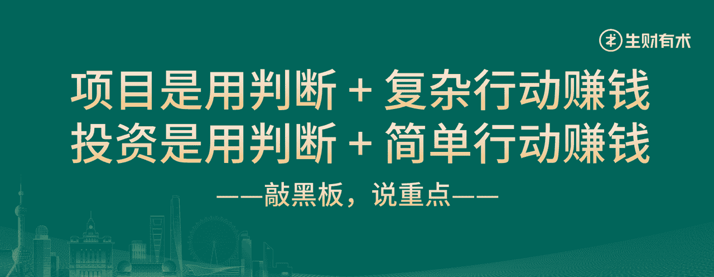

【🙋‍♂️互动】大**家还是否**记得我们的互动思考题，记得的回复 1。

## 四者之间如何切换

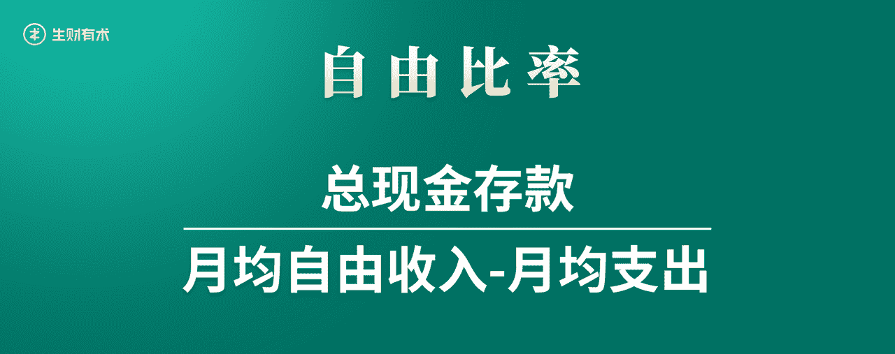

【🙋‍♂️互动】大**家可以自**己计算一下自己的自由比率，将段位结果发到评论区。

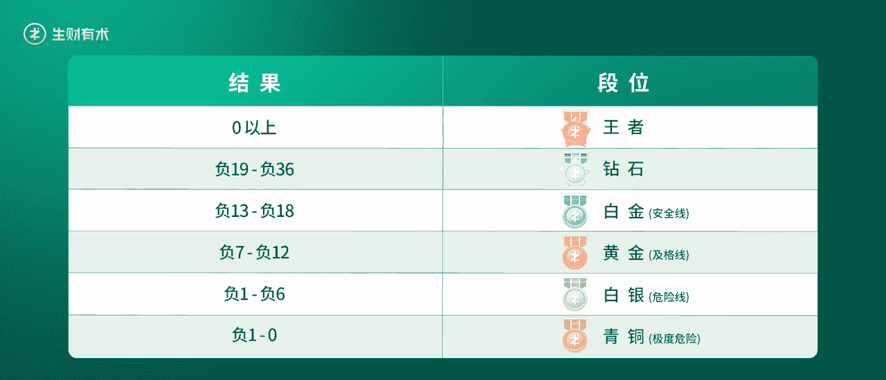

### **打工人要不要开始做副业：**

看工作是否有积累，看行业天花板，看发展潜力

看副业是否有积累，看行业天花板，看发展潜力，看是否符合三叶草

### 要不要从副业变创业：

**看自由比率是否大于六个月，看掌握资源**的稀缺度，看团队管理能力，看模式打造能力

### 要不要开始投资：

过于复杂，因人而异，但建议自由比率大于六个月

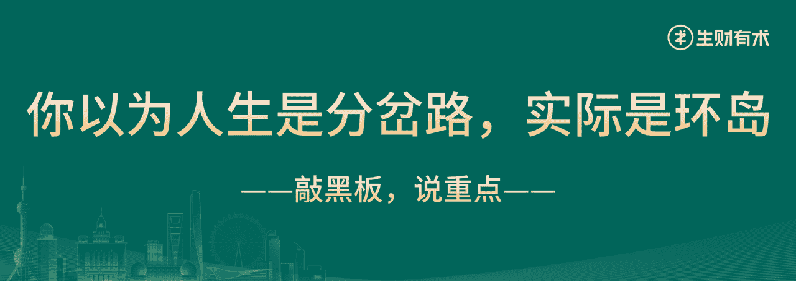

### 还记得预热思考题中的人生岔路口么？

> 最近这段时间发生了很多事情，你觉得来到了人生的岔路口：

>

1.  你试着更新了一下简历，收到了两家公司的邀约

1.  **【小公司图发展】**一家是小型的创业公司，是你之前领导创办的，启动期十分缺人才，虽然薪资水平不稳定但未来发展空间巨大，过去之后还有机会打造自己的团队，但风险也比较大不知道能活多久。

1.  **【大公司图稳定】**另一家是互联网巨头，看中了你负责片区的商家，希望你带着资源跳槽他们，给出了稳定的薪水，比你的平均收入略高，但你知道去那边后凭你的年龄和资历很难再有大的发展。

1.  你参加了你们大学同学的周年聚会，在席间聊了几个多年不见的同学

1.  **【做副业】**一位在电商行业的同学现在副业正在自己做新的📕店铺项目，据说上个月赚了四千多，这个月爆单可能做到近万元，听完你很心动

1.  **【去创业】**还遇到了你大学时的上铺，你们关系很好，他最近正准备出来做旅游方向的创业，正在招募合伙人，你看了看他的项目计划书，还做的有模有样的，告诉他你回去考虑一下

1.  你和女友手上的定期存款到期了，本金加利息可以拿回将近 40 万，准备继续合理利用这笔钱

1.  **【投实体】**你们公司楼下一家你常吃饭店的店主因家里有事要转让，听店主说旺季每个月可以赚 3-5 万，淡季也有一万多，盘下整个店面需要 60 万左右，你算了一下如果真如店主所言，将近两年时间就可以回本

1.  **【投房产】**你女朋友父母最近又在催你们的婚事，二老愿意联合你的父母各拿出 40 万，加上你们的存款共计 120 万，在市中心刚好够置办一套 80 平小窝的首付款，但为此的代价是你们不光要掏空积蓄，还要每月背上一万多的房贷，但你听说这个房子的上涨空间还不错，在大环境下行的情况下，这个小区今年又涨了几千块。

1.  **【投虚拟】**你同学会的一个同学最近炒股赚了很多，你看着他红红的收益也非常加入，问了一下他愿意让你跟单操作，但是你本金比较少，可能收益并不会很高，他推荐你可以尝试配一些杠杆，他对自己的炒股能力有信心

【互动🙋】听完上面赚钱418模型中的4个财富来源，你的选择发生了改变么？改变了/没改变

当然，没有人能预知未来，也没有人知道自己的选择是否一定正确，但过于安逸的生活，不动脑的随波逐流，一旦陷入被动的困境，便很难解决。

**当你还年轻时，你感受到的是：**

1、自己的经验、职位、收入都在逐渐上升

2、身体健康，熬夜、加班、饮酒作乐完全没问题

3、父母健康、没有结婚生子，没有多余的后顾之忧

于是便觉得自己的未来一定十分美好。

然而当你的年龄越来越大，就会发现

1、你的成长慢慢变慢，遭遇职场天花板，之后更多的都是重复性劳动

2、体能开始下降，身体开始出现各种小毛病，熬夜后一周都缓不过来，记忆力、精力都在下降

3、父母去医院的次数增加，开始有了慢性病；自己有了孩子，家庭支出大幅度增加

4、上有老、下有小，身背房贷，开始追求稳定

可能今天还过的很潇洒，明天突发一个事情，人生难度立马提高几个数量级。

一定要记得

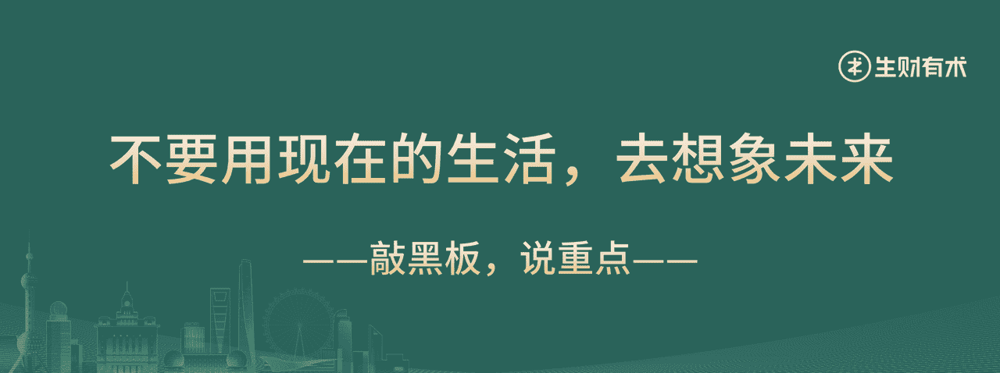

**给大家讲418模型，不是****想贩卖焦虑，而是发自内心的希望****，大家生活之余多想一想。

自****己期望的生活是怎样的？****

想收入翻倍，还有哪些工**作要做？

自己再工作三年，事业能上一个台阶吗？

所处的行业未来会有高速发展吗？

如果突然失业，怎么办？

如果家人得了重病，怎么办？

我身边四十岁的人都过的怎么样了？

多想想这些问题，终归是有好处的。

记得以前我问过赚钱里的大佬一个问题，大意是如果把你有一天陷入特别惨烈的困境中，你该怎么翻身？

这位大佬反问我：

为什么你要陷入这种境地，而不是避免问题的发生？

人生很多事情，其实是无解的，比起痛苦的挣扎，不如早早未雨绸缪，绕过这些坑更为实在。

一切的关键是，要多想。

# 1：一套0-1赚钱核心模型

## 四个起步能力差

有的人在一些高质量的圈子，这个热点刚刚有苗头的就看到了，而有的人不在圈子里，接触不到这方面的信息。

比别人更早接收信息，这个叫信息差。

有的人看到信息知道信息的价值，开始去行动，而有的人完全不理解。

**看不懂信息的价值，就叫认知差。**

有的人看到这个热点立马行动，足足发了8条推文（👸号日推文的上限），而有些人也看到了这个信息，但是行动的比较晚，也只发了一条推文。

比别人做地早，做地多，这就叫执行差。

有的人看到热点之后，有自己的关系和技术，能够迅速跟上，而有的人没有这方面的技术，即使看到了赚钱的机会也抓不住，只能眼睁睁的看着机会溜走。

有技术和资源抓住机会，这个叫资源差。

而信息差、认知差、执行差、资源差相加的和，就是结果差

### 信息差

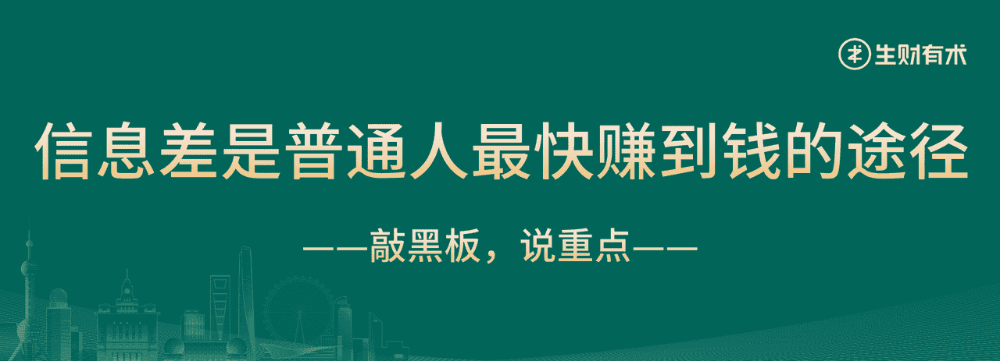

**信息差也被称之为“赚风口的钱”**

看什么风刮过来，就冲进去捞一笔，赚风口的钱，虽然是“一波流”。

但是操作起来往往简单易行，赚多赚少取决于你的进场早晚。

①找到红利行业：红利行业是流量的簇拥地，所以流量很容易获取，且大家都认为这是一个很大的机会。

②找到信息差：你只需要找到这里面的一些信息差，然后卖给新进场的人即可。

下面这些大家耳熟能详的项目，第一波进场的人都赚到了钱

【🙋‍♂️互动】大家是否有听过这些项目，可以把编号打在评论区。

1.  云蹦迪

1.  孤寡青蛙

1.  企业信用修复

1.  光盘修复

1.  音乐U盘

1.  老照片修复

1.  3D 彩超 AI 绘画

1.  AI 绘画二维码制作

1.  天涯神贴

......

这种钱的本质，**是因为敏锐于时代需求和风向的改**变，于是能做到在“新的稀缺资源”替代“旧的稀缺资源”的过程中，去抓了一下“新的”。

但因为**能力不够或者认知不够、运气不足，最终并没有抓到“稀缺”资源，因此无法产生**“复利效应”和“护城河”，缺乏长期的积累和发展性，先进场吃肉，后进场大家一起喝汤。

许多三天两头换营生的“生意人”，一波一波吃风口的，其实赚的就是“这个钱”。

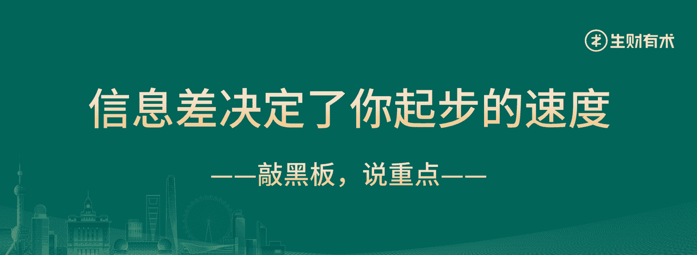

那龙哥盟是如何帮大家补充信息差的呢？

这就要提到我们的风向标栏目了：

聚集上千位商业嗅觉敏锐的圈友，分享他们发现的、正在发生的赚钱项目的栏目，包含了新机会、新模式、新平台、新思维、新工具和新用法等等。

读风向标也是龙哥说的，“商业思维提升最快的方式之一”。

风向标≠完全的赚钱，但风向标一定和赚钱息息相关。

龙哥盟星球，前前后后已经发布了4w多条风向标，也评选出了5000＋条中标。

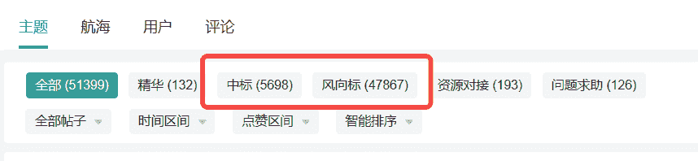

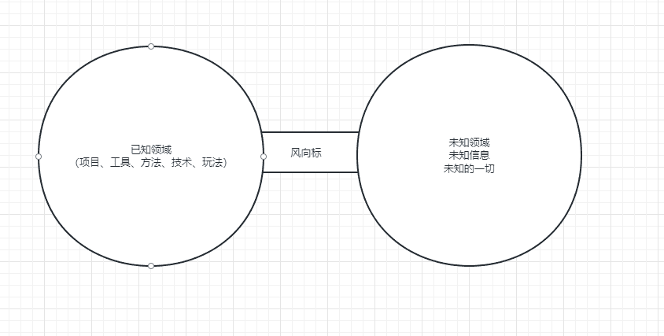

### 认知差

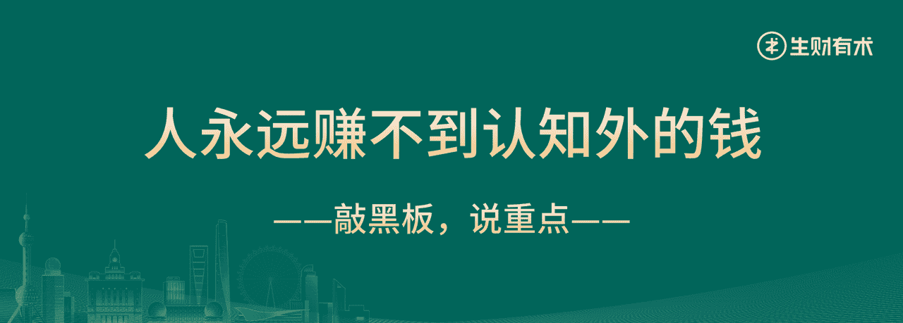

同样一个信息，不同的人看到的是不同内容，如果你没有足够的认知，

比如我说：uhsuoyiacgnehs，你记一下

你会觉得很奇怪，这是什么？为什么要记

但如果告诉你，这串乱码颠倒过来就是龙哥盟保险箱的密码，你一定会记得住，因为和你自己赚钱息息相关。

那如何提升自己的赚钱认知呢？

赚钱有一个精华帖板块，这是龙哥盟高手分享的实战赚钱干货，每一篇精华帖均由星主评选。

这些赚钱精华包括市面上稀缺的、各行各业、真实前沿的实战赚钱经验，可以算得上是一部普通人的真实赚钱史，能够帮助大家提升自己的赚钱思维。

用圈友的话来说，这就是一个诠释实践逻辑，干货满满，适合块状时间用心学习的宝藏地。

赚钱是这样帮助大家解决的。

第一个是“照方抓药”，第二个是“随机熏眼”。

大家回想一下我们上学阶段都是如何学习的？

是不是每有一个不会的题就看答案，或者找知识点？

照方抓药，就是根据自己的需求，输入关键词，查找自己感兴趣的内容，比如📕、视频号、👸号相关的赛道....

“随机熏眼”，就是随意翻翻帖子，在星球的“最新”页面，或者“精华”页面，直接往下滑，随手看看；

有意识的同学，会自己给自己安排任务，比如把书中例题举一反三，变换条件思考如何求解？

（1个项目，1W营收目标怎么做？100W营收目标怎么做？….）

思考同一个问题用不同的方法怎么解？

（社群玩法怎么做？小程序裂变怎么做？图文怎么做？视频怎么做？）

但是意识欠缺的同学，只看到了【问题和答案都码好了】 的【例题】

（问题和解法都写好的精华帖）

没有看到 【只有问题，没有答案】的【练习题】，就觉得无事可做了。

（看完了就关闭贴子，直接完事了，脑子里没冒出什么新的可以思考的问题，）

### 执行差

**普通人想赚钱，赚大钱，持续赚大****钱，谈何容易，每个拿到结果的人**，都是一路过关斩将过来的，对于我们大多数普通人来说：

一缺少看懂商业底层逻辑的认知；

二缺少能转化为赚钱机会的信息；

三缺少真刀真枪下场实战的勇气；

四缺少解决具体问题的经验技能；

五缺少同频真诚互帮互助的战友。

赚钱在执行上帮助大家找到更多志同道合的人，在赚钱路上一起真刀真枪下场实战，成为赚钱路上的战友。

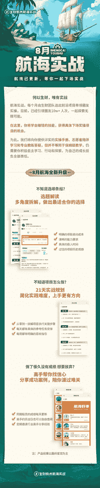

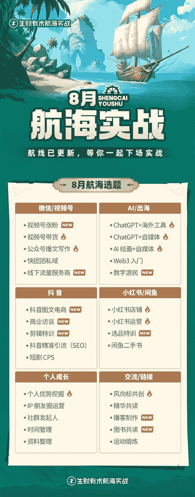

### 资源差

让愿意服务帮助更多其他圈友的圈友浮现出来，帮助他们建立IP输出影响力，成为赚钱的大小节点，同城、职业、技能、身份、阶段等各个维度，都有相应的圈友愿意组织活动和小圈子，带着大家一起学一起赚一起玩。

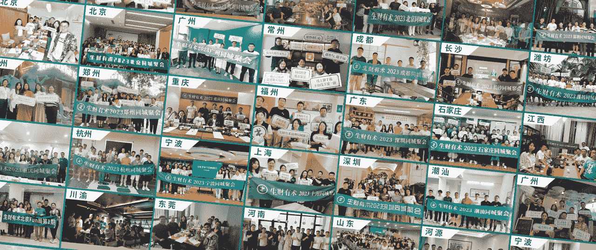

## 赚钱三板斧

## 成长四阶段

### 还记得预热思考题中的伯乐之遇么？

**站**在宏观&上帝视角上，写下你的介绍，让对方快速了解能够给你提供什么帮助，并快速帮你从零到一启动你的项目，甚至给出项目之后的发展战略

# 课程回顾和作业

## 赚钱 418 模型

## 这节课的初心

## 记得写作业

### **训练营新手福利**

### 你是想赚钱？还是只有赚钱的想法？

改变不是间歇性踌躇满志，持续性混吃等死，是从一个节点开始为人生积蓄力量。

张桂梅创办的华坪女高，生源质量非常差，很多女生入学前连初中水平都没有。

然而就是这样一所偏远贫困地区小县城的中学。

一本上线率44%，本科上线率94.33%，综合上线率100%。

她用成绩证明了：

【🙋‍♂️互动】给自己立个小flag：一定完成作业！！！

## 约好周四见

**周四 8:**00-10:30 ，一定要来参加（没回放）：

1.  第二节必修课：赚钱 418 模型中的 8，越赚越多的 8 个要素

1.  术值兑换口令

1.  现场作业点评（优秀作业评选）

1.  评选最佳学员 MVP

## 最后送大家一段话

我成年后明白的最震撼的道理之一，就是人可以通过不断的学习，利用理性与科学系统性的获取财富。

这种获取财富的方式是可复制的，别人可以，我也可以。

我震撼的点并不在于「我可能会变得有钱」。

而那种你可以成为「赚钱这件事的专家」，想赚钱就可以随心所欲的赚到钱，那种稳定的控制感，那种「预言实现」，简直太棒了。

从那时起工作、赚钱这件事对我来说更像是玩一个游戏，而不是为了生存被迫进行的痛苦挣扎。

【🙋‍♂️互动】今天课程到这结束了，最后一次签到结束：周四，不见不散！！！

