# 2023-10-21套现过千万，放弃网易200万年薪，六个月创建近3万人社群，All in AI：今天总结了一篇必看复盘

> 来源：[https://xuqiwei1986.feishu.cn/docx/GDDWdcBetoeYtxxZ9jlc9JJPnDg](https://xuqiwei1986.feishu.cn/docx/GDDWdcBetoeYtxxZ9jlc9JJPnDg)

> 🔗 原文链接： h[ttps://articles.zs](https://articles.zsxq.com/id_zapj4ujewsej.html)xq.com/id_zapj4u...

今早发了个帖子，因为最近不少会员在问我各种做AI副业，做个人IP的问题。

目前看回复量很大，于是我启动了这篇复盘。

请注意！这是一篇万字长文，请耐心阅读，相信看完你一定会有不小收获。

前言先说一句：这个世界上没有所谓的普通人，有的只是永远不行动的人。

再说一句：我并不是什么所谓大佬，在个人IP领域，我入局很晚，2019年12月27日，是我入局的时间点。那时候早就没红利了，但我一年多时间在职场近乎995的情况下，用每天一小时就做到了全网50万粉，这篇也会说一说心得。

好了，接下来是正文，分两部分，第一部分复盘我的副业岁月，第二部分复盘AI破局的崛起经历。

写一篇我的副业复盘和AI创业的长文，也能让大家更了解我。

**我算是一个非典型互联网从业者，在**过去的从业经历里， 干过技术、技术管理、产品管理、运营管理；创业过，还担任过大厂业务总经理。

2008年从华科计算机专业毕业，加入腾讯，2010年-2015年作为360初创核心员工，见证了360从500人到上市的全过程，这期间也从高级工程师晋升到产品技术总监。

360上市后我套现了过千万，拿到了人生第一桶金，在北京买了几套房。

但2015年，命运的齿轮转动了。

2015年志得意满的我，觉得打工已经不适合自己了，我要改变世界了， 于是连续创业三次，很遗憾，四年时间倒闭了三次。

第一次融资500万，烧了一年，没了、第二次和一位大佬一起融资一个亿，烧了一年，又没了、第三次做出国跨考，还是没成。

2019年11月，我创业第三次失败， 这时候我真的累了，于是想回大厂打工了，没曾想，我压根回不去了：简历已经乱了，大厂人脉也没了。

猎头看见我都会摇头， 没办法我开始寻找人生的出路。

想来想去，把几年前就想做的公众号注册了， 开始写作，开始打造个人IP。

2019年12月27日， 我开始了超级个体之旅，这是我的新起点。

最初什么都不懂，公域、私域、引流、钩子、CPS、产品体系、KOL、KOC、商业IP，这些概念真是三年时间慢慢摸索的。

但我知道要改变了，先做吧， 写了三个月，粉丝到了1万就此停滞，开始掉粉。

这个时候，我的人生贵人：勇哥出现了， 一个付费咨询，一通电话。

勇哥告诉我：公众号没有红利了，要做公众号，你得有公域！ 啥？啥是公域？

勇哥说：知乎、抖音等是公域，你做图文就去知乎、CSDN，等平台，引爆、做钩子、引流。

一小时，我悟了。

还没等我知乎起飞， 我的职场起飞了！

2020年10月，网易HR紧急找我， 说是CEO看见了我公众号的文章，点名要挖我。

聊了聊，不是骗子

然后网易的高级副总裁约我吃烧烤，然后就顺理成章加入网易做业务了，薪资直接double，200+

带团队100多人。

[刚加入网易，还应邀给网易](https://mp.weixin.qq.com/s/Fl12Q77UzfRvVNigLWJCnQ)管理层分享管理： 终于明白我为啥来网易了！

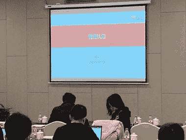

这时候我是一个年薪200万以上的大厂业务部门总经理了。

按理说，自媒体可以放弃了？

个人IP还需要做吗？ 我思考了两周，决定继续！每天做一小时，这件事儿也不能放弃！

尽管那时候我只有1万粉丝， 但它已经展现了它的威力：它能扩展我职场边界，带来无穷机会。

哪怕不赚钱，也要继续呀， 于是，一个超级自律的自己，诞生了。

我放弃所有娱乐，曾经喜爱的游戏，删。

曾经爱看的电影，戒。

曾经爱聊的天，退群。

关于怎么做知乎，我后续分享。

先看结果：坚持了7个月后，我的知乎从500粉开始爆炸。

每天阅读从100-1000-1万-10万-几十万。

我弄好钩子、引流。

知乎每天给我的公众号增粉1000+。

半年后，我在全网有了30万读者。

到今天为止，我的知乎总阅读数接近1个亿了！

收起

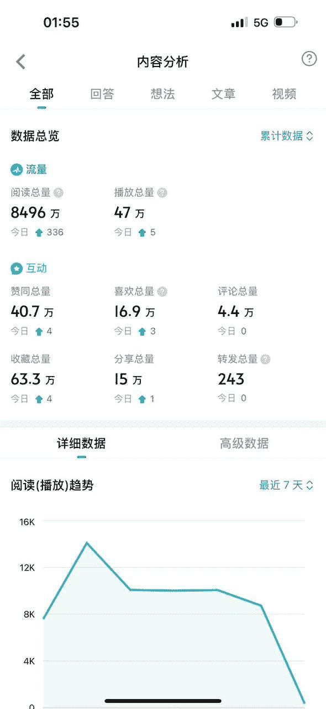

继续坚持日更， 每天一小时，我就是超级个体。

白天我是大厂部门总经理，晚上我就是个体户， 终于，我的B站，也起来了，我的公众号破5万、破10万、破15万了。

我的微信好友5万了。

我开始认识更高出层级的人脉了。

CEO、CTO、KOL、KOC们都来了。

慢慢的，我成网络节点大咖了。

建了一个互联网大咖群、建了一个号主群，聚会交流。

认识了路人甲、鱼皮、任易、小声逼逼等各路超级个体或IP。

慢慢的，在做个人IP一年半左右的时间，我的广告收入+知识星球+企业咨询，一年也达到了200+。

跟我的职场收入居然不相上下了。

慢慢的，我拥有了一个自己的平台。

这一切不过是每天的一小时。

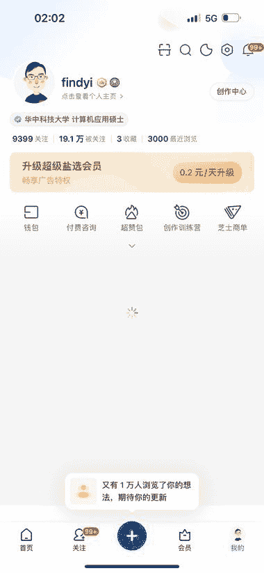

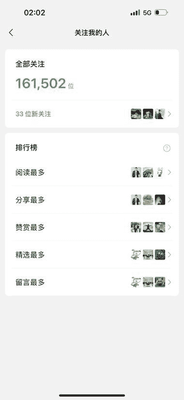

一个人胜过一个团队，胜过一家公司。

这种感觉，就是超级个体的感觉。

AI时代来临后，我更意识到它会让超级个体井喷。

因为它是10倍甚至百倍生产效率提升器。

于是哪怕我把网易的业务从亏损5000万干到盈利5000万并因此获得集团创新二等奖、哪怕我在网易晋升了，哪怕又要涨薪了，哪怕我已经创业失败过三次了。

在网易的三年，我操盘了 **年收入10个亿 **的业务，实现了业务整体盈利，团队也获得了网易有道各种奖励，更获得了网易集团创新奖：

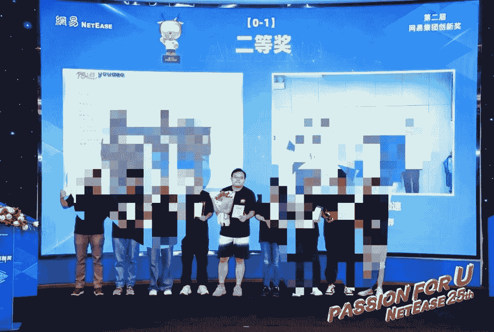

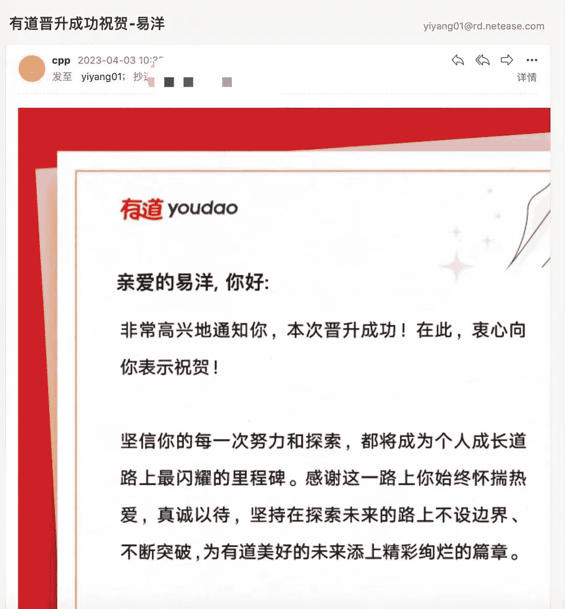

我还是毅然决然的离职了。

出来创业了。

因为我感受到AI时代的召唤，我感受到我的经验可复制、可赋能、可传播。

我必须拼一把！

底层逻辑是什么呢？

是这些：

比如我最近做的商业IP课，好多人看完后实操，知乎立马就爆了。

再比如我判断的AI多个风口，一一被验证。

我很擅长做这件事儿。

而AI时代又给了所有普通人一件效率神器。

我的方法论、实操经验、认知+效率神器，赋能给大家，会发生什么呢？

那么就是它了！

离职那天我写了一篇文章： [再见了，网易](https://mp.weixin.qq.com/s/lo91JZXZlNQcq1s6DXvMIw)

同时开直播我说了一句豪言壮语：在AI时代我要带领10万人，优先走进这个时代，我还要赋能1000个人成为AI时代的超级个体！

5个月过去了，以上的目标已经在实现中。

三年时间，我有哪些平台？

昨天有人私聊追着问，也简单说说。

1.公众号17万粉、 2.知乎20万粉、3.b站1万粉、4.视频号5万粉、5.头条，3万粉、6.微信私域8万。

以上，全部是每天一小时干出来的，这里面的独门秘籍，我可以写10万字。

目前我有哪些产品？

这个就更多了，虽然很少宣传：

1.AI破局：近3万付费，gmv过700万

2.职场&副业&成长星球，1100人

3.合伙人万元年度陪伴产品，210人（暂不纳新

4.企业产品zelinai，我是大股东之一 ，已获巨额融资

5.AI企业培训产品，这个后面会爆，大家拭目以待。

6.商业IP课程，学员数百

对了，以上不少产品，未来开放AI之心兑换通道！

我正在做的新产品：

今年我考虑把重心放到私域，进而让个人IP再上一层楼。

核心会做几个详细实操产品，比如商业IP小册之类，同时孵化其他人，是我的重中之重。

孵化这件事儿，举个例子：最近我推了几个合伙人的小册，轻松帮大家过1000-2000人订购。

论职场带100多人，年薪能过200的比比皆是。

论大V，全网50万也没什么难的。

论产品体系，我这个也不算啥。

论人脉，我也很普通。

但能把这四点聚于一身的，你在全国范围很难找到100个。（可能还说多了

有人说我是偶像型IP。

这是不懂我，我对交付和口碑看得比命还重要。

我并不是什么大佬，我只是个普通人，只不过比大家先走几步而已。

我只是一个交付型IP。

创造价值，获得认可，才是我追求的最宝贵的东西。

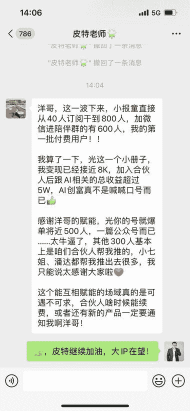

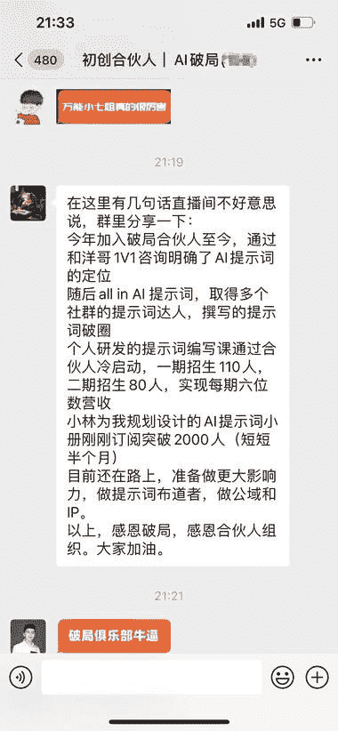

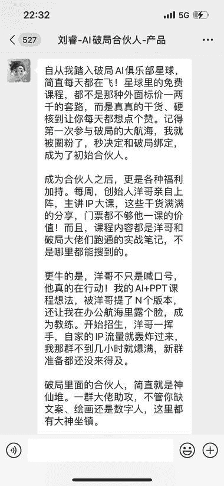

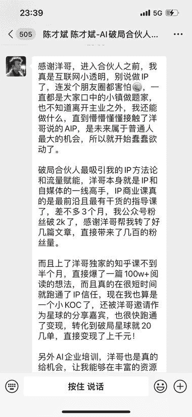

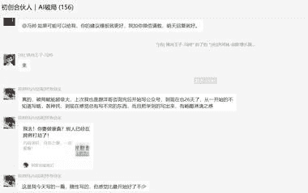

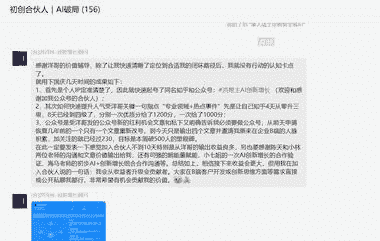

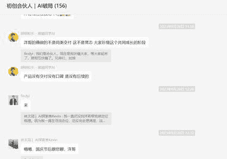

接下来，我复盘下做AI破局的五点方法论，希望对大家要创业，要做知识付费，要做社群的小伙伴，有所帮助：

**社群首先是产品，产品必须爆**

知识星球的本质是PGC+UGC，更底层它也是一个产品。

做过产品经理的人都知道，产品的品质决定了产品的生死。

但社群总要招第一个人，社群总有冷启动的问题，这个时候内容不可能太多，这个阶段如何让你的产品有价值呢？

这个阶段我采用的策略，是借力身边的人脉，疯狂拉了一群大佬给我的星球站台，比如投资大佬吴世春、许朝军、IT大佬刘江、自媒体&运营大佬黄有璨等等：

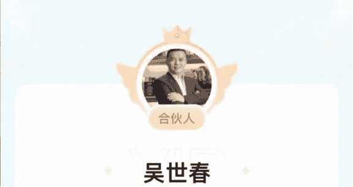

有了这些大佬的加入，这个星球的价值就不言而喻了。

但PGC要尽快过渡到UGC，延续爆品。

无论靠星主、靠嘉宾的方式都是短期的，一个社群要想长期保持活跃，最核心的是要尽快从PGC过渡到UGC。

在渡过初期的冷启动后，我快速制定了一套UGC激励体系，简单点说就是把社群的KOC找出来，并用精神和物质奖励，让这些KOC持续输出高品质内容。这里要感谢亦仁老大开创的知识星球社群的玩法模式了。

在我们社群发展1个月后，我也弄了一套UGC激励体系，有了这个体系之后，社群的内容输出开始变得高质量。

除了这些，运营活动非常关键，比如各种快闪的短期活动、线上直播和线下见面会，以及我们正在策划的实践课程。

同时因为星球会员数增长太迅猛，对很多星球来说，要发展到第二年第三年才会做线下活动，而我们在第二个月就陆续开展了北京、杭州、上海、深圳等地的线下见面会。

社群要的是链接，线上的快闪活动和线下见面会，能对会员产生极强黏性。

我们也策划社群的千人大会，进一步让会员们产生互动和黏性。

本质上用户交钱来到社群，如果不参与任何活动，那么用户是没有任何获得感的，他们也不可能有复购和续费。

**社群的增长方式：投放和口碑为王**

我自己的号算是冷启动时期的增长，这部分是社群的基础。

但我的号总计也就带了7000个会员，当然我的公众号并不大，只有不到20万读者，这个数据也非常不错了。

之所以能快速做到 **2.6万 **人，原因还在于另外两点：

**首先是投放 **，投放的方法主要是两个：公众号、视频号CPS、CPT，当然目前也在尝试校企合作方式和线下代理的方式，继续推我这个产品。

一般来说，大家都很少用投放的方法做知识星球，作为知识付费的入门标配，知识星球更多被大V们用做自己公众号的变现方法，做了一个轻产品去交付。

而星球这个产品是典型的社群产品，人越多、内容越多，越好推。

反之在发展的初期，星球内容少、人少，自然不好推。

这里说一个核心：刚需性话题星球，是可以尝试投放的。

比如很典型的副业搞钱、赚钱思路、个人品IP/品牌赋能等等，这些类型都有可能走投放模式。

**核心是初期如何用最小化成本去投放，我**的建议是： 自己先跑通小闭环，验证ROI效率，之后找KOL/KOC用CPS的方式去投放。

MVP的思路非常重要，这里面需要数据能力和分析能力，我之所以快速启动投放模式来做，源自于观察自己账号的数据。

做这个星球之前，我也有一个职场星球，我发现现在做的星球在自己账号的转化率是职场星球的三倍， 核心在于：现在做的星球是一个强话题星球。

**我**也计算了接广告和自己推星球的差距，最起码在2倍左右。这意味着一个299的品就可以做出来最起码ROI>2的效果。

当我自己推到2000会员后，那天晚上我失眠了。我感觉到这次有投放的机会，一旦跑通规模应该很可观。

**CPS的核心 **在于前期一定要有大号帮你背书，且你要认识足够多对你有基础信任的号主。这也算是平时积累的人脉。

这个过程你还需要用社群的远景去感召大号，简单点说公众号大号不缺广告，CPS这种方式他们一般都不会接受，因为他们会担心用户的口碑。

我当时找到第一个大号之际还在网易，我花了2个小时说服了他，让他放弃做同类产品，转而推我的产品。

**这个大号推**了之后，我拿他的案例撬动了近 200个 号主一起推我的星球。

我们给大V合作方的打款：

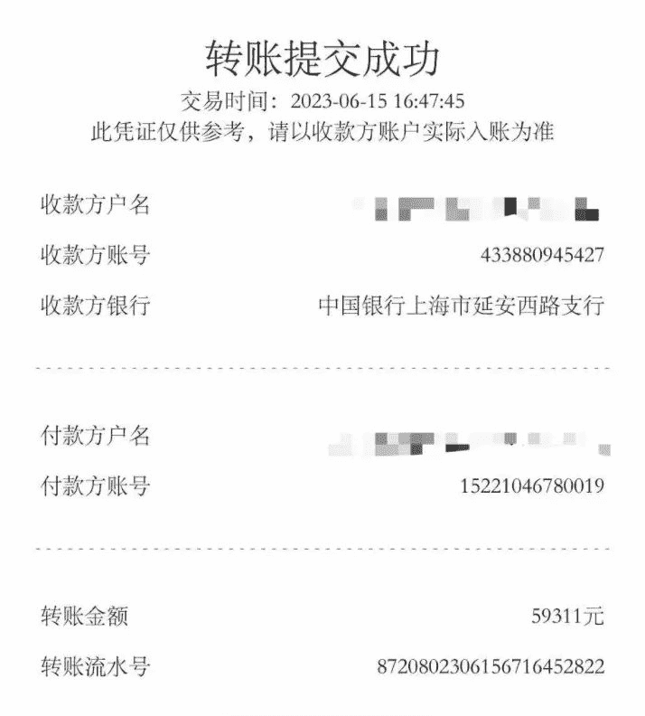

这么多号主一起推也导致一些问题，比如打款的问题，再比如记账的问题。

我们花时间都建立了自动化的通道，比如我们把记账的算法都固化在excel里，财务填几个数字就能出结果。

跑顺后星球达到 **日增1000 **的夸张程度，这个速度连我自己都没预测到，飞速增长的GMV和用户数让我快速下定决心辞职All in。

这里也提一下，All in后我发了一篇文章，开了一次直播，文章的阅读高达4万，直播场观破万，一下带来1000多用户。

CPT我们也在做，这个风险就会大很多，投放的方式分两种，一种是团队自己找号，我们在新榜筛选各种号，另一种是直接找媒介，给一定的抽成。

这里面需要先定位号的方向，要和品一致。我们选择的是：互联网、科技、创业、职场、副业号，这些离我们的品更近。

选出号之后，要观察这些号接广告的频次、评论数、点赞数等等，核心是判断IP的强弱。

IP越强的号带社群这种品越好带 ，这也是社群投放和其他产品投放不一样的地方，绝不能只看阅读量。

我们发现很多IP属性强的，可能只有500阅读，但一下卖了几十个产品，有些号5000阅读也只能卖10来个。

整个投放下来，我们的ROI是超过1.5的，这也让我们具备持续投放的能力。

我总结了一个简单的公式，可投度= （点赞*评论）/阅读数*报价。 这个值越高，这个号的价值就越大。甚至可以说，这个值基本和ROI挂钩。

下面这个号是我们投放的一个号，大家可以看看，哪怕是广告文，这个点赞数和评论数是不是挺可观：

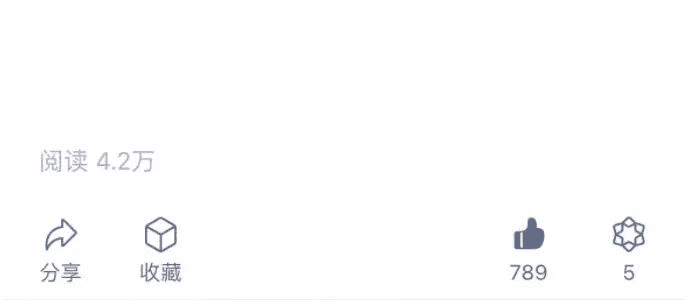

这期间我还尝试了视频号短视频和直播投放，当然这两种方式都是用的CPS，原因很简单，这种模式很难用CPT去定价，同时有时候还需要我和对方连麦一起推荐产品。

**所以大家也不要觉得知识星球不能投放，只要你**找好了渠道，选好品，一样是可以做投放的。

比如前一段时间猫叔启动个人认知星球，一时间撬动了几十个视频号、抖音同时直播，大概率猫叔用的方法也是CPS投放。

当然我建议大家，起步之际尽量采用CPS的方式进行投放，直接上来就CPT风险还是很大的。

在整体GMV占比中，我自有渠道大概占25%，CPS投放占40%，CPT投放占15%，剩下20%其实是口碑增长。

**接下来说说口碑增长了， **我们在增长的过程中，疯狂提升产品品质和服务，用产品和服务引爆用户口碑，我们现在每天就有50多个用户是会员推广来的用户，这应该算一个很不错的成绩。

短短两个月，我们建设了非常完善的内容栏目和新手引导，同时会把所有用户导入到企业微信，同时我们有完善的激励体系及发掘KOC的机制，社群能否持续活跃的核心，其实并不是星主，也不是早期的各种大咖，核心其实KOC。

**一个社群，拥护它的KOC越多，它的生命力越强悍，它的内部口碑**增长也就越强。（再次致敬亦仁老大和生财）

其实很多KOC既有强内容能力，同时还有流量，跟大家利益捆绑后，他们就更愿意推荐用户过来了。

另外，口碑的增长也才能让CPS持续放量。

原因很简单，CPS这种本身就是号主们不太愿意的合作方式，只有你的星球口碑足够好，让大家产生：我给粉丝推荐这个星球是为你们好，是给你们介绍了好产品，只有这种感觉产生之际，CPS合作才能持续。

复盘这个投放过程，我认为只要是强话题性的星球，又或者星球主本身具备强话题**性，同时邀请到足**够牛逼的嘉宾合伙人站台。星球这个品完全具备可投放性，价格选定在 99-299元 这个区间，能让用户通过社群或公众号直接关单，省掉决策成本。

那么适当的投放方式下，ROI就能超过1。

更别提后续还可以基于基础付费用户建立私域，搭建二阶、三阶品类，实现更大规模的盈利。

**降低退费率是社群生死线**

我们星球最初的退费率高达20%，这个过程我们快速梳理了内容栏目、课程栏目，同时在迎新流程上改了10多个版本。

**我们最**高峰时期日增1000多用户， 迎新 成了很大问题，最终我们采用客服只负责自动回复及问题拉群，招募了一批志愿者给用户服务的方式，极大的降低了退费率。

我们还优化了整个新手课程，给新加入的会员提供直播录播课程，让大家快速入门。

在改了很多版本之后，我们的退费率降低到10%，对于一个日营收好几万的星球来说，相当于增收好几千。

**利他是最重要的商业模式**

从网易离职到2个月做到2.5万社群，我最大的感悟是做商业一定要利他，利他就是最好的商业模式。

在网易我是高管，带百人团队，但我依旧会去帮助刚进入社会做自媒体的年轻人， 我会去用自己能提供的价值去链接大佬 ，这些年轻人后来很多成了自媒体大V，这些大佬也跟我保持了很好的关系。

这次能用CPS启动星球增长，最核心是我本身就有自媒体号主的资源，否则大家都不信任你的话，CPS很难谈成功。

再比如我设置的 **分销比例 **，算是所有社群中最高的了，这也在短期引爆了我的产品。

人的本质都是利己的，但我们要想通一个道理：

别人凭什么帮助你，只有你克服人性做利他的事情，最终才能实现利己，道理很简单，做起来的确很难。

**社群未来的发展**

我们社群已经正式进入2.0阶段，在这个阶段我们开启了线下活动，这段时间我在好几个城市做企业家内训活动，同时也组织了五场会员线下见面会和全国见面会。

**深度链接是关乎社群的生死之战 **，所有没有线下活动、没有实战活动的社群，最终结局一定是over。

同时我们的航海要深化到每一个行业，用AI+行业来真正赋能每一个人，带领大家做最好的AI实战。

我们还要启动分城市去中心化破局夜话，让大家深度链接起来。

我们还要启动AI破局企业服务中心，为所有会员服务！给企业家会员赋能，给个体户会员拉单，给职场会员做副业的好通道。

唯有品质和革新，才能驱动我们的社群长青！

**这场仗要远远比第一场仗难打很多很多，但我有**绝对的信心能带领大家一起取得各自的成功。

**最终我将践行最初的诺言：在AI时代带领10万人先行动起来，**带领1000个人成为AI时代的超级个体。

**我坚信。**

**我们终将以及必将实现这一目标。**

以上

-findyi 敬上