# 2023-10-22-30天，知乎从0到日阅读量3W+，我是如何做到的

> 来源：[https://xuqiwei1986.feishu.cn/docx/HgIjdl1bwofnIqxE683cLPcened](https://xuqiwei1986.feishu.cn/docx/HgIjdl1bwofnIqxE683cLPcened)

> 🔗 原文链接： h[ttps://articles.zs](https://articles.zsxq.com/id_be2w64xvbp90.html)xq.com/id_be2w64...

大家好，我是冯帅，AI 破局俱乐部初创合伙人。最近冯帅在发力知乎平台，冯帅按照洋哥提供给合伙人的课程《商业IP课程-知乎篇》中讲解的技巧来做，从 9 月下旬开始起号，截止到现在已经跑出来了不错的数据。

本篇文章冯帅将自己的知乎账号拆解，详细的介绍知乎如何起号、养号、回答问题以及如何留钩子等，同时冯帅在文章内容中也会穿插一些常见避坑指南，希望小伙伴们看了这篇文章之后有所收获。文末有小故事彩蛋哦～

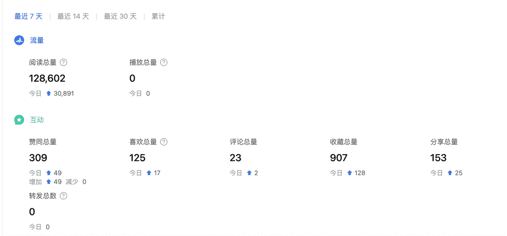

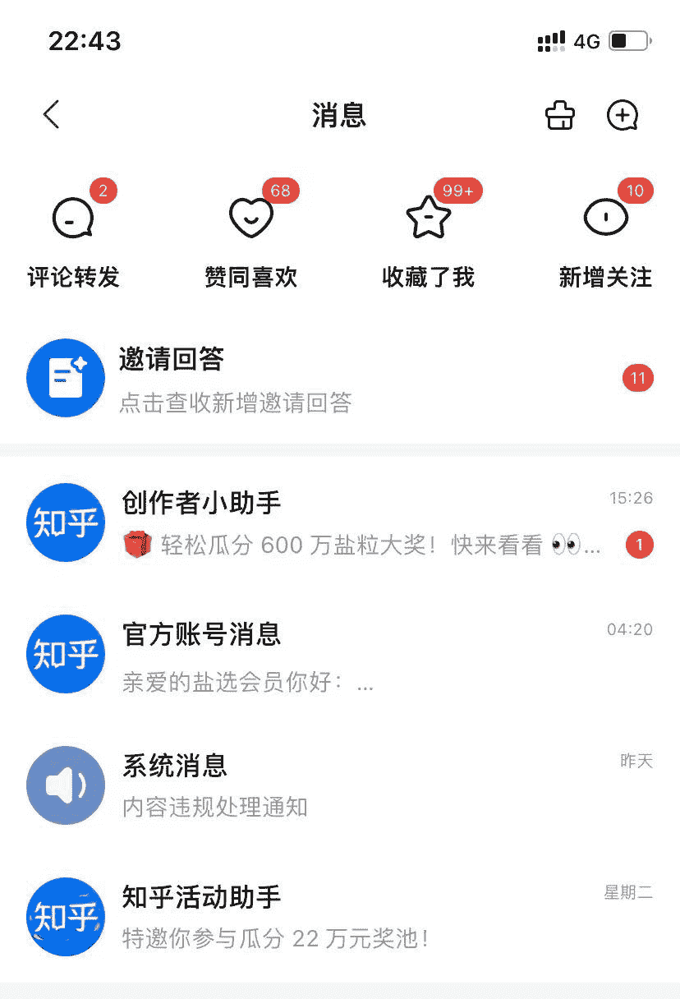

**一、为什么要做知乎**

**一）知乎平台特点**

1、知乎是一个专业问题答疑平台，它的核心就是提问和回答，它是国内最大的图文平台和问答社区。

2、知乎的内容特点： **够深度、够专业 ****，这个特点**也就决定了在知乎平台吸引的都是 精准粉丝 。

3、知乎用户特点： **高逼格、杠精多 **，正因为知乎的内容特点是够专业和深度，所以在知乎平台吸引到的粉丝要么是死忠粉，要么就是杠精黑粉。

4、知乎的主要内容形式： **图文/长文 ****，喜欢看长文的人**更加忠诚，并且也有 更强的付费意愿 。

5、知乎的流量特点： **长尾 **，同样的一个问题火过一次之后还有可能再火，比如说你一年前回答的问题今天突然又火了，那么你之前的回答会为你再带来一波持续的流量。

**二）知乎适合哪些人**

1、在某一项领域具有专业性、权威性，并且非常擅长总结和输出长文的人。

2、不愿意露脸的人，知乎是图文平台，只需要将自己专业性的知识总结输出出来即可，不需要露脸。

3、擅长讲故事的人，即使你的内容足够专业，也需要将内容套在一个故事中输出出来。因为人是天生具有惰性的动物，如果你输出的内容在用户看来像是在看一篇专业性的学术论文，那么大概率他是看不下去的。而你将专业性的内容套在一个故事中讲述出来，用户是非常乐意看到最后的。并且知乎平台上其他大的号主都擅长讲故事，而你却只发干巴巴的专业性内容，那肯定没有会讲故事的人更有吸引力。

**二、做知乎的核心原则**

文章后边讲解的关于做知乎平台的所有技巧和方法都是手段，而不是目的，做任何平台最核心的原则都是你的内容要足够优质，而对于知乎平台的内容特点来说优质的内容更重要。

小伙伴们谨记这个原则： **优质内容！优质内容！优质内容！**

**三、如何起号**

**一）定位**

**

1、明确定位** ：明确的定位是做个人 IP 的基础，有了定位才能够锚定目标群体，在后续运营账号的过程中持续输出和定位相关的内容，将这部分群体精准引流到自己的私域中来。

**2、定位要足够垂直 **：无论做任何平台，只要目标是做个人 IP，那定位一定要足够垂直，定位足够垂直我们的目标群体才足够清晰。先明确大方向，然后在大方向内找准细分领域和目标人群。比如冯帅给自己的定位大方向是 AI，细分领域是 Prompt 提示词工程，目标群体是 Prompt 提示词工程大小白人群。

**3、输出内容和定位相关： **冯帅的定位是 Prompt 提示词工程的小白人群，以下两种输出风格做对比，肯定是第一种更能精准的吸引目标粉丝，变现能力也足够强。

1）在公域平台持续输出教授小白系统入门 Prompt 的内容，久而久之在用户的认知中冯帅就是这个领域的专家，来冯帅这里就是要学习 Prompt 入门的，当冯帅推出 Prompt 方向的付费产品对时候如果用户有这个需求，那么他大概率是愿意付费的。

2）在公域平台上输出的内容包括 Prompt、Java编程、职场经验等杂七杂八的内容，在用户心里冯帅就变成一个什么都懂点，但是什么都不够专业的 IP 号，那么即使积累了一些粉丝，也都是泛粉，不会愿意为冯帅付费。

**二）起名+头像**

**

1、名字和头像全网统**一

做个人 IP 就是要在用户心智中反复的刷存在感，想尽一切办法让用户记住你、记住你是做什么的。名字和头像全网统一能最大程度的减少用户的记忆成本，从而让用户能够更容易记住你。

比如冯帅的个人 IP 名字是：冯帅Prompt，那么冯帅包括微信、知识星球、知乎、公众号、抖音、B站、小红书，甚至是飞书文档和语雀文档所有的平台都叫这个名字。

2、名字要和个人 IP 的定位强相关

好的 IP 名称一定是和定位强相关，让用户看**到你的名字就知**道你是做什么领域的，做到 「见名知意」。

比如冯帅的 IP 名称叫做 **「冯帅Prompt」 **，用户看到这个名字就知道冯帅是 Prompt 提示词工程领域的号主。如果目标用户在某个地方刷到平台推荐的冯帅的文章内容，那么他大概率会点进去冯帅的主页去翻看冯帅输出的内容，这样能大大增加他成为冯帅粉丝的概率。

**3、头像要有亲和力**

头像是用户对我们的第一印象，所以好的头像一定要有亲和力。具有亲和力的头像能增加用户对我们的信任度，而信任度是打造个人 IP 的重中之重，因为成交是建立在信任的前提下的。

做个人 IP 不是做学术需要非常严肃和严谨，做个人 IP 要让用户感觉到我们是一个实实在在的人，这样才能拉近我们和用户之间的距离，提高转化率。

头像一定不能选择阴暗负能量，当下社会各种群体对立极强，社会的怨气和负能量非常的重，如果用户第一眼看到我们的头像非常的阴暗和负能量，那么他大概率会讨厌的滑走，不会有人想在我们这吸收负能量。也不能选择非常抽象的头像，这样会导致用户第一眼看到我们的头像的时候很懵逼，他会觉得看不懂我们这个人，从而和我们产生距离感。

**三）个人简介**

**1、讲专业**

简单描述我们的专业领域和能够提供的价值，让用户快速了解到我们是做什么领域的，他能够在我们这里获得什么价值。

**2、 晒成绩、贴头衔**

晒成绩和贴头衔都是为了证明我们在这个领域里面是非常专业的，完全能够为用户提供他所期望的价值，从而增加信任度。

**注意： **不要刚开始起号就把自己的公众号和微信和留在简介里面，这样会被封号，等升级到 LV4级的时候再留。

下面这张图片是冯帅在知乎平台的名称、头像、简介

贴头衔：3W 人 AI 社区初创合伙人

讲专业：深耕 Prompt 领域，擅长教授 AI 小白入门

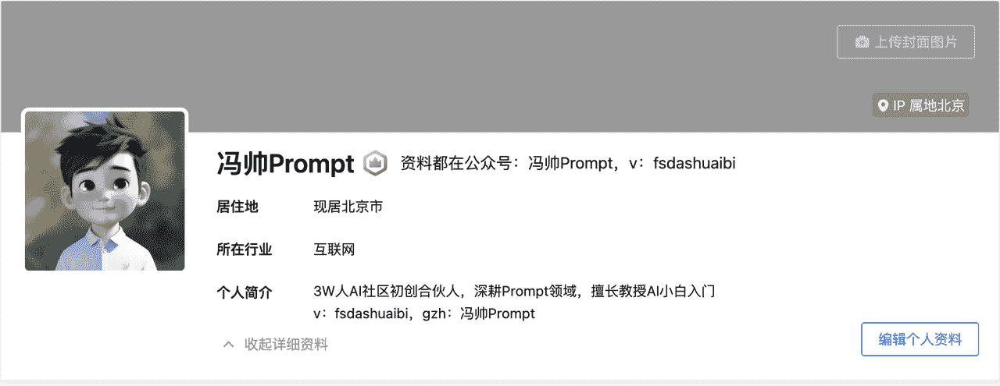

**四）选择行业**

选择和自己的定位最相关联的行业，这样的话知乎会给我们的账号推送本行业相关的高质量内容。

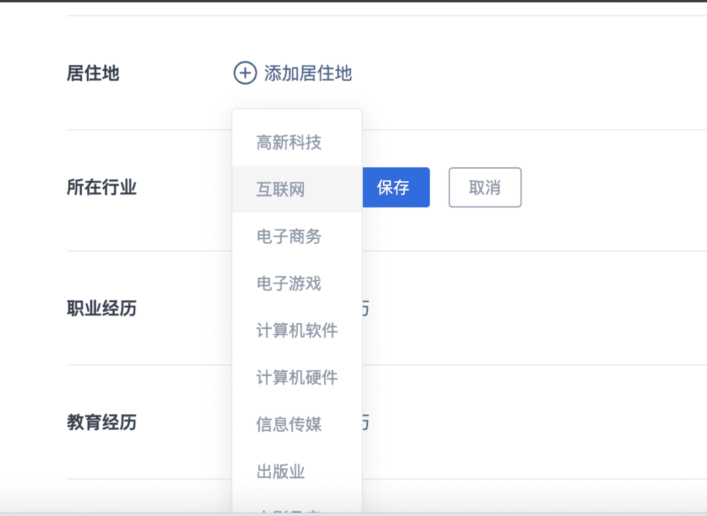

**四、如何养号**

在刚才完善个人信息选择行业的时候，选择的行业相对来说比较泛，需要我们在知乎搜索栏用关键词搜索领域内的问题并关注，慢慢的知乎平台就会给我们的账户打上该领域标签。

在搜索页面多维度、多关键词搜索我们的定位相关的问题，然后疯狂的浏览这些内容，同时关注这个领域内的大 V，这样坚持刷几天之后，我们的号就养成了，以后知乎就会不断的给我们推送你的领域相关的内容。

以下是冯帅在养号的时候，在知乎搜索栏搜索 prompt、prompt工程师、prompt提示词等等所有和我的定位相关的关键词。然后在筛选栏，选择「最多赞同」，点进去高赞回答，浏览高赞回答的号主的动态内容，如果发现这个号主发布的内容比较符合我们的定位，就直接关注。

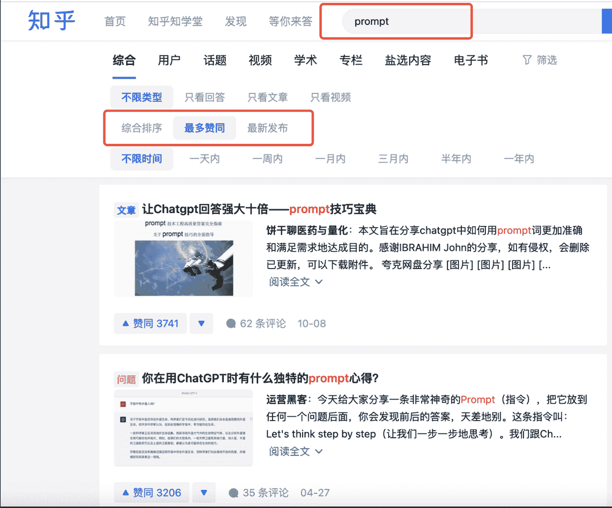

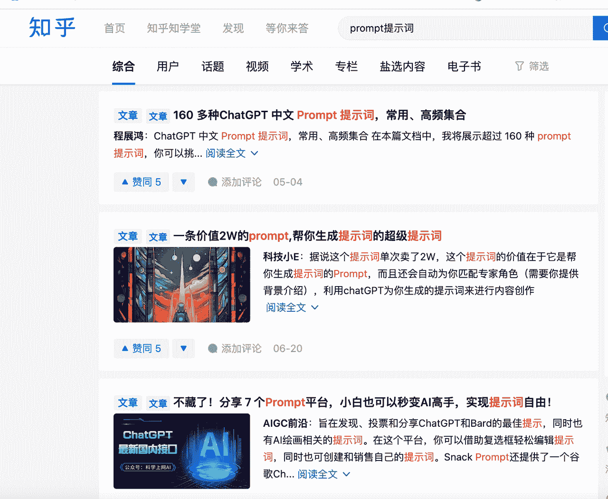

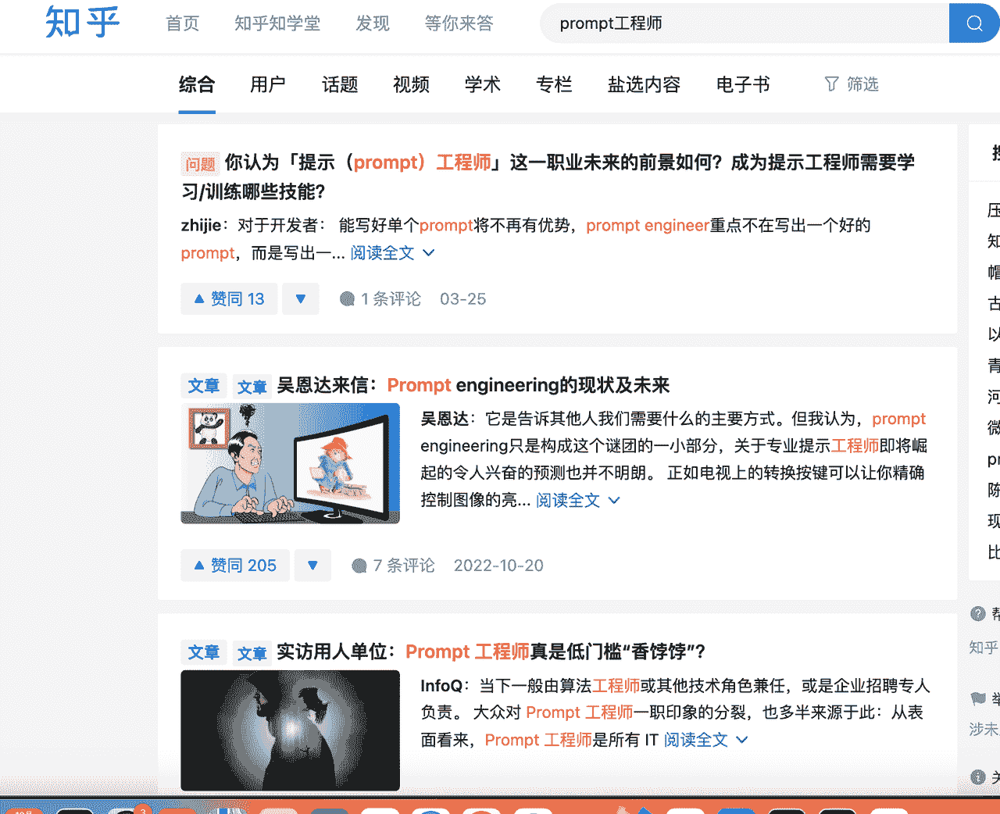

**五、如何选问题**

**一）热榜问题**

热榜问题排在问题选择的第一位，热榜上的问题都是当前知乎活跃用户在关注的问题，问题越热关注的人就越多，关注的人越多问题就越热，一个热榜问题很有可能就让我们的知乎账号直接起飞。

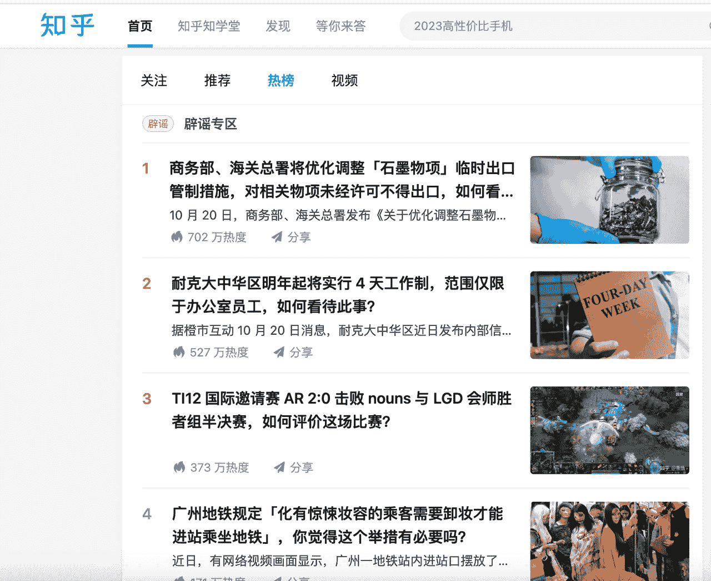

在知乎的创作中心，点击「近期热点」，然后选择行业，优先选择「小时榜」。这里冯帅发现一个很有意思的事情，在创作中心点击「近期热点」进来当前这个页面之后，知乎会默认选择「小时榜」，这样说明小时榜中的热门话题是价值最大的。

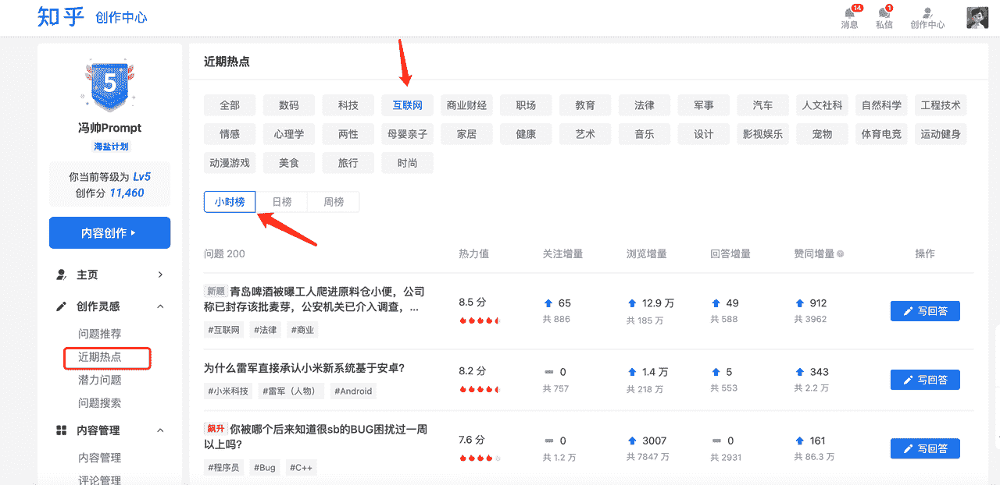

**二）爆款问题**

我们不可能无时无刻都关注知乎的热榜，这个时候我们就可以选择使用零散时间刷知乎的推荐内容，把一些高质量的问题筛选出来去回答。

在这之前经历过养号之后，在推荐这个栏目里面收到的基本上都是和我们的定位相关的内容了，挨个点进去这些问题查看这个问题是否具备爆款标题的元素。

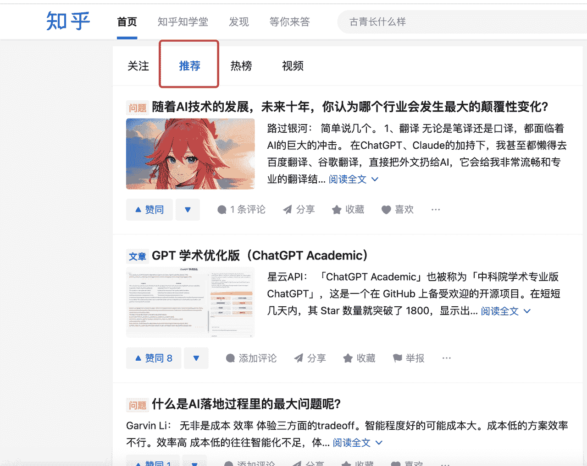

爆款问题具备三个要素：浏览量和关注者多、回答数量少、问题的创建时间离当前时间最近。

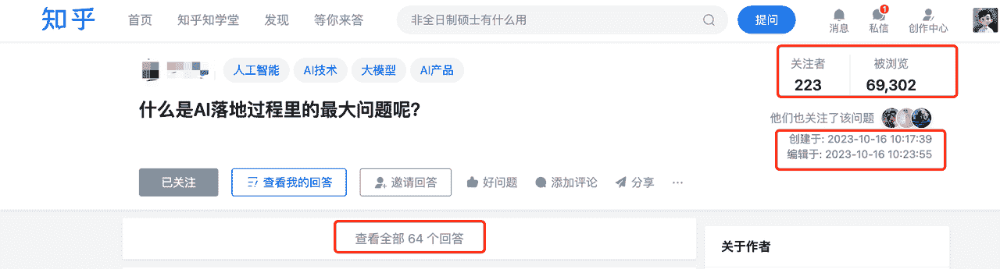

**三）同领域大V问题**

经历过养号阶段之后，我们的账号里面应该就有数十个和你定位相关的同领域内的大 V ，去他的主页浏览他都回答了哪些问题，跟着他回答同样的问题即可。

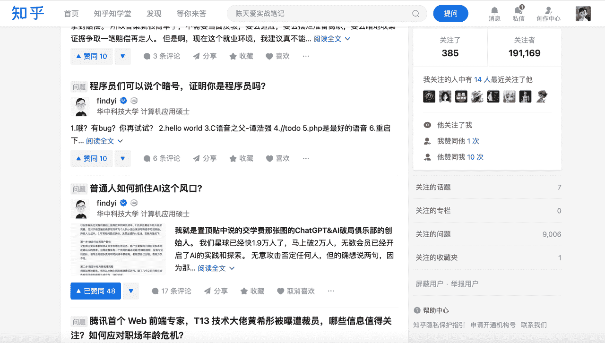

**六、如何回答问题**

**一）取标题**

知乎是一个问答平台，并没有提供填写标题的地方，所以在我们回答问题的时候，回答内容的第一段话就是我们的标题。

标题是吸引用户点击的最关键的因素，没有之一，没有一个好的标题哪怕我们回答足够专业和有故事性，用户点击进去的概率都是很小的。

一个好的标题具备以下要素：

**1、清晰简洁**

标题不要太长，一定要突出文章的重点，让用户一眼就了解到我们的这篇文章能为他提供什么价值。

比如冯帅回答的以下这两个问题，标题中都提及了「万能公式」。人都是有惰性的，天生的想要一劳永逸的解决所有问题，所以「万能公式」这个关键词非常的吸引人，用户看到这个关键词之后大概率会点击进去。

这**里还要重点说**明一点，冯帅的标题中提及了「万能公式」，冯帅的文章内容里边一定要真正的包含万能公式，也就是文章开头提及的： 优质内容！ 如果只是通过标题把用户吸引进来而你的内容中但是却没有提供相应的价值，用户肯定不会给你点赞的，每一个用户点击进去都不给我们点赞，久而久之知乎平台就会降低我们的账户权重。

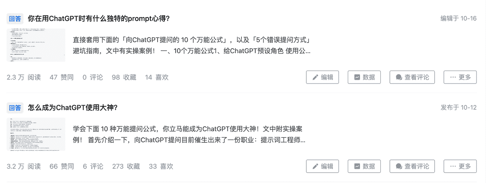

标题长度要控制在 40 个字以内。下图一是冯帅的知乎数据的流量入口来源分析情况，可以看出大部分流量都是来源于 APP 端，所以在取标题的时候要重点考虑标题在 APP 端是否能够显示完全，图二是冯帅的知乎账号两篇文章的标题情况。

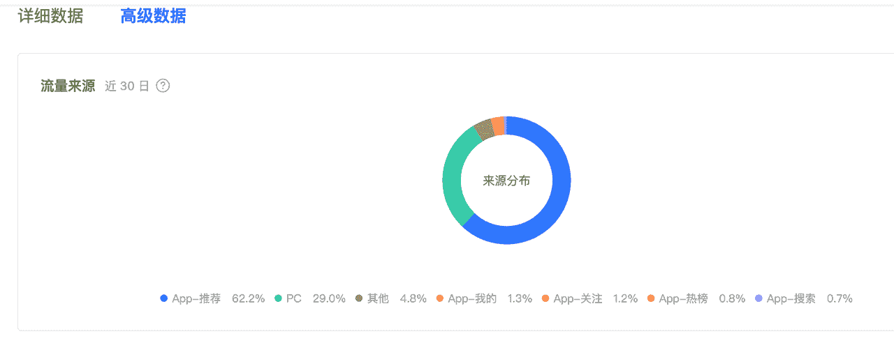

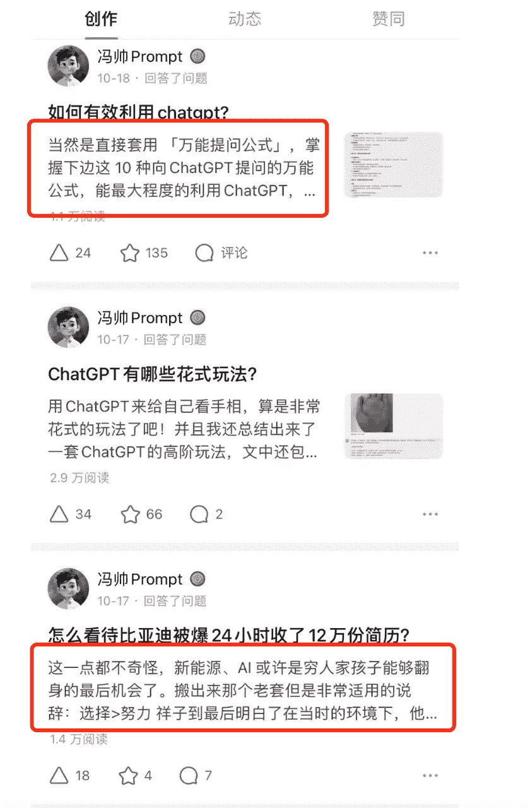

**2、能够引起共鸣**

大家都知道当下的大环境情况，所以在标题内容中包含一些能够引起共鸣点话题，更加能够吸引用户点击。

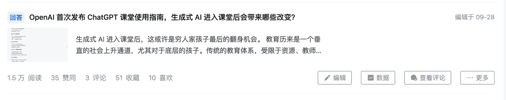

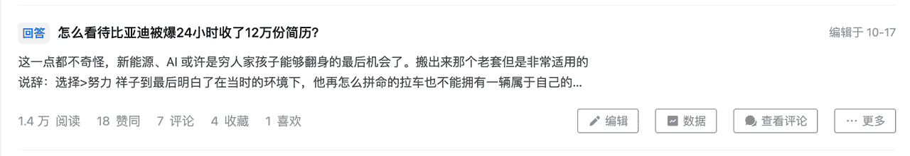

**二）铺内容**

冯帅在上边贴出来的图片案例，那几个回答其实都是基于以下这篇文章和其它的文章进行拆解、组合，然后想一个好的标题，基本上能做到10-20分钟回答一个问题，所以建立一个自己的知识库尤为重要。

知识库的建立需要我们多思考、多总结、多复盘、多输出，将这些内容都沉淀到自己的知识库中，当发现到热门话题的时候，立马在自己的知识库中检索相关内容，快速的拆分组合出来一篇回答。如果你能在10分钟之内就搞定一个热门问题回答，而别人从发现热门问题到回答完毕前前后后花了一两个多小时，可能这个话题的热度就已经过去了。

还有一点需要注意的是，知识库沉淀到内容一定是火过的内容，没有任何流量的内容沉淀到知识库中没有价值。

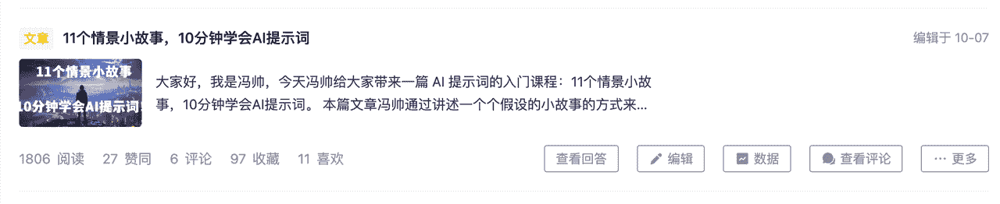

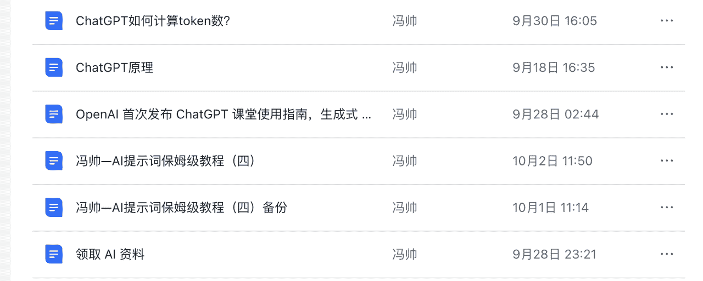

**七、如何留钩子**

在文章末尾，通过引导性的话术告诉用户：“在我这领了资料你就变得厉害了”。然后在公众号写一篇专门介绍我们的钩子非常 NB 的文章，然后将自己的微信二维码贴上去。

知乎平台由于有腾讯的投资，是可以在文章中帖微信公众号链接的。但是在等级达到 LV7 级之前不要这样干，VL7级之前就认认真真的输出内容。引用小林老师的一句原话：“欲于取之，必先予之”，只有我们的账号能持续的为平台带来价值了，我们的这些留钩子的动作才不会被官方封号。冯帅之前就因为知乎账号级别太低，直接在文章中留微信二维码而被封了一天号。

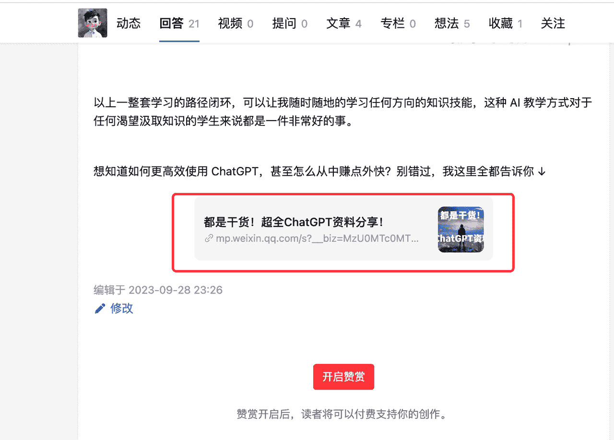

**八、写在最后**

在文章的末尾，冯帅想和大家分享一下我和洋哥，和破局的故事。

1、2020年初，冯帅偶然间在一个技术类的公众号上看到了一篇洋哥讲述拼多多商业模式的公众号文章，看完之后就一个感觉，这个人太牛逼了，这篇文章讲述的内容是冯帅之前完全没有意识到和接触到的认知，所以果断关注公众号，在那几天就疯狂的看洋哥公众号的内容，给公众号文章评论，试图和洋哥建立链接。在这个阶段，冯帅命运的齿轮开始转动了。

2、后来洋哥发了一篇公众号推文，让粉丝加洋哥的微信号，冯帅果断加入进入到了洋哥的读者群中。

3、再后来洋哥运营了一个职场成长的知识星球，冯帅想都没想就果断加入，冯帅在这个星球的编号是 3 号，冯帅在这个星球里边学到了很多职场和个人认知的知识，在这个阶段冯帅已经充分感受到洋哥的利他精神了，洋哥是真的帮人提升认知和解决问题，这个时候冯帅已经成为洋哥的死忠粉了。

4、2022年底，ChatGPT 火爆全球，看到洋哥不断的在公众号上发布关于 AI 相关的文章内容，这个时候冯帅还只是简单的用了 GPT3.5，还觉得 ChatGPT 就是「人工智障」

5、2023年初，冯帅看到洋哥发的一篇关于 GPT4.0 的文章，把GPT4.0介绍的相当 NB，我立马去试用了一下，并试着在网上搜一下怎样用好 GPT 的教程，不用不知道，一用起来感觉这个东西太强了。

6、2023年3月份，洋哥创立 AI 破局俱乐部星球，冯帅同样是想都没想直接加入，冯帅在AI破局俱乐部的编号是27，进入星球之后被扑面而来的爆炸性信息搞懵了，星球里的小伙伴都太牛逼了，大家都一个一个拿到结果，而我还在东打一枪西打一枪，没有明确的目标和定位。

7、2023年8月份，洋哥推出合伙人产品，当时这个产品还属于内测阶段，但是冯帅同样的直接买入，冯帅的合伙人编号是 0015 成为合伙人之后冯帅也没有找洋哥梳理定位，洋哥的 IP 课程也没有认真听，就这样一直持续了一个月。

8、9月16日晚上，洋哥给合伙人直播商业IP课程-知乎篇，课程知识讲完之后开始鞭策我们。听完这节课之后我那天一晚上都没睡着，最后脑子里就只有一个想法：老子就是要。

9、然后第二天开始行动，开始发力知乎平台，当时番茄大佬也提供了 AI 破局合伙人—知乎投稿通道，有流量扶持。就这样我跟着洋哥的课程一步步实操，现在知乎号已经跑出来了点成绩。与此同时冯帅在 9.26 日还有一个针对提示词小白入门的快闪活动，并且也正在打磨提示词+知乎引流变现的小册产品。

以上是冯帅和洋哥，和破局的故事，冯帅自从加入破局俱乐部星球以来，在星球中的各个大佬的身上学到了很多很多的知识，这些知识都会让冯帅受益终身。冯帅也持续的将自己所学的知识复盘总结输出到星球中来了，在总结输出到过程中又时常有一些新的思考点，冯帅就这样在一点一点的进步。希望各位小伙伴们抓紧行动起来，学习星球中的精华和中标帖子内容，将学习过程中的思考和疑问输出到星球中来，想都是问题，做就会成功。