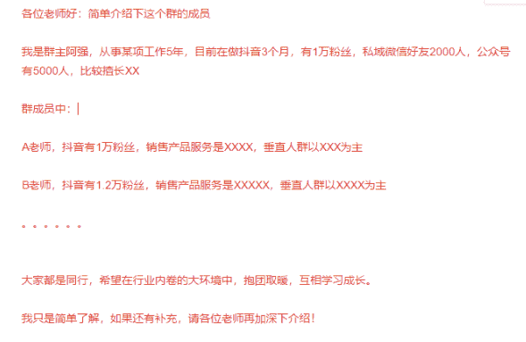
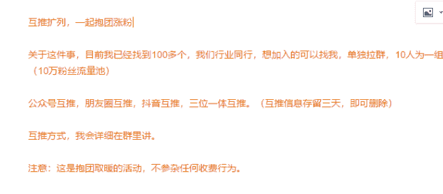
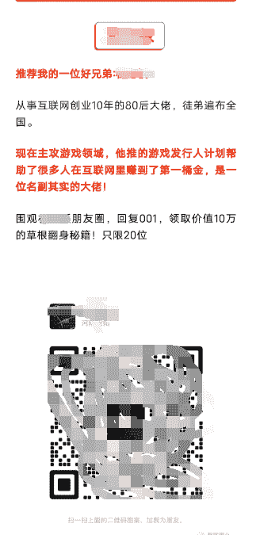

# 2023-10-17《拥抱同行“借势”课》互推·扩列，涨粉操盘手SOP

> 来源：`https://xuqiwei1986.feishu.cn/docx/F80TdXFtRoQqYlx20dWcUWJSnYc`
> 🔗 原文链接：`https://articles.zsxq.com/id_skrvu1ouvgul.html`

## 我是：领飞！

要给大家分享的一套课程文案，这套文案我8月份一个月卖了5万，你可以把这套文案录制成课程，就能拿去卖，或者自己吸收价值去使用，对于个人IP涨粉，有非常强的作用。

## 你会收获：

如何利用互推涨粉，是一种营销引流方法。

如何利用互推赚钱，是一个月入万元的项目。

## 第一节课：同行内卷突围

抖音营销圈有一位大神叫“金枪大叔”，他写了一本书《借势》，这里我不是打广告，我也不觉得这本书有多好，但是“借势”这两个字，足够有分量反应了，当下个人IP圈子营销的扩展度。

这本书的销售量之所以高，就是把借势用到了极致，全抖音60%的百万级粉丝商业播主，都参加了发售会展，为这本书打了广告，其实当个人IP影响力达到一定体量的时候，增长拉新是非常难的，如果同行说一句“那个人也很好”，就又可以拉新一波高潮，甚至产生更多的热门话题，引起争议热点，同理直播间打PK的本质原理也是这样，这就是同行同级别之间借势。

还有一个很简单的逻辑，疯狂小杨哥，为什么经常免费来一些娱乐明星，这些明星日常出场费就上百万，说难听点，可怎么就不要脸的来了，还是因为要借小杨哥的势，这就是同行不同级别借势。

高大上一点叫：借势 低级一点叫：互推

往往借势都是有门槛的，上面的两种情况，都是要达到一定影响力才可以做到，也正因为如此，后入场的中小博主，就能难再脱颖而出，好的资源被他们占了，好的流量被他们占了，好的热点被他们占了，甚至可以说：认知差都被他们占了。

现在抖音很内卷，这也是没办法的事实情况，所以平台搞出各种各样的内容形式活动，为了也是中小博主IP，能够占有一些扶持性流量。

说句题外话，头部占有资源的时候，我们只能垂直细分， 不痛不痒的需要，解决100个也不会让你成功，针尖大的刚需，解决一个就可以让你成功。

现在视频号，📕很火热，不要觉得好像是机会，其实还是被抖音头部占有了，只不过不是机会的机会，在于用户长时间和经常使用平台的习惯，产生了短期内红利，这个很好理解，就是说：不经常刷抖音了，刷开视频号了，刷开📕了，可内容的出处还是在抖音，一场直播下来，只不过开几个账号而已，毕竟抖音是自媒体视频营销的鼻祖。

当然了我以上的观念，是我自己的观念，你可以保留意见，山顶的风景，毕竟我们谁也没感受过，但是我接下来要讲的方法，一定是我们站在山腰和向上爬的人，能内卷破局的方法，这个方法从🐧时代就开始验证，现在任然是高效见血的方法，也一直有人在做。

我把这种方式叫：互推扩列

互推大家已经明白了，现在说下扩列，这是一个当代年轻人00后交友，非常流行的一个词，其意义就是扩大自己的朋友圈，扩展志同道合的人，让更多的人围观；如果用在我们同行之间扩列，那杀伤力绝对大于表面意义的交友扩列。

第一个例子：不同类10个人，同样的服务群体

A小学语文老师：有一万粉丝

B小学数学老师：有一万粉丝

C小学英语老师：有一万粉丝

D小学国学老师：有一万粉丝

E小学体能老师：有一万粉丝

F小学美术老师：有一万粉丝

G小学心里学老师：有一万粉丝

H小学练字老师：有一万粉丝

L小学音乐老师：有一万粉丝

M小学科学老师：有一万粉丝

这个10个老师有不同的擅长，我相信每个学科老师，在抖音没有10万个也有2万个吧，也都有真才实学可交付的产品，可谁能杀一条路登顶，卷都卷死了，更何况绝大多数人，也根本没玩明白自媒体运营，也没有团队和资本力推。这也就是为什么很多老师，都跑到商业博主那里被他们操盘的原因。

1万粉丝大概率努努力就可以做到，10万粉丝、50万粉丝、100万粉丝，可就不是努力就能做到了，当然这不是绝对，也别骨头里挑刺，相对来说1万粉丝用的时间周期一定是最短，很多人一万粉丝已经身精力竭了。

10个老师每人1万粉丝，总共就是10万粉丝的盘子，每个人每月拿出4条内容互相推荐下，涨粉的速度会远远高于30天30条内容，尤其是精准、天天耍你视频的老粉丝，这个商业线索的价值就更高了。

第二个例子：同类10个人，同样的服务群体

A房产业务经理：一万粉丝，IP内容别墅

B房产业务经理：一万粉丝，IP内容学区房

C房产业务经理：一万粉丝，IP内容外地落户

D房产业务经理：一万粉丝，IP内容某城区房

E房产业务经理：一万粉丝，IP内容新房开盘

。。。。

这10个人都是同类做房产，朋友圈互推一下，是不是什么房都卖了，信息共享，人脉共享。

第三个例子：不同类10个人，不同的服务群体

A博主讲美妆：一万粉丝

B博主讲穿搭：一万粉丝

C博主讲护肤：一万粉丝

D博主讲情感：一万粉丝

E博主讲瘦身：一万粉丝

。。。。。。

这10个人每人自己拉自己的群，互相都进入下各自的群，是不是群的价值更高了，互相都能扩列，互相都能获取意向客户，互相培训粉丝信任度，一个人维护群和10个人维护群，即高效，又省力，还给予客户更高超值服务。

社群营销核心就是群价值，群价值的核心就是群主服务，群主的服务核心就是大量回复，大量回复的核心就是众多人一起活跃，这就是超价值体系信任链接。

OK！通过以上举例，大家多少有些感触了，其实说白了就放大自己盘口，互相之间抱团取暖，互推扩列适用于服务某个领域一类人的IP博主，效果是才最强。

自古以来，天下大同大势，分久必合，合久必分，抖音也是如此，以此产生了更多平台，任何平台的头部都是平台造就的神话，展现给世人看，永远也都是阶级划；竞争力就是要搞大同，农村包围城市，凝聚力才是竞争力，杀出一条虎口夺食的路。

## 第二节课：同行如何抱团取暖

卖这套课程方法，多少有些抢平台饭碗，要知道平台也是以广告营收为主要的手段，“抖加”广告投放，👸号广告主，不就是投放同行获取线索嘛，获取同行的流量嘛！

现在私自的行为操作，可不是抢平台的饭碗，平台洞穿我们的需求，以此盈利，用付费的方式让你获取同行，这套课程的价值明白了吧。

同行的客户就是你的客户，最好的精准流量就是你的同行，自媒体时代各有所爱，一个产品可以去很多地方买到，淘宝、京东、拼多多、快手，可唯独喜欢你，就从你这买。你的魅力吸引了他，你的价值吸引了他，你的人设吸引了他，说一千道一万，自媒体的核心是信任，你用你的内容获得了信任。

所以聚拢同行，每人一句话传递给粉丝，推荐给粉丝，这个威力可想而知。当然，我们也有迟疑，会有、会遇到不良的同行，但从整体效益收获来看，也无伤大雅，放眼整个盘口，你与9个同行互推完，还会有另外的9个，更多的9个，推的多了，谁没有价值，谁不走正道，不都是自然淘汰的事情嘛，做好自己即可，粉丝也不是傻子， 现在人都聪明了，看见什么事物，先琢磨下什么套路，你的格局目标就是做大自己粉丝盘口，其中缺陷也是要容忍和承担的，总体来看收获远远大于那点缺现。

在抖音我们经常看到同行之间互踩，互相撕逼，吃瓜群众挺多，就好像看戏一样不嫌事大，其实还真是看戏，没两天他们一起出现在了同一个直播间，吃瓜的傻眼了，不按套路出牌，你被反套路了，看戏的其实是唱戏的。

骂同行的人，是在为了获取比他牛的同行流量；

被骂的人，回头反驳互怼一下，制造争议话题，验证自己的能力，又获得一批流量。

这就是剧本，谁也没伤害到谁，谁都获利了；只不过这种方式稍微有点膈应人，没点脸皮还真不行，我也相信绝大多数人也做不到、学不了这种方式，可这种涨粉方式真的好用，相比于线下实业搞破坏，要人道很多，这也是互联网自媒体，给予我们放大生意的红利。

同行之间制造争议话题，这种方式完全没必要，这都是小道，自古以来所有谋略中，“阳谋”才是谋中之王道，互推扩列就是如此，把同行拥抱起来，众人拾柴火焰高。大家目的都很明确，大家都知道互相利用，大家都知道平台内卷，大家都知道要出路，大家都知道同行粉丝是最好的。。。。这就够了，如果没有这点商业认知，也不是好同行，也不是你要拥抱的同行，注定他的路很短，注定他的难度比你高，所以弃之，还有成千上万的花朵等你采摘。

千万不要做后悔莫及的事情，格局变小，生怕同行模仿，真正错失机会的是自己，举2个例子吧！

比如：知识博主卖课，别人卖课都把课程放在群文件里面，学员随便学习，还能传播给别人；反而你，把课程加密，不轻易盗版和翻录，以至于就不如同行传播量广，要知道知识卖课博主，不缺少的就是做课能力，也不可能一套课吃老本，盗版越多，其实传播就越多，用盗版课链接更多人认识你，有价值自然会联系你，会购买你新的课程。

比如：有同行加你🛰️，你就拉黑了，总感觉他要复制你，你又格局小了，不与同行沟通自以为是，殊不知他们之间，互相交流经验，互相熟悉，互相借鉴，互相扩列互推了，一起建圈子共荣。

几年下来，你会发现真的错失很多，如果一开始就拥抱同行，势必积累的能量，让你少走很多弯路，节省很多时间。试想你现在，从做抖音第一天起，就拥抱同行，和第一天起杜绝同行，一年以后会是什么样的结果。

如果就按照互推扩列执行一年，我相信能把杜绝同行的人甩出十万八千里，这不是我说空话，有案例支撑。

9.9元那些卖资料人，你的课程被他们卖了，他们就是小蜜蜂，帮你传播了更多的花粉，是这个道理吗？你的课程不值得别人盗版卖，说明你没啥价值，也不入人家法眼，人家可是专业赚这个钱的。

你的IP账号被一堆同行关注，你的内容被一堆同行摘抄，说明你有能力，说明你有被人利用的价值，同行就是最好的老师，你也可以抄别人，为自己节省时间，把别人说的当成自己说的，还能让别人觉得是你说的，这也是能力。

利用同行偷偷摸摸的抄，不丢人，只是小道，正大光明的告诉你，我要抄你，这才是大道。他为什么让你抄？也一定是因为你有价值，他才让你抄，拥抱同行链接在一起，不就都知道各种的价值了嘛，互相光明正大的抄，这属于众乐乐。

OK！我们拥抱同行，才能走的更远，比如说这套课程，大家买了之后，可以随便发给别人，也代表这套课有价值，不然你也不会自愿发给别人，反而我能链接更多的客户，因为我还有更多的课程等各位。

怎么样格局打开了没？众多同行中，存在互相瞧不起的情况，一般都是同体量级别，谁也不服谁，很多人去参加那些超级IP大佬的会展，为什么不去怼人家，因为你仰视人家，就觉得大佬说的对；好比身边朋友和你说道理，你不服，因为各自级别都差不多，如果和你讲道理的人是年入千万的朋友，你只有点头的份，人的心态就是这样，这是没法抹平的事情，普通人变得不普通人，应该互相正视，互相拥抱各自的意见。

互相拥抱同行取暖，是当下自媒体营商，抢占资源最好的方式，我觉得没有之一，因为它的成本足够低，做生意能赚到利润，就是在拼谁能用低成本带来更多的效益，当你的同行还在每天花大量时间绞尽脑汁创作内容的时候，还在花大量的金钱忍痛割肉投放广告获取精准粉丝的时候，反而，你早已利用同行互相扩列了，比如1万粉操盘10万粉互相取暖。

自媒体IP运营，我们本身就是一个商品，没人在乎你生产的过程，如果把自己高效的、低成本的卖出去，这才是重要的。条条大路通罗马，我也相信很多人不赞同，互推扩列的另辟蹊径，自己有自己的道，就想一步步的深耕自己，没毛病，这份执着值得鼓励，也有很多人这么做出成绩，可是做为一个创业者，不会投机取巧，注定发家第一笔财富获取是艰难的。

或者，我们也可以这样想，内容创作我们时时刻刻在进行，这是维护粉丝的基本盘，如果日常也加上互推扩列的策略，是不是形成的效果是倍增呢！

## 第三节课：同行互推释能

同行愿意加入互推扩列，大家都有被值得利用的地方，大家都在占对方的便宜，都能看出来1万粉丝能借势到10万粉丝，这个威力真的是非常猛，它是一个循循渐进的增长过程，只要你把课程第1节的文案发给同行，我相信他们都会被吸引，大概率会加入到这个组织。（这就是为什么，我这套课程，要写出详细文案的原因）

比如你有1万粉丝，前期找到的都是同级别9个同行，一轮周期下来之后，1万变成了2万粉丝，那就可以再找2万同级别9个同行，又一轮周期下来之后，2万变成4万粉丝。。。。以此类推，直到10万粉丝体量为止。

因为任何平台10万粉丝是一个大分水岭，基本大盘口就稳了，也不再是小卡拉咪，当然根据不同领域情况也有所不同，但对于细分垂直领域来说，绝对已经是大的承载体的IP了；大佬也会注意到你，这时候的互推就需要花钱了，融入更高级的圈子，用钱链接最直接，增加与大佬的接触，给自己背书。向上管理，让自己努力成为所在行业的头部，具备更高的商业价值，从0到拥有基本盘（10万粉丝）这个阶段，是最难的，也是需要细分做出来的，此时就可以扩展大领域，增加变现的多手段。（这里面的深入运营逻辑，如果大家不懂，可要购课群里面，单独解答。）

从小就开始懂得借势，到长大了还懂得借势，绝对是成功上位者具备的心智品行，走捷径就是在借助人的力量，不同阶段借助不同的人，手段也是不一样，起步最难，很多商业博主不总说这么一句花嘛：1到100万最难赚到，100万到1000万就相对简单的多。

这里面存在一个问题，在你互推成长的路上，那些同行又怎么样了？他们也会和你一样成长起来的吗？

答案是：不一定

因为他们缺少一个我，这不是我自吹，我所教授给大家的认知，他们可能没有这样的信息差，因为你是操盘手，他们是入局者，能看懂你背后操盘逻辑的人，毕竟在少数。

有流量的承载，接不住变现，是不行的，也会被淘汰，太多的人流量非常不错，为什么最后都不做了，原因就在于变现能力跟不上，虽然刚开始在一个圈子，商业能力不行就会慢慢被稀释掉。

所以你做为操盘手，也要顾及和你成长的同行，你教给他们商业运营能力，这样他们才会死心塌地的继续跟你做大盘口。

这个时候所掌握的资源，就不是普通粉丝了， 而是各个矿的金主，也俗称广告主，你能借他们赚钱，助力他们赚钱。

比如：

你从1万粉丝涨到10万粉丝之后，这个期间跟你一起成长，有5万、10万粉丝多个同行，你们有社群圈子，你们各自又在对方的粉丝群，这就是资源，那么有1万粉丝的同行就想加入圈子，是不是可以收费，1万粉丝想向上5万粉丝互推，是不是也可以收费，你们最初的几个成长起来的同行，都能赚到钱，这里面的价值差是完全可以设计出来的，还能接到更多的品牌商业广告，因为你掌握的资源价值很高啊。

更多的小虾米，陆续加入你的圈子，你所掌握的资源更多，商业价值也就越大，届时，你不再只是一个服务你领域粉丝零售的博主，还是一个掌握行业的渠道商，从挖矿刨金变为卖铲子给金主，角色的转变，也是任何行业转型的重要战略，走一步看十步，不也是上位成长者具备的心智品行吗！

这节内容多少有点扯远了，但领飞不觉得，规划发展的好处不给予大家，就是不一个会画蓝图的老师，自媒体个人IP一定要常备转型思维，因为同行内卷，不管在什么程度，别人看到了你，他也看到了别人，付费的内容大同小异，向上看要成为同行头部，向下看要管理同行，不然达到瓶颈期时候，很难突破，如果从一开始你就拥抱同行，那突破瓶颈期就会非常快了，甚至可以说，面临瓶颈期还会有很长时间，足够你赚到你要的结果。

这节内容想告诉大家：互推扩列，不是简单意义上的表面涨粉，还具备成功上位者的心智，提前看3步规划可遇见的瓶颈期，延长个人品牌商业的变现周期。

## 第四节课：涨粉操盘手

互推扩列这件事情，你就是一个操盘手，对于操盘手的工作，当然是总理全局，只需要多付出一份辛劳，既可以极低成本获得大量的流量资源和精准客户线索。

第一节课作用是吸引：互推扩列对你的吸引，对同行的吸引加入到你的操盘。

第二节课作用是借势：拥抱同行抢占头部的资源，众人拾柴火焰高。

第三节课作用是格局：涨粉是初级目标，要更久的运营活下去，还要活得更好。

前面三节课都在为第四节课做铺垫，没有这三节课的深度认知，就无法坚定的运用好互推扩列。

领飞从：高效、省钱、共存、精准、这四个维度，来进行分类讲解互推扩列的方法；

注意：要提前做好准备工作

1、找到同行，一方面是与你同级别可互推的同行，另一方面是高你几个级别可抢占的同行；

2、尤其是有私域运用的同行，特别重要，多多益善；

3、专门独立一个🛰️，加同行联系方式，方便后期管理。

4、找同行持续进行，不能停，各个自媒体平台去找（抖音、快手、知乎、📕等）

5、整理一套免费的诱饵，比如资料、课程等，以便于互推用到。（很重要）

### 一、私域互推扩列

如果你找到的同行，他有在运营私域，也就俗称🛰️体系，🛰️有很多好友，👸号有很多粉丝，这是我们的首选互推方式。

怎么鉴别他在运营私域呢？

打开他的公域媒体账号主页，看有没有留下联系方式，果断加他；再看朋友圈，有没有👸号文章分享，浏览量是多少；以及有没有社群对话截图，社群数量是多少；这样大概就能估算出他的私域好友体量是多少。

私域互推扩列能最为直接的获取精准好友，转化率也是最高的，前提是你的朋友圈足够吸引人，这个技能我不多说了，领飞送大家一份教程吧，做为参考。精准好友直接联系方式的线索是非常值钱的，干过销售的人都明白，比如你在抖音投放100元广告费，也许你才能拉到5个加你🛰️的好友，为什么要加你🛰️，一定是特别有意向。

找到要互推的同行之后，不用单独聊天，最好100个以上，多多益善，开始10人为一组（涵你）拉群，同时组建10个群，拉群之前，写一份群成员介绍：如下文案

把类似上面建群开场话术发出去之后，就会有群成员反应，这时候你要当一个活跃分子，让他们聊起来。每个人都说话了之后，就进行互推业务的介绍。

把我第一节内容的文案，你一段段的发到群里，大家就会产生讨论，也产生了兴趣；第二节、第三节的内容，也可以结合你学习到的思路，组织语言发到群里面，来维护和回答群成员。

注意上面的动作，你要同步10个群一起操作，共鸣这100个人集体发声，之后你就要组织互推了。如下文案：

按照领飞操作的经验，核算概率，第一次当操盘手，第一次起盘，基本会有10个人左右加入，不会少于5个人，100个人转化10%，这已经是销售学较低概率了。概率的提升就在于，各位能不能把我前面3节内容吸收，转化为自己的学识讲出来，吸引他们，有心的学员可以做成PPT，或者案例数据对比图，这样会更好。

只要能组建第一次互推就可以了，后面就简单了，这些人都是你的🛰️好友，自然会看你的朋友圈，参加第一次互推的成员，你们要一定要及时反馈各自的情况，好友加了多少？👸号涨了多少粉丝？抖音涨了多少粉丝？把这些对话截图发到朋友圈，发到之前10个群里。过段时间互推群成员各自成交，有明显提升，这样的对话图片发出去，更具说服力。

# 如何设计互推？

这个样板设计图，我没法给大家展示，因为是一篇👸号文章。

类似上面这张图就是👸号互推的文案，这是做创业博主的文案，你是什么行业，你就对应参照格式修改，你先自己写一个介绍样板，之后发到群里，让他们按照你的格式编辑就行了。

## 一、私域互推扩列

### 基本组成

我是谁+我有啥能力+我有啥成绩+我有啥服务+免费送你什么（很重要）+二维码

### 怎么👸号发文？

重新注册一个👸号，把上面推文的内容编辑好，之后10个成员各自转发就可以了。

### 互推什么规则？

（01）各自保留3天，即可删除。

（02）朋友圈要转发一次，保留3天，即可删除。

### 没有👸号怎么办？

就把编辑的文案，做出一个个图片，发到朋友圈，即可。

### 抖音怎么互推？

把👸号文案做出图片，以图文信息的形式发出去，要去掉🛰️二维码，换成各自的抖音ID主页图片，你做为操盘手，图片合成工作最好你来做。

### 互推前考核

互推成员把👸号、🛰️好友、抖音号，都拍成视频发到群里。

### 互推排序

在群里发1元钱红包，谁数字最大，谁排在最前面展示。

### 赠品设计

这个很重要，关乎能不能吸引更多粉丝，一定要强调他们，让他们设计出来，哪怕是一份导图和心得笔记也行，或者买别人资料整理出来也行。

上面8个点，就是互推的细节，一个群一个月互推4次，每个星期一次，这个群互推的价值基本就完成了，期间注意观察下，哪个成员的粉丝质量比较好，上粉速度比较快；这个很好辨别，粉丝领取赠送的时候，问一句你是从哪看到的，就可以排查出来了，你留心给他一个🛰️特别的标记，对于你日后再次互推，筛选优质群体同行，价值会更高。

关于加同行，没有便捷方法，就是手动🛰️添加（多搞几个🛰️），一天最多添加20-30个，一个月下来也不少，也很好被通过，验证信息的时候，就说老师讲的好，向你学习。

当大家尝到互推扩列的好处之后，我相信你们会拿出更多精力去做这件事，领飞知道有专门做这件事的团队，以此来赚钱，这个我们后面讲，当作福利彩蛋。

这样几轮互推扩列下来，从你一万粉丝再涨几千粉丝，还是比较容易地，记得朋友圈也多发下你的抖音账号，让新加的私域人也关注。不花一毛钱，把同行的精准粉丝获取了，真的是非常低的营销成本，可直接提升转化，并且公域流量也涨粉，扩大播放数据基本盘，你投放抖+没几百也要上千元；如果你也在操作视频号，涨粉就会更省事儿。

所以：【私域互推扩列】是所有互推方式里面，重中之重！涨到2万粉丝，再找2万同行互推，执行力强，不出半年10万粉丝，很容易做到，这个增长的数据可不是递增，而是几何倍数，2万粉丝的同行10个互推，那可是20万的流量池，一下在可能就涨到4万粉丝。

建议：你做为操盘手，建议你互推的时候，用朋友圈和抖音，因为👸号发太多互推信息不好，一个月发4-8次，就可以了，对粉丝影响不大，但是为了涨粉快，朋友圈2天发一条，这个无伤大雅，毕竟朋友圈不限次数，抖音也不限次数。

这就是操盘手的好处！

更多的细节问题，买课的兄弟姐们，一起探讨。

## 二、公域互推扩列

看懂了【私域互推扩列】，那么公域互推扩列就简单了，有些人他不愿意私域互推，因为怕出一些不良影响，虽然领飞说他格局小，这也只是我的观念，1万粉丝群体真的不算多，影响也影响不到哪去，多注意排查同行能力，你只要格局大就可以了，找那么多同行，总有认同你思维的人，你以涨粉为目的，实现自己目标就可以了。

越是粉丝多的同行，越是不愿意互推，所以你要多给他们灌注这些思维。粉丝多其实也是一种风险承诺，双方都有好处，非常爱惜自己的羽毛，同行互推也是他遇到数据下滑的情况时，大概率会互推，或者高认知流量思维的人。

不管怎么说，公域互推绝对风险比私域互推小很多，能明显看到的效果也不如私域互推，但加的同行很多，这种需求也是要做的。

互推的细节，结合【私域互推扩列】方法，即可。

## 三、众筹互推扩列

【众筹互推扩列】这个方式属于向上互推，严格意义讲，做为操盘手的福利，投机取巧一把，当同行加多了以后，有些人付费推广意识非常强，不要小瞧这个需求，很多人投放广告引流可是非常猛。

还是那个道理，同行的粉丝就最好的精准粉丝，尤其是私域；同行也是要赚钱的，其中接广告变现，是非常简单粗暴来钱的方式，当你有大量的粉丝之后，也会如此操作。

粉丝量越大的账号，价值越高，粉丝越垂直细分领域的账号，越值钱。比如你有10万粉丝，你就可以报价广告费5000元（行业不同价格不同），没有实力的同行花这些钱，是不是有点吃力，这就产生了众筹广告。

5000元的广告费，你联系10个人每人让他们掏500元，最后你自己把自己加进去，就可以了。或者联系9个人，每人掏600元，你还赚400元。

注意：实际价格，不能告诉众筹的成员，这就是【众筹互推扩列】。

【众筹互推扩列】不要局限广告形式，也可以一起众筹广告位，上时间占据位置，比如某网站广告位、👸号朋友圈广告主；甚至还可以众筹买自媒体的账号。

【私域互推扩列】【公域互推扩列】【众筹互推扩列】聪明的人会发现，这三招是可完全融合互导来回的循环，互推商业都会产生，就看你怎么熟练的玩了，越玩越顺溜，越取之不尽的流量资源。

## 四、总结彩蛋

把【互推扩列】这件事坚持的执行下去，掌握这个方法随时去运作，也不用太刻意，自己操作的IP该怎么干还是怎么干，高级级别的同行、同级别的同行，链接在一起成长的速度就会更快，毕竟同行才是最好的老师，对你的优化也是有莫大的好处。

我们很芥蒂同行添加，总感觉同行要套取我们什么，其实同行也是这样感觉你的，可有了【互推扩列】的意识，那么芥蒂也就不存在了，反而存在芥蒂地同行，肯定不会像你一样能快速成长起来，这也是人分三六九等真正的认知差。

上面说到一个赚钱彩蛋，各位可以深入专注操盘【互推扩列】当作一个项目，组织一个团队运营，先从某个领域知识博主下手，把【互推扩列】做社群收费，这里面有很多利润差，也可以超低的成本获取流量，给自己养多个私域👸号，再筛选出优质的同行，给你的私域卖课，收取合作费。归纳起来，项目模式就是同行之前涨粉的供需关系、你是中介操盘，更多商业模型就不多说了，其商业价值这几节内容看懂了也就懂了。

### 最后

我是领飞：一个互联网创业10年以上的老兵，对于流量这件事，也有足够的经验，这套【互推扩列】课程希望大家能够熟练的运作起来，其功效就是：快 准 狠 。

这些年的营商环境大家也能看出形势：“流量为王” 和“个人IP私域为王”，流量获取的专业性也会越来越强，【互推扩列】这种方式适合每一个细分领域IP，并且长长久久不会被淘汰，也不存在某个平台内卷没有流量红利，只会同行越多越好，可持续占有自己的流量洼地。

领飞未来还会推出2套课程《IP会讲故事营销》《阳谋赚钱无敌》，加上这套【互推扩列】，才属于真正的快准狠，奇招营销运营三步曲。

### 往期赚钱文章分享

#### 【卖虚拟资源】如何转型发财，实现被动收入

#### 【中介思维+模式复制】博取年入千万机会的方法

#### 【长期暴利项目】中介思维极致，年入百万项目方法

#### 【吐槽自己】引以为戒：从一开始就要有格局
