# 🌍Deepseek+飞书🐦=「📕爆文生产机」

> 来源：[https://xuqiwei1986.feishu.cn/docx/HxSXdAkvdos1MZx70aDcuWPVnof](https://xuqiwei1986.feishu.cn/docx/HxSXdAkvdos1MZx70aDcuWPVnof)

【用多维表有一定入门门槛】

最近刷了很多Deepseek+飞书多维表的教程，多维表接入调用Deepseek API后，基本上一张表格就是一个业务流也是一个小智能体，解放不止100倍的生产力。虽然还没有多模态的应用（生成图片、音频、视频），但是已经见识了很多大神搭建内容生产的工作流，还有利用coze+飞书搭建批量自动抓取📕爆文的智能体（下期分享）。对于很多刚接触多维表的小伙伴，是有一定入门门槛的。

【逆向工程学逻辑】

[📕 AI 爆款印钞机](https://r0rel9lqdms.feishu.cn/base/V9B5bUiDlauU9zsT7Flc0DN6npd)用费曼学习法，所以我根据@王大仙的 ，“逆向工[📕AI爆款印钞机（逆向工程）](https://r0rel9lqdms.feishu.cn/base/WUFSbKATSaa5O0s6IrHcQhXnnVc?from=from_copylink)”了一下，可以在前辈的基础上编辑自己的个性化需求，同时把我的模板分享给大家 。希望对大家有用呀！

【举一反三】

通过表格建立逻辑和设置步骤的拆机，可以复刻除📕文本内容外、👸号、小绿书都是同理；另外还可以生成抖音、📕、短视频的脚本分拆；还有小说写作✍️的故事文本。玩起来吧！

**‼️重要的概念：**

对于多维表的运用，有三个概念，利用🔗链接案例，我用大白话说（👈行首小箭头，展开有图示）：

**数据表**：就是原始数据库，先进的excel表，可以调用ai大模型的excel表，要填的内容其实都是记载在这个位置的；

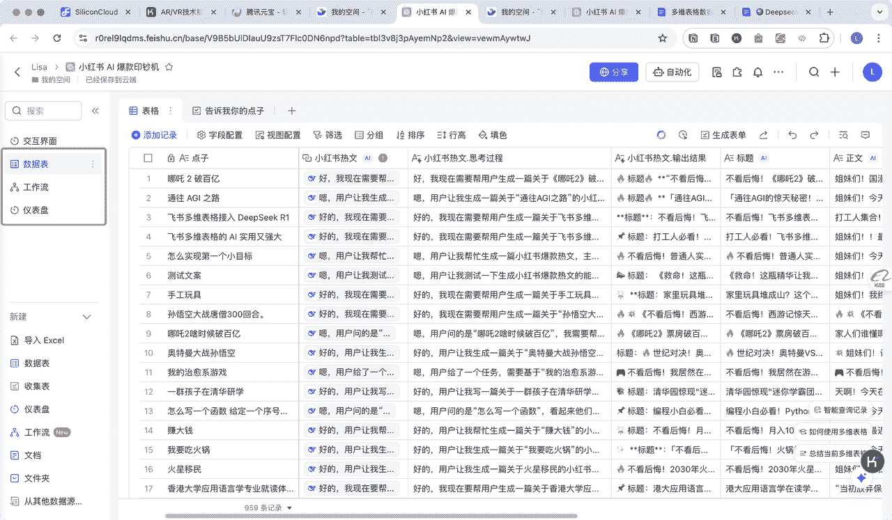

**工作流**：「输入input」——「过程process」——「输出output 」的逻辑链，这个模板有个功能是：「输入」输入“点子”栏后（表格最左）——「过程」云端服务器处理完毕——「输出」会在飞书客户端提示完成内容；

**仪表盘**：基于“数据表”内的数据，做可视化展示的页面，也就是“看板”。可以有图标、按钮等很多功能，更加直观的看到关键性数据。案例的“交互界面”就是一个仪表盘。

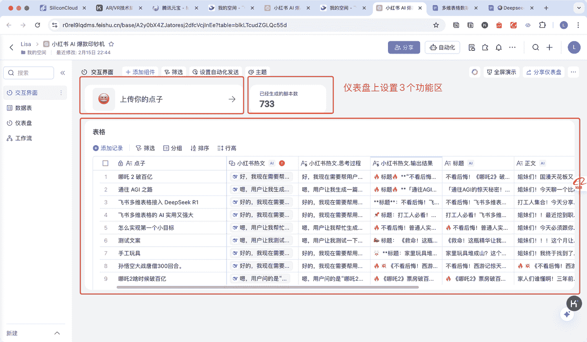

[📕AI爆款印钞机（逆向工程）](https://r0rel9lqdms.feishu.cn/base/WUFSbKATSaa5O0s6IrHcQhXnnVc?table=tbl9NEpitIG2qkc1&view=vewdntHFEV)小车把手请扶稳，我要开车了， 开始⚠️：

# 第一步：设置数据表，调用Deepseek API，生成基础内容

## **新建多维表，设置表头内容：**

| 填写内容 | **点子** | **Deepseek-r1** | ** 标题** | **正文** | **话题词** | **互动问题** |
| --- | --- | --- | --- | --- | --- | --- |
| 注释 | 自行填写 | 思考过程、输出结果，设置单元格后会自动生成 | 由AI输出 | 由AI输出 | 由AI输出 | 由AI输出 |

**所有字段设置成“文本”**

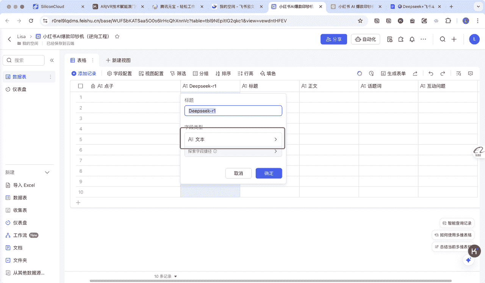

## “Deepseek-r1”单元格设置：

+   “探索字段捷径”选择“Deepseek R1”

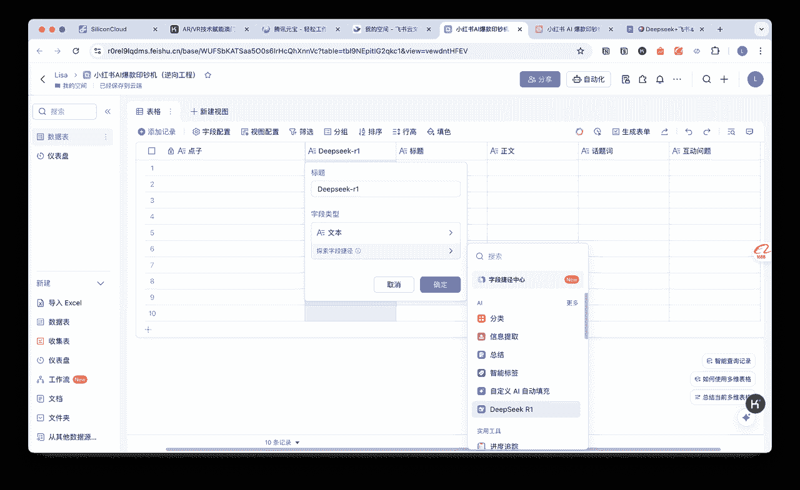

+   “选择指令内容”选择“点子”列

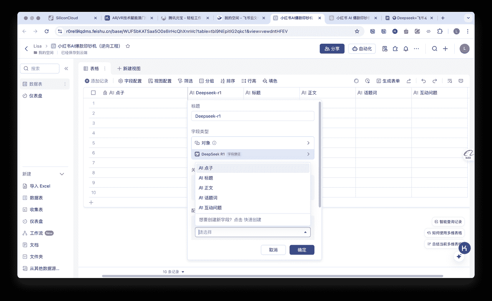

+   “自定义要求”请黏贴以下咒语：

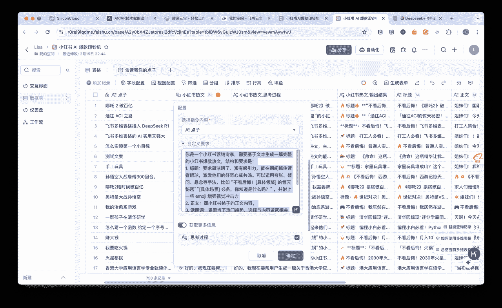

> 你是一个📕营销专家，需要基于文本生成一篇完整的📕爆款热文，结构和要求是：

1.  标题：要求简洁明了、富有吸引力，能在瞬间抓住读者眼球，激发他们的好奇心或共鸣。可以运用夸张、疑问、悬念等手法，比如 “不看后悔！[具体领域] 的惊天秘密”“[具体场景] 必备，你知道是什么吗？” ，并附上一些 emoji 增强视觉冲击力

1.  正文：即📕帖子的正文内容，

1.  话题词：紧跟当下热门趋势，选择与内容紧密相关的话题。比如分享美食，就带上 #美食分享 #热门美食 #美食探店 等；如果是时尚穿搭，就用 #时尚穿搭 #今日穿搭 #穿搭灵感 等。同时，也可以加上一些通用热门话题，像 #📕爆款 #爱用物分享 等，提高帖子的曝光度。

⚠️以上文字可以根据自己的需求，通过deepseek分析对标的爆文风格，生成逻辑结构。逻辑不同，多维表的表头也需要对应更改

+   打开“获取更多信息”，☑️勾选“思考过程”、“输出结果”

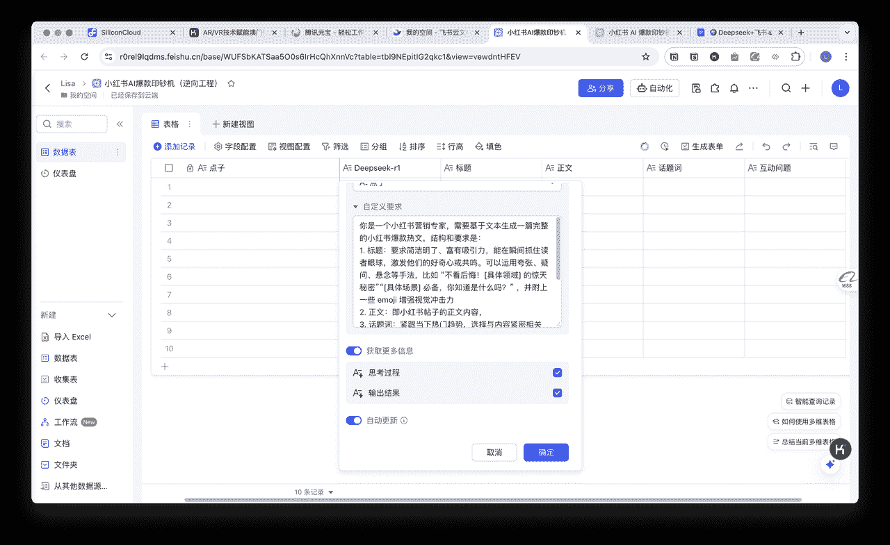

## “标题”、“正文”、“话题词”、“互动问题”单元格设置：

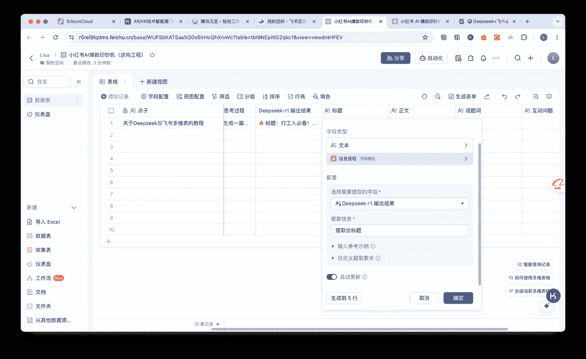

+   “探索字段捷径”选择“信息提取”

+   “选择指令内容”选择“Deepseek R1-输出结果”，自动更新打开

+   “自定义要求”请输入以下咒语：

> 提取出标题

+   “正文”、“话题词”、“互动问题”单元格，以此类推

## 测试下，00:15-00:49，跑了30秒左右，文章生成：

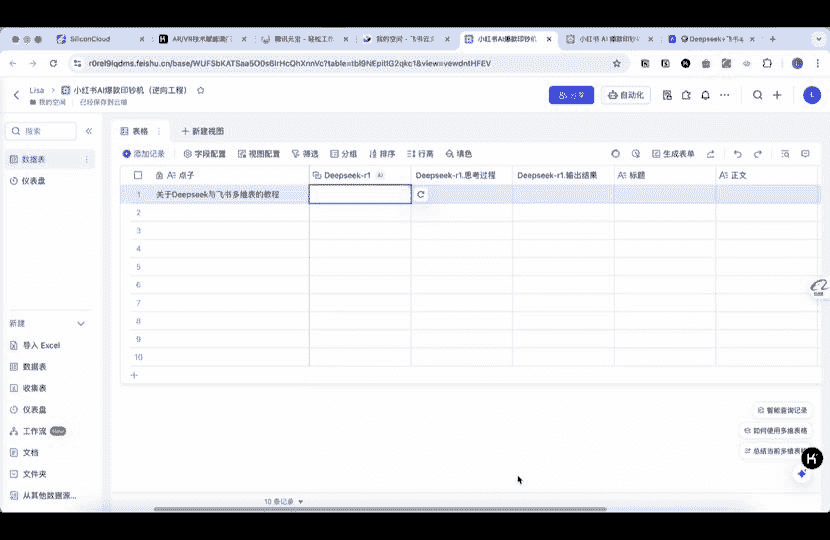

[2月19日(3).mp4](https://internal-api-drive-stream.feishu.cn/space/api/box/stream/download/all/X9OEbwIeHoJWICxLhgScFdabngf)

> 🌟标题🌟

> 「颠覆认知的国漫神作🔥我命由我不由天！这部动画不看绝对后悔！」

> 💫正文💫

> 姐妹们快去看《哪吒之魔童降世》！！看完我直接跪着出影厅！这绝对是我见过最炸裂的国漫没有之一！全程高能到不敢眨眼😱

> ✅ 颠覆认知的改编

> 烟熏妆+鲨鱼牙的哪吒完全打破传统形象

> 但看到最后你会哭着喊：这就是我心中最燃的少年！

> 父母线改编超催泪💔李靖那句"他是我儿"直接让我在电影院爆哭

> ✅ 特效封神名场面

> 山河社稷图里的水墨仙境美到窒息

> 哪吒敖丙决战时的冰火特效每一帧都能当壁纸

> 3D效果超震撼 建议直接冲IMAX厅！

> ✅ 全员立体人设

> 暴躁又缺爱的魔童哪吒

> 温润如玉却背负家族使命的敖丙

> 连结界兽都自带表情包笑点

> 每个角色都值得写万字小作文！

> 💡观影小贴士

> 1️⃣ 一定留到最后！三个彩蛋信息量爆炸

> 2️⃣ 带够纸巾！前面笑得多开心后面就哭得多惨

> 3️⃣ 建议二刷 细节多到头皮发麻

> 最后想说：这才是真正的国漫崛起！当哪吒喊出"我命由我不由天"时，整个影厅都在鼓掌👏你们最喜欢哪个名场面？快在评论区告诉我！

> 🔥话题词🔥

> #国漫之光 #哪吒之魔童降世 #电影推荐 #年度必看 #国漫崛起 #📕爆款 #沉浸式观影 #催泪电影 #特效炸裂 #敖丙哪吒

# 第二步：设置仪表盘，部署3个功能区

⚠️设置仪表盘（交互界面）的目的，简单来说其实就是为了好看和好用。一键点击输入点子💡，等点子成百上千的时候就不用一页一页的翻表格了。

## 设置“请告诉我你的想法✍️”输入窗口

+   先添加一个表单视图：数据表——添加视图——表单视图

这个页面是点击“告诉我你的点子”后链接的页面

表单就是把“数据表”的每一行形成一个页面，我们只保留“点子”那一列的单元格填空就好，提示语可自行编辑✍️

复制浏览器地址栏：表单的链接🔗

> [📕AI爆款印钞机（逆向工程）](https://r0rel9lqdms.feishu.cn/base/WUFSbKATSaa5O0s6IrHcQhXnnVc?table=tbl9NEpitIG2qkc1&view=vewOIH9fnM)-“请告诉我你的想法✍️”

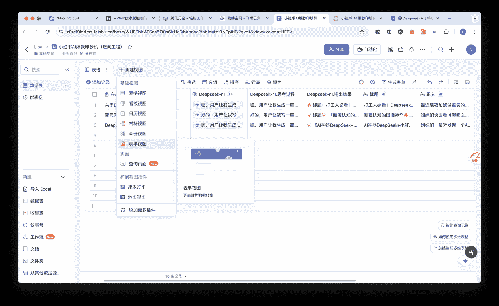

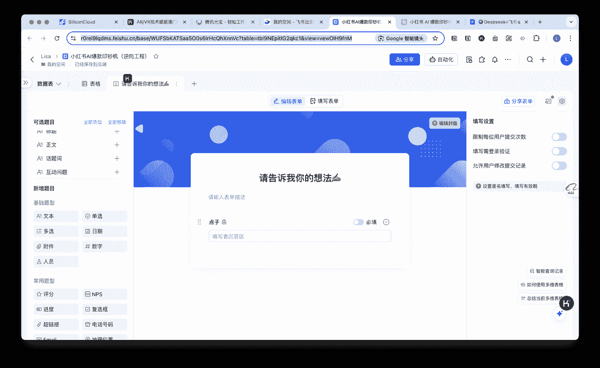

+   创建仪表盘“请告诉我你的想法✍️”窗口

+   仪表盘添加“按钮”：仪表盘——添加组建——按钮

+   按钮文字——“请告诉我你的想法✍️”

+   执行操作——打开链接

+   链接地址——[新表单的链接🔗](https://r0rel9lqdms.feishu.cn/base/WUFSbKATSaa5O0s6IrHcQhXnnVc?table=tbl9NEpitIG2qkc1&view=vewOIH9fnM)

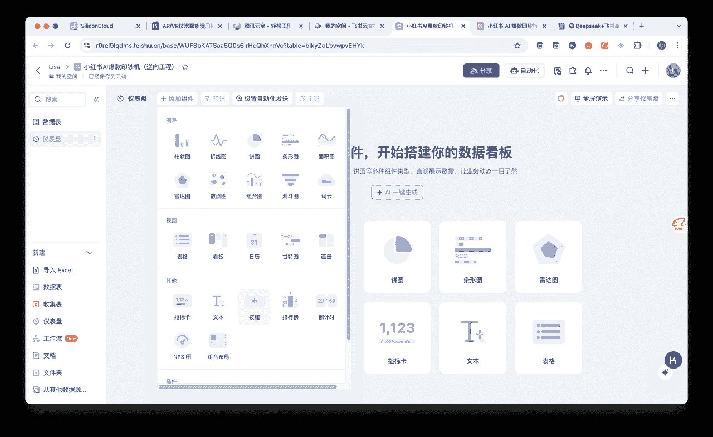

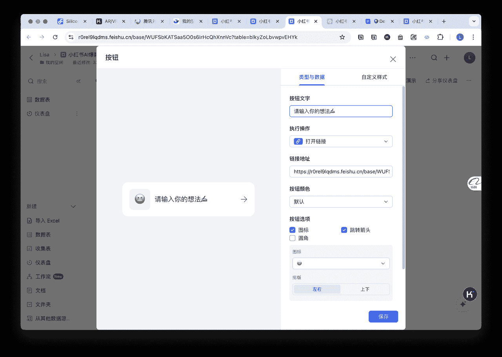

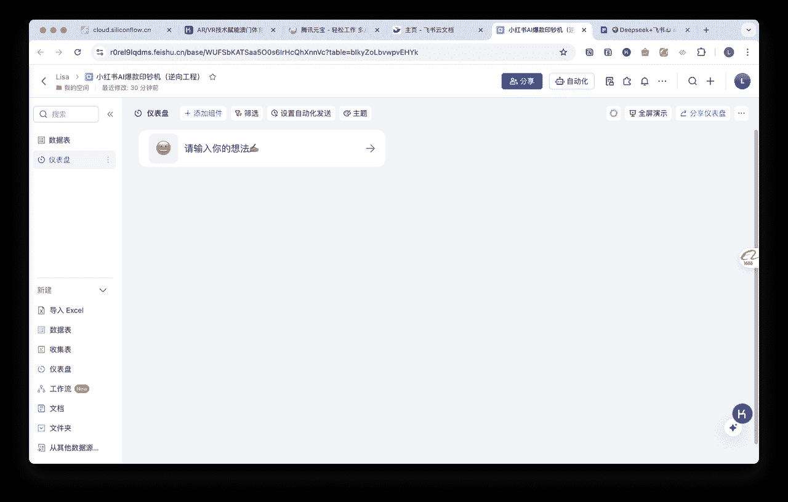

## 点子总数统计窗口

+   仪表盘添加“指标卡”：仪表盘——添加组建——指标卡

+   数据说明——“已生成脚本数”

+   数据源——数据表

+   数据范围——全部数据

+   统计方式——统计记录总数

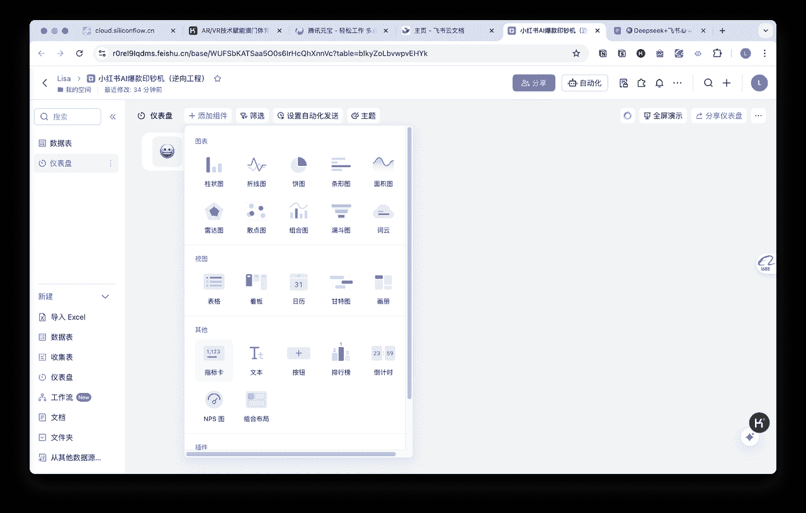

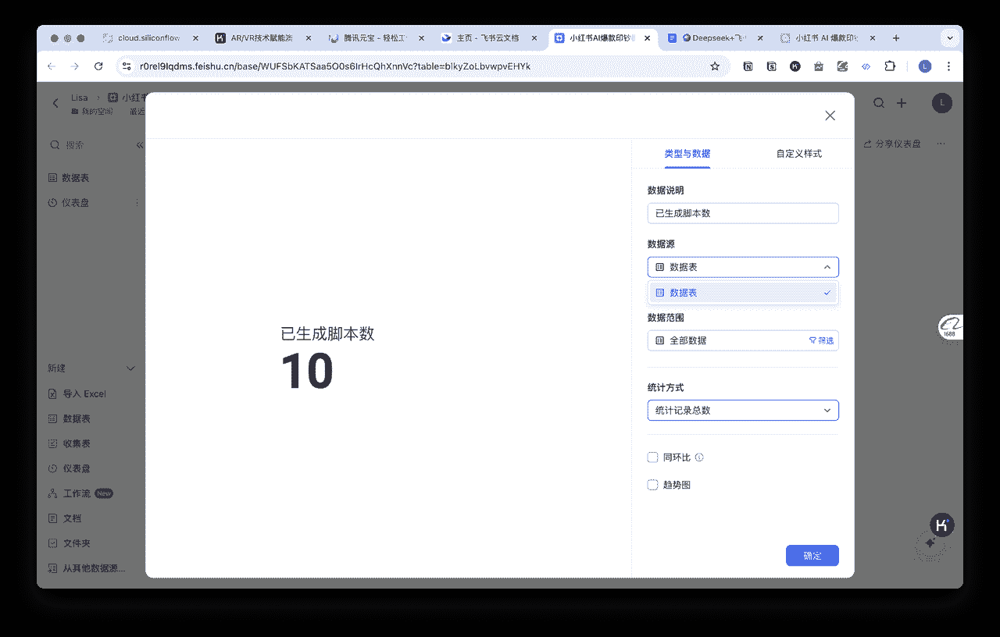

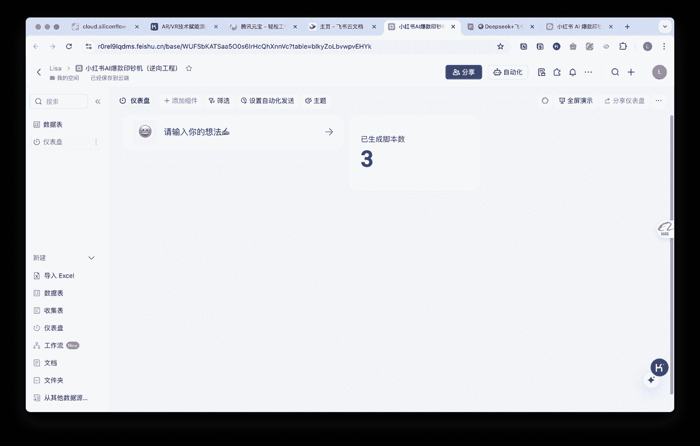

## 数据表窗口

+   **仪表盘添加数据表**

+   仪表盘——添加组件——表格

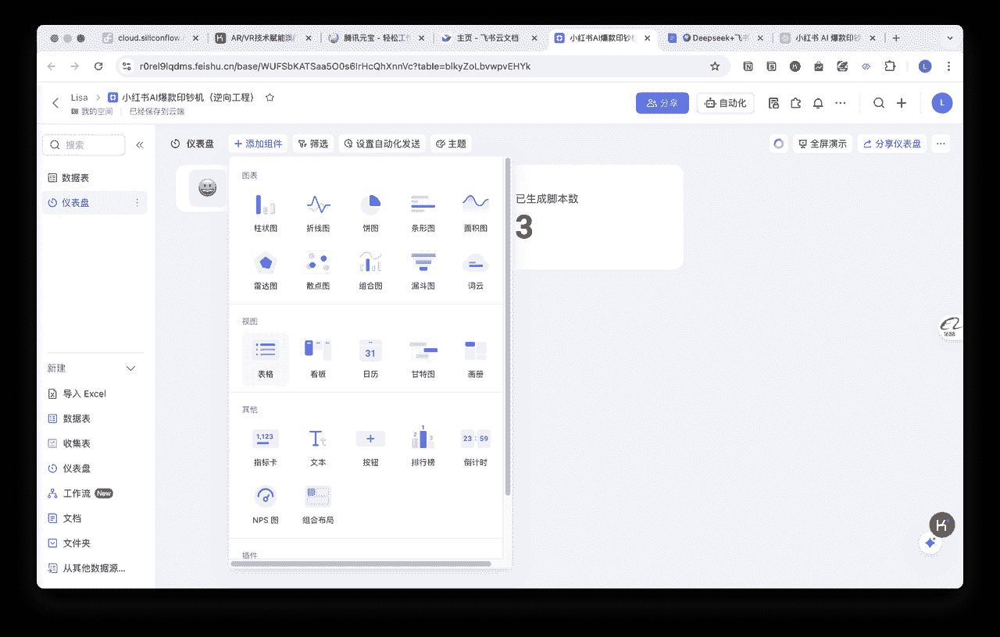

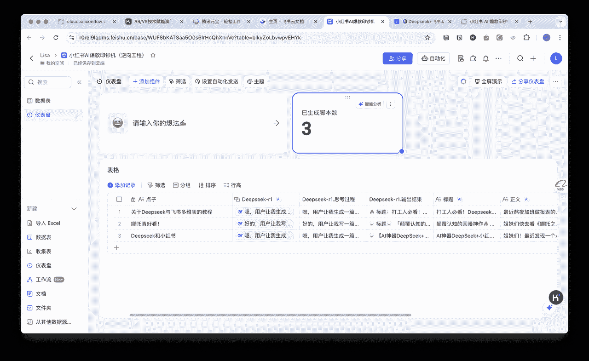

# 第三步：生成工作流，设置内容生成完成后，客户端提醒功能

⚠️ 此步骤的作用是当填写完点子💡，还在缓冲没有出来，文本数据📊生成会在飞书客户端发来提示信息🔔

+   新建工作流：左下角——新建——工作流——从空白开始

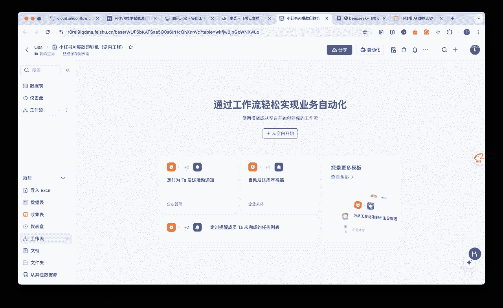

+   添加工作流触发条件：新增修改的记录满足条件时

+   选择记录所在的数据表——数据表

+   标题——不为空

+   正文——不为空

+   话题词——不为空

+   互动问题——不为空

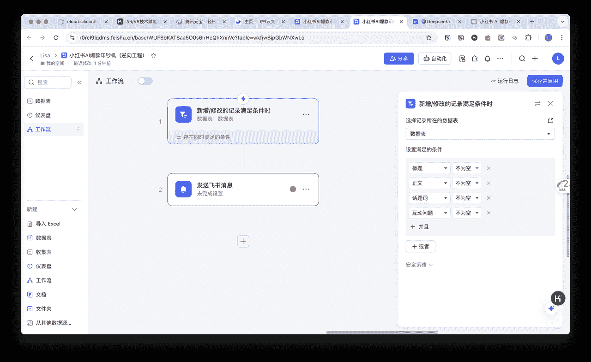

+   添加工作流执行动作：发送飞书消息

+   设置“内容”⚠️支持Markdown格式

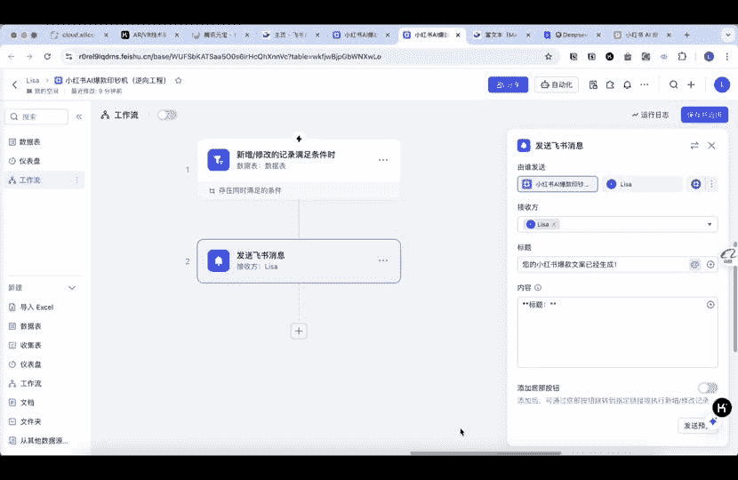

[2月19日(2).mp4](https://internal-api-drive-stream.feishu.cn/space/api/box/stream/download/all/WJWibRbyhoXIt8xmelNcj9Gknpe)

+   设置“接收方”

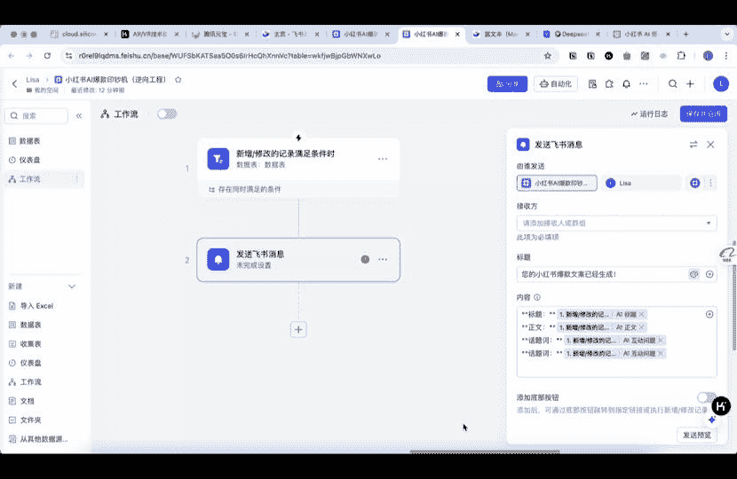

[2月19日(1).mp4](https://internal-api-drive-stream.feishu.cn/space/api/box/stream/download/all/Qy85b5UxOoResGx9uOHcFJ8unkg)

+   **文字生成后提示效果**

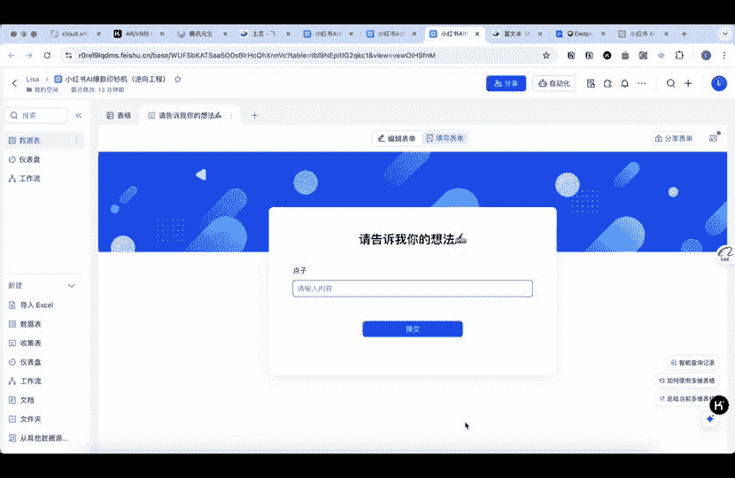

[2月19日.mp4](https://internal-api-drive-stream.feishu.cn/space/api/box/stream/download/all/Ituobw7PZoepebxQK8pcgLttnZe)

恭喜，完工🎉

🔧工具拿走，不谢！😊

另外，之前有写过🥬小白搞定Deepseek卡顿问题

[不再卡顿的Deepseek 💻📱](https://r0rel9lqdms.feishu.cn/docx/A7Q4d4czyojgGXxPOWQc7mTlnGb)

还有用Deepseek做个人智能体的方法

[🌍Deepseek+Cherry Studio两步生成个人网址](https://r0rel9lqdms.feishu.cn/docx/MmPsdBRIyoxNB3xnQppcXwDWnsg?from=from_copylink)

👏欢迎指正～谢谢大家看完了～