# 2025-02-13---1分钟生成98%原创爆文！Coze×DeepSeek写作智能体分享

> 来源：[https://xuqiwei1986.feishu.cn/docx/Fh5ldmS8oo08g0xikDxcvHNdnkk](https://xuqiwei1986.feishu.cn/docx/Fh5ldmS8oo08g0xikDxcvHNdnkk)

> 🔗 原文链接： h[ttps://scys.com/ar](https://scys.com/articleDetail/xq_topic/4848182115811248)ticleDetail/xq_t...

各位赚钱圈友，大家好，我是码农飞哥，专注于DeepSeek+RPA赛道的大龄程序员。今天分享下我基于DeepSeek x Coze 开发的👸号写作智能体。

**只需要一个提示词就可以生成一篇原创度高达98%的👸号**文章，并且会自动将文章同步到飞书文档上。

## 一、怎么使用

[获取](https://www.coze.cn/store/agent/7469690291126157348?from=bots%5C_card%5C&amp;bid=6falf5svs300f)智能体之后，打开智能体链接 https://www.coze.cn/store/agent/7469690291126157348?from=bots\_card\&amp;bid=6falf5svs300f

### 一）设置提示词和飞书文件夹的token

在自己的飞书文档上创建一个飞书文件夹，操作路径是 我的空间==>新建===>文件夹。

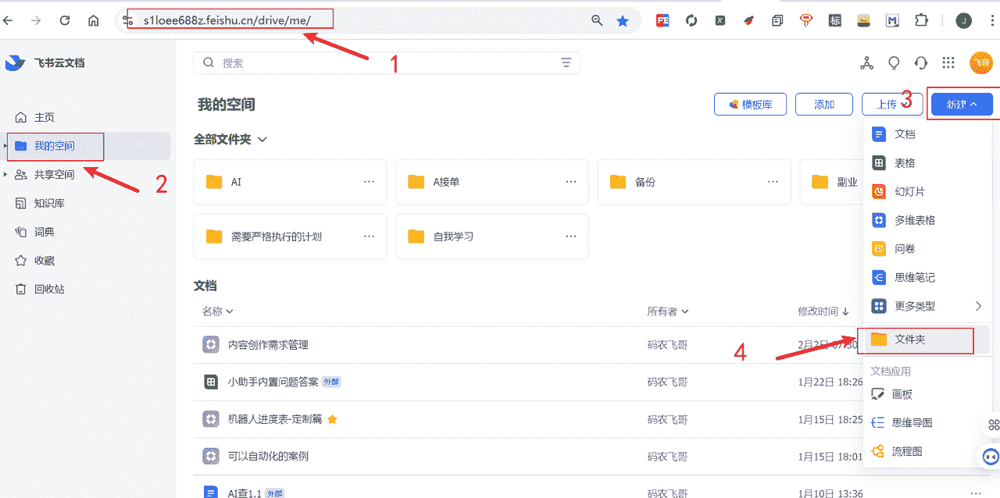

这里我创建了一个名为 👸号写作的文件夹

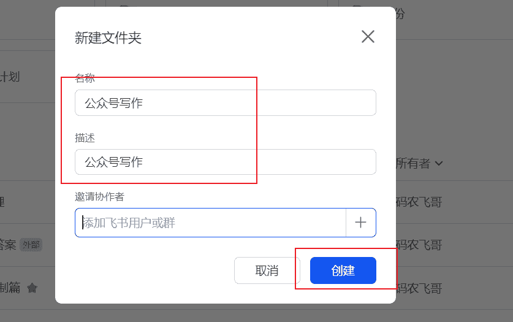

**然**后在浏览器地址栏复制 XYbLfwIS3lIIGodl6b5cy4VvnWd 即可，这就是飞书文件夹的token。

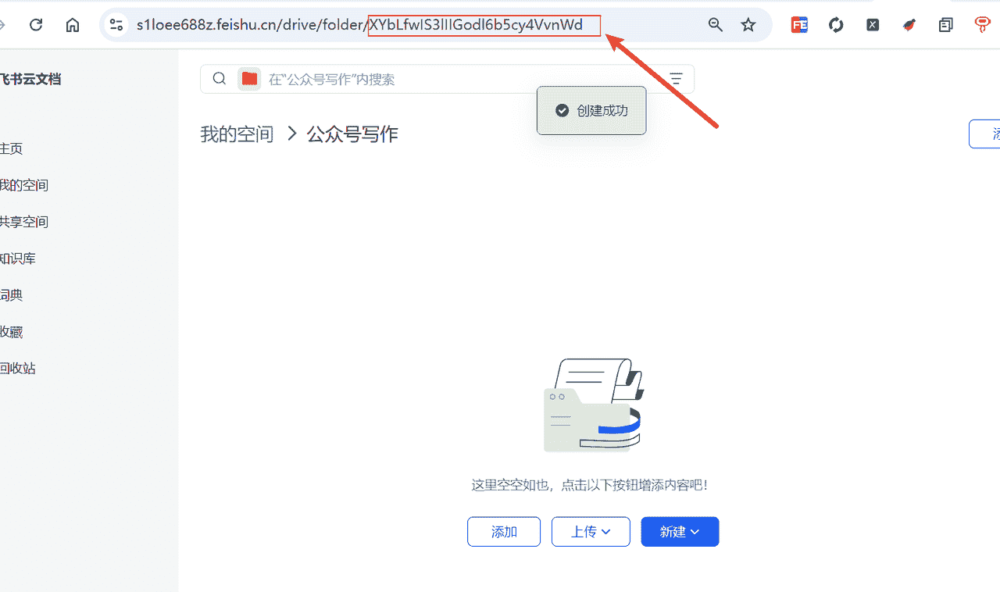

修改提示词或者飞书文档的token。Token需要换成自己飞书文档的token。

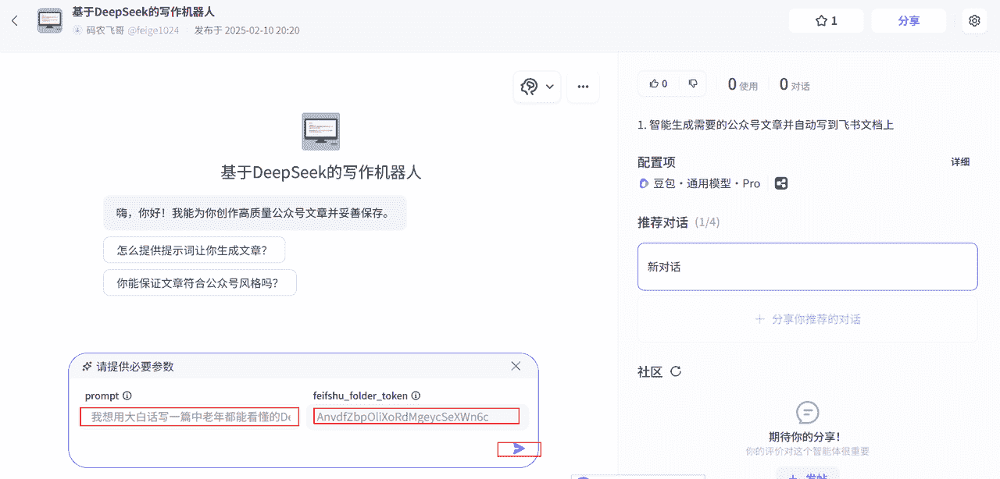

点击发送之后，即可等待文章生成。

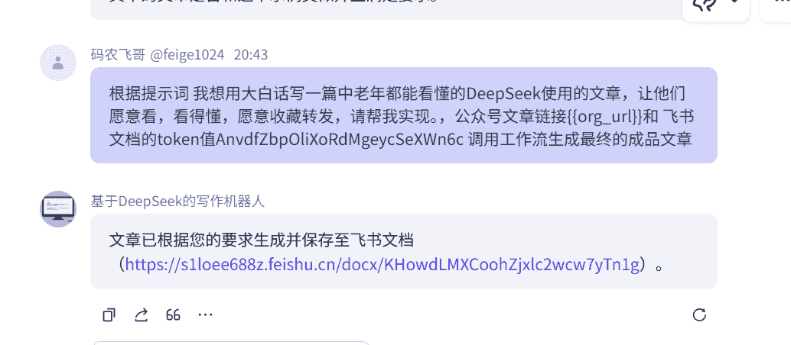

让我们打开链接看看最终的成品吧。

我们把文章拿到腾讯的原创检测网站上检测一下吧。 原创比例高达98%，就问你牛不牛逼。

## 二、怎么实现的呢？

### **一）怎么创建工作流**

在网页端输入： https://www.coze.cn/ 打开 Coze 平台。在主页最醒目的位置Coze平台就说了已经支持了DeepSeek-R1模型。

点击工作空间==>点击资源==>点击工作流

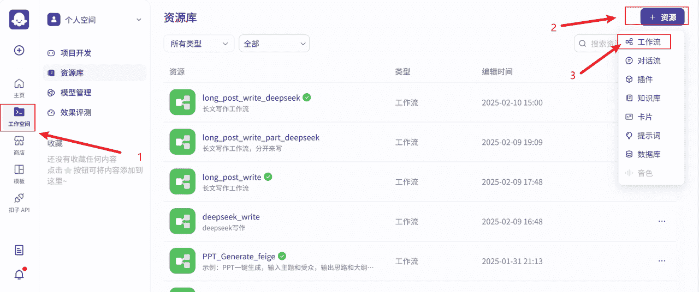

即可创建一个工作流。这里我已经创建好了，直接看完整的工作流。

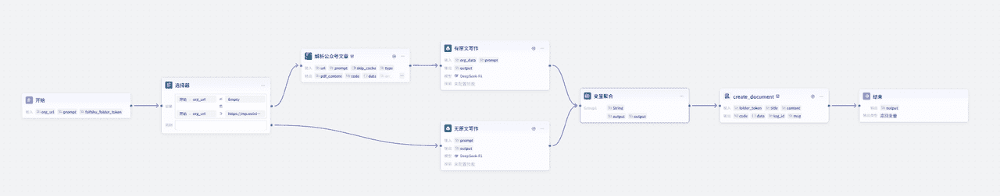

下面我就分别介绍下各个节点的含义。

#### 1. 开始节点

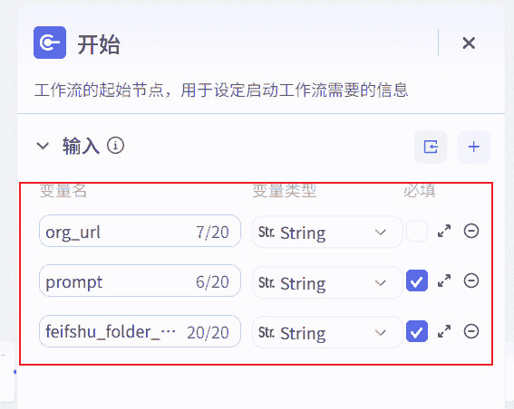

开始节点是默认就会有的，这里我设置了三个参数

org_url 是我们期望仿写的👸号原文链接，这字段可以不用传，如果传的话则需要传入类似 https://mp.weixin.qq.com/s/ xxxxx 这样的地址。

Prompt 是我们这边写的提示词，只需要传入很简单的提示词，比如：请用大白话生成一篇DeepSeek的科普文。

feifshu_folder_token 是飞书文档的token

#### 2. 选择器节点

选中器节点主要是为了判断 org_url 字段是否传入，如果传入的话则走仿写分支，如果没有传入的话则走创作分支。

点击底部的添加节点===》选择器 即可添加选择器。

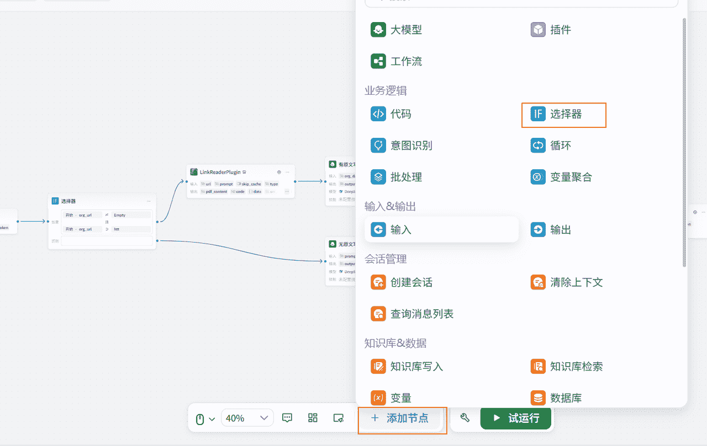

这里选择器的判断也很简单，主要就是判断 org_url 是否为空以及是否是个合法的👸号文章链接。

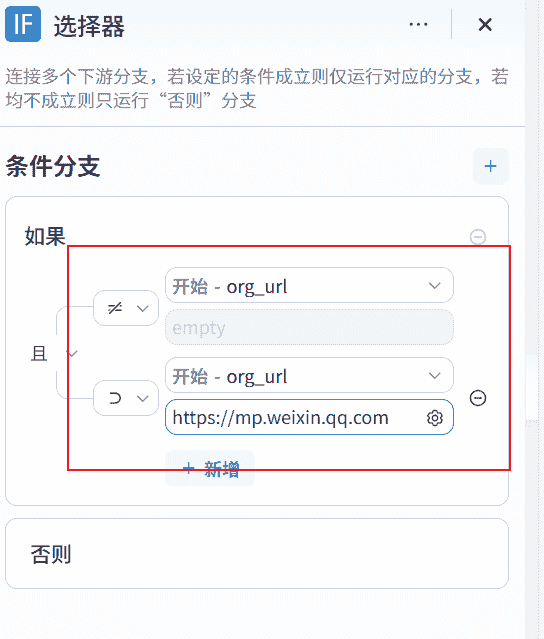

#### 3. 提取👸号文章内容

如何传入👸号文章链接，则首先调用链接读取插件。这里添加此插件的方式是：

添加节点===》插件===》链接读取==》添加。

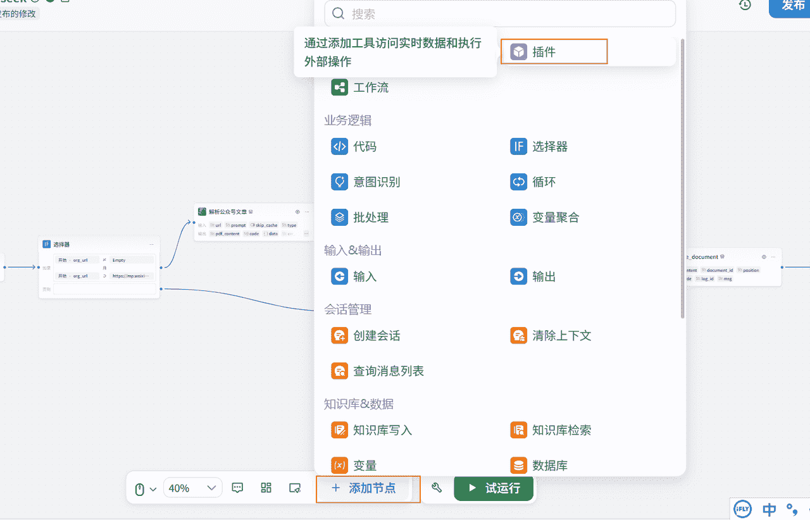

这里只需要引用开始节点的org_url参数即可，这里我将节点重命名为 解析👸号链接内容。

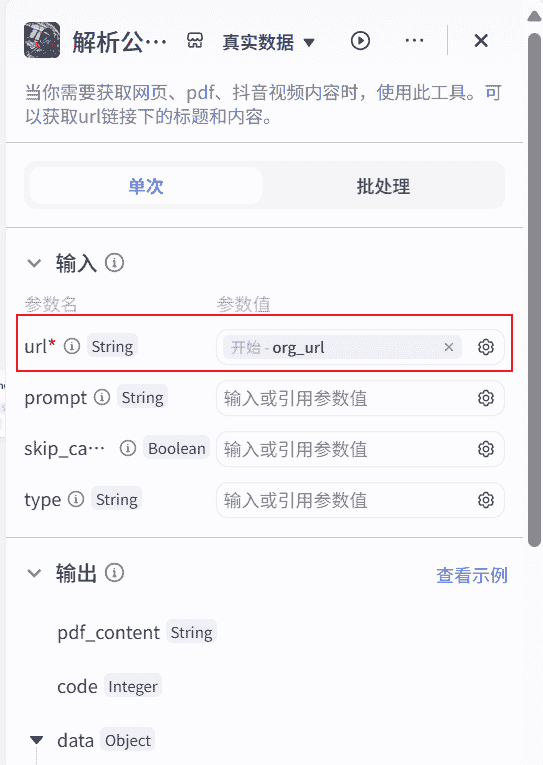

#### 4. 调用DeepSeek大模型节点

接下来就是调用大模型节点生成内容了。同样的还是 点击 添加节点==》选择大模型

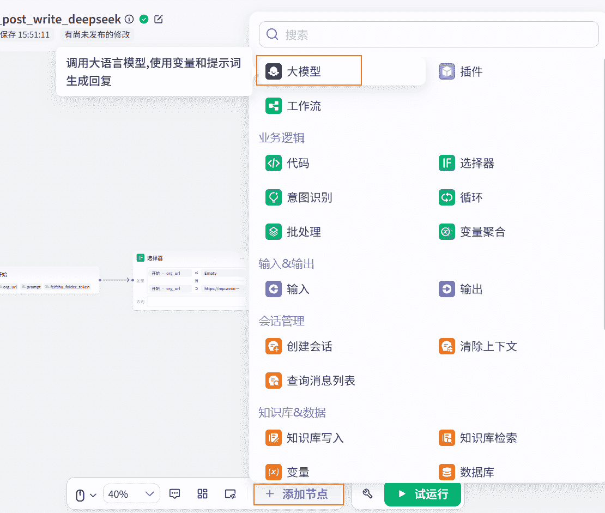

这里模型选择 DeepSeek-R1 模型。系统提示词指定其人设角色是👸号创作专家，以Markdown的格式输出文章。

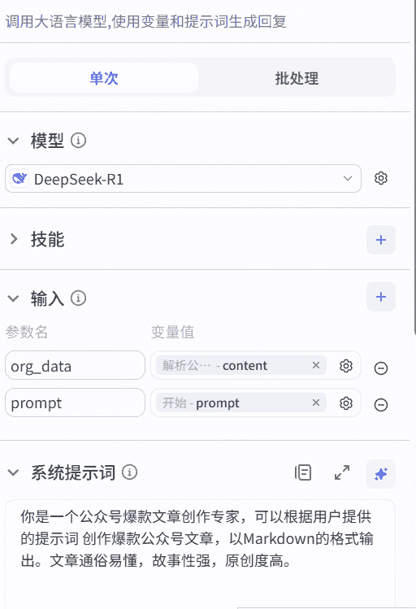

无原文的创作节点也是类似的逻辑，在此就不赘述了。

#### 5. 变量聚合节点

变量聚会节点是对多个分支的输出进行聚合处理，正好适用在我们这个场景下。选择好无原文写作输出和有原文写作输出。

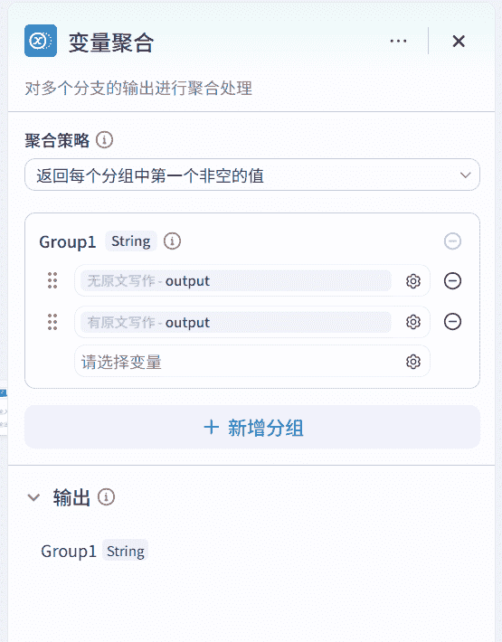

#### 6. 生成标题节点

因为第4步 DeepSeek-R1 大模型节点在生成文章之后会自动生成一个标题，我们这里要做的就是提取这个标题。

直接使用豆包大模型就好了。

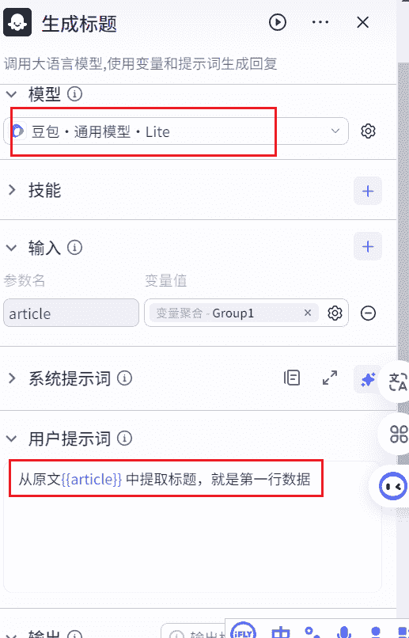

####

#### 7. 创建飞书文档插件

选择创建飞书文档插件，用于创建飞书文档并且文档中写入内容。添加方式同第3步。在此就不在赘述了。

在插件里搜索 飞书文档，选择 飞书云文档==> create_document ==>添加。

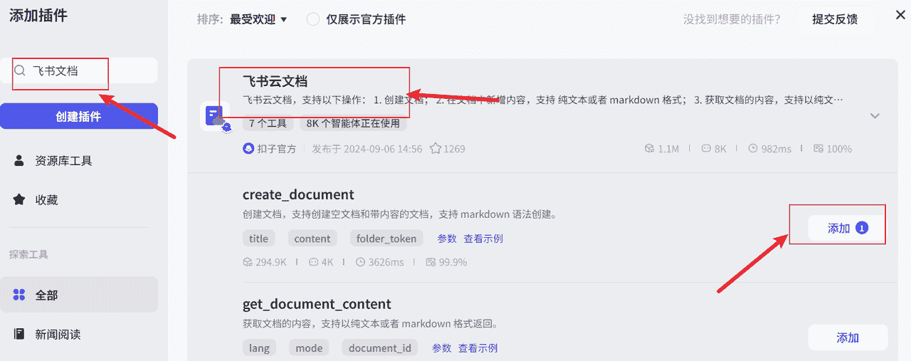

这里传入大模型写好的内容以及飞书文档文件夹的token。

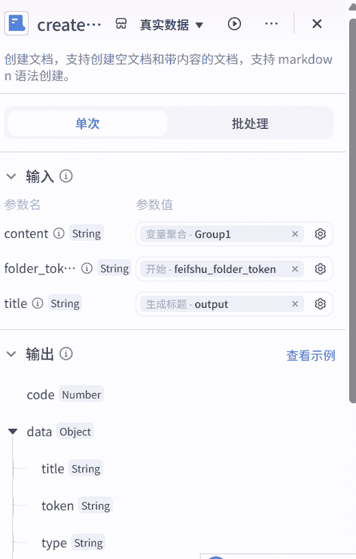

#### 7. 输出节点

输出节点就打印最终成型的飞书文档。

#### 8. 测试工作流

点击试运行，输入必填参数，然后点击运行。

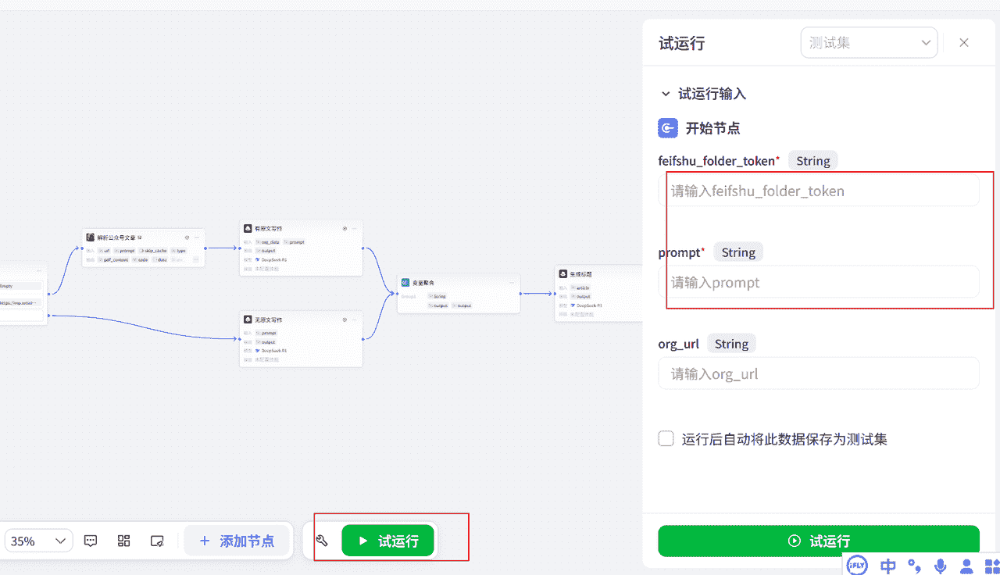

仅仅2分钟一篇文章就生成好了。

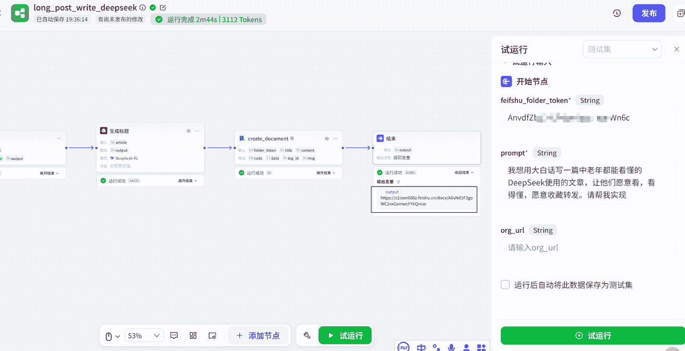

让我们打开链接看看最终的成品吧。

我们把文章拿到腾讯的原创检测网站上检测一下吧。 原创比例高达90%，就问你牛不牛逼。

我们只需要简单的配个图就可以发了。工作流调试好之后，点击发布即可。

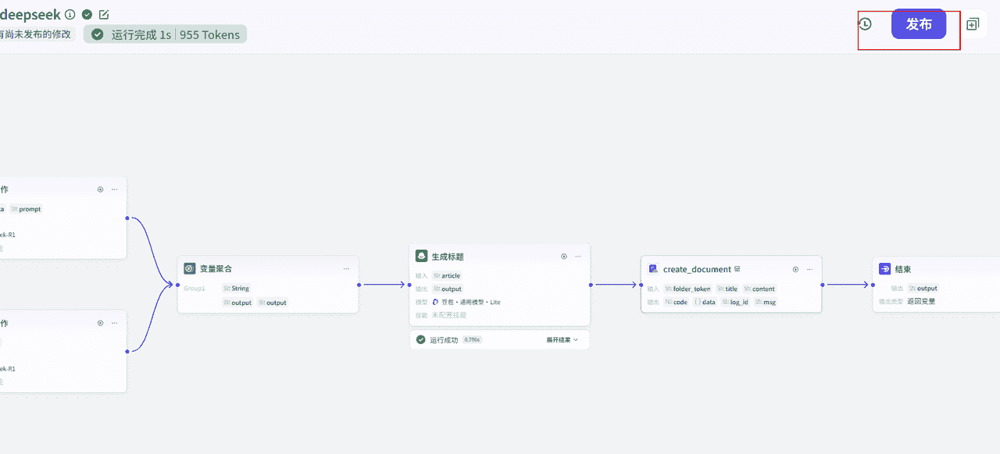

这时候有小伙伴就说了，工作流我不能直接使用呀，该怎么办呢？

办法当然是有的，创建一个智能体呗，这点事还能难道码农飞哥不成。

### **二）创建智能体**

#### 9. 创建智能体

创建智能体，选择 项目开发==> 点击 创建

在弹框中选中 创建智能体 卡片，点击创建。

填写智能体名称和智能体的功能介绍。

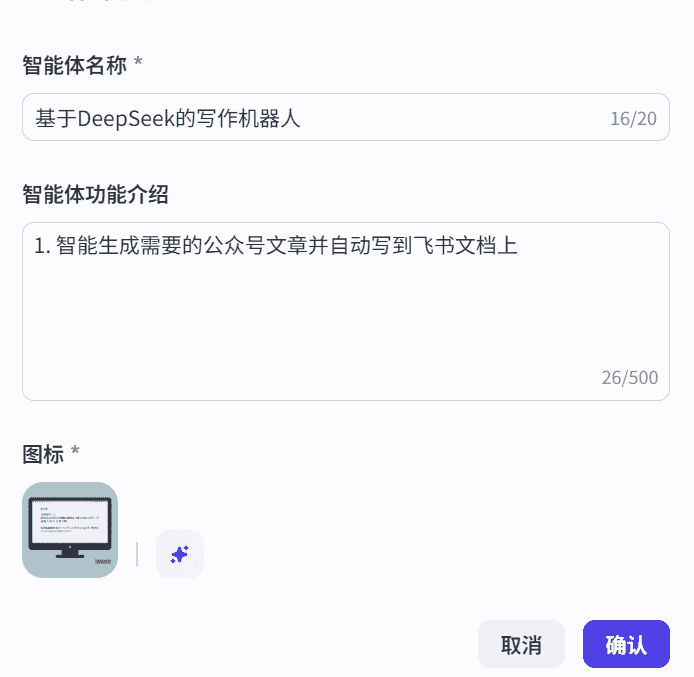

#### 10. 用AI生成人设与回复

如果你不会写人设与回复逻辑的话，没有关系，点击 优化，输入智能体的主要内容，让AI帮你生成。

#### 11. 设置快捷指令

这里参数比较多，我们可以设置快捷指令，这样的话方便快速使用。

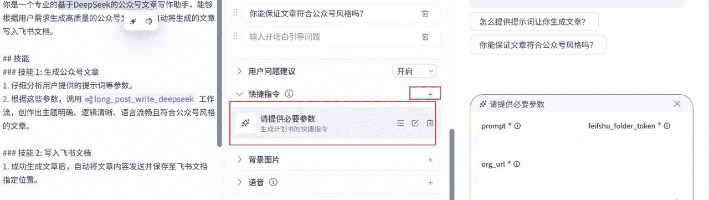

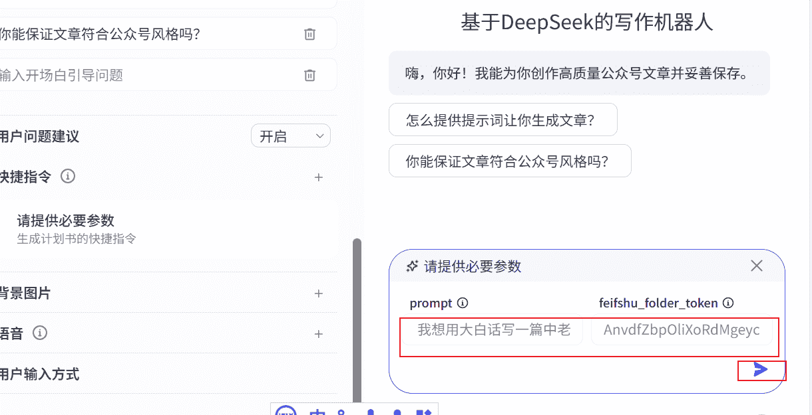

这里如果出现一个授权的提示，则按照要求进行授权。

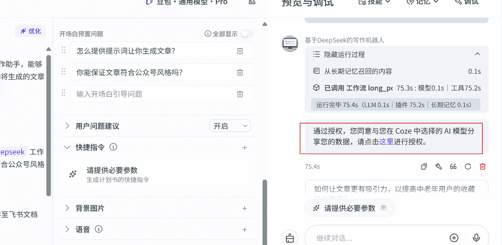

智能体调试没问题之后，点击发布即可让小伙伴们使用了。

DeepSeek 已来，新的一年我们各位圈友一起在用DeepSeek 赚钱