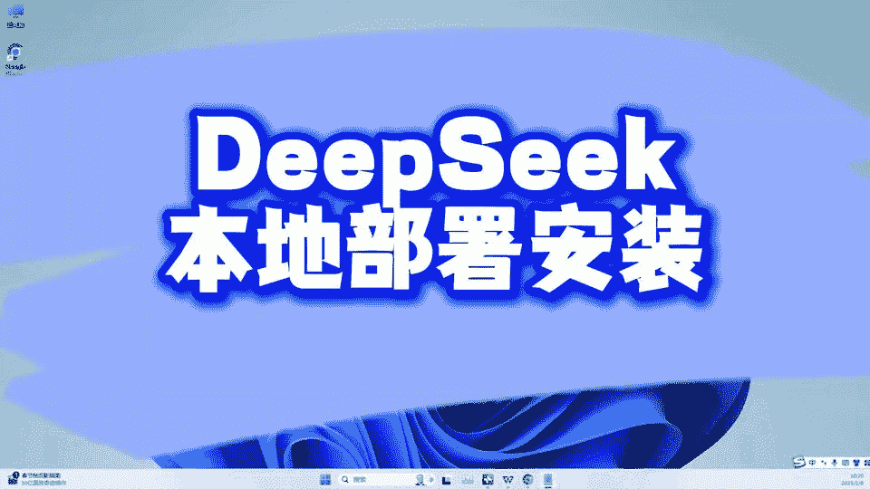
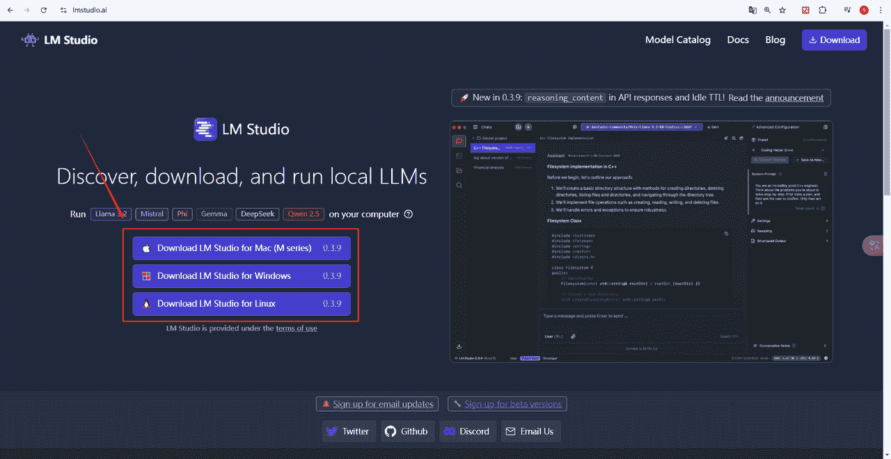
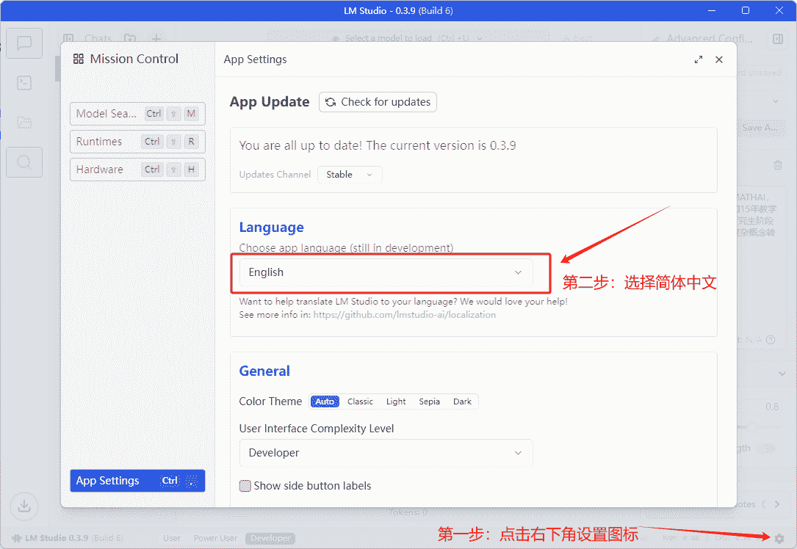
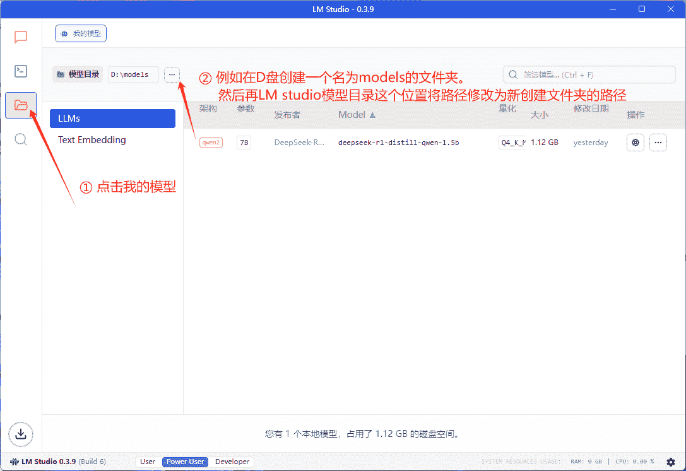
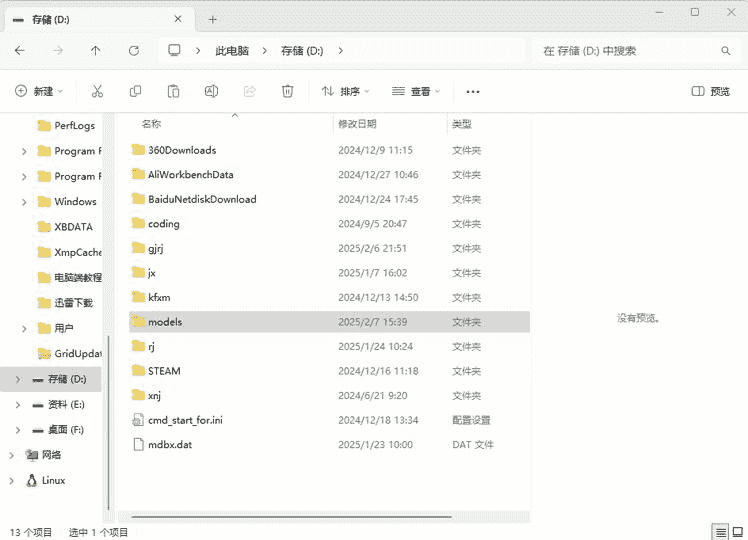
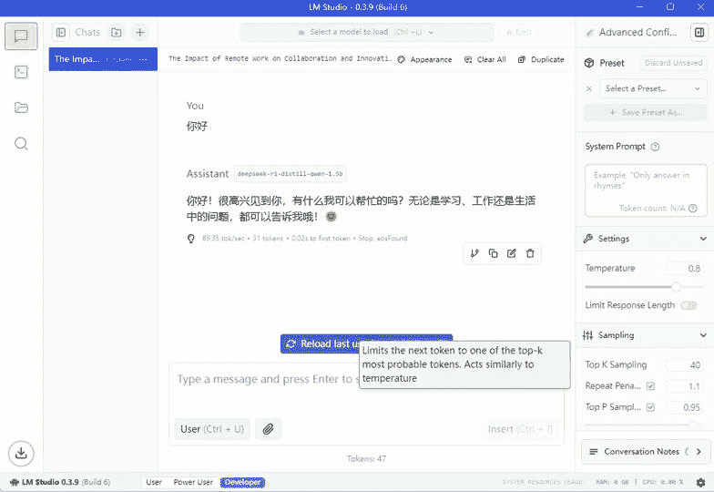

# DeepSeek本地部署教程+可视化界面

> 来源：[https://xuqiwei1986.feishu.cn/docx/OCiydMgDCoQJw9xN3zycQP3lngd](https://xuqiwei1986.feishu.cn/docx/OCiydMgDCoQJw9xN3zycQP3lngd)

## 教程说明

> 1、大家可以根据本文档步骤安装使用。

> 2、看不懂文档的，可以看安装教程视频，跟着视频里一步一步操作。

> deepseek本地部署视频教程：

[2月8日deepseek本地部署安装.mp4](https://internal-api-drive-stream.feishu.cn/space/api/box/stream/download/all/RirObQe3qo9HQDxqAoIcZG1zn1d)

> **3、如果怎么都搞不定，**可以联系博主，远程手把手教你。一定要让你会部署！！！

## 配套资源

> **给**大家准备了夸克和百度两个网盘，网盘里有全部资料，提取后使用方便。如果都没有会员，可以去官网结合迅雷下载，速度很快。

+   夸克网盘：https://pan.quark.cn/s/c2aa63d32a2c

+   百度网盘：https://pan.baidu.com/s/1rzYVYxCIGfvJylmEP8xajA?pwd=8tpn

> 没有网盘会员的，可以点击下方的链接去下载。

+   LM studio 下载地址：https://lmstudio.ai/

+   DeepSeek  模型下载地址：https://hf-mirror.com/

# 第一步：LM studio的下载安装

> 点击下载LM studio进行安装，安装至LM studio推荐的默认路径即可。

+   LM studio 下载地址：https://lmstudio.ai/

# 第二步：LM studio的配置

> 将界面配置为中文，并修改模型文件存储位置

+   1、点击右下角设置，改为简体中文。

# 第三步：DeepSeek模型选择和下载

> 根据博主的提供的参数，先清楚自己能够使用多大的模型，再进行下载。

> 根据自己电脑的显卡配置和需求选择合适的模型下载，可以先下载1个尝试，模型是可以下载多个并灵活切换的。

> 以下是博主制作的显卡参数，不知道自己显卡显存和算力多少的，可以查看。

### 模型下载地址（三种方式）

+   1、夸克网盘：https://pan.quark.cn/s/c2aa63d32a2c

+   2、百度网盘：https://pan.baidu.com/s/1rzYVYxCIGfvJylmEP8xajA?pwd=8tpn

+   3、DeepSeek  模型下载地址：http://hf-mirror.com/

# 第四步：保存模型到文件夹

> 将模型保存在我们在第二步时创建的D盘models文件夹下。

### **按着下面视频操作即可**

> 1、在保存模型时，要先创建一个文件夹，文件夹名称和模型名称一致，然后将模型拉进这个文件夹内。

> 2、再新建一个文件夹，文件夹名称改短一些，将上一个文件夹再放进新文件夹内即可。

> 备注：通过夸克或百度网盘下载的模型，主播已经套好文件夹了，只需要保存在D盘models文件夹下即可。

[模型保存视频.mp4](https://internal-api-drive-stream.feishu.cn/space/api/box/stream/download/all/NcqWbH8vnoPjkXxUFaGc9GConth)

# 第五步：打开LM studio加载模型 进行对话

> 到这里就已经搞定了呢，我们可以开始愉快的使用了！！！

> 点击加载模型，与AI进行对话。

[加载模型进行对话.mp4](https://internal-api-drive-stream.feishu.cn/space/api/box/stream/download/all/UqF7bpA4fovU75xw2G9cKxivn6g)

# 第六步：利用LM studio生成API进行调用

> 除了直接在LM studio上进行对话，我们还可以通过生成API来供本地开发使用，端口是和Open AI一样的标准！

> 点击加载模型，与AI进行对话。

[API调用方式.mp4](https://internal-api-drive-stream.feishu.cn/space/api/box/stream/download/all/UaJlbwhuEomGb4xLajLceoKfn0d)

> 电脑配置比较低，连1.5b模型都用不了的小伙伴。或者说是想要体验满血大模型和其他参数大模型的小伙伴。可以点击下方链接打开教程。

> [DeepSeek 无需部署，体验671B满血模型教程（手机端+电脑端）](https://lcnx5rb1niet.feishu.cn/docx/MBzodoInFo2QPRxinIocdgjsnm6?from=from_copylink)