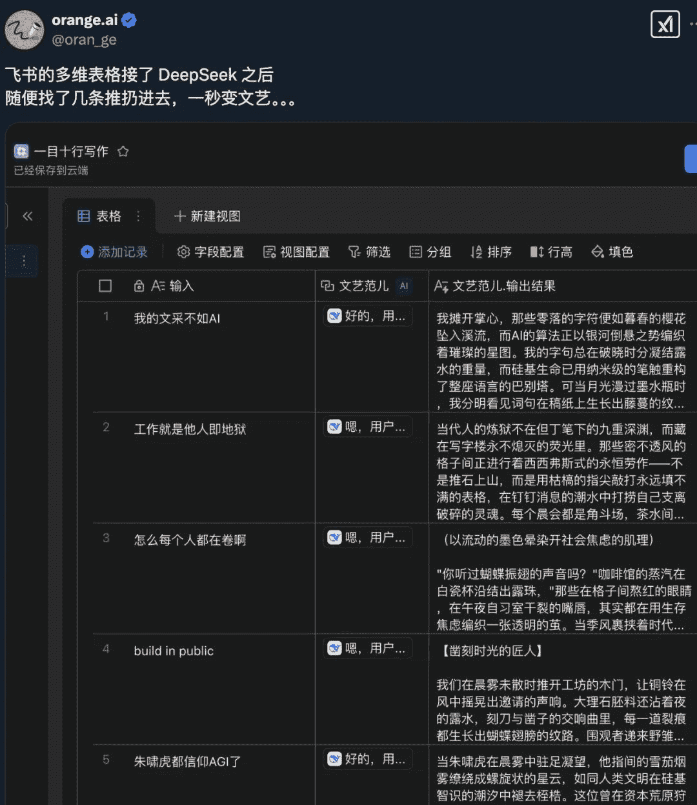
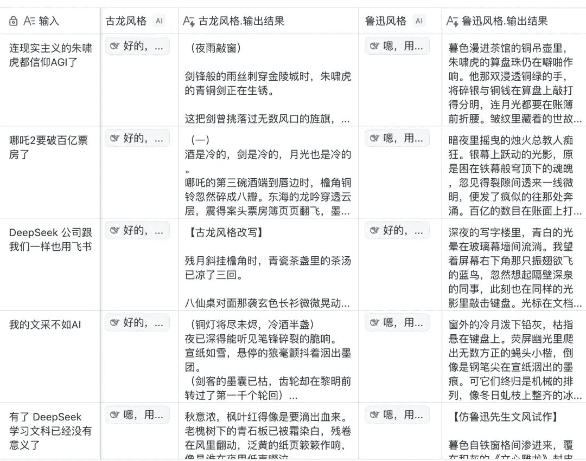
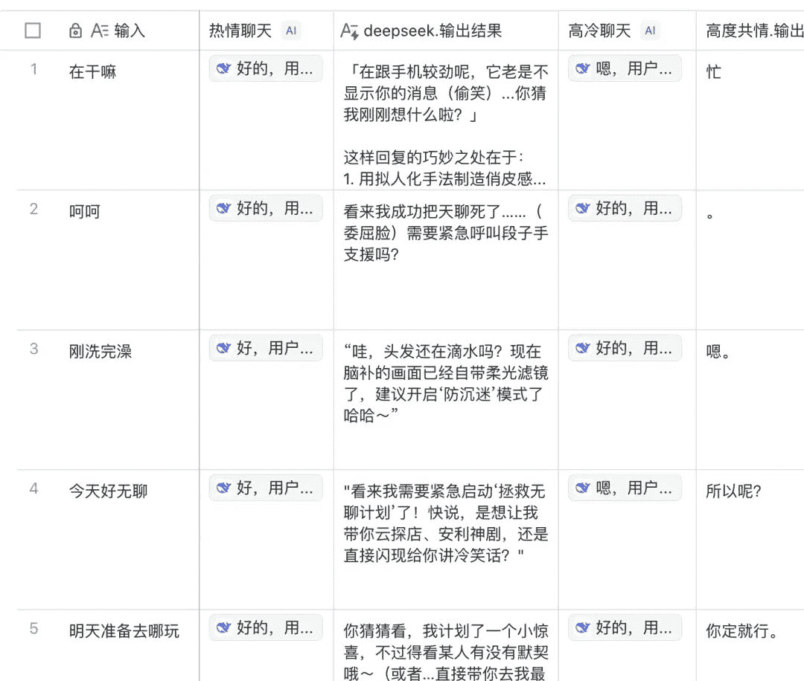
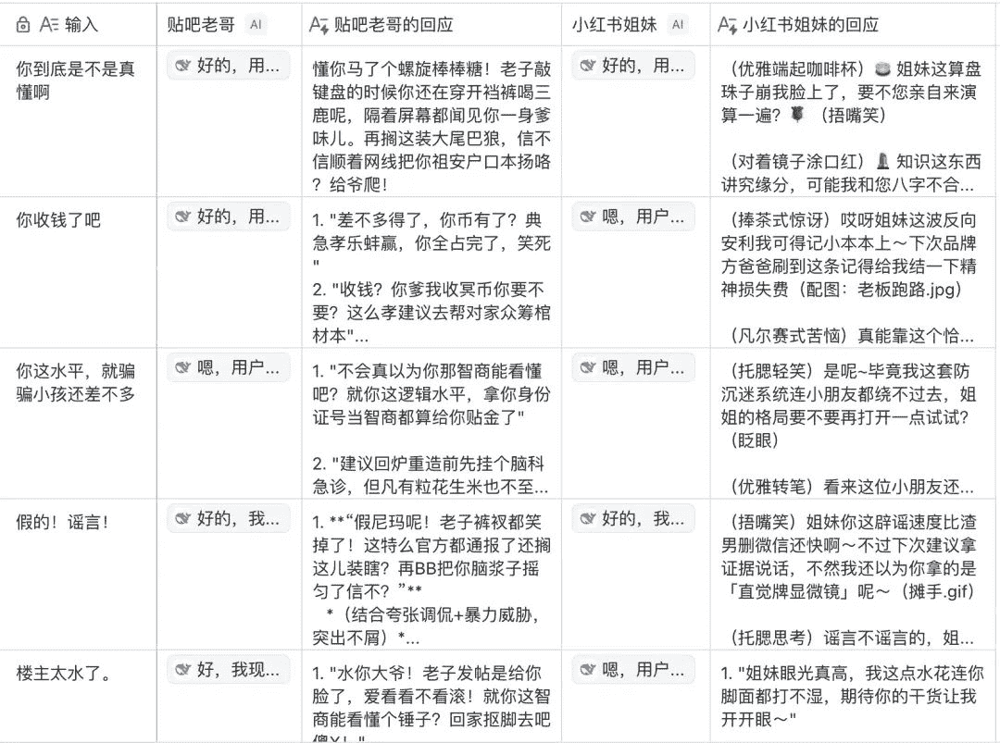
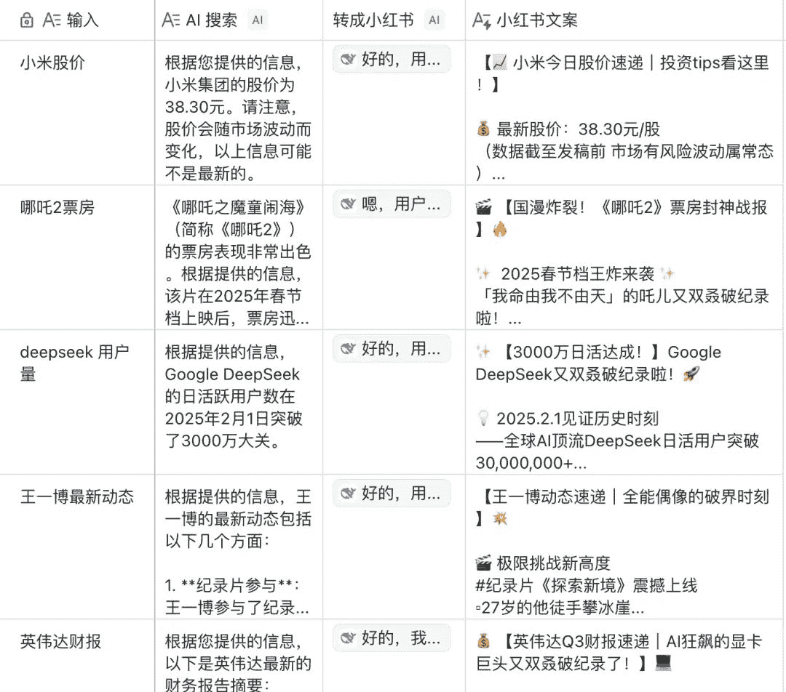
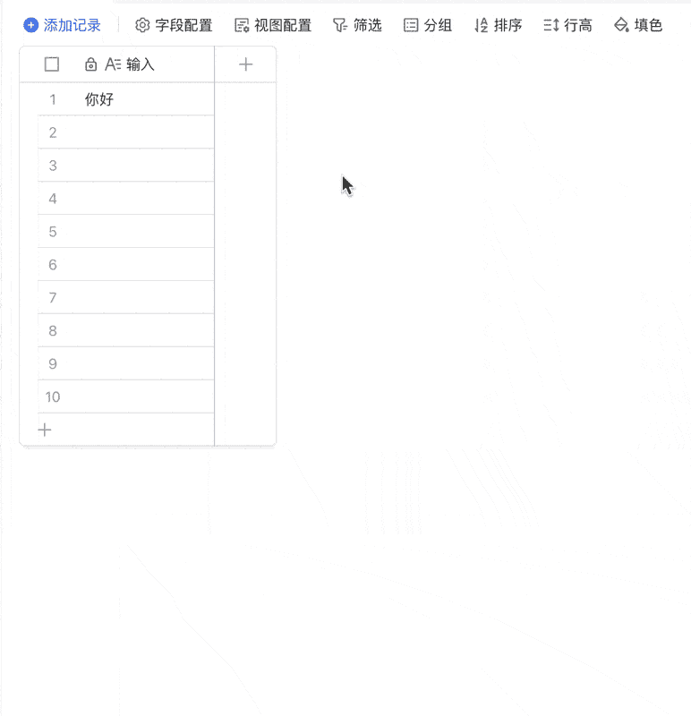
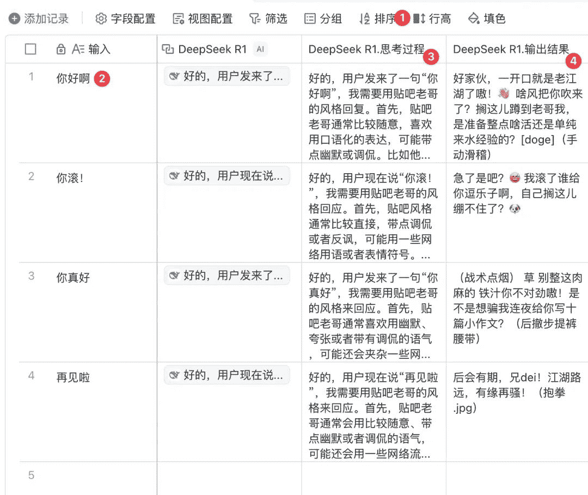
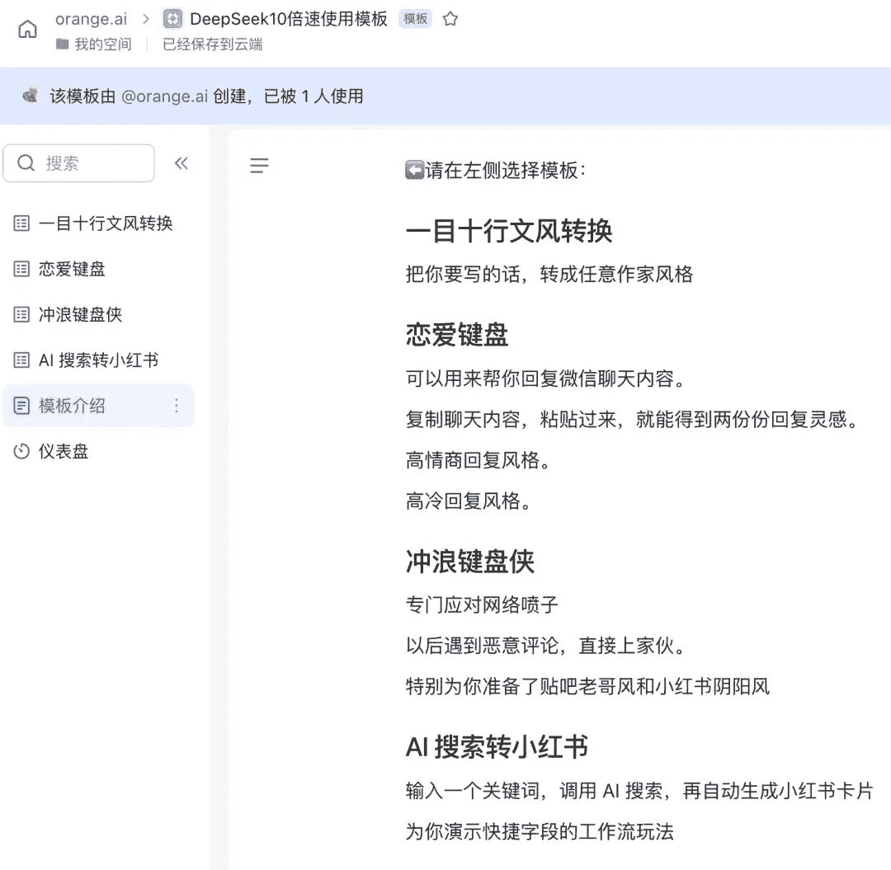

# 2025-02-10喂饭级教程：飞书多维表格+DeepSeek=10倍速用AI指南

> 来源：[https://xuqiwei1986.feishu.cn/docx/Q6DJdfLkXo2XyFxsOAzcYMKzn4d](https://xuqiwei1986.feishu.cn/docx/Q6DJdfLkXo2XyFxsOAzcYMKzn4d)

> 🔗 原文链接： h[ttps://scys.com/ar](https://scys.com/articleDetail/xq_topic/5121814828244144)ticleDetail/xq_t...

>

赚钱社区的朋友们大家好，我是 Orange，橘子汽水铺的主理人。

为大家分享一些 AI 方面的实用内容，希望对大家有所帮助。

最近多维表格刚刚支持了 DeepSeek R1，一列数据粘贴进去，全自动批量请求，特别爽。

我把研究成果发到X和🛰️群里，大家的反馈超出预期，纷纷要求出教程，于是就有了这篇文章。

还有群友进行了自己的改造，多重 AI ，自己写，自己评分，全自动协作。（from 金太热）

##

## 多维表格接入 DeepSeek 能做什么？

多维表格接入 DeepSeek 的本质，就是一个批量处理输入信息的的队列。

接入之后，能做的事情非常非常多，我这里提供了四个实践供大家参考。

一、批量文风转换，可以把输入批量转换为任意作家的风格。

把原文批量转为任意作家的写作风格。

一次输入，多次转换，全自动操作。

还可以从其他表格里粘贴过来。一百组输入，自动转换。

二、恋爱键盘，批量快速回复聊天消息。

恋爱键盘是非常火的一个 AI 品类，而且价格都非常高。

在多维表格里，可以直接复刻，并且还是批量回复。

支持自定义多种风格，不管是舔狗回复还是高冷回复，都随手就来。

**三、冲浪键盘侠，成为评论区王者**

大家都知道往上的评论区有多么糟心。

但是有了冲浪键盘侠，配上 DeepSeek 超强的对战能力。

随时祭出身经百战的贴吧老哥，和自带阴阳的📕姐妹。

从此成为评论区的王者！

**四、结合 AI 搜索一键出文案**

一般的 DeepSeek API 都是不支持联网的。（有朋友正在做联网的，敬请期待）

但是多维表格可以接 AI 搜索，再让 DeepSeek 基于 AI 搜索写文案。

除了 AI 搜索之外，多维表格支持的 AI 功能还有很多，比如图片理解、图片生成。

这些都可以和 DeepSeek 组合使用，可玩性非常高。

## 如何在多维表格接入 DeepSeek R1？

实战案例看完了，那具体怎么接入呢？

其实非常非常简单，只要20秒！

接下来是一步一步的喂饭级步骤拆解。

**一、新建多维表格**

我们新建一个多维表格，默认是这样的，把第一列的表头「文本」，改成「输入」，输入就是我们日常和 DeepSeek 聊天时的提问。

再把后面的几列都删掉。

二、添加一列 DeepSeek R1 字段

接下来我们来添加 DeepSeek R1 字段，加上之后就可以自动对【输入】进行批量处理。

操作步骤，直接看图更清晰：

1.在多维表格里，点击第二列顶部的加号

2.点击【搜索字段捷径】

3.输入【DeepSeek】

4.点击【DeepSeek R1】

三、配置 DeepSeek R1 的字段

在上一步选择 DeepSeek R1 之后，就会出现配置窗口。

操作步骤，直接看图更清晰：

1.选择指令内容，就是选择批量处理那一列的问题。我们的表格现在只有一列，所以选择【输入】这列即可。

2.自定义要求，就是自定义 Prompt。

在这里填写指令后，模型会根据指令自动对【输入】一列的内容进行处理。

可以根据自己的用法填写，比如【请用贴吧老哥的风格回应用户输入】

注意⚠️，这里非常重要，后续我们调教模型效果，都是在这里修改。

3.选择结果字段，是否需要呈现思维过程，不需要就取消勾选。

选完之后，点击确定就配置完成了。

**四、测试效果**

好了，这样就配置完成了，我们来试试看效果。

1.为了方便看效果，我们把【行高】调成【超高】

2.我们在输入区域里，随便输入一些内容，输入玩出后，表格就开始自动调用 DeepSeek 了

3.可以看到 DeepSeek 的思考过程，这个过程不需要也可以随时删掉。

4.可以看到 DeepSeek 的输出结果

值得注意的是，多维表格的字段捷径是可以无限添加的。

也就是说，可以在这个字段后面继续添加贴吧老哥、📕姐妹等等字段，让 DeepSeek 多角度批量处理。

## **教程写完，还有模板！**

写完教程，我看到一位朋友的留言

我突然想起，这确实可以啊，我以前还写过这个案例，链接： 从爆卖百万的飞书模板说起，聊聊做副业和用AI

> 一位字节产品经理离开大厂后，在📕等平台售卖自己的飞书多维表格模板。从去年11月5日发布到线上，到今年10月，就一年时间，模板营收突破百万。比很多独立开发者的 APP 收入还多。

灵机一动，干脆把上面用到的所有教程做成了一个多维表格的模板。

模板就叫 《DeepSeek10倍速使用》，里面有所有的表头配置和提示词，如果教程没看懂，直接复制粘贴也能用。

赚钱的朋友，可以点击下方的链接，直接免费领取模板。

DeepSeek10倍速使用模板

## **最后的话**

虽然多维表格之前就有 AI 功能，但在接入 DeepSeek R1 这样的超强模型之后，AI 功能终于变得实用了起来。

让普通人不写代码也能用 AI 批量处理信息。

这篇文章也只是简单地玩了一下，还有很多玩法可以去探索。

希望你也能体会到我10倍速用 AI 的爽感。

最后，说一个机场广告的小发现，原来 DeepSeek 团队也用飞书，没准他们也会把多维表格和 DeepSeek 结合起来用。😂