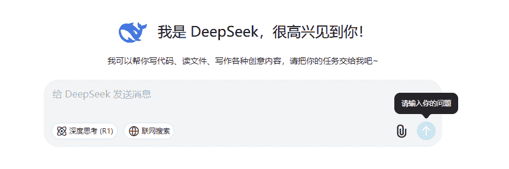
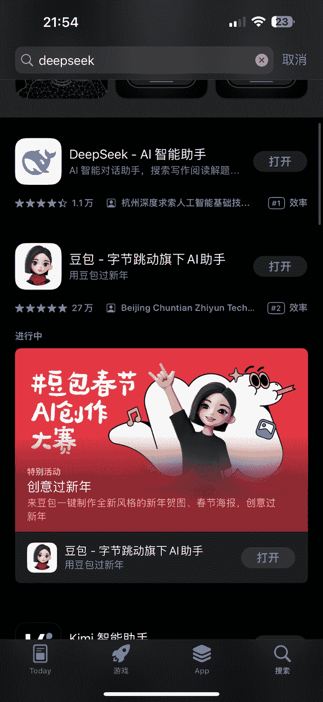
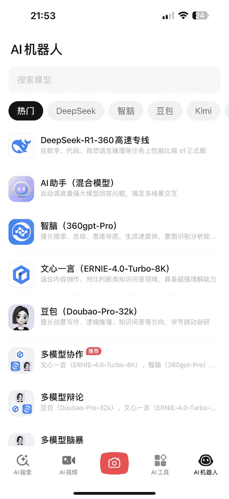
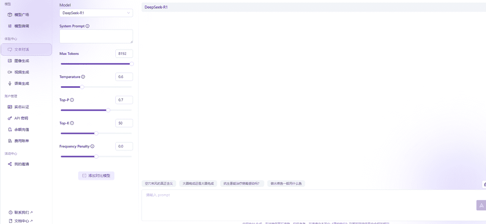

# AI知识库deepseek

> 来源：[https://xuqiwei1986.feishu.cn/docx/E0GwdXVIToToILxDOlPcXCZ5npd](https://xuqiwei1986.feishu.cn/docx/E0GwdXVIToToILxDOlPcXCZ5npd)

# 前言（社群：tkus008）

> 知识库地址https://u0nirmal6e.feishu.cn/wiki/BU1LwQucQiGG6Xk2Jf1cQtVpnSb?from=from_copylink

> 截图保存--提取文字--把空格删除

1）[deepseek本地化部署方案](https://u0nirmal6e.feishu.cn/wiki/QmHNwoFKziU7VukjQWHcvZNznLd)来的！体验一下DS直接看文档3.4🌏本地部署

2）云端部署用这个硅基流动（最具性价比）https://cloud.siliconflow.cn/i/2i85p5Gh

用这个链接注册送2000万Tokens！都去白嫖

**云端服务器+本地化知识库部署**[DeepSeek R1本地部署+私有知识库本地部署](https://u0nirmal6e.feishu.cn/wiki/LHjywH7W4ipEwKk9xz8cIOoQnJb?from=from_copylink)**（电脑配置不够想用r1模型）**

**教程会出现一些程序和代码，新手可能有点复杂，但其实**很非常简单，只要按照教程一步一步操作即可

如果觉得看文档学不会，也可以直播间问，或者进社群问七哥.

> 七哥不定时会直播说跨境和ai链接本人：tkus008

> 备注：跨境或者ai电商应用

> 朋友们，2025年AI工具早不是大厂专属了！现在连楼下奶茶店都用AI动态定价，你竟然还没上车？别被技术参数吓懵，记住三件事：

> ① 盘点现有业务里重复劳动最多的环节（比如客服、报表）

> ② 选个开箱即用的AI工具先试水（推荐通义星尘+DeepSeek套餐）

> ③ 见效后逐步升级，用省下的钱反哺核心业务！

**2025年是国产AI爆发的元年，随着DeepSeek的轰动发布，现在每一个行业、每**一家企业、每一个人，都可以用极低的成本甚至零成本，使用全世界最先进的AI大模型。

# 怎么使用ai？

** 那么，我们怎么使用AI为我们自己的产业、公司、个人创造价值呢？是不是每个人都需要本**地部署大模型呢？网上眼花缭乱的各种AI产品层出不穷，我们应该如何选择，如何取舍？

**今天一次给你讲清楚！**

## ** ai的三个层面解析**

首先，从用户视角，市面上AI产品/服务可以分为3个层面：

### **1.底层（大模型、显卡/算力）**

直接底层部署：

部署671B全量大模型效果最好，高度可定制，但是成本太高，只适合有一定规模的企业，或者有特殊需求的行业（法律、金融、财税等，数据不能联网，需要本地部署）。

注意：如果你只用来问答的话，网页版/APP就可以了，个人电脑性能只能跑得动蒸馏模型7B/8B（可以理解为缩减版），使用效果远远不如网页版/APP。

### **2.中间层工具**

例如coze，anythingLLM，lmstudio ，直接调用主流大模型，同时能根据我们自己的需求进行定制

中间层工具：目前大部分是免费的，而且选择极多，大部分需求都能找到合适的免费工具，还能根据自己的需求进行一定程度的定制。

### **3.应用层软件**

直接给我们结果，比如mj，sd，即梦，可灵，数字人等等各类的软件

应用层软件：目前市面上疯狂打广告的，基本都是应用层软件，这些软件虽然可以直接达到某些结果，但是往往都需要付费（价格普遍偏贵），而且无法根据我们的需求精细化定制和调整。

**大部分企业或者个人，使用****中间层工具****或****应用层软件****就可以满足需求。**

** **

> **目前**AI还处于早期阶段，应用层软件并不完善，很难用一个工具完成商业化，所以薇薇建议大家，尽量使用中间层工具来搭建自己的AI智能体，或者满足自己需求的工作流，应用软件功能组合（这些会员群都会教）

> 中间层的工具唯一的缺点是，需要一定的学习成本，最适合直播间的各位。

# **什么人需要本地部署大模型？**

1.如果你的数据很敏感，不能联网，本地部署可以让你断网使用大模型。

比如（法律、金融、财税等，数据不能联网，需要本地部署）

**2.如果你的需求非常专业，你的私有数据量非常大，云端可**能没有特别好的使用体验，你需要本地部署。

** **

**如果你只是用AI做获客营销、智能客服、私有知识库（数据**不超过10G），没必要在本地部署大模型。

# 实操教程正文

## 电脑端

https://chat.deepseek.com/

## 手机端

1.手机应用商店搜索deepseek

2.如果deepseek官网崩溃，下载纳米AI搜索

## ☁️云端平台（云端部署）

说明：官网崩溃用不了的用云端，需要多模态（文本，图片，视频，音频）的不会部署的用云端！！！！

### 多模态云端平台（文本，图片，视频，音频）

DeepSeek模型已登陆硅基流动，现已支持DeepSeek-V3和R1模型，搭载华为昇腾云，爽用，不怕官网宕机，注册送2000w免费token：

https://cloud.siliconflow.cn/i/2i85p5Gh

**云端服务器+本地化知识库部署**[DeepSeek R1本地部署+私有知识库本地部署](https://u0nirmal6e.feishu.cn/wiki/LHjywH7W4ipEwKk9xz8cIOoQnJb?from=from_copylink)**（电脑配置不够想用r1模型）**

## 🌏本**地部署(小白直接看这边)**

### 说明：适合特殊职业，比如：律师，财税，企业，等

可以自己训练模型：可以更新一些参数，把模型内容进行调整

根据自己的数据库对模型进行调整

**注**意：本地部署后，大模型的性能取决于你的设备性能，如果你的电脑配置不满足大模型运行的最低要求，部署之后可能会运行非常慢或者无法运行。

[deepseeek本地化部署](https://u0nirmal6e.feishu.cn/wiki/QmHNwoFKziU7VukjQWHcvZNznLd)

# 四、更新中

[deepseek的应用场景](https://u0nirmal6e.feishu.cn/wiki/MmI1wGMWziPGxik1PHGc1u0BnWe)

[deepseek接入api](https://u0nirmal6e.feishu.cn/wiki/PuyJwmfFkifHxNkVFFQcLll5nng)

# 七哥在做的电商项目

[东南亚TIKTOK-本土投流计划书](https://qajip2qccfl.feishu.cn/docx/UVQed0Ql0o3chhxvfACc5xV9n6Y)