# LOF基金套利---美元债LOF（501300）每天捡5块钱

> 来源：[https://xuqiwei1986.feishu.cn/docx/Y7XpdhSvios1Y2xztNTc1bPFnkd](https://xuqiwei1986.feishu.cn/docx/Y7XpdhSvios1Y2xztNTc1bPFnkd)

前段时间，主要是通过标普信息科技LOF基金套利，不过后来这只基金暂停申购了，套利的拖拉机就熄火了。

但！其实除了标普信息科技外，现在还有一个可参与的套利机会——

美元债LOF（5013 00），当前溢价率6%左右

相当于：用100元参与套利可以赚6块左右，实现一天一杯蜜雪冰城的自由。

如果坚持每天都参与，一周就是30元，一个月就是120元，坚持薅下去还是挺香的。

接下来，我来手把手教大家「 美元债的套利方法 」，一共分为四步，分别是：

**1）场外申购**

**2）场内外关系建立**

**3）转托管**

**4）卖出，完成套利**

# **第一步，场外申购套利基金**

1，以华宝APP为例，进入理财-公募基金

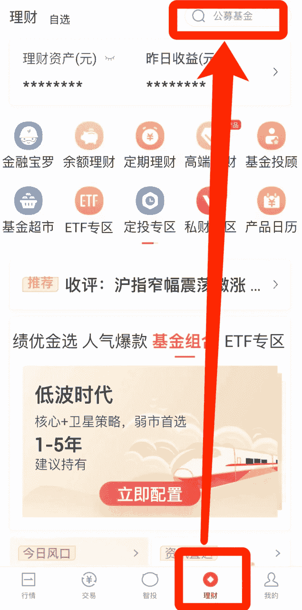

2，输入可套利的基金代码：

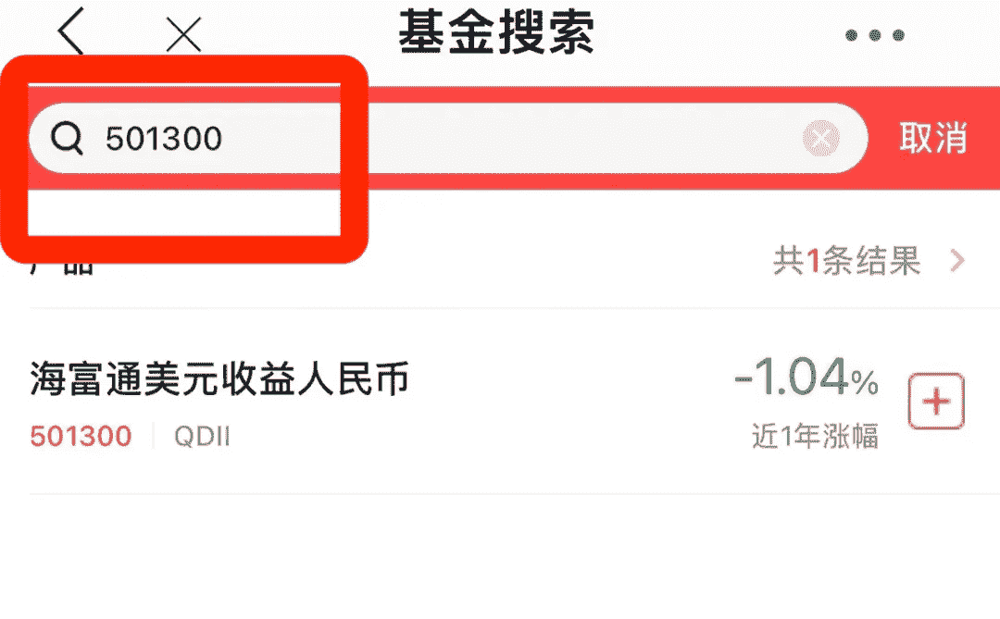

3，进入基金详情页后，点击下方的「立即购买」：

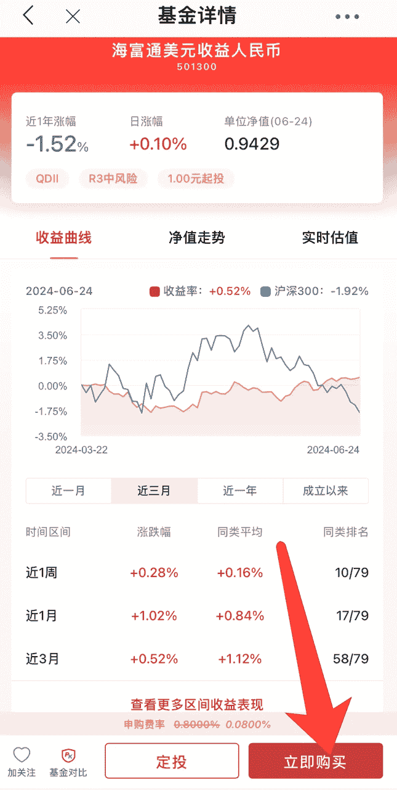

4，进入购买页面后，先在买入金额处输入对应申购金额，然后在风险提示处打钩：

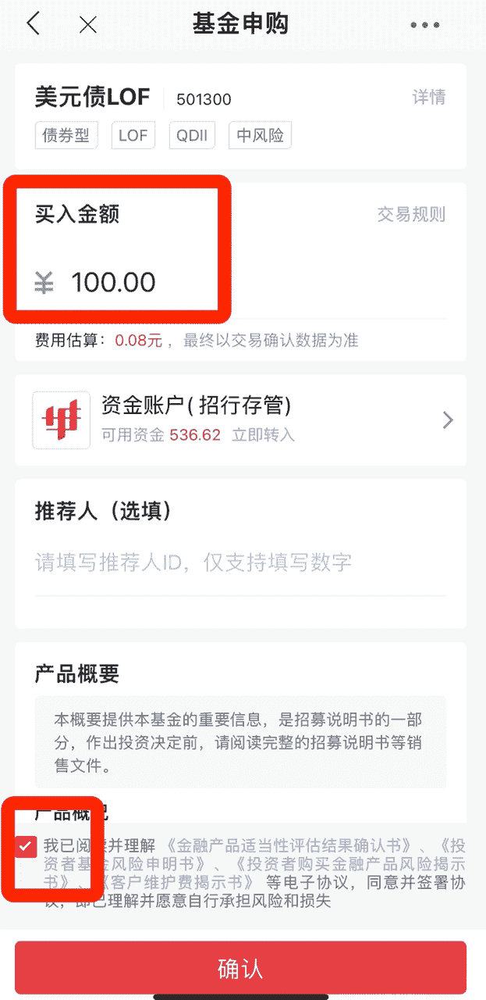

5，核对基金名称、代码、金额是否正确，没问题直接点击确认

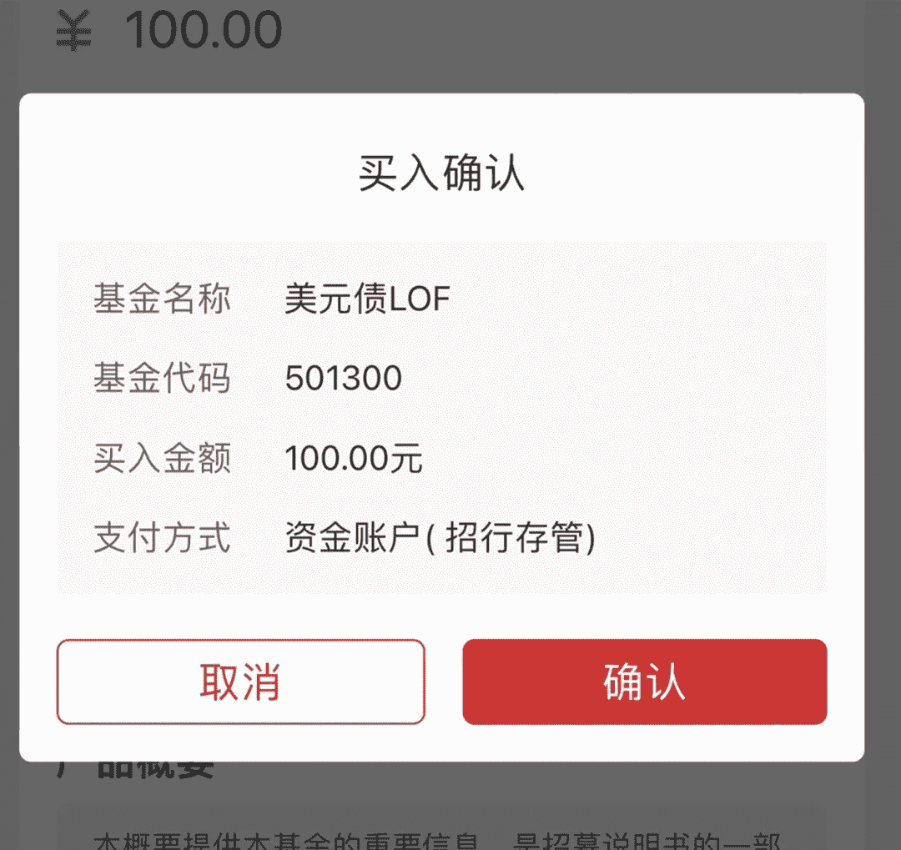

6，点击「完成」，即成功操作场外申购

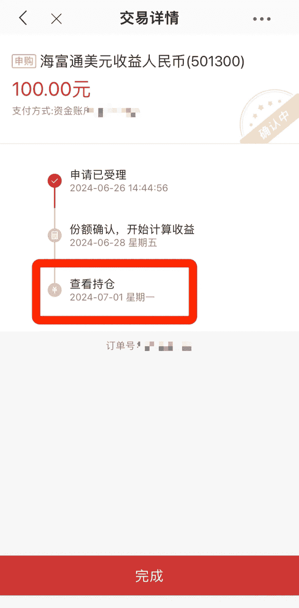

这里， **强烈建议把上述页面截图 **——

**红框里「****查看持仓」的日**子就是我们要进行 转托管 的关键时间点。

注意： 不是所有证券公司都会代销 套利基金

如果你发现你的券商找不到想要套利的基金，那就说明它不代销，也就操作不了场外转场内。

当然，也有人说我是不是可以通过其他平台场外申购再转入场内。

理论上是可以的，但操作上复杂。

所以为了方便简单，还是选择有代销该基金的证券公司来操作吧。

# **第二步，建立场内外关系**

1，华宝-业务办理-账户管理-场内外对应关系维护

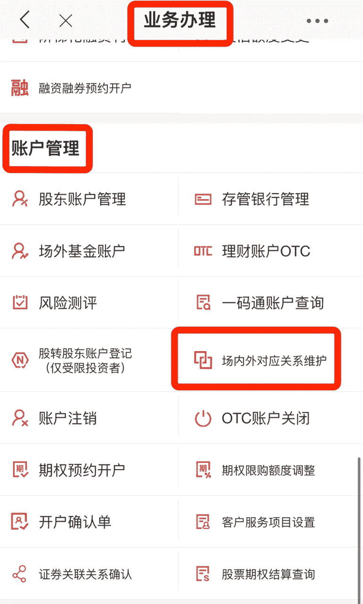

2，点击最下方的「立即办理」

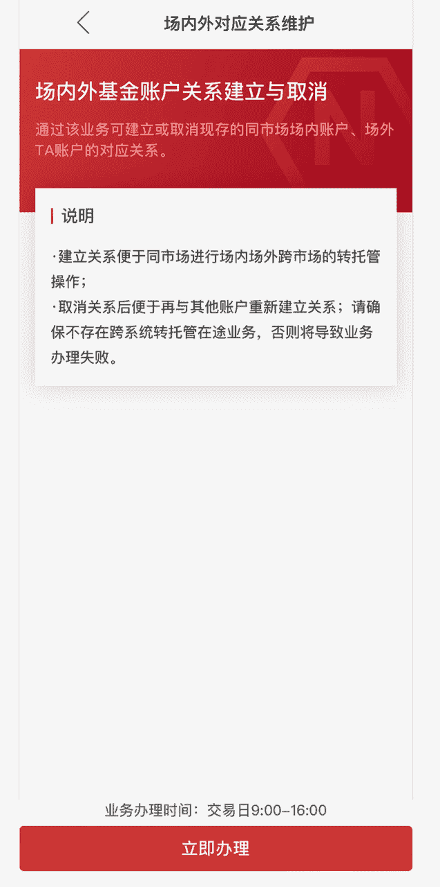

3，点击下方的「建立关系」

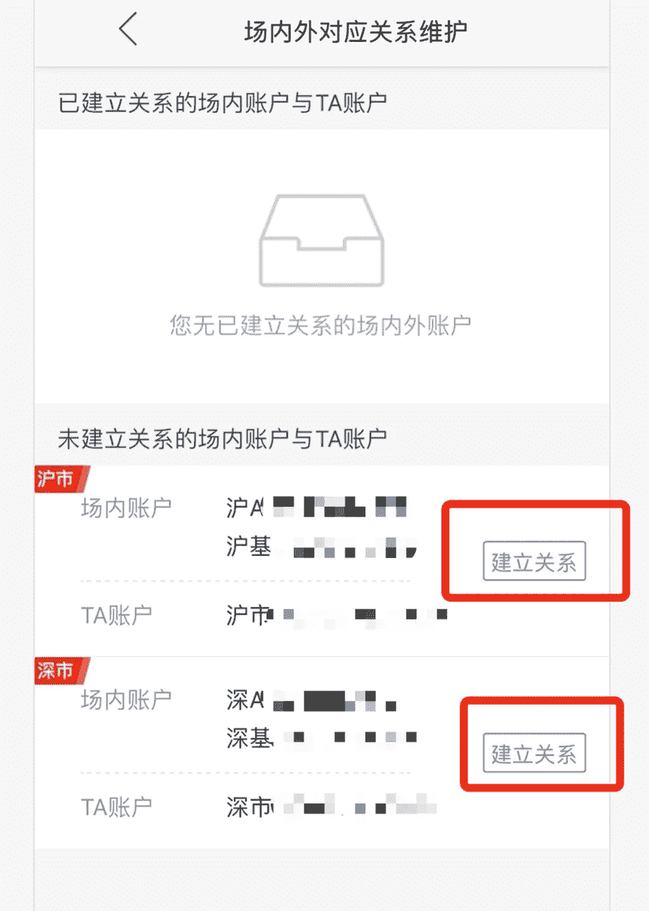

4，进入这个页面后，直接点击「确定建立关系」即可

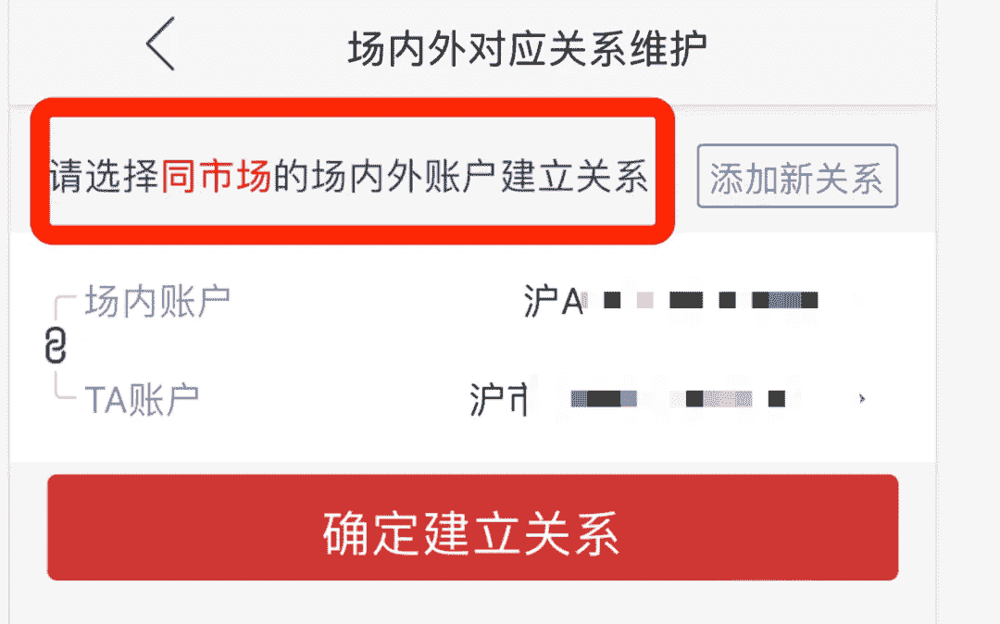

5，阅读完成电子协议，然后签字即可

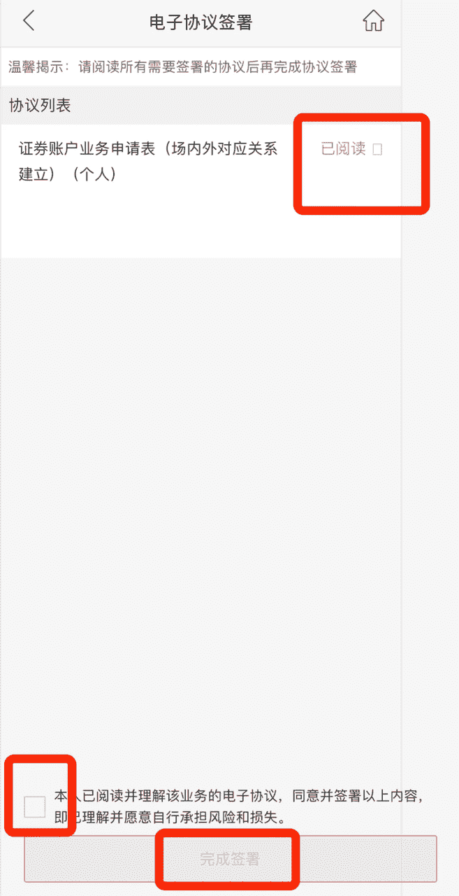

6，场内外关系建立完成

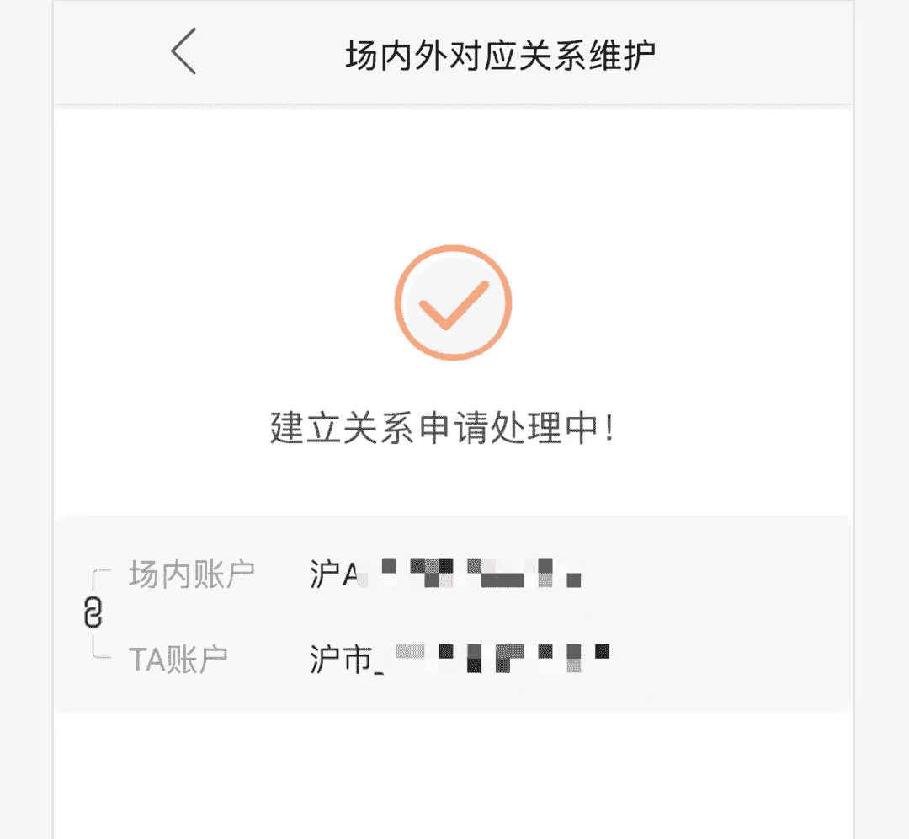

注意：

1）这一步需要在交易日的9点-16点操作，其他时间无法操作；

2）记得沪深两市都要建立关系，以上操作需要重复两遍完成；

3）场内外关系只需要建立一次，后续操作不用再次建立。

# **第三步，开启转托管**

1，在场外申购后的T+3交易日，回到「华宝智投-交易-开放式基金」，点击对应想要转托管的 LOF基金

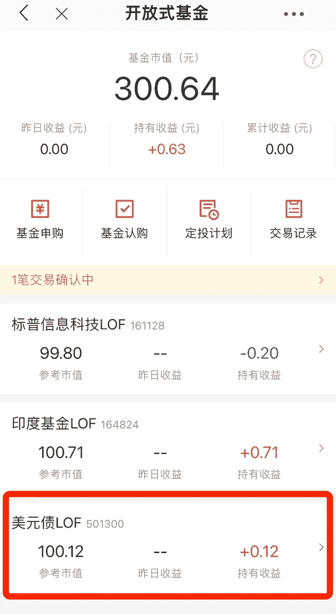

2，进入基金页面后，点击「转托管」

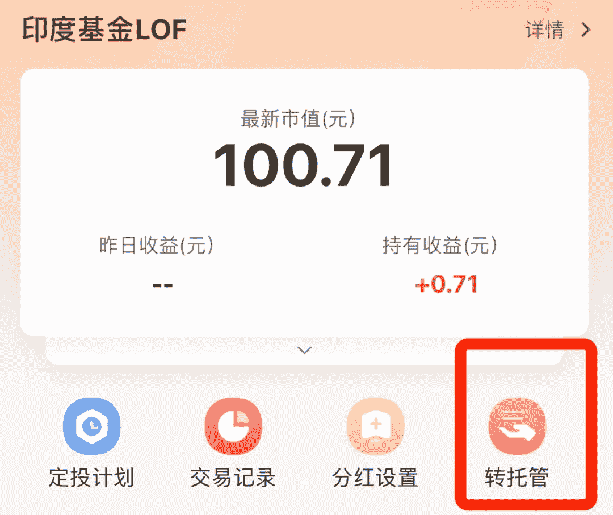

3，转托管份额，填写下方可转份额的整数

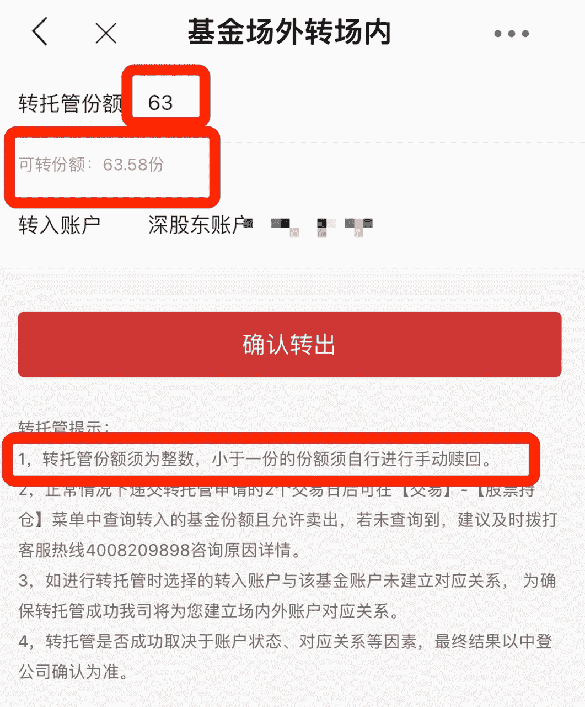

比如，我这里的可转份额是63.68，那我填写的转托管份额就是63份。

4，转托管成功，坐等到账

注意：

建议把这张图截屏。

因为 下方出现的查看持仓时间就是你可以在「股票持仓」看到的时间。

# **第四步，卖出套利基金**

1，等转托管到账后，会出现在股票持仓中

2，进入持仓页，点击「卖出」

3，进入卖出页面后，会有一个卖出价和卖出量的选项

**卖出价：**

如果你只想赚套利的钱，可以在 当天开盘成交。

如果你还想赚波动收益，也可以等着开盘后按照合适的价格卖出。

如果你觉得长期都有机会，甚至可以不卖出，一直持仓。

但要注意，这就从单纯的套利变成赚取波动的钱，是否有得赚就不知道了。

**卖出量：**

直接选择全仓即可

操作完以上步骤，一笔场外转场内的套利就彻底结束了。

给大家总结一份场外转场内的常见问题：

1，场外转场内，一定要选择手续费便宜的券商操作

因为对于套利来说，注定是利润有限的一个搞钱方式。

既然利润少，那我们就要在成本上尽量控制。

选择申购费打一折，卖出费便宜的券商就变得非常重要。

比如， 美元债LOF的申购费率是0.8%：

也就是，每申购100元，证券公司会收取0.8元的申购费。

但有一些证券公司申购费能打到一折 ，相对来说更划算。

我现在用的这个，申购就可以打一折，只有0.08的手续费：

费率足够低，也就给足了自己利润空间。

如果你的股票账户费率比较高，那操作之后可能会被券商反撸，建议换一个费率优惠的券商。

2，建立场内外关系时会出现的特殊情况：转托管时，提示「不规范」

这意味着，你建立好的场内账户和TA账户不是一家券商。

举个例子：

你的场内账户是华泰证券，TA账户是 华宝证券 ，两个券商不一致，肯定是不规范。

1）如果你已经开过华宝沪A、深A股东户，就去「中国结算」网站查询，找到对应的账号，替换场内账户。

2）如果你没有华宝沪A股东户，那就需要注销一个原有账户（每个人只能开3个沪A），然后在华宝增开沪A，再去建立场内外关系。

3）如果你没有TA账户，那买一笔对应的基金，少沪TA账户就买沪基金，少深TA账户就买深基金。

如何了解基金所属市场：

如果你发现套利的LOF基金开头是数字5，那基本上是沪市基金，所以需要沪市场内外建立关系；

同理，如果你发现套利的LOF基金开头是数字16，那基本上是深市基金，则需要深市场内外建立关系。

3，为什么在股票持仓找不到对应基金？

先确认是否已经完成转托管：场外申购后，T+3到账后进行转托管，T+2过场内卖出。

具体操作转托管的时间为交易日当天9点30分-15点。

举个例子：

你可能是周三申购的，周五晚上你会发现它已经在你的持仓里面，但是操作转托管的时间一定是下周一的9点30分-15点。

如果设置转托管且时间没问题，这时如果还是出现持仓看不到的情况，大概率你的场内账户和TA账户绑定到了另外一个券商，需要去对应的券商APP查看。

4，每天都可以买吗，一次买100吗？

如果溢价率适合，每个交易日都可以利用场外转场内的方式买入100元。

因为它是认身份证，和你拥有几个证券账户无关，每人每天有且只能申购100元。

同时，美元债不支持「拖拉机」，也不支持场内申购。

这是因为美元债LOF是沪市基金，场内申购是1000元，但当前限额是100元，这种情况下场内没办法申购成功，只能通过场外申购。

5，场外转场内，剩下的份额怎么办？

可以累计份额，等到整数后继续转到场内。

6，美元债到账后，为什么是亏钱的？

1） 开放式基金 页面呈现的亏损大概率是手续费的缘故，只要转到场内才叫套利，否则在开放式基金页面只能称之为申购；

2）股票持仓的盈亏因为显示问题也有误，实际盈亏以后台交割单为准，一般都有5-6块收益。