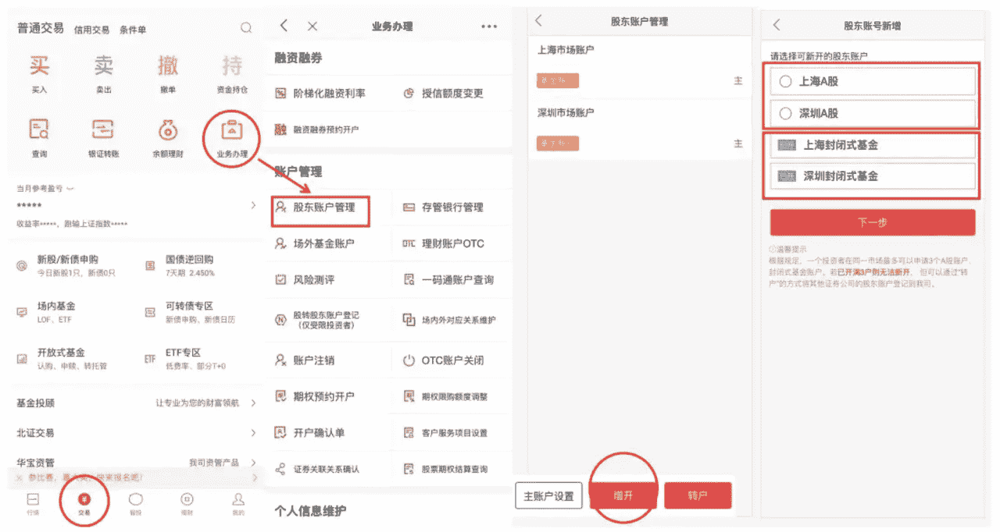
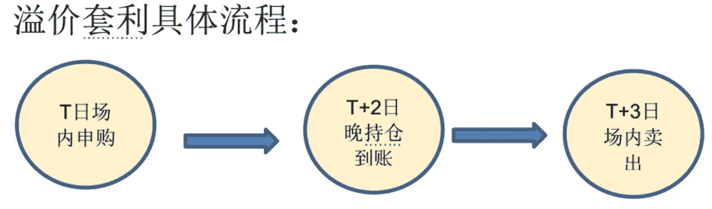
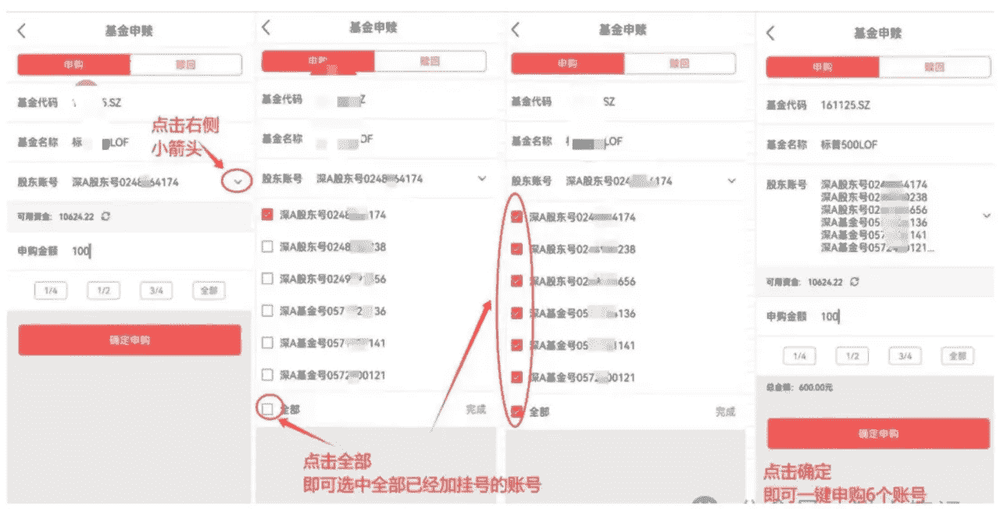
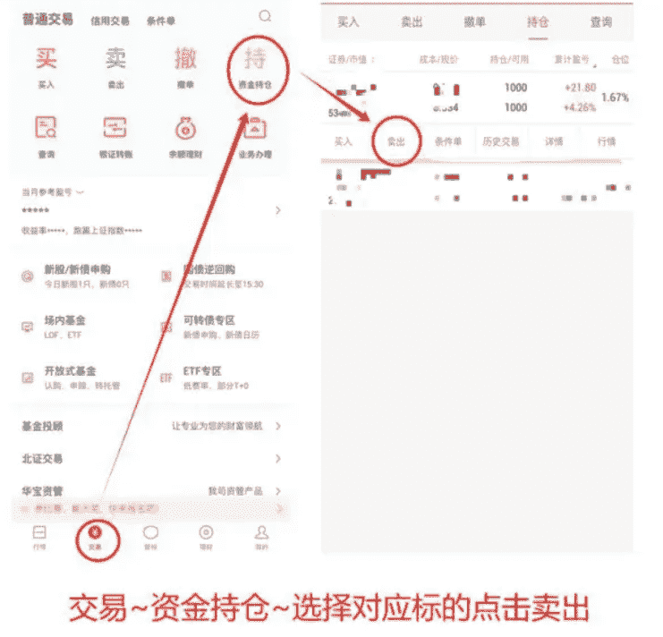
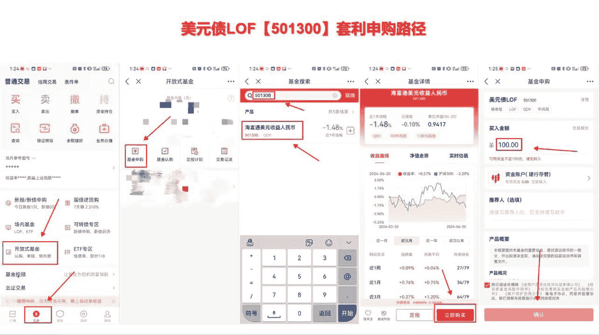

# LOF基金套利拖拉机（1拖6）开通、加挂、申购、卖出 全流程教程

> 来源：[https://xuqiwei1986.feishu.cn/docx/O8vbdytlno9B4dxqbvQcTkqWn2g](https://xuqiwei1986.feishu.cn/docx/O8vbdytlno9B4dxqbvQcTkqWn2g)

### 一、什么是拖拉机（1拖6）

根据规定，每个身份证最多只能开3个券商，也就是每人最多开3个沪A账户，3个深A账户，3个上海封基账户，3个深圳封基账户。

上面说的把6个不同的基金账户集中绑定加挂到1个券商下面，就是一拖六。

以深市的账户为例， **一拖六的拖拉机账户就是指1个账户有「3**个深市股东账户」和「3个深市封基账户」 。

至于更传说的一拖7， **其实就是再加个场外基金账户， **跟场内账户映射好关系，就可以通过场外转场内，但是通过转托管会多耗时2天， 一般用不上，特别限额时也可以带上。

### 二、为什么需要拖拉机

市场每隔一段时间就会出现基金套利机会，而且基金套利机会绝大部分情况下都是限购的。

**比如近期套利的**印度基金LOF，每个基金账户就 限购100元 ，那么如果我们有多个场内基金账户（最多6个）+1个场外基金账户， 一次就可以申购700元，放大7倍的套利利润 。

但是由于这7个账户是分散在不同的券商的，操作起来比较麻烦。

如果集中到1个券商中，就可以一次性操作，买卖都更加方便快捷，套利也能快人一步（基金套利能快速卖出很关键）。

### 三、拖拉机套利费用

目前市场上支持加挂一拖七的券商不多，优先推荐使用银河证券加挂账户。

一是LOF申购费仅需一折（一般券商不打折，费率1.2%~1.5%左右）；

二是LOF卖出费费率统一按照某 河的费率收取，仅需万0.5最低0.1元（一般券商最低5元）；

一次拖拉机买卖仅需2.24元，一般券商（非一折券商）需要43.4元，立马省了41.16元。

申购费率和卖出费用便宜是基金套利的必要条件，本来利润空间就不大，全交手续费就得不偿失了。

**注意：如果没有账户，建议找黑哥注册开户，千万不要自己去下载**注册，否则交易费率贵好几倍且无法再降低！

### 四、如何开通拖拉机账户

在交易时间内，一般咱们半天时间就出客户号了，出客户号后，在 APP 业务办理--股东账户管理--新增股东账户，重新新增一个沪基和深基；如果已经有基金账户，就选择新增沪深股东账户

### 五、拖拉机如何申购

1、场内基金账户申购

如下图，在场内申购时，可以 **选择全部账户 **，然后输入金额，点击“确定”，6个账户就会全部申购上，非常爽快。

**有个注意点是，这里**填入的申购金额是 针对单账户的金额 。比如限购100，那你就填100，而不是600，切记。

PS：补充个小知识点，大部分券商上不会显示基金的限额，但别抱侥幸心里，多填肯定是不会多成功的，甚至可能全部失败。

2、场外基金账户申购

### 六、到账日期及如何卖出

场内基金申购需要时间确认，一般是三个交易日才会到账户中。

比如，周一交易时间申购，周四才能进行交易。周三晚上，就可以在券商app里看到持仓了，周四9点30~15点卖出即可。（卖出方式跟股票交易方式一样，直接点击卖出）

注意事项：

1、溢价率在5%以上才进行套利。

2、基金申购不m⑤的账户不建议基金套利，利润全交手续费了。

3、绝大部分基金套利机会，申购都有限额。

4、转户后的费率按照某券商的费率收取。

5、 这个一折费率，需要申请才会给你开通，默认是不开通的 （这个一定要找自己的客户经理确认）