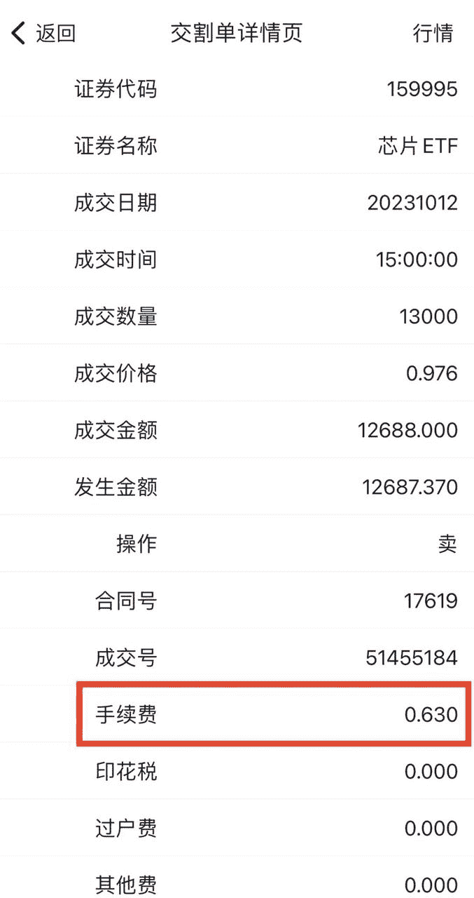
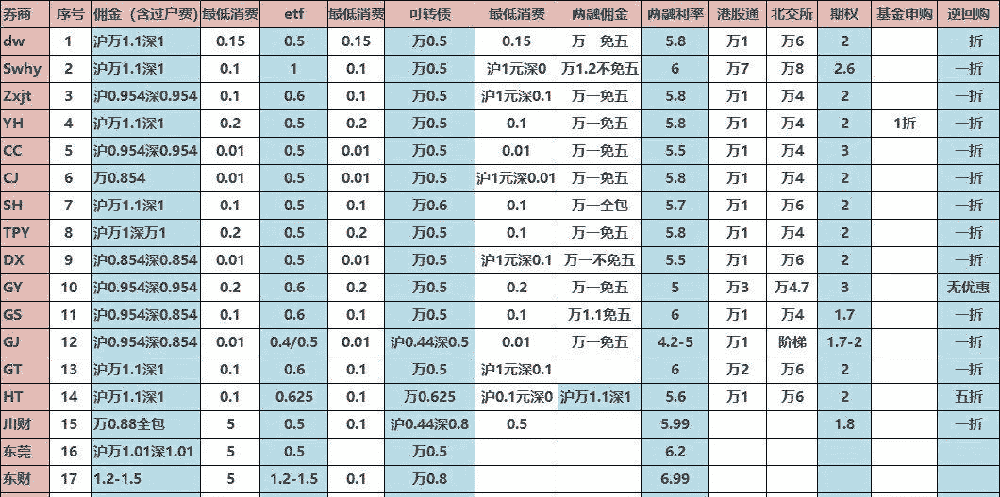

# 低佣券商---万1免5账户

> 来源：[https://xuqiwei1986.feishu.cn/docx/TBOidiiORo9krTxtAlVc1jb1nhg](https://xuqiwei1986.feishu.cn/docx/TBOidiiORo9krTxtAlVc1jb1nhg)

随着市场的逐步触底，许多投资者已经开始摩拳擦掌，准备行动。在这种背景下，拥有一个佣金低廉的证券账户显得尤为重要。经常有朋友询问，目前市场上的“免五”券商，个人是否能够申请？以及一旦申请成功，这种优惠是否能够长期有效，不会在一段时间后被取消？

答案是肯定且明确的。所谓的“免五”以及当前更低的万0.85费率，是证券公司为互联网开户的客户提供的优惠费率。无论您的资金规模大小，都有机会申请到这样的低佣金费率，并且一旦调整完成，该费率将永久有效。

此外，现在您完全可以在线完成申请，无需亲自前往营业部。

今天，我整理了一份关于股票交易费率的详细资料，供您参考。

# **关于“免五”的含义：**

+   券商交易佣金费率按照万分之一计算，即实际佣金等于成交金额乘以佣金费率（万分之1）。

+   “免五”意味着免去了最低5元起步的限制，实现了0元起步，这对于频繁进行小额交易的投资者来说是一个巨大的利好。

# **“免五”政策下的手续费计算：**

+   手续费等于成交金额乘以手续费率（万分之一），如果没有“免五”政策，最低起步费用通常为5元。

# **开通“免五”后的好处：**

+   每次交易都能节省一笔不小的费用，长期累积下来，这无疑是一笔可观的节省。

# **股票交易中涉及的税费名词解释：**

1.  **印花税**：卖出股票时征收，费率为成交金额的0.5‰。上海和深圳股票的印花税按照实际成交金额的千分之一支付，由券商代扣后由交易所统一代缴。

1.  **过户费**：费率为成交金额的0.01‰，自2015年8月1日起，上海和深圳市场均开始收取。

1.  **券商交易佣金**：最高不超过成交金额的3‰，最低收费5元起，如果不足5元则按5元收取。

# **当前交易费用构成：**

+   交易费用分为三部分：佣金（包括证管费和交易经手费）、印花税、过户费。

# **买入股票的费用构成：**

+   买入佣金加上过户费。

# **卖出股票的费用构成：**

+   卖出佣金加上过户费再加上印花税。

希望这份资料能够帮助您更好地理解股票交易的相关费用，从而做出更明智的投资决策。

**万一免五账户列表：**

