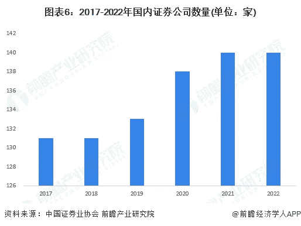
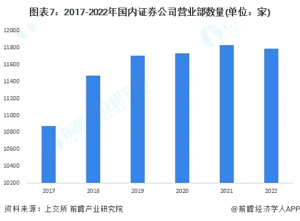
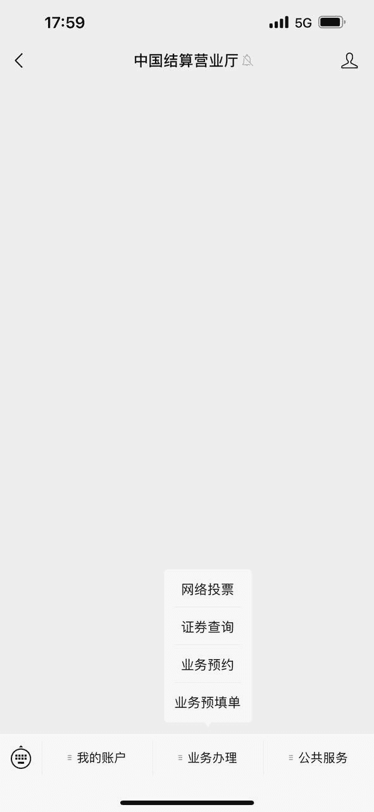
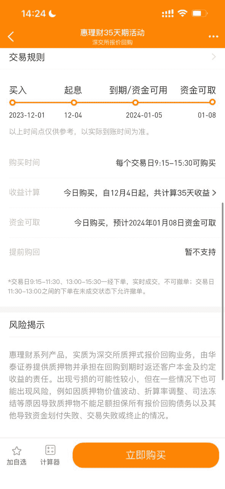

# 证券开户---新客理财+开户红包返现

> 来源：[https://xuqiwei1986.feishu.cn/docx/SU6ZdcvUTobf1OxynE7cCIIxnct](https://xuqiwei1986.feishu.cn/docx/SU6ZdcvUTobf1OxynE7cCIIxnct)

# 项目背景

截至2024年，国内证券公司数量已达到140家左右，其下属营业部数量超过1.2万家。在这些机构中，活跃着约5万名客户经理，他们负责拓展客户。据统计，2024年每月新开设的股票账户数量约为200万户，累计股票账户总数达到3.8亿户。值得注意的是，每位投资者均有资格同时开设上证A股和深证A股账户，因此，累计投资者人数约为2.1亿人。

+   **证券公司**：券商有100多家，为了拉新客，纷纷推出了“新客专属理财产品”。这些产品旨在激发新入市投资者的兴趣，并期望他们未来能够参与股票交易，从而为券商带来佣金收入。

+   **客户经理**：对于营业部的客户经理而言，每月都面临着一定的开户数量任务。券商通常会根据开户数量提供阶梯式的奖励机制，即开户数量越多，奖励也越丰厚。然而，实际情况是，大多数客户经理难以完成既定任务。为了达到目标或争取更高奖励，部分客户经理可能会寻求中介机构的帮助，通过这些中介进行开户，并为此支付高额的返佣红包。

## 每家券商可薅300多元

**第****1****部分收益：****新客理财收益（券商公司的补贴）**

+   **产品特点**：证券公司为新客户提供的理财产品，年化收益率介于4%至8%之间，投资限额为1万至5万元。持有期限从7天至1年不等，多数情况下持有30天。

+   **平均收益**：预期平均收益约为150元，但根据市场情况，收益有可能达到300元或更高。

+   **产品类型**：该理财产品实质为“报价质押式回购”或“收益凭证”，为证券公司目前唯一能够公开承诺保本的产品，因此，投资风险几乎为零。

**第****2****部分收益：****开户返佣红包（客户经理的补贴）**

+   **返佣比例**：根据任务入金额度、持有期限的不同，返佣金额存在较大差异。具体如下：

+   50%的券商，平均返佣200元；

+   40%的券商，平均返佣300元；

+   10%的券商，平均返佣在500元至3000元之间。（资金门槛约20万、50万、100万）

+   **返佣时间**：少数证券公司会在新客户购买理财产品的次日发放返佣，而大多数则在理财产品到期后的2周左右返佣。

+   **账户限制**：每人最多可开设3个上海证券交易所(上证A)账户、3个深圳证券交易所(深证A)账户。值得注意的是，一个深证A账户可以关联多家证券公司，而上证A账户则只能关联一家证券公司。尽管理论上可以开设多达140家证券账户，但实际活跃且经常开户需求的证券公司大约有50家。

|  |  |
| --- | --- |
|  |  |

## 1年保守可薅3万多元

+   1年内，个人资金在10万左右，完成循环30多家开户很轻松。

+   按每家收益350元、30家券商计算，这样1个人可以薅到1万元。

+   如果全家一起开：夫妻、父母、岳父岳母共6人。一家6口，累计收益=1万元*6人=6万元。

+   如果家里有50万，全家轮换顶格买新客理财，同时多完成高价单（资金量占用10万以上），1年轻松赚3万元，2~3年全家账户薅一轮轻松能赚10多万元。

+   那所有新户开完了，是不是后面就不能赚钱了？不是，证券市场中每年都有很多0风险套利机会，1个人轻松薅几千元很正常，全家轻松薅1万元。LOF基金套利，如2024年6月，每人可套利700多元，用一家6口身份证可套利4000元，每年几乎都有几次这样机会。

## 为什么这个项目0风险

1、新客理财几乎100%到期兑付，目前还没有发生过新客理财出现亏损的券商，而且资金只能在个人证券账户、个人银行卡之间进行银证转入转出，不能转向其它地方，目前也没有一家券商倒闭跑路的情况。银行有倒闭，但券商没有，最差情况也是被大券商兼并。

+   证券公司是中国金融领域的重要机构之一，和银行、保险公司并称为“金融三驾马车”。大部分证券公司都有地方政府或国企央企作为背景，并且已经上市。相比于中国拥有4000多家银行，证券公司的数量只有100多家，可见其门槛之高。

2、因为要经过邀请链接或二维码进行注册开户（确认邀请关系），一定会锁定到某个客户经理，几乎不怕客户经理不给佣金。因为一旦被举报到券商营业部，客户经理大概率会被开除，除非客户经理想捞一把就跑路，以后再不想在这个行业干了。

## 券商任务管理表格

+   完全没开过户的新人，按开户指引可能要10多分钟；几次熟练后5分钟就能开完。

+   目前券商都支持24小时开户，工作日9点~15点开，多数当天可以下账户，其它时间开，次工作日也能开好户。

+   简要操作流程：1、扫描客户经理的二维码，按教程开户；2、开户成功后发送(姓名+客户号)给渠道审核；3、审核过程中，可先把资金转入到证券账户；4、审核通过后，买入指定理财产品，锁定任务完成。5、按照事先约定的时间等待结算佣金。

+   使用飞书APP，建一个在线文档，方便手机APP记录任务进度。

| 序 | 开户人 | 券商 | 任务内容示例 | 资金号 | 入金金额日期 | 返佣红包 |
| --- | --- | --- | --- | --- | --- | --- |
| 1 | 张三 | 华泰 | 华泰，单开，以下四档任选其一： | 资金号xxxx | 未开户 | 红包400元 |
| 2 | 李四 | 银河 | 银河，不限三，限首开，入金10.1万，先购买银河水星聚利中短债C 970202 ， 持有10天后赎回；赎回后买5万28天新客+5万28天逆回购，利息算客户，亏损经理补；入金五个工作日后开通财富星plus，550/个，5个 |  | 2024-01-01，入金5万 |  |
| 3 |  |  | 华福证券，入金21万，10万买28天新客利息客户，其中1万交易量操作159934当日T0即可，10万买兴银同业存单基金015648跨月赎回包盈亏，700+利息460左右 |  | 已返佣 |  |
| 4 |  |  | 招商证券，双转户，首开，3.21号开户入金20.2万代零头，买20万91天国债逆回购，另外2000，每个月买一次28天国债逆回购，加企业🛰️和官微，发信息查号，定金200 |  |  |  |
|  |  |  | 长江，限三，3月1号入金50万带零头，客户任意理财，4月1号出，2550/个 |  |  |  |
|  |  |  | 平安，不限3，3月1日入金1.1W买国开债券etf，代码159651，4月1日卖出，4月2日出金。包亏，盈利给客户，255/个 |  |  |  |
|  |  |  | 东方，不限三，开户当天入金1万带零头，买30天新客，年化5.18%，收益归客户，220/个 |  |  |  |
|  |  |  | 广发证券    不限三  单转深市 |  |  |  |

# 新人手册

## 开户条件：身份证、手机号、1类储蓄卡

**开户资格与年龄限制：**

我们欢迎年满18周岁至65周岁的客户通过线上渠道轻松开户。对于年龄超过65岁的客户，部分营业部如华泰证券和广发证券等提供了更为宽松的政策，允许70岁及以上的人士开户。

**开户所需材料：**

1. **身份证：** 您需要提供本人身份证的原件。虽然某些情况下上传身份证照片即可，但携带原件将确保流程的顺畅与安全。

2. **手机号码：** 请提供一个能够接收短信并接听电话的手机号码。请注意，严禁使用虚拟号码。开户过程中，您的手机号码无需与银行预留号码一致，也无需进行实名认证。

3. **1类储蓄卡：** 您需要提供一张本人名下的一类储蓄卡，以避免二类卡每日交易限额带来的不便。在选择银行时，请注意以下限制：

- 邮储银行的储蓄卡请谨慎使用。(有限额，一般跟随银行卡的日转账限额)

- 工商银行和建设银行，支持40个账户绑定。

- 其他银行，通常支持30个账户绑定。

- 中国银行，支持9个账户绑定。

- 农业银行，支持10个账户绑定。

- 招商银行，支持20个账户绑定。

如果超过上述银行的账户绑定限制，虽然偶尔可以绑定成功，但可能会遇到资金转入的问题。

**入金特别说明：**

对于使用浦发银行、招商银行、建设银行储蓄卡的客户，您的第一笔资金转入必须通过手机银行APP进行。操作步骤如下：

- 在手机银行APP中搜索“银证”功能。

- 找到相应入口后，发起转账操作。

- 完成上述步骤后，您便可以通过我们的软件平台进行资金转入。

| 例：工商银行APP，可看关联的券商 |  |
| --- | --- |

**名词解释**

1.  **限三：**个人开立证券账户**沪A（上海交易所）**，**深A（深圳交易所）**都不能超过三个账户；

1.  **不限三：**可只转户深A（复制深A），就避开了限制开三个账户的政策，个别不限三（俗称双转户）就是要求沪A，深A都转户），所以证券没开过户的，建议先开一个限三的，后面所有不限三的券商，都用当前账号的深A账号。第二个限三的券商时，可以开个银河证券的万一免五，并加挂一拖六的拖拉机账号。

1.  **双转户**：沪A和深A都要转户；

1.  **转户**：相当于复制，不会影响你之前券商的交易的

1.  **限首开**，之前从未在当前券商开户过，注册过又注销的也不行；

1.  **包盈亏（盈亏归经理）**：盈利退，亏损补，都是经理或营业部的；

1.  **自负盈亏（盈亏自理）**：盈利和亏损都是客户自己的；

1.  **亏损补**：盈利客户的，亏损经理补；

**行业默认规则**

+   所有单默认限首开，销过户不行。

+   一年内不许销户，提前销户的需退回开户红包。

## 任务步骤【10步】

1.  **加入🛰️群**：关注最新的券商活动信息，挑选适合自己的券商。优先考虑有“限三”活动的前三家券商，之后可以继续参与“不限三”的券商活动。

1.  **联系群主**：添加发布消息的群主为🛰️好友，索取参与活动的券商开户二维码（确保带有邀请关系），并了解开户的相关注意事项。请注意，自行下载APP开户将无法获得返佣。

1.  **准备工作**：准备好个人身份证（高清照片亦可），银行储蓄卡号（需为一类卡），并准备新客户理财产品的本金，建议金额为1-2万元人民币，资金需占用1个月以上。也可顶格购买，这样赚的更多。

1.  **开户时间**：在工作日（周一至周五）9点~15点之间完成注册开户流程，预计耗时约5分钟（包括视频验证）。若非此时间段，账户将在下一个交易日开通。

1.  **等待账户信息**：开户成功后，等待券商通过短信下发证券资金账号，通常不超过半小时。对于券商的回访电话，都回答【是】即可。

1.  **下载并登录APP**：下载相应券商的APP，并使用【证券资金账号】进行登录，建议设置人脸登录。

1.  **确认邀请关系**：与中介联系，确认邀请关系有效。**请务必在确认邀请关系后再购买新客户理财产品**。

1.  **资金转入**：在APP内通过银证转账功能，将本金一次从银行转入证券账户，并购买指定的新客户理财产品。

1.  **提交任务完成证明**：将任务成功截图、开户人姓名以及证券资金账号（可在开户成功短信中找到）发送给中介，并告知任务已完成。

1.  **确认返佣时间**：向中介确认返佣的具体时间。如果中介可以提前垫付，则返佣可能在当天或次日到账；如果中介无法垫付，则返佣将在新客户理财产品到期后的两周左右发放。

**交易日定义**：交易日是指除了周末和法定节假日之外的所有日期。

**开户入金时间**：交易日的上午9:30至下午3:00为入金交易时间。虽然在周末和节假日也可以开立账户，但资金账号通常需要在交易日才能完成审核。

## 开户注意【10条】

1.  **扫码或访问链接**：使用未注册过该证券公司的手机号码扫码或点击指定链接，接收验证码并完成注册。根据提示继续开户流程或下载APP，在APP内点击开户选项。部分情况下，可能需要在下载的APP中填写工号和选择营业部以继续开户。

1.  **选择或核对营业部及经理**：仔细核对默认的营业部及经理信息，确保符合攻略要求。一旦选择错误，可能导致无法补救的问题。

1.  **上传身份资料**：在光线充足的环境中，垂直拍摄身份证正面，确保整个证件完整入镜，无边框切割。上传后，务必核对扫描识别的信息，如有错误，手动进行更正。

1.  **填写个人资料**：

+   证件地址不可更改。

+   联系地址根据实际情况或攻略要求填写，有时需填写营业部所在地地址。

+   职业通常选择“企事业单位职工”，学历填写“大专”或“中专”，单位信息按实际情况填写，一般不会进行核实。

1.  **视频验证**：独立完成，确保无旁人提示。

+   双向认证：通常较为简单，普通话不标准也能接受，只需按照工作人员的提问回答即可。

+   单向认证：录制视频，清晰准确地按照提示说出指定话语并上传，注意普通话发音，避免因发音不准确而被驳回。

1.  **风险测评**：评估对股票交易风险的承受能力。表现出高学历、高收入、丰富的投资经验以及较高的风险承受能力，有助于顺利通过。可适当夸大描述，但不会实际增加风险。

1.  **选择开通账户**：根据是否受“限三”政策影响，选择开通深A、沪A账户。不受限制的情况下，可选择不开通沪A账户，或单独开通深A账户。基金理财账户通常不开通，除非攻略有特别要求。

1.  **开通三方存管，绑定银行卡**：

+   仔细核对银行卡信息，确保卡号无误，否则可能导致资金无法入账，需要前往银行处理。

+   牢记自行设置的交易密码，若遗忘，可能需要重新进行视频验证。

+   如需设置通讯密码或资金密码，可选择与交易密码相同，以简化操作。

1.  **完成问卷**：通常选择“是”或“否”即可，系统一般会预设正确答案。确认是否自愿开户、是否了解风险、是否有他人代操作账户等。

1.  **提交并等待审核**：在所有步骤无误后提交申请，留意短信或电话通知。部分营业部可能需要回访确认以激活账户，因此避免使用虚拟手机号开户。

+   审核通过后，保存短信通知的截图，并提交所需信息：手机号、姓名、客户号（或资金号，开户成功后券商会通过短信提供）。

**如何查询在哪些券商开过户**

| 🛰️👸号：中国结算营业厅 |
| --- |
|  |

## 示例-新客理财

|  |
| --- |
|  |
|  |
|  |
|  |
|  |
|  |
|  |

## 购买华泰新客理财视频（1分30秒可完成）

[示例：华泰新客专享开户购买流程](https://xuqiwei1986.feishu.cn/wiki/ReNFwLWkzieUGdkpQsIcH3p3ncg?fromScene=spaceOverview)