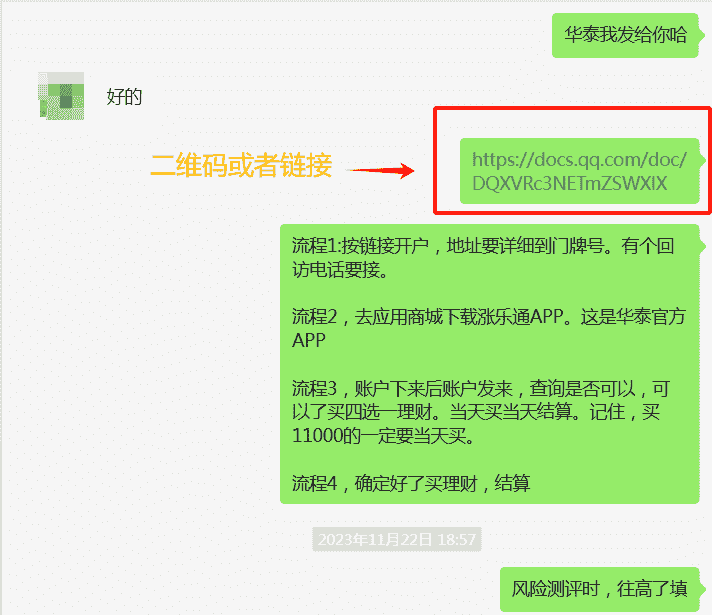
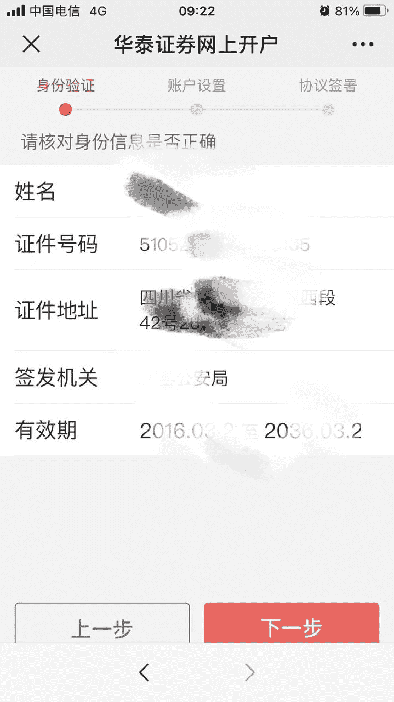
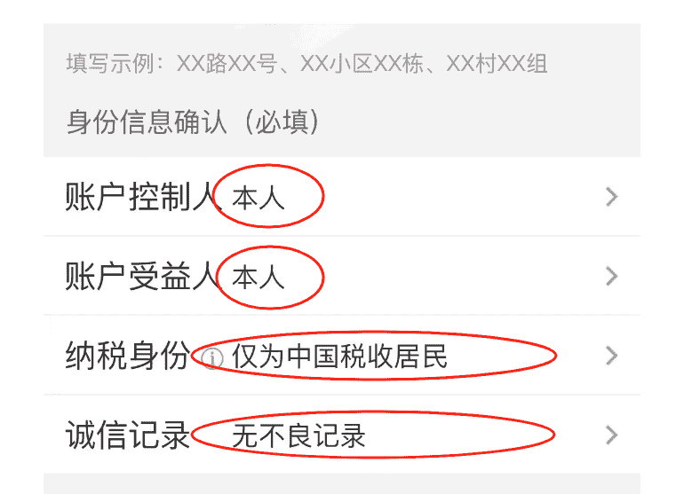
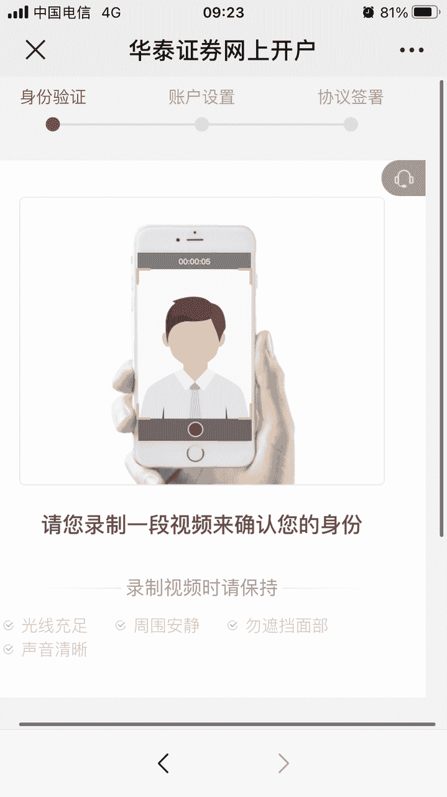

# 示例：华泰新客专享开户购买流程

> 来源：[https://xuqiwei1986.feishu.cn/docx/JRI6dJhJaodG15xHsDkcNYz5ntf](https://xuqiwei1986.feishu.cn/docx/JRI6dJhJaodG15xHsDkcNYz5ntf)

## **找群主拿经理专属开户二维码；**

## 扫码点击：立即开户，输入手机号；

## **核对服务经理工号**

## **上传身份证，填写身份信息如图示**

## **身份信息确认（必填），如图示：**

## **录**制视频，确认本人操作，若部分浏览器不支持视频检测，根据提示到应用市场下载华泰证券APP：涨乐财富通，继续开户完成视频检测。

## 选择账户功能，开通深市账户和沪深基金账户即可，如图示

## 风险评估结合实际情况向高了选，不会的可参考答案

（1）A；（2）C；（3）B；（4）D；（5）C；（6）D；（7）D；（8）D；（9）A；（10）C；（11）B；（12）D；（13）A；（14）B；（15）D；（16）A；（17）D；（18）C；

## **绑定银行卡，设置登录密码**

## **签署协议，用户回访**

## 完成开户，等待95597电话回访

## 开户成功后，把客户号记录下来，发给群主核查，是否在经理名下，

得到经理确认后，登录华泰APP：涨乐财富通，领取理财券，如图示

## **13.根据自己的需求，任选一款理财产品**，完成购买后，即可登记领取新客专享奖励。

## 购买华泰新客理财视频（1分30秒可完成）

|  |
| --- |

[RPReplay_Final1701408145.mp4](https://internal-api-drive-stream.feishu.cn/space/api/box/stream/download/all/QCW5bnF7UoC6Yjx1W9FctM2InLh)