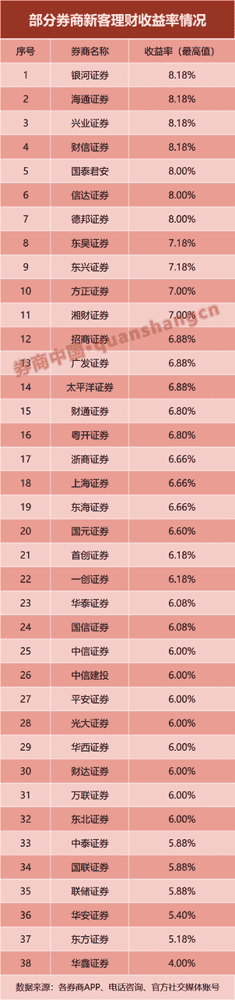

# 太"卷"了！券商新客理财，收益最高8.18%！有人"疯狂"开户......

> 来源：[https://xuqiwei1986.feishu.cn/docx/EIq1dSVhWoNfVJxY35ccCXY0nQb](https://xuqiwei1986.feishu.cn/docx/EIq1dSVhWoNfVJxY35ccCXY0nQb)

🔗 原文链接： h[ttps://mp.weixin.q](https://mp.weixin.qq.com/s/dTCqaPc1Kmx3c2APd8NGjg)q.com/s/dTCqaPc1...

在存款利率不断走低的背景下，风险偏好较低的投资者如何钱生更多的钱？

社交媒体上，不少人都盯上了券商新客理财，甚至开通多家券商账户轮番“薅羊毛”，或者动员父母开账户。

券商也是随行就市，在社交媒体上推介新客理财产品，互相“卷”起利率，多数都在5%以上，最高可达8.18%。

投资者为“薅羊毛”在多家券商开户

新客理财是券商给新客户发行的一种短期理财产品，以质押式报价回购或收益凭证为主。据渤海证券武汉分公司介绍，新客理财本质上是证券公司以贴息的方式，在新用户存钱时，给予用户利息补贴，利息往往高达6%～8%。这是目前市场上为数不多的高息理财产品，风险等级为R1，相当于券商发行的“存款”。

面对高收益率，不少投资者都动心了，甚至开立多个券商的证券账户，只为薅新客理财羊毛。

“我已经买够了3万的限额，还在考察，再找一个（利率）高的，然后让我爸妈各自再开一个户买！”95后小林买过银行理财，也买过基金，但收益均不甚理想，每天看着账户净值下跌让她感到焦灼。

偶然得知新客理财收益较高后，从未涉足过股市的她在朋友安利下，当即就去开户，认购新客理财产品。小林对券商中国记者直言，就是冲着“薅羊毛”去的，准备多开几个挨个体验。

社交媒体上，检索券商新客理财，已有不少指导帖。除列明不同券商的新客优惠力度外，还有网友给出攻略，根据持有金额的多少，如何根据期限和收益率选择更合适的产品。针对每个人只能开通三家券商证券账户的限制，也有一些网友分享如何无限制开立证券账户以轮番“薅羊毛”。

记者以咨询者身份与一位主要认购大额度新客理财的博主交流得知，不开通沪A，仅办理深A专户即可开通多个账户。其至少已开立了五个账户，主要认购50万元额度以上的新客理财产品。

多位营业部人士证实了该点。他们提到，平常也会接触到一些专为“薅羊毛”而来的投资者，只开通深交所的资金账户，理论上可以在多个券商开新账户认购新客理财。

券商“卷”起新客理财优惠力度

券商中国记者注意到，社交媒体上，新客理财也是各券商拓客的主要流量抓手。

券商营业部或者分公司通常会发布相关投教文章招徕客户。这些帖文往往置顶，并打着诸如“捡钱的机会”“薅羊毛”之类的标签，详细拆解从开户到认购的每一步流程。另一方面，也有不少券商营业部从业人员或以私人账号发布新客理财攻略，或者在相关帖文下低调而又积极地“抢客”。

“大额资金、两个号，蹲时间长收益高的理财经理”“蹲客户经理，私信我请直接说明哪家券商，新客多少收益，多少额度，有无后续好的理财产品，多少收益，多少额度”……在类似帖文下，往往会有券商营业部从业人员争相“认领”，默契地报出自家产品的收益率揽客。

券商中国记者梳理了近40家券商的新客理财产品发现，年化收益率普遍在5%以上。其中，有32家在6%及以上，银河证券、海通证券、兴业证券、财信证券可达到8.18%，国泰君安为8%，东兴证券为7.18%。

不过，上述产品基本有限额，少则3万元，多则200万元。理财期限多为14天或28天，最长也可有364天。比如银河证券“金自来”364天期，约定年收益率为4%。

对比某国有大行的存款产品，活期存款是0.2%，1年定期整存整取利率是1.45%。如果有10万元现金，存银行定期，1年可收获利息1450元。如果认购上述券商364天期产品，利息可多出2550元。

如何新客变“老客”？

不过，尽管收益率可观，在全行业证券经纪业务日益内卷的背景下，营业部人士如何看待前述投资者“薅羊毛”行为？又如何将新客持续留存下来？

“虽然新客理财收益率很高，但额度小、期限短，算下来其实利息有限，也谈不上是‘薅羊毛’。”有营业部人士表示，批量开户的时代已经不太可能，现在新开户很难，主要靠朋友转介绍。针对身边一些对股票不感兴趣，但想学习理财的朋友，自己一般也会先推荐尝试新客理财。

他提到，新客理财是一个新开户的抓手，非常乐意看到客户来参与。客户一旦购买，后期转化也会更容易。另外，从财富管理的角度看，客户来开户肯定是为了赚钱，这就要考验具体的产品类目是否全面，实际做出来的收益能否耀眼。

另一位券商营业部人士也对客户开多账户“薅羊毛”持开放态度。他提到，不强制客户必须怎么样，但也会希望客户能继续留在营业部。会通过提供好服务和相关产品的对接，解读客户财富管理中的疑问，实现共同成长。

不过需要指出的是，记者发现，新客理财营销也存在一些违规现象。据多位营业部人士，出于合规要求，客户经理并不能跟客户有资金往来，发红包是禁止的。但社交媒体上，既有寻找发红包才开户的投资者，也包括少量证券从业人员以发红包的形式揽客。

此外，有营业部人士提到，新客理财的宣传也有一定限制，并不能作为公开拉客户的手段，有合规风险。并且，新客理财虽是一种安全性较高的本金保障型产品，但也不能公开宣传保本。但有些从业者在用个人账号发布相关帖文时，仍以百分百收益稳赚不赔等言语进行宣传。

责编：杨喻程

校对：王蔚