# 手机虚拟定位教程

> 来源：[https://xuqiwei1986.feishu.cn/docx/SVHBdZibOoRQ3jxELE0coZPtnBe](https://xuqiwei1986.feishu.cn/docx/SVHBdZibOoRQ3jxELE0coZPtnBe)

> 🔗 原文链接： h[ttps://mp.weixin.q](https://mp.weixin.qq.com/s?__biz=Mzg2NTg4NzcwMw==&mid=2247485293&idx=1&sn=7112c6db7ff7f158215ffbfd52c45421&chksm=ce5273d5f925fac3d87c809cab655cd38f78ee5821adaefb921ef5a06f0e0967a198c7754d14&scene=21#wechat_redirect)q.com/s?__biz=Mz...

**✅ 苹果手机：**

**（一）爱思助手**

操作流程：

1.电脑下载最新的爱思助手，将iOS设备用数据线连接即可完成准备工作。

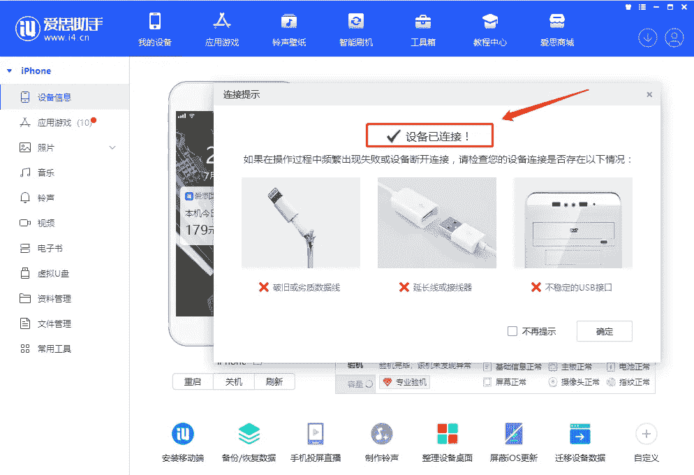

2.点击工具箱——虚拟定位

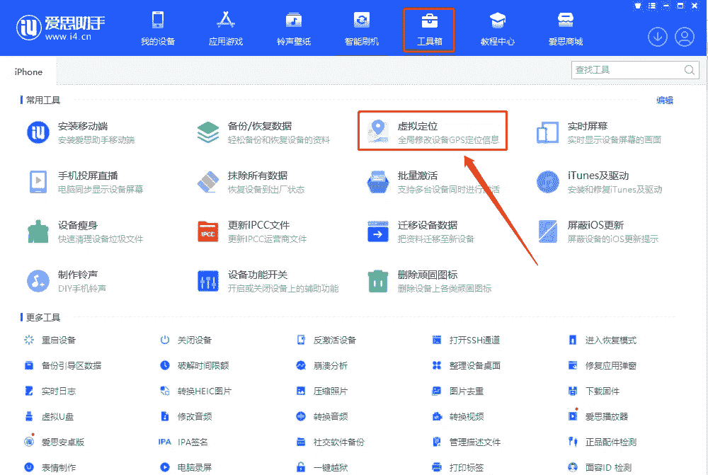

3.在输入框内输入自己想更改的任意位置，完成后点击修改虚拟定位即可

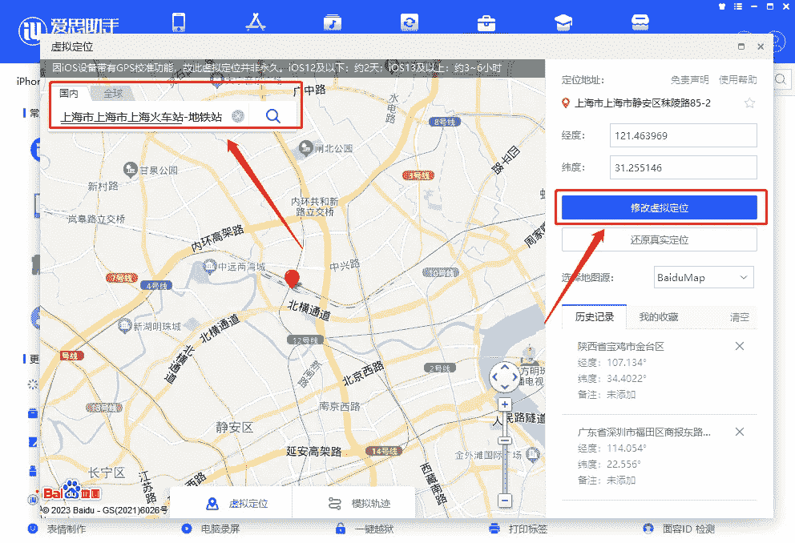

4.提示成功后，现在我们打开地图软件和某钉软件可以看到我们的定位完全不一样，可以随意更改

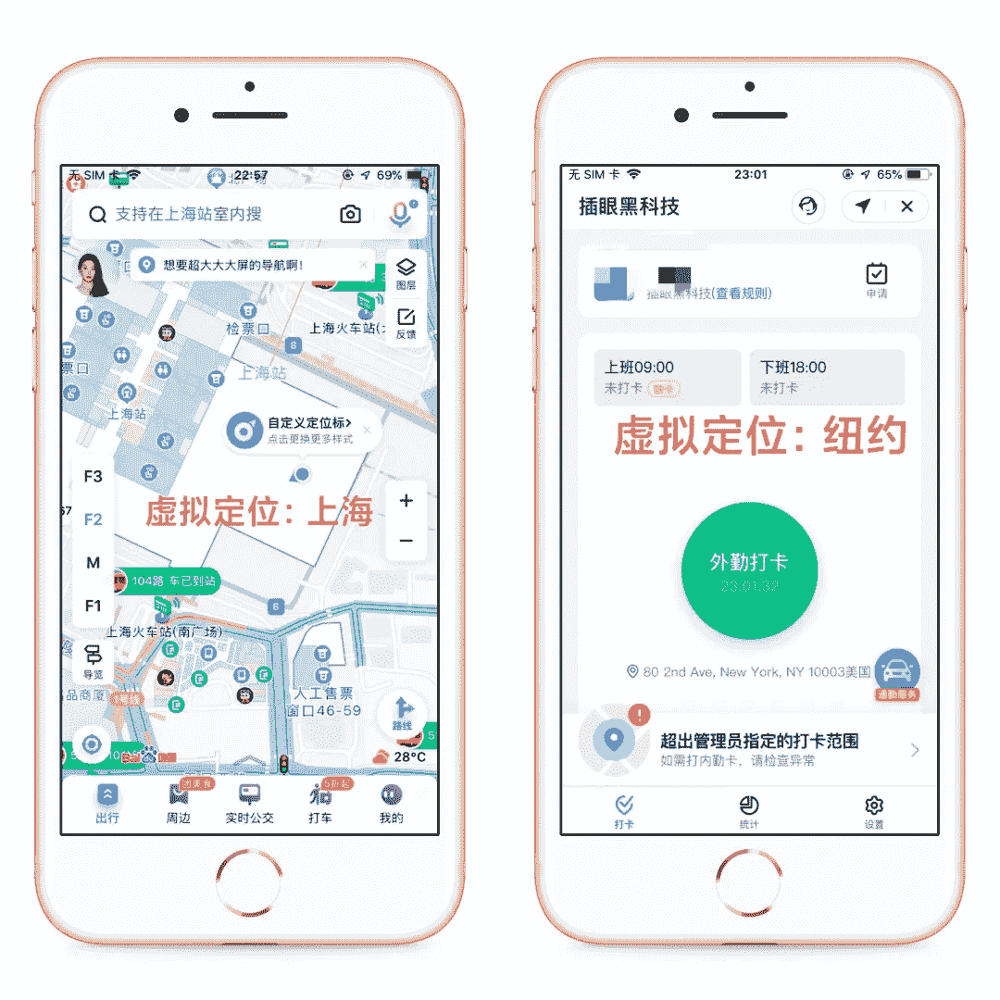

如果需要恢复正常定位，重启手机设备后即可。

**（二）爱加速： **（有些爱思搞不定的，可以尝试一下爱加速）

**一般下载后，有3天免费使用时间**

第一步：下载并打开爱加速软件，使用手机注册并登录爱加速。

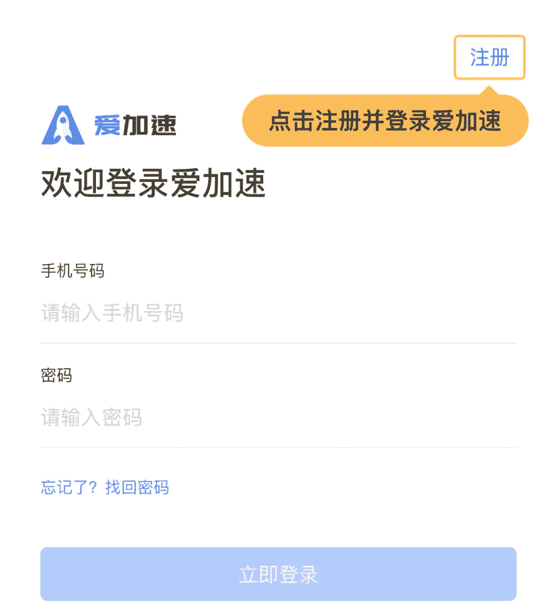

第二步：

首页，点击服务器按钮，进入服务器列表。

爱加速支持【自动匹配节点】功能，点击所需省份即可为您自动选择合适的服务器。如需具体线路，请点击省份右方按钮根据城市进行线路选择。

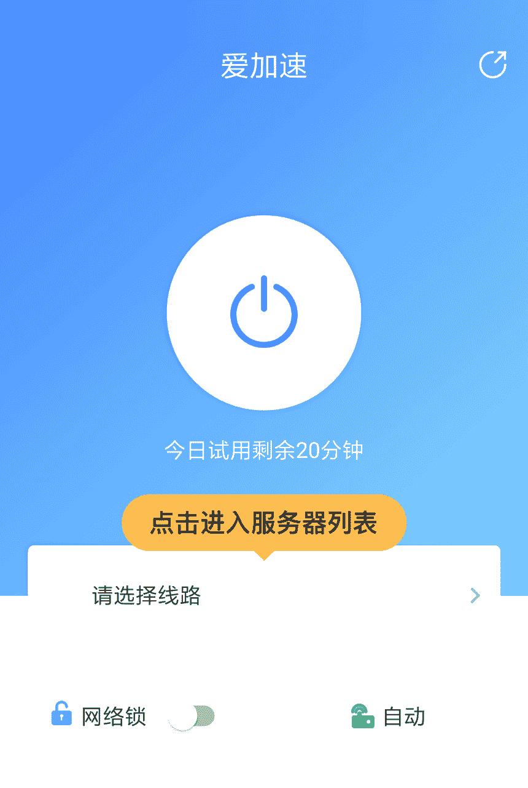

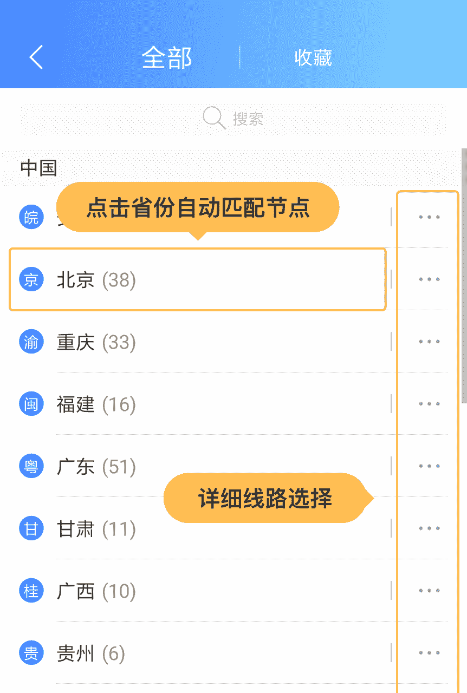

第三步： 首页可设置上网模式，上网模式包括：自动、UDP协议、TCP协议。推荐设置自动模式(默认模式)。

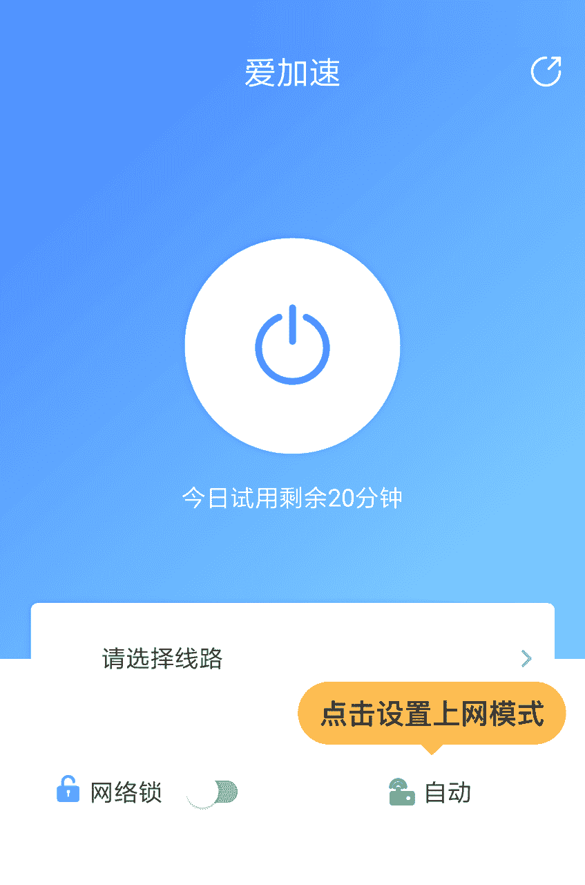

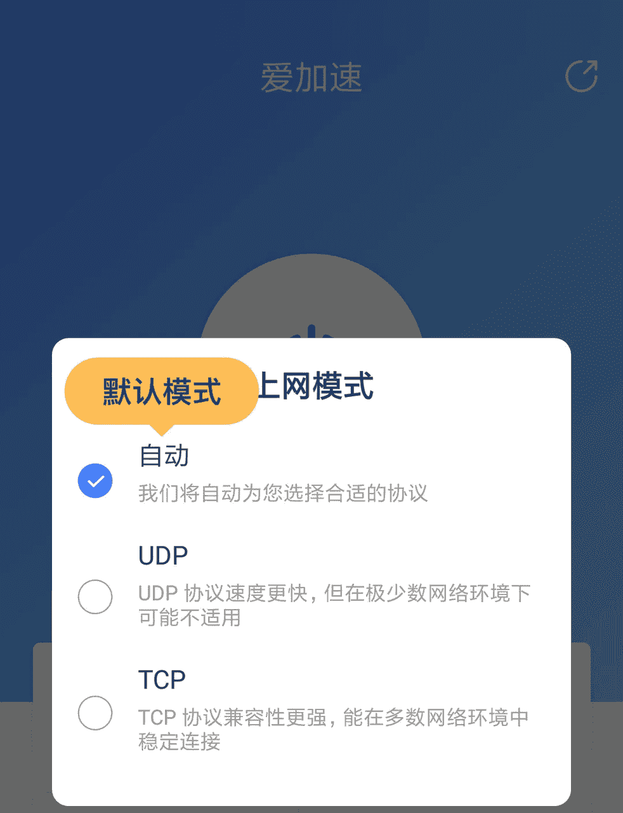

第四步：开启“网络锁”功能，能有效避免本地网络泄露。即当服务器意外断开连接时，也不会恢复本地网络，此时只有您手动断开服务器，才能恢复网络。

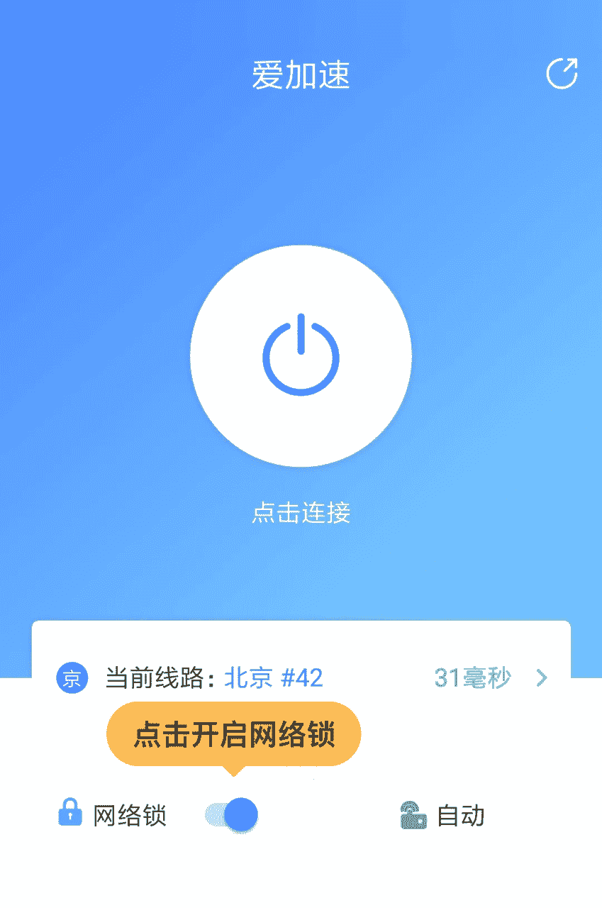

**✅ 安卓手机**

**1、爱加速： **具体操作方法和上面苹果手机一致。一般都能搞掂。

**2、其他常用软件： **猴子分身、幻影分身、Fakelocation等

仅以猴子分身为例（用不了就换另外的软件）：

1.点击下载猴子分身

https://wwt.lanzoul.com/iWXKY0er2zpe?w1 https://www.lxapk.com/1798.html

2. 安装好猴子分身。华为手机如果安装时提示签名不一致不让安装，返回打开手机飞行模式重新安装，安装好后关闭飞行模式

3. 打开app→登录账号 → 主页 → 我的 → 添加分身，添加要虚拟定位的app，添加好后点app图标右上角的齿轮按钮，场景穿越功能就是虚拟定位

4. 定位到需要定位的位置后，点应用位置，打开app即可

**PS： **按教程来基本不会有问题，如果找不到场景穿越的或者需要收费的，可能是系统自带应用市场自动更新了app，去应用市场设置里把自动更新关了，重新安装。

以京东虚拟定位为例：

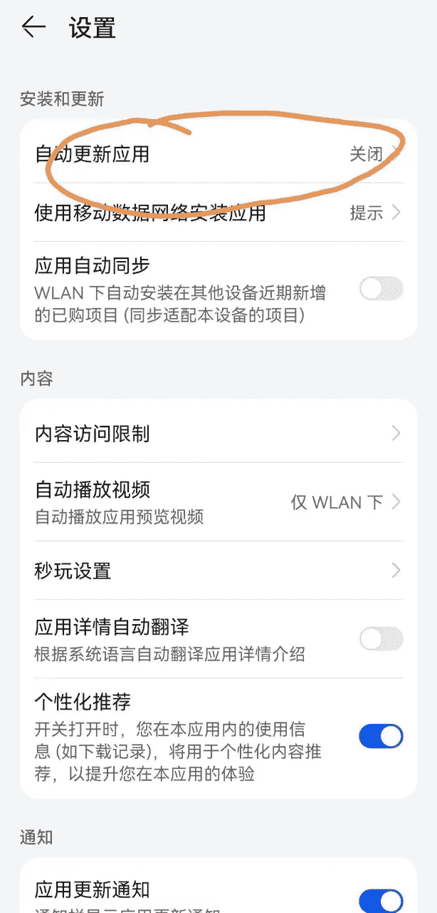

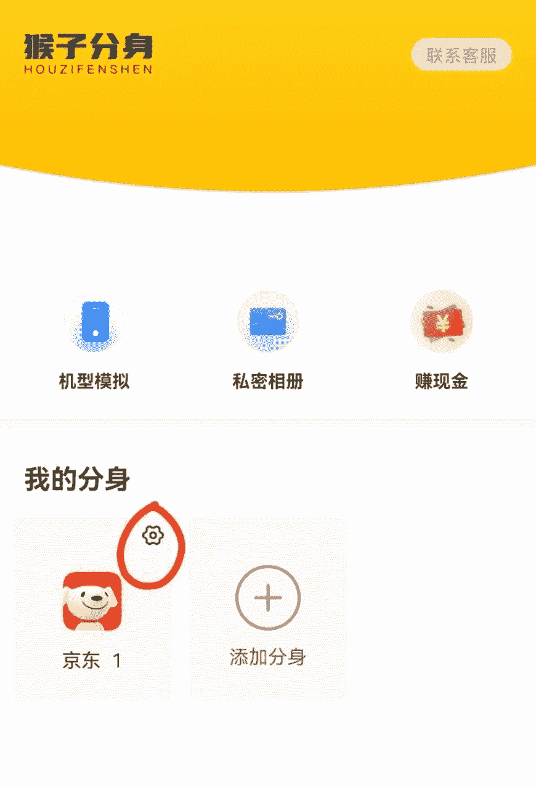

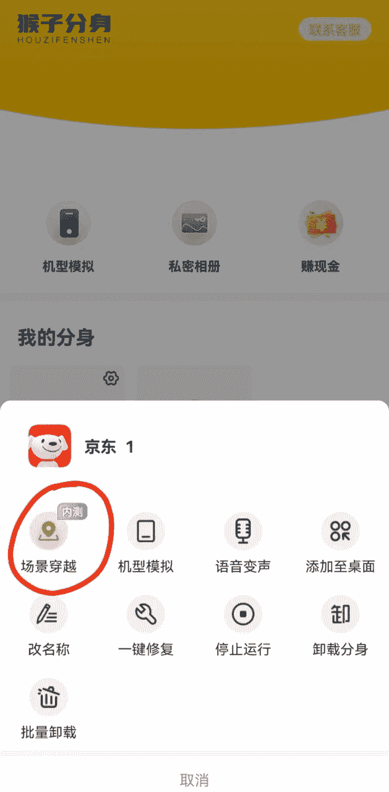

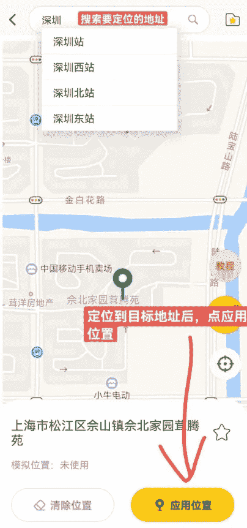