# 国内如何通过支付宝订阅ChatGPT Plus会员？

> 来源：[https://xuqiwei1986.feishu.cn/docx/UXVsdWsX8op8T2xi41vcq82qnTe](https://xuqiwei1986.feishu.cn/docx/UXVsdWsX8op8T2xi41vcq82qnTe)

今天就介绍一种在国内，通过支付宝就可以搞定GPT充值的方法，我已经使用近半年了

（1）打开网站： [h](https://gpt.fomepay.com/#/pages/login/index?d=373039)ttps://gpt.fomepay.com/#/pages/login/index?d=373039

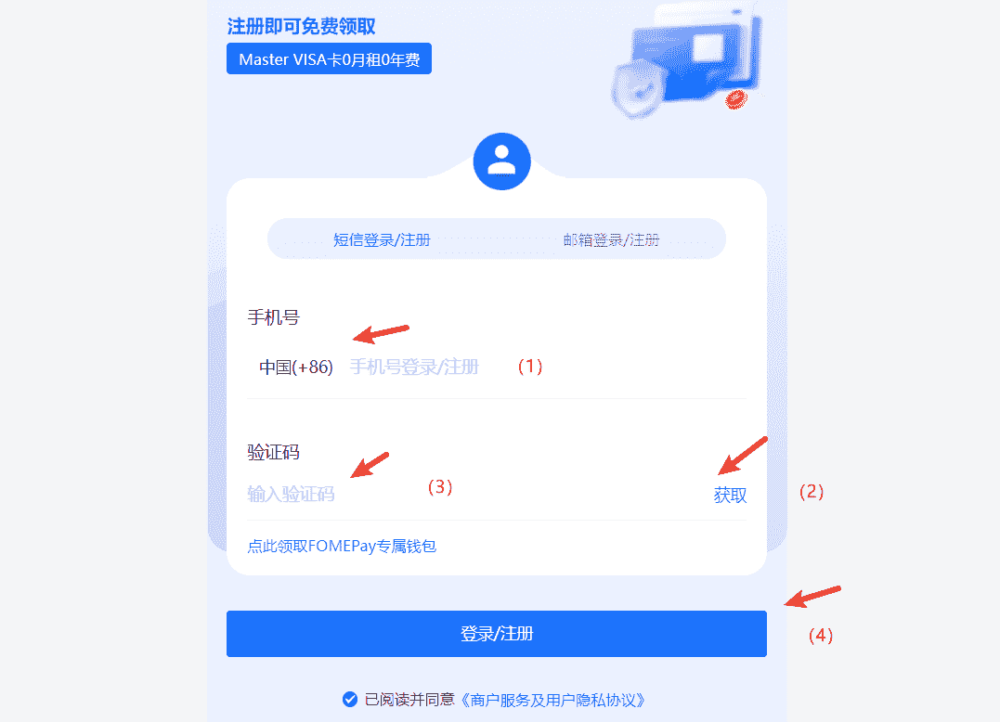

（2）账号注册

打开之后，你可以选择用手机号，接个验证码直接登录，如果你不放心，你也可以选择用邮箱登录。建议用outlook等国外邮箱。

上方如果选择用手机号登录，操作很简单，输入你的手机号，点击获取验证码，把验证码输入到上面框中，点击下方的登录或注册。

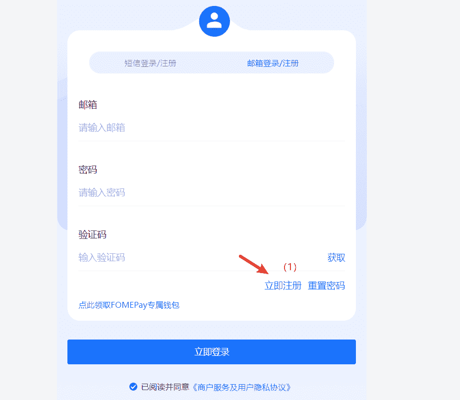

如果你不想用手机号登录，先点击上方的邮箱注册或登录，找到上方箭头所指的位置，点击立即注册即可。

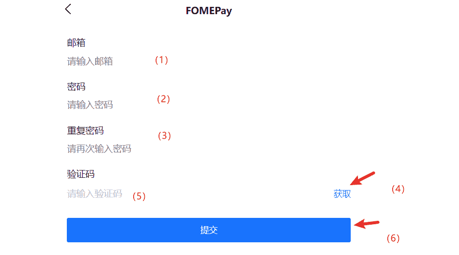

在上方输入你的邮箱，然后输入密码，确认密码，然后点击验证，这个验证是验证你的邮箱是否有效的。输入验证码后，点击提交。

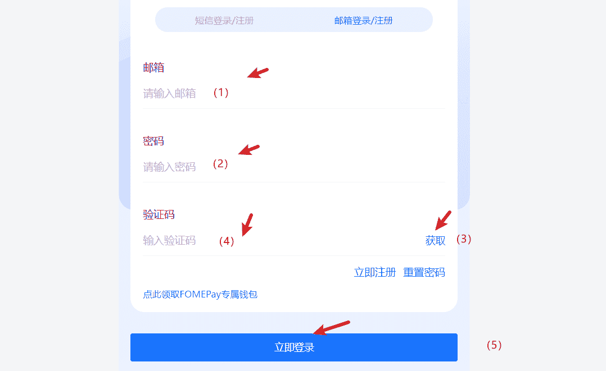

之后，就会登录上去了，如果没有登录上去，你再回到之前的位置。

点击邮箱登录或注册，然后输入你之前注册账户的邮箱名，密码，然后获取邮箱的验证码，之后点击立即登录。

（3）开卡

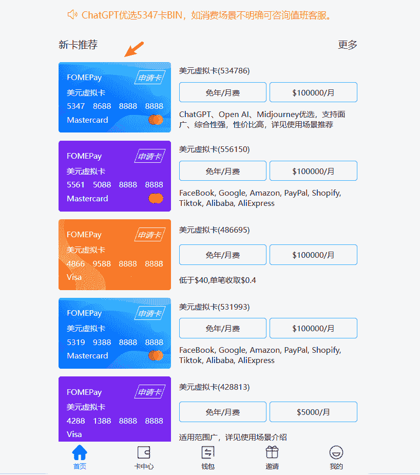

登录进去之后，这里面可以看到很多卡。如果你只是想充值ChatGPT，Midjourney，Claude 2的话。选择第一个534786卡段的卡即可。

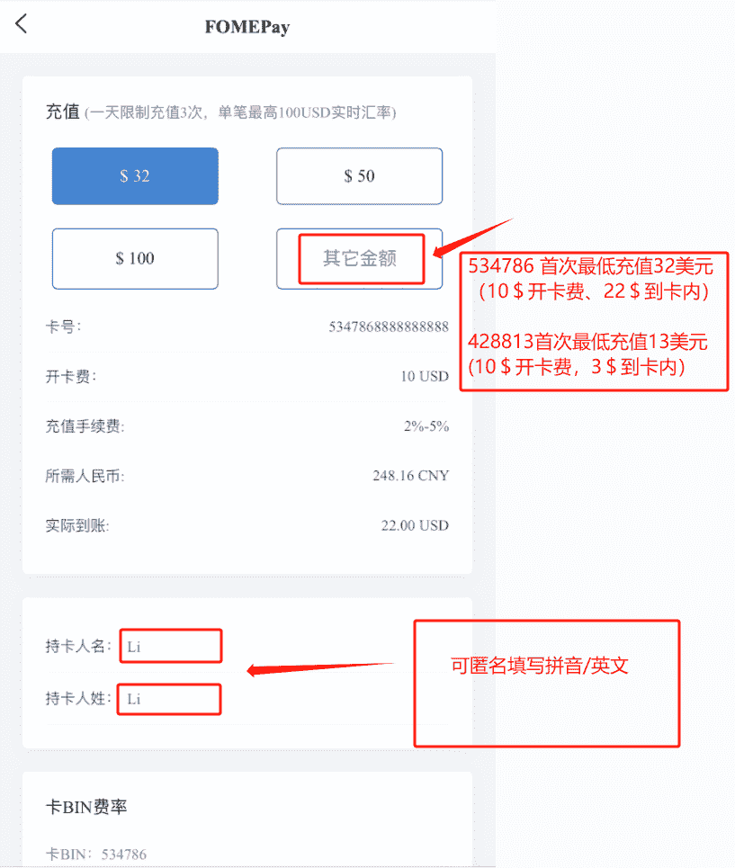

首先说明，这个卡是需要开卡费的，适合长期使用GPT会员的小伙伴。

也就是说10美元，你就买了个卡，但卡里是没有钱的，你还得再充值20美金，才可以去开通ChatGPT。

这个卡段，上面也说明了，首次开卡建议直接选择默认的32美金即可，10美金开卡费，22美金卡内余额。

持卡人姓名随便填写，拼音也行。

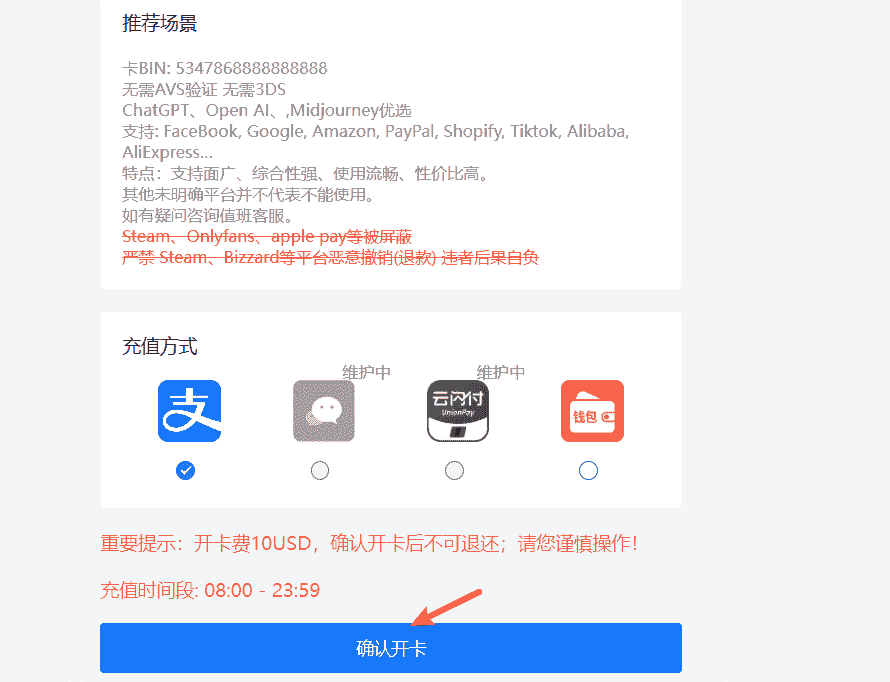

然后选择默认的支付宝充值方式，之后点击确认开卡即可。

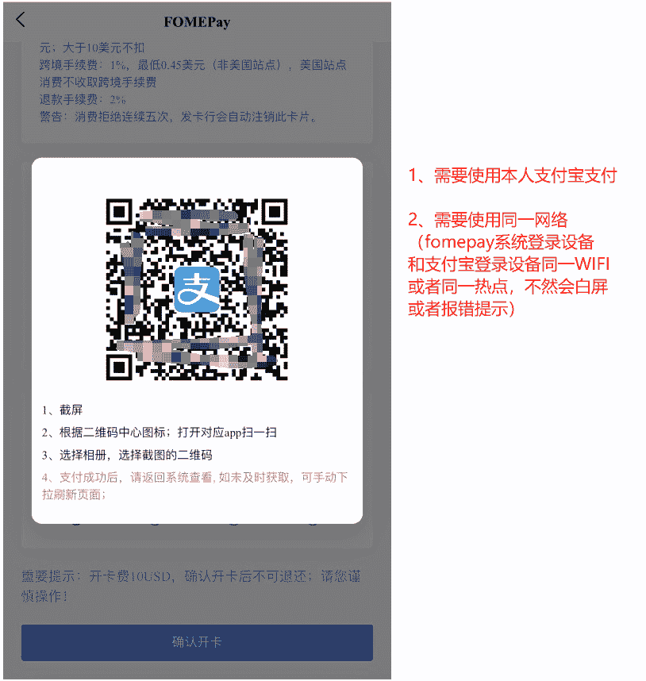

点击确认开卡后，把出现的支付宝二维码截图，然后打开自己的支付宝扫码支付即可。

（4）查看卡号信息

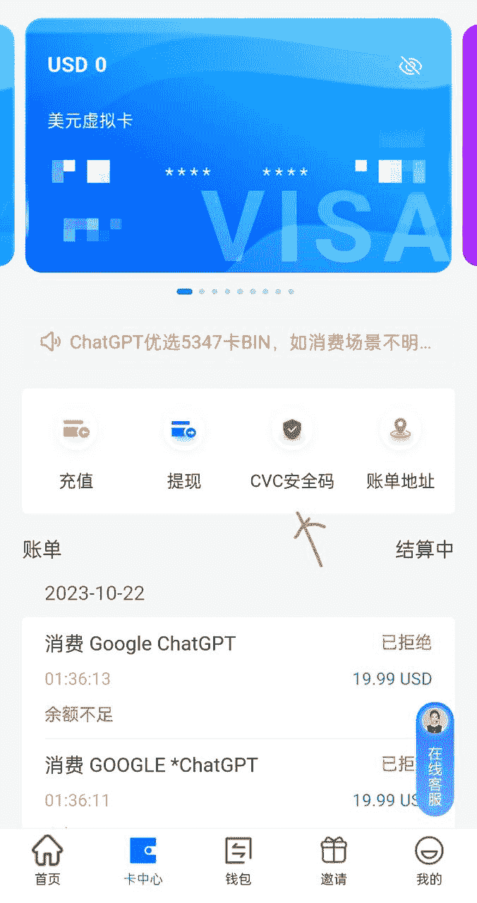

点击左下方的卡中心，会看到你开卡的相关信息。最上方会出现余额，卡的账号。

下方会出现该卡的消费记录，例如我之前曾经用这张卡，在谷歌商店中内购ChatGPT的会员。但因为余额不够，失败了。

旁边会有在线客服，如果你有充值问题，或不知道该选择哪个卡段，都可以先咨询客服，再去操作。

点击箭头所指的CVC安全码。

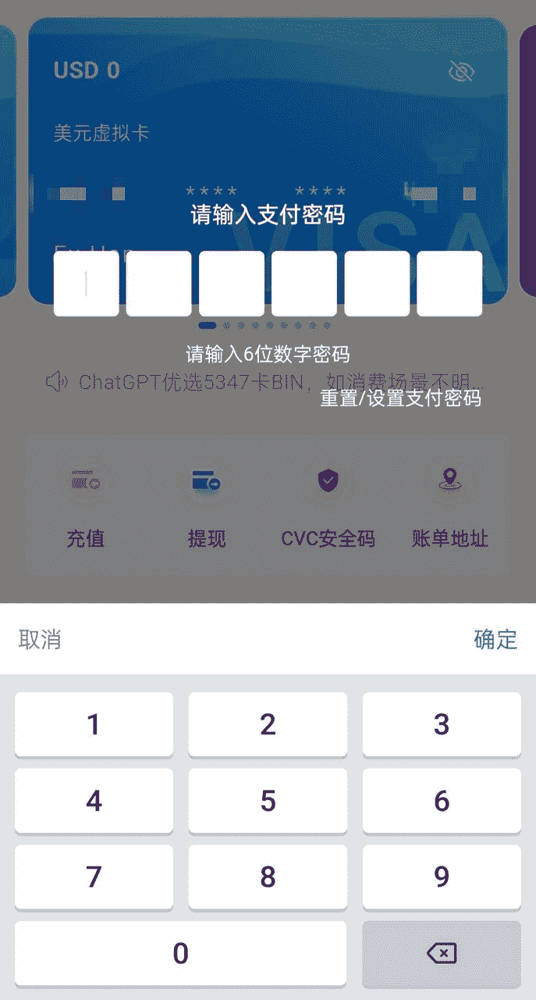

上方会让你先输入6个数字的支付密码，第一次会先让你设置6位数字的支付密码。

输入之后，就会显示卡片的全部信息，包括持卡人姓名，卡号，到期时间，CVC号，邮编，账单详细地址等。

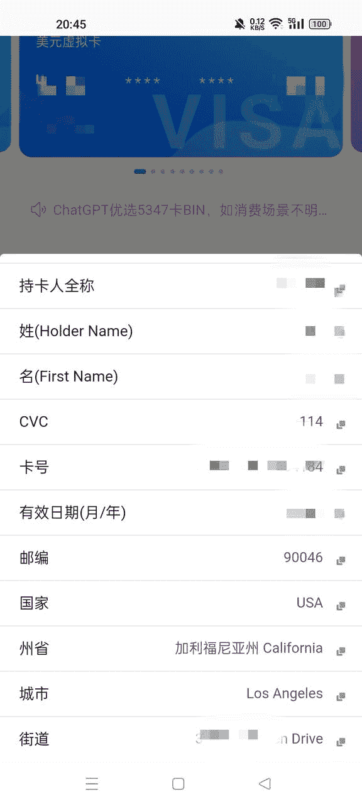

到时，我们充值GPT会员时，使用的信息，都直接复制上方信息即可。但先看一下上方的地址，是否是免费地址。

美国是有5个免税州的，阿拉斯加州（ Alaska ）、特拉华州（ Delaware ）、蒙大拿州（ Montana ）、新罕布什尔州（ New Hampshire ）和俄勒冈州（ Oregon ）

如果不是上面5个免税州地址，请看下面步骤来修改地址。

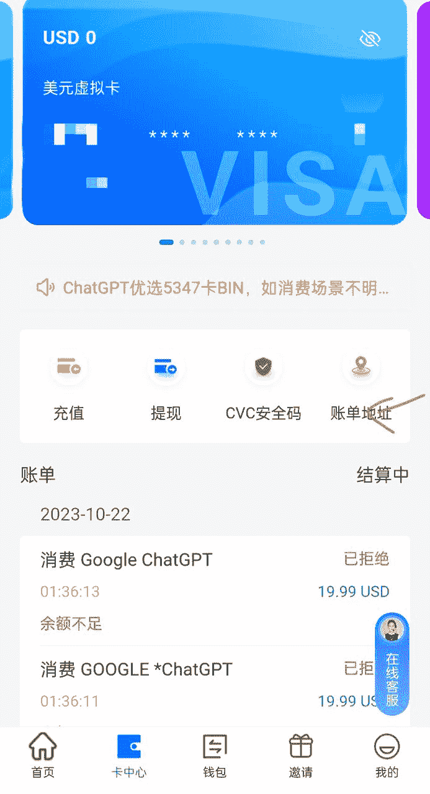

点击上方箭头所指的账单地址，然后进行地址修改。

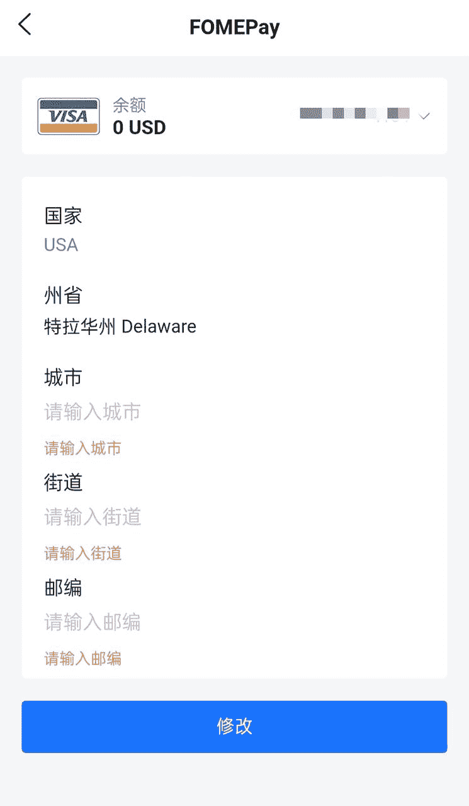

最上方是你的卡号，把州省选项点开下拉，找到上方5个免税州的任意一个然后点击修改即可。

之后再点击CVC安全码查看卡的全部信息。

（5）充值ChatGPT

打开官网：chat.openai.com 然后点击Log in 输入自己之前注册的gpt账号。浏览器无痕模式下进行

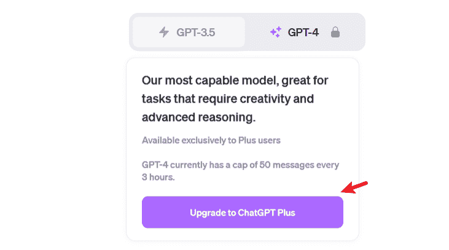

点击上方的GPT-4，上方是出现锁的状况，代表你没有开通plus会员。点击下方的Upgrade to ChatGPT Plus

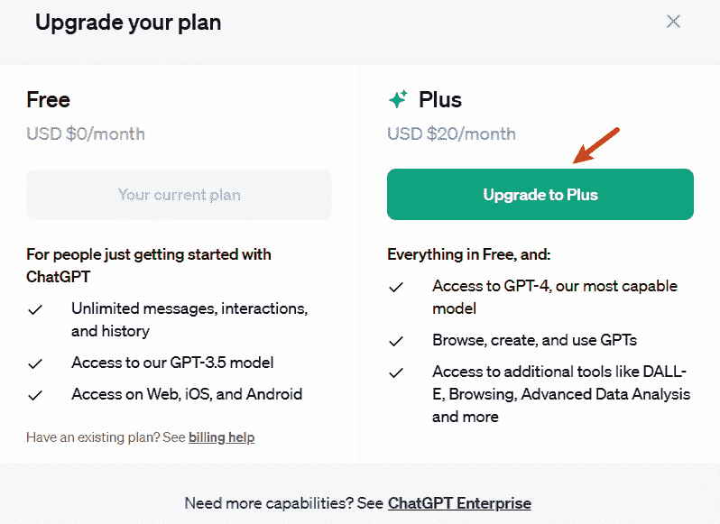

继续点击上方的Upgrade to Plus

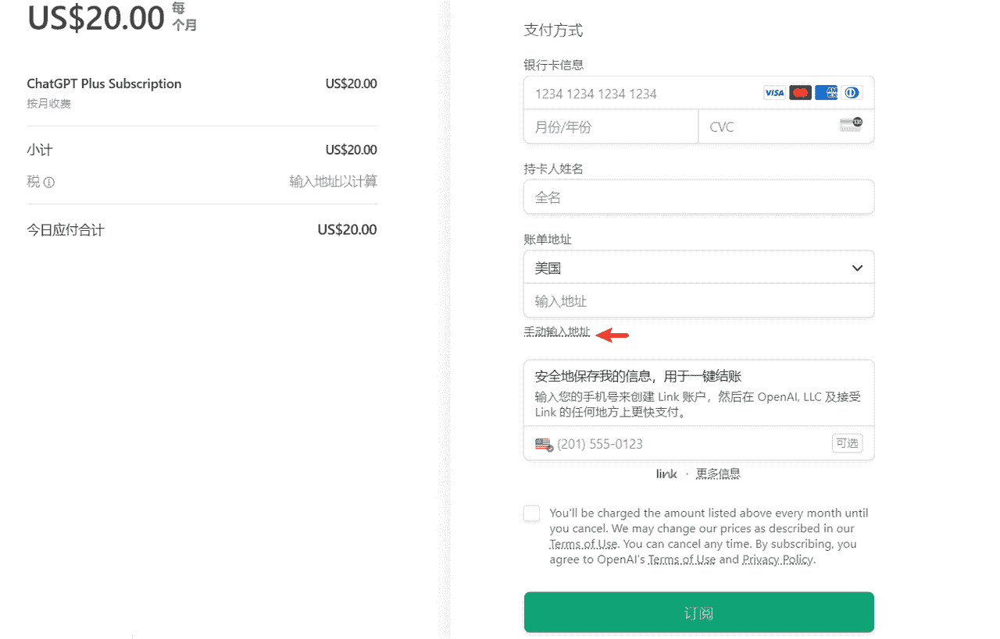

首先把输入地址下方的，手动输入地址打开。

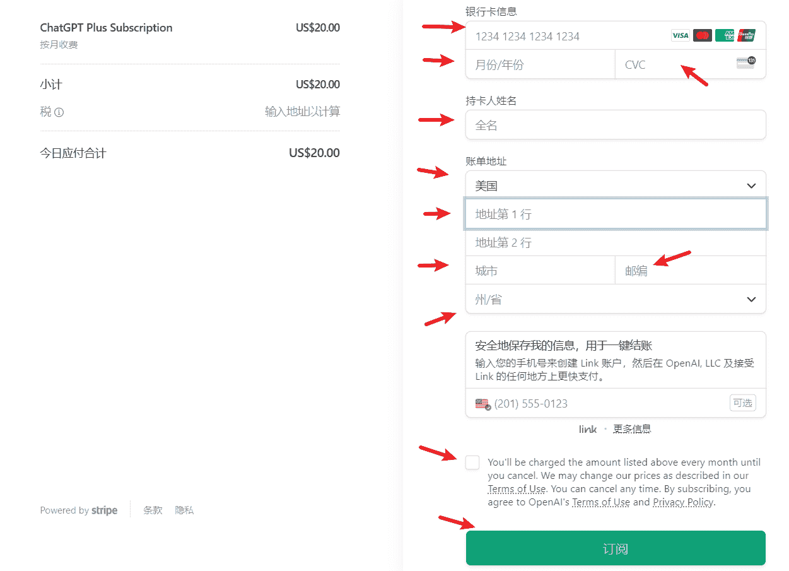

充值会员时需要填写的信息，我在上方已经都标注了。

以上所有信息，你直接复制之前点击CVC安全码显示卡片全部信息，那个步骤里面的信息即可。

所有信息都直接复制卡片显示的全部信息即可，地址第二行是不用填写的。其余我箭头所指的信息，是都要填写的。

然后把下方的框勾上，点击订阅即可。

这里订阅时，注意以下几个地方。

（1）使用浏览器的无痕模式去登录账号和订阅

（2）填写的信息要和卡的信息一致，否则会不成功。

（3）订阅失败时，不一定是卡的问题，大概率是你的IP地址有问题。

（4）自己的IP地址实在订阅不成功，可以联系客服，让他们帮你订阅。