# 虚拟信用卡FOMEPay开通GPT-4

> 来源：[https://xuqiwei1986.feishu.cn/docx/Gcmpdxw3XoFjs0xL48HcYLBznhf](https://xuqiwei1986.feishu.cn/docx/Gcmpdxw3XoFjs0xL48HcYLBznhf)

# 第一步：复制链接到google浏览器

[h](https://gpt.fomepay.com/#/pages/login/index?d=373039)ttps://gpt.fomepay.com/#/pages/login/index?d=373039

FOMEPay 目前支持国内手机，所以，我们用自己的手机号注册就行。（如下图）

# 第二步：进入首页，点击第一张卡

|  |
| --- |
|  |
|  |
| 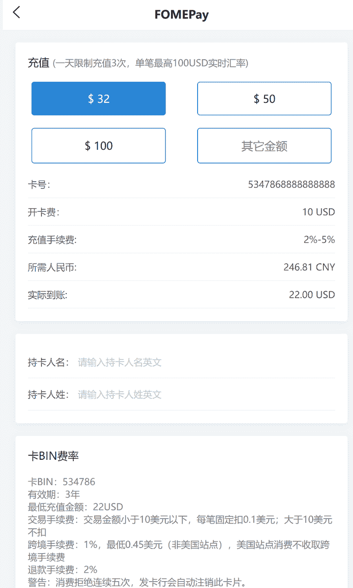 |

### 1、开卡

第一次开卡，点击右上角的“申请卡”就可以了。

（这里要注意的是，要在“美元虚拟卡”页面申请卡，不要右滑到香港虚拟卡了，不然后续可能充不上）

接着你会进入到充值和填写基础信息页面（如下图）

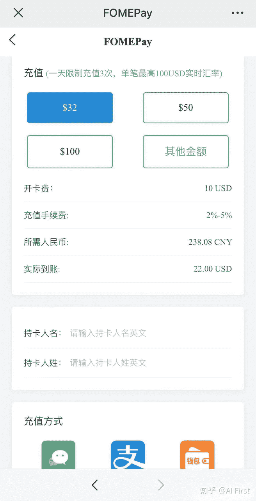

### 2、确定金额

Plus 帐号每次充值需要20刀，但保险起见可以尽量多充1～2刀。

在“其他金额”那里输入你要充值的金额就行。（如下图）

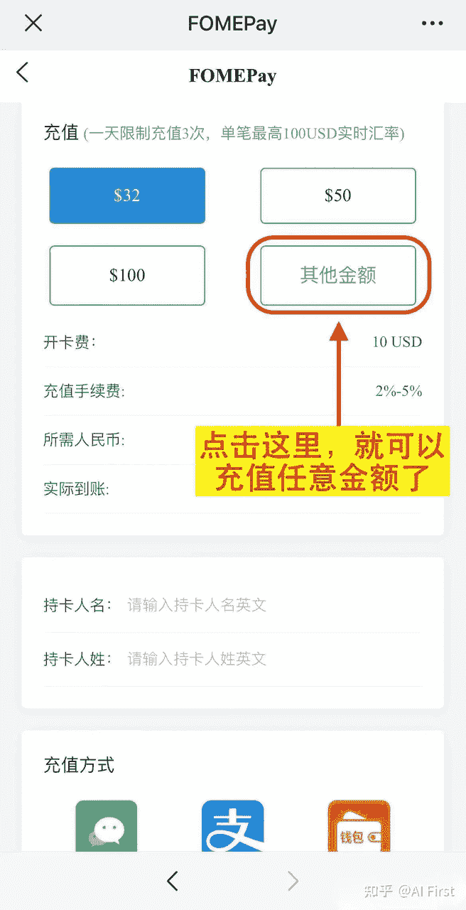

### 3、填写资料

**或用自己名字的拼音**

**或**持卡人姓名随便填就可以，优先用英文名字。如果实在想不出来，给大家一个随机生成英文名的入口

在线英文名随机生成器 - UU在线工具uutool.cn/english-name/

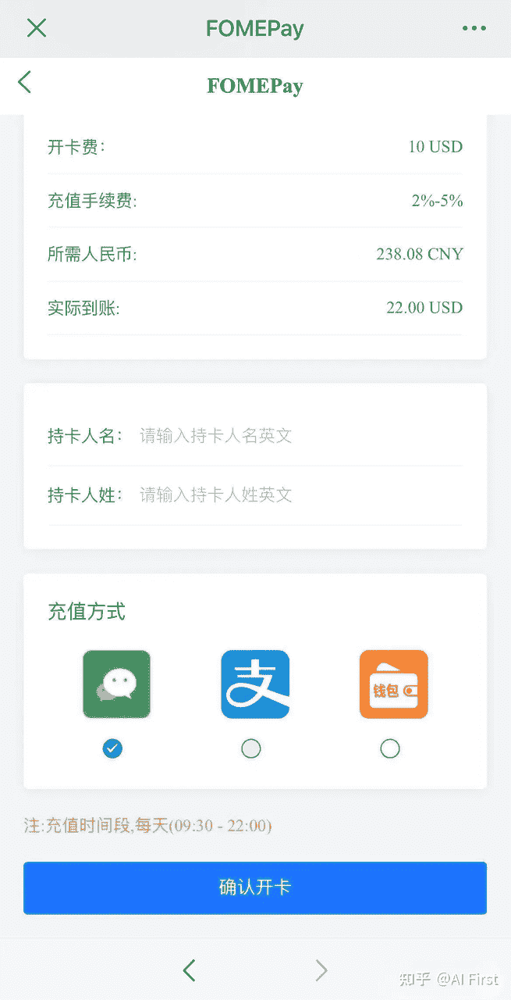

4、充值

点击“确认开卡”，会弹出一个付款二维码。

截屏后，用🛰️或支付宝扫一扫就能直接付款，非常简单。

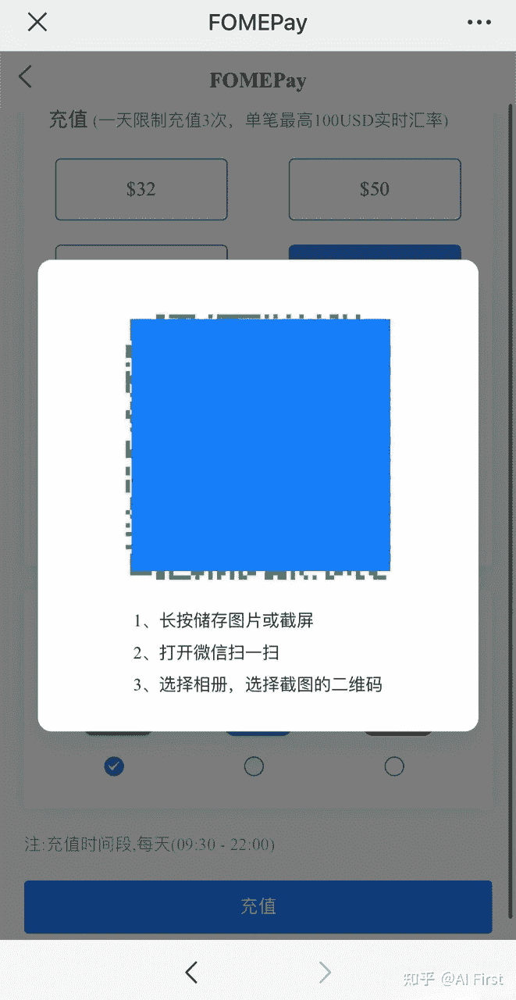

# 第三步：设置密码

充值成功后，回到首页。

接下来，点击下图中的“CVC安全码”，就会跳转到设置「信用卡密码」的界面。

设一个你能记住的支付密码就可以，非常简单。

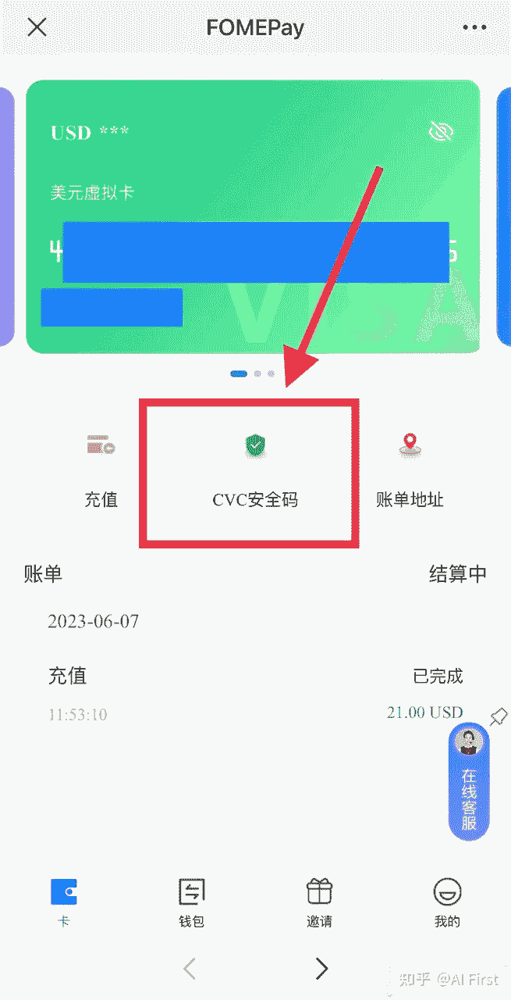

密码设置完成后，再次点击“CVC安全码”，就可以查看你的基础信息了。

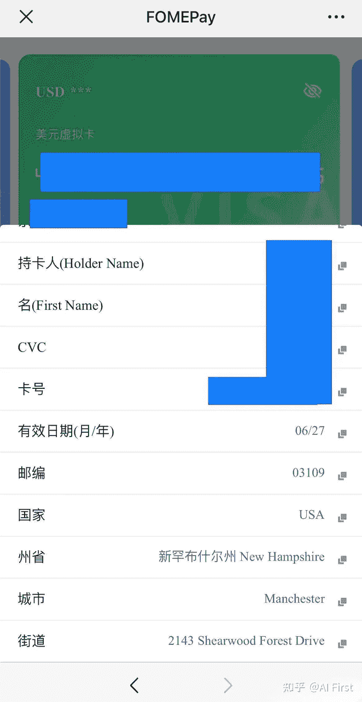

FOMEPay会帮你随机生成一个美区地址。

这里需要注意的是：上面的地址，优先选择美区的「免税州」

我们常用的5个美区免税州：

Alaska（阿拉斯加）Oregon（俄勒冈）Delaware（特拉华）Montana（蒙大拿）NewHampshire（新罕布什尔）

如果FOMEPay给你的地址不在免税州，点进首页的“账单地址”就可以直接修改。

# 第四步：升级 Plus

完成了上面三步，FOMEPay 这边的操作，就全部完成了。

接下来登陆你的 ChatGPT，点击升级Plus，

再把上面的 FOMEPay 信用卡的信息，对照填进来。

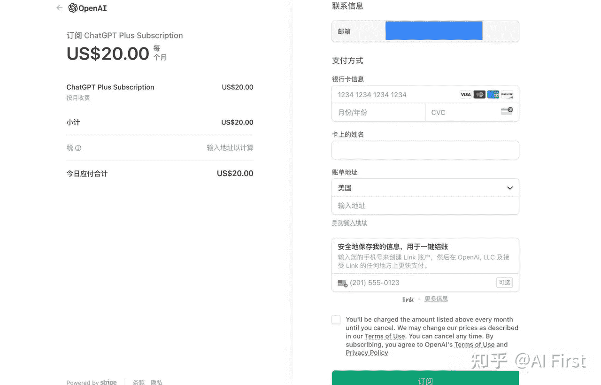

其它信息都很容易，照着填就行，唯一可能有点难度的就是地址部分。

关于哪一栏填什么，下面是具体说明。

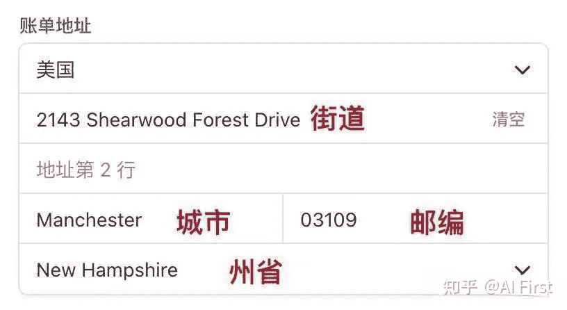

点击付费开通ChatGPT Plus，搞定收工。

最后，对于个人玩家来说，充值GPT Plus账号，优先推荐FOMEPay这个渠道

一则，它足够稳定，目前还没有掉Plus、没有封账号的例子；

二是，每次需要多少，就充值多少，非常方便；

三是，开卡特别简单，不像一些平台还需要选择特定号段、开多个账户。

嗯，就这些吧，有需要的小伙伴赶紧试试去。

# 可以在“我的”先找【客服咨询】

| 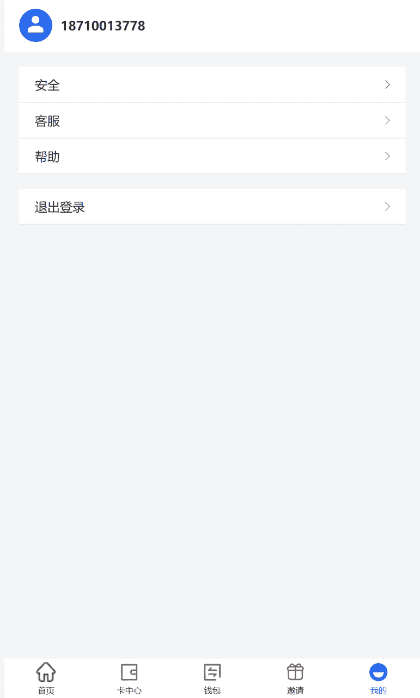 |
| --- |
| 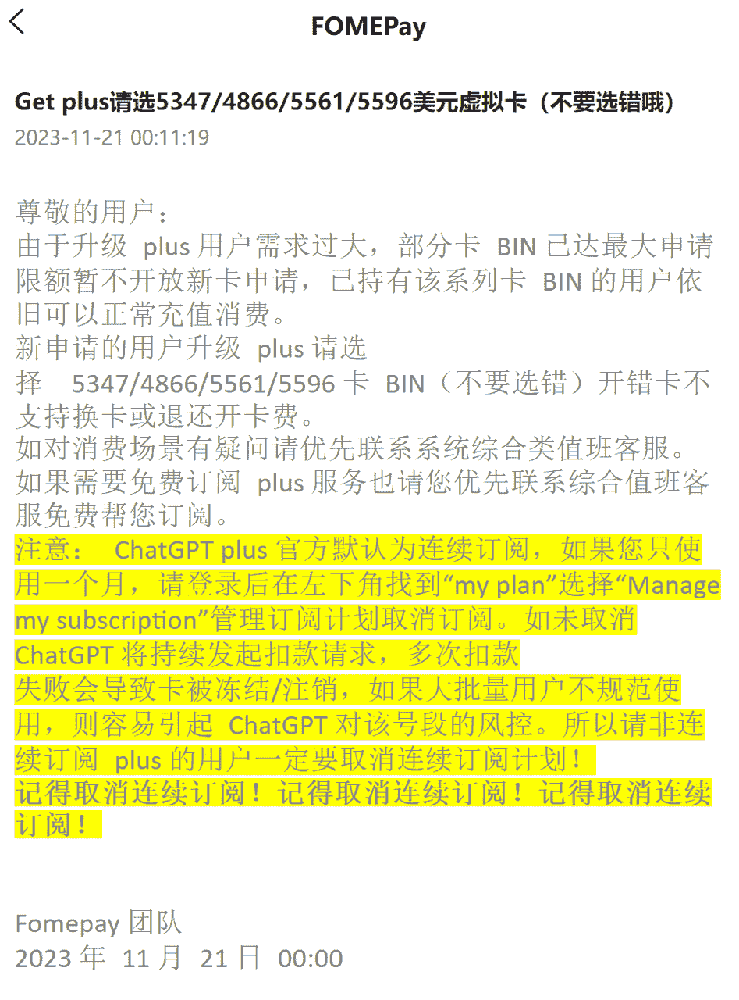 |
|  |
|  |