# 常见问题

> 来源：[https://xuqiwei1986.feishu.cn/docx/QMJNd7y2JoCexJx09m9cp4XlnKc](https://xuqiwei1986.feishu.cn/docx/QMJNd7y2JoCexJx09m9cp4XlnKc)

## 1、分别是邮箱、密码、apikey（如果不是开发人员不需要使用，直接无视）

## 2、Web端登录入口

官网链接：https://ai.com 或者

其实这两个指向的IP是**一样的，都可以**访问到官网地址。

ai.com 这个是 OpenAI 官网在域名销售商 Saw.com 花了1100万美元 买下来的，你理解为都可以使用即可。

## **   3、登陆注意事项**和步骤

2）输入给你的账号密码登录即可，如果需要改密码，就点上面的忘记了密码，进行修改。

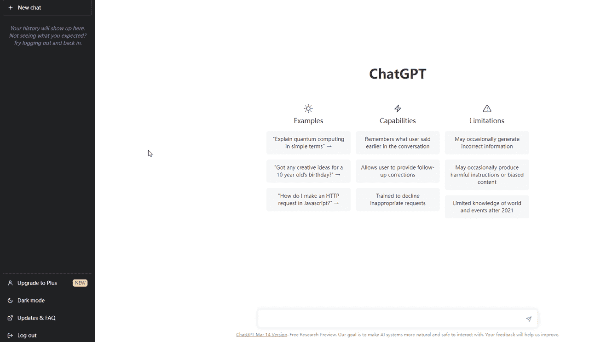

即可成功登录。

## 4、如果提示出现以下问题👇

### 1）提示出现 "Access denied"页面

当输入网址 https://chat.openai.com/ 回车后，**出现 Acc**ess denied 拒绝访问。说明你的网络问题，是自身网络问题，不纯净 。

解决方案1：使用纯净的线路，去Cookie或者使用隐身模式。

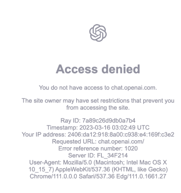

解决方案2: 设置网页自带浏览器无痕浏览 （小白推荐）❤️

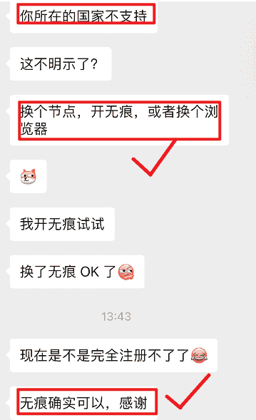

解决方案3：新建一个浏览器用户，以Chrome浏览器为例，下图所示。

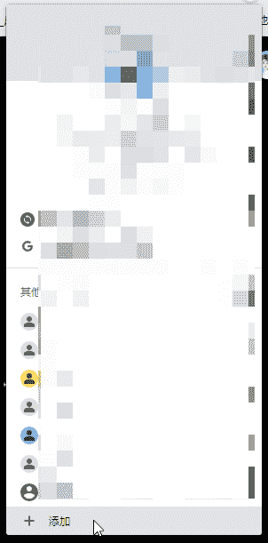

### 2）提示出现 "账户已锁定" 的页面

出现这个是正常的，新账号，7天内登录会提示绑定手机号，是微软的邮箱风控保护机制，绑定以后即可长期使用。

**解决方案第一步：**点击下一步，解锁账户。

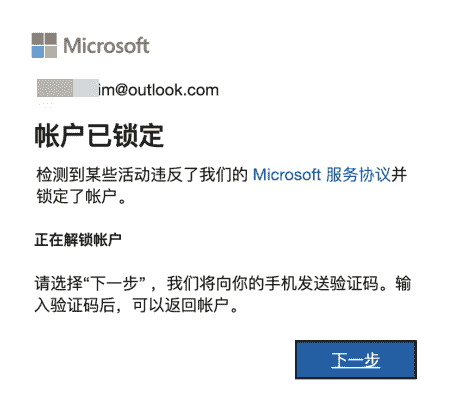

**解决方案第二步： **绑定自己的手机号即可，任何手机号都可以，注意地区代码，国内的是+86。

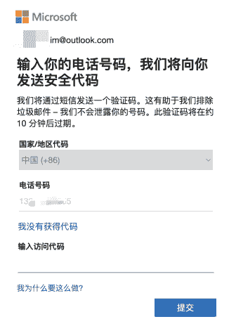

**解决方案第三步： **提交之后，即可解锁了。

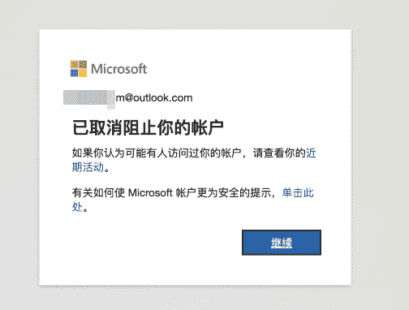

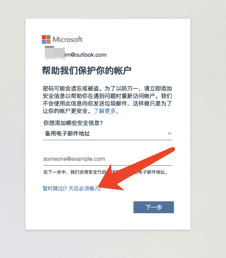

### 3）提示出现 "我们无法向此号码发送短信"

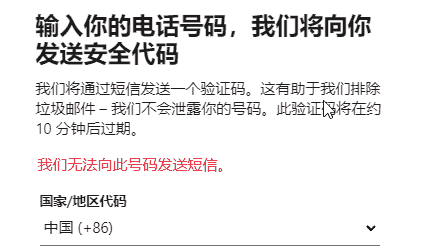

如果您没有收到手机验证码，可能是由于验证尝试次数过多或首次请求期间出现问题，官方的系统暂时屏蔽了您。

**

解决方案1**：请在几个小时后重试，并确保您在手机覆盖范围内，并且您没有使用任何文本拦截器应用程序。

**解决方案2：**有可能是微软官方的bug，正在修复，大家等待几天就行

### 4）提示出现 ”ChatGPT is at capacity right now”

**

一般这种情况出现**在，登录数量多，特别是晚上的时候，服务器压力大，不允许免费用户进来了。

解决方案1:   开通 Plus 账户，发送邮箱有特殊通道可以进。

解释一下PLus账号和普通账号的区别👇

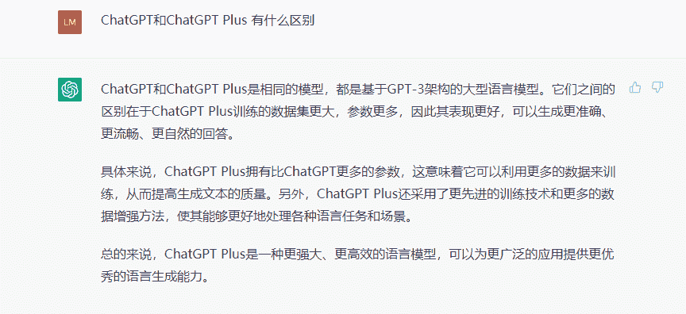

**解决方案2:**不断刷新页面，直到出现登陆界面（推荐等待后多次刷新）。

### 5）提示出现"429 您受到速率限制"

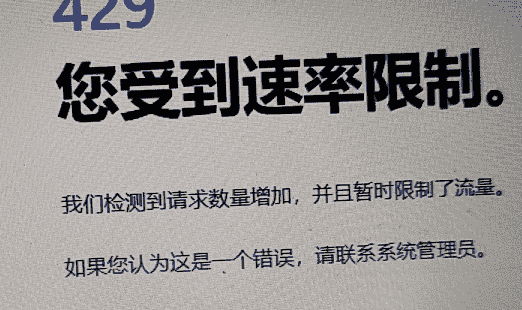

解决方案：网络问题，尝试着切换节点就可以了

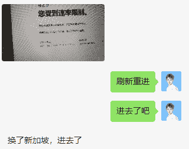

### 6）提示出现"我们检测到可疑的登录行为"

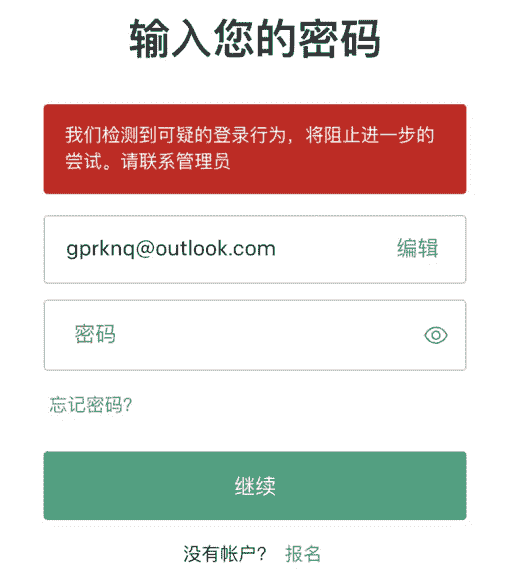

**解决方案：** 网络问题，都是同一个解决方法，切换节点+换一个干净点的浏览器环境。

### 7）提示出现 We’re Currently processing too many requests. Please try again later. 而且是不是的掉线

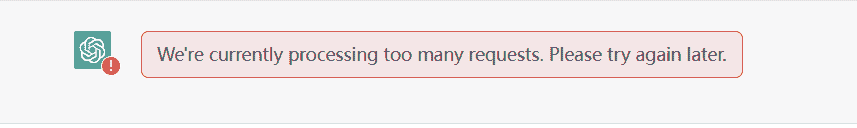

**解决方案：**找课程助理升级 Plus 账户，微信号：17349587346

### 8）提示出现 ChatGPT is at capacity right now

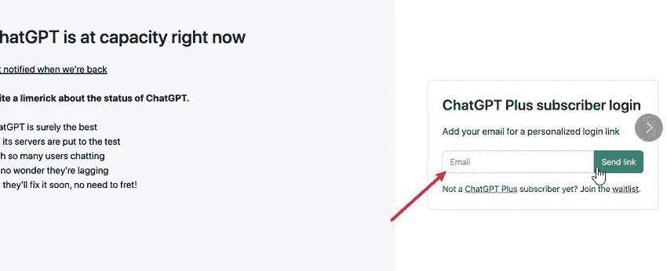

**

解决方案1****： 不断的刷**新页面，直到进入登录页面

解决方案2：升级 Plus 账户（需要可以找助理助理升级，补差价180元）

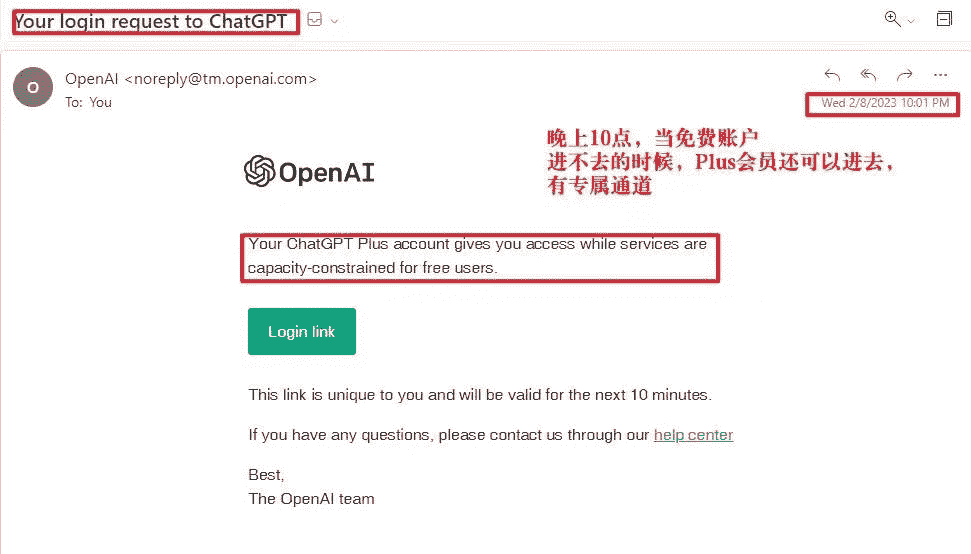

### 9）提示出现 "应用程序错误：发生客户端异常"

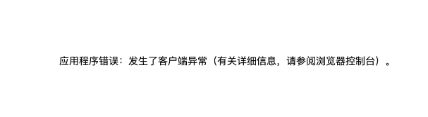

**解决方案：**还是和网络和 Cookie 有关， 重启个浏览器用户账户，再次访问就可以了。

### 10）提示出现 "network error"

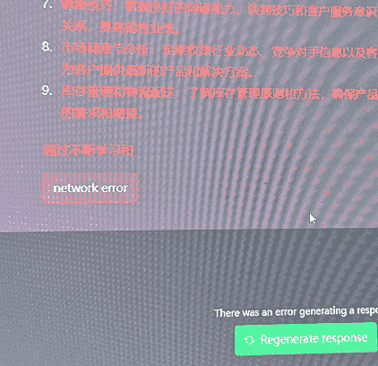

**解决方案**：系统负载过重时，会导致网络错误的发生，过一段时间再访问或者直接走付费走Plus线路。

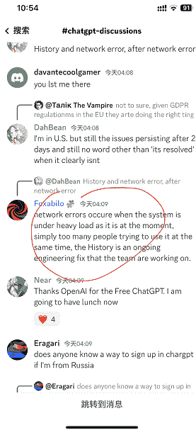

##  5、分享解决问题的其他办法

大家在遇到问题解决问题的时候，优先：看官网的文档和社区问答，搜索关键词，基本都可以找到解决方法。毕竟是全球产品，学习看英文是不可避免的，实在不行，你可以复制到翻译浏览器。

官方帮助文档：https://help.opsaaaaaaaenai.com

社区问答：https://discord.com/invite/openai/

## 6、基础知识普及

### 1）ChatGPT是什么

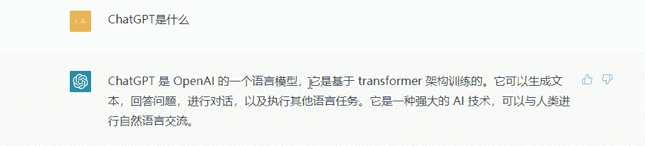

ChatGPT 是 OpenAI 的一个语言模型，它是基于 transformer 架构训练的。它可以生成文本，回答问题，进行对话，以及执行其他语言任务。它是一种强大的 AI 技术，可以与人类进行自然语言交流。

###   2）ChatGPT能做什么

ChatGPT 可以完成许多语言任务，其中包括：

1.  回答问题：ChatGPT 可以回答很多类型的问题，例如历史、科学、数学、技术等。

1.  对话：ChatGPT 可以与人进行自然语言对话，并回答关于任何主题的问题。

1.  文本生成：ChatGPT 可以生成文本，例如文章、故事、诗歌等。

1.  文本摘要：ChatGPT 可以生成文本摘要，以简化长篇文章。

1.  语言翻译：ChatGPT 可以翻译文本从一种语言到另一种语言。

1.  情感分析：ChatGPT 可以识别文本中的情感倾向，例如积极、消极等。

这只是 ChatGPT 的一些应用，它还可以执行其他语言任务。

### 3）如何更改我的ChatGPT帐户密码

请按照以下步骤重置密码：

1.  如果您当前已登录帐户，请注销或打开隐身浏览器窗口。

1.  导航到站点的登录页面。

1.  输入与您的帐户关联的电子邮件地址。

1.  点击“忘记密码？”链接。

1.  您将收到一封电子邮件，其中包含重置密码的说明。按照这些说明操作。

如果您没有收到电子邮件，或者重置过程不起作用，请检查您最初是使用 Google 还是 Microsoft 帐户进行身份验证。如果您使用了其中一种方法，请尝试使用该身份验证方法登录。

### 4）如何联系官方人员

有两种方式联系官方人员

如果您已经有一个帐户，只需登录并使用“帮助”按钮开始对话。

如果您没有帐户或无法登录，您仍然可以通过选择 https://help.openai.com/ 右下角的聊天气泡图标与官方联系。

## 7、必备插件

## AIPRM for ChatGPT

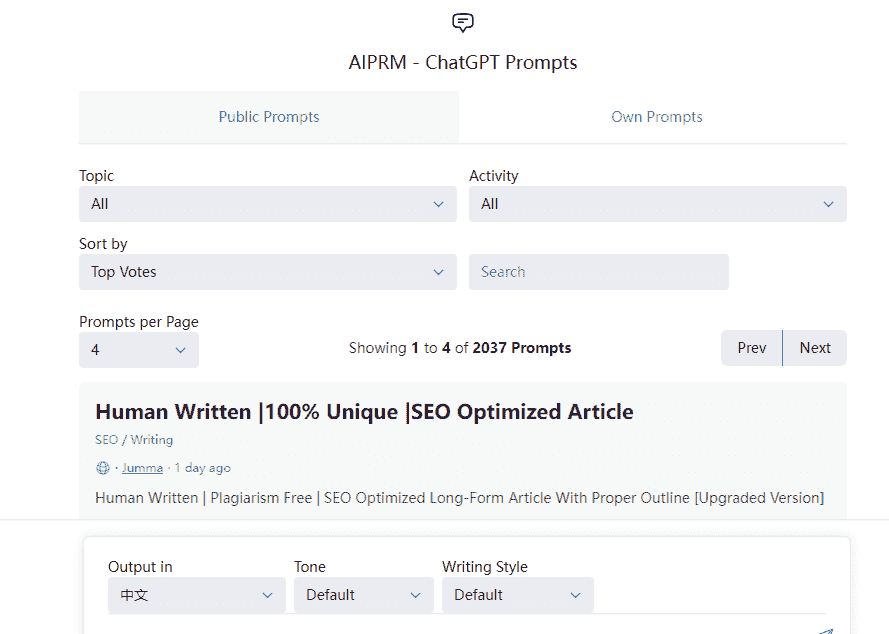

ChatGPT 的一键式提示！ChatGPT 的 AIPRM 为 ChatGPT 添加了两千多个针对 SEO、SaaS 等的精选提示模板

## ChatGPT for Google

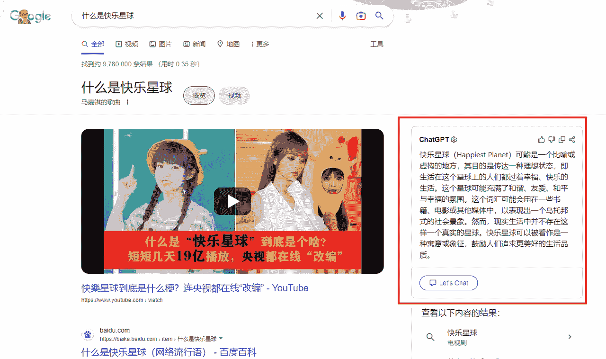

在安装了这个插件的浏览器使用任何一个搜索引擎结果中同时显示ChatGPT的回答。

## YouTube Summary with ChatGPT

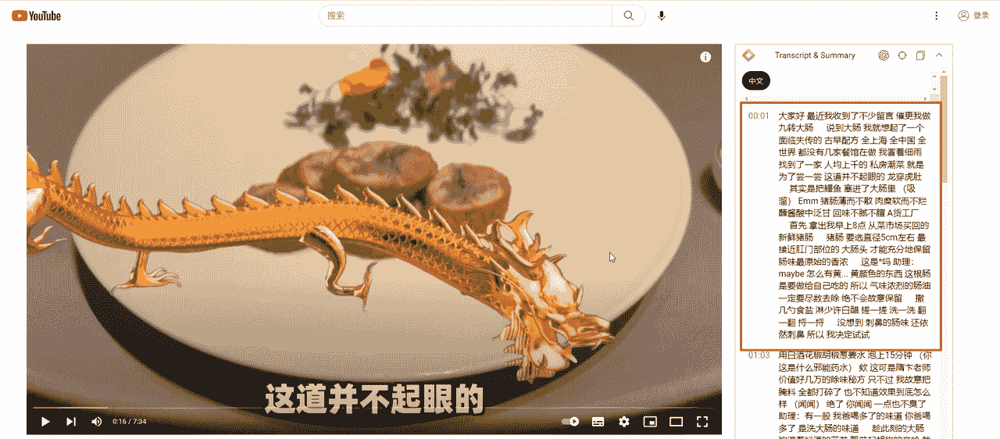

使用 ChatGPT 总结 YouTube 视频，YouTube Summary with ChatGPT 是一款免费的 Chrome 扩展程序，可让您使用 OpenAI 的 ChatGPT AI 技术快速访问您正在观看的 YouTube 视频的摘要。使用此扩展程序可以节省时间并更快地学习。此外，在 YouTube 上浏览视频时，您可以通过单击视频缩略图上的摘要按钮来快速查看和访问视频摘要。

## LINER: ChatGPT 谷歌助手和高亮显示工具

在信息的洪流中，LINER 帮助您更快地找到和学习可靠的信息。LINER AI x ChatGPT为您提供ChatGPT没有的答案/功能。

---

更多OpenAI官方信息

ChatGPT论坛：https://discord.com/invite/openai/

ChatGPT公告及帮助中心：https://help.openai.com/en