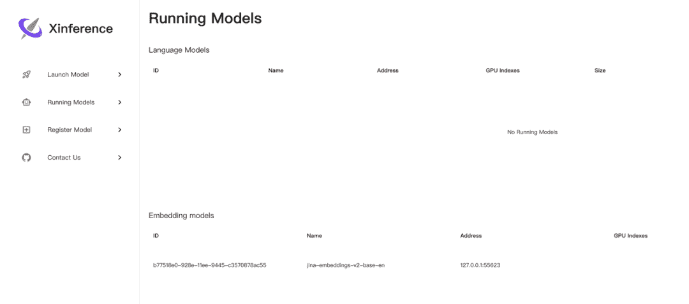
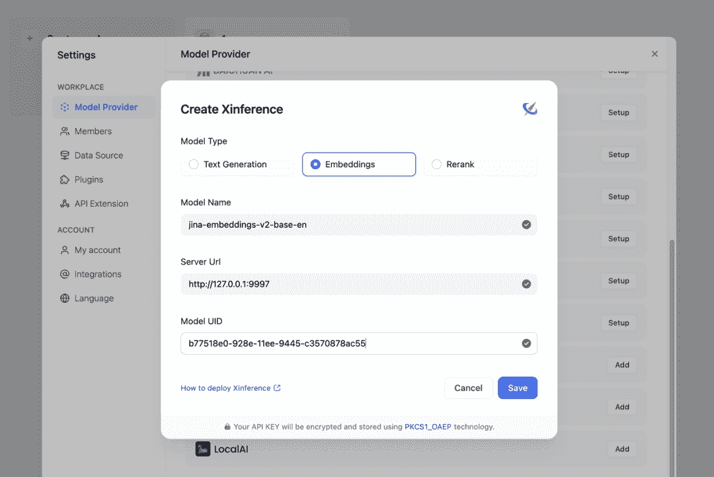

# 2023-12-19Dify.AI x Jina AI：Dify Embedding 模型新添助力 —— jina-embeddings-v2

> 来源：[https://xuqiwei1986.feishu.cn/docx/Trq8dpHEHoHQBSxS2x0chj4lnCe](https://xuqiwei1986.feishu.cn/docx/Trq8dpHEHoHQBSxS2x0chj4lnCe)

> 🔗 原文链接： h[ttps://mp.weixin.q](https://mp.weixin.qq.com/s/k9-k1ONpRubRV4sKwuAhcg)q.com/s/k9-k1ONp...

原创 Dify.AI Dify 2023-12-07 17:32 发表于 美国

手机阅读

文本 Embedding 是构建检索增强生成（Retrieval Augmented Generation, RAG）应用的关键。Embedding 模型将文本转换为向量，捕捉文本语义从而实现了复杂的自然语言理解。

在开发 RAG 应用中，Embedding 模型的序列长度决定了模型可以理解文本上下文的范围。可以把 Transformer 想象成计算机，LLM 的上下文长度是内存，越大更好，但成本也更高。RAG 类似于外存，也可以有效地增强这种容量。因此，一个支持更长文本的 Embedding 模型（例如 Jina Embeddings v2 系列）非常重要，它可以帮助 RAG 应用更好地理解文本上下文，生成更丰富、更具上下文感知力的 Embedding。

本次更新 Dify.AI 引入了 Jina Embeddings v2 向量模型，Jina Embeddings v2 系列 的开源 向量模型 支持 8k 输入长度，可为 RAG 应用提供更强大的文本理解能力。

# ☁️**云端版使用**

Dify.AI 集成了多种 Embedding 模型，以便为您提供最佳的 LLM 应用解决方案。长达 8192 个 token 的上下文使 jina-embeddings-v2 在开源  Embedding 模型中成为了佼佼者。您可以通过以下视频了解在 Dify.AI 云端版本中使用 jina-embeddings-v2 的 详细操作步骤：

关闭

**观看更多**

更多

退出全屏

切换到横屏模式

[🎦 点击观看视频](https://mpvideo.qpic.cn/0b2eciaamaaa6qaenwdrfrsvaewdayjaabqa.f10002.mp4?dis_k=f10df148e03647a6e9628ff297544573&dis_t=1702952796&play_scene=10120&auth_info=c/3bva1TRlIy0sDfu3ZHVj5EARYoKzRSNEgVblt3PGVBTi4KYTksO0Y0YVsxVlU=&auth_key=93ecd654e6d28eaed0c2bc9ee35d7dd7&vid=wxv_3226740604273999877&format_id=10002&support_redirect=0&mmversion=false)

> 无法获取音频链接

视频详情

# 💻部**署到本地**

在 Dify.AI 的社区版本中同样支持了 jina-embeddings-v2，通过 Xinference 您可以轻松将其部署到本地使用。

**前期准备**

> 在本地安装 Dify.AI 社区版和 Xinference 并启动：

> https://docs.dify.ai/v/zh-hans/getting-started/install-self-hosted

> https://docs.dify.ai/v/zh-hans/advanced/model-configuration/xinference

部署 jina-embeddings-v2

在 Xinference 官网的「Embedding Models」页面激活 jina-embeddings-v2 后即可开始使用。您可以随时在运行模型页面上查看模型的动态。

进入 Dify.AI 的「模型供应商」页面，将已激活的 jina-embeddings-v2 加入到 Xorbits Inference 模型提供商。

在「系统模型设置」中将其设置为默认 Embedding 模型后即可使用，详细使用步骤和云端版操作一致。

除了本文提到的 Jina Embedding 模型，Dify.AI 还支持 OpenAI，ZHIPU (ChatGLM) 的** **E mbedding 模型。我 们致力于引入更多优秀的合作伙伴，为开发者提供一个更加开放的平台来选择他们偏好的模型。 目前，我们正在优化社区版架构，旨在让所有贡献者都能轻松加入，整合他们偏好的模型，并积极参与到 Dify 的项目中。 如果您期待深入了解，欢迎扫描文末二维码添加小助手，加入我们的社群。

---

# 🥳如**果你喜欢 Dify，欢迎：**

+   在 GitHub 上贡献代码，与我们一同共建更好的 Dify；

+   通过线上线下活动、社交媒体向你的朋友们分享 Dify，以及你的使用经验；

+   在 GitHub 上给我们点亮⭐️

+   https://github.com/langgenius/dify

你也可以联系 Dify 小助手，加入我们的好友群聊，相互分享使用经验：

