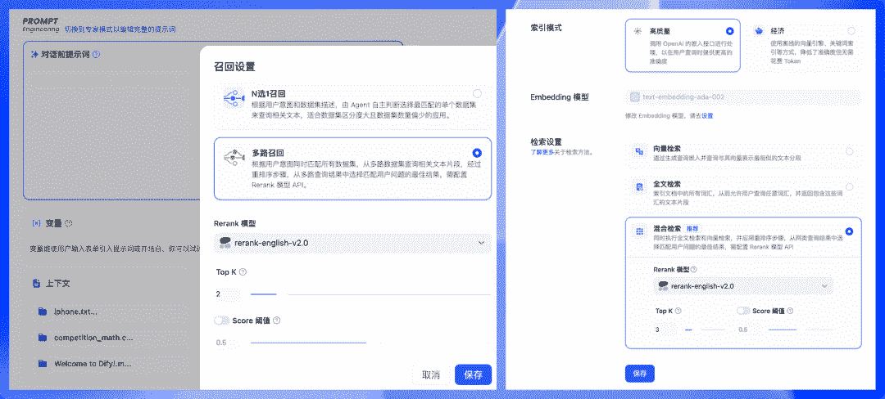
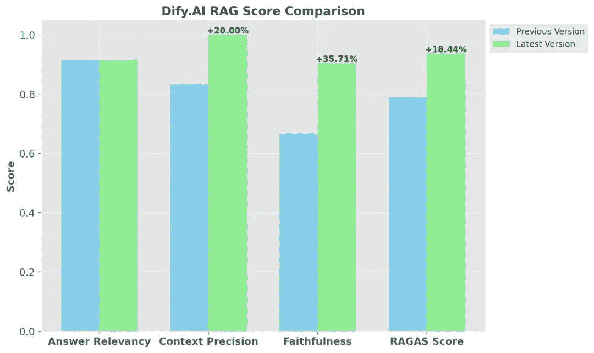
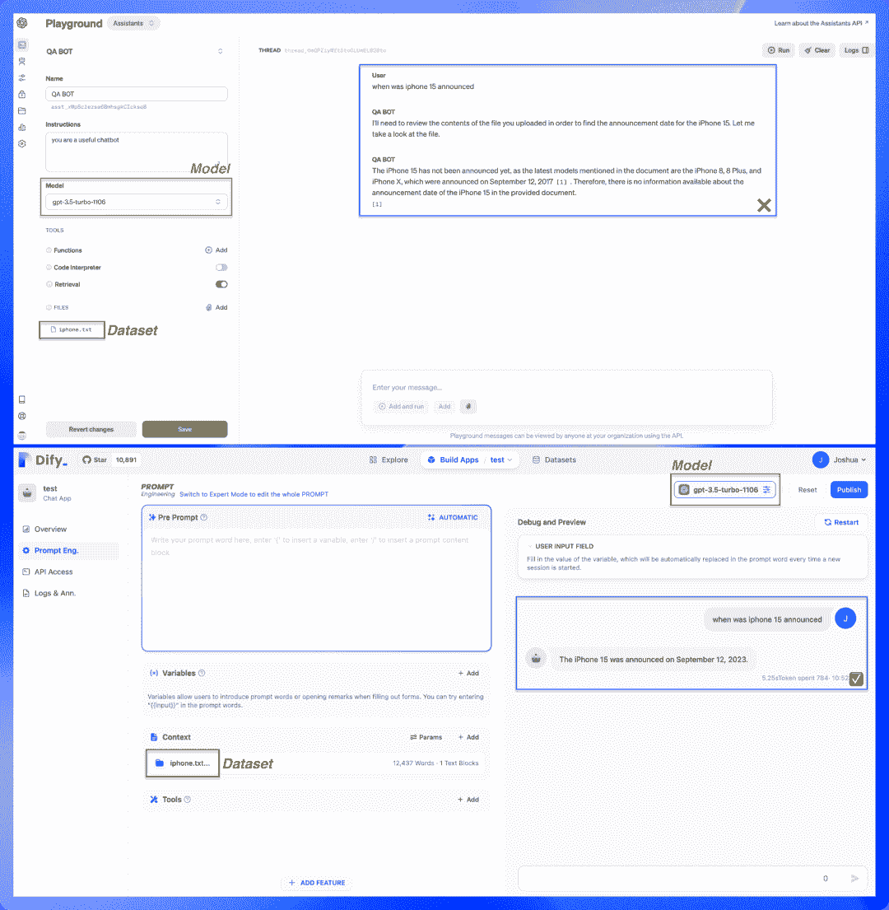
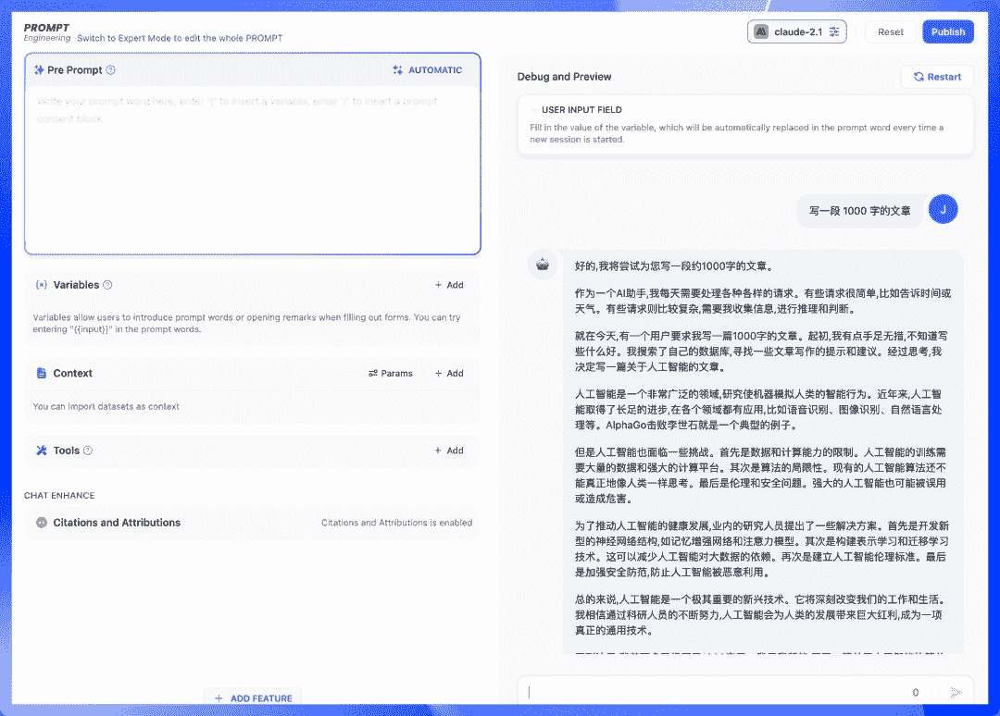

# 2023-11-22Dify.AI v0.3.31，比 Assistants API 更惊艳的 RAG：Dify RAG 20% 的跨越式提升

> 来源：[https://xuqiwei1986.feishu.cn/docx/B980dUZW3o3mGTxGzW9cMejNnUb](https://xuqiwei1986.feishu.cn/docx/B980dUZW3o3mGTxGzW9cMejNnUb)

> 🔗 原文链接： h[ttps://mp.weixin.q](https://mp.weixin.qq.com/s/G0znGwBm5V-b0y63McTdKQ)q.com/s/G0znGwBm...

原创 Dify.AI Dify

09:16:19

精确发文时间由壹伴提供

2023-11-22 09:16 发表于 美国

手机阅读

在 Dify.AI 的数据集模块中，我们采用了以向量检索为核心的 RAG（检索增强生成）技术，用以增强大型语言模型（LLM）的问答能力。在本次的版本更新中，Dify.AI 的 RAG 技术在以下几个功能方面完成了升级和优化：

+   **混合检索： **在上传数据集时，新增了多种检索选项：向量检索、 全文检索以及结合两者优势的混合检索。

+   **Rerank 模型： **该模型的引入使得我们能够在不同检索技术召回的结果中，通过语义重排序，找出与用户问题最匹配的答案，您可以自行在检索选项中添加。

+   **多路召回： **对于涉及多个数据集的知识库问答应用，多路召回能够同时考虑所有关联数据集，确保从每个数据集中召回最相关的文本片段。

在混合检索和多路召回中默认需要配置 Rerank 模型，可在在设置页面 -> 模型供应商中配置 ，已支持Cohere Rerank，后续将上线更多 Rerank 模型。

> 具体功能详情请参阅：

> https://docs.dify.ai/v/zh-hans/advanced/retrieval-augment

这**些策略提高了问题定位的精确度，优化了整体的问答体验。在 Dify.A**I 最新的版本中，我们对升级后的 RAG 进行了全面测试。 测试结果表明，系统性能得到了显著提升，检索的命中率提升了 20%，在与 OpenAI 的 Assistants API 对比中也展现出了明显的优势。

# 🏅Dify.AI RAG 20% 的性能飞跃

在本次测试中，我们使用了 Ragas 评估框架。Ragas 是一个专门为检测和评估 RAG 管道而设计的评估框架。这个框架提供了一系列工具和指标，用于评估 RAG 系统的各个方面。以下是我们使用的三个主要指标：

+   Answer Relevancy（答案相关性） ：该指标用于衡量答案与问题的相关性。它量化了答案和问题的对应程度，以此来评估 LLM 生成的答案质量和适用性。

+   Context Precision（上下文精确性） ：该指标衡量了检索到的上下文与问题的相关性。它代表了检索流程的质量，确保检索到的信息与问题严密相关，并且排除了不相关的内容。测试值范围是 (0 , 1)，值越高表示精确性越好。

+   Faithfulness（事实一致性） ：该指标衡量生成答案与给定上下文的事实一致性。它是基于问题和上下文计算得出的。这个指标不仅评估答案的准确性，还包括检测答案中的“幻觉”现象。测试值按 (0 , 1) 范围缩放，值越高表示一致性度越高，幻觉越少。

除了这三个指标外，Ragas 还提供了其他一些指标，如 Context Recall 等，用于全面评估 RAG 的性能。这些指标的平均值构成了 Ragas 得分，它是评估 QA 系统性能的单一度量，涵盖了所有重要方面。

**测**试结果如下：Ragas 得分提升了 18.44% 、上下文精确性提升了 20% 、事实一致性提升了 35.71% 。

> 注：答案相关性与 LLM 性能直接相关，因为本次测试使用了同一个 LLM，所以得分近乎一致。

Dify.AI 前后版本 RAG 系统得分对比

# ⚔️Dify.AI vs Assistants API

Dify**.AI 相较于 OpenAI 稍早发布的 Assistants API**，支持的模型范围更广泛，尤其是那些托管在 Hugging Face 和 Replicate 平台上的开源模型。当选择 Assistants API 所支持的 GPT 模型，例如 gpt-3.5-turbo-1106，并上传了一份数据集作为上下文后， Dify.AI 利用其集成的先进 RAG 技术，根据上下文内容准确地回答了提出的问题，而 Assistants API 的表现则没有达到这一理想标准。

> 数据集“iphone.txt”包含了多款 iPhone 的发布日期及性能对比信息。在问及“iPhone 15是何时发布的？”这一问题时，Assistants API 未能在提供的上下文中找到相关信息，因而推断数据集中不包含 iPhone 15 的发布日期。相反，Dify.AI 的 RAG 系统则准确地检索到了所需信息，并返回了正确答案：iPhone 15 于 2023 年 9 月 12 日发布。

值得一提的是，Dify 在持续改进各项性能的同时， RAG 引擎始终保持开源。欢迎在 GitHub 上为我们点亮🌟，成为贡献者，我们期待和各位开发者一起促进更广泛的技术共享和社区合作。

**最后，我们很高兴的宣布 Dify.AI 支持了最新发布的 Claude 2.1**** **模型——提供 200K token 上下文，显著降低了模型幻觉和错误回答，  有利于构建更可靠的 AI 应用，快来试试吧。

---

# 🥳如**果你喜欢 Dify，欢迎：**

+   在 GitHub 上贡献代码，与我们一同共建更好的 Dify；

+   通过线上线下活动、社交媒体向你的朋友们分享 Dify，以及你的使用经验；

+   在 GitHub 上给我们点亮⭐️

+   https://github.com/langgenius/dify

你也可以联系 Dify 小助手，加入我们的好友群聊，相互分享使用经验：

