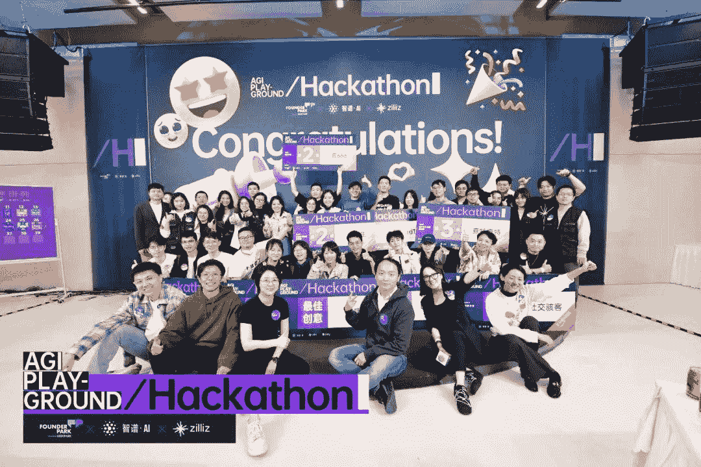
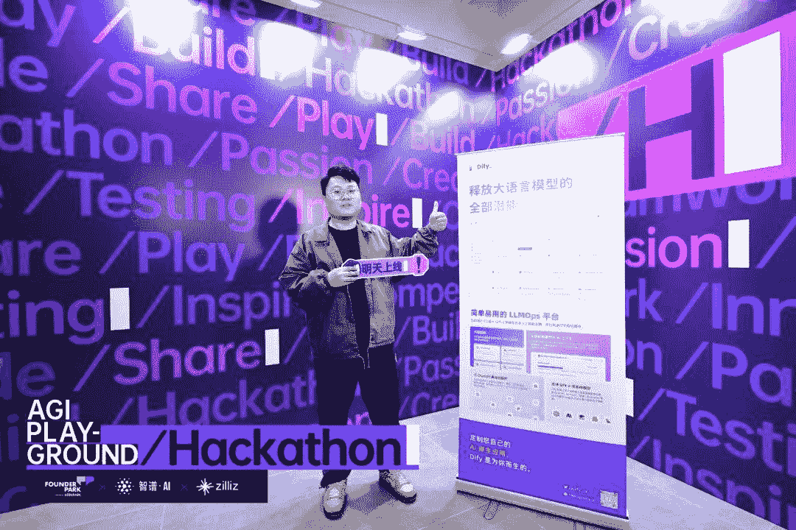
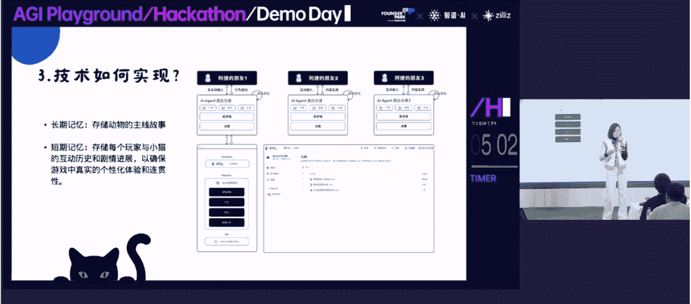
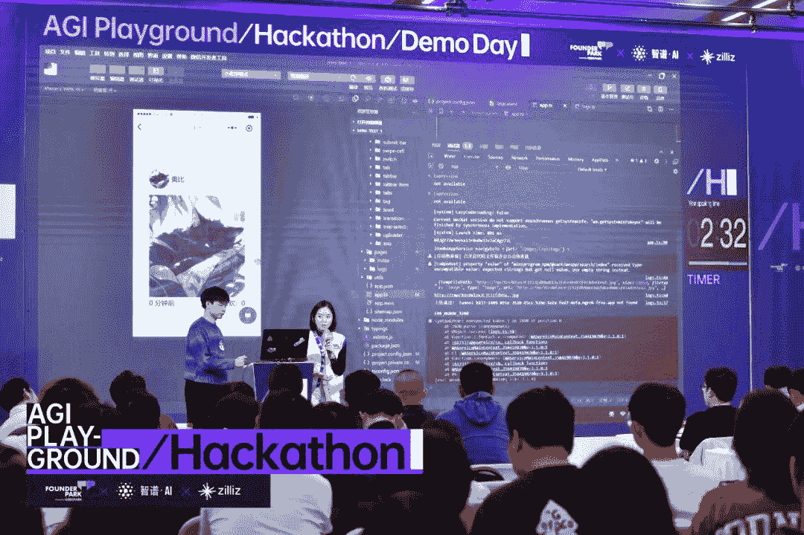
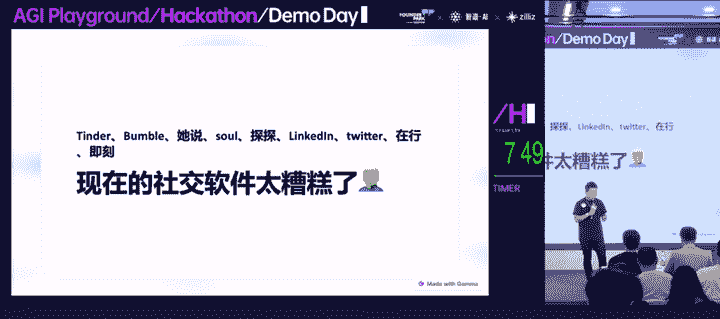
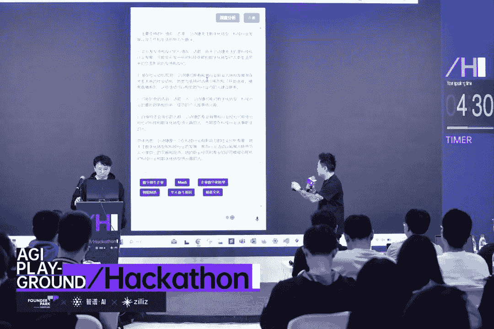
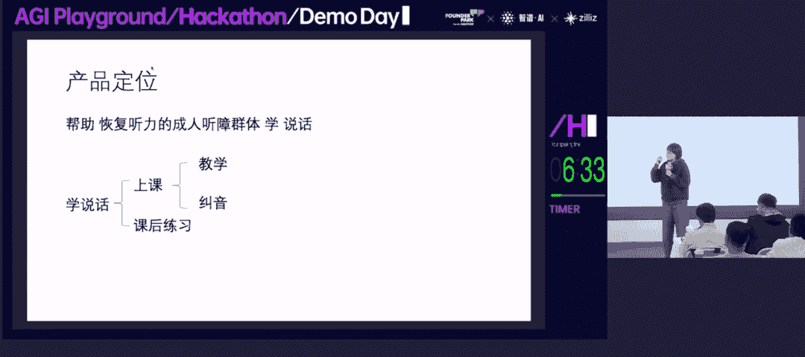
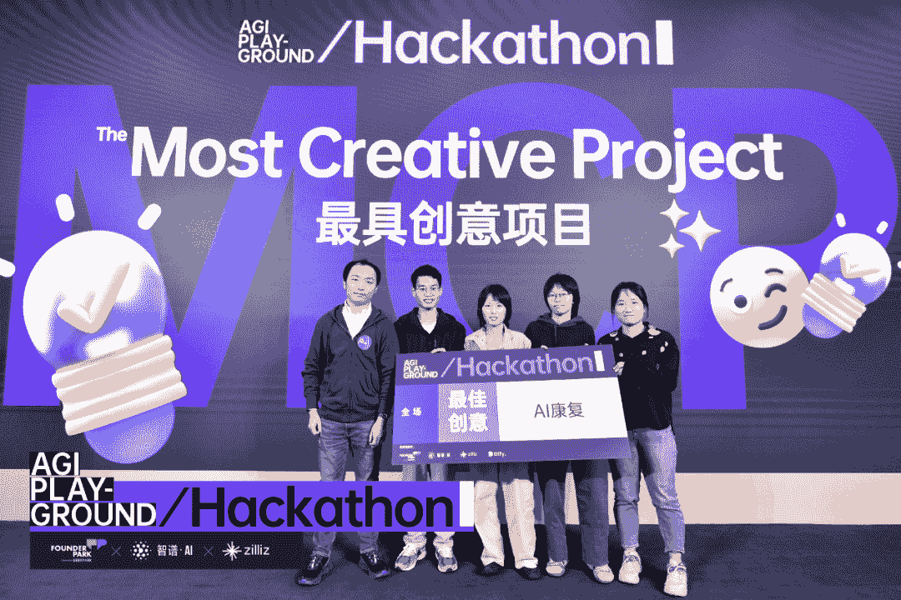
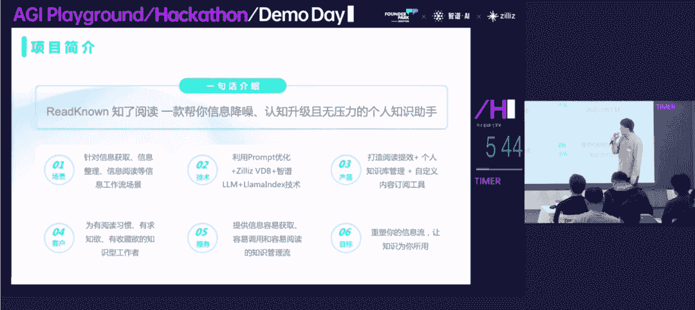
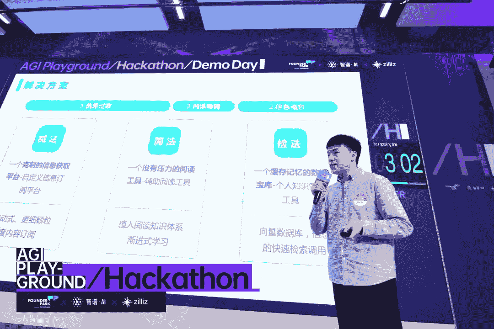

# 2023-10-23生成式 AI 浪潮下：Dify 助力 AI Hackathon 创新

> 来源：[https://xuqiwei1986.feishu.cn/docx/EFZmduCIDoyihvx9Gjrcqo50nLg](https://xuqiwei1986.feishu.cn/docx/EFZmduCIDoyihvx9Gjrcqo50nLg)

> 🔗 原文链接： h[ttps://mp.weixin.q](https://mp.weixin.qq.com/s/mIwyHUCl6ZxQIApwFXdcmQ)q.com/s/mIwyHUCl...

>

2023-10-23 09:00 发表于 江苏

手机阅读

在生成式 AI 的浪潮之下，我们看到了它如何重塑产业与创新的可能。对于众多开发者和创新者来说，如何在这个浪潮之巅迅速地将创意转化为应用，无疑是一个巨大的挑战。

**作为大模型应用开发平台，Dify 在最近由 Founder Park、智谱AI、Zilliz 联合主办的 AGI Playgr**ound Hackathon 赛事上为参赛者提供了卓越的技术支持，帮助开发者轻松地接入大模型，从而大大缩短了开发时间。 更重要的是，它让参赛者能够将更多的精力放在创意体现和业务开发上，而不是纠结于技术的复杂性。这不仅大大提高了创意的实现速度，也为参赛者提供了更多的时间去完善他们的方案，使其更具市场价值。

参赛团队不限于常规的技术领域，勇于跨界创新，涉及知识库、金融、健康、短视频、宠物、儿童绘画、残障人士关爱等多个领域。每一个作品都展现了对人类生活的深刻洞察和科技创新的无限潜力。在这场技术与创意的盛宴中，我们看到了生成式 AI 应用的种种可能性。

活动现场，不仅有技术专家、投资人对这些作品给予高度评价，更有众多线上观众为之点赞。同时，许多参赛者也表示，若非 Dify 提供的强大技**术**支持和开放性平台，他们的项目难以如此迅速地从概念走向实践。他们对 Dify 的高度认可，不仅在于其技术性能，更在于其为开发者创造的友好环境和无缝的集成体验。 这正是 Dify 希望看到的，一个充满活力、创意激荡的 AI 应用生态，Dify 恰如其分地发挥重要的作用。

**AGI Playground Hack**athon 部分精彩作品介绍及评委点评：

### **AI 迪生：猫咪云养游戏**

Tameme 啾咪：基于 AI agent 的猫咪云养游戏。

为真实的宠物生成 AI 分身，方便和朋友一起进行云养宠物。可以为每个玩家存储与猫猫游玩的长期记忆和短期记忆，保证每个人的独一无二的养猫体验。

Dify.AI 创始人&CEO 张路宇

> 啾咪产品形态的想法是很棒的，让我想起了以前玩的电子宠物游戏。啾咪让猫咪加上了生动的猫格能让人感受温暖，但后续需要把每个细节都打磨得很精细，比如在互动过程中不断存储总结猫咪的性格标签，让它形成长期的记忆，增强体验感。还包括声音、图片等细节感受方面都可以持续优化。后续打磨几个月后应该是可以大卖的 C 端产品。另外，我个人也很高兴在这个项目中 Dify.AI 能给啾咪带来帮助，快速基于 Dify 上做了喵咪数字分身。

**变量资本 管理合伙人 吴江**

> 啾咪把现实中的宠物做了数字分身，在模型的驱动下根据不同的用户需求提供个性化的服务，让云养宠从一对多变成了多对多，用户获得了更多的参与感和个性化的反馈，拥有了一只真正属于自己的赛博宠物。

## 社交骇客：AI 时代的 Facebook

利用 AI，全网寻找和你兴趣最相符的好友，分析 Ta 的个人资料，甚至可以和 Ta 的赛博分身互动。

Dify.AI 创始人&CEO 张路宇

> 出色的应用创新极有可能来自跨学科的碰撞：X + 大语言模型能够诞生什么？社交骇客选择融入了社会工程学的概念，巧妙的使用了搜索、社交网络爬虫、模型汇总和角色扮演多个技术点，将数年后的人人关系、人机关系的可能性展现在大家面前。虽然项目应用存在一些伦理上的挑战，但其创新角度和选手的赛场发挥都给了我深刻印象。

Zilliz 合伙人&产品负责人 郭人通

> 非常好的技术及演示。同时，几乎所有在场的观众都表达了 AI 时代隐私保护的焦虑。大数据技术剥离了每个人的衣服，AI 时代又进一步剥离了肉体外壳，让每个人的想法暴露于野。我们每一个 AI 技术的参与者都是盗火者，好的技术服务于商业成功，更应该坚守正确的应用原则。

### **AI 康复：AI 口语康复**

同时也是本届 Hackathon 票选的「全场最具创意项目」。

产品定位：用 AI 帮助恢复听力的成人听障群体学说话。

主要解决成人听障人群上课时间有限、价格昂贵以及课后练习无反馈的问题。由 AI 针对学员的自身情况设计专属的训练课程，提供资料查询、瞬时反馈和长期反馈。

**智谱AI 副总裁 李文珏**

> 这个项目很好的 align 了智谱一直坚持的「科技的力量应该被共享」的理念。队长的签名「当所有选项都被拿走的时候你依然有无限自由的可能」让我印象深刻，智谱也会努力迭代 GLM、VLM 模型，用科技给更多人「自由的可能」。

### ReadKnown 知了阅读：个人知识助手

帮用户信息降噪、认知升级且无压力的个人知识助手。多平台：PC+APP+微信助手，对文章进行智能摘要，提出问题，方便用户快速阅读。打造一个没有压力的渐进式学习阅读工具。

阅览室 创始人&产品设计师 王俊煜

> 互联网世界中有几个产品门类总会有前仆后继的新产品出现：编辑器、待办事项、项目管理、笔记，还有……稍后阅读。

>

> 知了阅读在 Hackathon 中主要演示的是在目前的稍后阅读产品中新增的卡片式阅读。市面上已有的 AI 文章总结工具已经多到足以拉一个群了，知了阅读对人们「为何要阅读」有进一步的思考，借此更针对性地生成文章总结。至于新增的卡片式阅读界面，也试图让长文本内容在短视频时代更有竞争力——尽管我认为是个堂吉诃德式的斗争，之前包括我自己在内的团队也做过尝试，但这就是适合在 Hackathon 中做的事情呀。所以，看到的和 AI 结合的效果还是蛮新奇的。

>

> 产品的远景也有不少有意思的点，但就不在 Hackathon 中讨论了。上面这些前仆后继的品类的共同点，是这些产品希望要解决的都是不可能解决的问题。如「解决信息过载」，实际上是每个人自己的欲望和自己的能力的斗争。但不管怎么样，还是很高兴能看到新尝试。

生成式 AI 的浪潮带来了无限的可能性。而作为大模型应用开发平台的 Dify，将继续支持和鼓励创新者们追求他们的梦想。我们坚信，只有给予开发者更多的自由度和创作空间，才能真正释放 AI 的潜力，推动技术为更美好的未来做出更大的贡献。

随着更多的 Hackathon 和其他创新活动的到来，Dify 将持续作为支持者和伙伴，与所有创新者们一起探索 AI 的无穷魅力，共同书写人工智能的新篇章。

---

# **🥳**

# **如果你喜欢 Dify，欢迎：**

+   在 GitHub 上贡献代码，与我们一同共建更好的 Dify；

+   通过线上线下活动、社交媒体向你的朋友们分享 Dify，以及你的使用经验；

+   在 GitHub 上给我们点亮⭐️

你也可以联系 Dify 小助手，加入我们的好友群聊，相互分享使用经验：

