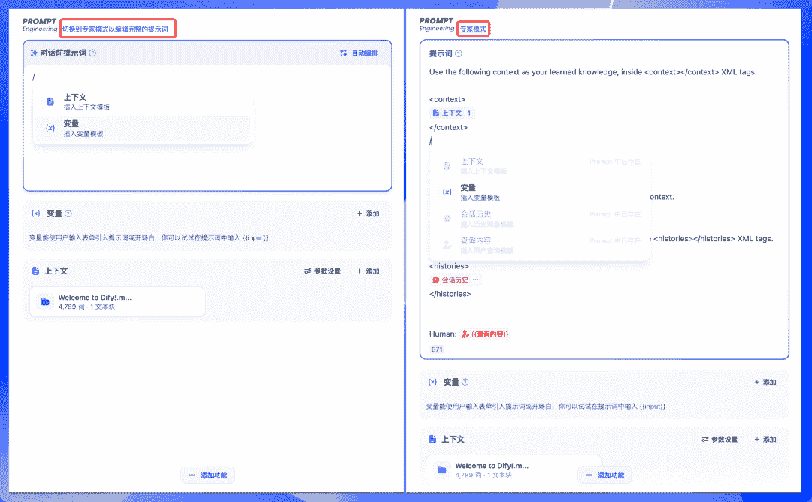
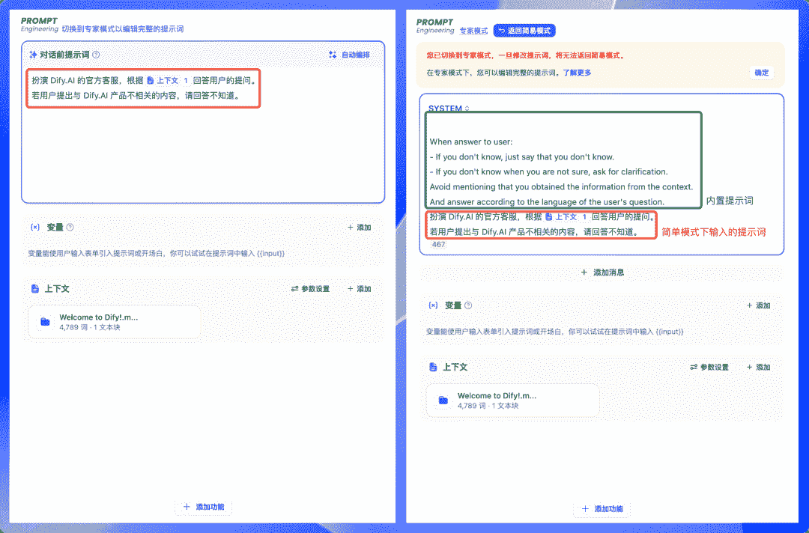
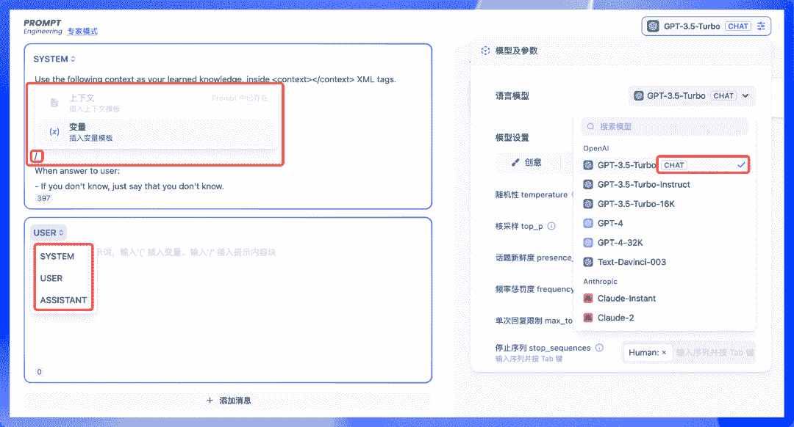
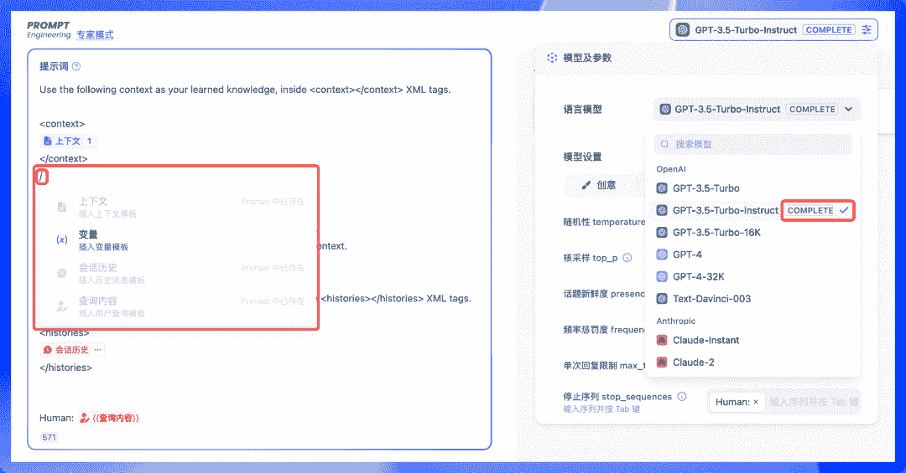
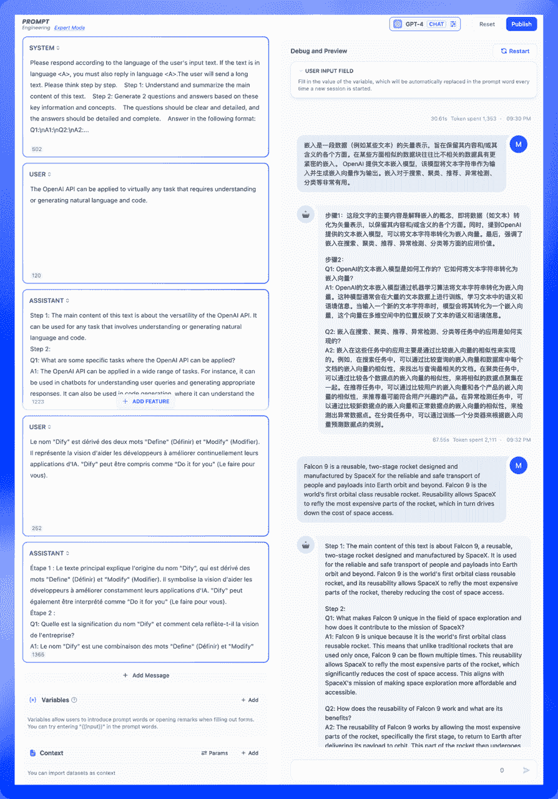
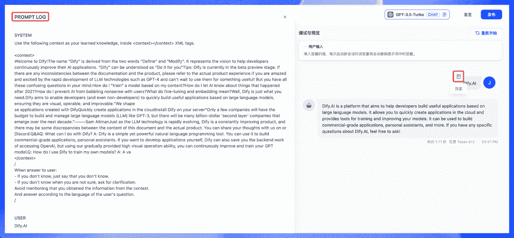

# 2023-10-23玩转 Dify.AI 的全新提示词编排

> 来源：[https://xuqiwei1986.feishu.cn/docx/QWiUdVMeKouJlXxRE3scj865n7b](https://xuqiwei1986.feishu.cn/docx/QWiUdVMeKouJlXxRE3scj865n7b)

> 🔗 原文链接： h[ttps://mp.weixin.q](https://mp.weixin.qq.com/s/ZME7sh_EKgvCuTomGQ38lg)q.com/s/ZME7sh_E...

>

原创 Dify.AI Dify

2023-10-23 09:00:31

精确发文时间由壹伴提供

2023-10-23 09:00 发表于 江苏

手机阅读

自 Dify.AI 推出以来，我们一直致力于探索如何为开发者提供更加灵活、自由度更高的提示词编排功能。为此，我们推出了全新的编排模式，您只需在提示词编排页面从「简易模式」切换至「专家模式」，就可以开启全新的提示词编排之旅。

# 🔭

# 探索 提示词编排专家模式 的新玩法

## **模式概述:**

**专家模式 为专业的开发人员和提示词工程师创造** 了一 个高度灵活的定制化 编排模式。 通过该模 式，可以帮助开发人员来设计有效的提示词，与 LLM 或数据集进行稳健且可靠的交互。

## **从简单到专业 :**

简易模式让用户能轻松配置和创建基本应用，而专家**模式则赋予了您更多的控制权和定制选项。 在专家 模式下 ，您可以自由编辑提**示词、包括上下文、用户输入、对话历史、示例等提示要素，并通过设计这些要素更好地指导模型，从而获得符合预期的输出结果 。 无论是对话型应用还是文本生成应用，专家模式都为您提供了丰富的选项和工具，帮助您实现更为复杂的提示词编排设计。

简易模式设计的初衷是降低用户创建 AI 应用的上手难度，因此在后台封装了部分提示词，这导致编排的自 主性在一定程度上受到限制。若您在「简易模式」下编排了提示词并上传数据集后跳转至「专家模式」，就可以看到简易模式下默认封装的完整提示词，此时您可以修改其中的任何部分，提高了编排的自由度 ， 使 LLM 的输出达到 理想的状态， 快速将 AI 应用调试至最佳效果。

## **专家模式的功能配置：**

专家模式下可以自由定制提示词，若选择 CHAT 模型，就可以针对 SYSTEM / USER / ASSISTANT 三种消息类型编写提示词。选择 COMPLETE 模型，可以较为灵活的调整提示词中的内容块：如「上下文」、「会话历史」、「查询内容」和「变量」的位置，使应用更符合需求，而在 CHAT 模型下仅可调整「上下文」和「变量」。

CHAT 模型（聊天模型）

COMPLETE 模型（文本补全模型）

在**选择 CHAT 模型的情况下，您可以针对上文提到的三种**消息类型（ SYSTEM / USER / ASSISTANT ）编写提示词。 通过模式化编排 USER 和 ASSISTANT 的交互信息，可以引导模型达到预期的输出效果。

以一个帮助用户将文本生成多个 QA 对的应用为例，通过多组 USER 和 ASSISTANT 的交互示例来为模型提供明确的引导，确保其在回答过程中严格遵循 SYSTEM 提示词的约束。 这就好比预设了一个模版，让模型按照固定的回答格式来输出结果。

上图中 SYSTEM 提示词大意：

> 请根据用户输入文本的语言进行回复。如果文本为<A>语言，您也必须用<A>语言回复。用户会发送一段长文本。请逐步思考。

> 步骤1：理解并总结这段文本的主要内容。

> 步骤2：根据这些关键信息和概念生成 2 个问题及答案。问题应该清晰详细，答案应详细完整。请按以下格式回答:Q1:\nA1:\nQ2:\nA2:...

输入的两组 USER 和 ASSISTANT 示例：

> **USER 1:**

> The OpenAI API can be applied to virtually any task that requires understanding or generating natural language and code.

> **ASSISTANT 1:**

> Step 1: The main content of this text is about the versatility of the OpenAI API. It can be used for...

> Step 2:

> Q1: What are some specific tasks where the OpenAI API can be applied?

> A1: The OpenAI API can be applied in a wide range of tasks. For instance...

> Q2: How does the OpenAI API understand and generate natural language and code?

> A2: The OpenAI API uses machine learning algorithms, specifically a type of model called transformers...

> **USER 2:**

> Le nom "Dify" est dérivé des deux mots "Define" (Définir) et "Modify" (Modifier). Il représente la vision d'aider les ...

> **ASSISTANT 2:**

> Étape 1 : Le texte principal explique l'origine du nom "Dify"...

> Étape 2 :

> Q1: Quelle est la signification du nom "Dify" et comment cela reflète-t-il la vision de l'entreprise?

> A1: Le nom "Dify" est une combinaison des mots "Define" (Définir) et "Modify" (Modifier)...

> Q2: Comment "Dify" peut-il aider les développeurs à améliorer leurs applications d'IA?

> A2: "Dify", en tant que service ou outil, peut aider les développeurs à...

通过这种方式您还可以针对其他各种场景，编写特定的提示词，从而实现对 AI 应用回答的精准引导，进一步提高提示词编排的效率和精确度。

您还可以在 CHAT 与 COMPLETE **模型间轻松切换，探索出最佳的应用场景。 在具体的提示词调试**过程中，「日志查看」功能可以让您深入了解从输入到输出的整个流程，定位问题所在。 无论是模型解析的错误还是提示词的质量问题，都能得到及时的发现和调整，进而优化应用表现，确保输出的质量。

更多关 于 提示词编排专家模式 的具体概念和使用指南，请参 阅官方文档：

https://docs.dify.ai/v/zh-hans/advanced/prompt-engineering

# 🎊

# **即将上线：**

+   **新增内容审查功能。 **支持用户输入和模型输出的敏感词过滤，让你的 AI 应用内容生成更加安全可控。

+   **外部工具 API 调用。 **提示词编排开放了外部工具的 API 调用，支持将 API 的查询结果插入至提示词中，增强了应用编排的扩展性。

---

# **🥳**

# **如果你喜欢 Dify，欢迎：**

+   在 GitHub 上贡献代码，与我们一同共建更好的 Dify；

+   通过线上线下活动、社交媒体向你的朋友们分享 Dify，以及你的使用经验；

+   在 GitHub 上给我们点亮⭐️

你也可以联系 Dify 小助手，加入我们的好友群聊，相互分享使用经验：

