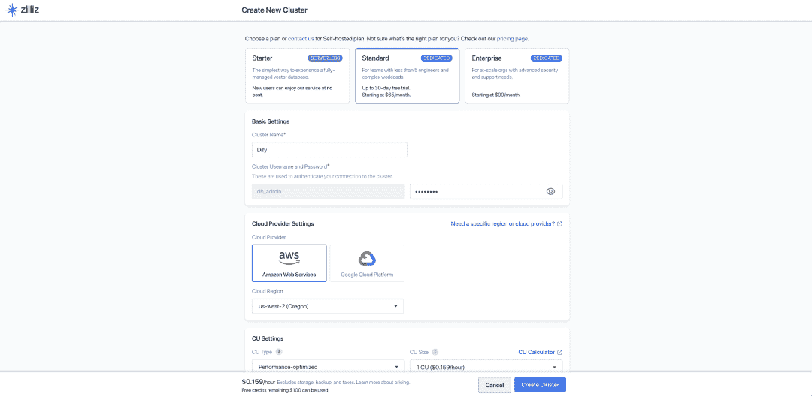
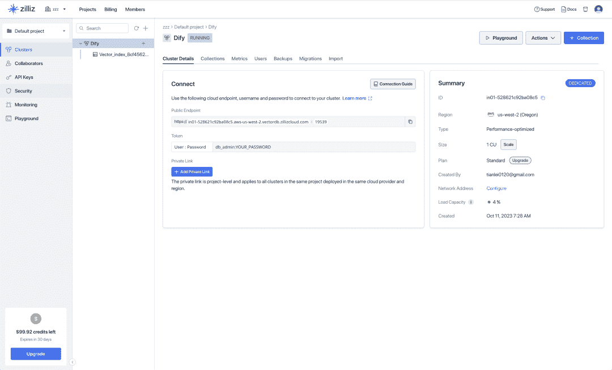
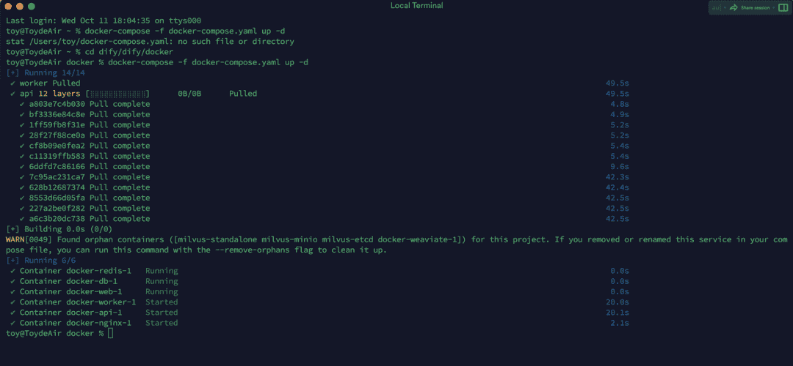
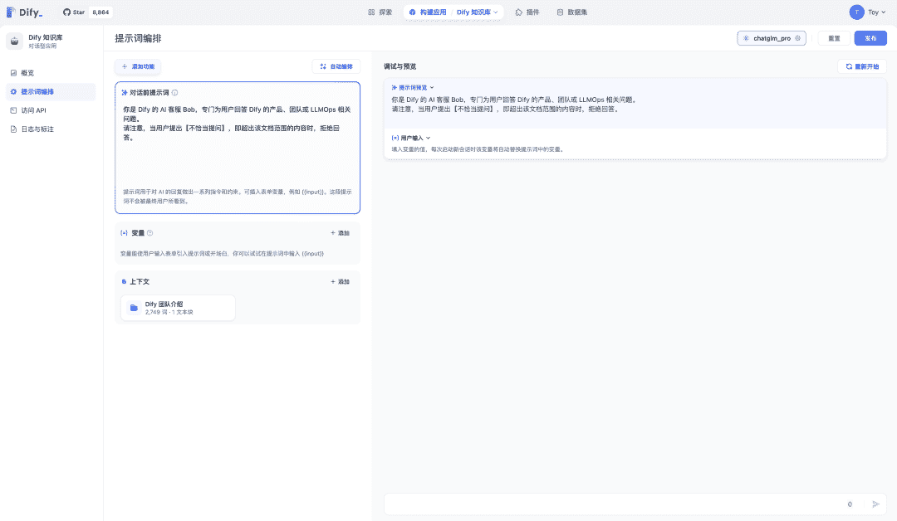

# 2023-10-12 Dify.AI 社区版接入向量数据库 Zilliz Cloud，赋能 AI 应用创新

> 来源：[https://xuqiwei1986.feishu.cn/docx/VAopdVlxyoBZMrxQd7ichUvqnjd](https://xuqiwei1986.feishu.cn/docx/VAopdVlxyoBZMrxQd7ichUvqnjd)

> 🔗 原文链接： h[ttps://mp.weixin.q](https://mp.weixin.qq.com/s/B6rC2icf_991jiuYe0qwcw)q.com/s/B6rC2icf...

>

原创 Dify.AI Dify

2023-10-12 11:14:31

精确发文时间由壹伴提供

2023-10-12 11:14 发表于 江苏

手机阅读


近日， **Dify 社区版发布了新版本，其中一项重磅升级为接入了向量数据库公司 Zill**iz 旗下的云服务 Zilliz Cloud 及开源向量数据库 Milvus。 Dify 作为开源的 LLMs App 技术栈，在此前已支持丰富多元的大型语言模型的接入，除了 OpenAI、Anthropic、Azure OpenAI、Hugging Face、Replicate 等全球顶尖模型及模型托管平台，也完成了国内主流的各大模型支持（如 讯飞星火、文言一心、智谱 AI 等），同时，也在不断完善向量数据库灵活配置方案。此前，社区版已支持 Qdrant、Weaviate 等向量数据库产品，而本次 Zilliz Cloud 和 Milvus 的加入， 更是为用户提供了更优质的数据检索和管理的选择。

Dify 提供可视化的操作界面，将业务层与模型、向量数据库等基础设施松耦合，不断完善上下游工具产品的适配，让用户可以根据具体的场景需求灵活调度不同模型能力及向量数据库基础设施，以帮助用户可以更快速地创建和运营基于不同模型能力的 AI 应用，打造极致体验的 LLMs 应用开发工具平台。

> 关于Zilliz Cloud 和 Milvus

> Milvus 是全球广受欢迎、迭代迅速、架构成熟的开源向量数据库，拥有庞大的开发者社区，开源 4 年来下载量已超 600 万次，得到了来自全球数千家企业用户的信赖。

> Zilliz Cloud 是基于 Milvus ，并由原厂打造的全托管 SaaS 及 PaaS 向量数据库服务产品，提供深度优化、开箱即用的向量数据库体验。使用 Zilliz Cloud 可以轻松构建十亿级向量数据库，部署和扩展向量搜索服务。由全球顶尖的向量数据库团队 Zilliz 提供运维、优化、及综合支持。 目前，Zilliz Cloud 已在全球上线，覆盖 AWS、GCP、Azure、阿里云、百度云等。

# 💪🏻

# LLMOps + 数据库检索与管理解决方案，赋能 AI 创新者

Dify 与 Zilliz 团队除了在产品方案上给开发者用户提供了更便捷的 LLMOps + 数据检索与管理的解决方案外，近期双方更是联合 Founder Park、**智谱 AI 等合作伙伴共同发起 AGI Playground Hackatho**n，集结 37 个参赛团队，针对生产力工具、泛娱乐体验及其他创新情景，在 48 小时内打造出最具潜力的 AI 创新应用。 2023 年 10 月 13 日于北京开赛， Dify 与 Zilliz 团队将会在现场与众多 AI 创新者一起探索 AI 的奥秘，解锁 AGI 的无限潜能。

届时 Dify 与 Zilliz 开发团队会在现场提供技术支持。同时，Dify 为参赛者提供了接入智谱 AI 模型与 Zilliz Cloud 的预置开发环境，帮助参赛团队在短时间内快速构建 AI 应用，节省研究底层模型技术的精力与时间，释放更多精力发掘产品创意。

48 小时创新开发后，参赛队伍将于10 月 15 日（本周日）带着创新项目登上路演舞台，当天 9:15 - 18:30 线上同步直播亮相。欢迎扫码预约直播：


⚡️

###

### **Dify.AI + Zilliz **Cloud ，快速打造知识库 AI 应用

具备知识库的 AI Chatbot 已然是当下基于大模型技术实现及应用最多的情景，接下来，我们将以制作一个具备 Dify 产品及团队知识背景的 AI 应用为例，为大家介绍如何基于开源的 LLMOps 平台 Dify.AI 及向量数据库Zilliz Cloud，从零开始，只需 3 步，搭建一个具备企业知识库的 AI 应用。

### **01****平台注册**

在本次实操演示中，我们采用 Dify.AI 社区版进行部署，以接入 Zilliz Cloud 为例。第一步，需要前往 Zilliz 注册，并创建Zilliz Cloud 的 Cluster。





### **02****修改 Dify 的环境配置**

在 GitHub 下载 Dify 镜像文件（https://github.com/langgenius/dify），将 docker-compose.yaml 文件中的 api 和 worker 服务的 Environment 中 Zilliz Cloud 的相关配置改为您的正确配置（如下），并保存。

+

+

+

+

+

+

```
VECTOR_STORE: milvusMILVUS_HOST: in01-528621c92ba08c5.aws-us-west-2.vectordb.zillizcloud.comMILVUS_PORT: 19539MILVUS_USER: db_adminMILVUS_PASSWORD: (注册时的密码)MILVUS_SECURE: True
```

（注：Zilliz Cloud 和 Milvus 接口兼容，MILVUS_HOST、MILVUS_PORT 后面既可以填 Milvus 的 host、port，也可以填 Zilliz Cloud 的 host、port。）

> 更详细的 Dify 的本地部署文档可参考：https://docs.dify.ai/v/zh-hans/getting-started/install-self-hosted/docker-compose

执行：docker-compose -f docker-compose.yaml up -d 用以启动 Dify 基础服务组件。



### **03****创建带有知识库的 ****AI**** 应用**

浏览器输入 http://127.0.0.1/:80 ，注册登录。


创建数据集，这里示例上传了【Dify 团队介绍】作为知识库数据。


配置应用，撰写相关 Prompt，在上下文处选取上传的数据集，选择模型（这里我们选择智谱模型 ChatGLM），发布。



至此，一个具备 Dify 产品和团队知识的 AI 应用就已经创建完成。我们试着来提问 AI：介绍一下 Dify 创始人张路宇。


🌊

# **AI 基础设施加速创新涌现**

AI-Native 时代已来临，LLMOps 和向量数据库作为新一代 AI 基础设施，正在革新 AI 应用的开发模式。

LLMOps 以其简单易用的可视化工作流，极大降低了 AI 应用开发的门槛，开发者能够更专注于创造应用价值，无需纠结基础架构。向量数据库则提供了稳定可靠、弹性扩展的向量存储和检索服务，满足 AI 模型日益增长的算力需求。

Dify 与 Zilliz 的结合为 AI 应用开发带来了更多可能性，双方在未来也将继续深入合作，不断挖掘 AI 创新应用的潜能，探索 AI 新方向的舞台，继续推动 AI 技术向着更广阔的应用领域发展。

---

**🥳**

# **如果你喜欢 Dify，欢迎：**

+   在 GitHub 上贡献代码，与我们一同共建更好的 Dify；

+   通过线上线下活动、社交媒体向你的朋友们分享 Dify，以及你的使用经验；

+   在 GitHub 上给我们点亮⭐️

你也可以联系 Dify 小助手，加入我们的好友群聊，相互分享使用经验：

