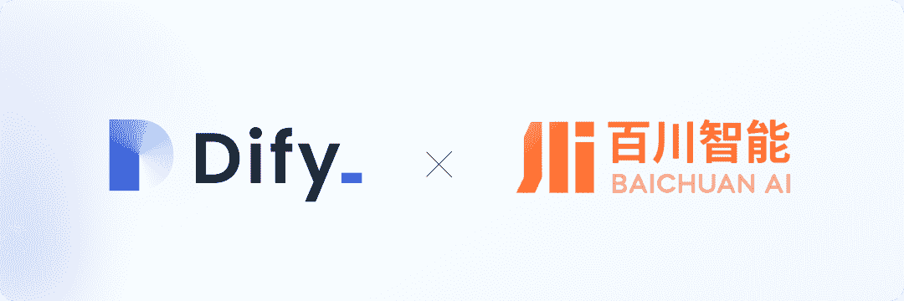

# 2023-08-30Dify 用户直面会:「Dify x 开源模型」的无限可能 & Baichuan 模型详解

> 来源：[https://xuqiwei1986.feishu.cn/docx/MkBndWIuYoc8UmxaQBhc3vuHnbd](https://xuqiwei1986.feishu.cn/docx/MkBndWIuYoc8UmxaQBhc3vuHnbd)

> 🔗 原文链接： h[ttps://mp.weixin.q](https://mp.weixin.qq.com/s/6C9gV29Q-Z8kNMktnqAwdg)q.com/s/6C9gV29Q...

>

原创 Dify.AI Dify 2023-08-30 09:22 发表于 江苏

> 最近一个月，Dify 已全面接入了全球顶尖开源模型 & 国内闭源商用模型，让用户能够在一个平台根据不同需求场景调用&评估不同模型能力。同时，我们也一直在与国内优秀的大模型厂商保持深度的沟通与交流，同步分享当前技术趋势。

本次**线上直面会我们邀请了百川智能的 Alex 老师和 Dify 创始人张路宇和大家一起探讨关于开源 LLMOps 和 Baichuan 开源模型结合的**最佳实践、当前模型技术及市场的发展趋势等话题。直面会上， 百川智能的 Alex 老师实战演示了如何在 Dify 上使用 Baichuan 开源模型的能力，在数分钟内即可以在 Dify 创建一个基于 Baichuan 13B-chat 模型能力的 AI 应用。也与 Dify 的用户朋友们进行的深度的互动交流，分享大家在应用 LLMs 能力过程中遇到的问题与实践。 以下为两位老师以及 Dify 用户朋友们交流环节的关键信息整理。

# 📋关**于 Baichuan 模型**

百川智能是前搜狗公司 CEO 王小川创立的一家大模型公司，成立于** 4 月 10 日。目前 Baichuan 总体发布了三款模**型，两款开源模型： Baichuan-7B 和 Baichuan-13B，及一款闭源的模型：Baichuan-53B。 Baichuan-7B 最先发布，这是首款开源可商用的 70 亿参数大模型，紧接着发布的 Baichuan-13B 在开源界也非常受欢迎，在当时的同尺寸开源模型中表现最佳，7B 和 13B 都结合了中英文语料从头开始训练并可以免费商用。而百川最新在 8 月 8 日发布的闭源模型：Baichuan-53B 是类似于 ChatGPT 的体验版本，结合了搜索增强能力做了强化，可以以较低的幻觉和较高的时效性回答问题，现处于内测阶段。

如果你需要在 Dify 接入开源模型如 Baichuan 系列，我们提供了两种选择：一是使用托管的开源模型，你可以使用 Hugging Face 和 Replicate 上托管的开源模型。二是如果有算力，或者想在本地部署模型，我们支持两种分布式模型推理框架：Xorbits inference 和 OpenLLM。这些产品由中国背景的团队开发，和我们有紧密的合作，欢迎在下一篇推文中查看最佳实践的范例。

#

# 🎙️Alex Vs 张路宇：Baichuan 模型特性详解及模型技术发展

> 本环节，由张路宇针对 Dify 用户关心的相关问题，与 Alex 老师展开讨论。

>

> Alex： 🙋♂️

> 张路宇： 🐟

**🐟 Q1： 目**前大部分模型厂商每隔数月发布一个新版本的模型，接下来是否会存在一种动态微调的模型发布形式，实时更新数据，弱化模型时效性的局限？

**🙋♂️ A1： 最**新上线的 GPT-3.5 Turbo 微调功能可以实现这样的发布形式，只需少量的数据大约 50 条到 100 条就可以达到效果比较好的微调。模型厂商本身可以做动态的微调，利用 Dify 这样的 LLMOps 也可以做动态微调，用户在 Dify 还可以基于模型近日的动态表现，获取反馈的数据持续改进 AI 应用。

从另外一个**角**度来看 GPT 发行 Turbo 版本和它的服务模式息息相关，因为它可以用纯 SaaS 的版本。但国内的大模型可能更多的是以私有化的形式，即云端私有化部署形式为主。很多客户都希望能深度训练 Baichuan 模型，但这不仅仅是传授模型一些特定知识或回答几个问题的简单微调。他们需要模型深入了解整个行业，掌握特定行业领域的能力，如能源、法律、医疗等。这需要更复杂的微调和量化调整，而不仅仅是表面上的问题解决。 对于这种垂直领域的模型，我们必须进行全方位的微调，包括参数、结构等各个方面的调整，才能获得理想的性能。 而对 GPT 进行全量微调并不现实，从模式上来说，Baichuan 未来可能会发行基于云端版本和私有化版本的微调模式。如果客户需要某个领域的垂直大模型，我们会配合他们做全量版本。

**🐟Q2： 百**川模型的 base 和 chat 版本有什么区别？

🙋♂️ A**2：  **Baichuan-7B 推出的是 base 版本，而 Baichuan-13B 同时推出了 base 和 chat 版本。 首先 base 版本的预训练模型具备了同类模型的所有能力，但不能以对话的方式和人进行交互，需要通过微调后使用。打个比方，base 版本的模型可以比做一个毛坯房，虽然已具备基本的条件，但是想住进去还需要装修，chat 就是一个精装的版本。可以选择不同的方式精装，完成不同的任务。

**🐟 Q3： B**aichuan-7B 和 Baichuan-13B 这两个尺寸的模型有什么区别？

**🙋♂️ A3： 7**B 是比较亲民的尺寸，量化后单张 RTX 3090 的显卡就能跑一个半精度的版本，具备大模型初级的能力，因此起步可以选择 7B 尺寸的模型。而 13B 的参数是 7B 的两倍，业内的共识是模型参数要达到 13B 后才能拥有一些初步的涌现能力（创造性输出、多功能性、泛化能力、语言和对话的理解、自我学习和自适应等）。

🐟 Q**4： B**aichuan-13B 和 Llama2 能力对比如何？和通义千问相比呢？

**🙋♂**️ A4： Llama2 在 Baichuan-13B 之后发布，Llama2 是开源可商用的模型，发布后评分很高，超越了 Baichuan-13B 在英文大模型榜单上的表现，处于屠榜的状态。 但是由于 Llama2 的 Meta 官方没有发展中文模型，经过第三方社区微调的中文模型和 Baichuan-13B 相比在中文语境上的表现上并不佳，因此在模型预训练的起始阶段融合中文语料很重要，后期的微调效果往往很难达到预期。通义千问在 SuperCLUE 的测评中表现出理强文弱的特点，他们在推理方面做了很强的优化。

**🐟 Q5： 同**一个 prompt 在 Baichuan 下的表现和 ChatGPT 不同的原因是什么？

**🙋♂️ A5： B**ai**chuan 的 prompt 与国外模型明显不同是因为国外模**型通常使用英文 prompt，而 Baichuan 由于微调数据有限，可能无法适应各种不寻常的问题，英文 prompt 效果不佳。 现在百川提供了一套适配的 prompt 和 Dify 完成了对接，可以在 Dify 的源代码里查看。

**🐟 Q6： 百**川作为国内模型会怎么处理合规和意识形态的问题？

**🙋♂️ A6： 如**果用大模型做的应用在国内渠道发布的话，我建议大家在这方面的做一个二次检验。在模型层面，我们会最大限度的保证输出内容的安全性，比如从训练语料和前置、中途到后置的安全策略方面加强，但暂时还无法确保万无一失。

# 🧠用**户问答环节**

**🤔 Q1： 百**川智能是王小川老师创立的，关于 Baichuan 模型具有搜狗的基因和搜索增强的能力，能再具体解释一下吗？

🙋♂️ A**1： 首**先搜索增强技术是针对联网情况下的公网知识搜索。用户必须先联网获取一些网络上的知识，然后才能生成回答。其次，搜索增强框架是独立于模型之外的系统。虽然它与模型一同工作，但它们是两套不同的系统。搜索增强系统也可以进行离线部署，但在这种情况下，需要连接到企业的私有知识源，如数据库和产品，以实现功能。

搜索插件的基本工作方式是，当您提出一个问题时，它会自动在 Google 上进行搜索，并汇总搜索结果。然后再将这些搜索结果用作输入结合 prompt 最后生成回答。还有一种类似的方法，只不过它搜索的内容是将问题向量与已有的向量库进行相似度匹配。这两种方法最终可以结合在一起，是相对基础的模式。

关于搜索增强模块，其基本概念与上述类似，但具体实践中涉及到复杂的细节。搜索本身是一个非常复杂的过程，需要多年的积累和不断的优化，包括意图识别、后端处理等多个方面。有许多不同的策略和流程来完成搜索任务，可以将其视为高度增强的插件版本。

以百度为例，百度不仅仅是一个简单的 Elastic Search，它有自己多年积累的复杂搜索引擎代码，用于处理非常复杂的搜索流程。同样，搜狗也有类似复杂的搜索框架来解决这一问题。虽然它们的方法有所不同，但总体搜索能力是相似的。搜狗更加注重向量技术的应用，而百度在较晚的阶段才引入了向量技术。

**🤔 Q2： 在**使用 Baichuan 模型进行要素提取时要求以阶层格式输出结果，除了阶层内容外，还可能输出一些多余的信息，该怎么处理？

**🙋♂️ A2： 一**方面在工程上从 prompt 的层面可以做一些尝试，避免输入中英文混杂的 prompt。第二个从模型的本身的能力上来看，Baichuan 的指令遵循能力还不强，那可以期待后续的新版本。

**🤔 Q3： 未**来 Dify 会在数据库向量匹配上做出改进吗？

🐟 A**3： 这**个技术涉及多个方面，特别是要实现高精度匹配，首先需要将用户的问题转化为匹配语句。而不同类型的数据，如文本、关系数据库、表格数据和知识图谱，都需要不同的处理策略。为了提供更好的效果，我们正大规模调整我们的产品，以更好地处理知识分段和数据结构。

**在接下来的产品版本中，我们计划提供一个更**综合的解决方案，而不是目前的简化版本。 虽然我们一直坚持保持产品的简单性，以使技术和非技术人员都能轻松使用，但我们也追求精确性和强大性。我们将综合处理不同类型的数据，这是我们团队的重要方向之一。

**🤔 Q4： 在** Dify 的大模型都使用了相同的 prompt 代码，接下来是否会对每个模型进行个性化定制的微调？

🐟 A**4**： 我们会为我们每个用户量较大的模型进行调整，与模型供应商的专家一起优化推理过程的关键步骤和模板。 因为每个模型在初始训练时接收的数据不同，所以我们会在最新版本中进行一些调整。这可能涉及到架构问题，例如，在 Dify 中，我们将其视为一种类似操作系统驱动程序的支持，其中包含模型参数和 prompt 信息。另外，在 Dify 产品中，未来也会开放系统级的推理模板，以便用户可以自行进行配置和修改。无论是通过配置文件还是通过界面配置，用户都可以改善模版和自定义各种参数，如分配 token 的比例权重等。

**🤔 Q5： D**ify 后期有对接多模态的计划吗？

🐟 A**5： 多**模态的概念比较宽泛，可以从很多层面解决，可以在中间层解决，可以在模型层解决，可以甚至在训练层。Dify 作为中间层下半年有两个发力点，一个是agent，一个是多模态，目前文本方向是主**攻**方向。多模态应用开发可能需要一些时间，我们需要探索这个领域，圈定关键方向。在最近和其他朋友的讨论中，我们达成了共识。其中最重要是现在应用开发者的首要任务是明确定义应用要解决的具体情景和目标用户。 大模型不能做所有事情，如果将其视为产品，开发者应充分利用当前可用技术，解决用户的痛点，而不是简单地拿来使用。 我们需要优化技术，但作为我们无法覆盖所有应用的技术需求，用户要提供情景支持。一个成功的应用需要时间和深思熟虑，特别是在提高质量方面。多模态应用的构建也需要时间和协调，涉及到多个层面的磨合。多模态应用的开发取决于具体情景，不同行业需要不同的多模态技术。 因此，我们会密切关注开发者的需求，将可投产性最高的技术组合到一起。 例如，教育领域需要更多的多模态技术，而客服领域则更侧重于文本。总之，基于模型的应用开发需要充分的准备和投入，但前景广阔。

---

# **📺往****期直面会 & 产品更新 ：**

[Dify.AI 用户直面会总结：Embeddin](http://mp.weixin.qq.com/s?__biz=Mzg5MDkyOTY3NA==&mid=2247484819&idx=2&sn=bbfdc2ba85a2d8736c5db213e014e6e3&chksm=cfd452f6f8a3dbe0ecf92ffc2bc5c40e95ed4742f27a239c3a221ab5be8a290656e321c7f95d&scene=21#wechat_redirect)g 技术与 Dify 数据集设计/规划

[Dify.AI 用户直面会：Dif](http://mp.weixin.qq.com/s?__biz=Mzg5MDkyOTY3NA==&mid=2247484708&idx=1&sn=e5cac4e207e80a7a4ad3e9ecc739c6e1&chksm=cfd45241f8a3db574b8cca5cb088cf82877f70cab191d61a4f0b092d5ddf753fe581bfae1425&scene=21#wechat_redirect)y 产品规划与 LLM 应用落地常见问题

在 Dify 轻松调用顶尖开源与国产模型，解锁不同模型的潜力

# **🥳如****果你喜欢 Dify，欢迎：**

+   在 GitHub 上贡献代码，与我们一同共建更好的 Dify；

+   通过线上线下活动、社交媒体向你的朋友们分享 Dify，以及你的使用经验；

+   在 GitHub 上给我们点亮⭐️

你也可以联系 Dify 小助手，加入我们的好友群聊，相互分享使用经验：

