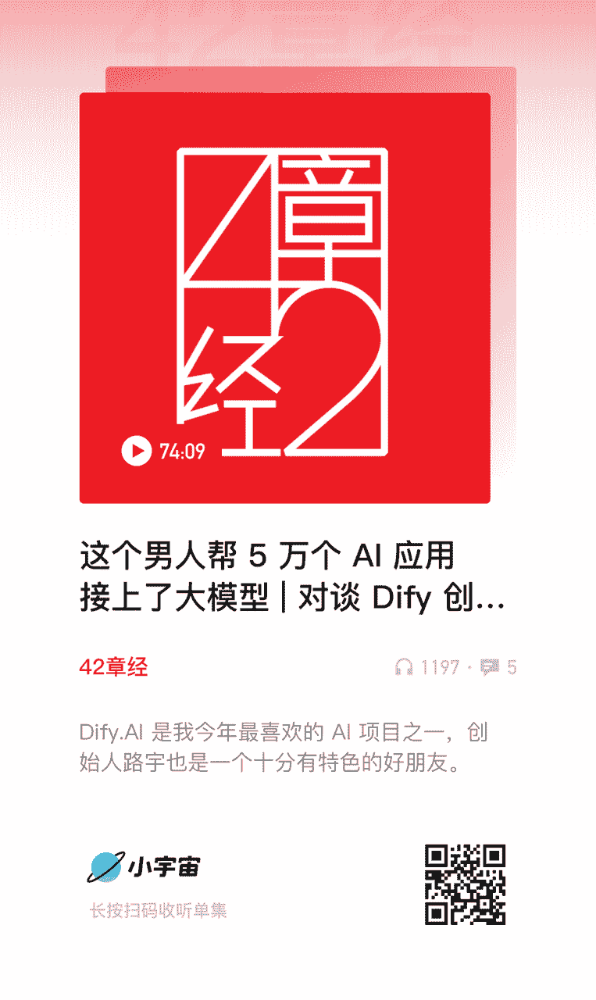

# 2023-08-22这个男人帮 5 万个 AI 应用接上了大模型 | 42 章经播客对谈

> 来源：[https://xuqiwei1986.feishu.cn/docx/ZNSjdyUqKoE0STxb4j6cyrbRnSh](https://xuqiwei1986.feishu.cn/docx/ZNSjdyUqKoE0STxb4j6cyrbRnSh)

> 🔗 原文链接： h[ttps://mp.weixin.q](https://mp.weixin.qq.com/s/t2pR4NB0pEh-TGxNmzcmLg)q.com/s/t2pR4NB0...

>

原创 Dify.AI Dify 2023-08-22 09:00 发表于 江苏

数**日前，Dify.AI 创始人 & CEO 张路宇受邀在 42 **章经播客上与曲凯老师进行了一次深度对话， 围绕大型语言模型的能力和应用，让更多人了解大模型投产的现状、潜力和挑战，以及 LLM 中间件的价值。 小编将播客对话中的关键内容与观点进行整理如下。（本篇内容由于篇幅限制，仅摘取部分内容，推荐查阅文末播客入口，倾听原汁原味的炸裂对话与碰撞。）

> 对话主角：

> 42 章经 创始人：曲凯（以下简称 曲）

> Dify 创始人：张路宇 （以下简称 张）

# **什么是 LLMOps？**

🤔️ 曲** ：**Dify 定位是 LLMOps，能和大家大概解释一下这个定义吗？

🐟 张** ：**LLMOps 是 DevOps 的衍生，但存在运维和运营的区别。**传统的 DevOps 将软件开发与运维融合，重点在基础设施监控**和应用**可**用性。 然而，现代大型模型的 AI 应用需要更密切的研发与运营结合，运营要持续迭代，与研发之间要有快速反馈。 开发基于大模型的应用需要多个非技术人员参与，与传统软件开发不同，它需要结合业务、运营和销售等多方面经验。这就是 LLMOps 的核心概念，强调无论是 Prompt、Agent 还是模型本身，都必须接受市场用户的快速反馈并不断迭代，否则无法达到期望的结果，这是最大的工程区别。 Dify 是 LLMOps 的完整技术栈，包括开发框架和运营工具，用于大模型应用的开发、部署、维护和优化。 其目标是高效、可扩展和安全地使用强大的 AI 模型来构建和运行实际应用，包括模型训练、部署、监控、更新、安全性和合规性等方面。

🤔️ 曲** ：**现在 Dify 应该算是这个领域的绝对第一名？GitHub 的 Stars 已经超过 7000+。

🐟 张** ：** 从** 5 月中旬开源到现在有 7000+ Stars。我们的 Docker** 镜像拉取数差不多有 1 万，也就是外面有 1 万多个安装的私有化部署版本。 同时我们的公有云服务版本已经有 4 万多个应用。我们最近与用户进行了许多交流活动，发现 Dify 的用户质量非常高。他们提出了许多严肃的问题，希望利用大型模型的能力进行各种应用开发和投产，无论是市场创业、服务第三方客户，还是满足公司内部的各种业务需求，甚至一些实验性的需求，都表现出了高度的专注和严谨。

# 大模型工程化的三种方式与 Agent

🤔️ 曲** ：**Dify 有 4 万多个应用，能和我们分享一些其中的难题吗？

🐟 张** ：**我们可以逐层分析这一过程。首先，从模型角度看， OpenAI 显然是领导者，其在模型性能和 API 接口方面均明显领先，最接近实际生产应用。随着时间推移，我们可以考虑替换为更好的国产或开源模型。一旦接入模型，接下来是定义应用程序的过程。我们可以逐渐增加应用程序的服务层，从简单到复杂，分为几个级别。

**最简单的级别是 Prompt as Service，由一些简**单的提示组成，例如语法纠正或情感分类。 这种功能通常不适合作为独立的应用，而是可以用于增强你的自有应用，或者将其打包成更加产品化的应用，例如大量生成文案。这是我们最简单的应用类型之一。在此过程中，开发者需要不断编写代码来调试和优化提示。

然后，我们可以基于私有数据进行更高级的操作。由于 OpenAI **的模型数据大部分截止到 2021 年，因此我们可以提供私有数据以解决这**个问题。 解决这个问题有两种方式，一种是微调模型本身，另一种是使用嵌入（Embedding）技术，将私有内容嵌入到提示中，这是 Prompt 工程的一种方式。 通过这种方式，您可以集成各种私有知识库，从而模型可以回答更多问题，不仅限于其现有的知识。

举例来说，如果您想让模型了解“曲凯老师”是谁，通常需要通过多次提问和回答的方式教给模型，这一过程非常繁琐。此外，在微调模型时，需要将模型加载到 GPU 显存中，这会消耗大量资源，因此微调只在必要时才使用，对大多数开发者来说门槛较高。

**大**模型本身及其能力有三种工程化方法。第一种是 Prompt 工程本身，第二种是嵌入技术，第三种是微调。 这三种选项基本上按照难度递增，可以根据自身具体情况选择合适的方法。

最后，我们考虑的是 Agent。前面提到的 Prompt 工程、嵌入技术和大模型本身都是解决模型在单次会话中的回答问题的方式。但在处理复杂情境时，例如让 AI 机器人帮助您预订机票，需要多轮对话或多步推理，使用上下文进行连续推演，需要一系列能力，如搜索工具、上网工具、调用 API 等，以完成一系列动作，最终达到目标。这个推理过程被称为 Agent。

**Agent 有三种类型：第一种是手工编排，相对笨拙；第二种是完全自主的 Agent，**但不可控；第三种是混合了大模型部分编排能力和自主能力的相对可控的 Agent。 此外，如果 Agent 的表现达到预期，可以将其动作和工具预存为编排好的 Agent，以重复执行相同的推理过程。

🤔️ 曲** ：**现在 Agent 概念这么火的原因是什么？

🐟 张** ：**很多人都对 Agent 这个概念充满激情，包括我自己。因为我们已经看到 AI 可以显著提高工作效率。现在只是帮助人类更快地完成任务，而在将来会直接完成任务，甚至有可能代替人类工作。这就是从人工干预到不再需要人工干预的变革。

**A**gent 的推理过程很接近人脑的思维方式，因此普遍认为，在一定成熟度阶段后，Agent 可以被看作是一位员工。 人们热衷于 Agent 和开源模型的原因是它们实现了技术平权的理念。工程师和技术人员此前从未接触过如此强大的工具。尽管它们的成熟度尚不高，但大家想象着拥有这个工具后，可以在各种领域中胜任，与大公司竞争，实现自己的愿望。因此，Agent 对他们来说具有巨大的吸引力。

🤔️ 曲** ：** Agent 现在看起来大家对它最大的诟病就是它的成本，你觉得呢？

🐟 张** ：**存在几个问题： 首先，上下文窗口不够，尤其在处理复杂任务时，需要更全面的上下文支持。 比如，在编写大型软件项目（如10万行代码以上）时，大模型必须加载全部代码以构建初始上下文，这一问题也许会逐渐解决。

其次，模型推理质量仍有提升空间。 尽管像 GPT-4 这样的模型在推理方面表现优秀，但偶尔会出错。模型自带的代码解释器作为一种编程代理，可能需要多次自我修正才能达到预期效果。模型需承认首次推理可能出现错误或信息不完备，推理质量有待改进，相信也能逐步解决。

第三，工具方面的质量也受到考验。 Agent 技术包括大型模型、推理算法、逻辑以及 Prompt 工程技巧等。开发高质量工具以满足多样需求是挑战。例如，我们创造了更短的语言格式来辅助软件工程师进行 API 自动化测试，以应对市面上 API 定义格式冗长的问题。因此，这需要其他技术来适应大模型并解决工具层面的难题。

最后，注意力分散和想象力问题。 大模型是文本补全机制，对待给定的 5000 字 Prompt 中的每个字权重一致。与人类理解不同，模型难以从文字中获取情感、表情、停顿等信息。

🤔️ 曲** ：**大多数项目在落地的时候就是不断地解决这些问题，在一个既定的规则下不断地调优，你觉得呢？

🐟 张** ：**现在许多软件团队都在开发基于大型模型的 API 、 LangChain 和 Dify 等产品，但首要难题是 Prompt 工程。虽然 Prompt 工程似乎是最简单的，但实际上是最具挑战性的。首先，大家都缺乏经验，其次，需要不断尝试和调整。我们内部幽默地称他们为 Prompt 艺术家。要使基于大型模型的能力达到预期，不是一蹴而就的事，而是需要逐步解决许多问题的过程。

Dify 解决了很多中间问题，因为我们发现很多团队在进行上述工作**时**都会遇到类似的问题，例如嵌入的权重是多少？Prompt 应该如何编写和测试？ 接下来，我们将提供 Prompt 工具，就像传统软件开发中有代码集成开发环境（例如 VsCode ）一样， 基于 Prompt 的开发需要 Prompt 集成开发环境，可以快速编写 Prompt，然后在多个模型下生成不同的结果，最后进行校准，以确定实际结果与预期结果的差异。这有助于开发者在没有辅助的情况下高效地工作。

第二步是提供一些引导或模板。事实上，我们已经在系统内置了一些模板。这些模板有助于确定哪种问题应**该使用哪种范式、模型和参数。不同的模型具有不**同的特点，甚至可能需要不同的写法。 Dify 将与模型供应商合作更深入，根据模型供应商的调试报告来优化 Prompt。 开发者可以直接使用这些 Prompt，无需与模型供应商进行沟通或处理开发细节，从而避免浪费时间。

简而言之，Dify 旨在为开发者提供工具和支持，以帮助他们更轻松地利用大型模型的能力，减少沟通成本和开发细节，从而加速开发过程。

# **未来大模型的市场格局**

🤔️ 曲** ：**目前看起来在某些领域里面各个大模型之间各有优劣，比如OpenAI，它可能推理能力更强， Claude 上下文更长。你觉得未来大模型大家会混用吗？

🐟 张** ：**会的**，现在就已经有了。比如说文本生成的环节、特**例的环节、Embedding 的环节、甚至还有这种声音转文字、文字转声音的环节，很多环节现在就已经开始混用了，等多模态出来之后，会带来 OCI 的这种能力增进。 它一定是多个模型之间配合的过程，因为每一个模型都会有自己的擅长领域，成本也不一样。

🤔️ 曲** ：**所以这是 Dify 能产生很大价值，也是相对复杂度的地方吗？

🐟 张** ：**对。我们想象两种情况，一种是未来商业模型垄断了整个市场，在这种情况下，每一个模型会提供自己的一套解决方案，但这个解决方案是封闭在它的整个体系下，但是你可能有一个环节不满意，想用另外一家的。另外一种是开源，开源的情况下可能我们会看到现在百模大战之后，它们之间在各个领域会有自己的专长。对于 Dify 来说，开源模型的繁是更有吸引力的一件事，因为在工程上可以做的事情就很多了，大家能想象的可能性也就很多了。如果是封闭的这种商业模型去垄断市场的话，可能一共也就 3-5 个赢家，每家有自己一个派系，模型的多样性就少了很多。

🤔️ 曲** ：**你目前看起来你觉得更倾向于哪种会发生？

🐟 张** ：**从近一两年的观察来看，商用模型仍然是首选，无论是在效果还是成本上都有明显优势。尽管开源模型仍然处于早期阶段，但仍然引发着浓厚的兴趣。在我身边以及社群中，我曾向许多人提出了一个问题：如果要像 GPT 一样在服务器上运行 100 个并发实例，你知道需要多少显卡以及什么样的配置才能确保稳定性吗？然而，几乎没有人能够回答这个问题。这表明，首先，他们可能还没有达到这个阶段，其次，当前大多数人似乎更注重探索和创造，而不是考虑将其投入生产。我刚提到的问题中，推理成本显然是一个关键问题，因为没有解决这个问题，稳定性将无法保证。但在我所遇到的人中，只有极少数人了解这方面的知识。 因此，我认为开源模型距离真正投入生产可能还有相当长的一段路要走。

🤔️ 曲** ：**用 Dify 到底能缩短开发者多长时间？

🐟 张** ：** 以** LangChain 为基准，典型应用**可能会缩短 1-2 个月的开发时间， 但关键是 OPS（运营和数据维护）需要更多人的参与。市面上的工具通常无法解决后续问题，例如私有数据的维护，数据清洗和分段，权重的管理，以及 Agent 工具的选择和升级。这些都需要反复参与，因为我们认为只有这样，AI 的可塑性和潜力才能充分发挥。如果每个人都不能轻松地塑造符合期望的 AI，那么 AI 仍然会受限于少数技术人员，他们对世界的理解也会变得狭隘。

# 天天提 LangChain，到底什么是 LangChain?

🤔️ 曲** ：**LangChain 是什么？

🐟 张** ：**LangChain 是一个多功能工具箱和教科书，它为开发者提供了在各个阶段解决疑问的便捷工具。它充当了一个库，支持开发者接入大型模型，并简化了模型驱动开发中的替换和**链式操作。然而，LangChain **虽然在大模型兴起时汇集了各种功能，但由于缺乏良好的设计和服务化，随着工程的复杂化，它表现出不足，需要不断自行修改和维护，与代码紧密耦合，难以融入成熟的产品流程。 因此，尽管每个人一开始可能会使用 LangChain，但最终都会选择放弃它。

🤔️ 曲** ：**LangChain 跟 Dify 的关系是什么？

🐟 张** ：**这个问题有点难。首先，LangChain 在 Dify 中充当了基础设施的角色，我们将其视为一个工具箱，根据需要使用，未来可能不再需要**。LangChain 并不是一个完全产品化的**实体，而 Dify 是一个完全产品化的 LLM 应用技术栈，可用于云服务或自行部署，因为我们提供一站式解决方案。 因此，你可以将 Dify 视为一个一体化解决方案，即开即用，可满足 80% 的需求。

同时，我们还在进行另一项工作，将 Dify 的一些优秀组件，如我们的数据集能力和智聊 Agent 实验平台独立拆分出来，可以与 LangChain 或其他产品一起使用。你可以选择使用整体方案，也可以单独使用其中一个功能，以实现更灵活的开发方式，构建更完整的生态系统。

# Dify 4 万多个应用中，最典型的落地场景是什么？

🤔️ 曲** ：**有没有最典型的一些应用场景和大家分享一下？

🐟 张** ：**企业内部的各项任务，如内务调度和市场营销，目前是最成熟的领域之一，无论是文案撰写还是图形设计。此外，客服领域也取得了显著进展，可以替代一些简单的客服任务，且适用情境广泛。现在，甚至可以处理更复杂的情景，例如识别买家的购买历史和订单信息，判断他们的情绪状态，决定是否需要退款等问题。我认为大型模型在这方面已经表现得非常出色。

🤔️ 曲** ：**所以其实有很多持续且很好的应用？

🐟 张** ：**是的，比如在我们团队中，我们不会完全依赖 AI 来处理所有工作，而是会选择部分工作交由 AI 处理，尤其是与运营类增长相关的工作，其中可能包括多达二三十种工种。我们会仔细考虑哪些细致的任务适合在大型模型成熟的情况下自动化。一旦确定，我们就会尝试使用 Dify 或其他技术手段来实现自动化改进，以替代人力，这是可行的。但请不要仓促地用大型模型替代一个人，而是应该列出一个人所需的所有工作技能，然后查看哪些技能已经达到了可以用大型模型替代的程度。也许你可以在这个过程中发现一个极好的市场机会，创造一些全球都需要的优质产品。

# 基于大型语言模型 AI 应用的发展方向？

🤔️ 曲** ：**你有没有更深层次的问题分享给大家？

🐟 张** ：**我最近思考的问题是，随着大型语言模型的不断发展，未来将会涌现出多少种增量应用，即所谓的 AI 原生应用？类似于移动支付在上一代互联网中催生了众多 O2O 产品一样，大型模型可能会带来哪些重大增量应用？这正是我们最期待的机会。

**我**目前的看法是，这些应用可能会将多个模型的功能融合在一起，甚至结合一些硬件产品，形成一个完整的解决方案，将其嵌入到日常物品中。 与此不同的是，我们并不认为未来会有很多 ChatBot。

C**hatBot 是一种用户和开发者都能理解的直观交互方式，因此许**多科技公司都在研发类似 ChatGPT 的 ChatBot。 然而，需要明确的是，ChatBot 只是 AI 技术应用的一个入口和界面，而不是 AI 的最终形态。 对于开发者和企业来说，ChatBot 是与用户互动的一种途径，但并不代表全部。

未来，每个人可能会拥有自己的智能助手，但实际有用的ChatBot 有限。一个人使用 1-3 个具有不同功能的 ChatBot 已经足够满足日常需求，太多的 ChatBot 反而会导致混乱。这些 ChatBot 具有不同的能力，需要适当地组合和分工，才能发挥最大的效益，因此单一的 ChatBot 难以取代所有人类知识。

未来，操作系统级的 ChatBot 接口将不可避免地出现，同时需要强大的 AI 后端支持。ChatBot 只是一个入口**和界面，开发者可以通过丰富的后端 AI 功能**来实现差异化。我们不能被 ChatBot 的热潮所迷惑，必须清醒地认识到， ChatBot 只是 AI 前端的一个界面和入口，真正的核心竞争力在于后端的 AI。

🤔️ 曲** ：**你现在最担心、最焦虑的是什么事情？

🐟 张** ：**我最焦虑的问题，其实是模型的发展速度，没有我刚才说的那么乐观。大模型厂商很多，最近也跟我聊了落地的问题，因为一方面 Dify 现在可以帮他们的一些用户做落地，另一方面现在有一些模型厂商，已经合作了一些蛮大的客户，客户的预期很高，即使现在拿出世界上最好的模型的能力其实也没有办法满足。所以他们跟我一样，跟开发者一样，处于在找情景或者各种各样的尝试。

🤔️ 曲** ：**这就是我最看好 Dify 的地方，未来上游一堆大模型，下游是一堆应用开发者，中间一定是需要一个东西来串起来的。

🐟 张** ：**我们最宝贵的是我们已经连接到的几千个开发者，中间可能有上百个跟我们关系特别好，他们需要落地什么？遇到什么样的技术难题？自己的受到的这个成本限制？这些信息都回毫无保留地告诉我们。他们甚至不一定会告诉模型厂商，他会告诉我们，那我们就知道他在这个有限的命题作用下，可以做出什么样东西地方可以帮他什么。

# **👇🏻**

# **扫码倾听两个男人之间的硬核对话**

---

# **📺**

# **往期产品更新 & 最佳实践 ：**

在 Dify 轻松调用顶尖开源与国产模型，解锁不同模型的潜力

如何在几分钟内创建一个带有业务数据的官网 AI 智能客服？

重磅更新 | 大幅提升数据集命中预期；AI 联网搜索能力也来了！

# **🥳**

# **如果你喜欢 Dify，欢迎：**

+   在 GitHub 上贡献代码，与我们一同共建更好的 Dify；

+   通过线上线下活动、社交媒体向你的朋友们分享 Dify，以及你的使用经验；

+   在 GitHub 上给我们点亮⭐️

你也可以联系 Dify 小助手，加入我们的好友群聊，相互分享使用经验：

