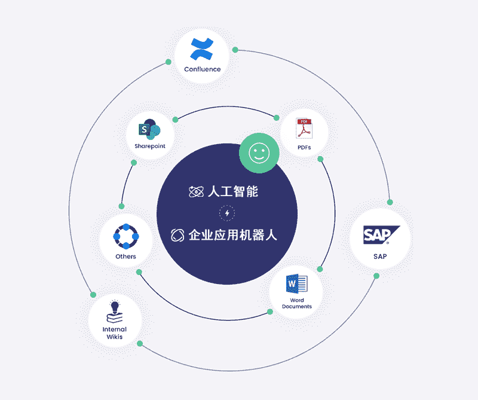
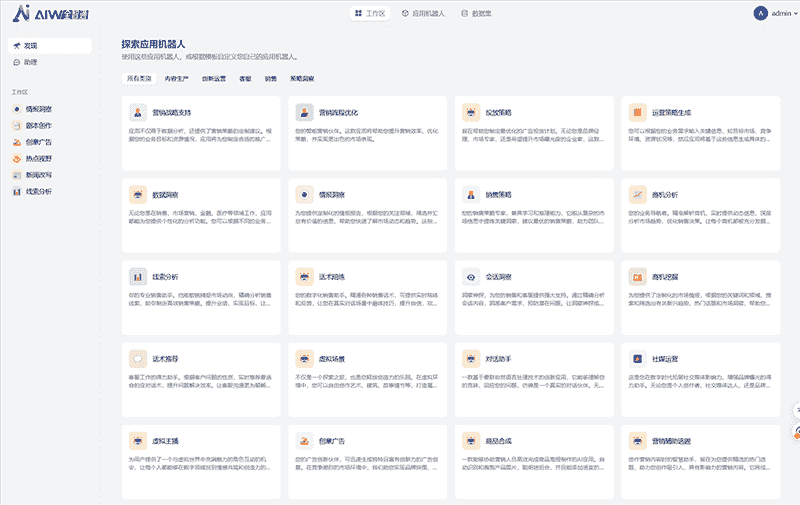

# 2023-08-14【代理】借助AIW全智通实现中小企业智能化工作流改造 - 广州企元大数据科技有限公司 - 企元官网

> 来源：[https://xuqiwei1986.feishu.cn/docx/J5PfdjtqhokotZxewQ7cvZoUnud](https://xuqiwei1986.feishu.cn/docx/J5PfdjtqhokotZxewQ7cvZoUnud)

> 🔗 原文链接： h[ttp://www.qiydata.](http://www.qiydata.net/sys-nd/24.html)net/sys-nd/24.ht...

>

在当前商业生态下，传统中小企业面临不断上涨的人力成本和相对滞后的工作效率，必须寻找解决问题的方法。然而，这个过程并不容易，需要一定的时间和精力，同时也需要持续不断的改进和创新。科技的飞速进步为我们打开了一扇大门，其中广州企元大数据科技有限公司自主研发的全智通(AIW)是一款以人工智能为基础的企业智能化工作管理平台，专为中小企业提供全面优化人力资源和提升效率的解决方案。

# 示例截图

借助AIW，企业可以整合内部知识，更能实现隐私保护和提供更可靠的功能，从而高效地提升企业效能，节省人力成本。在人力资源管理方面，AIW能够为员工提供全面的支持，包括员工入职、离职管理，休假申请，福利政策查询，薪酬查询以及职位发布等。此外，AIW还能为企业团队提供全面的财务和采购请求支持，并在AI营销领域的内容创作、数据洞察、客服工作、销售和运营等方面，为企业提供强有力的支持。全智通(AIW)是企业智能化的关键工具之一，具备自动化请求处理和与现有系统集成的重要功能，旨在帮助中小企业降低人力成本、提高工作效率，同时提供符合GDPR法规的数据处理和数据安全保障，轻松集成各种现有系统，让企业能够快速实现智能化工作流改造。

在过去，所有的人工智能工具对使用者的要求非常高，且输出成果无法被预期，工作过程也难以被管理。这些都成为了企业使用人工智能、将人工智能能力融入到企业的日常运营工作中的难点。而在当前商业生态下，传统中小企业面临不断上涨的人力成本和相对滞后的工作效率，也需要寻找解决问题的方法。AIW引入了应用机器人的概念，将企业的工作无限细化。然而，要进行AI训练的难度也非常高，需要通过机器学习、微调等手段进行，这并不适合中小企业使用。与其他人工智能工具最不同的是，AIW的认知三角循环机制使得人工智能在执行每一个细微工作任务时，都拥有严格训练的行业认知，使它的工作成果无限接近企业对行业的认知水平。此外，AIW提供了对人工智能机器人独特的可视化的训练方法。企业管理员只需要通过自然语言与人工智能进行问答的方式，让人工智能充分理解和复刻企业对行业的认知，从而十分简单地训练出精细化程度极高的AI应用机器人。

AIW的出现，为中小企业注入了新的活力，推动企业智能化转型的同时，也为企业打开了新的发展大门。借助AIW，中小企业可以优化工作流程、提升工作效率、降低成本，并借助其在AI营销等领域的强大功能，提升市场竞争力。中国传统中小企业可以借助AIW更好地挖掘潜力，迈向新的发展高峰。随着科技的不断加持，我们相信，中国的中小企业将会在全智通(AIW)的帮助下，以更高、更快、更强的姿态，迎接新的发展阶段，共同见证中小企业的辉煌时刻。