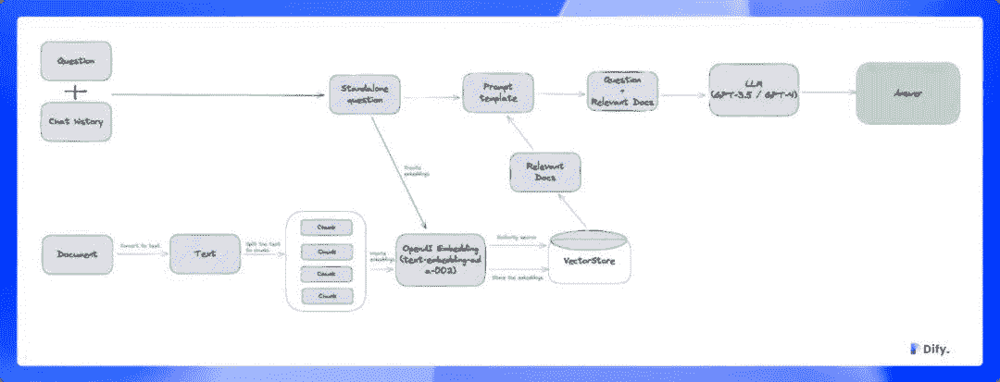
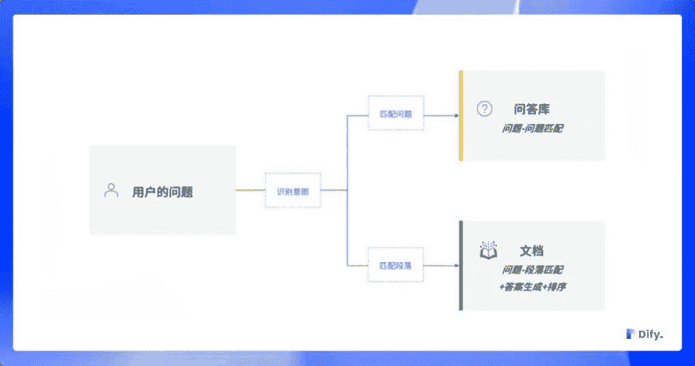

# 2023-08-01 Embedding 技术与 Dify 数据集设计/规划

> 来源：[https://xuqiwei1986.feishu.cn/docx/OSoBd8INgovHPjxJlSAccVQjnYc](https://xuqiwei1986.feishu.cn/docx/OSoBd8INgovHPjxJlSAccVQjnYc)
> 原文链接：https://mp.weixin.qq.com/s/vmY_CUmETo2IpEBf1nEGLQ

2023-08-01 09:20 发表于 上海

7 月 29 日晚，`Dify` 主创团队如约与社区朋友们线上直面交流，由 `Dify` 的数据集产品&架构负责人姜勇（Jyong）给大家分享在企业知识库嵌入 AI ChatBot 应用中最核心的 `Embedding` 技术概念和 `Dify` 数据集的设计和规划。我们还整理了本次会议中用户关心的问题，供大家阅读参考。

## Embedding 技术的文本向量化

`Embedding` 是一种将离散型变量（如单词、句子或者整个文档）转化为连续的向量表示的技术。这个向量表示（`Embedding`）可以捕捉到离散型变量间的相似性和关系。这段话听起来很晦涩，但其实它的本质是特征性的收集，将事物所有的特征进行向量化，我们可以叫它叫特征工程。

目前市面上的 `LLM` 模型的 `token` 有长度限制，尽管现在 `Claude2` 支持 100K 的 `token`，可以直接分析大约 75000 字的文本，但是其分析时间长并且 `token` 昂贵的计费，目前用户还不能接受。在性能和成本的要求之下，`Embedding` 技术应运而生。我们将文本进行分段之后转化为向量，当用户提出相关问题时，搜索的内容会转换成向量，然后在向量数据库中搜索最相似的向量，匹配最相似的几个上下文，最后将上下文组成的 `prompt` 一起提供给模型。这样不仅可以大大减少模型的计算量，提高响应速度，更重要的是降低成本，并丰富了模型的知识库。

## Dify 的数据集模式设计与规划

从数据集的整体模式出发，`Dify` 有如下的设计：

将文本进行自定义分段，用户自定义分隔符以及 `token` 大小，将文本分成多个串。`Dify` 目前用的是 `ada002` 模型，用户文档进行 `embedding` 后存入向量数据库。当用户在 `App` 端提问时会带着他的问题和上下文组成新的问题，然后匹配向量数据库里相似的段落，将这些内容组成 `prompt` 传到 `LLM` 并输出标准的回答。

`Dify` 数据集工作模式分为以下两种方式：

+   `Dify` 最近刚上线的 `Q2Q` 匹配模式，可大幅提高数据命中预期。用户提出的问题会匹配到数据集里问题和段落，数据集基于用户的文档分成若干个分段，内容以 QA 形式储存在向量数据库。用户的问题会与在向量库数据库里的问题进行相似度对比，完成后将匹配得到的答案直接返回给用户。问题和问题的匹配不管从语义还是从整体文本上都十分准确，这样可以很大程度提升文本的搜索精确度。这个功能的使用场景更适用于一些常用高频问题的回答，用户提出的问题需要在问答库里才能匹配到，问题和答案的具体内容可以进行动态调整。

+   将文档段落直接存入 `Dify` 的线上数据库。用户提出的问题直接在文档中命中了一些段落并返回至模型生成回答。由于用户短小的问题需要匹配一整段文档，召回率存在问题；文档窗口的切分可能会导致上下文语义的丢失。`Dify` 现在支持分段的编辑，用户不需要的文档内容可以做一些动态的调整。

关于 `Dify` 数据集功能的规划：

+   基于 `App` 对话的数据集收集：`Dify` 将整理高质量的回复，将文本作为做 `QA`（问答）的切分。这会在 `App` 端聊天时起到缓存的作用，优化性能和减少与 `GPT` 的交互所需的 `token` 成本。

+   多模型兼容：`Dify` 计划能够支持多种不同 `LLM` 的返回值。通过记录和缓存来自不同模型的回答，兼容多个返回值。如某一个问题 `GPT4` 的回答更好，就可以缓存到数据集里，用户在用 `GPT3.5` 提问相同问题的时候，就可以命中这个数据集并直接返回 `GPT4` 的回答。这样就可以形成针对用户自己或特定垂直领域的小型训练集，实现 `QA` 数据集到用户使用场景的闭环。

+   向量数据库优化：在向量数据库中，为了进行正确的搜索和匹配，每个 `connection` 的 `embedding` 必须具有相同的维度。搜索时，用于相似度对比的 `embedding` 和数据也必须属于相同的维度。目前市面上的一些向量数据库在 `connection` 管理和 `partition` 管理方面尚未实现相关功能。为此，`Dify` 计划对向量数据库进行优化，主要包括 `collection`（集合）的管理和 `release`（释放）方面的内存优化。通过这些优化措施提高向量数据库的性能和效率。

## QA 问答环节

**Q1：** 数据集现在支持 `Q&A` 分段模式和文档模式，这两个模式能不能同时或链式的去用？（开启 `Q&A` 分段模式功能的 AI 客服索引到数据集里的问题答案后，是否可以再去文档里延伸。）

**A1：** 基于 `Dify` 现在的模式，如果数据集都是绑定在同一个 `App` 里，在提问的时候可能无法区分用户需要命中的数据集，假设有 AB 两个数据集，用户提出的第一个问题想从数据集 A 里（`Q&A` 里）提取出来；第二个问题想从数据集 B 里提取，这其实是数据集选择的问题，`Dify` 目前通用聊天框里有 `Agent` 的设计，后续可能会考虑支持数据集内容调用。

**Q2：** `Dify` 在文本分块后续会不会有更精细和多功能的支持？（比如有很多产品型号的手册文档，在上传切开后切成了五段，那第五段可能 AI 就不知道该产品的名称了。）

**A2：** 这个问题 `Dify` 在 `Notion` 方面做的优化是将一级标题和标题栏放在内容侧的前端。例如，如果某一级标题下有二级标题的内容，我们会把它放到所有二级标题的内容下的分段里。数据集的编排不是简单依赖程序进行，更多地需要人为参与。我们现阶段建议用户提供高质量的物料。`Dify` 用来测试的文档内容经过了人工调整后再分段依然保持高质量状态，我们使用了自定义分隔符来处理分段问题，以保持文档内容的有效性和连贯性。

**Q3：** 数据集上传文档不支持 Word 的原因是什么？

**A3：** `Dify` 目前主要支持一些文本格式，但对于图片等内容的解析尚未实现。这是因为 Word 文档可能包含各种复杂的格式和图片，而我们目前的重点是针对用户的痛点进行优化，主要集中在文本内容的识别，常用的文本格式有：`TXT`、`Excel`、`PDF`、`HTML` 等，这些文本属性包含了大部分用户常见的使用场景。随着功能优化的进行，我们将逐步加入更多的支持格式。

现阶段我们正在规划将 `Web` 页面导入的功能，用户可以通过 `URL` 直接导入页面，我们会对页面中的所有文本进行识别，在后续的迭代中也将逐步增加更多功能。

**Q4：** 在选择多个数据集后，推理过程具体使用哪个数据集是通过描述来确定的，想了解这样设计的原因，如果用户修改了 `prompt` 会不会导致后续数据集的命中出现问题？

**A4：** 在 `Dify` 现在的数据查询模式中，我们将数据集视为一个工具进行使用，但是选择使用哪个工具是通过用户描述来进行选择的。举个例子，如果你有三个数据集，想查询这三个数据集的结果，会有时间成本的问题。我们最初的设计是对每个数据集进行循环遍历，但这样的效率会非常低。因此，我们现在的做法是将用户对于数据集的描述作为是否使用该数据集的依据。（例如，如果你有三个数据集，第一个数据集描述的是乔布斯，第二个数据集描述的是库克，第三个数据集描述的是雷军，当你问关于乔布斯的问题时，我们会根据你对乔布斯的描述进行匹配。如果你对乔布斯的描述错误地写成了库克，就可能会匹配到库克的数据集而不是乔布斯的。）

所以目前我们的命中策略还比较依赖于用户对数据集的描述，这使得数据集的描述变得非常重要。我们最初考虑将整个文档进行总结，为用户生成一个更好的描述，但是这样做会增加较大的计算成本，因为这相当于对每个段落进行迭代和总结，消耗的 `token` 也会较多。因此，我们暂时没有在这个方向上进行进一步的优化。目前 `Dify` 的 `QA` 数据集在生成 `QA` 的过程中会解析全文，我们会在此过程中为 `QA` 数据集优先加上总结生成。

**Q5：** 命中率的有问题怎么去判断？高于多少数值的，它才是一个正确的命中？

**A5：** 目前在使用的向量数据库中，`score`（分数）的数值通常在 0.5 到 0.75 之间。对于分数的判断，一般认为大于 0.7 的分数可能是一个比较高的匹配度，较有可能是正确的命中。我们会对向量数据库进行优化，搭建一个基于向量数据库的管理平台，后续会支持 `milvus`，并会全方面考量各个向量数据库的优劣会考虑这个问题。我们将确保 0.7 或 0.8 上的数据是正确的，作为上下文推送给模型。

**Q6：** 减少维度的向量表示是为了让命中率提高，直接用图形数据库检索知识图谱会不会更好？

**A6：** 目前 `Dify` 在做测试的时候并没有考虑使用知识图谱。不同模型在进行 `embedding` 时三个侧重点（语义、聚类和文本相似度）并不相同，特征也不同。并不是为了降低维度来提高命中率，而是为了给用户提供不同的模型，为不同场景提供专属的 `embedding` 模型选择方式。有些模型对英文的支持度比较高，有些对中文的支持度比较高，也可能有些模型在专业领域如法律或医学方面的语义更好一些。所以我们提供这些专属的 `embedding` 模型选择方式，而不是刻意降低数据的维度以提升命中率。

**Q7：** 在 `Dify` 数据集里上传了文件后，点击右上角可以描述这个文件来源，这个功能以后会启用吗？

**A7：** 在 `Dify` 优化后的系统中使用数据集的字段进行问答时，系统会返回 `source` 字段，以标识回答来自哪个段落。这样可以聚焦在某几个段落上进行搜索，以提高搜索效率。我们后面会支持添加 `Web` 作为文件来源，用户提问后的回答会显示来自哪一个网站。

**Q8：** `Dify` 后续会支持开源模型吗？

**A8：** `Dify` 目前支持三种模型。我们首推的是 `OpenAI` 和 `Claude`，因为这两个模型在成熟度上表现较好。第二种是国产模型，我们正在积极与国内优秀的模型厂商进行交流，并了解他们的技术路线。

我们的模型和其他常见的开源模型（如 `LangChain` 等）有所不同，我们会对接入 `Dify` 的模型进行专门的 `prompt` 调试，以提供最佳实践。因为不同模型在处理推理和系统行为等方面的表现是不同的，我们不急于上线模型，我们希望为用户提供高质量的模型资源，所以模型调优后才会上线，如果用户没有足够的计算资源，可能无法接入某些模型或效果较差。

关于开源模型的部署方式，有两种选择。用户可以自行配置算力资源进行部署，也可以选择托管到一些云厂商（如 `Amazon`、`Replicate` 等）进行托管。

`Dify` 目前正在与 9 个模型供应商进行合作，预计最快下周五将开源模型推上去，但也可能会因其他问题而延迟。需要指出的是，目前开源模型的成熟度还不高，特别是小规模的模型在推理方面可能表现不佳，对于复杂的任务可能效果不好。因此，对于应用还在早期阶段的用户，建议先使用效果较好的模型（如 `GPT4`）搭建流程，等到流程稳定后再考虑接入开源模型。

**Q9：** 数据集现在支持的 `Q&A` 分段模式，一个数据大概会生成 20 个问题，后续可以自定义数量吗？

**A9：** 可能会，目前的固定值是 20 个。我们后续会增添一些新的功能，例如目前可能会遇到一个问题，即中英文混合的文档输入后，系统生成的回答可能是纯英文的。我们计划会对此进行优化，让用户可以选择固定生成纯英文还是生成中文的回答。此外，我们还将考虑为用户提供更多参数的自定义选项，比如选择生成特定数量的问题。这些功能都在后续的开发计划中。

+   问题生成的逻辑是什么？

    Step 1：了解并总结这段文本的主要内容。

    Step 2：这段文本提到了哪些关键信息或概念。

    Step 3：可分解或结合多个信息与概念。

    Step 4：将这些关键信息与概念生成 20 个问题与答案。

    因为我们的分段大小是 1000 `token`，经过我们的测试 20 个问题是可以完全覆盖整个分段的，当然这个也需要根据你的文本质量来看。

**Q10：** 用户的问题与数据集中的问题不完全匹配的情况怎么处理？（`Q&A` 中相似度匹配的问题）

**A10：** 我们有一个想法，当用户问了一个问题，而我们的数据集中没有找到对应问题的答案时，我们会尝试换一种方式进行反复询问，最终获取用户的意图。这种反复的推理和询问是我们设计中的一部分，通过不断的交互和改善会逐渐理解用户的意图。虽然这个方法还在讨论中，但我们认为这种反复询问和推理的方式是很有潜力的。

当然，在目前的相似度匹配值上还不能很好的做区分，后续我们会将这个匹配值进行优化，例如断定 0.9 以上的就是正确答案，以分值来进行一个段落的匹配。

**Q11：** 如果提前生成了问题和答案（`Q&A`），但答案与时间相关性强，实时性要求高，应该如何处理？

**A11：** 首先，`Dify` 现在的数据相对来说是静态的全量数据。但是在应对复杂场景的数据集方面，比如查询最近七天上架的商品或某个订单的退款记录，这样的问题就需要处理更复杂的数据流。在数据的上游，我们需要一种动态写入数据的方式，目前 `Dify` 还没有这样的功能，但将来会提供解决方案，无论是我们独立开发，还是寻求合作。

其次对于这种复杂数据，静态的数据集是不够的，可能还需要接入其他数据源，例如数据库，并采用多种方式获取数据，自动的或者是推送的。不管怎样，`Dify` 会先提供 `API`，有了 `API` 后处理这些数据就会变得相对简单。

接下来是关于数据读取的问题。当进行数据召回时，可能需要设置条件，比如在特定天数内更新的数据，或者根据特定用户 ID 召回数据等等。这些问题我们已经考虑过，目前还在实现中。类似于在 `Dify` 的应用编排中选择数据集，插入一些变量，这实际上是一项相当复杂的任务，涉及数据的写入、动态更新和读取。我们需要一些时间来解决这个问题。

**Q12：** 一个海量的数据集里有各式各样的内容，如何实现精确命中某一个文件？

**A12：** 目前在我们的数据集里面保存了一个字段叫做 `Metadata`，其中包含了 `source` 和 `name` 等信息。后续，我们可以考虑在搜索时添加一个选项，让用户指定从哪个字段中进行查询，比如从 `"Name"` 字段或其他字段中进行搜索。这可以通过丰富 `Collection` 中的 `Schema` 来实现对数据的 `filter`，从而提升查询的精确度和速度。实际上，这个功能可能是易于实现的，但是 `Dify` 一直秉承简单且高效的用户体验，所以对于这个交互方式，我们还需要思考在哪里让用户进行输入 `filter` 的设定。

**Q13：** `Dify` 最近的智聊模块可以设置 `API` 去对接 `Google` 和维基检索，以及链接解析，但这些检索的都是公网的知识，如果我要从集团内网的知识库去做检索该怎么实现？可以通过对接流程编排引擎吗？（当我需要对接第三方的知识时，比如：会议系统等不在 `Dify` 平台本身兼容的系统时，我是否可以使用流程编排引擎，根据业务逻辑来处理数据的来源和编排，最后再将数据回传回来。这样可以更友好地实现内网数据与实时数据的联动。）

**A13：** `Dify` 肯定要实现 `Agent`，无论是预编排还是自主 `Agent`，这可能需要找到最佳实践的过程。智聊不仅是为了提供用户使用，也是我们用来搞清楚各个技术边界的工具。智聊后续要做两件事。

第一，我们要定义 `Dify` 每一层的开放标准，包括模型驱动，比如搜索等。开放的形式有两种：一种是让用户用外挂代码的形式进入，另一种是类似于 `OpenAI` 官方插件的形式，如 `Swagger` 标准的 `API` 格式等等。可能会有一到两种开放形式，如流程编排引擎等。

只要提供标准 `API`，接入是相对简单的。所以这些计划都建立在 `Dify` 产品的早期功能验证基础上，我们会设计最佳结构，然后逐步下放到应用编排或 `Agent` 中，这可能需要几周。最终一定会出现大家理想中的功能。

`Dify` 非常欢迎大家积极参与，无论是在本周六的会议中，还是在🛰️群里描述你的需求。我们会很乐意帮你解决，设计最佳方案，并尽快在产品中推出类似的功能。

**Q14：** 我们在集团部署了 `Dify`，并尝试让用户使用，但目前不可避免的问题是，一旦我们向外开放，用户上传数据时可能没有足够的安全意识。这可能导致他们将集团内部的敏感数据上传到数据集中，进而有可能将这些敏感数据暴露给 `OpenAI` 或外网。因此，我之前看过你们的代码，有一个想法，是否可以在 `Dify` 中加入一个预制的模块，用于内置规则。在进行数据分片生成后，对每个分片根据预先设定的敏感度标准进行评估，将被认定为敏感的数据默认标记为红色，以特殊状态标识出来。你们认为这个想法有机会实现吗？

**A14：** 可以，这其实是一个敏感数据的识别问题，目前我们的团队近几个月来重心一直放在技术和工程设计上，希望达到最佳状态。在企业落地和深度应用这块，我们可以帮您做审计、策略和添加用户权限或角色等，这些都属于解决问题的方案。在目前的解决方式中，最快的方法是在上传数据集或分段之前进行预先检查。您可以提供一个地址或接口进行检查，通过检查后再进行数据上传，可以通过我们预留的位置完成这个步骤。

最后，感谢大家参与本次讨论。关于 Dify 最新版本的一项额外事项是我们对 Dify 进行了 License 的修改，这对商业使用可能有一些影响。在开源策略上，我们是 Apache 协议，总体上比较宽松，但有两个限制。第一，如果您计划将 Dify 用于多租户业务，则需要与我们联系以获得商业授权。第二，如果您是企业内部使用或对限制有疑问，如在控制台中移除 Dify 的 logo，您需要与我们联系以获得商业授权。根据用户的情况，比如您是一个早期的创业项目或者是一家大型企业具备长期合作的支付能力，我们可以根据情况提供特殊的免费或低成本授权。另外，您可以通过其他方式参与和帮助 Dify，我们也很欢迎，将酌情提供授权。

接下来 Dify 会推出许多插件，其中一部分会免费开源，而另一部分插件因涉及较为复杂的工程，将会收费。另外，我们允许开发者自己开发插件接入，正在探讨和补充这方面的事情。

对于 Dify 的商业用途或者产品有任何疑问，欢迎与我们联系，您可以在我们的用户群里与我们交流。

> PS：如您需要咨询商业化授权相关事宜，请通过邮箱 business@dify.ai 与我们联系。

---

## 往期产品更新 & 最佳实践

[Dify.AI 接入 Claude2 模型：支持 100K token 上下文，登录即免费获得 1000 次消息额度](http://mp.weixin.qq.com/s?__biz=Mzg5MDkyOTY3NA==&mid=2247484669&idx=1&sn=c19206507d0d2d6fd1042090e48713e1&chksm=cfd45398f8a3da8e25e1030dbd1f809c08978a287d5d7c19442ea54c7dc2b1d92a5f0067b482&scene=21#wechat_redirect)

如何利用 AI 在 5 分钟批量产出 100 篇 SEO 文章？

如何在几分钟内创建一个带有业务数据的官网 AI 智能客服？

## 如果你喜欢 Dify，欢迎：

- 在 GitHub 上贡献代码，与我们一同共建更好的 Dify；
- 通过线上线下活动、社交媒体向你的朋友们分享 Dify，以及你的使用经验；
- 在 GitHub 上给我们点亮⭐️。

你也可以联系 Dify 小助手，加入我们的好友群聊，相互分享使用经验：

