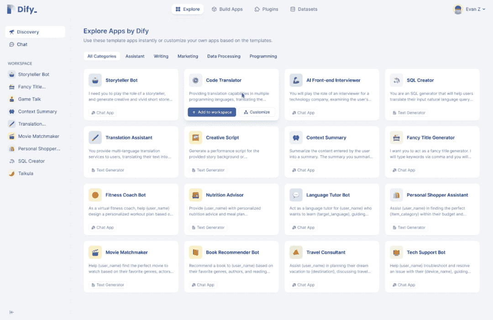

# 2023-07-25Dify 产品规划与 LLM 应用落地常见问题

> 来源：[https://xuqiwei1986.feishu.cn/docx/AsHfdUjwfoq5l6xPZZmc58Obnrf](https://xuqiwei1986.feishu.cn/docx/AsHfdUjwfoq5l6xPZZmc58Obnrf)

> 🔗 原文链接： h[ttps://mp.weixin.q](https://mp.weixin.qq.com/s/5X2QAOYX3pIw8_ZZANEYFQ)q.com/s/5X2QAOYX...

>

Dify.AI Dify

2023-07-25 09:00:14

精确发文时间由壹伴提供

2023-07-25 09:00 发表于 江苏

手机阅读

> 7 月 22 日晚，Dify 主创团队和用户们临时性地组织了一场高质量的线上交流活动。交流会主要围绕 Dify 的产品规划、用户对于 LLM 的探索和理解、用户使用 Dify 过程中遇到的问题和困惑等方面展开讨论。相信对所有基于 LLM 或 Dify 创造应用的小伙伴们都能提供很好的思路和借鉴。错过的小伙伴看这里，我们整理总结了相关的问题和讨论要点，供大家阅读参考。（ Question 部分为不同用户提出的问题，Answer 部分为 Dify 团队的理解和答疑。）

# **关于 Dify 产品规划**

Dify 产品上线以来受到很多开发者朋友的关注和喜爱，在平台上已经创建了 3 万多个应用（仅云端版），我们希望能在产品能力上不断去满足用户的应用场景需求，让大家能够真正将应用落地到实际的业务和工作中。Dify 创始人张路宇首先同步了大家最关心的 Dify 近期重点的产品规划：

### **关于模型支持**

目前**已支持的主要是 OpenAI 系列和 Claude 系列模型，测试下来相对**效果最好所以优先支持。其他模型还没有到能投产的程度或者因为合规等问题所以暂时还没有支持。考虑到用户对不同模型的兴趣， 我们下周会加入一批新模型，包括商业模型像阿里通义、文心一言、讯飞星火认知等，以及开源模型像 LlaMa 等，当然，Dify 也会尽量兼容用户自建的模型， 大家可以去托管到 Hugging Face Hub，Dify 后续都会支持接入。

**插件生态规划**

**目前市面上**插件**的方案有很多种**，** Dify  总**体上 **会 支持自有平台的原生插件和** ** OpenAI  标准**的外部插件 。 现在热门的插件如联网插件，包括国内安全合规审查相关，也将作为我们原生插件做进去。 现有的数据集功能也有机会作为原生插件。 我们最近会上线 一个通用的  Agent Chat  模式，用于调插件和实现团队内的协同 ， 编排功能可能在之后进行调整。

**Q1：有没有考虑做个应用市场 ，让用**户 可以公开发布 或 投票其他人的应用？

A1： **D**ify 的定位是技术栈服务商并不专注于应用市场，其使命是降低应用开发门槛、提升开发效率，与一般的应用市场有显著区别。 我们在国内看到有很多应用市场和应用导航，但是合规的风险很高。目前来看都还没到应用市场成熟的阶段，Dify 愿意把一些好的应用及制作的模板分享出来。

Q2：即将上线的 Agent 是什么样子的？

A2：将分几个阶段推出:

第一阶段是工具版，主要是调用工具，可以上网搜索、调用 API 等，会在 Workspace 的通用应用中优先上线一个 demo 版。

第二阶段计划是自主 agent ，类似 AutoGPT ，我们2月份就已经研究过这个了，概念上很有意思，但是由于不能投产，计算资源消耗很大、实际应用效果仍需验证等，所以暂时不会优先推出。

Q3： 我们以个人身份去申请 LLM 模型 API  并不容易，Dify 能否 提供额度购买服务？

A3： D ify 预计会在产品界面提供 OpenAI 和 Claude 模型的使用额度购买渠道，用户购买完成后系统会自动充进去，第二种情况是有一些开发者已经在国内各种渠道买了代理的 key，这个我们也会支持。

# Dify.AI/LLM 落地使用问题交流

> 交流会上 Dify 团队还就近几个月来用户在使用 Dify 落地应用过程中遇到的问题进行了深入的讨论和交流，为方便阅读，以下内容通过 Q&A 的方式进行了整理。

**Q1：数据集 分段 功能何时可以进行**更精细手动调整？能否实现自定义分割边界？

A1：Dify 的分段规划是需要做比较大的调整。我们做 Dify 的初衷很重要，现有模型的技术阶段的微调可能不是大部分用户能直接用的东西，那么 Dify 的思路就是一开始就把embedding、数据集这块儿作为重中之重去做了，也是大家用的比较多的功能。因为我们是一个开发者产品，或者说 toB 的产品，我们要求这个内容是可控、精准的。未来大量的 PDF、网页的各种数据源都会接进来，这必然就会需要对分段进行非常精准的调整，最近我们一直在优化（比如像数据库的算法）。但是对大家来说可能更紧迫的问题是，如果你有一个 10 万字的文档，系统有策略帮你做了预清理之后，帮你查分成 1000 段，可能是 300-500 字的字段，但是这个明显还达不到大家想要 AI 回答的效果。关于这个问题，我们现在是有两套解决方案正在做：

1、 **Dify 即将会 支持 ** **QA ** **型的数据结构 **， 也就是说假设用户把文本上传后会被分成 1000 段，系统以后再帮你生成 10 个或者更多的 QA 对，那么这个 QA 对生成后，基本上就能涵盖用户会问的问题，大模型在做 embedding 和匹配的时候，就能拿着问题去匹配问题，这个效果一定是更好的。同时一个段的 QA 对我们可以支持手 动编辑，这样能缓解一部分的问题。

2、我们会把大家 现在看到的分段界面重新做设计，用户可以在这个界面看到全文效果，比如在上传 PDF 之后会将鼠标划线的操作 实现 相对精细的手动分段，如果你觉得系统分段不满意 可以手动做调整。

**Q 2 ：为什么在文本生成有时会突破限制，回答与提示词不符？（如设了**一**段提示**词：要求只能回答某方面相关的问题，不能回答另一方面相关的问题。但是在和  AI  对话时， 他可能会跑偏 。）有关长期记忆的方向有什么方案吗？

A**2：大家在用任何大模型，包括 ChatGPT 可能**都会有**这样的问题**，你**下了一个指令，**我们叫预提示词， 前面 的 问题他回答挺好，后面就拐弯抹角失控了。这是由于大型语言模型的技术原理所导致的。 这些模型采用文本生成的方式，它们的回答倾向于最后看到的文字。因此，即使设定了提示词限制，模型在生成回答时还会受到先前输入的影响，导致回答可能偏离提示词的限制。目前，大部分主流模型都没有完全解决这个问题，可能需要供应商调整模型的系统级别提示词的权重或进行模型微调以改进此限制。 Dify  在未来会 采用检查和重置的方法，让机器 将之前的对话总结为一个精简的  Prompt  作为记忆，再加入系统提示词，再重新生成回答 ，以此思路改进此问题。 但其中会有很多细节的工程问题，我们做 Dify 这个产品希望尽可能让大家在做应用的过程中减少这些工程化的工作，因为这里的最优解和最佳实践都是反复的实验出来的结果，不是说我们有现在有固定套路，因为每一个模型都会不太一样。

长期记忆按生命周期有几种，第一是在整个的对话生命周期里边，第二是固定到用户上，第三是我们在数据集里面可能会接下来去加一些筛选条件，如果你数据集很大，可以根据这个用户的 ID 分类或者订阅的商用产品去查数据，类似 circle 里面的 where 语句。

**Q 3** ：为什么 Dify 只有一个 pre-prompt 输入，不像 GPT 原生一样有 system message、user message、assistant 三个接口？为什么我在其他工具（如 ChatGPT ）和 Dify 提的同一个问题，但两边的输出会不一样？

A3：Dify 的第一个阶段是为了降低门槛，让大家觉得简单好用，所以我们把很多工程概念简化了。比如说 system 还是 user 提示词的问题，我们两边都**提**前测试好了效果，测试完后把最好的方式写进去，所以基本上你只要写一段 prompt 就可以。但是随着后面模型的细分，同一个 prompt 可能会有不同的情况。 所以 prompt 编排页面后续也会根据复杂的情况迭代高级版本，让用户能看到我们整个 prompt 的链路。

输出结果不一样的原因有两个可能，第一模型参数设置不对。第二是因为 Dify 在部分情景下，会将prompt 和数据集拼接成更复杂的 prompt，所以和你原来在其他工具测试的其实已经不是同一个 prompt 了。 这样的目的是利用数据集让回复更符合实际需求。

Q**4：在一个对话中有几个方面，第一是** ** pr**ompt，第二是数据集，第三是上下文，第四个是用户更具体的提问，那么  AI  在实际回复中，这几个方面的权重可以设置吗？

A4：现在你看到的应用编排里面确实有一堆东西。这堆东西我们有一个叫做 token 的分配比例，你说的权重在我们这叫 token 的分配比例。在一个模型有限的 token 下到底哪部分占比多，哪部分占比少，这个权重如果你想调整的话，可以通过公开的源码去查看。我们可能将来会提供这个投入分配的调整能力去提高灵活度，目前是比较简单的分装。

**Q**5：在 AI 客服这个场景应用中，怎么实现在对话中主动获取用户信息的业务流程（如：引导用户提供订单号、手机号等信息）而不会跑偏？

A5：这个一方面还是模型的问题，换成 GPT4 会更好，另一方面可以把限制写的更**清晰，把参数的温度调到最小，AI 基本上就会按照数据集回答，否则会更开放**一些。 Dify 的 Agent 发布后会有一个“人类协助对话”功能，AI 如果判断用户给的上下文不完备，在回答这个问题的时候会主动返回问题，让用户接着补充。 这个过程是 AI 反过来提问用户来补充信息，更复杂的业务流程是通过让用户在表单等地方提供信息，然后调用 API 获取这些信息后再生成回复。

**Q6：Dify 解析的是 PDF、TXT 、CSV 等文档型的数据，如果有一些同时包含文档和关系型数据的情况如上**市公司公布的财报、季报等，我想以这些数据作为一个语料，然后开发一个财经领域的应用，是否能同时支持包含文档和关系型数据呢？

A6：Dify 在最初设计时考虑过表单型数据的处理方式，但发现效果不佳，因为该方式存在冗余信息，导致命中率降低。为了解决这个问题我们考虑将 Excel 等结构化数据预处理后再进行命中以提高效果。未来我们可能会和一家擅长数据库相关工作的公司合作，我们计划与他们合作开发一个 Dify 插件，通过结构化数据的处理方式来解决数据问题。

关于用 API 调用数据库，我们之前还设计过一种语言，专门用于给 LLM 进行简短、精准的 API 调用和改进。你可以把他理解成一个压缩版Swagger，大约只有原来50%的字符长度。API 调用本质上就是拿 URL 加 Post 参数和字段注释，和写代码没有本质区别，只是语法上有所不同。如果你的模型能力不是很强，那么理论上效果不会有本质区别，所以如果能够直接通过 Dify 连接数据库，效果会比调用 API 要好。因为调用 API 存在一些问题，比如现在 AI 使用的插件会占用大量的 token ，从而导致返回结果有限且速度变慢。

**Q7：如何实现一个融合游戏并可以交互的 AI 虚拟教师产品？（计划想要实现一个 AI 虚拟教师，可以与学生文字交互并提出学习建议。后续**目标是让交互形式更丰富，如支持图片交互，根据作品给出反馈，设计个性化学习计划。最终想要将其嵌入游戏场景中，与游戏 NPC 交互来学习知识点，以提高学习趣味性。）

A7：AI 虚拟教师产品的复杂性在于涉及到多个领域的技术，包括自然语言处理、游戏开发和交互设计等。同时，大模型的应用也面临一些挑战，比如需要解决多模态的情况、长对话的处理等。因此，在实现这样的产品时，需要结合实际情况和技术水平一步步地实现功能，并根据现有技术的进展来规划和迭代产品的发展。

---

（完）

以上是经过整理的关键内容，供大家参考。虽然是在周六的晚上，并且临时性组织，但交流质量非常高，相信以上讨论的问题能带给大家启发。本次线上交流小活动也受到很多用户的支持，所以我们会不定期进行类似的学习与交流活动。让大家在 LLM 应用落地路上共同进步，敬请期待！

**如果你喜欢 Dify，欢迎：**

+   在 GitHub 上贡献代码，与我们一同共建更好的 Dify；

+   **通过线上线下活动、社交媒体向你的**朋友们分享 Dify，以及你的使用经验；

+   在 GitHub 上给我们点亮⭐️。

你也可以联系我们的小助手，邀请你到 Dify 用户交流群，相互分享使用经验：

如何在几分钟内创建一个带有业务数据的官网 AI 智能客服？

零代码，使用 Dify 两分钟接入企业🛰️ AI 机器人

[D](http://mp.weixin.qq.com/s?__biz=Mzg5MDkyOTY3NA==&mid=2247484669&idx=1&sn=c19206507d0d2d6fd1042090e48713e1&chksm=cfd45398f8a3da8e25e1030dbd1f809c08978a287d5d7c19442ea54c7dc2b1d92a5f0067b482&scene=21#wechat_redirect)ify.AI 接入 Claude2 模型：支持 100K token 上下文，登录即免费获得 1000 次消息额度