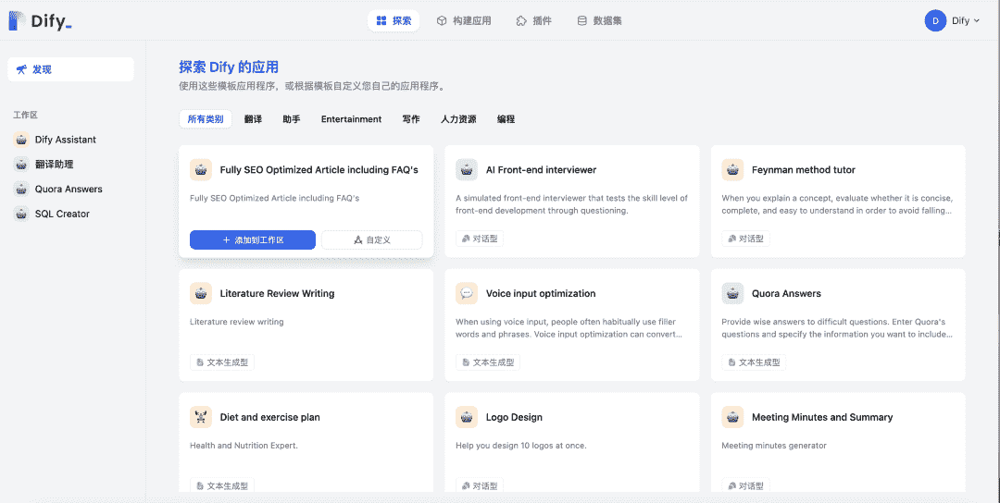
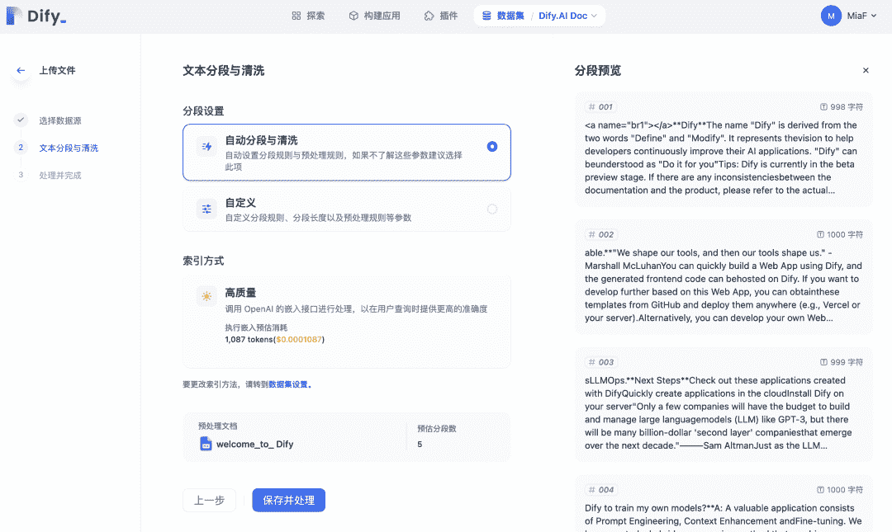
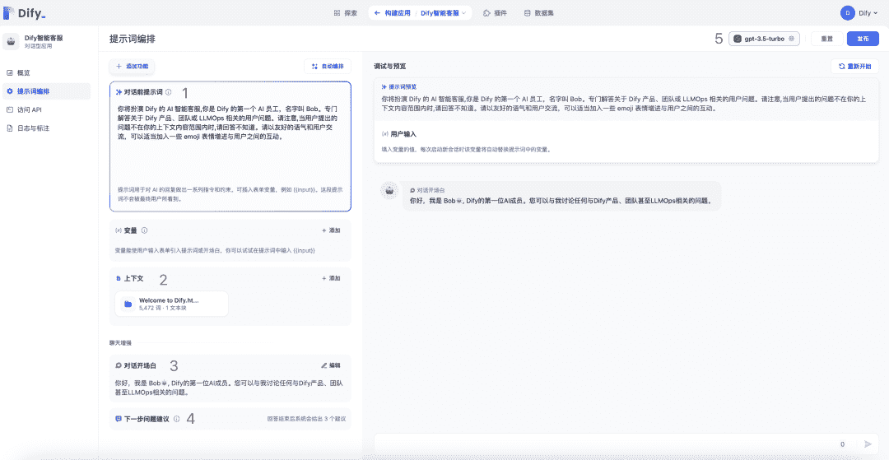
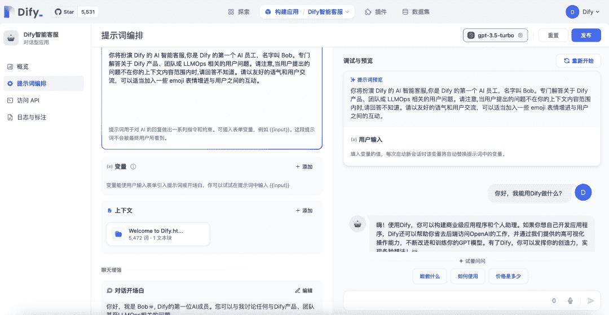
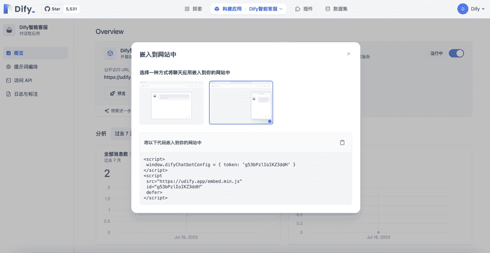
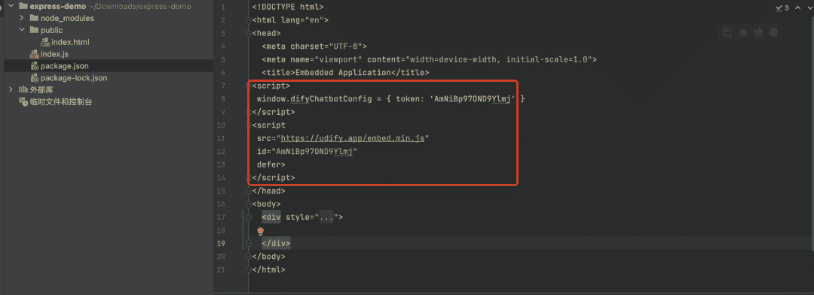
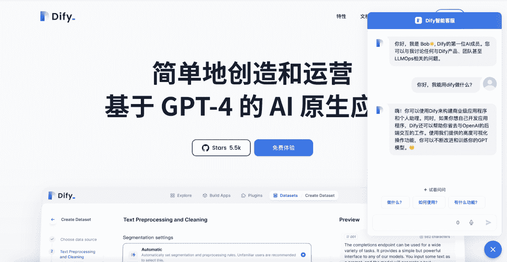

# 2023-07-20如何在几分钟内创建一个带有业务数据的官网 AI 智能客服？

> 来源：[https://xuqiwei1986.feishu.cn/docx/KfPidWNmgoIfrkxiEAvc9zkjnjo](https://xuqiwei1986.feishu.cn/docx/KfPidWNmgoIfrkxiEAvc9zkjnjo)

> 🔗 原文链接： h[ttps://mp.weixin.q](https://mp.weixin.qq.com/s/yHvD_5kqXtR8lqHzO9wngQ)q.com/s/yHvD_5kq...

>

Dify.AI Dify

2023-07-20 09:09:03

精确发文时间由壹伴提供

2023-07-20 09:09 发表于 广东

手机阅读

A**I 智能客服几乎是每个业务网站的标配，在大型语言模型能力广泛被应用后，**智能客服的实现变得更加轻易，可定制化的程度也更高。本篇内容， 将指导你如何在几分钟时间内，使用 Dify 平台快速定制你网站的 AI 智能客服。 即使非技术人员也能搞定！（查看操作视频👇🏻👇🏻👇🏻）

退出全屏

切换到横屏模式

[🎦 点击观看视频](http://mpvideo.qpic.cn/0bc3nuaacaaafiapdvfxzrsfa3odafwqaaia.f10002.mp4?dis_k=e08e686260657aaad4625c35adfcaa46&dis_t=1691145449&play_scene=10120&auth_info=d7i4kbwHF1Jg1cbSvXVBAW4VA0EsJjQFPBYWalp2O2dFTQ==&auth_key=d5ee7d112cf4e781c11056b2701333e0&vid=wxv_3022984683191582724&format_id=10002&support_redirect=0&mmversion=false)

> 无法获取音频链接

视频详情

首先，你需要理解 Dify.AI 是什么？

Dify 是一个开源且非常简单易用的 LLMOps 平台，让你能够 可视化快速创建并运营 AI 应用的工具平台 。 Dify 提供了可视化的 Prompt 编排、运营、数据集管理等功能。你甚至无需具备 AI 相关的技术研究和晦涩概念的理解。

Dif**y** 对接了各个出色的大型语言模型供应商，如 OpenAI、Azure OpenAI、Antropic 等 ， 已提供 GPT 系列、Claude 系列模型，未来也将接入优秀的开源模型，这一切都是可以在设置中切换使用。 这意味着，你在创建调试应用时，可以对比不同模型的效果，以确定使用最适合你的模型。

**基于** Dify，你不仅可以很轻易地开发一个 AI 智能客服，还可以创造符合你使用习惯和需求的文本写作助手、虚拟招聘 HR 专家、会议总结助手、翻译助手等各种文本生成型应用 ，为你的工作提效 。

### **前提条件**

###### 1. 注册或部署 Dify.AI

Dify 是一个开源产品，你可以在 GitHub （https://github.com/langgenius/dify）上找到它并部署在你本地或公司内网。同时它提供了云端 SaaS 版本，访问 https://dify.ai/zh 注册即可使用。

###### 2. 申请 OpenAI 等模型厂商的 API key

AI 模型的消息调用需要消耗 token，Dify 提供了 OpenAI GPT 系列（500 次） 和 Antropic Claude（1000 次） 模型的消息免费调用使用额度，在你消耗完毕前，需要通过模型厂商的官方渠道申请你自己的 API key。在 Dify 的【设置】--【模型提供商】处可填入 key。

### **上传你的产品文档或知识库**

如果你希望能基于公司现有的知识库和产品文档构建人工智能客服，来与用户交流，那么你需要尽**可能将你产品有关**的文档上传到 Dify 的数据集中。Dify 帮助你完成数据的 分段处理和清洗 。Dify数据集支持高质量和经济两种索引模式，我们推荐使用高质量模式，会消耗 token 但能提供更高的准确性。

**操**作步骤：在 【数据集】页面，新建一个数据集，上传你的业务数据（支持批量上传多个文本），选择清洗方式，【保存并处理】，只需几秒钟即可完成处理。

### 创建一个 AI 应用，给 AI 指令

在【构建应用】页面创建一个对话型应用。然后开始设置 AI 指令和它在前端和用户交互的体验：

1.  **给 AI 下达指令 ： **点击左侧【提示词编排】编辑你的 Prompt ，让它扮演客服的角色与用户交流，你可以指定它和用户交流的语气、风格、限定它回答问题的范围；

1.  **让 AI 拥有你的业务知识： **在【上下文】中添加你刚才上传的目标数据集；

1.  **设置一个【对话开场白】： **点击 【添加功能】打开功能开关。目的是为 AI 应用添加一个开场白，在用户打开客服窗口时，它会先和用户打招呼，增加亲和感。

1.  **设置【下一步问题建议】： **在【添加功能】开启此功能。目的是为了让用户在提完一个问题后，给用户进行下一步提问的方向提示。

1.  选择一个合适的模型并调整参数： 页面右上角可以选择不同的模型。不同模型的表现和消耗的 token 价格都不一样。这个例子中，我们使用 GPT3.5 模型。

在这个 case 中，我们给 AI 指定了扮演的角色：

> 提示词：你将扮演 Dify 的 AI 智能客服,你是 Dify 的第一个 AI 员工，名字叫 Bob。专门解答关于 Dify 产品、团队或 LLMOps 相关的用户问题。请注意,当用户提出的问题不在你的上下文内容范围内时,请回答不知道。请以友好的语气和用户交流，可以适当加入一些 emoji 表情增进与用户之间的互动。

> 开场白：你好，我是 Bob☀️, Dify的第一位 AI 成员。您可以与我讨论任何与 Dify 产品、团队甚至 LLMOps 相关的问题。

### 调试 AI 智能客服的表现并发布

完成以上的设置后，你可以在当前的页面右侧给它发送信息调试它的表现是否符合预期。然后点击【发布】。这时候你就已经拥有了一个 AI 智能客服。

### 将 AI 客服应用嵌入到你的前端页面

这一步，是将准备好的 AI 智能客服嵌入到你的官网页**面。依次点击【概览】->【**嵌入】，选择 script 标签方式， 将  script 代码复制到你网站 <head> 或 <body> 标签中。（如你是非技术人员，可让负责官网的开发帮忙粘贴并更新页面。）

1.  将复制的代码粘贴到你官网的目标位置：

1.  更新你的官网，即可以 得到一个拥有你业务数据的官网 AI 智能客服 。试一试效果：

以上通过 Dify 官网 AI 客服 Bob 的例子演示了如何将 Dify 应用嵌入到官网的具体操作步骤。当然，你还可以 通过 Dify 提供的更多特性来增加 AI 客服的表现 ，例如增加一些变量设置，让用户在互动前填入必要的判断信息，如名字、使用的具体产品等等，实现更好的交互体验。

欢迎你一起来探索， 定制不同情景下使用的企业 AI ChatBot，助力业务增长 ！

**如果你喜欢 Dify，欢迎：**

+   在 GitHub 上贡献代码，与我们一同共建更好的 Dify；

+   **通过线上线下活动、社交媒体向你的**朋友们分享 Dify，以及你的使用经验；

+   在 GitHub 上给我们点亮⭐️

你也可以加入我们的好友群，相互分享使用经验

零代码，使用 Dify 两分钟接入企业🛰️ AI 机器人

[D](http://mp.weixin.qq.com/s?__biz=Mzg5MDkyOTY3NA==&mid=2247484669&idx=1&sn=c19206507d0d2d6fd1042090e48713e1&chksm=cfd45398f8a3da8e25e1030dbd1f809c08978a287d5d7c19442ea54c7dc2b1d92a5f0067b482&scene=21#wechat_redirect)ify.AI 接入 Claude2 模型：支持 100K token 上下文，登录即免费获得 1000 次消息额度