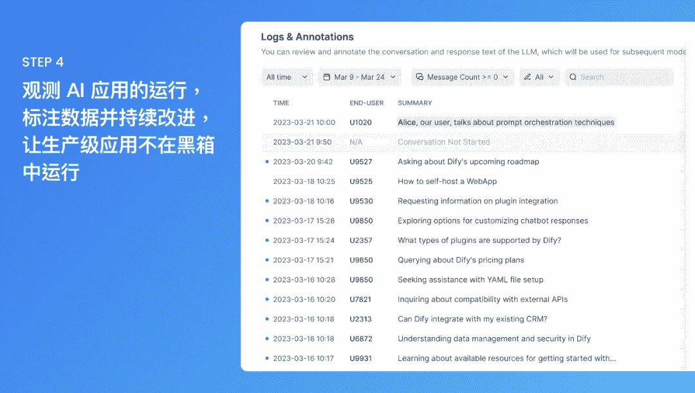

# 2023-05-10Dify.AI：简单易用的 LLMOps 平台，可视化创造和运营你的 AI 原生应用

> 来源：[https://xuqiwei1986.feishu.cn/docx/SRqFdkrzTo4TQexFic7csmjQnmg](https://xuqiwei1986.feishu.cn/docx/SRqFdkrzTo4TQexFic7csmjQnmg)

> 🔗 原文链接： h[ttps://mp.weixin.q](https://mp.weixin.qq.com/s/nysFQhTQ0Co__9DD22WcvA)q.com/s/nysFQhTQ...

>

LangGenius Dify

2023-05-10 23:22:51

精确发文时间由壹伴提供

2023-05-10 23:22 发表于 广东

手机阅读

**Dify 一词源自 ****D ****efine + Mo ****dify **，意指定义并持续改进你的 AI 应用。

随着大型语言模型（LLM）不断涌现的各种能力，AI 应用的场景变得更加广阔。然而，对于大多数开发者而言，基于 GPT 等大型语言模型、Langchain 等技术框架开发 AI 应用仍然是一项门槛极高的任务。开发者必须花费大量时间学习各种晦涩的概念和技术研究，也无法进行 AI 应用的持续运营。

是否有这样一个工具，开发者无需关注基础设施的底层原理，只需专注于将想象力转化为实际落地的 AI 应用并持续运营，可以将大型语言模型变成像云计算服务一样易于使用？

基于这个问题， Dify.AI 诞生了。

它是为你而做的（ D o i t f or y ou）。

### （PS：LangGenius 是 Dify 正式发布前的名称，本号名称和 Logo 正在更换中。）

**Dify.AI 是什么？**

Dify.AI 是一款 LLMOps 平台，帮助开发者更简单、更快速地构建 AI 应用。它的核心理念是通过可声明式的 YAML 文件定义 AI 应用的各个方面，包括 Prompt、上下文和插件等。Dify 提供了可视化的 Prompt 编排、运营、数据集管理等功能。这些功能使得开发者能够在数天内完成 AI 应用的开发，或将 LLM 快速集成到现有应用中，并进行持续运营和改进，创造一个真正有价值的 AI 应用。

**目前已支持能力：**

**01**

**可视化编排 Prompt**

通过界面化编写 prompt 并调试，只需几分钟即可发布一个 AI 应用。

**02**

**接入长上下文（数据集）**

全自动完成文本预处理，使用您的数据作为上下文，无需理解晦涩的概念和技术处理。

**03**

**基于 API 开发**

后端即服务。您可以直接访问网页应用，也可以接入 API 集成到您的应用中，无需关注复杂的后端架构和部署过程。

**04**

**数据标注与改进**

可视化查阅 AI 日志并对数据进行改进标注，观测 AI 的推理过程，不断提高其性能 。

**只**需 4 步，就可以创造一个适配各种场景的 AI 应用，例如个性化对话机器人、AI 智能客服、基于专业知识的文本生成等。

左右滑动查看更多

目 前，我们 已经 完成 OpenAI GPT 系列的支持，正在接入 Azure OpenAI Service、 Claude 、Hugging Face HubHugging Face Hub 等模型。 即将支持插件能力，释放大型语言模型的无限潜力。

**Dify.AI 来自哪里？**

Dify.AI 是由原腾讯云 CODING DevOps 团队的核心成员倾力打造。我们在 SaaS 开发者工具产品领域深耕多年。曾成功打造多款开发者协同产品，将 CODING 成功打造为国内成熟度最高、覆盖面最广、拥有数百万开发者用户的一站式 DevOps 平台。这些经验也为我们创造 Dify 这款 LLMOps 产品提供了很大帮助。

如果你对 Dify 产品及团队感兴趣，欢迎与我们交流： hello@dify.ai

**上线 36 小时...**

2023 年 5 月 9 日正式上线生产环境。尚未来得及小范围公测，只因团队创始人临时起意在社区平台发了一条动态，就此引发大量用户的自发传播。在短短 36 小时内，创建的应用数达到 1500+，开源项目 Star 超 240+ （即使我们还没有正式开源）。同时，收到了大量的用户好评与肯定。感谢社区朋友们的鼓励。

开源，创造自然涌现

我们相信，当 AI 应用无处不在，它将产生难以想象的影响力与价值，创造自然涌现。

我们即将开源 Dify ，让全世界的开发者可以参与其中。我们希望打造一个开放的生态，通过 Dify 的开源和持续发展，推动大型语言模型的普及，帮助创新者更好地创造AI 应用。

欢迎在 GitHub 上关注我们，创造你的 AI 应用：

https://github.com/langgenius/dify

点击阅读原文，开始 Dify your AI.