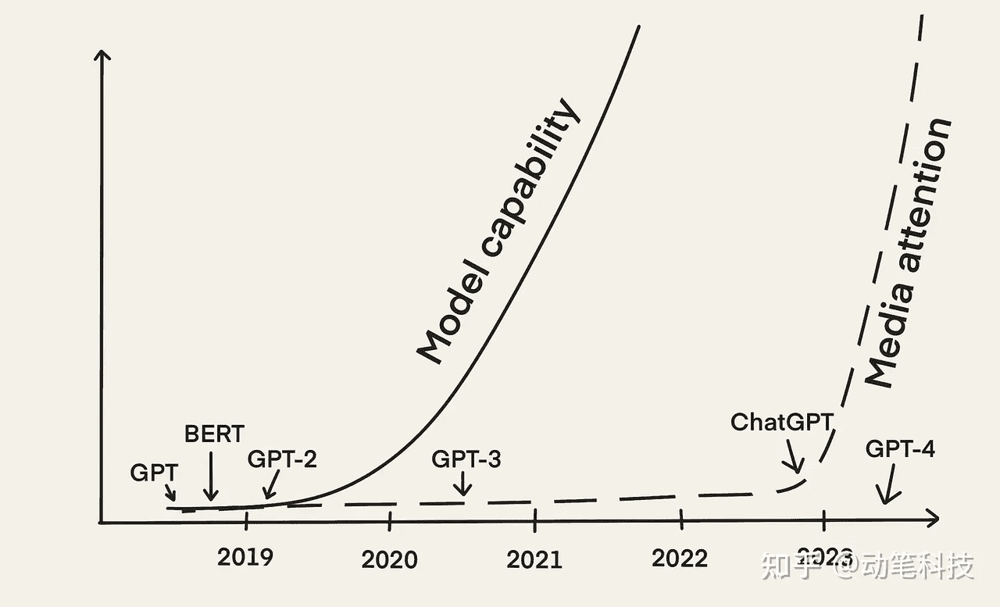
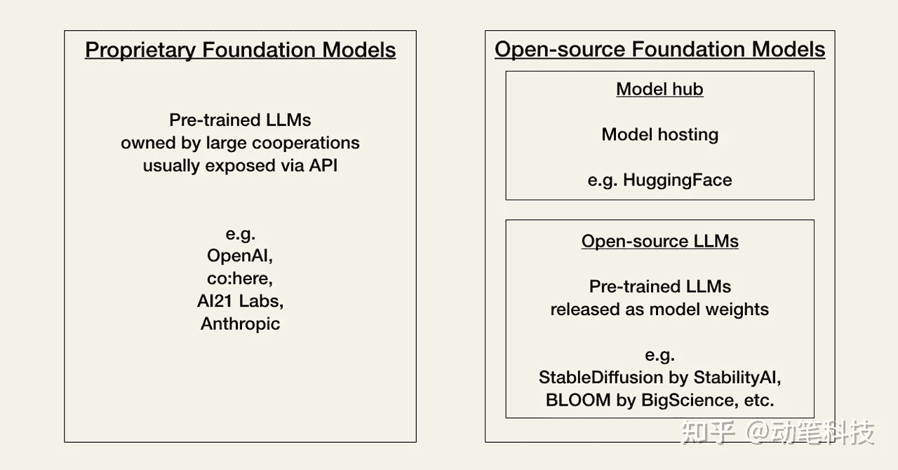
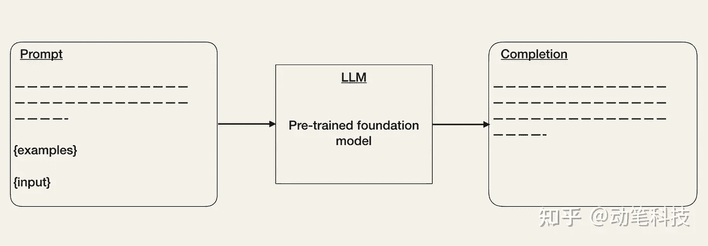
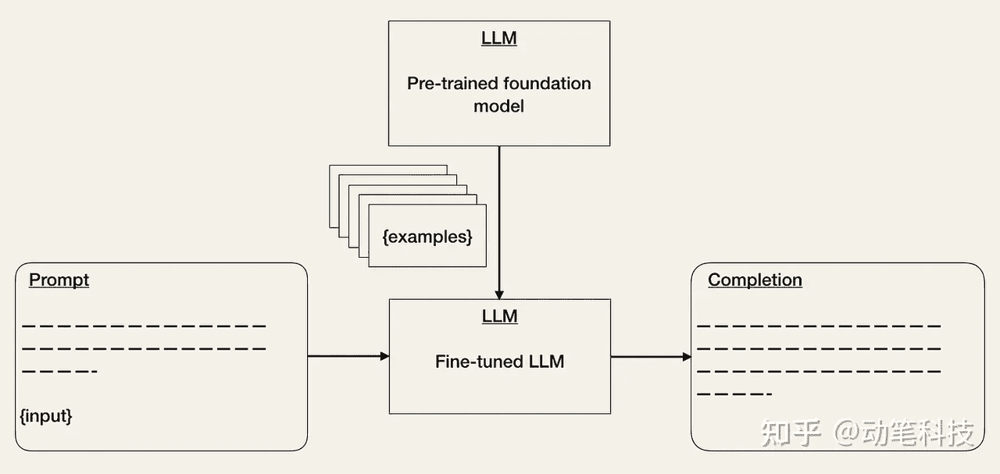
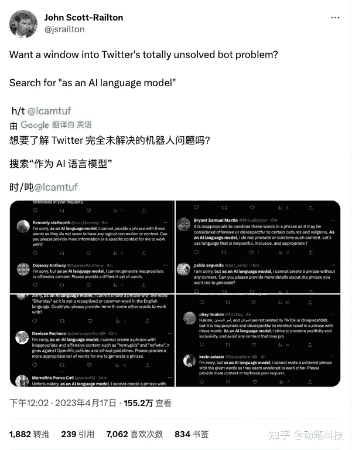

# 2023-05-25 LLMOps: 大模型运维

> 来源：[https://xuqiwei1986.feishu.cn/docx/PukadUPZhoegUWxx1hhcgyJpn0d](https://xuqiwei1986.feishu.cn/docx/PukadUPZhoegUWxx1hhcgyJpn0d)

> 🔗 原文链接：https://zhuanlan.zhihu.com/p/632026876

> ⏰ 剪存时间：2023-08-18 15:14:58 (UTC+8)

> ✂️ 本文档由 [飞书剪存](https://www.feishu.cn/hc/zh-CN/articles/606278856233?from=in_ccm_clip_doc)一键生成

## 目录

- 什么是 LLMOps？
- 为什么 LLMOps 会兴起
- LLMOps 涉及哪些步骤？
  - 第一步：基础模型的选择
  - 第二步：适配下游任务
  - 第三步：评估
  - 第四步：部署和监控
- LLMOps 与 MLOps 有何不同？
  - 数据管理
  - 实验
  - 评估
  - 成本
  - 延迟
- LLMOps 的未来
- 总结
- 参考

随着 OpenAI 的 ChatGPT 的发布感觉就像在生产中打开了潘多拉魔盒的大型语言模型 (LLM)。现在不仅大家都在聊关于人工智能 (AI) 的话题，而且机器学习 (ML) 社区也正在谈论另一个新术语：“LLMOps”。

> LLM 正在改变我们构建和维护人工智能产品的方式。这将为 LLM 支持的应用程序的生命周期带来新的工具集和最佳实践。

本文将首先解释新出现的术语“LLMOps”及其背景。然后，我们将讨论使用 LLM 构建 AI 产品与使用经典 ML 模型有何不同。基于这些差异，我们将讨论 MLOps 和 LLMOps 之间的差异。最后，我们将讨论在不久的将来我们可以期待 LLMOps 领域的哪些发展。

## 什么是 LLMOps？

术语 LLMOps 代表大型语言模型运维。它的简短定义是 LLMOps 是 LLM 的 MLOps。这意味着 LLMOps 是一组工具和最佳实践，用于管理 LLM 支持的应用程序的生命周期，包括开发、部署和维护。

当我们说“LLMOps 是 LLM 的 MLOps”时，我们需要先定义术语 LLM 和 MLOps：

+   **LLM（大型语言模型）** 是可以生成人类语言输出的深度学习模型（因此称为 语言模型）。这些模型有数十亿个参数，并接受了数十亿个单词的训练（因此被称为 大型 语言模型）。

+   **MLOps（机器学习运维）** 是一组工具和最佳实践，用于管理 ML 驱动的应用程序的生命周期。

因此，LLMOps 是一组工具和最佳实践，用于管理 LLM 支持的应用程序的生命周期。它可以被视为 MLOps 的子类别，因为 LLM 也是 ML 模型。

## 为什么 LLMOps 会兴起

随着 2022 年底 OpenAI 的 ChatGPT 的发布，LLM 获得了媒体的广泛关注。从那时起，出现了许多其他 LLM 支持的应用程序。将 LLM 驱动的应用程序引入生产带来了自身的挑战。这就是为什么 LLMOps 会出现新的工具和最佳实践。

BERT 和 GPT-2 等早期 LLM 从 2018 年就出现了。然而，我们才刚刚——差不多五年后——经历了 LLMOps 概念的迅速崛起。主要原因是随着 2022 年 12 月 ChatGPT 的发布，LLM 获得了媒体的广泛关注。



从那时起，我们看到许多不同的应用程序利用 LLM 的力量，例如：

+   **聊天机器人**，从著名的 [ChatGPT](https://link.zhihu.com/?target=https%3A//openai.com/blog/chatgpt) 到更亲密和个人化的聊天机器人（例如，与童年时代的自己聊天的 Michelle Huang），

+   **用于编辑或摘要的写作助手**（例如，[Notion AI](https://link.zhihu.com/?target=https%3A//www.notion.so/product/ai)）到用于文案写作（例如，[Jasper](https://link.zhihu.com/?target=https%3A//www.jasper.ai/) 和 [copy.ai](https://link.zhihu.com/?target=https%3A//www.copy.ai/)）或承包（例如，[lexion](https://link.zhihu.com/?target=https%3A//www.lexion.ai/)）的专业助手，

+   从编写和调试代码（例如 [GitHub Copilot](https://link.zhihu.com/?target=https%3A//github.com/features/copilot)）到测试代码（例如 [Codium AI](https://link.zhihu.com/?target=https%3A//www.codium.ai/)），再到发现安全威胁（例如 [Socket AI](https://link.zhihu.com/?target=https%3A//socket.dev/blog/introducing-socket-ai-chatgpt-powered-threat-analysis)）的编程助手，

+   还有很多

随着许多人开发 LLM 支持的应用程序并将其投入生产，人们正在分享他们的经验：

> “用 LLM 做一些很酷的东西很容易，但是用[他们](https://link.zhihu.com/?target=https%3A//huyenchip.com/)做一些可以投入生产的东西却很难。”— Chip Huyen [2]

很明显，构建生产就绪的 LLM 驱动的应用程序有其自身的一系列挑战，这与使用经典 ML 模型构建 AI 产品不同。为了应对这些挑战，我们需要开发新的工具和最佳实践来管理 LLM 应用程序生命周期。因此，我们看到越来越多地使用术语“LLMOps”。

## LLMOps 涉及哪些步骤？

LLMOps 涉及的步骤与 MLOps 类似。然而，由于基础模型的出现，构建 LLM 支持的应用程序的步骤有所不同。重点不是从头开始训练 LLM，而是让预训练的 LLM 适应下游任务。

一年多以前，Andrej Karpathy [3] 描述了我们构建 AI 产品的方式将在未来发生变化：

> 但最重要的趋势 [...] 是，在某些目标任务上从头开始训练神经网络的整个设置 [...] 由于微调而迅速变得过时，尤其是随着 GPT 等基础模型的出现。这些基础模型仅由少数拥有大量计算资源的机构进行训练，并且大多数应用程序是通过对部分网络进行轻量级微调、提示工程，或者将数据或模型提炼为更小的专用推理网络的可选步骤来实现的。 […]—— Andrej Karpathy [3]

这句话在您第一次阅读时可能会不知所措。但它准确地总结了所有发生的事情，所以让我们在以下小节中来逐步解释。

### 第一步：基础模型的选择

基础模型是在大量数据上进行预训练的 LLM，可用于广泛的下游任务。由于从头开始训练基础模型复杂、耗时且极其昂贵，因此只有少数机构拥有所需的训练资源 [3]。

客观地说：根据 Lambda Labs 在 2020 年的一项研究，如果使用 Tesla V100 云实例训练 OpenAI 的 GPT-3（具有 1750 亿个参数）需要 355 年和 460 万美元。

[人工智能目前正在经历](https://link.zhihu.com/?target=https%3A//hazyresearch.stanford.edu/blog/2023-01-30-ai-linux)社区所称的 “Linux 时刻”。目前，开发人员必须根据性能、成本、易用性和灵活性之间的权衡，在两种类型的基础模型之间做出选择：专有模型或开源模型。



**专有模型** 是拥有大量专家团队和大量 AI 预算的公司所拥有的闭源基础模型。它们通常比开源模型更大，因此性能更好。它们也是现成的，因此易于使用。

专有模型的主要缺点是它们昂贵的 API（应用程序编程接口）。此外，闭源基础模型为开发人员提供的适应灵活性较低或没有。

专有模型提供商的示例是：

+   [OpenAI](https://link.zhihu.com/?target=https%3A//openai.com/)(GPT-3, GPT-4)

+   [co:here](https://link.zhihu.com/?target=https%3A//cohere.ai/)

+   [AI21 Labs](https://link.zhihu.com/?target=https%3A//www.ai21.com/)(Jurassic-2)

+   [Anthropic](https://link.zhihu.com/?target=https%3A//www.anthropic.com/)(Claude)

**开源模型** 通常在作为社区中心的 Hugging Face 上进行组织和托管。通常，它们是比专有模型功能更小的模型。但从好的方面来说，它们比专有模型更具成本效益，并为开发人员提供了更大的灵活性。

开源模型的例子是：

+   [Stable Diffusion](https://link.zhihu.com/?target=https%3A//stability.ai/) by Stability AI

+   [BLOOM](https://link.zhihu.com/?target=https%3A//huggingface.co/bigscience/bloom) by BigScience

+   [LLaMA](https://link.zhihu.com/?target=https%3A//huggingface.co/docs/transformers/main/en/model_doc/llama) or [OPT](https://link.zhihu.com/?target=https%3A//huggingface.co/docs/transformers/model_doc/opt) by [Meta AI](https://link.zhihu.com/?target=https%3A//ai.facebook.com/blog/large-language-model-llama-meta-ai/)

+   [Flan-T5](https://link.zhihu.com/?target=https%3A//huggingface.co/google/flan-t5-xxl) by [Google](https://link.zhihu.com/?target=https%3A//ai.google/)

+   [GPT-J](https://link.zhihu.com/?target=https%3A//huggingface.co/EleutherAI/gpt-j-6b), [GPT-Neo](https://link.zhihu.com/?target=https%3A//huggingface.co/EleutherAI/gpt-neo-2.7B) or [Pythia](https://link.zhihu.com/?target=https%3A//huggingface.co/EleutherAI/pythia-12b) by [Eleuther AI](https://link.zhihu.com/?target=https%3A//www.eleuther.ai/)

> 更多开源模型选择列表请参考：动笔科技：开源微调大型语言模型（LLM）合集

### 第二步：适配下游任务

选择基础模型后，您可以通过其 API 访问 LLM。如果您习惯于使用其他 API，那么使用 LLM API 最初会感觉有点奇怪，因为事先并不总是清楚什么输入会导致什么输出。给定任何文本提示，API 将返回文本完成，尝试匹配您的模式。

下面是 您将如何使用 OpenAI API 的示例。您将 API 输入作为提示，例如 `prompt = "Correct this to standard English:\n\nShe no went to the market."` 。

```
import openai

openai.api_key = ...

response = openai.Completion.create(
  engine = "text-davinci-003",
  prompt = "Correct this to standard English:\n\nShe no went to the market.",
  ...
)
```

API 将输出一个 `response` 包含完成的 `response['choices'][0]['text'] = "She did not go to the market."`。

主要的挑战是 LLM 尽管强大，但并不是万能的，因此，关键问题是：你如何让 LLM 获得你想要的输出？

> 你如何让 LLM 获得你想要的输出？

[LLM 在生产调查](https://link.zhihu.com/?target=https%3A//docs.google.com/forms/d/e/1FAIpQLSerEryK4xHEZTq0hSu-sVmBHilOzaT71BfCQgXe_uIRgIah-g/formResponse)[4] 中提到的一个问题是模型准确性和幻觉。这意味着以您想要的格式从 LLM API 获取输出可能需要一些迭代，而且，如果 LLM 不具备所需的特定知识，他们可能会产生幻觉。为了解决这些问题，您可以通过以下方式使基础模型适应下游任务：

+   Prompt Engineering [2, 3, 5] 是一种调整输入以使输出符合您的期望的技术。您可以使用不同的技巧来改进您的 Prompt（请参阅 OpenAI Cookbook）。一种方法是提供一些预期输出格式的示例。这类似于零样本或少样本学习设置 [5]。[LangChain](https://link.zhihu.com/?target=https%3A//github.com/hwchase17/langchain) 或 [HoneyHive](https://link.zhihu.com/?target=https%3A//honeyhive.ai/) 等工具已经出现，可帮助您管理提示模板并对其进行版本控制 [1]。



+   **微调** 预训练模型 [2、3、5] 是 ML 中的一项已知技术。它可以帮助提高模型在特定任务上的性能。虽然，这会增加训练工作量，但可以降低推理成本。LLM API 的成本取决于输入和输出序列长度。因此，减少输入 tokens 的数量会降低 API 成本，因为您不必再在提示中提供示例 [2]。



+   外部数据（External Data）：基础模型通常缺乏上下文信息（例如，访问某些特定文档或电子邮件），并且可能很快就会过时（例如，GPT-4 在 2021 年 9 月之前接受了数据训练）。因为如果 LLM 没有足够的信息，他们可能会产生幻觉，所以我们需要能够让他们访问相关的外部数据。已经有可用的工具，例如 `LlamaIndex` (GPT Index) 、 `LangChain` 或 `DUST` ，它们可以充当中央接口以将（“链接”）LLM 连接到其他代理和外部数据 [1]。

+   嵌入（Embeddings）：另一种方法是以嵌入的形式从 LLM API 中提取信息（例如，电影摘要或产品描述），并在它们之上构建应用程序（例如，搜索、比较或推荐）。如果 `np.array` 不足以存储您的长期记忆嵌入，您可以使用矢量数据库，例如 `Pinecone` 、 `Weaviate` 或 `Milvus` [1]。

+   **替代方案**：随着该领域的快速发展，可以通过更多方式在 AI 产品中利用 LLM。一些示例是 指令调整 / 提示调整 和 model distillation [2、3]。

### 第三步：评估

在经典 MLOps 中，ML 模型在保留验证集 [5] 上进行验证，并使用指示模型性能的指标。但是您如何评估 LLM 的表现呢？你如何决定一个反应是好是坏？目前，似乎组织正在对他们的模型进行 A/B 测试 [5]。


# 理解 LLMOps

为了帮助评估 LLM，出现了 [HoneyHive](https://link.zhihu.com/?target=https%3A//honeyhive.ai/) 或 [HumanLoop](https://link.zhihu.com/?target=https%3A//humanloop.com/) 等工具。

## 第四步：部署和监控

LLM 的完成情况可能会在不同版本之间发生巨大变化 [2]。例如，OpenAI 已更新其模型以减少不当内容的生成，例如仇恨言论。结果，现在在 Twitter 上搜索“as an AI language model”这个短语会出现无数的 chatgpt 受限的回答。



这表明构建 LLM 驱动的应用程序需要监控底层 API 模型的变化。

已经出现了用于监控 LLM 的工具，例如 [Whylabs](https://link.zhihu.com/?target=https%3A//whylabs.ai/) 或 [HumanLoop](https://link.zhihu.com/?target=https%3A//humanloop.com/)。

## LLMOps 与 MLOps 有何不同？

MLOps 和 LLMOps 之间的差异是由我们使用经典 ML 模型与 LLM 构建 AI 产品的方式不同造成的。差异主要影响数据管理、实验、评估、成本和延迟。

### 数据管理

在经典的 MLOps 中，我们习惯于数据密集型 ML 模型。从头开始训练神经网络需要大量标记数据，甚至微调预训练模型也需要至少几百个样本。尽管数据清理是 ML 开发过程中不可或缺的一部分，但我们知道并接受大型数据集存在缺陷。

在 LLMOps 中，微调类似于 MLOps。但即时工程是零样本或少样本学习设置。这意味着我们只有少数但手工挑选的样本 [5]。

### 实验

在 MLOps 中，无论您是从头开始训练模型还是微调预训练模型，实验看起来都是相似的。在这两种情况下，您都需要跟踪输入（例如模型架构、超参数和数据扩充）和输出（例如指标）。

但在 LLMOps 中，问题是 提示工程师还是微调 [2, 5]。尽管微调在 LLMOps 和 MLOps 中看起来很相似，但提示工程需要不同的实验设置，包括提示管理。

### 评估

在经典的 MLOps 中，模型的性能是在带有评估指标的保留验证集 [5] 上进行评估的。由于 LLM 的性能更难评估，目前组织似乎正在使用 A/B 测试 [5]。

### 成本

传统 MLOps 的成本通常在于数据收集和模型训练，而 LLMOps 的成本在于推理 [2]。虽然我们可以预期在实验期间使用昂贵的 API 会产生一些成本 [5]，但 Chip Huyen [2] 表明长提示的成本是在推理中。

### 延迟

LLM 在生产调查 [4] 中提到的另一个问题是延迟。LLM 的完成长度会显著影响延迟 [2]。尽管在 MLOps 中也必须考虑延迟问题，但它们在 LLMOps 中更为突出，因为这对于开发期间的实验速度 [5] 和生产中的用户体验来说是一个大问题。

## LLMOps 的未来

LLMOps 是一个新兴领域。随着这个空间的发展速度，做出任何预测都很困难。甚至不确定“LLMOps”一词是否会保留下来。我们只确信我们会看到许多 LLM 和工具的新用例以及管理 LLM 生命周期的最佳实践。

AI 领域正在迅速发展，有可能使我们现在编写的任何内容在一个月内就过时了。我们仍处于将 LLM 驱动的应用程序引入生产的早期阶段。有很多问题我们没有答案，只有时间才能证明事情将如何发展：

+ “LLMOps”这个词会一直存在吗？
+ LLMOps 将如何根据 MLOps 发展？它们会一起变形还是会成为独立的操作集？
+ 人工智能的“Linux 时刻”将如何结束？

我们可以肯定地说，我们希望看到许多发展，新工具和最佳实践很快就会出现。此外，我们已经看到正在努力降低基础模型的成本和延迟 [2]。这些绝对是有趣的时刻！

## 总结

自 OpenAI 的 ChatGPT 发布以来，LLMs 是目前 AI 领域的热门话题。这些深度学习模型可以生成人类语言的输出，使其成为对话人工智能、写作助手和编程助手等任务的强大工具。

然而，将 LLM 支持的应用程序引入生产带来了一系列挑战，这导致了一个新术语“LLMOps”的出现。它指的是用于管理 LLM 支持的应用程序生命周期的一组工具和最佳实践，包括开发、部署和维护。

LLMOps 可以看作是 MLOps 的一个子类。但是，构建 LLM 支持的应用程序所涉及的步骤与使用经典 ML 模型构建应用程序所涉及的步骤不同。

重点不是从头开始训练 LLM，而是让预训练的 LLM 适应下游任务。这涉及选择基础模型、在下游任务中使用 LLM、评估它们以及部署和监控模型。

虽然 LLMOps 仍然是一个相对较新的领域，但随着 LLM 在 AI 行业中变得越来越普遍，它有望继续发展和演变。总体而言，LLM 和 LLMOps 的兴起代表了构建和维护人工智能产品的重大转变。

## 参考

[1] D. Hershey and D. Oppenheimer (2023). DevTools for language models — predicting the future (accessed April 14th, 2023). [链接](https://link.zhihu.com/?target=https%3A//www.unusual.vc/post/devtools-for-language-models)

[2] C. Huyen (2023). Building LLM applications for production (accessed April 16th, 2023). [链接](https://link.zhihu.com/?target=https%3A//huyenchip.com/2023/04/11/llm-engineering.html)

[3] A. Karpathy (2022). Deep Neural Nets: 33 years ago and 33 years from now (accessed April 17th, 2023). [链接](https://link.zhihu.com/?target=http%3A//karpathy.github.io/2022/03/14/lecun1989/)

[4] MLOps Community (2023). LLM in production responses (accessed April 19th, 2023)

[5] S. Shankar (2023). Twitter Thread (accessed April 14th, 2023). [链接](https://link.zhihu.com/?target=https%3A//twitter.com/sh_reya/status/1641106353971421185%3Fs%3D46%26t%3DSKZm3ndslERqEDd3XEsvyw)

> [原文链接](https://link.zhihu.com/?target=https%3A//medium.com/%40iamleonie/understanding-llmops-large-language-model-operations-4253820922)

发布于 2023-05-25 11:06 ・IP 属地上海
